# Bench Core foundation

## Routing

Select this page for the Go Bench Core under `05_Software/core/`:
the `nilo` command line (`serve`, `discover`, `open`, `admin` in local and remote mode, `network`,
`activity`, `maintenance`, `seed-admin`), the authenticated `/api/v1` HTTP routes and their
permissions, identities, sessions, API tokens and their audit events, network
operations, the simulation catalog, and the SQLite repositories. Start at
`cmd/nilo/main.go` for a command, `internal/httpapi/server.go` for a route
(the one permission table), `internal/identity/service.go` for an identity
rule, and `internal/network/operation.go` for a managed change; the focused
tests sit beside each file. The browser interface belongs to *Browser GUI
foundation*; the privileged NetworkManager helper and its system tests are in
`internal/nethelper/` and `02_Tools/tests/network/`, and the appliance
verification stage's proof is `cmd/nilo/appliance_stage_linux_test.go`, run by
`02_Tools/tests/appliance/`; the Python integration packages belong to
*Integration platform*. Physical Camera records and capture are mapped in
[Camera integration](camera-integration.md); appliance Network operations and
commissioning are mapped in [Appliance Network](appliance-network.md).

USB serial terminal, connection and log changes route to
[USB to Serial integration](serial-integration.md).

## Purpose and boundaries

The Go Bench Core owns validated configuration, immutable operation state, identity and access control, policy and approvals, durable sessions and evidence, application startup reconciliation, and the authenticated HTTP boundary. It exposes read-only Network MCP tools; live interface networking and WireGuard readiness use a separate privileged NetworkManager helper; managed instrument operations use the bench integration service.

Two authorization decisions live here and stay separate. `identity.Service` decides whether an actor may *request* an action, from its fixed role and the scopes of the API token in use. `policy.Resolver` decides whether an operation may *run* without a human approval, from the integration app's declared operation policy. Neither the Administrator role nor a fully scoped token touches the second decision.

Managed plugin lifecycle, asynchronous instrument jobs and the `plugin`/`bench`
CLI groups route to [Managed bench integrations](bench-integrations.md).

## Public interface

`nilo network` calls the authenticated `/api/v1/network` interface for status,
statistics, interfaces, WireGuard, device networks, the operation listing and
separate operation acknowledgement, confirmation and rollback. `/mcp` offers
three network read tools over the same service, plus the configured Bench and
Camera tools when the integration manager is available. WireGuard reads expose safe
metadata only.

`nilo admin password-policy` reads the appliance password policy with no values
given, and replaces it when given a minimum length and `--require` naming the
classes a password must carry, or `none`. It is remote mode only: the policy is
the appliance's, and the appliance authorizes the token and applies the rule on
every request.

`nilo admin user|token` run in exactly one of two modes: local (`--data-dir`,
write access is the authority, `--actor` is attribution, no deletion) or remote
(`--server` with `--token-file`, an ordinary `internal/apiclient` client of the
identity administration routes, where the appliance authorizes the token on
every request and `user delete` / `token delete` exist behind a typed
confirmation or `--confirm-delete`). Ambiguous or incomplete mode options exit 2
before anything is opened or contacted. The root usage names every group.

`cmd/nilo` provides version reporting, the `serve-foundation-check` composition smoke command, development token issuance, the `nilo admin` local and remote administration commands, the `network` and `activity` API clients, and explicit simulation/appliance servers. Protected HTTP contracts provide login, logout, the current session, status, deterministic integration and device inventory for the selected simulation scenario, and the identity and token administration routes the browser Authentication page drives. Physical cameras enter inventory through the managed Camera integration. Internal consumers compose the foundation with `app.Open` and authorize through `app.IdentityService()`, submit work through `operation.Service`, resolve policy through `policy.Resolver`, and use the narrow repository interfaces owned by the domain packages. Only a starting server composes with `app.New`, which is `app.Open` followed by startup reconciliation; every other command opens the appliance without touching the operations recorded in it.

`nilo discover` merges validated mDNS and SSDP records by appliance UUID and
emits a stable table, JSON record or printable label; `nilo open` and remote
commands resolve only a uniquely discovered serial or friendly name. The
appliance routes expose authenticated public identity/About facts, label,
friendly-name mutation and session-only Identify, while a separate literal
loopback listener exposes only local status and the same printable label.

`nilo maintenance` supplies the package-owned migration, inventory,
snapshot/restore, remove and confirmed purge boundary. Snapshots checkpoint and
integrity-check SQLite, bind application/schema versions, preserve Linux
ownership, modes, ACLs and xattrs, and restore by an atomic whole-directory
exchange. Removal asks the root helper to delete only exact durably owned
network resources; a possible active management tunnel is retained without
local confirmation. Confirmed purge first retains a verified sibling backup.
`nilo seed-admin` consumes a bounded root-owned password file and removes it
only after durable creation or confirmation of the same enabled administrator.
Packaged first boot preserves the image's root-owned mode-`0600` source, copies
it through a root one-shot to an ephemeral `nilo`-owned mode-`0600` handoff,
and runs the same command as `nilo`; the root source is deleted only after that
handoff is consumed. Portable snapshot restore places a sibling exclusion
marker before releasing its internal lock and reverses a partial three-rename
exchange before another maintenance operation can observe it.

## Invariants

- Every protected route declares its permission in `server.go` or `bench.go`; the command
  line is an API client and adds no authorization or identity rule of its own.
- A token's permissions are its owner's current role intersected with its
  scopes, resolved from stored state on every request.
- No credential is accepted on a command line: tokens come from `--token-file`,
  passwords from standard input; no response, log, audit event, export or error
  message carries a password, secret or verifier.
- An identity change and its audit event commit in one `BEGIN IMMEDIATE`
  transaction; one enabled administrator always remains; a refused change
  leaves the subject untouched. A password policy change commits the same way.
- The appliance holds one password policy - a minimum length and four
  independent class requirements, for a lowercase letter, an uppercase letter, a
  digit and a character that is neither - applied wherever a password is set and
  never where a stored verifier is checked, so tightening it leaves every
  existing identity able to sign in. A refusal names every requirement the
  password missed. A configured minimum may go no lower than the compiled floor
  of 8 bytes and no higher than the fixed maximum of 1024; an appliance with no
  recorded policy applies a minimum of 12 requiring no class. The maximum is not
  policy: it bounds the Argon2 work an unauthenticated login attempt can ask for
  and holds on both paths.
- Permanent deletion is explicit (typed confirmation or `--confirm-delete`),
  distinct from disable and revoke, and every attempt, applied or refused, is
  on record with labels that outlive the row.
- Network changes go through preview, acknowledgement, confirmation and
  rollback; a noninteractive mutation needs `--acknowledge`, which is never
  consent for anything else.
- Maintenance removal and purge delete helper resources only when durable
  ownership and the live exact object agree; foreign or failed resources remain
  and are reported for retry. An active management tunnel requires local
  confirmation before deactivation, and application purge requires a verified
  recoverable backup before state deletion.
- Snapshot restore verifies all content and metadata before constructing a
  complete fsynced sibling state tree and atomically exchanging the whole data
  root. A partial tree is never exposed as the active application state.
- Whether a network interface may carry appliance management access is decided
  from what a provider observed about the hardware - the device kind, a physical
  adapter observation and the permanent adapter identity - and never from the
  interface name. A reading that carries no hardware observation is ineligible.
- The appliance records exactly one commissioning lifecycle state, `provisioning`
  or `commissioned`. It is seeded by the schema migration that creates it and
  read on every open; an absent or unrecognized value stops the start rather
  than resolving to either state.
- While the appliance is provisioning, the management allowlist is every
  eligible physical interface currently present, recomputed on each reconcile
  and persisted. Once commissioned, the persistent allowlist is the configured
  set alone. A Pi hardware request may add one non-persistent, deadline-bounded
  recovery interface without changing that record.
- The privileged helper publishes only process-owned Avahi D-Bus entries. It
  receives validated host/service/alias values and interface lists, never raw
  responder configuration, and does not replace daemon policy. Permanent
  discovery uses the printed serial host and version-2 DNS-SD service; recovery
  and friendly aliases are separate per-interface groups, so an alias collision
  cannot withdraw the serial service. An exact Avahi global-host match reuses
  its record; a preserved custom system hostname receives a no-reverse serial
  alias. SSDP follows the same effective management interfaces through a
  separate typed helper lifecycle, refreshes before expiry, republishes when
  helper state is lost even if desired state is unchanged, jitters searches by
  MX, bounds pending replies globally and rate-limits each interface/source
  pair. Helper status remains current only while every receive loop is alive and
  each published IPv4 address is still assigned to its interface.
- A friendly-name collision returns only the validated candidate and a sorted,
  deduplicated, interface-validated list capped at 16 entries. The helper wire
  preserves that typed scope, the HTTP boundary sanitizes it again, and failed
  publication leaves the permanent serial and previous friendly name usable.
- Every label QR uses the exact advertised permanent-name HTTPS URL, including
  a non-default management port, and refuses another host, credentials, query,
  fragment or invalid port. The shared SVG renders a 27 mm QR within a fixed
  62 by 29 mm print footprint and uses a larger pixel preview on screens.
- Authenticated status reports the project build plus a bounded host snapshot:
  Linux release, kernel, architecture, and free/total bytes for the filesystem
  containing NILO data. It exposes no filesystem path, mount inventory,
  hostname, process list or other general-purpose host inspection surface.
- Raspberry Pi button events are stored by the helper before exposure with the
  release time; recovery-duration events additionally carry the connected-link
  snapshot while reset events do not. Events are coalesced with reset precedence
  and acknowledged only after core handles them. Nonterminal recovery ownership
  is restored before a later event; an idle highest-generation tombstone stops
  acknowledgement failures from replaying an action. A long press atomically changes the live
  lifecycle and management admission to provisioning without restarting the
  process or touching identities, credentials, TLS, audit, integrations, or
  device configuration. For a recovery-duration event, already-connected-link
  refusal audits complete before core persists the handled generation, so an
  audit failure leaves the helper event available for a safe retry.
- A GPIO read discontinuity cancels the gesture in progress and requires a
  stable released baseline before another press. Recovery-profile
  restoration proves the exact durable UUID, adapter/interface/MAC binding,
  volatile state and non-routing settings before deletion. NetworkManager's
  generated empty `proxy` section is part of the normalized owned profile;
  populated proxy settings or any other unexpected setting remain foreign.
  Post-mutation audit
  failures retain a durable ordered queue covering every required audit that
  can outlive a state advance or network effect, and never repeat or delay
  expiry cleanup of the network effect.
- Commissioning is one way and is completed only onto an allowlist the appliance
  can still be reached through. A transition that does not finish restores the
  allowlist that was serving and leaves the appliance provisioning.
- Commissioning is refused while a stored verifier under the published user name
  still matches the published password, and refused when that cannot be
  determined. The stored verifier is tested rather than a provenance marker, so
  the rule holds however the identity arose and whether or not it is disabled.
- The root helper generates one P-256 appliance key, persists it outside Bench
  Core, and exposes only the public certificate plus SHA-256 signing. Certificate
  activation precedes local-name publication, and the server loads the current
  public generation for each handshake. Bench Core limits helper signing to 32
  concurrent calls with a five-second deadline. File-backed TLS remains an
  explicit legacy/development mode and cannot be mixed with the helper identity.
- Provisioning AP ownership persists the exact NetworkManager UUID, adapter,
  interface and SSID, then compares the complete expected settings before reuse
  or deletion. Periodic maintenance and restart retain it only while the radio
  still has no foreign saved or active client profile, conflicting settings or
  protected role; Core supplies the currently eligible adapters and the helper
  independently matches the durable UUID before activation. Captive services
  clear failed process state for retry, and AP degradation does not stop
  Ethernet, discovery or recovery reconciliation.
- Identify indication never masks recovery or reset indication. Its durable
  Core operation reserves a replayable requested audit event before crossing
  the privileged boundary. The helper persists the typed operation-ID intent,
  gives that token to each idempotent indicator/mDNS/SSDP sub-effect, checkpoints
  each exact sub-result, and durably stores their combined result before
  returning it. The helper retains completed receipts without eviction until
  Core durably records the outcome and explicitly acknowledges the operation.
  A crash before helper invocation resumes the intent once; sub-effect receipt
  failure, a Core result-write, acknowledgement, append, restart or
  client-cancellation failure reuses the same token or receipt and never starts
  another logical physical action or discovery refresh. Helper requests more
  than thirty seconds into the future are refused. The Pi hardware token keeps
  its original absolute deadline as the idempotent result, remains durable when
  Core acknowledges while the pattern is still active, and is removed only
  after that interval expires; helper restart therefore neither truncates nor
  extends the indicator. Physical expiry is derived before token cleanup, so a
  transient cleanup-store failure retains retry evidence without extending the
  LED pattern or poisoning later GPIO input. The same cleanup is best effort at
  Pi construction: an already-expired token cannot abort GPIO/helper startup,
  and the running indicator loop retries its retained cleanup evidence. Runtime
  reconciliation restores a durable non-idle recovery indication and normal
  mDNS/SSDP publication before it resumes pending button Identify work, so
  recovery/reset keeps precedence and interrupted reannouncement markers settle
  from current publication rather than a false unavailable snapshot.

## Key behaviors

- `REQ-FUNC-880eac8d` - preserves immutable operation requests and defined session transitions.
- `REQ-DATA-b2e24314` - atomically activates and reloads one digest-checked configuration version.
- `REQ-DATA-4357c6f2` - acquires complete resource claim sets or returns typed busy.
- `REQ-DATA-f9b0b55d` and `REQ-DATA-9608cfd8` - persists attributable audit history and verified artifacts.
- `REQ-SEC-0ecda0e7`, `REQ-SEC-f9fd49ff`, `REQ-SEC-035a8f94`, `REQ-SEC-50599a7e`, and `REQ-SEC-ae30d292` - enforce the foundation authentication, policy, and approval model.
- `REQ-REL-32b81ca8`, `REQ-REL-fe4a58f2` and `REQ-REL-e223f4b5` - reconcile interrupted sessions when the server starts, leave them untouched for every other command, and avoid false completion.
- `REQ-FUNC-4b3d9fd7` - exposes the versioned authenticated simulation status contract.
- `REQ-FUNC-649c67f8` and `REQ-SEC-f9fd49ff` - issue development tokens through non-login identities while retaining one-way verifier storage.
- `REQ-SEC-7fd3869a` - rejects missing, malformed, unknown, and revoked HTTP Bearer tokens uniformly.
- `REQ-PLAT-6f93c06b` - confines development simulation listeners to literal loopback addresses.
- `REQ-REL-fce79da4` - drains and closes the HTTP server after cancellation or termination.
- `REQ-FUNC-22f4f69c` and `REQ-FUNC-346ffa07` - return stable authenticated simulated integration and device inventories.
- `REQ-FUNC-9835998b` and `REQ-FUNC-7f4afa6b` - select only supported deterministic simulation scenarios and fail closed on unknown identifiers.
- `REQ-PLAT-30618e85` - keeps every simulation inventory entry unmistakably separate from physical equipment.
- `REQ-FUNC-7ae21313` - names which observed interfaces may carry management access, from recorded hardware facts rather than the interface name.
- `REQ-DATA-72876d18` - seeds the commissioning lifecycle state from whether the database already held an appliance identity when the migration ran.
- `REQ-REL-d9bfd8ae` - reports the recorded lifecycle state unchanged across restart and refuses to assume one.
- `REQ-FUNC-243c38a6` - derives the first-boot management allowlist from the eligible interfaces present and follows them as they appear and leave.
- `REQ-SEC-a1012bc5` - freezes the allowlist once commissioned so a newly attached adapter never joins it.
- `REQ-PLAT-b1abf074` - starts a first-boot appliance with no console listener option, and refuses one that is already commissioned.
- `REQ-FUNC-9a19ad36` - accepts link-local as a wired adapter's IPv4 method so direct commissioning needs no DHCP server and no guessed address.
- `REQ-FUNC-554b9bbd` - answers the appliance's local name on exactly the interfaces carrying management access and renews it as they change.
- `REQ-SEC-83deb5c6` - takes a validated advertisement rather than responder configuration, manages only configuration it wrote, and reports an appliance it cannot publish on.
- `REQ-FUNC-6334add6` - continuously advertises one stable `_nilo._tcp.local` instance in both lifecycle states with the permanent serial as its SRV/HTTPS target, while provisioning and recovery aliases remain independent.
- `REQ-DATA-605c381f`, `REQ-FUNC-5a886873` and `REQ-SEC-1b1ab2b2` - derive one reset-stable printed appliance name and publish bounded, management-interface-scoped mDNS and SSDP presence without secret-bearing responder input.
- `REQ-FUNC-74521b89` and `REQ-REL-8010bcad` - change an optional friendly alias only after certificate preparation, preserve the permanent serial through collision/rollback, and report bounded public collision scope.
- `REQ-FUNC-8d482c89` and `REQ-SEC-f3d137bb` - retain the exact helper-owned provisioning AP on an otherwise unused eligible radio while confining its DHCP, DNS and captive services to that interface.
- `REQ-FUNC-60826fdb`, `REQ-SEC-7b9d9d6b` and `REQ-PLAT-c6a335b0` - provide bounded session-only Identify and short-button Identify with recovery/reset precedence and durable action/audit handoff.
- `REQ-FUNC-9baf9854`, `REQ-FUNC-1215d6c9`, `REQ-FUNC-5fa824aa` and `REQ-FUNC-17f9c447` - merge independent discovery records safely, resolve only a unique appliance name, and render the exact advertised serial HTTPS URL in the printable label.
- `REQ-FUNC-d2d75f06` - gives every role-safe first-boot Ethernet adapter an exactly inventoried, volatile, non-routing IPv4LL commissioning profile without inferring ownership from its name.
- `REQ-FUNC-2b5bfab7`, `REQ-FUNC-4249d837` and `REQ-SEC-281ef5e4` - arm a bounded post-transition recovery window, select only the first doubly verified unassigned Ethernet adapter, and exactly restore its temporary effects.
- `REQ-PLAT-c6a335b0`, `REQ-UX-8062385f` and `REQ-PLAT-ca44573d` - confine the BCM17/BCM27 button and indication path to explicitly enabled Raspberry Pi deliveries.
- `REQ-FUNC-fb666359` and `REQ-DATA-2c5b4a4d` - return only network access to commissioning while preserving appliance identity, credentials, TLS, audit and integration/device configuration.
- `REQ-FUNC-b49d7866` - fixes the management allowlist to what an administrator chose, records the appliance commissioned, and refuses a selection it could not be reached through.
- `REQ-REL-fa990acb` - restores the allowlist that was serving when a commissioning transition does not finish, leaving the appliance provisioning.
- `REQ-SEC-c9e034de` - refuses to complete commissioning while the published first credential still opens the appliance, so the published password cannot outlive first boot.
- `REQ-PLAT-3c35bacd` - reports every advertised name its certificate does not carry, rather than refusing to start, so a misprepared image stays reachable.
- `REQ-PLAT-18084875` - records a device as a physical adapter only when it reports a permanent hardware address and the kernel presents it on a real bus.
- `REQ-SEC-5d0cfe7e` and `REQ-SEC-74b46e3e` - map the three fixed roles to explicit permissions and bound a token by its scopes intersected with its owner's current role.
- `REQ-SEC-62e54172` - authorizes every protected route server-side and separates unauthenticated from forbidden.
- `REQ-FUNC-00305f82`, `REQ-SEC-8e89944b` and `REQ-FUNC-519eff58` - restrict first-administrator bootstrap, preserve one enabled administrator, and administer identities from the command line.
- `REQ-FUNC-db6fb2fa`, `REQ-FUNC-ec3d2e54` and `REQ-FUNC-7d80be16` - establish, end and report expiring browser sessions.
- `REQ-SEC-b5502ddb`, `REQ-SEC-49fe784b`, `REQ-SEC-d8026dbe` and `REQ-SEC-e14c8f51` - confine session cookies to the declared deployment mode, require a session CSRF token, brake repeated failed logins, and invalidate sessions on disable or password reset.
- `REQ-FUNC-ae14f9d3`, `REQ-FUNC-e325f08e` and `REQ-SEC-01c18c7c` - disclose a token secret once, list and revoke tokens without exposing secrets, and reject expired, revoked and disabled-owner credentials.
- `REQ-DATA-cffc3af2` and `REQ-DATA-d8d5a701` - append one complete common
  Activity audit envelope for every applied identity and token mutation without
  secrets, and migrate existing identities and tokens forward as least-privileged.
- `REQ-FUNC-5fd2806f`, `REQ-FUNC-27c1db30`, `REQ-FUNC-1fac821d` and `REQ-FUNC-907003de` - create an identity, change its role, disable and re-enable it, and replace its password over the authenticated HTTP interface.
- `REQ-FUNC-795b54d0`, `REQ-FUNC-f50eb6d3` and `REQ-FUNC-71c3c908` - list every token's safe metadata, create a named token whose secret is returned exactly once, and revoke one.
- `REQ-FUNC-938c5f85` - refuse an administrative request carrying an unknown role or scope, a bad username, a short password, a past expiry or a taken username, naming the field and changing nothing.
- `REQ-SEC-7595665c`, `REQ-SEC-89034a8a` and `REQ-SEC-6e3ae992` - authorize
  every administration route server-side, attribute every change to the actual
  request credential (user ID for a session, token ID for bearer) rather than
  any body field, and serialize no verifier of any kind.
- `REQ-FUNC-a1cefd8f` - `nilo network operation list` reads the operation
  listing the browser reattaches with; the route has no filters, so the command
  offers none.
- `REQ-FUNC-6590e0c5`, `REQ-FUNC-4da35b94`, `REQ-FUNC-94648466`,
  `REQ-FUNC-38138ea8`, `REQ-SEC-7861a0b2` and `REQ-UX-3f48f396` - administer
  identities and tokens remotely over the administration routes with the token
  read only from a file, in exactly one mode per command, with readable or
  `--json` output, and name every command group in the root usage.
- `REQ-SEC-bfd1cf86` - a command-line permanent deletion states its subject and
  proceeds only on the subject typed back or `--confirm-delete`; no other flag
  is consent.
- `REQ-DATA-b4cdd70a` and `REQ-DATA-20645b45` - record every refused deletion
  as a denied event with its reason, and write applied deletion events with the
  subject's label and the actor's and owner's usernames so they read after the
  row is gone.

## Architecture

```mermaid
flowchart TD
    cli(["cmd/nilo"])
    admincli(["nilo admin"])
    netcli(["nilo network"])
    http(["HTTP /api/v1/status"])
    inventory(["HTTP inventory routes"])
    authroutes(["HTTP auth and user routes"])
    adminroutes(["HTTP identity and token administration routes"])
    netroutes(["HTTP /api/v1/network routes"])
    mcproutes(["MCP /mcp read tools"])
    middleware["identity resolution"]
    authorize["permission check"]
    catalog["simulation.Catalog"]
    network["network.Service"]
    management["network.ManagementAccessService"]
    publishedcred["appliance.PublishedCredential"]
    hwrecovery["network.HardwareRecoveryService"]
    mdns["network.MDNSAnnouncer"]
    ssdp["network.SSDPAnnouncer"]
    naming["appliance.NamingService"]
    discoverycli(["nilo discover / open"])
    discovery["internal/discovery client"]
    multicast(["mDNS and SSDP multicast"])
    appliancehttp(["/api/v1/appliance and loopback status"])
    commissioningap["network.CommissioningAccessPoint"]
    identify["network.IdentifyService"]
    operations["network.OperationManager"]
    provider["network.Provider: simulation or helper client"]
    changer["network.ConnectivityChanger: simulation or helper client"]
    sampler["network sampler"]
    helper["root nethelper: peer-authenticated Unix RPC"]
    nm["NetworkManager D-Bus and independent checkpoint timer"]
    avahi["Avahi process-owned D-Bus group"]
    gpio["Pi GPIO v2 button and LED"]
    recovery[("root-only recovery records")]
    networkrecovery[("SQLite network_recovery")]
    provider --> helper
    changer --> helper
    helper --> nm
    helper --> avahi
    helper --> gpio
    helper --> recovery
    apiclient["internal/apiclient"]
    app["app.New"]
    identity["identity.Service"]
    roles["auth role matrix"]
    op["operation.Service"]
    policy["policy.Resolver"]
    session["session.Service"]
    runner(["integration supervisor"])
    artifact["artifact.Store"]
    audit["audit.Repository"]
    sqlite[("SQLite repositories")]
    files[("artifact root")]
    cli --> app
    cli --> http
    cli --> catalog
    admincli --> identity
    http --> middleware
    inventory --> middleware
    authroutes --> middleware
    adminroutes --> middleware
    adminroutes --> identity
    middleware --> identity
    middleware --> authorize
    authorize --> roles
    authorize --> catalog
    identity --> roles
    identity --> audit
    identity --> sqlite
    app --> identity
    app --> sqlite
    app --> op
    op --> policy
    op --> session
    op --> runner
    op --> artifact
    op --> audit
    policy --> sqlite
    session --> sqlite
    audit --> sqlite
    artifact --> sqlite
    artifact --> files
    netcli --> apiclient
    apiclient --> netroutes
    netroutes --> middleware
    netroutes --> network
    mcproutes --> middleware
    mcproutes --> network
    netroutes --> operations
    network --> provider
    network --> sqlite
    app --> management
    app --> hwrecovery
    management --> helper
    management --> publishedcred
    publishedcred --> identity
    hwrecovery --> management
    hwrecovery --> helper
    hwrecovery --> networkrecovery
    mdns --> helper
    ssdp --> helper
    mdns --> multicast
    ssdp --> multicast
    naming --> mdns
    appliancehttp --> naming
    appliancehttp --> identify
    identify --> helper
    discoverycli --> discovery
    discovery --> multicast
    commissioningap --> helper
    operations --> changer
    operations --> provider
    sampler --> network
    sampler --> sqlite
```

The runtime shares one `network.Simulation` across observations, changes,
WireGuard metadata and counters. `RunMaintenance` writes minute history and
expires unconfirmed operations. `ChangeController` carries validated import and
startup parameters; public operations contain a revision digest rather than raw
configuration. Mutation I/O is serialized independently of readable progress.
Failure to restore or discard recovery cannot become a successful outcome.

The explicit Linux appliance profile runs Bench Core unprivileged and uses
`internal/nethelper` over a restricted Unix socket. The root helper validates peer
UIDs, bounds JSON requests and binds one saved interface change to durable recovery
before arming a target-specific NetworkManager checkpoint. NM owns the independent
120-second timeout; startup reconciliation verifies connection/autoconnect and
normalized IP/route/DNS state before allowing further management. No saved network
profile is rewritten for interface toggles. The explicit systemd installer is in
`02_Tools/scripts/install-nethelper.sh`; its service and recovery timer run on the
bench Raspberry Pi, while reboot-during-change recovery remains unverified.

`wireguard.check` reads NetworkManager availability/version without D-Bus auto-start,
loaded/running-kernel WireGuard evidence and `/usr/bin/wg --version` with a fixed
environment, two-second timeout and 4 KiB output limit. Unknown probes carry
`reported: false` and fixed diagnostics, never raw command output. Live results
carry `readiness_only: true`; they do not inventory profiles or claim tunnel state.
No module loading, profile file reads, package installation or shell occurs on this
read path. Missing required tooling remains an explicit `wg` row with no version.

`internal/network/install.go` adds an optional asynchronous installation controller:
acknowledgement reserves the mutation slot and the maintenance loop polls progress.
`internal/nethelper/install*.go` owns the job, private durable last-job record,
supported-distribution/source checks and fixed APT transaction. The version-2
pre-install guard is also a fixed `nilo-nethelper` process mode, so the actual
locked transaction cannot change unrelated packages after an earlier simulation.
Only wireguard-tools is installed; readiness is probed again before success.
Request cancellation does not own the worker; service shutdown cancels and joins
it, and restart reports interruption without replay. `probe.go` shares bounded
metadata reads between readiness and installation. `install_system_linux_test.go`
exercises real signed installation, locks, offline errors and idempotence on the
pinned Debian 13 and Ubuntu 24.04 disposable fixtures. The separate HTTPS process
test exercises the already-installed path through a real unprivileged core.

Appliance serving requires a built GUI and either helper-backed TLS or an
explicit certificate/key pair, forces secure
session cookies, confines a legacy literal listener to a private address, and
guards the provisioning wildcard listener by the derived interface allowlist.
It labels the GUI with safe runtime metadata before authentication. Managed
plugin and device inventory comes from the Bench manager. WireGuard
has no live fallback. NetworkManager pseudo-devices or hot-unplugged adapters
without sysfs counters produce a zero counter sample instead of stopping the
service. See `06_SoftwareDocu/Network_Operations.md` for network operation and
hardware verification guidance.

`identity.Service` decides whether an actor may *request* an action. `policy.Resolver` independently decides whether an operation may *run* without a human approval. Neither the Administrator role nor a fully scoped API token changes the second decision, so identity authorization can never become an approval or safety bypass.

Identities and API tokens can also be removed permanently, which is a distinct
operation from disabling and from revoking rather than a stronger word for
either. `DELETE /api/v1/users/{username}` (`users.manage`) removes the identity
row and, in the same transaction, every browser session row it holds; it is
refused with `last_administrator` while the identity is the last enabled
administrator and with `user_has_tokens` while it owns any API token, revoked
and expired ones included, because a cascade would destroy credential records
on the strength of a decision that was about a person. `DELETE
/api/v1/tokens/{id}` (`tokens.manage.all`) removes the token row in any state:
revoking keeps the record and stops the secret, deleting removes the record,
which also stops the secret because the row a bearer secret is matched against
is gone. Each successful removal appends exactly one `identity.user.deleted` or
`identity.token.deleted` event carrying the safe description of what was
removed — for a user the username, role and prior enabled state; for a token the
name, owner ID and owner username, scopes, expiry and prior revoked/expired
state — with the subject's name as the event's target label and the acting
administrator's username in the details, because the record itself no longer
exists to be looked up afterwards. A refused deletion (not an administrator,
last enabled administrator, owned tokens, unknown user or token) appends one
`identity.user.delete_refused` or `identity.token.delete_refused` event with
outcome `denied`, the requested subject as label (`invalid` or `unknown` when
none was usable; the unusable input stays out of the record) and the reason
code, written through the ordinary writer after the refusing transaction has
rolled back. The refusal never depends on that record, but a record that
cannot be written is joined to the returned error (`errors.Join`, so
`errors.Is` still finds the reason and the HTTP code is unchanged); a store
failure inside the transaction is not a refusal and is not recorded. The remote
command line treats the listing reads around a change as informational: a 403
on the pre-deletion listing skips the description, and a failed re-read after
an applied change is reported with exit 0. A credential lacking the route permission is refused earlier by the
HTTP access guard as `identity.access.denied`. There is no soft deletion and no
second mutation path.

Every administrative identity change runs inside one `BEGIN IMMEDIATE`
transaction supplied by the identity repository, which also supplies the audit
repository bound to it. `audit.Writer.Compose` supplies the same appliance,
boot, clock, actor, category, outcome and severity envelope used by other common
Activity events, then the transaction-bound repository appends it before
commit. The write lock is taken before the change reads anything, so the
last-enabled-administrator count is read and enforced without another
connection or another process changing it in between — for a deletion exactly as
for a demotion or a disable, so two concurrent removals through separate
connections can never both be applied — and a change whose audit event is
rejected is rolled back with it rather than surviving unattributed, which for a
deletion means the identity, its sessions and the token stay.
Successful reads and rejected or no-op changes do not create mutation events;
a refused permanent deletion creates a denied event instead. A
browser session is inserted by a statement conditional on the identity still
carrying the password verifier the login checked and still being enabled, so a
completed password reset cannot be overtaken by a login already in flight.

The simulation catalog is dependency-free and does not contact physical equipment. Camera discovery and capture run through the managed Camera package.

## Files

- `internal/simulation/catalog.go` - deterministic non-camera development inventory.
- `internal/httpapi/bench.go` - authenticated Camera artifact and bounded preview routes.

- `internal/nethelper/`, `cmd/nilo-nethelper/` - bounded privileged D-Bus interface operations, root-only durable recovery/event records, process-owned Avahi publication, and the explicitly enabled Pi GPIO path.
- `internal/nethelper/cleanup.go`, `protocol.go`, `client.go`, `socket_linux.go`
  - peer-authenticated maintenance cleanup of exact helper-owned tunnels,
  forwarding, commissioning, discovery and management-firewall resources, with
  partial-failure retention and typed reports.
- `cmd/nilo/maintenance.go`, `internal/maintenance/` - migration, owned-state
  inventory, metadata-preserving snapshots, atomic restore, preserve-state
  removal, verified purge backup and confirmed purge.
- `cmd/nilo/network_runtime*.go`, `internal/httpapi/serving.go` - explicit live provider selection, TLS and runtime-aware static GUI.
- `02_Tools/tests/network/` - disposable real-NetworkManager and unprivileged HTTPS process tests (opt-in, separate from the ordinary suite).

- `internal/network/` (under the Go module) - operation safety, simulation, profile validation, sampling and statistics, plus the device-network model and the pure forwarding planner.
- `internal/network/commissioning.go` - the one-way transition out of first boot: it checks the appliance can still be reached through the chosen interfaces, applies and persists them, stops deriving, and restores what was serving if any step does not finish.
- `internal/appliance/commissioner.go` - adapts the durable lifecycle writer to the narrow interface the network service calls, returning nil when there is nothing to record through.
- `internal/appliance/published_credential.go` - the credential published with every appliance image, and the adapter that answers whether it still opens this appliance. It reports one boolean over `identity.Service.PasswordVerifierMatches` and never the credential, so the network service can gate commissioning on it without learning what an identity is.
- `internal/httpapi/commissioning.go` - the administrator-only route, mapping each refusal onto a conflict rather than a service failure.
- `internal/network/mdns.go`, `mdns_announcer.go` - validated provisioning aliases and commissioned DNS-SD records, plus restart-aware reconciliation against the helper's actual publication.
- `internal/nethelper/avahi_plan.go`, `mdns.go`, `avahi_linux.go` - the typed publication plan, privileged operation, and Linux Avahi D-Bus entry-group implementation; no daemon configuration file is replaced.
- `internal/network/ssdp.go`, `internal/nethelper/ssdp_responder.go` - the scoped SSDP lifecycle, lease refresh, randomized and rate-bounded search response policy, global pending-response cap and withdrawal cancellation.
- `internal/appliance/{identity,naming,label}.go` - stable public appliance identity, rollback-safe friendly naming with bounded collision detail, and the shared exact-URL printable SVG/QR artifact.
- `internal/httpapi/appliance_identity.go`, `local_status.go`, `discovery.go` - authenticated About/name/Identify/label routes, loopback-only public status and the read-only SSDP description.
- `internal/systeminfo/`, `internal/httpapi/server.go`, `cmd/nilo/main.go` - the bounded authenticated Linux/storage snapshot and its status-route composition.
- `internal/discovery/`, `cmd/nilo/discover.go`, `cmd/nilo/browser_*.go` - cross-platform mDNS/SSDP collection, UUID merge, unique name resolution, stable CLI output and OS browser launch.
- `internal/network/commissioning_ap.go`, `internal/nethelper/commissioning_ap_plan.go`, `networkmanager_commissioning_linux.go`, `commissioning_services_linux.go` - exact AP ownership/retention and interface-confined DHCP, DNS and captive redirect planning.
- `internal/network/identify.go`, `internal/nethelper/identify_action.go`, `cmd/nilo/hardware_recovery.go`, `internal/store/sqlite/identify_operation_repository.go` - bounded indicator control, recovery precedence, helper-owned operation-ID result receipts and the durable requested/result/audited handoff.
- `internal/network/commissioning_link.go`, `internal/nethelper/networkmanager_commissioning_linux.go` - role-safe first-boot IPv4LL intent and the exact owned volatile NetworkManager profile lifecycle.
- `internal/network/hardware_recovery.go`, `cmd/nilo/hardware_recovery.go` - durable arm/link/expiry/reset coordination and live runtime composition.
- `internal/nethelper/direct_recovery.go`, `networkmanager_recovery_linux.go`, `recovery_hardware.go`, `gpio_*.go` - exact temporary-link ownership/restoration and durable Pi button/indicator behavior.
- `internal/store/sqlite/hardware_recovery_repository.go`, `migrations/014_network_recovery.sql` - durable core recovery interlock and handled hardware generation.
- `cmd/nilo/listener_mode.go` - the two decisions `serve` makes about its listener: which mode the options ask for, and whether first-boot serving is permitted by the appliance's recorded state. Pure, so both are asserted without a subprocess.
- `cmd/nilo/discovery_runtime.go` - the names the appliance advertises and tells a user to visit, which of them the certificate it was given does not carry, and the reconciliation that follows the live lifecycle. The certificate decision is pure, so it is asserted without starting a server.
- `internal/appliance/commissioning.go` - the lifecycle vocabulary, its validity rule and the load that refuses an unusable recorded value. It reads nothing itself; `internal/store/sqlite/commissioning_repository.go` satisfies its store interface.
- `internal/store/sqlite/migrations/013_commissioning.sql` - the singleton `commissioning` table and the seeding rule, expressed in SQL because it is the only code that runs before the first appliance identity row exists.
- `internal/network/eligibility.go` - the single rule naming which observed interfaces may carry management access. Pure: it reads a reading's kind, physical observation and adapter identity and nothing else.
- `internal/nethelper/adapter_identity.go` - the physical-adapter decision and the `/sys/class/net/<name>/device` probe. Both are portable and untagged so they are tested on any development host; only the D-Bus read that feeds them lives in `networkmanager_linux.go`.
- `internal/network/{devicenetwork,forwarding_plan}.go` - the saved device-network decision and the owned resource set it implies. Planning is pure; `device_network_manager.go` submits validated plans through the `Forwarder` seam, and the privileged helper applies them.
- `internal/network/persistence.go`, `internal/store/sqlite/network_operation_repository.go` - the durable record of a managed change, holding public metadata only and refusing a record whose parameters name a secret.
- `internal/httpapi/network*.go`, `internal/mcp/`, `internal/apiclient/` - shared authenticated Network adapters.
- `cmd/nilo/network*.go` - Network CLI with interactive or explicit acknowledgement; confirmation remains separate.
- `internal/auth/password_policy.go` - the policy value, its own bounds, and the check one password is held to when it is set. Pure: it reads no database, which is what keeps the construction-time timing placeholder in `identity.NewService` out of its reach. `internal/auth/password.go` keeps only the maximum, on both the hashing and the verification path.
- `internal/store/sqlite/password_policy_repository.go`, `migrations/015_password_policy.sql` and `migrations/016_password_policy_classes.sql` - the singleton policy row and the table whose `CHECK` constraints mirror the Go bounds. 015 created it with the retired class count and is never edited, because an appliance that applied it compares that file's digest on every open; 016 reshapes the table to the four named requirements, carrying a configured minimum length across. No row is seeded: an absent row means the shipped default, so a database carried forward keeps behaving as it did.
- `internal/httpapi/password_policy.go`, `cmd/nilo/admin_password_policy.go` - the administrator-only route pair and its command-line client. A replacement carries the whole policy; a partial one is refused rather than merged, in both.
- `cmd/nilo/admin.go`, `cmd/nilo/admin_remote.go` - the administration commands: mode resolution and the local data-directory path in the first, the remote API client, readable renderings and the deletion confirmation in the second. `admin_remote_test.go` proves the requests against a recording stub; `admin_live_test.go` proves roles, scopes and credential state against a real `nilo serve` subprocess.

- `05_Software/core/cmd/nilo/` - command entry point and CLI contract tests.
- `05_Software/core/internal/app/` - foundation composition and startup reconciliation.
- `05_Software/core/internal/config/` - process configuration and physically confined paths.
- `05_Software/core/internal/domain/` - UUID identities, immutable requests, artifacts, and session states.
- `05_Software/core/internal/operation/` - policy-to-runner operation orchestration.
- `05_Software/core/internal/policy/` - policy matrix, immutable snapshots, and approvals.
- `05_Software/core/internal/session/` - session transitions, lease ownership, and reconciliation service.
- `05_Software/core/internal/auth/` - password, role/permission, browser-session and API-token primitives, plus the failed-login brake.
- `05_Software/core/internal/identity/` - identity, session, token and authorization service shared by the command line and the HTTP boundary.
- `05_Software/core/internal/audit/` - the event contract, its envelope, and the writer that fills the appliance, boot, category, severity and clock fields so a caller supplies only what it knows. Append, list and bounded retention; no operation can change a stored event.
- `05_Software/core/internal/appliance/` - the stable appliance identity and the per-boot identity, provisioned while the application opens and therefore before any service that could record an event exists.
- `05_Software/core/internal/artifact/` - bounded, confined, durable artifact placement with OS adapters.
- `05_Software/core/internal/store/sqlite/` - database opening, migrations, and all foundation repository implementations and tests.
- `05_Software/core/internal/buildinfo/` - build metadata reported by the command.
- `05_Software/core/internal/httpapi/` - loopback-confined simulation listener, credential resolution and per-route permission checks, cookie and CSRF handling, the authentication and status contracts, and graceful lifecycle. `identity.go` holds the middleware and the sign-in, sign-out and current-session handlers; `administration.go` holds the identity and token administration handlers, their validation and the one map from a typed service failure to a documented client error; `server.go` holds the single route table where every route declares its permission.
- `05_Software/core/internal/simulation/` - immutable healthy and unavailable integration/device catalogs with stable simulation identity.
- `05_Software/core/go.mod` and `05_Software/core/go.sum` - pinned Go module graph.
- `05_Software/core/README.md` - portable core usage and boundaries.

## Network operations and commissioning

Current Network, forwarding, discovery, commissioning and hardware-recovery
contracts are mapped in [Appliance Network operations and
commissioning](appliance-network.md).

## Whole-appliance power control

`POST /api/v1/system/power` accepts only `restart` or `power_off`. The route is
guarded by `system.power.manage`, held by Operator and Administrator, then
requires a browser-session credential in addition to CSRF; Viewer and bearer
credentials never reach the controller. A `system.power.requested` audit record
must persist before dispatch or the request fails closed.

`internal/power.Controller` is the consuming interface. Simulation composes its
inert `Unavailable` implementation. Appliance composition uses the existing
peer-authenticated helper client, whose closed protocol adds only empty
`system.restart` and `system.power_off` envelopes. The root helper maps those to
systemd-logind `Manager.Reboot(false)` and `Manager.PowerOff(false)` over system
D-Bus. No shell, executable name or caller-supplied argument crosses the
boundary. The local Pi restart and human-operated power cycle are early hardware
observations rather than gates.

### Managed instrument composition

`app.StartBench` composes the durable manager for `serve` only. Migration 011 adds
plugin state and jobs linked to existing sessions. `operation.Service.Prepare`,
`Run` and `ApproveQueued` preserve the synchronous Submit/Approve wrappers while
separating durable admission from execution. `AppendInTransaction` lets queued
settlement and its audit envelope share one SQLite transaction. Focused proof:
`internal/operation/queue_test.go`, `internal/bench/jobs_test.go`, and the shared
HTTP/MCP/CLI bench tests listed in bench-integrations.md.
