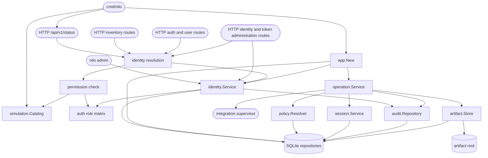

# Bench Core foundation

## Purpose

The Go Bench Core owns validated configuration, immutable operation state, identity and access control, policy and approvals, durable sessions and evidence, application startup reconciliation, and the authenticated HTTP boundary. It does not yet expose MCP routes or implement hardware-family behavior.

Two authorization decisions live here and stay separate. `identity.Service` decides whether an actor may *request* an action, from its fixed role and the scopes of the API token in use. `policy.Resolver` decides whether an operation may *run* without a human approval, from the integration app's declared operation policy. Neither the Administrator role nor a fully scoped token touches the second decision.

## Public interface

`cmd/nilo` provides version reporting, the `serve-foundation-check` composition smoke command, development token issuance, the `nilo admin` local administration commands, and the simulation server. Protected HTTP contracts provide login, logout, the current session, status, deterministic integration and device inventory for the selected simulation scenario, the identity listing, and the identity and token administration routes the browser Authentication page drives. Internal consumers compose the foundation with `app.Open` and authorize through `app.IdentityService()`, submit work through `operation.Service`, resolve policy through `policy.Resolver`, and use the narrow repository interfaces owned by the domain packages. Only a starting server composes with `app.New`, which is `app.Open` followed by startup reconciliation; every other command opens the appliance without touching the operations recorded in it.

## Key behaviors

- `REQ-FUNC-880eac8d` - preserves immutable operation requests and defined session transitions.
- `REQ-DATA-b2e24314` - atomically activates and reloads one digest-checked configuration version.
- `REQ-DATA-4357c6f2` - acquires complete resource claim sets or returns typed busy.
- `REQ-DATA-f9b0b55d` and `REQ-DATA-9608cfd8` - persists attributable audit history and verified artifacts.
- `REQ-SEC-0ecda0e7`, `REQ-SEC-f9fd49ff`, `REQ-SEC-035a8f94`, `REQ-SEC-50599a7e`, and `REQ-SEC-ae30d292` - enforce the foundation authentication, policy, and approval model.
- `REQ-REL-32b81ca8`, `REQ-REL-fe4a58f2` and `REQ-REL-e223f4b5` - reconcile interrupted sessions when the server starts, leave them untouched for every other command, and avoid false completion.
- `REQ-FUNC-4b3d9fd7` - exposes the versioned authenticated simulation status contract.
- `REQ-FUNC-649c67f8` and `REQ-SEC-f9fd49ff` - issue development tokens through non-login identities while retaining one-way verifier storage.
- `REQ-SEC-7fd3869a` - rejects missing, malformed, unknown, and revoked HTTP Bearer tokens uniformly.
- `REQ-PLAT-6f93c06b` - confines development simulation listeners to literal loopback addresses.
- `REQ-REL-fce79da4` - drains and closes the HTTP server after cancellation or termination.
- `REQ-FUNC-22f4f69c` and `REQ-FUNC-346ffa07` - return stable authenticated simulated integration and device inventories.
- `REQ-FUNC-9835998b` and `REQ-FUNC-7f4afa6b` - select only supported deterministic simulation scenarios and fail closed on unknown identifiers.
- `REQ-PLAT-30618e85` - keeps every simulation inventory entry unmistakably separate from physical equipment.
- `REQ-SEC-5d0cfe7e` and `REQ-SEC-74b46e3e` - map the three fixed roles to explicit permissions and bound a token by its scopes intersected with its owner's current role.
- `REQ-SEC-62e54172` - authorizes every protected route server-side and separates unauthenticated from forbidden.
- `REQ-FUNC-00305f82`, `REQ-SEC-8e89944b` and `REQ-FUNC-519eff58` - restrict first-administrator bootstrap, preserve one enabled administrator, and administer identities from the command line.
- `REQ-FUNC-db6fb2fa`, `REQ-FUNC-ec3d2e54` and `REQ-FUNC-7d80be16` - establish, end and report expiring browser sessions.
- `REQ-SEC-b5502ddb`, `REQ-SEC-49fe784b`, `REQ-SEC-d8026dbe` and `REQ-SEC-e14c8f51` - confine session cookies to the declared deployment mode, require a session CSRF token, brake repeated failed logins, and invalidate sessions on disable or password reset.
- `REQ-FUNC-ae14f9d3`, `REQ-FUNC-e325f08e` and `REQ-SEC-01c18c7c` - disclose a token secret once, list and revoke tokens without exposing secrets, and reject expired, revoked and disabled-owner credentials.
- `REQ-DATA-cffc3af2` and `REQ-DATA-d8d5a701` - audit identity and token lifecycle changes without secrets, and migrate existing identities and tokens forward as least-privileged.
- `REQ-FUNC-5fd2806f`, `REQ-FUNC-27c1db30`, `REQ-FUNC-1fac821d` and `REQ-FUNC-907003de` - create an identity, change its role, disable and re-enable it, and replace its password over the authenticated HTTP interface.
- `REQ-FUNC-795b54d0`, `REQ-FUNC-f50eb6d3` and `REQ-FUNC-71c3c908` - list every token's safe metadata, create a named token whose secret is returned exactly once, and revoke one.
- `REQ-FUNC-938c5f85` - refuse an administrative request carrying an unknown role or scope, a bad username, a short password, a past expiry or a taken username, naming the field and changing nothing.
- `REQ-SEC-7595665c`, `REQ-SEC-89034a8a` and `REQ-SEC-6e3ae992` - authorize every administration route server-side, attribute every change to the authenticated identity rather than any body field, and serialize no verifier of any kind.

## Architecture

`identity.Service` decides whether an actor may *request* an action. `policy.Resolver` independently decides whether an operation may *run* without a human approval. Neither the Administrator role nor a fully scoped API token changes the second decision, so identity authorization can never become an approval or safety bypass.

Every administrative identity change runs inside one `BEGIN IMMEDIATE` transaction supplied by the identity repository, which also supplies the audit repository bound to it. The write lock is taken before the change reads anything, so the last-enabled-administrator count is read and enforced without another connection or another process changing it in between, and a change whose audit event is rejected is rolled back with it rather than surviving unattributed. A browser session is inserted by a statement conditional on the identity still carrying the password verifier the login checked and still being enabled, so a completed password reset cannot be overtaken by a login already in flight.

The simulation catalog is deliberately dependency-free and cannot discover or contact physical equipment; runner-backed discovery remains later work.

## Files

- `05_Software/nilo_assistant/cmd/nilo/` - command entry point and CLI contract tests.
- `05_Software/nilo_assistant/internal/app/` - foundation composition and startup reconciliation.
- `05_Software/nilo_assistant/internal/config/` - process configuration and physically confined paths.
- `05_Software/nilo_assistant/internal/domain/` - UUID identities, immutable requests, artifacts, and session states.
- `05_Software/nilo_assistant/internal/operation/` - policy-to-runner operation orchestration.
- `05_Software/nilo_assistant/internal/policy/` - policy matrix, immutable snapshots, and approvals.
- `05_Software/nilo_assistant/internal/session/` - session transitions, lease ownership, and reconciliation service.
- `05_Software/nilo_assistant/internal/auth/` - password, role/permission, browser-session and API-token primitives, plus the failed-login brake.
- `05_Software/nilo_assistant/internal/identity/` - identity, session, token and authorization service shared by the command line and the HTTP boundary.
- `05_Software/nilo_assistant/internal/audit/` - append/list-only audit contract.
- `05_Software/nilo_assistant/internal/artifact/` - bounded, confined, durable artifact placement with OS adapters.
- `05_Software/nilo_assistant/internal/store/sqlite/` - database opening, migrations, and all foundation repository implementations and tests.
- `05_Software/nilo_assistant/internal/buildinfo/` - build metadata reported by the command.
- `05_Software/nilo_assistant/internal/httpapi/` - loopback-confined simulation listener, credential resolution and per-route permission checks, cookie and CSRF handling, the authentication and status contracts, and graceful lifecycle. `identity.go` holds the middleware and the sign-in, sign-out and current-session handlers; `administration.go` holds the identity and token administration handlers, their validation and the one map from a typed service failure to a documented client error; `server.go` holds the single route table where every route declares its permission.
- `05_Software/nilo_assistant/internal/simulation/` - immutable healthy and unavailable integration/device catalogs with stable simulation identity.
- `05_Software/nilo_assistant/go.mod` and `05_Software/nilo_assistant/go.sum` - pinned Go module graph.
- `05_Software/nilo_assistant/README.md` - portable core usage and boundaries.
