# Bench Core foundation

## Routing

Select this page for the Go Bench Core under `05_Software/nilo_assistant/`:
the `nilo` command line (`serve`, `admin` in local and remote mode, `network`,
`activity`, `diagnostics`), the authenticated `/api/v1` HTTP routes and their
permissions, identities, sessions, API tokens and their audit events, network
operations, the simulation catalog, and the SQLite repositories. Start at
`cmd/nilo/main.go` for a command, `internal/httpapi/server.go` for a route
(the one permission table), `internal/identity/service.go` for an identity
rule, and `internal/network/operation.go` for a managed change; the focused
tests sit beside each file. The browser interface belongs to *Browser GUI
foundation*; the privileged NetworkManager helper and its system tests are in
`internal/nethelper/` and `02_Tools/tests/network/`; the Python integration
packages belong to *Integration platform*.

## Purpose and boundaries

The Go Bench Core owns validated configuration, immutable operation state, identity and access control, policy and approvals, durable sessions and evidence, application startup reconciliation, and the authenticated HTTP boundary. It exposes read-only Network MCP tools; live interface networking and WireGuard readiness use a separate privileged NetworkManager helper; hardware-family integrations and live WireGuard management remain unimplemented.

Two authorization decisions live here and stay separate. `identity.Service` decides whether an actor may *request* an action, from its fixed role and the scopes of the API token in use. `policy.Resolver` decides whether an operation may *run* without a human approval, from the integration app's declared operation policy. Neither the Administrator role nor a fully scoped token touches the second decision.

## Public interface

`nilo network` calls the authenticated `/api/v1/network` interface for status,
statistics, interfaces, WireGuard, device networks, the operation listing and
separate operation acknowledgement, confirmation and rollback. `/mcp` offers
exactly the three read tools over the same service. WireGuard reads expose safe
metadata only.

`nilo admin user|token` run in exactly one of two modes: local (`--data-dir`,
write access is the authority, `--actor` is attribution, no deletion) or remote
(`--server` with `--token-file`, an ordinary `internal/apiclient` client of the
identity administration routes, where the appliance authorizes the token on
every request and `user delete` / `token delete` exist behind a typed
confirmation or `--confirm-delete`). Ambiguous or incomplete mode options exit 2
before anything is opened or contacted. The root usage names every group.

`cmd/nilo` provides version reporting, the `serve-foundation-check` composition smoke command, development token issuance, the `nilo admin` local and remote administration commands, the `network`, `activity` and `diagnostics` API clients, and explicit simulation/appliance servers. Protected HTTP contracts provide login, logout, the current session, status, deterministic integration and device inventory for the selected simulation scenario, the identity listing, and the identity and token administration routes the browser Authentication page drives. Internal consumers compose the foundation with `app.Open` and authorize through `app.IdentityService()`, submit work through `operation.Service`, resolve policy through `policy.Resolver`, and use the narrow repository interfaces owned by the domain packages. Only a starting server composes with `app.New`, which is `app.Open` followed by startup reconciliation; every other command opens the appliance without touching the operations recorded in it.

## Invariants

- Every protected route declares its permission in `server.go`; the command
  line is an API client and adds no authorization or identity rule of its own.
- A token's permissions are its owner's current role intersected with its
  scopes, resolved from stored state on every request.
- No credential is accepted on a command line: tokens come from `--token-file`,
  passwords from standard input; no response, log, audit event, export or error
  message carries a password, secret or verifier.
- An identity change and its audit event commit in one `BEGIN IMMEDIATE`
  transaction; one enabled administrator always remains; a refused change
  leaves the subject untouched.
- Permanent deletion is explicit (typed confirmation or `--confirm-delete`),
  distinct from disable and revoke, and every attempt, applied or refused, is
  on record with labels that outlive the row.
- Network changes go through preview, acknowledgement, confirmation and
  rollback; a noninteractive mutation needs `--acknowledge`, which is never
  consent for anything else.

## Key behaviors

- `REQ-FUNC-880eac8d` - preserves immutable operation requests and defined session transitions.
- `REQ-DATA-b2e24314` - atomically activates and reloads one digest-checked configuration version.
- `REQ-DATA-4357c6f2` - acquires complete resource claim sets or returns typed busy.
- `REQ-DATA-f9b0b55d` and `REQ-DATA-9608cfd8` - persists attributable audit history and verified artifacts.
- `REQ-SEC-0ecda0e7`, `REQ-SEC-f9fd49ff`, `REQ-SEC-035a8f94`, `REQ-SEC-50599a7e`, and `REQ-SEC-ae30d292` - enforce the foundation authentication, policy, and approval model.
- `REQ-REL-32b81ca8`, `REQ-REL-fe4a58f2` and `REQ-REL-e223f4b5` - reconcile interrupted sessions when the server starts, leave them untouched for every other command, and avoid false completion.
- `REQ-FUNC-4b3d9fd7` - exposes the versioned authenticated simulation status contract.
- `REQ-FUNC-649c67f8` and `REQ-SEC-f9fd49ff` - issue development tokens through non-login identities while retaining one-way verifier storage.
- `REQ-SEC-7fd3869a` - rejects missing, malformed, unknown, and revoked HTTP Bearer tokens uniformly.
- `REQ-PLAT-6f93c06b` - confines development simulation listeners to literal loopback addresses.
- `REQ-REL-fce79da4` - drains and closes the HTTP server after cancellation or termination.
- `REQ-FUNC-22f4f69c` and `REQ-FUNC-346ffa07` - return stable authenticated simulated integration and device inventories.
- `REQ-FUNC-9835998b` and `REQ-FUNC-7f4afa6b` - select only supported deterministic simulation scenarios and fail closed on unknown identifiers.
- `REQ-PLAT-30618e85` - keeps every simulation inventory entry unmistakably separate from physical equipment.
- `REQ-SEC-5d0cfe7e` and `REQ-SEC-74b46e3e` - map the three fixed roles to explicit permissions and bound a token by its scopes intersected with its owner's current role.
- `REQ-SEC-62e54172` - authorizes every protected route server-side and separates unauthenticated from forbidden.
- `REQ-FUNC-00305f82`, `REQ-SEC-8e89944b` and `REQ-FUNC-519eff58` - restrict first-administrator bootstrap, preserve one enabled administrator, and administer identities from the command line.
- `REQ-FUNC-db6fb2fa`, `REQ-FUNC-ec3d2e54` and `REQ-FUNC-7d80be16` - establish, end and report expiring browser sessions.
- `REQ-SEC-b5502ddb`, `REQ-SEC-49fe784b`, `REQ-SEC-d8026dbe` and `REQ-SEC-e14c8f51` - confine session cookies to the declared deployment mode, require a session CSRF token, brake repeated failed logins, and invalidate sessions on disable or password reset.
- `REQ-FUNC-ae14f9d3`, `REQ-FUNC-e325f08e` and `REQ-SEC-01c18c7c` - disclose a token secret once, list and revoke tokens without exposing secrets, and reject expired, revoked and disabled-owner credentials.
- `REQ-DATA-cffc3af2` and `REQ-DATA-d8d5a701` - append one complete common
  Activity audit envelope for every applied identity and token mutation without
  secrets, and migrate existing identities and tokens forward as least-privileged.
- `REQ-FUNC-5fd2806f`, `REQ-FUNC-27c1db30`, `REQ-FUNC-1fac821d` and `REQ-FUNC-907003de` - create an identity, change its role, disable and re-enable it, and replace its password over the authenticated HTTP interface.
- `REQ-FUNC-795b54d0`, `REQ-FUNC-f50eb6d3` and `REQ-FUNC-71c3c908` - list every token's safe metadata, create a named token whose secret is returned exactly once, and revoke one.
- `REQ-FUNC-938c5f85` - refuse an administrative request carrying an unknown role or scope, a bad username, a short password, a past expiry or a taken username, naming the field and changing nothing.
- `REQ-SEC-7595665c`, `REQ-SEC-89034a8a` and `REQ-SEC-6e3ae992` - authorize
  every administration route server-side, attribute every change to the actual
  request credential (user ID for a session, token ID for bearer) rather than
  any body field, and serialize no verifier of any kind.
- `REQ-FUNC-a1cefd8f` - `nilo network operation list` reads the operation
  listing the browser reattaches with; the route has no filters, so the command
  offers none.
- `REQ-FUNC-6590e0c5`, `REQ-SEC-7861a0b2` and `REQ-UX-3f48f396` - administer
  identities and tokens remotely over the administration routes with the token
  read only from a file, in exactly one mode per command, with readable or
  `--json` output, and name every command group in the root usage.
- `REQ-SEC-bfd1cf86` - a command-line permanent deletion states its subject and
  proceeds only on the subject typed back or `--confirm-delete`; no other flag
  is consent.
- `REQ-DATA-b4cdd70a` and `REQ-DATA-20645b45` - record every refused deletion
  as a denied event with its reason, and write applied deletion events with the
  subject's label and the actor's and owner's usernames so they read after the
  row is gone.

## Architecture

```mermaid
flowchart TD
    cli(["cmd/nilo"])
    admincli(["nilo admin"])
    netcli(["nilo network"])
    http(["HTTP /api/v1/status"])
    inventory(["HTTP inventory routes"])
    authroutes(["HTTP auth and user routes"])
    adminroutes(["HTTP identity and token administration routes"])
    netroutes(["HTTP /api/v1/network routes"])
    mcproutes(["MCP /mcp read tools"])
    middleware["identity resolution"]
    authorize["permission check"]
    catalog["simulation.Catalog"]
    network["network.Service"]
    operations["network.OperationManager"]
    provider["network.Provider: simulation or helper client"]
    changer["network.ConnectivityChanger: simulation or helper client"]
    sampler["network sampler"]
    helper["root nethelper: peer-authenticated Unix RPC"]
    nm["NetworkManager D-Bus and independent checkpoint timer"]
    recovery[("root-only recovery.json")]
    provider --> helper
    changer --> helper
    helper --> nm
    helper --> recovery
    apiclient["internal/apiclient"]
    app["app.New"]
    identity["identity.Service"]
    roles["auth role matrix"]
    op["operation.Service"]
    policy["policy.Resolver"]
    session["session.Service"]
    runner(["integration supervisor"])
    artifact["artifact.Store"]
    audit["audit.Repository"]
    sqlite[("SQLite repositories")]
    files[("artifact root")]
    cli --> app
    cli --> http
    cli --> catalog
    admincli --> identity
    http --> middleware
    inventory --> middleware
    authroutes --> middleware
    adminroutes --> middleware
    adminroutes --> identity
    middleware --> identity
    middleware --> authorize
    authorize --> roles
    authorize --> catalog
    identity --> roles
    identity --> audit
    identity --> sqlite
    app --> identity
    app --> sqlite
    app --> op
    op --> policy
    op --> session
    op --> runner
    op --> artifact
    op --> audit
    policy --> sqlite
    session --> sqlite
    audit --> sqlite
    artifact --> sqlite
    artifact --> files
    netcli --> apiclient
    apiclient --> netroutes
    netroutes --> middleware
    netroutes --> network
    mcproutes --> middleware
    mcproutes --> network
    netroutes --> operations
    network --> provider
    network --> sqlite
    operations --> changer
    operations --> provider
    sampler --> network
    sampler --> sqlite
```

The runtime shares one `network.Simulation` across observations, changes,
WireGuard metadata and counters. `RunMaintenance` writes minute history and
expires unconfirmed operations. `ChangeController` carries validated import and
startup parameters; public operations contain a revision digest rather than raw
configuration. Mutation I/O is serialized independently of readable progress.
Failure to restore or discard recovery cannot become a successful outcome.

The explicit Linux appliance profile runs Bench Core unprivileged and uses
`internal/nethelper` over a restricted Unix socket. The root helper validates peer
UIDs, bounds JSON requests and binds one saved interface change to durable recovery
before arming a target-specific NetworkManager checkpoint. NM owns the independent
120-second timeout; startup reconciliation verifies connection/autoconnect and
normalized IP/route/DNS state before allowing further management. No saved network
profile is rewritten for interface toggles. The explicit systemd installer is in
`02_Tools/scripts/install-nethelper.sh`; its service and recovery timer run on the
bench Raspberry Pi, while reboot-during-change recovery remains unverified.

`wireguard.check` reads NetworkManager availability/version without D-Bus auto-start,
loaded/running-kernel WireGuard evidence and `/usr/bin/wg --version` with a fixed
environment, two-second timeout and 4 KiB output limit. Unknown probes carry
`reported: false` and fixed diagnostics, never raw command output. Live results
carry `readiness_only: true`; they do not inventory profiles or claim tunnel state.
No module loading, profile file reads, package installation or shell occurs on this
read path. Missing required tooling remains an explicit `wg` row with no version.

`internal/network/install.go` adds an optional asynchronous installation controller:
acknowledgement reserves the mutation slot and the maintenance loop polls progress.
`internal/nethelper/install*.go` owns the job, private durable last-job record,
supported-distribution/source checks and fixed APT transaction. The version-2
pre-install guard is also a fixed `nilo-nethelper` process mode, so the actual
locked transaction cannot change unrelated packages after an earlier simulation.
Only wireguard-tools is installed; readiness is probed again before success.
Request cancellation does not own the worker; service shutdown cancels and joins
it, and restart reports interruption without replay. `probe.go` shares bounded
metadata reads between readiness and installation. `install_system_linux_test.go`
exercises real signed installation, locks, offline errors and idempotence on the
pinned Debian 13 and Ubuntu 24.04 disposable fixtures. The separate HTTPS process
test exercises the already-installed path through a real unprivileged core.

Appliance serving requires a built GUI and TLS certificate/key, forces secure
session cookies, refuses public/wildcard binds, and labels the GUI with safe
runtime metadata before authentication. Instrument inventory is empty. WireGuard
has no live fallback. NetworkManager pseudo-devices or hot-unplugged adapters
without sysfs counters produce a zero counter sample instead of stopping the
service. See `06_SoftwareDocu/Network_Service_Implementation_Status.md` for the
remaining hardware and reboot acceptance work.

`identity.Service` decides whether an actor may *request* an action. `policy.Resolver` independently decides whether an operation may *run* without a human approval. Neither the Administrator role nor a fully scoped API token changes the second decision, so identity authorization can never become an approval or safety bypass.

Identities and API tokens can also be removed permanently, which is a distinct
operation from disabling and from revoking rather than a stronger word for
either. `DELETE /api/v1/users/{username}` (`users.manage`) removes the identity
row and, in the same transaction, every browser session row it holds; it is
refused with `last_administrator` while the identity is the last enabled
administrator and with `user_has_tokens` while it owns any API token, revoked
and expired ones included, because a cascade would destroy credential records
on the strength of a decision that was about a person. `DELETE
/api/v1/tokens/{id}` (`tokens.manage.all`) removes the token row in any state:
revoking keeps the record and stops the secret, deleting removes the record,
which also stops the secret because the row a bearer secret is matched against
is gone. Each successful removal appends exactly one `identity.user.deleted` or
`identity.token.deleted` event carrying the safe description of what was
removed — for a user the username, role and prior enabled state; for a token the
name, owner ID and owner username, scopes, expiry and prior revoked/expired
state — with the subject's name as the event's target label and the acting
administrator's username in the details, because the record itself no longer
exists to be looked up afterwards. A refused deletion (not an administrator,
last enabled administrator, owned tokens, unknown user or token) appends one
`identity.user.delete_refused` or `identity.token.delete_refused` event with
outcome `denied`, the requested subject as label (`invalid` or `unknown` when
none was usable; the unusable input stays out of the record) and the reason
code, written through the ordinary writer after the refusing transaction has
rolled back. The refusal never depends on that record, but a record that
cannot be written is joined to the returned error (`errors.Join`, so
`errors.Is` still finds the reason and the HTTP code is unchanged); a store
failure inside the transaction is not a refusal and is not recorded. The remote
command line treats the listing reads around a change as informational: a 403
on the pre-deletion listing skips the description, and a failed re-read after
an applied change is reported with exit 0. A credential lacking the route permission is refused earlier by the
HTTP access guard as `identity.access.denied`. There is no soft deletion and no
second mutation path.

Every administrative identity change runs inside one `BEGIN IMMEDIATE`
transaction supplied by the identity repository, which also supplies the audit
repository bound to it. `audit.Writer.Compose` supplies the same appliance,
boot, clock, actor, category, outcome and severity envelope used by other common
Activity events, then the transaction-bound repository appends it before
commit. The write lock is taken before the change reads anything, so the
last-enabled-administrator count is read and enforced without another
connection or another process changing it in between — for a deletion exactly as
for a demotion or a disable, so two concurrent removals through separate
connections can never both be applied — and a change whose audit event is
rejected is rolled back with it rather than surviving unattributed, which for a
deletion means the identity, its sessions and the token stay.
Successful reads and rejected or no-op changes do not create mutation events;
a refused permanent deletion creates a denied event instead. A
browser session is inserted by a statement conditional on the identity still
carrying the password verifier the login checked and still being enabled, so a
completed password reset cannot be overtaken by a login already in flight.

The simulation catalog is deliberately dependency-free and cannot discover or contact physical equipment; runner-backed discovery remains later work.

## Files

- `internal/nethelper/`, `cmd/nilo-nethelper/` - bounded privileged D-Bus interface operations, durable store and independent recovery.
- `cmd/nilo/network_runtime*.go`, `internal/httpapi/serving.go` - explicit live provider selection, TLS and runtime-aware static GUI.
- `02_Tools/tests/network/` - disposable real-NetworkManager and unprivileged HTTPS process tests (opt-in, separate from the ordinary suite).

- `internal/network/` (under the Go module) - operation safety, simulation, profile validation, sampling and statistics, plus the device-network model and the pure forwarding planner.
- `internal/network/{devicenetwork,forwarding_plan}.go` - the saved device-network decision and the owned resource set it implies. Both are pure: their only imports are `errors`, `fmt`, `sort`, `strings` and `net/netip`, so a plan cannot reach a host. Nothing applies a plan yet.
- `internal/network/persistence.go`, `internal/store/sqlite/network_operation_repository.go` - the durable record of a managed change, holding public metadata only and refusing a record whose parameters name a secret.
- `internal/httpapi/network*.go`, `internal/mcp/`, `internal/apiclient/` - shared authenticated Network adapters.
- `cmd/nilo/network*.go` - Network CLI with interactive or explicit acknowledgement; confirmation remains separate.
- `cmd/nilo/admin.go`, `cmd/nilo/admin_remote.go` - the administration commands: mode resolution and the local data-directory path in the first, the remote API client, readable renderings and the deletion confirmation in the second. `admin_remote_test.go` proves the requests against a recording stub; `admin_live_test.go` proves roles, scopes and credential state against a real `nilo serve` subprocess.

- `05_Software/nilo_assistant/cmd/nilo/` - command entry point and CLI contract tests.
- `05_Software/nilo_assistant/internal/app/` - foundation composition and startup reconciliation.
- `05_Software/nilo_assistant/internal/config/` - process configuration and physically confined paths.
- `05_Software/nilo_assistant/internal/domain/` - UUID identities, immutable requests, artifacts, and session states.
- `05_Software/nilo_assistant/internal/operation/` - policy-to-runner operation orchestration.
- `05_Software/nilo_assistant/internal/policy/` - policy matrix, immutable snapshots, and approvals.
- `05_Software/nilo_assistant/internal/session/` - session transitions, lease ownership, and reconciliation service.
- `05_Software/nilo_assistant/internal/auth/` - password, role/permission, browser-session and API-token primitives, plus the failed-login brake.
- `05_Software/nilo_assistant/internal/identity/` - identity, session, token and authorization service shared by the command line and the HTTP boundary.
- `05_Software/nilo_assistant/internal/audit/` - the event contract, its envelope, and the writer that fills the appliance, boot, category, severity and clock fields so a caller supplies only what it knows. Append, list and bounded retention; no operation can change a stored event.
- `05_Software/nilo_assistant/internal/appliance/` - the stable appliance identity and the per-boot identity, provisioned while the application opens and therefore before any service that could record an event exists.
- `05_Software/nilo_assistant/internal/artifact/` - bounded, confined, durable artifact placement with OS adapters.
- `05_Software/nilo_assistant/internal/store/sqlite/` - database opening, migrations, and all foundation repository implementations and tests.
- `05_Software/nilo_assistant/internal/buildinfo/` - build metadata reported by the command.
- `05_Software/nilo_assistant/internal/httpapi/` - loopback-confined simulation listener, credential resolution and per-route permission checks, cookie and CSRF handling, the authentication and status contracts, and graceful lifecycle. `identity.go` holds the middleware and the sign-in, sign-out and current-session handlers; `administration.go` holds the identity and token administration handlers, their validation and the one map from a typed service failure to a documented client error; `server.go` holds the single route table where every route declares its permission.
- `05_Software/nilo_assistant/internal/simulation/` - immutable healthy and unavailable integration/device catalogs with stable simulation identity.
- `05_Software/nilo_assistant/go.mod` and `05_Software/nilo_assistant/go.sum` - pinned Go module graph.
- `05_Software/nilo_assistant/README.md` - portable core usage and boundaries.

### Network gateway observations

Network interface readings expose Gateway4 and Gateway6 from the active NetworkManager IP configurations. HTTP adds gateway4/gateway6 strings (empty when absent); the deterministic simulation catalog includes both families for its wired device. The disposable dual-stack NetworkManager fixture checks these observations and recovery with default gateways present. No routing configuration is edited by this read path.

## Device networks, forwarding, Activity and diagnostics (2026-09-04)

Added under TASK-943403e2, P2 to P9. Packages and the seams between them:

- `internal/network/profile_manager.go`, `tunnel.go`: the saved WireGuard
  inventory and the `TunnelDriver` seam the helper client implements
  (`CreateTunnel`, `DeleteTunnel`, `Tunnels`, `ConnectTunnel`); `Startup` runs
  the startup selection as the system actor and retries from the maintenance
  loop. `appliance.go` composes the helper client (`ApplianceBase`) with the
  profile manager, the settings intent store and the device-network manager;
  `serve` hands one value to the service, the operation manager and the sampler.
- `internal/network/interface_settings.go`, `management.go`, `wifi.go`:
  configuration bound to the adapter's permanent hardware identity, the
  management-path trace (`ValidateManagementChange` with `Change.Origin`), and
  Wi-Fi scan/join with the password staged through `SecretStager.StagePassword`.
- `internal/network/devicenetwork.go`, `forwarding_plan.go`,
  `device_network_manager.go`, `device_network_check.go`: the pure model and
  planner (`ForwardingContext{DeviceLink, TunnelDevice, LocalLink}`), the manager
  over the `Forwarder` and `DeviceNetworkEnvironment` seams, snapshot/restore of
  the saved decisions, computed status, checks and instructions. Simulation and
  appliance both use the manager; the simulation forwards in memory. A candidate
  adapter is treated as the device side while its first definition is validated,
  and saving that disabled definition does not arm or apply forwarding recovery.
- `internal/nethelper/forwarding.go`, `nftables_render.go`,
  `nftables_linux.go`: the durable `ForwardingInventory`, the engine's
  `ApplyForwarding`/`RemoveForwarding`/`AppliedForwarding`/`VerifyForwarding`,
  the one-transaction nft script and the Linux adapter (`nft` at a pinned path,
  `/proc/sys/net/ipv4/ip_forward`). A device-network change is prepared with
  `Record.Forwarding` and no NetworkManager checkpoint. `recovery.go`
  `RecoverOnce` is what `nilo-nethelper recover` and the systemd timer run.
- `internal/nethelper/tunnel_engine.go`, `settings_engine.go`,
  `networkmanager_wireguard_linux.go`, `networkmanager_settings_linux.go`: the
  NetworkManager adapters for tunnels (system-wide checkpoint, `SystemSnapshot`
  digest) and adapter settings (`nilo-if-<mac>` profiles, `ipv6.method=link-local`,
  scan classification, join).
- `internal/activity`: `Service.Query`/`Export`, `Policy`, `Housekeeper`,
  `Monitor` (audit health); `internal/diagnostics`: timed sessions and the
  `Trace` debug sink the operation manager calls. `internal/store/sqlite`
  migrations 008 (interface settings), 009 (device networks), 010 (activity
  policy, retention watermarks, diagnostic sessions).
- HTTP: `network_operations.go` (settings, Wi-Fi and device-network previews with
  the request origin), `device_networks.go`, `activity.go` (`accessGuard` records
  refusals; exports and policy changes are recorded with the requesting actor).
- Invariants kept: durable record before any privileged mutation; secrets only
  in the helper's root-only store and never in a response, log, audit row,
  database row or export; disabled debug never disables audit; the forward chain
  closes what NILO did not grant only where NILO turned forwarding on.

Verification: the disposable container (`02_Tools/tests/network/check.sh`) runs
the NetworkManager, WireGuard, settings, local forwarding (three namespaces and a
Modbus responder), VPN topology (hub, remote client, two sites) and independent
recovery system tests; the Windows suite covers everything portable.
