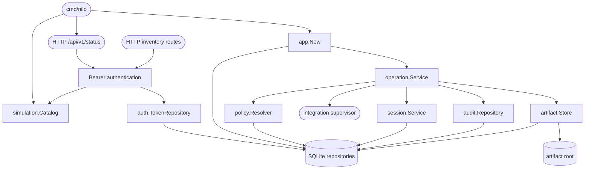

# Bench Core foundation

## Purpose

The Go Bench Core owns validated configuration, immutable operation state, policy and approvals, durable sessions and evidence, application startup reconciliation, and the authenticated HTTP boundary. It does not yet expose MCP routes or implement hardware-family behavior.

## Public interface

`cmd/nilo` provides version reporting, the `serve-foundation-check` composition smoke command, development token issuance, and the simulation server. Protected HTTP contracts provide status plus deterministic integration and device inventory for the selected simulation scenario. Internal consumers compose `app.New`, submit work through `operation.Service`, resolve policy through `policy.Resolver`, and use the narrow repository interfaces owned by the domain packages.

## Key behaviors

- `REQ-FUNC-880eac8d` - preserves immutable operation requests and defined session transitions.
- `REQ-DATA-b2e24314` - atomically activates and reloads one digest-checked configuration version.
- `REQ-DATA-4357c6f2` - acquires complete resource claim sets or returns typed busy.
- `REQ-DATA-f9b0b55d` and `REQ-DATA-9608cfd8` - persists attributable audit history and verified artifacts.
- `REQ-SEC-0ecda0e7`, `REQ-SEC-f9fd49ff`, `REQ-SEC-035a8f94`, `REQ-SEC-50599a7e`, and `REQ-SEC-ae30d292` - enforce the foundation authentication, policy, and approval model.
- `REQ-REL-32b81ca8` and `REQ-REL-e223f4b5` - reconcile interrupted sessions and avoid false completion.
- `REQ-FUNC-4b3d9fd7` - exposes the versioned authenticated simulation status contract.
- `REQ-FUNC-649c67f8` and `REQ-SEC-f9fd49ff` - issue development tokens through non-login identities while retaining one-way verifier storage.
- `REQ-SEC-7fd3869a` - rejects missing, malformed, unknown, and revoked HTTP Bearer tokens uniformly.
- `REQ-PLAT-6f93c06b` - confines development simulation listeners to literal loopback addresses.
- `REQ-REL-fce79da4` - drains and closes the HTTP server after cancellation or termination.
- `REQ-FUNC-22f4f69c` and `REQ-FUNC-346ffa07` - return stable authenticated simulated integration and device inventories.
- `REQ-FUNC-9835998b` and `REQ-FUNC-7f4afa6b` - select only supported deterministic simulation scenarios and fail closed on unknown identifiers.
- `REQ-PLAT-30618e85` - keeps every simulation inventory entry unmistakably separate from physical equipment.

## Architecture

The simulation catalog is deliberately dependency-free and cannot discover or contact physical equipment; runner-backed discovery remains later work.

## Files

- `05_Software/nilo_assistant/cmd/nilo/` - command entry point and CLI contract tests.
- `05_Software/nilo_assistant/internal/app/` - foundation composition and startup reconciliation.
- `05_Software/nilo_assistant/internal/config/` - process configuration and physically confined paths.
- `05_Software/nilo_assistant/internal/domain/` - UUID identities, immutable requests, artifacts, and session states.
- `05_Software/nilo_assistant/internal/operation/` - policy-to-runner operation orchestration.
- `05_Software/nilo_assistant/internal/policy/` - policy matrix, immutable snapshots, and approvals.
- `05_Software/nilo_assistant/internal/session/` - session transitions, lease ownership, and reconciliation service.
- `05_Software/nilo_assistant/internal/auth/` - password and MCP-token primitives.
- `05_Software/nilo_assistant/internal/audit/` - append/list-only audit contract.
- `05_Software/nilo_assistant/internal/artifact/` - bounded, confined, durable artifact placement with OS adapters.
- `05_Software/nilo_assistant/internal/store/sqlite/` - database opening, migrations, and all foundation repository implementations and tests.
- `05_Software/nilo_assistant/internal/buildinfo/` - build metadata reported by the command.
- `05_Software/nilo_assistant/internal/httpapi/` - loopback-confined simulation listener, Bearer authentication, status contract, and graceful lifecycle.
- `05_Software/nilo_assistant/internal/simulation/` - immutable healthy and unavailable integration/device catalogs with stable simulation identity.
- `05_Software/nilo_assistant/go.mod` and `05_Software/nilo_assistant/go.sum` - pinned Go module graph.
- `05_Software/nilo_assistant/README.md` - portable core usage and boundaries.
