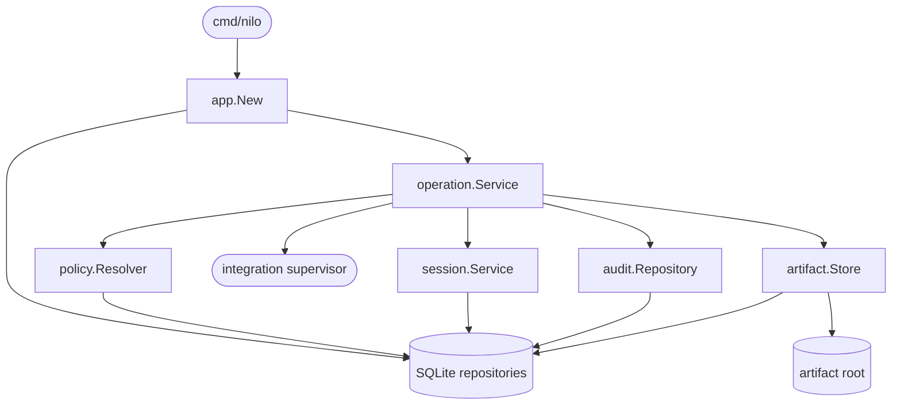

# Bench Core foundation

## Purpose

The Go Bench Core owns validated configuration, immutable operation state, policy and approvals, durable sessions and evidence, and application startup reconciliation. It deliberately does not expose MCP or HTTP routes and does not implement hardware-family behavior in Increment 1.

## Public interface

`cmd/nilo` provides version reporting and the `serve-foundation-check` composition smoke command. Internal consumers compose `app.New`, submit work through `operation.Service`, resolve policy through `policy.Resolver`, and use the narrow repository interfaces owned by the domain packages.

## Key behaviors

- `REQ-FUNC-880eac8d` - preserves immutable operation requests and defined session transitions.
- `REQ-DATA-b2e24314` - atomically activates and reloads one digest-checked configuration version.
- `REQ-DATA-4357c6f2` - acquires complete resource claim sets or returns typed busy.
- `REQ-DATA-f9b0b55d` and `REQ-DATA-9608cfd8` - persists attributable audit history and verified artifacts.
- `REQ-SEC-0ecda0e7`, `REQ-SEC-f9fd49ff`, `REQ-SEC-035a8f94`, `REQ-SEC-50599a7e`, and `REQ-SEC-ae30d292` - enforce the foundation authentication, policy, and approval model.
- `REQ-REL-32b81ca8` and `REQ-REL-e223f4b5` - reconcile interrupted sessions and avoid false completion.

## Architecture

The command is currently a composition and smoke boundary; network transports and real equipment integrations remain later increments.

## Files

- `05_Software/nilo_assistant/cmd/nilo/` - command entry point and CLI contract tests.
- `05_Software/nilo_assistant/internal/app/` - foundation composition and startup reconciliation.
- `05_Software/nilo_assistant/internal/config/` - process configuration and physically confined paths.
- `05_Software/nilo_assistant/internal/domain/` - UUID identities, immutable requests, artifacts, and session states.
- `05_Software/nilo_assistant/internal/operation/` - policy-to-runner operation orchestration.
- `05_Software/nilo_assistant/internal/policy/` - policy matrix, immutable snapshots, and approvals.
- `05_Software/nilo_assistant/internal/session/` - session transitions, lease ownership, and reconciliation service.
- `05_Software/nilo_assistant/internal/auth/` - password and MCP-token primitives.
- `05_Software/nilo_assistant/internal/audit/` - append/list-only audit contract.
- `05_Software/nilo_assistant/internal/artifact/` - bounded, confined, durable artifact placement with OS adapters.
- `05_Software/nilo_assistant/internal/store/sqlite/` - database opening, migrations, and all foundation repository implementations and tests.
- `05_Software/nilo_assistant/internal/buildinfo/` - build metadata reported by the command.
- `05_Software/nilo_assistant/go.mod` and `05_Software/nilo_assistant/go.sum` - pinned Go module graph.
- `05_Software/nilo_assistant/README.md` - portable core usage and boundaries.
