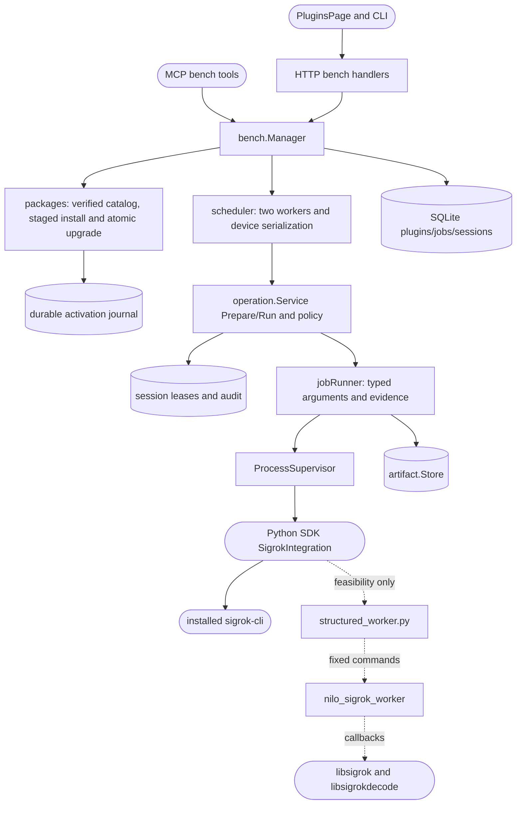

# Managed bench integrations

## Routing

Select this page for Plugins, sigrok/ATK-DL16, `nilo plugin`, `nilo bench`, durable
instrument commands, transaction IDs, queues, delayed replies and timeouts.
Start at `05_Software/core/internal/bench/manager.go` and `jobs_test.go`.
Wire protocols and process termination belong to [Integration platform](integration-platform.md);
identity/SQLite composition belongs to [Bench Core](bench-core-foundation.md);
visual structure belongs to [Browser GUI](gui-foundation.md).

## Purpose and boundaries

The manager owns curated package installation, persisted enablement and device
inventory, command admission, scheduling and retained instrument evidence.
The first typed adapter wraps the installed sigrok CLI for ATK digital captures
and saved UART analysis. It excludes PWM, arbitrary command/config/path access,
continuous capture, a marketplace and signal/decoder correctness qualification.
The Sigrok package also contains an unwired SW-01 feasibility worker that proves
structured native metadata, mixed Demo packets and decoder callbacks; it does
not add or replace any public Bench operation.

## Public interface

`bench.New(Options)` starts one manager per data directory; `Close` cancels and
waits for its workers. `ListPlugins`, `Lifecycle`, `Discover`, `Submit`, `GetJob`,
`ListJobs`, `Action`, `OpenArtifact` are shared by HTTP and MCP; CLI/GUI use HTTP.
`app.StartBench` composes this only for a server, after startup reconciliation.
The lifecycle surface also accepts `upgrade`: it waits a bounded interval for
the installed integration to become idle, verifies and stages the replacement
on the same filesystem, preserves enablement/mode/database state, health-checks
the switched package, and restores the prior package if health fails. The
stage, every rename boundary and the database transition are durably journaled
and directory-synced; manager startup reconciles an interrupted activation to
the package digest that SQLite still declares authoritative before serving it.

`/api/v1/plugins` exposes curated availability and lifecycle; `/api/v1/bench/jobs`
returns durable transaction acknowledgements and summaries. Individual reads
return ordered replies/results, actions approve/cancel, and artifact download.
The eight MCP tools and CLI equivalents are listed in
`06_SoftwareDocu/Sigrok_Integration.md`. Human approval requires a browser session.

## Invariants

- A durable job/session/request and canonical owner/idempotency key precede ack.
- At most 32 nonterminal jobs and two executing workers; one analyzer at a time.
- Approval and queue time count toward the absolute deadline; cleanup completes
  before resource reuse. Disconnect does not cancel or duplicate admitted work.
- Replies carry transaction IDs and monotonic sequence, with 100 records of at
  most 4 KiB each. Terminal data is bounded to 1 MiB; late replies cannot change it.
- Restart marks unfinished jobs incomplete without replay. Disable prevents new
  and queued work; busy restart/uninstall refuse. History survives uninstall.
- Upgrade refuses after a bounded busy wait and never exposes a partially copied
  package; a failed replacement health check restores the prior filesystem and
  preserved lifecycle state. An interruption between filesystem activation and
  database commit is resolved from the durable journal and authoritative stored
  digest before package discovery resumes.
- Read/execute/approve/manage are separate permissions. Tokens use current owner
  scopes per call, never a cached actor or human approval authority.
- Verified curated package copies and core-owned paths bound execution and
  artifacts. PWM and unknown parameters are refused in core and runner.
- The feasibility worker accepts only fixed Demo/UART-fixture commands, emits
  bounded `nilo.sigrok.worker/1` JSONL, and remains a child process outside
  Bench Core; its retained fixtures are not electrical qualification.

## Change map

| Change | Start | Focused verification |
|---|---|---|
| Lifecycle/catalog integrity | `internal/bench/packages.go` | `jobs_test.go`, `bundle_test.go` |
| Queue, retry, deadline, cancel/restart | `jobs.go`, `scheduler.go` | `jobs_test.go`, `internal/operation/queue_test.go` |
| Runner arguments and evidence | `parameters.go`, `execution.go`, Python `plugin.py` | `jobs_test.go`, Python `tests/test_plugin.py` |
| Permissions and transport | HTTP/MCP/CLI `bench.go` | adjacent `bench_test.go`, auth `role_test.go` |
| GUI transactions | `PluginsPage.tsx`, `api/bench.ts` | adjacent component tests |

## Key behaviors

- REQ-FUNC-26332084, REQ-FUNC-74c69ce6, REQ-FUNC-8a6445ff,
  REQ-FUNC-1707e62e, REQ-FUNC-b198e8c0: explicit managed lifecycle.
- REQ-FUNC-d21b7686, REQ-FUNC-93c2ec4b, REQ-FUNC-28779550: digital
  discovery, finite acquisition and bounded saved UART annotations.
- REQ-REL-49026029, REQ-REL-a49eb835, REQ-REL-94d1b464: durable
  correlated jobs, bounded scheduling, expiry, cancellation and recovery.
- REQ-SEC-6b1dd726, REQ-SEC-b22b7951: no PWM and shared authorization.
- REQ-FUNC-1f656691, REQ-FUNC-93362dc2, REQ-FUNC-cf21e27d,
  REQ-REL-c2695283, REQ-TEST-11dc600f: structured Sigrok feasibility,
  native-fault containment and evidence without public adoption.
- REQ-DATA-721ec2ea: confined, digest-verified artifacts with provenance.
- REQ-UX-30e2e009: common GUI, CLI and MCP outcomes.
- REQ-PLAT-d1427e1e: one package contract for bundled and later installation.
- REQ-REL-6fd2a7b2: atomic in-place package upgrade with bounded idle wait,
  preserved state, health verification and rollback.

## Architecture

Lifecycle and discovery are serialized control calls with bounded runner waits;
capture/decode are queued commands. New hardware families require their own
curated typed adapter and resource claims; transport handlers remain shared.

## Files

- `05_Software/core/internal/bench/`: model, manager, packages,
  parameters, jobs, execution and scheduler; `jobs_test.go` covers state/concurrency,
  `bundle_test.go` validates assembled target runner interoperability.
- `05_Software/core/internal/bench/upgrade_recovery.go` and
  `package_sync_*.go`: durable activation journal, directory sync and startup
  reconciliation for interrupted package upgrades.
- `05_Software/core/internal/app/bench.go`: server composition.
- `05_Software/core/internal/operation/service.go`, `queue_test.go`:
  separated durable preparation, queued approval and execution.
- `05_Software/core/internal/store/sqlite/migrations/011_bench.sql`:
  plugin/job persistence; `audit_repository.go`: atomic queued settlement audit.
- `05_Software/core/internal/{httpapi,mcp}/bench.go` and adjacent tests:
  authenticated HTTP and MCP interfaces; MCP strict codec and session token binding.
- `05_Software/core/cmd/nilo/bench.go`, `bench_test.go`: API client commands.
- `05_Software/core/internal/auth/role.go`, `role_test.go`: permissions.
- `05_Software/integrations/sigrok/`: manifest/schemas, runner, Python implementation,
  locked dependency graph and package/adapter tests; `structured_worker.py`,
  `worker/nilo_sigrok_worker.c`, `evidence/`, and `tests/test_worker.py` hold the
  feasibility-only structured worker boundary and proof.
- `05_Software/frontend/src/api/bench.ts`, `bench.test.ts`, `client.ts`: client contract.
- `05_Software/frontend/src/components/pages/PluginsPage.tsx`, `PluginsPage.test.tsx`:
  managed workspace; shell routing, i18n and layout follow gui-foundation.md.
- `02_Tools/scripts/build-sigrok-bundle.py`, `build-appliance.sh`: bundle preparation.
- `02_Tools/scripts/check-sigrok-integration.py`: isolated appliance HTTP/CLI/MCP smoke.
- `02_Tools/scripts/build-sigrok-worker.py`: target-native feasibility build helper.
- `06_SoftwareDocu/Sigrok_Integration.md`: operator, extension and deployment contract.
- `06_SoftwareDocu/Sigrok_Structured_Worker_Feasibility.md`: SW-01 evidence,
  coverage, dependency and boundary decision.
