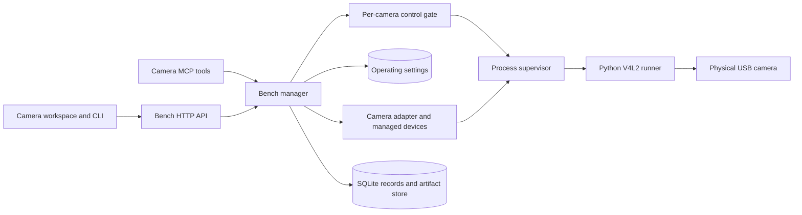

# Physical Camera integration

## Routing

Select this page for Camera package behavior, managed physical devices, capture,
controls, previews and target verification. Start at
`05_Software/integrations/camera/src/nilo_camera/plugin.py` for the runner and
`05_Software/core/internal/bench/camera_adapter.go` for its Bench Core adapter.
Shared package lifecycle and job scheduling belong to
[Managed bench integrations](bench-integrations.md); the runner protocol belongs
to [Integration platform](integration-platform.md); navigation and presentation
belong to [Browser GUI](gui-foundation.md). Operator setup is in
`06_SoftwareDocu/Camera_Integration.md`.

## Purpose and boundaries

The Camera package captures real USB V4L2 devices. Discovery selects a
capture-capable node, excludes metadata-only nodes and reports its advertised
formats, sizes and controls. It generates no simulated frames or replay data.
A stable `cam-N` record owns each configured camera. A serial-less device binds
to its physical USB port; moving it creates a provisional record until an
administrator explicitly rebinds it.

## Public interface

The package declares `discover_devices`, `snapshot`, `get_controls`,
`set_controls`, `reset_controls`, `workspace` and Core-only `stream` through `nilo.integration/1`. Bench Core
exposes managed-device configuration and revisioned actions to an Administrator.
Bench work uses the shared job route, `nilo bench submit --plugin camera`, the
Camera CLI commands and Camera MCP tools. The browser places appliance settings,
including stream capacity and session lifetime, under **System > Plugins > Camera**
and enabled physical-device work under **Instruments > Camera**.

Snapshots retain a verified JPEG or PNG artifact. Authorized readers receive
bounded previews; a complete artifact is downloaded through its transaction.
Each camera offers RealTime View and Recordings. A persistent physical
stream supplies processed preview, JPEG/PNG snapshots and MP4/H.264 normal video
or time-lapse. Settings retain hardware controls and advanced composition.
Effects and capture-time overlays are embedded in every output. The runner validates requested formats and frame
intervals against the observed device before retaining an image.

Core supervises the configured number of streams (default two), one controller
per camera. Each session uses the configured lifetime (default 55 minutes); an
idle preview closes after 30 seconds without a
viewer. A recording continues after browser disconnect until its time/size limit
or Stop. Settings remain fixed during recording. Mutations use revision-bound
policy-approved Bench jobs; an owner or administrator can stop without a new
approval. A private Unix socket transports commands and bounded JPEG previews.

Media settings default to 100 images, 2 GiB per camera and 500 MiB or 600 seconds
per video. Admission reserves space across cameras and preserves at least 2 GiB
or 10% of the filesystem. All captures appear in one chronological library and share one retention policy,
including snapshots stored in the artifact layout. Files remain in place. Active downloads, pending and incomplete
media are not automatically evicted. Interrupted deletions resume from tombstones;
verified completed files recover after restart and incomplete files retain their
reservations. The library permits confirmed individual/selected deletion and export.

## Invariants

- A configured camera resets to its stored control baseline before becoming
  ready after startup or reconnect. A failed reset prevents capture.
- Device configuration, enablement, rebind and forget use current revisions;
  active work blocks changes to that record. Rebind and forget require exact
  record-ID confirmation.
- The core validates operations and artifact media types against the installed
  manifest. Capture remains a queued Bench transaction with normal permissions,
  approval policy, owner-scoped reads and digest verification.
- Source EXIF is not retained. Preview decoding and output dimensions are
  bounded; previews do not become separate evidence artifacts.

## Key behaviors

- `REQ-UX-4f9b8d21` and `REQ-UX-37d846a0` cover the installed Camera
  navigation and the boundary between appliance administration and physical
  work.
- `REQ-FUNC-46dd5987`, `REQ-FUNC-5d897991`, and `REQ-REL-1d70d023`:
  configured stream admission and new-session lifetime, with camera-local
  control serialization that permits unrelated Core work during runner I/O.
- Camera capability, managed-record, image, packaging and target-binding
  requirements remain draft while their release and physical acceptance is
  incomplete (`REQ-FUNC-0141b9d4`, `REQ-FUNC-a46dc9e4`, `REQ-DATA-8082c1dc`,
  `REQ-PLAT-26896f80`, `REQ-TEST-dcc25f09`).

## Architecture

## Files

- `05_Software/integrations/camera/` - manifest, runner, schemas, V4L2 capture,
  image processing and isolated package tests.
- `05_Software/core/internal/bench/managed_devices.go`, `camera_adapter.go`,
  `camera_initialization.go` and `camera_preview.go` - records, dispatch,
  readiness and bounded previews.
- `05_Software/core/internal/store/sqlite/migrations/019_managed_devices.sql`
  and `020_bench_plugin_configuration.sql` - persistent device and package
  configuration.
- `05_Software/frontend/src/components/pages/CameraWorkspacePage.tsx` - the two
  per-camera work pages. The Instruments Camera group only expands its devices;
  it has no overview page.
  `CameraPluginPage.tsx` owns administrator-only appliance configuration.
- `camera_workspace.go`, `camera_media.go`, `camera_legacy.go` in the Bench package
  and migration `021_camera_workspace.sql` - stream ownership, settings revisions,
  media reservations, recovery, library access and retention.
- `src/nilo_camera/workspace.py` - shared physical capture/composition and bounded
  FFmpeg encoding; `tests/test_workspace.py` covers its validation and processing.
- `02_Tools/scripts/build-camera-bundle.py` - verified target bundle assembly.
- `02_Tools/tests/camera/` - isolated binding tests and physical target probes;
  `.agentic/evidence/camera/pi-webcam/` records the Pi webcam observation.

Package and GUI tests cover the software contract. The release input lock in
`02_Tools/packaging/config/inputs.lock.json` is incomplete, so this checkout
cannot build a production release candidate. Physical Camera and live-view
acceptance remain separate from isolated package and probe tests.

## Camera administration

Public command/tool contracts and examples are maintained in the
[CLI reference](../../06_SoftwareDocu/CLI_Reference.md) and
[MCP reference](../../06_SoftwareDocu/MCP_Reference.md). Camera uses Core's shared
MCP endpoint; workspace start/settings/record-start use generic Bench submission.

System > Plugins > Camera is visible only to administrators with plugins.manage.
The header groups Camera plugin and View activity, with the installed version
and Update plugin at the right. Update is enabled only when Core reports a
newer SemVer bundle in its local catalog after manifest, adapter and inventory
verification. It performs the existing offline package upgrade with rollback.
Enable/Disable control the Instruments entry; approval policy is selected before
enabling or saved immediately for an enabled plugin. Discovery lists stable
camera records with a user-assigned name and revisioned enable/disable controls.
The controls and connected-camera list share one frame. Enable, Disable, the
inline approval-policy selector and Discover cameras form a wrapping toolbar.
Disconnected and unknown-presence records are hidden; connected unconfigured
and disabled cameras remain available for setup and re-enabling. Per-camera
presence/readiness labels are omitted; initialization failures use a shared
warning callout.
Naming preserves purpose and device settings. Configured, enabled cameras appear
beneath Instruments > Camera. MessageBanner provides labelled and colored
Info/Warning/Error callouts shared with Network, Authentication and Activity.
General feedback uses the shared dismissible workspace overlay; pending physical
operation approvals remain inline with their Approve and Cancel actions.
