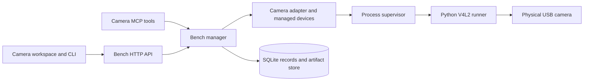

# Physical Camera integration

## Routing

Select this page for Camera package behavior, managed physical devices, capture,
controls, previews and target verification. Start at
`05_Software/integrations/camera/src/nilo_camera/plugin.py` for the runner and
`05_Software/core/internal/bench/camera_adapter.go` for its Bench Core adapter.
Shared package lifecycle and job scheduling belong to
[Managed bench integrations](bench-integrations.md); the runner protocol belongs
to [Integration platform](integration-platform.md); navigation and presentation
belong to [Browser GUI](gui-foundation.md). Operator setup is in
`06_SoftwareDocu/Camera_Integration.md`.

## Purpose and boundaries

The Camera package captures real USB V4L2 devices. Discovery selects a
capture-capable node, excludes metadata-only nodes and reports its advertised
formats, sizes and controls. It generates no simulated frames or replay data.
A stable `cam-N` record owns each configured camera. A serial-less device binds
to its physical USB port; moving it creates a provisional record until an
administrator explicitly rebinds it.

## Public interface

The installed package declares `discover_devices`, `snapshot`, `get_controls`,
`set_controls` and `reset_controls` through `nilo.integration/1`. Bench Core
exposes managed-device configuration and revisioned actions to an Administrator.
Bench work uses the shared job route, `nilo bench submit --plugin camera`, the
Camera CLI commands and Camera MCP tools. The browser places appliance settings
under **System > Plugins** and enabled physical-device work under **Bench >
Camera**.

Snapshots retain a verified JPEG or PNG artifact. Authorized readers receive
bounded previews; a complete artifact is downloaded through its transaction.
The browser offers capture options, hardware controls, retained history and
local viewer transformations. The runner validates requested formats and frame
intervals against the observed device before retaining an image.

## Invariants

- A configured camera resets to its stored control baseline before becoming
  ready after startup or reconnect. A failed reset prevents capture.
- Device configuration, enablement, rebind and forget use current revisions;
  active work blocks changes to that record. Rebind and forget require exact
  record-ID confirmation.
- The core validates operations and artifact media types against the installed
  manifest. Capture remains a queued Bench transaction with normal permissions,
  approval policy, owner-scoped reads and digest verification.
- Source EXIF is not retained. Preview decoding and output dimensions are
  bounded; previews do not become separate evidence artifacts.

## Requirements and verification

- `REQ-UX-4f9b8d21` and `REQ-UX-37d846a0` cover the installed Camera
  navigation and the boundary between appliance administration and physical
  work.
- Camera capability, managed-record, image, packaging and target-binding
  requirements remain draft while their release and physical acceptance is
  incomplete (`REQ-FUNC-0141b9d4`, `REQ-FUNC-a46dc9e4`, `REQ-DATA-8082c1dc`,
  `REQ-PLAT-26896f80`, `REQ-TEST-dcc25f09`).

## Architecture

## Files and verification

- `05_Software/integrations/camera/` - manifest, runner, schemas, V4L2 capture,
  image processing and isolated package tests.
- `05_Software/core/internal/bench/managed_devices.go`, `camera_adapter.go`,
  `camera_initialization.go` and `camera_preview.go` - records, dispatch,
  readiness and bounded previews.
- `05_Software/core/internal/store/sqlite/migrations/019_managed_devices.sql`
  and `020_bench_plugin_configuration.sql` - persistent device and package
  configuration.
- `05_Software/frontend/src/components/pages/CameraSection.tsx` and
  `PluginsPage.tsx` - physical-device work and appliance administration.
- `02_Tools/scripts/build-camera-bundle.py` - verified target bundle assembly.
- `02_Tools/tests/camera/` - isolated binding tests and physical target probes;
  `.agentic/evidence/camera/pi-webcam/` records the Pi webcam observation.

Package and GUI tests cover the software contract. The release input lock in
`02_Tools/packaging/config/inputs.lock.json` is incomplete, so this checkout
cannot build a production release candidate. Physical Camera and live-view
acceptance remain separate from isolated package and probe tests.
