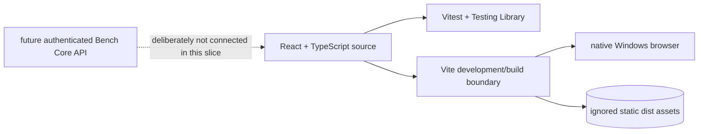

# Browser GUI foundation

## Purpose

The browser GUI foundation provides NILO's native Windows development
interface while keeping the deployed appliance boundary static. It gives
developers a locked, testable React and TypeScript project before live Bench
Core integration is introduced.

## Public interface

The project root is `05_Software/nilo_gui`. Developers use its npm scripts
through `02_Tools/env/with-tools.ps1`: `dev` serves the local interface,
`format:check` and `lint` enforce source quality, `test:ci` runs deterministic
component tests, and `build` emits static production assets into ignored
`dist/`.

## Key behaviors

- `REQ-PLAT-e1a2a591` - pins direct and transitive dependencies with exact
  versions, integrity metadata, and a static Vite production build.
- `REQ-TEST-031b1658` - includes frontend formatting, linting, tests, and build
  in the Windows repository gates.
- `REQ-UX-188a4860` - renders an accessible NILO development shell with an
  unmistakable SIMULATION runtime profile and no backend request.

## Architecture

The current page is a frontend readiness scaffold. It displays disconnected
Bench Core and simulation-only equipment states and performs no network call.
Authentication and live status rendering belong to the next vertical slice.

## Files

- `05_Software/nilo_gui/package.json` and `package-lock.json` - exact commands,
  dependency versions, transitive resolution, and integrity hashes.
- `05_Software/nilo_gui/src/App.tsx` - semantic NILO simulation shell.
- `05_Software/nilo_gui/src/App.css` and `src/index.css` - responsive visual
  presentation.
- `05_Software/nilo_gui/src/App.test.tsx` - accessible identity and simulation
  boundary test.
- `05_Software/nilo_gui/vite.config.ts` - local development server, Vitest,
  and static build configuration.
- `05_Software/nilo_gui/public/favicon.svg` - repository-owned browser icon.
- `05_Software/nilo_gui/README.md` - exact local restore, development, quality,
  and build commands.
- `05_Software/scripts/aegis_test.py` - Windows repository-gate integration.
