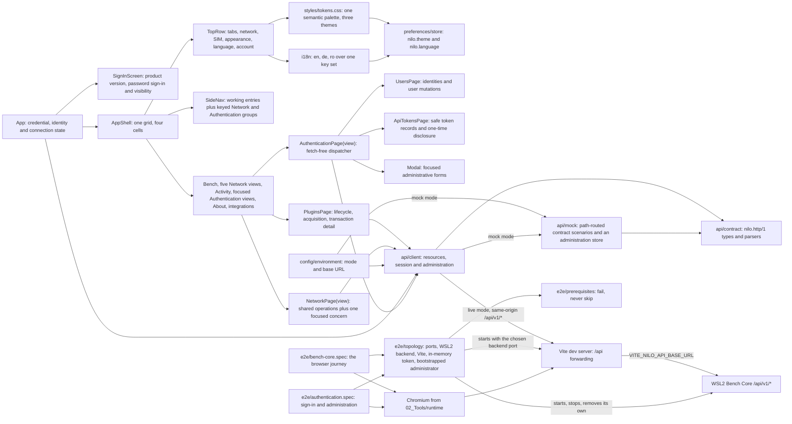

# Browser GUI foundation

## Routing

Select this page for the React shell, pages, API client, accessibility and
localization. Start at `src/components/shell/AppShell.tsx`; focused tests sit
beside each page. Instrument lifecycle and transaction views start at
`src/components/pages/PluginsPage.tsx` and `PluginsPage.test.tsx`. Core scheduling,
permissions and runner behavior belong to [Managed bench integrations](bench-integrations.md).

## Purpose and boundaries

The browser GUI foundation provides NILO's native Windows development
interface while keeping the deployed appliance boundary static. It gives
developers a locked, testable React and TypeScript project in which a human
signs in with a username and password over the server-managed browser session,
reads backend status and the selected runtime's integration and device inventory,
and — as an administrator — administers identities and API tokens, including
their permanent deletion, without ever
suggesting that a simulated result came from physical equipment.

## Public interface

The project root is `05_Software/nilo_gui`. Developers use its npm scripts
through `02_Tools/env/with-tools.ps1`: `dev` serves the interface against a real
backend, `dev:mock` serves it against the built-in contract mock, `format:check`
and `lint` enforce source quality, `test:ci` runs deterministic component tests,
`test:e2e` runs the integrated browser test against a real WSL2 backend with
`test:e2e:headed` as its diagnosis variant, and `build` (or `build:mock`) emits
static production assets into ignored `dist/`.

`*.test.ts` belongs to the component runner and `*.spec.ts` to the browser
runner; `vite.config.ts` and `playwright.config.ts` each name their own files, so
neither collects the other's.

Three build-time environment variables configure the endpoint:
`VITE_NILO_API_MODE` (`live` or `mock`), `VITE_NILO_API_BASE_URL` (an absolute
http or https URL, `http://127.0.0.1:8090` by default), and
`VITE_NILO_MOCK_SCENARIO`, one of `healthy`, `unavailable-inventory`, `empty`,
`unauthorized`, `unavailable`, `malformed-status`, `malformed-integrations`, or
`malformed-devices`, with `malformed` still accepted as an alias of
`malformed-status`. They are read from the committed `.env` and `.env.mock`
files, neither of which holds a credential.

The GUI's own module boundary is `src/api`: `createBenchCoreClient` returns a
`BenchCoreClient` whose methods take a `Credential` — either
`{kind:'session', csrfToken}` or `{kind:'bearer', token}` — and cover the three
bench resources, the sign-in, sign-out and current-session routes, and the
identity and token administration routes. Every failure arrives as a
`BenchCoreError` whose `failure` field is `unauthorized`, `forbidden`,
`rejected`, `unavailable`, or `malformed`, with the stable code Bench Core sent
in `code`. They all share one private `exchange`, so the classification cannot
drift between routes. A session credential sends no `Authorization` header at
all — its secret is in an `HttpOnly` cookie the page cannot read — and adds
`X-NILO-CSRF` on every state-changing request; a bearer credential does the
reverse, and its token is only ever a header value.

The configured client's `baseUrl` is always the empty same-origin base, so it
requests origin-relative paths — the three entries of `BENCH_CORE_PATHS`, the
`/api/v1/auth/*` session routes, and the `/api/v1/users` and `/api/v1/tokens`
administration routes.
`VITE_NILO_API_BASE_URL` is the endpoint the development server forwards `/api`
to, never a URL the browser fetches directly. This keeps the page and backend
one origin: an `Authorization` header is not CORS-safelisted, so a direct
cross-origin call would be preflighted, and Bench Core answers no `OPTIONS`
request and sends no CORS headers. An appliance serves the built assets from
Bench Core itself, where the same paths are already same-origin.

## Runtime presentation

Built assets served by Bench Core receive a `nilo-runtime-profile` HTML meta tag.
Authenticated status remains authoritative for the workspace runtime badge and
reported inventory. The metadata contains no network inventory and grants no
permissions. Before authentication, the product identity uses the project
version from the checked-in GUI package mirror and does not request protected
runtime status.

## Invariants

- All live requests use the same-origin authenticated client and its CSRF rules.
- Simulation labels stay explicit; browser state never proves physical accuracy.
- Instrument submission retries preserve a command key until a response arrives;
  history reattaches by transaction ID and polling never submits work.
- The server authorizes every action even when UI controls are hidden or disabled.

## Key behaviors

- `REQ-PLAT-e1a2a591` - pins direct and transitive dependencies with exact
  versions, integrity metadata, and a static Vite production build.
- `REQ-TEST-031b1658` - includes frontend formatting, linting, tests, and build
  in the Windows repository gates.
- `REQ-UX-188a4860` - keeps one persistent runtime badge after authentication.
- `REQ-FUNC-8a5491d8` - requests the versioned status resource with the entered
  bearer token and returns the reported profile, status, simulation flag, and
  build identity as typed values.
- `REQ-FUNC-3d412917` - separates a rejected token, an unreachable backend, and
  a response outside the supported contract into three distinct causes.
- `REQ-SEC-ed66f6ed` - holds the bearer token in volatile application memory
  only, never in `localStorage`, `sessionStorage`, or a cookie.
- `REQ-UX-40473e43` - presents the NILO product identity, labelled human
  credentials, sign-in action, and actionable authentication feedback.
- `REQ-UX-8a1ddb96` - displays the canonical project version before sign-in
  from the checked-in GUI package mirror.
- `REQ-UX-10182ba0` - keeps the password masked initially and offers an
  accessible, value-preserving reveal and hide control.
- `REQ-UX-fdb7c574` - keeps the complete sign-in surface readable and operable
  from an 800x480 field display through a 1920x1080 desktop viewport.
- `REQ-UX-66636ac9` - distinguishes in-progress, ended-session, unreachable,
  unsupported-response, and connected authenticated resource states.
- `REQ-UX-0018c647` - keeps the primary screen inside one viewport, with the
  workspace as the only scroll region.
- `REQ-PLAT-f852c5b2` - resolves the API mode and Bench Core endpoint from the
  environment, failing loudly on an unusable value.
- `REQ-PLAT-b55586c0` - addresses the backend only through same-origin paths and
  forwards them from the development server, so no authenticated request is ever
  preflighted.
- `REQ-TEST-76b94249` - answers from a mock built on the same contract the
  production client parses and routed by API path, so the interface runs with no
  backend and one scenario can spoil a single resource.
- `REQ-FUNC-539355e0` - requests the versioned integration inventory with the
  entered bearer token and returns the scenario and each integration's identity,
  display name, state, simulation flag, and operations as typed values.
- `REQ-FUNC-72bffd89` - requests the versioned device inventory with the entered
  bearer token and returns the scenario and each device's identity, owning
  integration, display name, kind, availability, simulation flag, and
  capabilities as typed values.
- `REQ-UX-8fa0c15e` - presents the backend status, every integration with its
  state, and every device with its owning integration and availability on one
  authenticated screen.
- `REQ-UX-afb79ae0` - states that an inventory is empty when the backend
  legitimately returns no entries, rather than showing a failure.
- `REQ-UX-8169ea1d` - names which resource returned an unusable response and
  keeps the resources that were read successfully on screen.
- `REQ-TEST-0a4f49af` - drives a real browser against a real Bench Core under
  WSL2 and confirms the bearer-token connection, the simulation identity, the
  healthy status and both deterministic inventories.
- `REQ-TEST-0f02f4b8` - stops that backend mid-session, confirms the unreachable
  screen, restarts it and recovers through the interface's own retry control.
- `REQ-TEST-3c4487d6` - fails a browser run and names the repository command
  that supplies each missing prerequisite, instead of skipping.
- `REQ-REL-f04744fa` - waits a bounded time for each endpoint and names the one
  that stayed silent.
- `REQ-REL-f0c8b07c` - stops only the processes that run started, confirms the
  removal of only the directory it created, and fails the run when any part of
  that release did not succeed.
- `REQ-SEC-4884bc91` - keeps the development token in one private field with no
  accessor, and redacts it out of anything a failing action throws.
- `REQ-PLAT-59993b78` - takes free loopback ports and keeps its temporary Bench
  Core state on the WSL Linux filesystem.
- `REQ-UX-f479d8b9` - offers one headless browser command and a headed variant
  for diagnosis.
- `REQ-FUNC-a6c14c23` - signs a human in with a username and password and shows
  the resulting identity and role.
- `REQ-FUNC-e0da3a06` - restores the signed-in state after a reload from the
  current-session resource, because the session secret is in a cookie the page
  cannot read.
- `REQ-FUNC-5ffce0e4` - ends the session server-side on sign-out.
- `REQ-FUNC-5d80ae6c` - offers one username-and-password credential submission
  path before sign-in.
- `REQ-UX-c7a277c5`, `REQ-UX-93e1b747` - make Authentication an expandable,
  permission-aware System group whose Users and API tokens destinations own
  distinct workspace tabs and resource reads.
- `REQ-UX-7c42d7ba`, `REQ-UX-833c9cd3` - keep primary user and token facts in
  responsive records, secondary safe metadata under Details, and mutations in
  record-aware Actions dialogs that explain unavailable choices.
- `REQ-UX-c4a0c9e7` - keeps each focused listing in normal workspace flow and
  converts the semantic table to labelled cards below 56rem without a nested
  list scrollbar.
- `REQ-UX-ae7baff0` - requires an explicit confirmation before a disable, a
  password reset or a revocation.
- Permanent deletion of an identity or a token sits in the destructive part of
  the same Actions dialog, textually distinct from Disable and from Revoke. Its
  dialog states what is removed, keeps a warning that it cannot be undone
  visible while the field is being filled, and sends nothing until the exact
  username or token name has been typed back. Dismissing it sends nothing at
  all. The dialog is presentation: Bench Core enforces the last-enabled-
  administrator invariant, the owned-token refusal and the audit record inside
  the transaction that applies the removal. An unavailable deletion states its
  reason beside the control, and an administrator deleting their own account is
  returned to sign-in because the session applying it stops authenticating.
  After a successful deletion only the focused listing is re-read.
- `REQ-UX-e60cf375` - discloses a new token secret once, with a copy action, and
  never again.
- `REQ-UX-96852626` - tells an ended session apart from a refused permission.
- `REQ-UX-38017d29` - states that a token cannot exceed its owner's current role.
- `REQ-UX-ed735941`, `REQ-UX-2b0b6d59`, `REQ-UX-4570c081` - reuse the shared
  Field, help popover and workflow-help contracts for authentication while
  keeping validation, impact and irreversible warnings persistently visible.
- `REQ-UX-d697e8ec` - opens Activity from either destination with the identity
  component filter already applied.
- `REQ-UX-b849ddb2` - shows every administrative action in progress and then its
  success or the reason Bench Core refused it.
- `REQ-SEC-66b84b2c` - keeps an entered password, a created token secret and the
  session's request-forgery token out of web storage, request URLs and the
  console.
- `REQ-TEST-68dcb172` - drives the administration page against a real Bench Core
  under WSL2 with a real bootstrapped administrator.
- `REQ-UX-5503457a` - carries the wordmark, the tabs and every control on one
  46-pixel row, with no second tab strip and no page title above the workspace.
- `REQ-UX-f300b346` - activates, closes and keyboard-navigates the open page
  tabs, falling back to the nearest remaining neighbour.
- `REQ-UX-30821068` - splits the navigation into the working entries and the
  bottom-anchored Plugins, Network, Authentication, Activity, About cluster.
- `REQ-UX-b718864e` - expands Network into five focused, separately tabbed
  destinations and keeps the group usable in the rail and drawer.
- `REQ-UX-b555166c` - shows only the assigned Network concern on each destination
  and requests traffic history only from Diagnostics.
- `REQ-UX-6da44516` - gives the active page the whole workspace, with no
  decorative background and no document-level scrolling.
- `REQ-UX-0697c0ab` and `REQ-UX-2d00dbdb` - Light, Dark and System over one
  token set, with System following the device in CSS and reacting to a change.
- `REQ-UX-adbe5465` and `REQ-NFR-b3f90f07` - one catalogue per language over one
  key set, selected from the top row, leaving identifiers untranslated.
- `REQ-UX-811bdde9` - reports appliance network state only where the backend
  reported it, and says so plainly where it did not.
- `REQ-DATA-1a14a1dc` - persists exactly the theme and the language, and nothing
  that authenticates.
- `REQ-TEST-842f1943` - proves the shell, a theme and a language across a real
  reload in a browser against a real WSL2 backend.

## Architecture

`AppShell` binds the Network read/change callbacks and maps five page descriptors
to one view-discriminated `NetworkPage`. `SideNav` renders Network as an expanded
group by default, with Overview, Network adapters, Device access, VPN profiles
and Diagnostics opening independent workspace tabs. `NetworkPage` polls active
operations on every view, requests traffic history only on Diagnostics, renders
a countdown and uses `NetworkConfirmation` for native modal focus containment.
`WireGuardPanel` proposes profile changes without
applying them; acknowledgement is separate. `api/wireguard.ts` validates the
wire contract and exposes only safe profile metadata. `e2e/network.spec.ts`
also covers `readiness_only`: the panel reports readiness without offering profile
controls or claiming an empty inventory, and the summary keeps tunnel and handshake
state unreported. The marker is optional for older/full responses. The same spec
also verifies acknowledged tool installation, `InstallationProgress` phases,
disabled competing actions and terminal success. An optional operation `progress`
string is parsed at the API boundary; no raw package command output is displayed.
The install capability is independent of profile-management readiness, including
when kernel evidence is unknown. Actual APT behavior has separate Linux tests.
The spec
exercises the real Windows-browser/WSL2 flow including the full 120-second
rollback window. Browser mock parity and operation reattachment after reload
remain unfinished, as listed in the Network implementation status document.

`App` owns the whole conversation: which credential is in use, who it belongs
to, and which page is open. Its shell is `restoring`, `signed-out`,
`connecting`, `refused`, or `active`. Every page load starts in `restoring`,
because the only way to learn whether somebody is signed in is to ask Bench Core
who the browser's cookies belong to. The API adapters own wire parsing; pages receive typed values and callbacks.
Network changes carry only their typed request parameters to those adapters.

Hiding the Authentication navigation entry is presentation, never a permission:
Bench Core authorizes every request on its own, so an identity that reaches the
page another way is refused there and told so.

The three resources are requested concurrently on one token. A status that
cannot be read settles the whole screen as `failed`, because without it neither
the token nor the backend nor the contract can be trusted for anything else.
Once the status is in, each inventory is carried as its own `Resource<T>` —
value or failure — which is what lets an unusable integration inventory be told
from an unusable device inventory while the status and the other inventory stay
visible.

## Files

- `src/api/wireguard.ts` - bounded readiness/profile parsing and typed change requests.
- `src/components/network/{WireGuardPanel,NetworkConfirmation}.tsx` - profile controls and native acknowledgement modal.
- `e2e/network.spec.ts` - isolated real-backend Network browser scenarios.

- `05_Software/nilo_gui/package.json` and `package-lock.json` - exact commands,
  dependency versions, transitive resolution, and integrity hashes.
- `05_Software/nilo_gui/.env` and `.env.mock` - committed build-time endpoint
  configuration for the WSL2-backed and mock-only development modes.
- `05_Software/nilo_gui/src/api/contract.ts` - the `nilo.http/1` constants, the
  origin-relative paths, the status, integration, device, session, identity and
  token types, and the strict parsers shared by the client and the mock.
- `05_Software/nilo_gui/src/api/client.ts` - the typed client's fourteen methods
  over one shared exchange, the `Credential` union, and `BenchCoreError` with
  its five causes.
- `05_Software/nilo_gui/src/api/csrf.ts` - reads the readable `nilo_csrf`
  cookie, the only part of the session credential the page can see.
- `05_Software/nilo_gui/src/version.ts` - exposes the checked-in GUI package
  version for the pre-authentication product identity.
- `05_Software/nilo_gui/src/api/permissions.ts` - whether a session has any
  reason to open the Authentication page.
- `05_Software/nilo_gui/src/api/mock.ts` - path-routed, contract-built answers
  for the eight development scenarios, plus an in-memory identity and token
  store enforcing the same role matrix, CSRF rule and last-administrator rule
  the backend does; the ready and unavailable inventories reproduce the Go
  simulation catalog exactly.
- `05_Software/nilo_gui/src/config/environment.ts` - environment reader,
  `GuiConfigurationError`, and the configured-client factory.
- `05_Software/nilo_gui/src/App.tsx` - session restoration, the held credential,
  the concurrent three-resource request, and the unauthenticated and
  not-yet-connected screens.
- `05_Software/nilo_gui/src/styles/tokens.css` - the one semantic palette,
  defined for light, for dark, and for the system theme's dark branch.
- `05_Software/nilo_gui/src/styles/shell.css` - the shell grid and every
  component in it, declaring no literal colour.
- `05_Software/nilo_gui/src/preferences/store.ts` - the only durable browser
  storage this interface uses, and the two keys it holds.
- `05_Software/nilo_gui/src/theme/` and `src/i18n/` - the theme and language
  providers, their contexts, and the three message catalogues.
- `05_Software/nilo_gui/src/components/shell/` - `AppShell`, `TopRow`,
  `TabStrip`, `SideNav`, `NetworkSummary`, `Menu`, `Icon`, the page registry and
  the tab state.
- `05_Software/nilo_gui/src/components/pages/` - `BenchPage`, `NetworkPage` and
  the About, not-yet-available and integration pages.
- `05_Software/nilo_gui/src/components/SignInScreen.tsx` - the unauthenticated
  screen with both forms.
- `05_Software/nilo_gui/src/components/AuthenticationPage.tsx`,
  `src/components/authentication/`, `AdministrationForms.tsx` and `Modal.tsx` -
  the fetch-free view dispatcher, focused Users and API tokens resource owners,
  shared dialog bodies for every change, and the focused dialog itself with its
  focus handling and Escape dismissal.
- `05_Software/nilo_gui/src/App.css` and `src/index.css` - single-viewport
  layout, the inventory scroll compartment, and the CSS custom properties every
  colour is expressed through.
- `05_Software/nilo_gui/src/App.test.tsx`,
  `src/components/AuthenticationPage.test.tsx`, `src/api/client.test.ts`,
  `src/api/contract.test.ts`, `src/api/mock.test.ts`,
  `src/config/environment.test.ts`, and `src/layout.test.ts` - the shell,
  administration-page, client, contract, mock, configuration, and layout tests.
- `05_Software/nilo_gui/src/test/setup.ts` - jest-dom matchers and the
  Testing Library cleanup Vitest does not register without injected globals.
- `05_Software/nilo_gui/vite.config.ts` - local development server, the `/api`
  forwarding for both serve and preview, Vitest, and static build configuration.
- `05_Software/nilo_gui/src/config/devServer.test.ts` - asserts that forwarding
  is declared and takes its target from the environment.
- `05_Software/nilo_gui/playwright.config.ts` - the integrated browser runner:
  headless, serial, no retries, and no retained trace, video or screenshot.
- `05_Software/nilo_gui/e2e/topology.ts` - one run's own Bench Core under WSL2
  and interface server on Windows: free loopback ports, a `mktemp` directory on
  the WSL Linux filesystem, the in-memory token, bounded readiness waits, and a
  teardown that signals only its own handles and removes only its own directory.
- `05_Software/nilo_gui/e2e/prerequisites.ts` - the distribution, checkout and
  browser checks, each failing with the repository command that supplies it.
- `05_Software/nilo_gui/e2e/bench-core.spec.ts` - the bearer-token browser
  journey, in one serial session: connect, status, simulation identity, both
  inventories, the unreachable screen, and recovery.
- `05_Software/nilo_gui/e2e/authentication.spec.ts` - the human browser journey
  against a real administrator the harness bootstraps through the real command
  line: password sign-in, identity creation, a role change, a token with its
  one-time secret, restoration across a reload, revocation, the
  last-administrator refusal, the entry a Viewer does not get, and sign-out.
- `05_Software/nilo_gui/e2e/token-redaction.spec.ts` - the forced-failure
  regression: a real browser action made to fail after its locator resolves,
  asserting the redaction wrapper removes the value and that the unwrapped call
  would still have leaked it.
- `05_Software/nilo_gui/e2e/topology.test.ts`, `e2e/prerequisites.test.ts` and
  `e2e/commands.test.ts` - the harness, prerequisite and command-surface tests,
  which run in the component suite and start no process of their own.
- `05_Software/nilo_gui/public/favicon.svg` - repository-owned browser icon.
- `05_Software/nilo_gui/README.md` - exact local restore, development, quality,
  build, configuration, and authentication commands.
- `05_Software/scripts/aegis_test.py` - Windows repository-gate integration.

## Compact Network overview (2026-09-03)

The authenticated shell uses one SIM/LIVE badge, without a footer disclaimer. Network lists show addresses and gateways, plus WireGuard configured addresses and peer endpoints. The API parser retains only public profile metadata. DNS, routes, handshake and readiness diagnostics are collapsed; Import profile opens the form. Completed notices are dismissible; pending confirmation, rollback failures and stale data remain explicit. Gateway fields are additive; an older running backend leaves them unreported until restarted. Do not restart a user simulation session merely to populate these fields: simulated profiles are in memory.

## Device networks, adapter configuration and Activity (2026-09-04)

- `src/api/devicenetworks.ts`, `src/api/activity.ts`, `src/api/settings.ts`
  parse the device-network, activity/diagnostics and adapter-settings resources;
  `contract.ts` gained `adapter_id`, `ssid` and `settings` on an interface, the
  operations listing, and the `activity.read`, `activity.export` and
  `diagnostics.manage` permissions; `wireguard.ts` gained the `rename` change.
  The client exposes one method per route and `exportActivity` returns the
  export as the text the appliance wrote.
- `src/api/mock.ts` answers every new route through the same acknowledged
  lifecycle, keeps device networks, sessions, the policy and an activity
  history in memory, and gives device-network and Wi-Fi changes a confirmation
  window as the appliance does.
- `components/network/DeviceNetworksPanel.tsx`: table (intent and observation
  are separate columns), editor dialog, enable/disable/delete through previews,
  check and instructions dialogs, activity link narrowed to the network.
  `InterfaceSettingsDialog.tsx`: addressing form and, on a wireless adapter,
  scan and join with a password that is typed once and never displayed.
  `WireGuardPanel.tsx`: rename in the profile details.
- `pages/ActivityPage.tsx`: filters as a responsive grid, server paging by
  cursor, retained window and logging health, JSONL/CSV export, and the
  diagnostics section (sessions with fixed scopes and durations, the retention
  policy). `shell/pages.ts` places the `activity` core page below
  Authentication, shown to an identity holding `activity.read`; `AppShell` keeps the filter a Network
  page link chose and remounts the page with it.
- `pages/NetworkPage.tsx` reads `GET /api/v1/network/operations` on mount and
  picks up a change still applying or awaiting confirmation; a refused preview
  is shown with the appliance's reason rather than as an outage.
- Catalogues: 154 keys added to en, de and ro; `messages.test.ts` lists the
  words the languages share.

## Compact field interface and contextual help (2026-09-04, TASK-9ca3f883)

The interface is sized for a seven-inch appliance display (`1024x600` primary,
`800x480` fallback) as well as a desktop monitor, and no backend, contract,
permission or confirmation behaviour changed with it.

- `REQ-UX-c8c16d33` - one semantic type scale in `styles/tokens.css`
  (`--text-title` 22px, `--text-section` 18px, `--text-body` 16px,
  `--text-dense` 15px, `--text-label` 14px with their line heights); every
  `font-size` in `styles/shell.css` names a token, nothing operator-facing is
  below 14px, and no heading is set in capitals with widened tracking.
- `REQ-UX-c5f7c0cd` - `--control-height` and `--target-min` are 44px; one base
  `button, .button` rule, 44px inputs and selects, 22px checkboxes inside
  44px labels, and a tab close control the height of the row.
- `REQ-UX-2687f591` - `shell/useViewportClass` reads the same two media queries
  the stylesheet uses and returns `wide | compact | constrained`. Compact
  narrows the rail to `--nav-width-compact` and keeps every label; constrained
  hides the rail, shows the `Menu` control and opens `shell/NavDrawer` (a
  `Modal` with `variant="drawer"`), and `TopRow` folds the appearance and
  language menus into the account menu while keeping the tabs, the network
  summary and the one `SIM`/`LIVE` indicator.
- `REQ-UX-2de87216` - `Modal` is a head (title and `Close`), a scrolling
  `.modal-body`, and a `.modal-actions` bar stuck to its bottom; below 56rem or
  640px it is a full-screen sheet. `components/layers.ts` keeps the stack of
  dismissible layers so Escape closes only the top one: a help popover over an
  editor closes the popover.
- `REQ-UX-2b0b6d59` - `help/HelpPopover` opens on click, tap, Enter, hover and
  focus, exposes `aria-expanded` and `aria-controls`, closes on Escape, outside
  activation and its own control with focus returned, closes any other help
  through one document event, and positions itself from the trigger's rectangle
  so it stays in the viewport. No explanation is left in a `title` attribute.
- `REQ-UX-4570c081` - `help/Field` renders label, help, control, persistent
  guidance and the validation message in reading order, tied to the control by
  `aria-describedby`. The confirmation window, countdown, rollback failure,
  refusal and route prerequisites stay in notices and dialogs.
- `REQ-UX-1860069d` - `help/WorkflowHelp` opens "How to configure" over `Modal`
  with six catalogue sections (`help.dn.*`, `help.if.*`): goal, values needed,
  addressing example, what NILO changes, what must exist elsewhere, verify and
  recover.
- `REQ-UX-cde0b9e2` - `network/NetworkOverview` states the uplink and its
  address, the device side, the active profile or None, and what needs
  attention, computed from the status, the device networks, the WireGuard status
  and the running operation. `network/addressing.ts` holds `uplinkOf`,
  `isAddress`, `isPrefix` and `subnetOf`.
- `REQ-UX-ff989933` - one `table.data-table.record-table` per list with
  `data-label` on each cell; below 56rem the stylesheet turns rows into labelled
  cards. Secondary values live in an explicit details row announced as a region;
  `components/RowActions.tsx` gives each row one Actions control that opens a
  compact `Modal` attached to the document body. It identifies the object type
  and status, gives every choice a full-width target, keeps disabled entries and
  their reasons visible, separates destructive actions, and cannot be clipped
  by the table scroll compartment.
- `REQ-UX-8859ce12` - the device-network editor is Identity, Device side, Access
  path, Addressing, Services, a collapsed Advanced and a Review that names the
  adapter and address, the authorized sources and target, whether WireGuard is
  involved, whether source NAT or preservation is used and whether the
  management path is affected. Format validation (address, prefix, source list,
  port range) runs before any preview and appears after the field; ports stay
  editable with 502 as an example.
- `REQ-UX-f30891b4` - Bench, Activity, Authentication and About use the same
  classes; Activity keeps time, outcome, action, subject and actor in the row
  and moves category, function, actor identity and the raw record into its
  details.
- `REQ-NFR-aa1a4734` - 134 catalogue keys added to en, de and ro.
- `REQ-TEST-5da12a09` - `e2e/field-display.spec.ts` drives 1920x1080, 1366x768,
  1024x600 and 800x480 in both themes and asserts readable text, 44-pixel field
  targets, no document overflow, no `title`-only explanation, the drawer, the
  sheet, help by pointer and keyboard, the editors' final actions, validation
  and a pending confirmation. It is CSS-pixel proof; the physical seven-inch
  panel is still unverified.

## Focused Network navigation (2026-09-04, TASK-b225b22e)

Network is one collapsible System group whose root opens Overview and whose
children open Network adapters, Device access, VPN profiles and Diagnostics.
Each destination owns one workspace tab and one concern: Overview contains the
decision summary, adapters contains interface configuration, Device access
contains forwarding definitions, VPN profiles contains WireGuard lifecycle and
import, and Diagnostics contains WireGuard readiness plus traffic history. The
existing `network` page id remains Overview; the children use internal
`network:*` ids. Collapsing navigation never closes a tab, Activity remains a
peer page, and common operation refusal, confirmation and recovery notices stay
available on every Network view.

`TrafficChart` labels received (RX) and sent (TX) traffic, scales bytes per
measured minute against a visible time axis, and positions bars by timestamp so
an unmeasured minute remains a gap. Hover, touch or keyboard focus selects one
minute and shows its time, RX, TX and total; arrow keys move through measured
minutes with only one chart sample in the tab order. Expanded WireGuard
readiness renders as a compact grid of left-label/right-value facts, and the
Statistics title shares one responsive header with the interface and period
controls. This keeps the initial Diagnostics chart in the workspace without
vertical scrolling at 1024x600 and larger; 800x480 may scroll vertically.

## Account-menu appliance power controls (2026-09-08, TASK-a3a3d7b2)

On a live appliance, `TopRow` adds Restart NILO and Power off NILO beside Sign
out only when the current browser session carries `system.power.manage`.
Simulation, Viewer and bearer-token states render neither action. Power remains
outside `BENCH_CORE_TOKEN_SCOPES`, although it is part of the complete permission
union used to parse session responses.

`PowerConfirmation` owns the action-specific warning and a single in-flight
submission. It distinguishes accepted responses, typed server refusals and an
unconfirmed transport loss; it never interprets the intended disappearance of
the appliance as success. `AppShell` owns the selected action and binds the
dialog to `BenchCoreClient.requestPower`, while sign-out keeps its existing
session behavior.

## Managed instrument workspace (TASK-f1f2d836)

`REQ-UX-30e2e009` adds Plugins and the sigrok integration tab through the same
`PluginsPage`. The page serializes refreshes, polls summaries and selected detail,
retains uncertain submission keys, renders digital channels and a bounded preview,
and exposes session-only approval, cancellation, capture download and saved UART
submission. Management and execution controls follow the current session scopes.
English, German and Romanian share the instrument key set.

- `src/api/bench.ts`, `bench.test.ts` — job/plugin wire parsing and API boundary.
- `src/api/client.ts` — lifecycle, discovery, submit/list/detail/actions/download.
- `src/components/pages/PluginsPage.tsx`, `PluginsPage.test.tsx` — workspace and
  retry/permission/reconnect regressions.
- `src/components/shell/pages.ts`, `AppShell.tsx` — installed workspace routing.
- `src/i18n/{en,de,ro}.ts`, `src/index.css` — translated controls and responsive layout.

The browser mock retains its pre-existing scope; exercise instruments against a
real simulation-profile runner. Source paths above are relative to `05_Software/nilo_gui/`.

## Core navigation order without Settings (2026-09-05, TASK-17d71acd)

`CORE_PAGES` in `shell/pages.ts` is the top-to-bottom order the lower cluster
renders, because `SideNav` maps the array as it stands: Plugins, Network with
its four `network:*` children, Authentication with API tokens, Activity, About.
The `settings` descriptor, its `AppShell` placeholder branch and the obsolete
placeholder catalogue entries are gone, so no Settings destination exists to
open; `Icon`'s `settings` glyph stays, used by Network adapters. The Plugins
entry remains available through the managed instrument workspace added by
TASK-f1f2d836.
