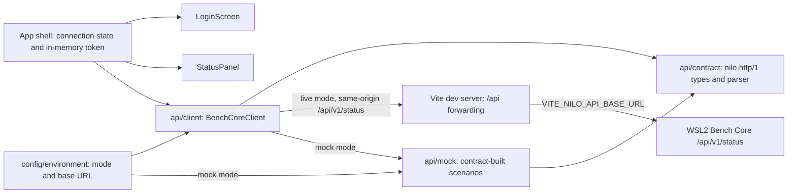

# Browser GUI foundation

## Purpose

The browser GUI foundation provides NILO's native Windows development
interface while keeping the deployed appliance boundary static. It gives
developers a locked, testable React and TypeScript project that authenticates
against the versioned Bench Core HTTP API and displays the backend status,
without ever suggesting that a simulated result came from physical equipment.

## Public interface

The project root is `05_Software/nilo_gui`. Developers use its npm scripts
through `02_Tools/env/with-tools.ps1`: `dev` serves the interface against a real
backend, `dev:mock` serves it against the built-in contract mock, `format:check`
and `lint` enforce source quality, `test:ci` runs deterministic component tests,
and `build` (or `build:mock`) emits static production assets into ignored
`dist/`.

Three build-time environment variables configure the endpoint:
`VITE_NILO_API_MODE` (`live` or `mock`), `VITE_NILO_API_BASE_URL` (an absolute
http or https URL, `http://127.0.0.1:8090` by default), and
`VITE_NILO_MOCK_SCENARIO` (`healthy`, `unauthorized`, `unavailable`, or
`malformed`). They are read from the committed `.env` and `.env.mock` files,
neither of which holds a credential.

The GUI's own module boundary is `src/api`: `createBenchCoreClient` returns a
`BenchCoreClient` with `baseUrl` and `getStatus(token)`, and every failure
arrives as a `BenchCoreError` whose `failure` field is `unauthorized`,
`unavailable`, or `malformed`.

The configured client's `baseUrl` is always the empty same-origin base, so it
requests origin-relative paths such as `/api/v1/status`. `VITE_NILO_API_BASE_URL`
is the endpoint the development server forwards `/api` to and the label the
login screen shows, never a URL the browser fetches. This is what keeps the page
and the backend one origin: an `Authorization` header is not CORS-safelisted, so
a direct cross-origin call would be preflighted, and Bench Core answers no
`OPTIONS` request and sends no CORS headers. An appliance serves the built
assets from Bench Core itself, where the same paths are already same-origin.

## Key behaviors

- `REQ-PLAT-e1a2a591` - pins direct and transitive dependencies with exact
  versions, integrity metadata, and a static Vite production build.
- `REQ-TEST-031b1658` - includes frontend formatting, linting, tests, and build
  in the Windows repository gates.
- `REQ-UX-188a4860` - keeps the NILO development identity, the SIMULATION
  runtime profile, and the physical-equipment boundary statement visible on
  every screen.
- `REQ-FUNC-8a5491d8` - requests the versioned status resource with the entered
  bearer token and returns the reported profile, status, simulation flag, and
  build identity as typed values.
- `REQ-FUNC-3d412917` - separates a rejected token, an unreachable backend, and
  a response outside the supported contract into three distinct causes.
- `REQ-SEC-ed66f6ed` - holds the bearer token in volatile application memory
  only, never in `localStorage`, `sessionStorage`, or a cookie.
- `REQ-UX-40473e43` - presents the development login screen and contacts nothing
  until a non-empty token is submitted.
- `REQ-UX-66636ac9` - renders in-progress, rejected-token, unreachable,
  unsupported-response, and connected as five separately identifiable screens.
- `REQ-UX-0018c647` - keeps the primary screen inside one viewport, with the
  workspace as the only scroll region.
- `REQ-PLAT-f852c5b2` - resolves the API mode and Bench Core endpoint from the
  environment, failing loudly on an unusable value.
- `REQ-PLAT-b55586c0` - addresses the backend only through same-origin paths and
  forwards them from the development server, so no authenticated request is ever
  preflighted.
- `REQ-TEST-76b94249` - answers from a mock built on the same contract the
  production client parses, so the interface runs with no backend.

## Architecture

`App` owns the whole conversation: the token it holds in state, and a session
that is `unauthenticated`, `checking`, `connected`, or `failed`. Components
never call the network themselves, and nothing outside `api/contract.ts` knows
the wire field names. The integration and device inventory resources exist in
the backend but have no client, mock, or view here yet.

## Files

- `05_Software/nilo_gui/package.json` and `package-lock.json` - exact commands,
  dependency versions, transitive resolution, and integrity hashes.
- `05_Software/nilo_gui/.env` and `.env.mock` - committed build-time endpoint
  configuration for the WSL2-backed and mock-only development modes.
- `05_Software/nilo_gui/src/api/contract.ts` - the `nilo.http/1` constants,
  status types, and body parser shared by the client and the mock.
- `05_Software/nilo_gui/src/api/client.ts` - the typed client and
  `BenchCoreError` with its three causes.
- `05_Software/nilo_gui/src/api/mock.ts` - contract-built healthy, unauthorized,
  unavailable, and malformed answers.
- `05_Software/nilo_gui/src/config/environment.ts` - environment reader,
  `GuiConfigurationError`, and the configured-client factory.
- `05_Software/nilo_gui/src/App.tsx` - the shell: in-memory token, connection
  state, persistent SIMULATION identity and boundary statement.
- `05_Software/nilo_gui/src/components/LoginScreen.tsx` and `StatusPanel.tsx` -
  the unauthenticated screen and the four post-submission screens.
- `05_Software/nilo_gui/src/App.css` and `src/index.css` - single-viewport
  layout and the CSS custom properties every colour is expressed through.
- `05_Software/nilo_gui/src/App.test.tsx`, `src/api/client.test.ts`,
  `src/api/mock.test.ts`, `src/config/environment.test.ts`, and
  `src/layout.test.ts` - the component, client, mock, configuration, and layout
  tests.
- `05_Software/nilo_gui/src/test/setup.ts` - jest-dom matchers and the
  Testing Library cleanup Vitest does not register without injected globals.
- `05_Software/nilo_gui/vite.config.ts` - local development server, the `/api`
  forwarding for both serve and preview, Vitest, and static build configuration.
- `05_Software/nilo_gui/src/config/devServer.test.ts` - asserts that forwarding
  is declared and takes its target from the environment.
- `05_Software/nilo_gui/public/favicon.svg` - repository-owned browser icon.
- `05_Software/nilo_gui/README.md` - exact local restore, development, quality,
  build, configuration, and authentication commands.
- `05_Software/scripts/aegis_test.py` - Windows repository-gate integration.
