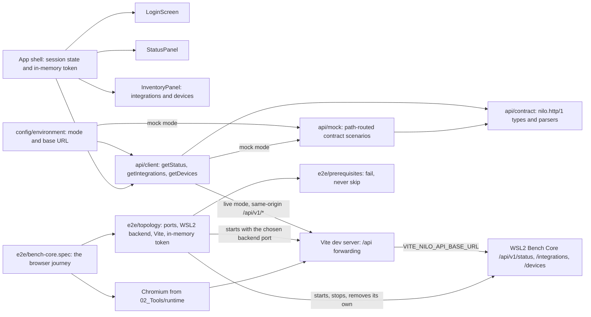

# Browser GUI foundation

## Purpose

The browser GUI foundation provides NILO's native Windows development
interface while keeping the deployed appliance boundary static. It gives
developers a locked, testable React and TypeScript project that authenticates
against the versioned Bench Core HTTP API and displays the backend status
together with the simulated integration and device inventory, without ever
suggesting that a simulated result came from physical equipment.

## Public interface

The project root is `05_Software/nilo_gui`. Developers use its npm scripts
through `02_Tools/env/with-tools.ps1`: `dev` serves the interface against a real
backend, `dev:mock` serves it against the built-in contract mock, `format:check`
and `lint` enforce source quality, `test:ci` runs deterministic component tests,
`test:e2e` runs the integrated browser test against a real WSL2 backend with
`test:e2e:headed` as its diagnosis variant, and `build` (or `build:mock`) emits
static production assets into ignored `dist/`.

`*.test.ts` belongs to the component runner and `*.spec.ts` to the browser
runner; `vite.config.ts` and `playwright.config.ts` each name their own files, so
neither collects the other's.

Three build-time environment variables configure the endpoint:
`VITE_NILO_API_MODE` (`live` or `mock`), `VITE_NILO_API_BASE_URL` (an absolute
http or https URL, `http://127.0.0.1:8090` by default), and
`VITE_NILO_MOCK_SCENARIO`, one of `healthy`, `unavailable-inventory`, `empty`,
`unauthorized`, `unavailable`, `malformed-status`, `malformed-integrations`, or
`malformed-devices`, with `malformed` still accepted as an alias of
`malformed-status`. They are read from the committed `.env` and `.env.mock`
files, neither of which holds a credential.

The GUI's own module boundary is `src/api`: `createBenchCoreClient` returns a
`BenchCoreClient` with `baseUrl`, `getStatus(token)`, `getIntegrations(token)`,
and `getDevices(token)`, and every failure from any of them arrives as a
`BenchCoreError` whose `failure` field is `unauthorized`, `unavailable`, or
`malformed`. All three share one private `request(path, token, parse)`, so the
classification cannot drift between resources, and the token is only ever an
`Authorization` header value.

The configured client's `baseUrl` is always the empty same-origin base, so it
requests origin-relative paths — `/api/v1/status`, `/api/v1/integrations`, and
`/api/v1/devices`, the three entries of `BENCH_CORE_PATHS`.
`VITE_NILO_API_BASE_URL`
is the endpoint the development server forwards `/api` to and the label the
login screen shows, never a URL the browser fetches. This is what keeps the page
and the backend one origin: an `Authorization` header is not CORS-safelisted, so
a direct cross-origin call would be preflighted, and Bench Core answers no
`OPTIONS` request and sends no CORS headers. An appliance serves the built
assets from Bench Core itself, where the same paths are already same-origin.

## Key behaviors

- `REQ-PLAT-e1a2a591` - pins direct and transitive dependencies with exact
  versions, integrity metadata, and a static Vite production build.
- `REQ-TEST-031b1658` - includes frontend formatting, linting, tests, and build
  in the Windows repository gates.
- `REQ-UX-188a4860` - keeps the NILO development identity, the SIMULATION
  runtime profile, and the physical-equipment boundary statement visible on
  every screen.
- `REQ-FUNC-8a5491d8` - requests the versioned status resource with the entered
  bearer token and returns the reported profile, status, simulation flag, and
  build identity as typed values.
- `REQ-FUNC-3d412917` - separates a rejected token, an unreachable backend, and
  a response outside the supported contract into three distinct causes.
- `REQ-SEC-ed66f6ed` - holds the bearer token in volatile application memory
  only, never in `localStorage`, `sessionStorage`, or a cookie.
- `REQ-UX-40473e43` - presents the development login screen and contacts nothing
  until a non-empty token is submitted.
- `REQ-UX-66636ac9` - renders in-progress, rejected-token, unreachable,
  unsupported-response, and connected as five separately identifiable screens.
- `REQ-UX-0018c647` - keeps the primary screen inside one viewport, with the
  workspace as the only scroll region.
- `REQ-PLAT-f852c5b2` - resolves the API mode and Bench Core endpoint from the
  environment, failing loudly on an unusable value.
- `REQ-PLAT-b55586c0` - addresses the backend only through same-origin paths and
  forwards them from the development server, so no authenticated request is ever
  preflighted.
- `REQ-TEST-76b94249` - answers from a mock built on the same contract the
  production client parses and routed by API path, so the interface runs with no
  backend and one scenario can spoil a single resource.
- `REQ-FUNC-539355e0` - requests the versioned integration inventory with the
  entered bearer token and returns the scenario and each integration's identity,
  display name, state, simulation flag, and operations as typed values.
- `REQ-FUNC-72bffd89` - requests the versioned device inventory with the entered
  bearer token and returns the scenario and each device's identity, owning
  integration, display name, kind, availability, simulation flag, and
  capabilities as typed values.
- `REQ-UX-8fa0c15e` - presents the backend status, every integration with its
  state, and every device with its owning integration and availability on one
  authenticated screen.
- `REQ-UX-afb79ae0` - states that an inventory is empty when the backend
  legitimately returns no entries, rather than showing a failure.
- `REQ-UX-8169ea1d` - names which resource returned an unusable response and
  keeps the resources that were read successfully on screen.
- `REQ-TEST-0a4f49af` - drives a real browser against a real Bench Core under
  WSL2 and confirms the login, the simulation identity, the healthy status and
  both deterministic inventories.
- `REQ-TEST-0f02f4b8` - stops that backend mid-session, confirms the unreachable
  screen, restarts it and recovers through the interface's own retry control.
- `REQ-TEST-3c4487d6` - fails a browser run and names the repository command
  that supplies each missing prerequisite, instead of skipping.
- `REQ-REL-f04744fa` - waits a bounded time for each endpoint and names the one
  that stayed silent.
- `REQ-REL-f0c8b07c` - stops only the processes that run started, confirms the
  removal of only the directory it created, and fails the run when any part of
  that release did not succeed.
- `REQ-SEC-4884bc91` - keeps the development token in one private field with no
  accessor, and redacts it out of anything a failing action throws.
- `REQ-PLAT-59993b78` - takes free loopback ports and keeps its temporary Bench
  Core state on the WSL Linux filesystem.
- `REQ-UX-f479d8b9` - offers one headless browser command and a headed variant
  for diagnosis.

## Architecture

`App` owns the whole conversation: the token it holds in state, and a session
that is `unauthenticated`, `checking`, `connected`, or `failed`. Components
never call the network themselves, and nothing outside `api/contract.ts` knows
the wire field names.

The three resources are requested concurrently on one token. A status that
cannot be read settles the whole screen as `failed`, because without it neither
the token nor the backend nor the contract can be trusted for anything else.
Once the status is in, each inventory is carried as its own `Resource<T>` —
value or failure — which is what lets an unusable integration inventory be told
from an unusable device inventory while the status and the other inventory stay
visible.

## Files

- `05_Software/nilo_gui/package.json` and `package-lock.json` - exact commands,
  dependency versions, transitive resolution, and integrity hashes.
- `05_Software/nilo_gui/.env` and `.env.mock` - committed build-time endpoint
  configuration for the WSL2-backed and mock-only development modes.
- `05_Software/nilo_gui/src/api/contract.ts` - the `nilo.http/1` constants, the
  three origin-relative resource paths, the status, integration and device
  types, and the strict parsers shared by the client and the mock.
- `05_Software/nilo_gui/src/api/client.ts` - the typed client's three resource
  methods over one shared request, and `BenchCoreError` with its three causes.
- `05_Software/nilo_gui/src/api/mock.ts` - path-routed, contract-built answers
  for the eight development scenarios; the ready and unavailable inventories
  reproduce the Go simulation catalog exactly.
- `05_Software/nilo_gui/src/config/environment.ts` - environment reader,
  `GuiConfigurationError`, and the configured-client factory.
- `05_Software/nilo_gui/src/App.tsx` - the shell: in-memory token, the
  concurrent three-resource request, session state, persistent SIMULATION
  identity and boundary statement.
- `05_Software/nilo_gui/src/components/LoginScreen.tsx`, `StatusPanel.tsx` and
  `InventoryPanel.tsx` - the unauthenticated screen, the post-submission
  screens, and the two inventory regions with their populated, empty and failed
  states.
- `05_Software/nilo_gui/src/App.css` and `src/index.css` - single-viewport
  layout, the inventory scroll compartment, and the CSS custom properties every
  colour is expressed through.
- `05_Software/nilo_gui/src/App.test.tsx`, `src/api/client.test.ts`,
  `src/api/contract.test.ts`, `src/api/mock.test.ts`,
  `src/config/environment.test.ts`, and `src/layout.test.ts` - the component,
  client, path-contract, mock, configuration, and layout tests.
- `05_Software/nilo_gui/src/test/setup.ts` - jest-dom matchers and the
  Testing Library cleanup Vitest does not register without injected globals.
- `05_Software/nilo_gui/vite.config.ts` - local development server, the `/api`
  forwarding for both serve and preview, Vitest, and static build configuration.
- `05_Software/nilo_gui/src/config/devServer.test.ts` - asserts that forwarding
  is declared and takes its target from the environment.
- `05_Software/nilo_gui/playwright.config.ts` - the integrated browser runner:
  headless, serial, no retries, and no retained trace, video or screenshot.
- `05_Software/nilo_gui/e2e/topology.ts` - one run's own Bench Core under WSL2
  and interface server on Windows: free loopback ports, a `mktemp` directory on
  the WSL Linux filesystem, the in-memory token, bounded readiness waits, and a
  teardown that signals only its own handles and removes only its own directory.
- `05_Software/nilo_gui/e2e/prerequisites.ts` - the distribution, checkout and
  browser checks, each failing with the repository command that supplies it.
- `05_Software/nilo_gui/e2e/bench-core.spec.ts` - the browser journey, in one
  serial session: login, status, simulation identity, both inventories, the
  unreachable screen, and recovery.
- `05_Software/nilo_gui/e2e/token-redaction.spec.ts` - the forced-failure
  regression: a real browser action made to fail after its locator resolves,
  asserting the redaction wrapper removes the value and that the unwrapped call
  would still have leaked it.
- `05_Software/nilo_gui/e2e/topology.test.ts`, `e2e/prerequisites.test.ts` and
  `e2e/commands.test.ts` - the harness, prerequisite and command-surface tests,
  which run in the component suite and start no process of their own.
- `05_Software/nilo_gui/public/favicon.svg` - repository-owned browser icon.
- `05_Software/nilo_gui/README.md` - exact local restore, development, quality,
  build, configuration, and authentication commands.
- `05_Software/scripts/aegis_test.py` - Windows repository-gate integration.
