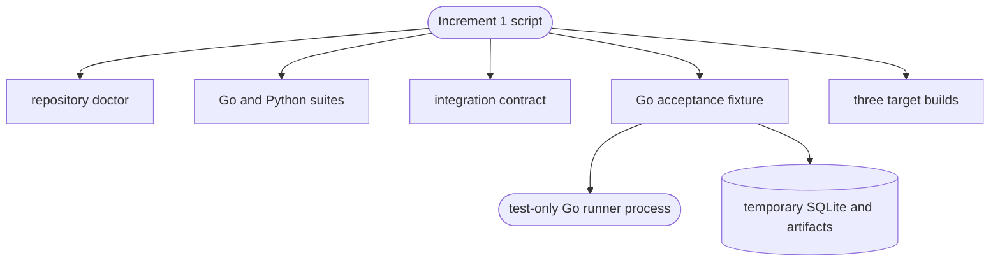

# Increment 1 acceptance

## Routing

Use this page for the Increment 1 foundation gate, its test-only integration
runner, or the Windows, Linux, and Raspberry Pi acceptance commands. Start with
`02_Tools/scripts/test-increment-1.ps1` or `test-increment-1.sh`, then
`05_Software/core/internal/acceptance/increment1_e2e_test.go` for the composed
lifecycle test. The integration wire contract belongs to *Integration platform*;
repository-wide test routing belongs to *Repository-local toolchain*.

## Purpose and boundaries

The acceptance component proves that the foundation works as one composed system through a real Go child process and real persistence. It is not hardware-in-the-loop evidence and does not replace the mandatory native Raspberry Pi run.

## Public interface

Developers run `02_Tools/scripts/test-increment-1.ps1` on Windows or `test-increment-1.sh` on Linux. The scripts use repository-local tools, run focused and full suites, exercise the test-only contract runner, vet Go, cross-compile the supported targets, and reject new repository artifacts.

## Invariants

- The acceptance runner is built from `05_Software/tests/fixtures/contract_runner/`
  into a temporary package and is never a product integration.
- The lifecycle test uses real foundation services and temporary state; its
  result does not claim physical hardware acceptance.
- Native Raspberry Pi execution remains a separate release gate.

## Key behaviors

- `REQ-TEST-b52051b8` - drives approval, Auto execution, progress, artifacts, cancellation, crash, and restart reconciliation through real foundation services.
- `REQ-TEST-2bbda8a9` - includes the reusable integration contract gate.
- `REQ-PLAT-93e1b194` - cross-compiles the portable core for all declared targets.

## Architecture

Windows proves the host workflow and compile portability. Release readiness still requires the same script to pass natively on Raspberry Pi 4 Linux ARM64.

## Files

- `05_Software/core/internal/acceptance/increment1_e2e_test.go` - externally observable lifecycle assertions.
- `05_Software/core/internal/acceptance/increment1_fixture_test.go` - real service, store, schema, supervisor, and package composition fixture.
- `05_Software/tests/fixtures/contract_runner/` - test-only Go process and package declaration.
- `02_Tools/scripts/test-increment-1.ps1` - Windows one-command gate.
- `02_Tools/scripts/test-increment-1.sh` - Linux and Raspberry Pi one-command gate.
- `05_Software/INCREMENT_1_ACCEPTANCE.md` - gate scope, commands, and Pi release-blocking evidence.
- `02_Tools/scripts/aegis_test.py` - polyglot suite router used by AEGIS.
- `02_Tools/tests/software/test_aegis_test.py` - router contract tests.
- `02_Tools/scripts/verify-portable-core.ps1` and `02_Tools/scripts/verify-portable-core.sh` - focused portable build checks.
