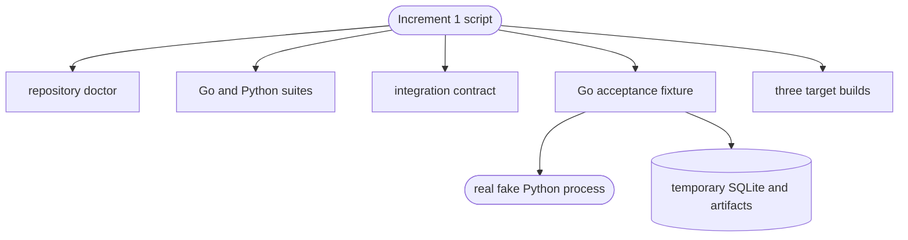

# Increment 1 acceptance

## Purpose

The acceptance component proves that the foundation works as one composed system through a real Python child process and real persistence. It is not hardware-in-the-loop evidence and does not replace the mandatory native Raspberry Pi run.

## Public interface

Developers run `05_Software/scripts/test-increment-1.ps1` on Windows or `test-increment-1.sh` on Linux. The scripts use repository-local tools, run focused and full suites, exercise the real fake runner, vet Go, cross-compile the supported targets, and reject new repository artifacts.

## Key behaviors

- `REQ-TEST-b52051b8` - drives approval, Auto execution, progress, artifacts, cancellation, crash, and restart reconciliation through real foundation services.
- `REQ-TEST-2bbda8a9` - includes the reusable integration contract gate.
- `REQ-PLAT-93e1b194` - cross-compiles the portable core for all declared targets.

## Architecture

Windows proves the host workflow and compile portability. Release readiness still requires the same script to pass natively on Raspberry Pi 4 Linux ARM64.

## Files

- `05_Software/nilo_assistant/internal/acceptance/increment1_e2e_test.go` - externally observable lifecycle assertions.
- `05_Software/nilo_assistant/internal/acceptance/increment1_fixture_test.go` - real service, store, schema, supervisor, and package composition fixture.
- `05_Software/scripts/test-increment-1.ps1` - Windows one-command gate.
- `05_Software/scripts/test-increment-1.sh` - Linux and Raspberry Pi one-command gate.
- `05_Software/INCREMENT_1_ACCEPTANCE.md` - gate scope, commands, and Pi release-blocking evidence.
- `05_Software/scripts/aegis_test.py` - polyglot suite router used by AEGIS.
- `05_Software/scripts/tests/test_aegis_test.py` - router contract tests.
- `05_Software/scripts/verify-portable-core.ps1` and `05_Software/scripts/verify-portable-core.sh` - focused portable build checks.
