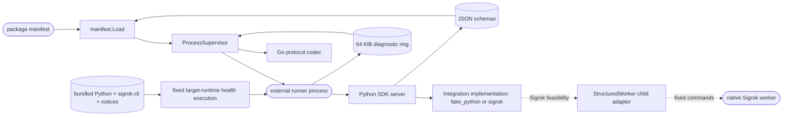

# Integration platform

## Routing

Select this page for runtime manifests, the NDJSON protocol, Python SDK and
process supervision. Start at `internal/integration/protocol/message.go` and
`describe_test.go` for Go/Python description interoperability. Managed package
lifecycle and queued instrument actions belong to [Managed bench integrations](bench-integrations.md).

## Purpose and boundaries

The integration platform loads bounded runtime packages and supervises their external processes through the language-neutral `nilo.integration/1` lifecycle. It isolates plugin faults from Bench Core; it does not grant integrations arbitrary shell or filesystem authority. Production packages carry their complete target runtime closure, including the interpreter and native backend, so installed runners do not resolve host packages or reach a network. The Sigrok SW-01 feasibility slice demonstrates one additional subordinate native process boundary without changing that public lifecycle.

## Public interface

Go callers use `manifest.Load`, protocol codecs and registries, and `supervisor.ProcessSupervisor` methods `Describe`, `Execute`, `Cancel`, and `Shutdown`. Python integration authors implement the asynchronous SDK lifecycle interface and launch its NDJSON server. Every enabled package is expected to pass the common contract harness. `build-sigrok-bundle.py` accepts an explicit architecture-matched runtime root, requires an observed Linux namespace with loopback as its only interface and no default route, executes the fixed target interpreter/version/import and Sigrok driver-scan health checks with a confined `PATH`, and emits the runner, SDK, schemas, component/runtime inventory, before/after network observations, hashed health results and third-party notices as one bounded package.

## Invariants

- Protocol stdout carries only bounded, correlated NDJSON with one terminal reply.
- Runner paths stay within a verified package; OS process cleanup is bounded.
- `response.describe` accepts the SDK's declared integration/operation metadata
  while rejecting unknown fields; it does not change the v1 wire format.
- A native library adapter stays subordinate to its Python integration runner,
  uses a separate bounded protocol, and cannot widen the package's public
  operation grammar by itself.
- A production bundle embeds regular, non-symlink runtime files, a real Python
  entrypoint, the Sigrok backend and redistribution notices; fixture runtimes,
  package resolution, failed target-runtime health execution and an unmeasured
  runtime limit are refused. Health status is derived from executed commands
  bracketed by observed network isolation, never accepted from a manifest or
  environment assertion.

## Key behaviors

- `REQ-FUNC-1d02a85d` - validates runtime manifests and launches compatible external runners.
- `REQ-FUNC-b0dd990f` - exchanges strict correlated lifecycle messages with one terminal response.
- `REQ-FUNC-39397f99` - provides the asynchronous Python authoring boundary.
- `REQ-NFR-6b5de8e9` and `REQ-NFR-c4c70f53` - bound all untrusted inputs and confine commands and paths.
- `REQ-NFR-1ad0cee7` and `REQ-REL-31cc1e94` - contain crashes and perform bounded cancel, safe shutdown, then termination.
- `REQ-TEST-2bbda8a9` - proves packages with the common contract suite.
- `REQ-REL-c2695283` - contains experimental native Sigrok work in a separately
  supervised child with bounded `nilo.sigrok.worker/1` records.
- `REQ-PLAT-532864ed` - builds the production Sigrok integration with its
  architecture-specific interpreter/backend closure and licence evidence.

## Architecture

Protocol stdout is reserved for NDJSON; diagnostics use bounded stderr. OS-specific process-group behavior is isolated in build-tagged files.

## Files

- `05_Software/schemas/integration/v1/` - public manifest, operation, and event JSON schemas.
- `05_Software/nilo_assistant/internal/integration/manifest/` - embedded schema copies, bounded loader, model, fixtures, and tests.
- `05_Software/nilo_assistant/internal/integration/protocol/` - strict Go message types, codec, lifecycle registry, and tests.
- `05_Software/nilo_assistant/internal/integration/supervisor/` - process lifecycle, OS adapters, diagnostic ring, helper process, and tests.
- `05_Software/integration_sdk/python/` - pinned Python SDK package, models, lifecycle API, server, tests, lockfile, and author documentation.
- `05_Software/integrations/fake_python/` - deterministic manifest, schemas, Python implementation, entry point, tests, and lockfile.
- `05_Software/tests/contract/` - package-level black-box contract fixtures, documentation, and tests.
- `02_Tools/scripts/build-sigrok-bundle.py` - validates and embeds the complete
  target runtime, SDK, schemas, runner, executed health evidence and third-party
  notices without package resolution.

- `05_Software/nilo_assistant/internal/integration/protocol/describe_test.go` — SDK metadata interoperability regression.
- `05_Software/integrations/sigrok/` — curated digital adapter; lifecycle ownership is documented in bench-integrations.md.
- `05_Software/integrations/sigrok/src/nilo_sigrok/structured_worker.py` —
  feasibility-only child containment and protocol validation beneath the public
  integration runner.
