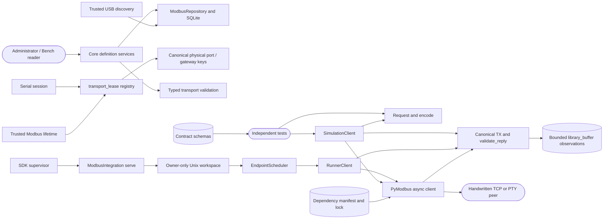

# Modbus client foundation and supervised runner

## Routing

Select this page for Core Modbus endpoints/profiles, trusted USB presence,
shared Serial/Modbus ownership, development contracts and canonical initial
requests, simulated RTU/TCP/RTU-over-TCP transactions and dependency evidence
under `05_Software/integrations/modbus/`. Core services start at
`05_Software/core/internal/bench/modbus_definitions.go`, `modbus_discovery.go`
and `transport_lease.go`; models and storage live in `internal/modbus/definitions.go`
and `internal/store/sqlite/modbus_repository.go`, with adjacent focused tests.
The Python package starts at `src/nilo_modbus/requests.py`, `feasibility.py`,
`runner_client.py`, `scheduler.py` and `workspace.py`; focused tests live in
`tests/` alongside independent peers.
Managed production package lifecycle belongs to
[Managed bench integrations](bench-integrations.md), shared runner lifecycle to
[Integration platform](integration-platform.md), physical serial terminals to
[USB to Serial integration](serial-integration.md), and acquisition tooling to
[Repository-local toolchain](repository-toolchain.md).

## Purpose and boundaries

Core owns revisioned endpoint/profile definitions, trusted USB reconciliation
and shared full-lifetime transport claims. Internal trusted consumers supply
transport lifetimes and cleanup; the curated production registry and public
session adapters compose separate runner and policy services.

This Python package supplies an SDK-supervised `serve` runner for one pinned
endpoint, and proves its client protocol against loopback TCP and Linux PTY
fixtures. The runner owns a private local control socket, fair per-endpoint
scheduling and bounded observations. Direct simulation tests remain available.
Bench Core owns the production integration registry, identity, policy and
persistence; the existing curated packages use the shared supervised lifecycle.

## Public interface

- Core `ModbusEndpoints`/`ModbusProfiles` require Bench read permission;
  `SaveModbusEndpoint`/`SaveModbusProfile` require plugin management authority,
  expected revisions and audit records. Core assigns and retains profile creators.
- `ModbusRepository` atomically publishes endpoint/profile definitions and trusted
  USB projections. Network records carry explicit peer/unit/bus configuration;
  USB records carry Core-owned identity and observed presence.
- `runModbusConsumer` is an internal trusted admission seam: pinned endpoint/profile
  revisions precede canonical claims, then the supplied lifetime function owns
  transport work and confirms cleanup. Serial uses the same claim registry.

- `Request(function, unit, address, count, values)` is an immutable canonical
  request; `encode(request, transport)` returns its validated PDU.
- `wire_address(area, address, base)` converts explicit zero, one or reference
  notation to a 16-bit wire offset.
- `SimulationClient(..., simulation=True)` accepts literal loopback endpoints
  or Linux `/dev/pts` entries. Callers explicitly connect, transact and close.
  Outcomes distinguish acknowledgement, device exception, timeout, cancellation,
  protocol error, pre-transmission rejection and unknown write delivery.
- `ModbusIntegration.execute(serve)` verifies pinned endpoint/profile and an
  owner-only workspace, opens one transport, and serves version-1 private
  transactions through a mode-0600 Unix socket until stop or cancellation.
- `EndpointScheduler.submit` admits bounded requests, coalesces queued polls,
  rotates units fairly and returns one correlated terminal outcome. The runner
  package manifest and schemas are loadable through Core's manifest loader.
- `schemas/contracts.schema.json` declares strict Draft 2020-12 entities and
  private messages. The linked specification defines semantic validation,
  ownership and the baseline routes consumed by subsequent implementation.
- `evidence/dependencies.json`, `pyproject.toml` and `uv.lock` bind the candidate
  runtime closure. Repository tooling prepares the corresponding verified
  archives and notices; the README describes the commands and target gates.

## Invariants

- Definition saves perform database/audit work; trusted observations establish
  USB presence and network readiness. Startup requires fresh observations.
- Strong USB identities survive tty/topology changes; weak duplicates remain
  port-bound. Reconciliation retains names, disabled state and profiles on unplug.
- USB claims include physical port and strong serial identity. Network claims
  include configured bus and normalized peer socket; unit IDs do not divide ownership.
- Cancellation retains claims through confirmed cleanup. Cleanup errors fence
  reuse for the Manager lifetime and propagate through shutdown.
- Live endpoint/profile edits wait for cleanup; endpoint disable cancels its own
  consumer. Reader/admin permissions and creator ownership govern shared definitions.

- Initial functions are 1/2/3/4/5/6/15/16 with function-specific quantity,
  value, unit and address checks before transmission.
- The client serializes transactions, checks outgoing canonical bytes and
  validates incoming identity, framing, quantity and write echoes.
- Automatic retries and reconnect are zero. Uncertainty closes and permanently
  fences the object; a transmitted write lacking acknowledgement is
  `delivery_unknown`, with at most one observed request.
- Trace retention is bounded by 256 observations and 64 KiB raw bytes;
  `library_buffer` identifies cumulative library callbacks. Overflow fails closed.
- The runner permits one active call and 128 pending requests, at most 8 per
  unit. TCP reads may retry at most three times inside a monotonic deadline;
  connection startup is capped at 60 seconds and no write is replayed. RTU
  serial recovery drains until a quiet frame gap,
  while RTU-over-TCP discards the closed socket. A timed-out unit/function is
  quarantined for the runner lifetime because its late reply is ambiguous.
- The private socket has exact bounded messages, and worker crash, stop and
  cancellation close the transport and unlink only the socket the runner bound.
- Serial recovery rechecks the pinned USB identity before draining and before
  reopening the tty, so a rebound tty cannot silently change adapters.
- Serial proof uses independent Linux PTYs with exclusive descriptor ownership.
  Physical framing, RS-485 direction and native ARM64 execution require target
  observations.
- Structural schemas preserve int64/uint64 values as decimal strings and
  non-finite decoded values as explicit tags. Definition imports are metadata
  intents, and the contract assigns successive-write permission to plugin policy.

## Change map

| Change requested | Start with | Focused verification |
|---|---|---|
| Definitions/transport validation | Core `modbus_definitions.go`, `definitions.go`, `modbus_repository.go` | Adjacent definition/repository tests |
| USB identity/presence | Core `modbus_discovery.go`, repository projection | Core/store `modbus_discovery_test.go` |
| Claims and cleanup | Core `transport_lease.go`, `serial_session.go` | `transport_lease_test.go`, `serial_lifecycle_test.go` |
| PDU limits or presentation addresses | `requests.py` | `test_requests.py` |
| Transport, response validation or fencing | `feasibility.py` | `test_feasibility.py` and handwritten `peers.py` |
| Supervised client, private socket or recovery | `runner_client.py`, `workspace.py`, `plugin.py` | `test_runner.py`, `test_workspace.py`, `test_supervised.py` |
| Fair queue and cancellation | `scheduler.py` | `test_scheduler.py` |
| Entity or private-message grammar | `contracts.schema.json` and specification | `test_contracts.py` |
| Dependency pins or notices | `dependencies.json`, lock and preparation helper | `test_dependencies.py` and explicit offline acquisition verification |

## Key behaviors

- `REQ-DATA-a8c75050` — atomic durable endpoint/profile revisions and conflicts.
- `REQ-DATA-2988e315` — retained stable USB definitions and trusted binding state.
- `REQ-FUNC-eafa69bc` — exact transport/settings validation before publication.
- `REQ-SEC-4b8a52fa` — shared read access, administrator mutation and retained creator.
- `REQ-REL-5af947a8` — canonical cross-family ownership with independent resources.
- `REQ-REL-4e21290d` — cleanup-confirmed release and failed-cleanup fences.

- `REQ-DATA-6fcda58c` — strict development entities and authority/state contracts.
- `REQ-FUNC-cfadd842` — exact bounded PDU encoding and explicit addressing.
- `REQ-TEST-3e971d35` — eight functions on three independent simulated transports.
- `REQ-REL-5c6b6a83` — inconsistent replies yield no successful result.
- `REQ-REL-689b7d81` — uncertainty fences reuse and preserves bounded correlation.
- `REQ-PLAT-81822827` — exact runtime archives and license provenance.
- `REQ-FUNC-aa89e3ad`, `REQ-REL-2ad3bbb0` — supervised baseline functions and strict replies.
- `REQ-REL-2d6babd5`, `REQ-REL-1878cffa` — fair bounded scheduling and conservative recovery.
- `REQ-SEC-a3293f66`, `REQ-REL-feb1ff48` — private workspace and deterministic cleanup.

## Architecture

The simulation client remains directly invoked by tests. The supervised runner
uses the same checked ADU boundary and owns its own recovery and private session.

## Files

- `05_Software/core/internal/modbus/definitions.go` and tests — typed validation/keys.
- `05_Software/core/internal/bench/modbus_definitions.go`, `modbus_discovery.go`
  and tests — shared definition services and trusted state.
- `05_Software/core/internal/bench/transport_lease.go` and tests — canonical claims.
- `05_Software/core/internal/bench/serial_session.go`, `serial_lifecycle_test.go`
  — live Serial claim ownership and exceptional cleanup.
- `05_Software/core/internal/store/sqlite/modbus_repository.go`, adjacent tests
  and `migrations/024_modbus_definitions.sql` — CAS, USB projection and startup state.
- `.agentic/specs/REQ-DATA-a8c75050.md` — exact Core definitions/claim contract.

- `05_Software/integrations/modbus/src/nilo_modbus/__init__.py` — package namespace.
- `05_Software/integrations/modbus/src/nilo_modbus/requests.py` — validation and PDU encoding.
- `05_Software/integrations/modbus/src/nilo_modbus/feasibility.py` — guarded async client.
- `05_Software/integrations/modbus/src/nilo_modbus/{runner_client,scheduler,workspace,usb,plugin,__main__}.py` — supervised endpoint, private control and lifecycle.
- `05_Software/integrations/modbus/{manifest.json,runner,schemas/}` — SDK package declaration and typed operation boundary.
- `05_Software/integrations/modbus/tests/{test_runner,test_scheduler,test_workspace,test_supervised,test_usb,test_package}.py` — runner behavior and package validation.
- `05_Software/integrations/modbus/schemas/contracts.schema.json` — structural schemas.
- `05_Software/integrations/modbus/tests/peers.py` — independent TCP/PTY fixtures.
- `05_Software/integrations/modbus/tests/test_requests.py` — golden encoding and bounds.
- `05_Software/integrations/modbus/tests/test_feasibility.py` — transport and lifecycle proof.
- `05_Software/integrations/modbus/tests/test_contracts.py` — strict schema examples.
- `05_Software/integrations/modbus/tests/test_dependencies.py` — pins and preparation checks.
- `05_Software/integrations/modbus/pyproject.toml` and `uv.lock` — exact candidate environment.
- `05_Software/integrations/modbus/evidence/dependencies.json` — archive and license hashes.
- `05_Software/integrations/modbus/README.md` — direct execution and evidence boundaries.
- `02_Tools/scripts/prepare-modbus-dependencies.py` — repository-owned acquisition helper.
- `.agentic/specs/REQ-DATA-6fcda58c.md` — semantic contracts and authority assignments.
