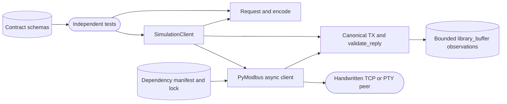

# Modbus client feasibility

## Routing

Select this page for the Modbus development contracts, canonical initial
requests, simulated RTU/TCP/RTU-over-TCP transactions and dependency evidence
under `05_Software/integrations/modbus/`. Start at `src/nilo_modbus/requests.py`
and `feasibility.py`; focused tests live in `tests/` alongside independent peers.
Managed production package lifecycle belongs to
[Managed bench integrations](bench-integrations.md), shared runner lifecycle to
[Integration platform](integration-platform.md), physical serial terminals to
[USB to Serial integration](serial-integration.md), and acquisition tooling to
[Repository-local toolchain](repository-toolchain.md).

## Purpose and boundaries

This isolated Python package proves client protocol behavior against loopback
TCP and Linux PTY fixtures and supplies a strict versioned development contract.
Its direct test interface owns simulated requests and bounded observations.
Bench Core owns the production integration registry, identity, policy and
persistence; the existing curated packages use the shared supervised lifecycle.

## Public interface

- `Request(function, unit, address, count, values)` is an immutable canonical
  request; `encode(request, transport)` returns its validated PDU.
- `wire_address(area, address, base)` converts explicit zero, one or reference
  notation to a 16-bit wire offset.
- `SimulationClient(..., simulation=True)` accepts literal loopback endpoints
  or Linux `/dev/pts` entries. Callers explicitly connect, transact and close.
  Outcomes distinguish acknowledgement, device exception, timeout, cancellation,
  protocol error, pre-transmission rejection and unknown write delivery.
- `schemas/contracts.schema.json` declares strict Draft 2020-12 entities and
  private messages. The linked specification defines semantic validation,
  ownership and the baseline routes consumed by subsequent implementation.
- `evidence/dependencies.json`, `pyproject.toml` and `uv.lock` bind the candidate
  runtime closure. Repository tooling prepares the corresponding verified
  archives and notices; the README describes the commands and target gates.

## Invariants

- Initial functions are 1/2/3/4/5/6/15/16 with function-specific quantity,
  value, unit and address checks before transmission.
- The client serializes transactions, checks outgoing canonical bytes and
  validates incoming identity, framing, quantity and write echoes.
- Automatic retries and reconnect are zero. Uncertainty closes and permanently
  fences the object; a transmitted write lacking acknowledgement is
  `delivery_unknown`, with at most one observed request.
- Trace retention is bounded by 256 observations and 64 KiB raw bytes;
  `library_buffer` identifies cumulative library callbacks. Overflow fails closed.
- Serial proof uses independent Linux PTYs with exclusive descriptor ownership.
  Physical framing, RS-485 direction and native ARM64 execution require target
  observations.
- Structural schemas preserve int64/uint64 values as decimal strings and
  non-finite decoded values as explicit tags. Definition imports are metadata
  intents, and the contract assigns successive-write permission to plugin policy.

## Change map

| Change requested | Start with | Focused verification |
|---|---|---|
| PDU limits or presentation addresses | `requests.py` | `test_requests.py` |
| Transport, response validation or fencing | `feasibility.py` | `test_feasibility.py` and handwritten `peers.py` |
| Entity or private-message grammar | `contracts.schema.json` and specification | `test_contracts.py` |
| Dependency pins or notices | `dependencies.json`, lock and preparation helper | `test_dependencies.py` and explicit offline acquisition verification |

## Key behaviors

- `REQ-DATA-6fcda58c` — strict development entities and authority/state contracts.
- `REQ-FUNC-cfadd842` — exact bounded PDU encoding and explicit addressing.
- `REQ-TEST-3e971d35` — eight functions on three independent simulated transports.
- `REQ-REL-5c6b6a83` — inconsistent replies yield no successful result.
- `REQ-REL-689b7d81` — uncertainty fences reuse and preserves bounded correlation.
- `REQ-PLAT-81822827` — exact runtime archives and license provenance.

## Architecture

The prototype is invoked directly by tests. Its permanent failure fence
provides the measured response boundary for the evaluated library.

## Files

- `05_Software/integrations/modbus/src/nilo_modbus/__init__.py` — package namespace.
- `05_Software/integrations/modbus/src/nilo_modbus/requests.py` — validation and PDU encoding.
- `05_Software/integrations/modbus/src/nilo_modbus/feasibility.py` — guarded async client.
- `05_Software/integrations/modbus/schemas/contracts.schema.json` — structural schemas.
- `05_Software/integrations/modbus/tests/peers.py` — independent TCP/PTY fixtures.
- `05_Software/integrations/modbus/tests/test_requests.py` — golden encoding and bounds.
- `05_Software/integrations/modbus/tests/test_feasibility.py` — transport and lifecycle proof.
- `05_Software/integrations/modbus/tests/test_contracts.py` — strict schema examples.
- `05_Software/integrations/modbus/tests/test_dependencies.py` — pins and preparation checks.
- `05_Software/integrations/modbus/pyproject.toml` and `uv.lock` — exact candidate environment.
- `05_Software/integrations/modbus/evidence/dependencies.json` — archive and license hashes.
- `05_Software/integrations/modbus/README.md` — direct execution and evidence boundaries.
- `02_Tools/scripts/prepare-modbus-dependencies.py` — repository-owned acquisition helper.
- `.agentic/specs/REQ-DATA-6fcda58c.md` — semantic contracts and authority assignments.
