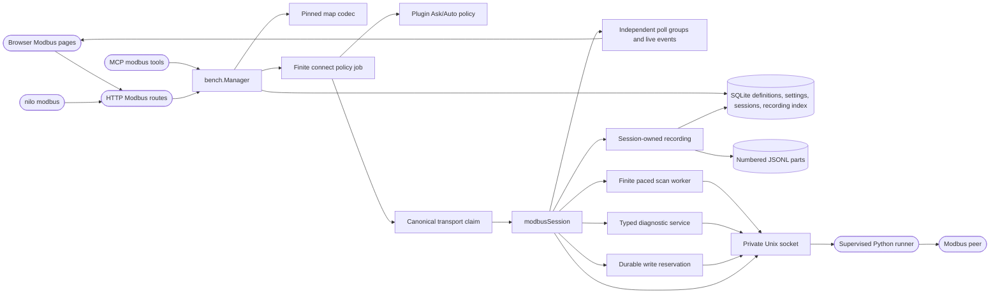

<!--
Copyright (c) 2026 DDP Engineering
This software is licensed under the PolyForm Noncommercial License 1.0.0.
Commercial use requires a separate commercial license.
See the LICENSE.txt in the .agentic folder for full license details.
SPDX-License-Identifier: LicenseRef-PolyForm-Noncommercial-1.0.0
-->

# Modbus integration

## Routing

Use this page for Modbus endpoint/profile definitions, named register maps and workspaces, session admission, raw reads and writes, the supervised client, `nilo modbus`, MCP `modbus_*`, HTTP `/api/v1/modbus`, and browser Modbus administration/navigation. Start in `05_Software/core/internal/bench/modbus_adapter.go` for admission, `modbus_settings.go` for appliance limits, `05_Software/frontend/src/components/pages/ModbusPluginPage.tsx` for administration, or `05_Software/integrations/modbus/src/nilo_modbus/plugin.py` for runner behavior. Focused tests sit beside those sources. Camera and Serial plugin flows belong to their own component pages; common plugin policy and lifecycle belong to Bench Core.

## Purpose and boundaries

Bench Core owns shared Modbus definitions, authority, policy admission, canonical transport claims, sessions, settings, audit, and public routes. The supervised Python runner owns the connection and private socket; it receives validated intents from Core and performs device I/O. The browser administers TCP endpoints and profiles and presents Core-owned state without directly contacting devices or opening a connection on page mount.

## Public interface

- `ModbusEndpoints`, `ModbusProfiles`, `ModbusMaps`, and `ModbusWorkspaces` expose shared metadata to Bench readers. Saves use expected revisions; endpoint/profile/settings changes require `plugins.manage`, while creator-owned map/workspace edits require Bench execute or administrator authority.
- `GET/PUT /api/v1/modbus/settings` and `ModbusSettings`/`ReplaceModbusSettings` expose a revisioned appliance-wide record. `nilo modbus settings`, `settings-save`, MCP `modbus_settings`, and `modbus_settings_save` call the same Core service.
- `POST /api/v1/modbus/endpoints/{id}/test`, `nilo modbus test`, and MCP `modbus_test` submit a revision-pinned finite `connect` policy job. The terminal result reports readiness after the temporary claim and runner are cleaned up; it creates no controllable live session and sends no Modbus PDU.
- `ConnectModbus` submits a policy job whose successful result opens a credential-bound live session. `ModbusSession`, `ReadModbus`, polling/display controls, `PreviewModbusWrite`, `WriteModbus`, command queries, and `DisconnectModbus` use that session under the existing HTTP, CLI, and MCP surfaces.
- Live Connect may pin a saved workspace revision; Core verifies its endpoint, profile and exact enabled poll plan. Per-group pause, timeout, stop-on-error and requested/observed polling metrics are exposed across HTTP, CLI and MCP. The point decode/encode routes use pinned map revisions and do no device I/O.
- `ModbusLiveView` runs for TCP and RTU-over-TCP endpoints. It loads a workspace and its exact map revisions inertly, then requires explicit Connect. It renders bounded event-derived traffic and trends, mapped raw/typed values with freshness, and an owner-only Core preview/Submit write flow. Display pause and Clear display affect browser buffers only. Start/Stop recording controls operate independently from display and polling.
- `ModbusSessionsPage` opens saved recordings without a live session. Each numbered JSONL part carries the pinned definition snapshot; Core also indexes sample/traffic/write events and owner/admin metadata. It exposes bounded Find, CSV/JSONL/text/ZIP exports, retention and deletion under reader leases through HTTP, CLI, and MCP. Startup recovers interrupted writers as incomplete without reconnecting hardware.
- `ModbusPluginPage` provides lifecycle, policy, activity, version/update, TCP definition/profile, test, and settings controls for administrators. `buildPages` creates named Instruments destinations for enabled endpoints and a Saved definitions destination that remains available after plugin disable or uninstall.
- `internal/modbus` validates point coordinates, explicit address bases, typed conversions, and exact write previews. The runner's private version-1 socket protocol and integration manifest are its supervised execution boundary.

## Invariants

- All live operations recheck the originating credential, current role, plugin state, pinned revisions, and lease. A page render or definition import never starts device I/O.
- Saves publish atomic, audited revisions. Existing map/workspace revisions remain immutable; imports preview conflicts before publication. A stale settings or definition revision fails without altering state.
- Transport claims use canonical physical-port or network-peer/bus keys. Cancellation retains a claim through confirmed cleanup; cleanup failure fences reuse for the Manager lifetime.
- Test-only admission uses the existing Ask/Auto policy, requires administrator management and Bench execute permissions, has a finite deadline, and closes the runner and claim before reporting success. It neither reads nor writes registers.
- The current session ceiling applies to new admissions. Each admitted session snapshots its lease and idle durations; lowering settings never terminates an existing session. Recording retention values are persisted for the recording service.
- A write reservation is durable before one transport dispatch. Lost acknowledgement remains delivery-unknown and is never replayed. The client rejects inconsistent framing/identity and fences uncertain transport state.
- Explicit scans run only on a live credential-bound lease. Core validates one finite FC01–04 unit/address plan (at most 512 probes, 1–10 probes/s, 1–60 seconds), submits one probe at a time through the runner scheduler, and retains settled progress until the session ends or another scan starts. Cancellation and deadline stop future probes. CSV/JSONL exports include plan metadata and observed outcomes; failed reads do not imply absent devices or writable/typed addresses.
- FC22 mask and FC23 combined read/write use the existing durable one-attempt write reservation. FC23 returns its read-side words separately from the submitted write words. FC43/14 basic identification and FC11/17 read-only serial diagnostics have typed bounded replies; native TCP refuses FC11/17 before I/O, and raw frames, FC08 and broadcast diagnostics remain unsupported.
- Recording parts sync before their event index commits. Closed parts carry size and SHA-256; export refuses mismatches. Recording failure stops logging, leaves polling running, and marks the saved record incomplete with a visible reason. Retention reclaims only completed, unleased records.
- Trusted USB observations maintain stable endpoint identity and unplugged definitions; this browser editor creates and changes only TCP targets. Physical RS-485 behavior and native ARM64 execution require target observations.

## Change map

| Change requested | Start with | Focused verification |
|---|---|---|
| Endpoint/profile and USB identity | `bench/modbus_definitions.go`, `modbus_discovery.go`, SQLite `modbus_repository.go` | Adjacent Core/store Modbus definition and discovery tests |
| Settings and admission capacity | `bench/modbus_settings.go`, `manager.go`, `modbus_session.go`, migration 027 | `modbus_settings_test.go`, `modbus_lifecycle_test.go` |
| Test-only or live connection and claim | `bench/modbus_adapter.go`, `modbus_session.go`, `transport_lease.go` | `modbus_lifecycle_test.go`, `modbus_session_test.go` |
| Named maps/workspaces and typed points | `bench/modbus_maps.go`, `modbus_workspaces.go`, `internal/modbus/` | Adjacent map, workspace, codec and interchange tests |
| Public commands and permission gates | `httpapi/modbus.go`, `mcp/modbus.go`, `cmd/nilo/modbus.go` | Adjacent `modbus_test.go` and `bench_test.go` |
| Browser administration and navigation | `frontend/src/components/pages/ModbusPluginPage.tsx`, `shell/pages.ts`, `AppShell.tsx` | Page, shell, API and `e2e/modbus-layout.check.ts` tests |
| Live register workspace and write controls | `frontend/src/components/pages/ModbusLiveView.tsx`, `bench/modbus_poll.go`, `bench/modbus_point_codec.go` | `ModbusWorkspacePage.test.tsx`, adjacent Core Modbus tests |
| Retained recording, search, recovery and export | `bench/modbus_recording*.go`, migration 028, `frontend/src/components/pages/ModbusSessionsPage.tsx` | `modbus_recording_test.go`, adjacent API/CLI/MCP and frontend page tests |
| Bounded scans, advanced writes and typed diagnostics | `bench/modbus_scan.go`, `modbus_write.go`, `modbus_diagnostic.go`, `frontend/src/components/pages/ModbusToolsPanel.tsx` | Adjacent scan, diagnostic, request, feasibility and Tools tests |
| Supervised transactions and recovery | `integrations/modbus/src/nilo_modbus/{plugin,runner_client,scheduler,workspace}.py` | `tests/{test_supervised,test_runner,test_scheduler,test_workspace}.py` |
| PDU bounds, transport, schemas and pins | `requests.py`, `feasibility.py`, `schemas/contracts.schema.json`, `evidence/dependencies.json` | `test_requests.py`, `test_feasibility.py`, `test_contracts.py`, `test_dependencies.py` |

## Key behaviors

- `REQ-DATA-a8c75050`, `REQ-SEC-4b8a52fa` — revisioned shared definitions with administrator mutations and retained creator ownership.
- `REQ-FUNC-41b61ddb`, `REQ-SEC-aed9d424` — policy-admitted live sessions with credential and pinned-definition checks.
- `REQ-FUNC-7bed9136` — finite, policy-controlled connection probe cleans up without a retained session or PDU.
- `REQ-PLAT-ca19fbda` — bounded audited settings govern new session capacity, lease and idle periods.
- `REQ-UX-5843b688`, `REQ-FUNC-d2db4ee3` — administrator lifecycle and revisioned TCP definition controls.
- `REQ-UX-3f615e7d`, `REQ-UX-aa51d4be` — named, offline-preserving browser destinations and localized accessible layouts.
- `REQ-FUNC-dd8ff122`, `REQ-FUNC-e14acc2b`, `REQ-DATA-723c5581` — inert shared maps/workspaces and previewed atomic interchange.
- `REQ-REL-4e21290d`, `REQ-REL-f258c750` — cleanup-confirmed claim release and durable one-attempt writes.
- `REQ-REL-2d6babd5`, `REQ-REL-1878cffa` — bounded fair runner scheduling and conservative recovery.
- `REQ-UX-04cd31fe`, `REQ-UX-9d7fd3a6`, `REQ-UX-35328cf5`, `REQ-UX-e0682e6a`, `REQ-FUNC-c7473d9f` — inert live workspace selection, mapped freshness, explicit writes, bounded displays and independent poll groups.
- `REQ-DATA-2490acc3`, `REQ-FUNC-b0d59f49`, `REQ-REL-e1048fd2` — logical recording parts, independent controls and honest incomplete recovery.
- `REQ-SEC-025e6e99`, `REQ-FUNC-69157924`, `REQ-DATA-797a97da`, `REQ-DATA-6c52a683`, `REQ-UX-e978db15` — owner/admin access, bounded search, exports, retention leases and offline inspection.
- `REQ-FUNC-28ad4c7d`, `REQ-REL-b7570e66`, `REQ-DATA-5084f2d5` — finite explicit scans, paced cancellation and truthful bounded evidence.
- `REQ-FUNC-90e44759`, `REQ-FUNC-104739e7`, `REQ-SEC-4932de81`, `REQ-UX-1845d724` — advanced typed writes, read-only diagnostics, live authority and browser Tools controls.

## Architecture

The test-only job uses the same policy and claim path, then closes `modbusSession` before it reports completion. Ordinary connect leaves the session alive outside finite job capacity.

## Files

- `05_Software/core/internal/bench/modbus_definitions.go`, `modbus_discovery.go`, `modbus_maps.go`, `modbus_workspaces.go`, `modbus_workspace_import.go` — shared definitions, discovery, map and workspace services.
- `05_Software/core/internal/bench/modbus_adapter.go`, `modbus_session.go`, `modbus_request.go`, `modbus_poll.go`, `modbus_write.go`, `modbus_scan.go`, `modbus_diagnostic.go`, `modbus_settings.go`, `modbus_recording*.go`, `transport_lease.go` — admission, settings, session I/O, retained evidence and cleanup.
- `05_Software/core/internal/store/sqlite/modbus_repository.go`, `modbus_definition_repository.go`, `migrations/{024_modbus_definitions,025_modbus_sessions,026_modbus_maps_workspaces,027_modbus_settings,028_modbus_recordings}.sql` — durable records and migrations.
- `05_Software/core/internal/modbus/` — typed definitions, validation, addressing, codecs and interchange.
- `05_Software/core/internal/httpapi/modbus.go`, `internal/mcp/modbus.go`, `cmd/nilo/modbus.go` — authenticated public interfaces.
- `05_Software/frontend/src/api/modbus.ts`, `api/client.ts`, `components/pages/{ModbusPluginPage,ModbusWorkspacePage,ModbusLiveView,ModbusToolsPanel,ModbusSessionsPage}.tsx`, `components/pages/modbus.css`, `components/shell/{pages,AppShell}.tsx`, `i18n/modbus.ts` — browser API, administration, live and offline workspaces, navigation, localization and layout.
- `05_Software/integrations/modbus/src/nilo_modbus/{requests,feasibility,plugin,runner_client,scheduler,workspace,usb}.py`, `manifest.json`, `schemas/` — supervised runner, protocol validation and contracts.
- `05_Software/integrations/modbus/{pyproject.toml,uv.lock,evidence/dependencies.json,README.md}` and `02_Tools/scripts/prepare-modbus-dependencies.py` — pinned candidate environment and preparation.
- `02_Tools/scripts/build-modbus-bundle.py`, `build-appliance.sh`, and `02_Tools/tests/software/test_modbus_bundle.py` — indexed offline target bundle construction from verified transport inputs, SDK/Pydantic closure, notices and an optional manifest-bound Python runtime.
- Focused verification: adjacent Core `modbus*_test.go`, frontend `modbus.test.ts`, `ModbusPluginPage.test.tsx`, shell tests, `e2e/modbus-layout.check.ts`, and integration `tests/test_*.py`.
