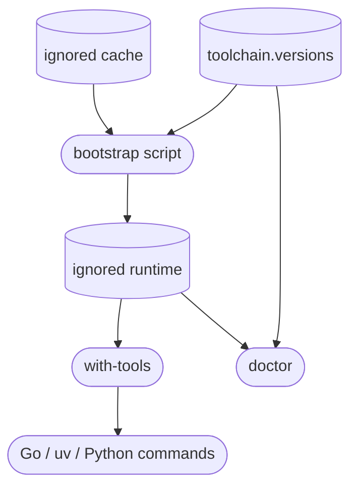

# Repository-local toolchain

## Purpose

The toolchain component gives a fresh supported checkout pinned Go, uv, and managed Python runtimes without persistent host changes. Downloaded runtimes and caches remain ignored so they can be populated online or carried in an offline development kit without bloating source history.

## Public interface

Developers run `bootstrap.ps1` or `bootstrap.sh`, invoke commands through `with-tools` or the Go-only compatibility wrapper, and use `doctor` to prove the pinned executables. `toolchain.versions` is the authority for versions, platform archive URLs, and SHA-256 checksums.

## Key behaviors

- `REQ-PLAT-978855a5` - checksum-verifies pinned repository-local tools and avoids persistent PATH or system installations.
- `REQ-PLAT-93e1b194` - supplies the Go runtime used by portable Linux ARM64, Linux x86_64, and Windows x86_64 compilation.

## Architecture

The scripts modify environment variables only in their child process. They do not package the Raspberry Pi appliance.

## Files

- `02_Tools/toolchain.versions` - pinned versions, archive URLs, and checksums.
- `02_Tools/bootstrap/bootstrap.ps1` and `02_Tools/bootstrap/bootstrap.sh` - checksum-gated online/offline population.
- `02_Tools/env/with-tools.ps1` and `02_Tools/env/with-tools.sh` - combined child-process environment.
- `02_Tools/env/with-go.ps1` and `02_Tools/env/with-go.sh` - Go-only compatibility wrappers.
- `02_Tools/scripts/doctor.ps1` and `02_Tools/scripts/doctor.sh` - executable and version verification.
- `02_Tools/README.md` - usage, support, cache, and offline-kit guidance.
- `05_Software/scripts/tests/test_toolchain_bootstrap.py` - manifest and non-global bootstrap contract tests.
- `.gitignore` - runtime, cache, and generated-artifact exclusions.
