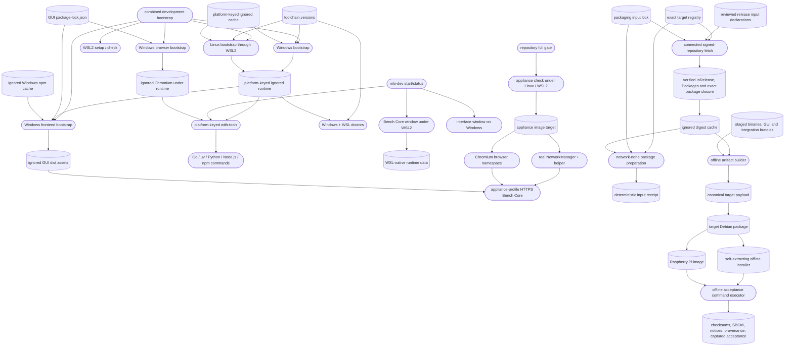

# Repository-local toolchain

## Routing

Select this page for how a checkout is provisioned and verified rather than for
product behavior: `02_Tools/` in full - the pinned runtimes under the ignored
`runtime/` and `cache/`, `toolchain.versions`, the `bootstrap/` entry points,
the `env/` child-process wrappers, the `doctor*` readiness checks, the locked
OCI build environment under `containers/build/` with
`env/with-build-environment.*`, the container test runs under `tests/`, and
the exact-target packaging boundary under `packaging/`, including connected
resolution/fetch, the ignored digest cache, offline preparation, deterministic
artifact builders, release evidence and verifiers, and
`02_Tools/scripts/aegis_test.py`, which routes the repository gate.

Start at `02_Tools/toolchain.versions` for a pinned version, `02_Tools/env/`
for how a command reaches a tool, `02_Tools/tests/appliance/check.sh` for the
appliance verification stage, `02_Tools/tests/build-environment/verify-offline.sh`
for what the locked container gate runs, and `02_Tools/scripts/aegis_test.py`
for what the host gate discovers and runs.

The privileged NetworkManager helper, its system tests under
`02_Tools/tests/network/` and the Go stage proof belong to *Bench Core
foundation*; this page owns those runs only as verification entry points and
owns the shared image definition they build. Product behavior belongs to the
component that implements it.

## Purpose and boundaries

The toolchain component gives a fresh supported checkout pinned Go, uv,
managed Python, Node.js, and npm runtimes without persistent host changes.
Downloaded runtimes and caches remain ignored so they can be populated online
or carried in an offline development kit without bloating source history.

The component owns how verification environments are materialized and entered.
It also owns how release inputs cross from an explicit connected acquisition
phase into a verified, read-only cache, and how explicit staged product inputs
become deterministic target payloads, Debian packages, offline installers,
Raspberry Pi images and closed release evidence without network access. It does
not own Bench Core network behavior, GUI behavior, integration behavior,
publication, signing-key custody, or physical hardware acceptance results.

## Public interface

Developers run `bootstrap.ps1` or `bootstrap.sh` for one host, or
`bootstrap-development.ps1` to prepare both Windows and a selected WSL2
distribution from one checkout. `setup-wsl.ps1` keeps host installation and
conversion opt-in, while `doctor-wsl.ps1` proves the distribution, repository
mapping, and Linux tools. `bootstrap-frontend.ps1` restores the locked browser
GUI dependencies, including from a populated offline cache, and
`bootstrap-browser.ps1` installs a Windows browser for host-local manual GUI
work. Acceptance does not use that installation: the appliance-stage image
installs its own pinned Playwright and Chromium. Commands run through
`with-tools` or the Go-only compatibility wrapper. `toolchain.versions` is the
authority for versions, platform archive URLs, and SHA-256 checksums; the GUI
lockfile pins the Playwright package graph.

The OCI migration adds a stricter Linux acceptance boundary without removing
the interactive host-local workflow. `bootstrap-build-environment.ps1`
validates Ubuntu 24.04 WSL2 on Windows x86-64, while
`bootstrap-build-environment.sh` validates native Ubuntu 24.04 x86-64. Both
use one shared Docker/Podman verifier and image-setup helper, consume only local
multipart archive content unless the developer explicitly selects the same
pinned network rebuild, and share the complete consumed dependency closure.
The Windows registration name is independent of the Ubuntu release label. The
repository gate automatically selects the sole development distribution,
ignores Docker Desktop's utility distributions, and honors
`NILO_WSL_DISTRIBUTION` when more than one development distribution is present.
Ordinary container
commands run with networking disabled, no engine socket, dropped capabilities,
the caller UID/GID, a generation-scoped cache volume seeded from a read-only
cache embedded in the image, and explicit source and output mounts. The
checked-in `current.json` remains a pending-generation
record until the real image, archive, replica readback, and external acceptance
evidence have actually been produced.

Release engineers select one exact target from
`02_Tools/packaging/config/targets.json`. The fetch wrappers enter the pinned
repository Python environment and materialize only complete-lock HTTPS inputs
with declared version and licence provenance under the ignored
content-addressed cache. Cache verification never opens a URL.
`with-build-environment.* package <target>` mounts that cache read-only
into the existing network-none container and writes a deterministic preparation
receipt; the receipt leaves physical target checks at `not_run`. The checked-in
lock remains incomplete until both OS dependency closures and the Raspberry Pi
base image are pinned, so production preparation currently refuses to run.

`packaging/fetch/resolve-inputs.*` resolves reviewed declarations once during
the connected phase, stores only digest-verified bytes and writes a proposal
whose required classes must be complete before adoption. An OS package pool is
accepted only when its digest-pinned keyring and admitted full signing
fingerprint verify the `InRelease` signature, the signed index binds every
package byte, and the pool is exactly the recursive root/base dependency
closure. Offline shell entry points under `packaging/build/` then rehash the
admitted cache objects and build canonical payloads, `.deb` packages,
target-specific self-extracting installers and the Pi image from explicit local
inputs. `build-release.sh` accepts only the exact five-artifact matrix and a
schema-2 check plan. It reparses the canonical lock, revalidates each admitted
signed pool, structurally parses every artifact, and executes each named
software check only through the digest-bound repository verifier closure in an
observed loopback-only/no-default-route Linux namespace. It derives the result
from the exit code, requires each installer to contain the exact revalidated
pool and matching NILO package, compares a distinct rebuild byte for byte,
binds both artifact sets, captures and hashes its output, and then closes checksums, the
per-package SPDX SBOM, notices, provenance and acceptance evidence; `verify/`
recomputes the closure and rejects undeclared files.

Two container runs sit outside that locked boundary because they need
capabilities it drops. `02_Tools/tests/network/check.sh` runs the privileged
helper's system tests and `02_Tools/tests/appliance/check.sh` runs the
appliance verification stage; both build one multi-target image definition,
`02_Tools/tests/network/Dockerfile`, and run it with `NET_ADMIN`, `SYS_ADMIN`
and engine networks the scripts create and remove. The `network-system` target
deliberately has no WireGuard tools so it can test their production installer.
The `appliance` target extends it with WireGuard, Node.js, the locked GUI graph,
Playwright and Chromium. Both take Go from the repository's pinned Linux runtime
through the read-only mount and share one Go cache volume and one NetworkManager
bring-up, `02_Tools/tests/network/network-up.sh`.

The appliance verification stage runs Bench Core the way an appliance ships it -
`--profile appliance` with TLS material minted for the run, a built interface
directory and the real root helper - against adapters a real NetworkManager
detected in that container's own namespace. It runs on Linux natively and inside
WSL2; a Windows-native invocation, a missing container engine, an engine whose
daemon does not answer, and a host without `ip` are each named and refused with
exit 2 rather than reported as a pass or a skip. It records the host's interface
list and default route before the run and compares them after it on every exit
path, so a run that changed the developer's own machine fails even when the
stage passed. `02_Tools/tests/appliance/README.md` carries the command, the
layout and the relationship between the three container runs.

The stage builds the GUI and runs Playwright against Bench Core's own HTTPS
origin. Chromium lives in a dedicated browser namespace connected to the
management interface, so requests cross the production listener and firewall.
Its live journeys exercise real NetworkManager state, sampling and WireGuard
lifecycle behavior. Narrow, explicitly labelled response fixtures cover only
presentation states the disposable appliance cannot safely create. Each
Playwright specification owns a fresh appliance process and database, and
removes its processes and `/tmp/nilo-e2e-*` data within fixed deadlines.

Reconstruction has two distinct phases. The networked materialization phase
acquires and digest-verifies the reviewed base and BuildKit frontend images and
the locked input closure; only then does the offline phase build with
`--pull=false --network=none`. A clean host with no cached images therefore
rebuilds successfully, and a mutable tag is never accepted.

The checkout is mounted read-only and copied into an isolated container source
root, so the container tests the developer's current source, including
uncommitted changes, without creating or replacing `node_modules`, platform
virtual environments, or build output in the host checkout. Git metadata is
mounted read-only outside that copy with optional locks disabled.
`verify-host-isolation.sh` proves this from the host side after every full
verification.

Archive restore performs one streamed, digest-verified pass into a single
staging file and refuses to start when the chosen temporary filesystem, the
engine store, or - under WSL - the Windows volume backing the ext4 virtual disk
cannot hold it. Explicit host engine installation calculates and prints the
exact package transaction first and refuses downgrades and architecture
replacements without an explicit override.

## Invariants

- The shared network-system image remains free of WireGuard before the
  installer system test begins; browser-only tools belong to the appliance
  target.
- The browser acceptance suite runs only inside the appliance stage. Production
  journeys reach their suite's appliance-profile core through the production
  management ingress; explicitly labelled presentation-only assertions may
  replace an individual API response without replacing that runtime.
- Stage cleanup names and removes only resources successfully created by that
  invocation, and host network state compares equal before and after.
- Checked-out source is mounted read-only; generated dependencies, build output,
  runtime state and caches remain outside tracked source.
- Packaging cache objects enter only through complete-lock HTTPS acquisition
  with declared version/licence provenance and exact size and SHA-256
  verification, and offline preparation sees that cache through a read-only
  mount.
- OS dependency pools are authenticated by a digest-pinned keyring, an admitted
  full signing fingerprint and signed index digests; every `.deb` has matching
  control identity and architecture, and no package outside or missing from the
  recursive declared closure is admitted.
- Packaging target IDs map to exactly one canonical OS identity, release,
  architecture, artifact set, and physical-acceptance checklist. Cache
  verification rejects symlinks and non-regular objects; on Linux it traverses
  digest-derived paths with non-following descriptor operations and opens the
  final object non-blocking so a FIFO cannot stall verification.
- Preparation parses and verifies one captured target/lock snapshot and hashes
  those same lock bytes into the receipt, so configuration replacement cannot
  mix evidence from different documents.
- Offline preparation requires a Linux namespace with loopback as its sole
  interface and no usable IPv4 or IPv6 default route. Kernel-generated reject
  routes on loopback do not imply connectivity; the receipt never infers
  physical target acceptance.
- Release payloads contain regular files and directories only, normalize
  ownership and timestamps, exclude mutable state and forbidden development
  content, and are byte-reproducible for identical staged input and epoch.
- Installer launchers authenticate one unique member inventory and the embedded
  manifest before full extraction, then accept only declared regular files and
  verify each file before execution. Installers use local-only package
  operations, extract their authenticated private repack tool before mutation,
  restore a failed clean install to absent state, and retain their root-only
  durable recovery journal outside service-writable application data until
  package, state and health verification commit.
- A release directory contains exactly the declared target artifacts and
  evidence. Each artifact receipt binds an invocation identity established
  before the builder runs plus its source revision, builder digest, command,
  declared inputs and artifact path; a build-set receipt can close only five
  consistently bound receipts and cannot be recreated for copied artifacts.
  Source-offer bytes must exactly
  match the admitted source archive and its index maps every input to licence
  and source-obligation evidence; runtime manifests expand into component-level
  SPDX records, and deliverable relationships bind artifacts to all admitted
  shared and target inputs. Software acceptance is executed by the assembler rather than
  accepted as caller-authored status or command. Destructive checks run in a
  fresh digest-pinned exact-target container with engine-level network-none and
  retain the configured image reference, observed image ID, kernel, OS release
  and architecture. Package failure checks enter real package transactions and
  interruption recovery covers every durable marker; the verifier closure,
  artifact set, before/after network observation and output bytes are
  digest-bound. Physical target rows stay `not_run` unless
  separately observed on the named hardware; unsigned candidates cannot be
  marked public.

## Change map

- Change image contents or target layering in
  `02_Tools/tests/network/Dockerfile`, then update inventory and stage contract
  tests together.
- Change stage ownership, engine networking or cleanup in
  `02_Tools/tests/appliance/check.sh` and `run.sh`.
- Change browser process topology, deadlines or the appliance origin in
  `05_Software/frontend/e2e/topology.ts`; keep its component tests and
  prerequisite contracts synchronized.
- Change repository routing in `02_Tools/scripts/aegis_test.py`; its unit
  tests prove camera probe inclusion, native and Windows/WSL invocation, and
  failure propagation.
- Change target, lock, cache, or receipt contracts in
  `02_Tools/packaging/package_inputs.py` and `config/`, then update
  `02_Tools/tests/software/test_packaging_inputs.py` and the packaging README
  together.
- Change the packaging cache mount or preparation entry in
  `02_Tools/env/with-build-environment.*` and
  `02_Tools/packaging/build/prepare-offline.sh`; retain network-none,
  read-only-source/cache, and output-only write boundaries.
- Change payload, Debian, installer, image or release formats in
  `02_Tools/packaging/release_builder.py` and their shell entry points, then
  update `02_Tools/tests/software/test_release_packaging.py`, schemas and the
  packaging README together.

## Key behaviors

- `REQ-PLAT-978855a5` - checksum-verifies pinned repository-local tools and avoids persistent PATH or system installations.
- `REQ-PLAT-e1a2a591` - restores the locked browser frontend and emits static
  production assets without adding a Node.js runtime to the appliance.
- `REQ-PLAT-93e1b194` - supplies the Go runtime used by portable Linux ARM64, Linux x86_64, and Windows x86_64 compilation.
- `REQ-PLAT-bdf0cbdb` - isolates tools, caches, managed Python, and generated
  Python environments by host platform.
- `REQ-PLAT-055d77ba` - verifies WSL2 readiness and requires explicit authority
  before requesting installation or conversion.
- `REQ-FUNC-6d8e811c` - bootstraps Windows and WSL2 tools through one Windows
  entry point.
- `REQ-TEST-e311d3bc` - diagnoses the WSL2 kernel, checkout mapping, and Linux
  toolchain from Windows.
- `REQ-TEST-031b1658` - routes frontend format, lint, unit-test, and build
  commands through the repository validation entry point on Windows.
- `REQ-FUNC-d05e1128` - offers `start` and `status` for the local development
  topology from one Windows entry point, with explicit distribution, scenario
  and port options.
- `REQ-FUNC-d161146d` - reports a successful start only once both components
  answer, and names the silent one on a readiness timeout.
- `REQ-FUNC-645b9d0c` - starts only the components that are not already
  answering.
- `REQ-UX-4f1d3604` - classifies the topology as stopped, healthy, partially
  running or port conflict, from endpoint answers rather than processes.
- `REQ-UX-1f854bdc` - prints the endpoints, the selection, the token-issuance
  command, the status command, and how to stop each component.
- `REQ-UX-09865d40` - opens a browser only when explicitly asked to.
- `REQ-SEC-e0462d41` - never writes a plaintext bearer token to its output or
  to any file.
- `REQ-REL-8c82d667` - reports a port held by an unowned process and starts
  nothing, without ever signalling that process.
- `REQ-PLAT-5360be1a` - keeps Bench Core runtime state on the WSL Linux
  filesystem, refusing a Windows drive mount.
- `REQ-PLAT-022e39b0` - reports each outcome through its own exit code.
- `REQ-TEST-daa9a99d` - exposes the WSL, endpoint, port, launcher and browser
  boundaries as injectable options so tests open no window and bind no port.
- `REQ-PLAT-38014f08` - installs the pinned Windows browser below the ignored
  platform runtime directory for host-local manual GUI work, so that workflow
  writes no per-user cache; appliance acceptance owns a separate image browser.
- `REQ-TEST-7ff6a75d` - runs the integrated browser test from the Windows
  repository gate, after the interface component tests and the production build.
- `REQ-TEST-68eedecb` and `REQ-TEST-b1177191` - run every production browser
  journey against the built interface on a real appliance-profile core and
  narrowly label presentation-only response fixtures.
- `REQ-PLAT-32b81548` - pins the real-network appliance image and its browser,
  system-service and WireGuard inventory.
- `REQ-PLAT-80e40361` - defines the digest-pinned Ubuntu OCI environment and
  its exact tool, package, browser, licence, SBOM, and provenance inventory.
- `REQ-PLAT-dd007527` - verifies or explicitly installs one WSL-native OCI
  engine from locally verified host-bootstrap packages.
- `REQ-FUNC-a29c7664` and `REQ-REL-37fe088c` - restore, export, stream-split,
  hash, and import the exact local OCI archive.
- `REQ-SEC-0cf66a6f` and `REQ-SEC-2efc54bc` - keep normal execution isolated
  and setup free of forge acquisition, credentials, and persistent host state.
- `REQ-PLAT-32c44b0c` - requires complete Gitea and backup evidence and treats
  GitHub archive replication as either complete or absent.
- `REQ-TEST-74c72bbe` and `REQ-TEST-5c90b63f` - expose native, cross, browser,
  appliance, and all ten acceptance outcomes without inferring missing proof.
- `REQ-UX-dc08eeab` - names defective LFS content and all three recovery paths.
- `REQ-PLAT-da89bf3b` - resolves only exact Ubuntu 24.04 amd64 and Raspberry Pi
  OS/Debian 13 arm64 delivery targets.
- `REQ-SEC-628657e1` - atomically caches only version/licence-declared,
  size-and-digest-verified HTTPS packaging inputs selected by a complete lock.
- `REQ-REL-f4a90899` - rejects incomplete or corrupt target cache closures and
  reports every inspectable object defect.
- `REQ-SEC-dd110b06` - prepares packaging inputs only in an observed
  network-isolated Linux namespace.
- `REQ-TEST-c442102f` - keeps unavailable physical target acceptance explicitly
  `not_run` in deterministic preparation receipts.
- `REQ-PLAT-4af865a9` - resolves every required release-input class into a
  reviewable digest lock and cache proposal during the connected phase.
- `REQ-NFR-2dc6dc61` and `REQ-SEC-a14ea155` - build canonical reproducible
  payloads and exclude mutable, secret, development and unsafe content. Release
  acceptance owns two fixed `build-candidate-set.sh` executions in fresh roots;
  each starts from the identified Git revision and lock-bound language/runtime
  cache archives and rebuilds binaries, GUI, bundles, payloads and final
  artifacts. Embedded schema-3 builder receipts retain causal evidence but
  caller-authored receipts never substitute for those executions.
- `REQ-PLAT-c98ee5fa` - builds policy-safe Debian packages for both exact
  targets with hardened units and idempotent lifecycle scripts.
- `REQ-SEC-936214c0` and `REQ-REL-e0e85969` - create self-verifying offline
  installers with local-only preflight, durable phases and bounded rollback.
- `REQ-PLAT-e6a39651` - constructs a sanitized Raspberry Pi card image from a
  verified base, arm64 package, local pool and protected first-boot credential.
- `REQ-DATA-0b4ecb84`, `REQ-TEST-6274da69` - close every artifact into
  checksums, SBOM, notices, provenance and honest acceptance evidence.

## Architecture

The scripts modify environment variables only in their child process. The
frontend bootstrap restores locked dependencies and can produce static assets;
it does not package the Raspberry Pi appliance.

The lifecycle entry point starts the topology those scripts prepared, each
component in its own visible console window, and answers whether the endpoints
are responding. It has no arrow to any stored state on purpose: it keeps no
metadata, tracks no process, and signals nothing, so a developer stops a
component by closing its window. Bench Core's database and artifacts are the
only durable state, and they live on the WSL Linux filesystem.

## Files

- `02_Tools/toolchain.versions` - pinned versions, archive URLs, and checksums.
- `02_Tools/bootstrap/bootstrap.ps1` and `02_Tools/bootstrap/bootstrap.sh` - checksum-gated online/offline population.
- `02_Tools/bootstrap/bootstrap-development.ps1` - combined Windows and WSL2
  setup, bootstrap, and diagnostic entry point.
- `02_Tools/bootstrap/bootstrap-frontend.ps1` - locked online or offline npm
  restore for the browser GUI, with browser downloads forbidden during the
  restore so browsers are only ever acquired deliberately.
- `02_Tools/bootstrap/bootstrap-browser.ps1` - installs the pinned Windows
  browser for host-local manual GUI work below the ignored platform runtime and
  refuses to download under `-Offline`; appliance acceptance does not use it.
- `02_Tools/bootstrap/setup-wsl.ps1` - read-only WSL2 readiness check with
  explicit installation or conversion requests.
- `02_Tools/lib/Wsl.ps1` - checked WSL invocation, discovery, kernel check, and
  Windows-to-WSL path translation.
- `02_Tools/env/with-tools.ps1` - Windows child-process environment for Go,
  uv, managed Python, Node.js, npm, the repository-local npm cache, and the
  repository-local browser installation directory.
- `02_Tools/env/with-tools.sh` - Linux child-process environment for Go, uv,
  and managed Python.
- `02_Tools/env/with-go.ps1` and `02_Tools/env/with-go.sh` - Go-only compatibility wrappers.
- `02_Tools/containers/build/` - locked OCI definition, expected inventory,
  source metadata, licence seed, SBOM seed, and provenance seed.
- `02_Tools/tests/network/Dockerfile` - the one capability-carrying image
  definition, pinned by base digest and an explicit package list, shared by the
  helper system run and the appliance verification stage.
- `02_Tools/tests/network/network-up.sh` - the shared D-Bus, NetworkManager and
  `eth0` bring-up both container runs source.
- `02_Tools/tests/appliance/check.sh` - the appliance verification stage's host
  entry point: prerequisite refusals, the disposable engine network, and the
  host interface and route comparison around the run.
- `02_Tools/tests/appliance/run.sh` - its container side, which builds the
  binaries from the read-only mount and runs the stage proof.
- `02_Tools/tests/appliance/inventory.json` - the components that image must
  carry and how to probe each.
- `02_Tools/tests/appliance/README.md` - the stage's command, contents and
  relationship to the other container runs.
- `02_Tools/bootstrap/bootstrap-build-environment.ps1` and
  `bootstrap-build-environment.sh` - Windows/WSL2 and native-Ubuntu host gates
  over shared engine verification and local restore or explicit rebuild logic.
- `02_Tools/env/with-build-environment.ps1` and its Linux helper - digest-
  checked, network-disabled build, test, package-preparation, shell, and command
  entry points.
- `02_Tools/packaging/` - exact target registry, explicitly complete/incomplete
  input lock, signed-APT declaration resolver and acquisition wrappers,
  cache/admitted-package verifier, offline preparation, artifact
  build/verification entry points, Debian lifecycle and first-boot assets, Pi
  image mutator, executable acceptance plan, evidence schemas and operator
  documentation; `release_builder.py` is the canonical archive/evidence engine.
- `02_Tools/tests/software/test_packaging_inputs.py` - target, lock, fetch,
  cache, isolation, receipt, and wrapper contract tests with no external
  network or hardware dependency.
- `02_Tools/tests/software/test_release_packaging.py` - deterministic payload,
  Debian, installer, image, release-closure, production-runtime and entrypoint
  tests, including POSIX-only traversal and special-file defenses under Linux.
- `02_Tools/tests/packaging/` - complete-fixture OCI execution of the actual
  package action, including network-none, read-only cache, and receipt checks;
  its temporary image and volume use unique names and are removed after use.
- `02_Tools/tests/camera/` - bounded, non-production V4L2 binding probe with
  fixture checks, isolated candidate workers, an evidence schema and target
  run guide; fixture records remain separate from target hardware evidence.
- `02_Tools/scripts/build-camera-bundle.py` - verified target interpreter,
  wheelhouse, dependency and notice assembly for the Camera package; product
  behavior is mapped in [Camera integration](camera-integration.md).
- `02_Tools/scripts/build_environment.py` and adjacent shell scripts - lock and
  manifest validation, streaming multipart archive operations, build/export/
  restore verification, metadata collection, and replica preflight.
- `02_Tools/tests/build-environment/` - executable acceptance procedures and
  the evidence schema whose pending values are never promoted implicitly.
- `02_Tools/scripts/doctor.ps1` - Windows Go, uv, Python, Node.js, and npm
  executable and exact-version verification.
- `02_Tools/scripts/doctor.sh` - Linux Go, uv, and Python executable and
  exact-version verification.
- `02_Tools/scripts/doctor-wsl.ps1` - Windows-side combined WSL2 and Linux-tool
  diagnosis.
- `02_Tools/scripts/nilo-dev.ps1` - the `start` and `status` entry point, its
  option surface, and its exit-code contract.
- `02_Tools/lib/DevLifecycle.ps1` - endpoint-based state classification, shell,
  PowerShell and Windows command-line quoting, listening-socket parsing,
  WSL-native data directory resolution, and the real endpoint, port, launcher
  and browser boundaries.
- `02_Tools/README.md` - usage, support, cache, offline-kit, lifecycle option,
  and exit-code guidance.
- `02_Tools/scripts/aegis_test.py` - camera probe, Go, Python, integration, and Windows
  frontend suite discovery that excludes generated environments and outputs, and
  the WSL2 appliance-stage browser step that follows the frontend build.
- `02_Tools/tests/software/test_appliance_stage.py` - the appliance stage's
  image definition, prerequisite refusals and host-isolation contract, driven
  against the real entry point.
- `02_Tools/tests/software/test_toolchain_bootstrap.py` - manifest,
  non-global bootstrap, WSL safety, orchestration, and diagnostic contract
  tests.
- `02_Tools/tests/software/test_development_lifecycle.py` - lifecycle command,
  option, readiness, conflict, quoting and reporting tests, driven entirely
  through injected boundaries.
- `.gitignore` - runtime, cache, and generated-artifact exclusions.
