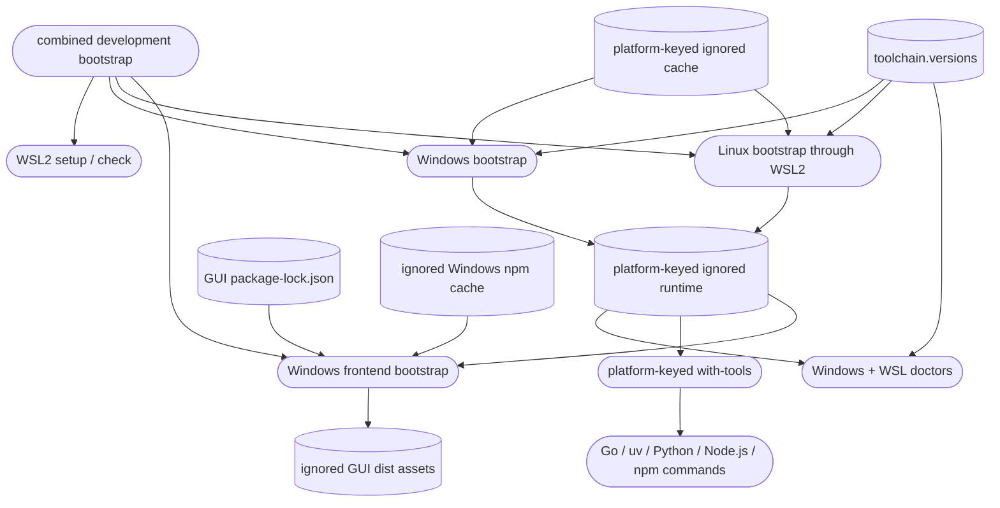

# Repository-local toolchain

## Purpose

The toolchain component gives a fresh supported checkout pinned Go, uv,
managed Python, Node.js, and npm runtimes without persistent host changes.
Downloaded runtimes and caches remain ignored so they can be populated online
or carried in an offline development kit without bloating source history.

## Public interface

Developers run `bootstrap.ps1` or `bootstrap.sh` for one host, or
`bootstrap-development.ps1` to prepare both Windows and a selected WSL2
distribution from one checkout. `setup-wsl.ps1` keeps host installation and
conversion opt-in, while `doctor-wsl.ps1` proves the distribution, repository
mapping, and Linux tools. `bootstrap-frontend.ps1` restores the locked browser
GUI dependencies, including from a populated offline cache. Commands run
through `with-tools` or the Go-only compatibility wrapper.
`toolchain.versions` is the authority for versions, platform archive URLs,
and SHA-256 checksums.

## Key behaviors

- `REQ-PLAT-978855a5` - checksum-verifies pinned repository-local tools and avoids persistent PATH or system installations.
- `REQ-PLAT-e1a2a591` - restores the locked browser frontend and emits static
  production assets without adding a Node.js runtime to the appliance.
- `REQ-PLAT-93e1b194` - supplies the Go runtime used by portable Linux ARM64, Linux x86_64, and Windows x86_64 compilation.
- `REQ-PLAT-bdf0cbdb` - isolates tools, caches, managed Python, and generated
  Python environments by host platform.
- `REQ-PLAT-055d77ba` - verifies WSL2 readiness and requires explicit authority
  before requesting installation or conversion.
- `REQ-FUNC-6d8e811c` - bootstraps Windows and WSL2 tools through one Windows
  entry point.
- `REQ-TEST-e311d3bc` - diagnoses the WSL2 kernel, checkout mapping, and Linux
  toolchain from Windows.
- `REQ-TEST-031b1658` - routes frontend format, lint, unit-test, and build
  commands through the repository validation entry point on Windows.

## Architecture

The scripts modify environment variables only in their child process. The
frontend bootstrap restores locked dependencies and can produce static assets;
it does not package the Raspberry Pi appliance.

## Files

- `02_Tools/toolchain.versions` - pinned versions, archive URLs, and checksums.
- `02_Tools/bootstrap/bootstrap.ps1` and `02_Tools/bootstrap/bootstrap.sh` - checksum-gated online/offline population.
- `02_Tools/bootstrap/bootstrap-development.ps1` - combined Windows and WSL2
  setup, bootstrap, and diagnostic entry point.
- `02_Tools/bootstrap/bootstrap-frontend.ps1` - locked online or offline npm
  restore for the browser GUI.
- `02_Tools/bootstrap/setup-wsl.ps1` - read-only WSL2 readiness check with
  explicit installation or conversion requests.
- `02_Tools/lib/Wsl.ps1` - checked WSL invocation, discovery, kernel check, and
  Windows-to-WSL path translation.
- `02_Tools/env/with-tools.ps1` - Windows child-process environment for Go,
  uv, managed Python, Node.js, npm, and the repository-local npm cache.
- `02_Tools/env/with-tools.sh` - Linux child-process environment for Go, uv,
  and managed Python.
- `02_Tools/env/with-go.ps1` and `02_Tools/env/with-go.sh` - Go-only compatibility wrappers.
- `02_Tools/scripts/doctor.ps1` - Windows Go, uv, Python, Node.js, and npm
  executable and exact-version verification.
- `02_Tools/scripts/doctor.sh` - Linux Go, uv, and Python executable and
  exact-version verification.
- `02_Tools/scripts/doctor-wsl.ps1` - Windows-side combined WSL2 and Linux-tool
  diagnosis.
- `02_Tools/README.md` - usage, support, cache, and offline-kit guidance.
- `05_Software/scripts/aegis_test.py` - Go, Python, integration, and Windows
  frontend suite discovery that excludes generated environments and outputs.
- `05_Software/scripts/tests/test_toolchain_bootstrap.py` - manifest,
  non-global bootstrap, WSL safety, orchestration, and diagnostic contract
  tests.
- `.gitignore` - runtime, cache, and generated-artifact exclusions.
