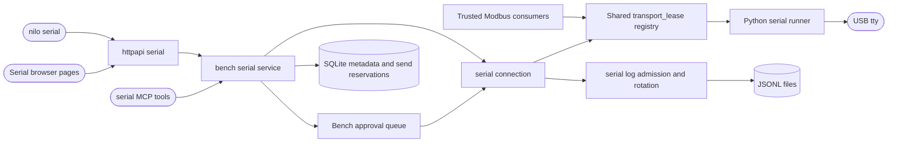

# USB to Serial integration

## Routing

Select this page for USB serial discovery, per-port terminals, session approval,
RX/TX logs, serial retention, `nilo serial` and `serial_*` MCP tools. Start at
`05_Software/core/internal/bench/serial_session.go` and `serial_lifecycle_test.go`.
Package installation and ordinary Bench jobs belong to
[Managed bench integrations](bench-integrations.md); the protocol and supervisor
belong to [Integration platform](integration-platform.md).

## Purpose and boundaries

The serial service binds an approved connection to one appliance USB port and
one authenticated credential. Core owns permissions, leases, retained logs and
client access; the Python runner owns bounded physical reads, writes and modem
signals. The browser, command line and MCP use these shared services.

## Public interface

`bench.Manager` exposes `ConnectSerial`, `SerialWorkspace`, `ReadSerial`,
`SendSerial`, `SetSerialSignals`, `DisconnectSerial`, `SerialLogging`,
`ListSerialLogs`, `ReadSerialLog`, `ExportSerialLog`, `DeleteSerialLog`,
`SerialRetention` and `UpdateSerialRetention`. HTTP routes use
`/api/v1/serial-devices/{id}` and `/api/v1/serial-logs/{id}`.
The exact wire contract is [USB serial sessions and logs](../specs/usb-serial.md).
The operational guide is `06_SoftwareDocu/USB_to_Serial_Integration.md`.

## Invariants

- USB discovery observes metadata without opening ports. Public device IDs are
  stable `serial-N` records; Core supplies endpoint and hardware identity.
- Shared transport claims reserve the physical port and strong serial identity
  across Serial and Modbus. Cancellation retains ownership through runner and
  workspace cleanup; failed cleanup fences reuse and is returned by Core shutdown.
- Connection approval binds settings, device revision, owner and credential.
  Sends require that same credential and current read/execute authority.
- Administrator operating settings set the lifetime, unrecorded idle disconnect
  and appliance-wide connection capacity (defaults one hour, one minute and four).
  Each connection retains its assigned lifetime and idle rule after a change.
- The browser edits these three settings under **System > Plugins > Serial**;
  Core stores them in the shared revisioned platform settings record.
- TX reservations are persisted before writing. Retry returns the stored result;
  an uncertain write remains unknown and never triggers an automatic resend.
- Rings, reads, sends, queues, retained files and exports have explicit bounds.
  Original bytes are retained as base64 JSONL events with host observation times.
- Rotation preserves recording admission time. Gaps and interrupted files remain
  visibly incomplete. Active/incomplete/download-leased files resist automatic pruning.
- Owners and administrators may inspect logs; administrator inspection does not
  transfer another credential's transmission authority.

## Change map

| Change | Start | Focused verification |
|---|---|---|
| Discovery and stable identity | `serial_adapter.go`, Python `discovery.py` | `serial_test.go`, `test_discovery.py` |
| Approval, lifecycle and revocation | `serial_session.go`, `serial_stream.go` | `serial_lifecycle_test.go` |
| TX validation and deduplication | `serial_model.go`, `serial_control.go` | `serial_test.go`, `test_transport.py` |
| Retention, exports and recovery | `serial_logs.go` | `serial_test.go` |
| Client operations | HTTP/MCP/CLI `serial.go` | adjacent `serial_test.go` |
| Terminal presentation | `SerialWorkspacePage.tsx`, `serialBuffer.ts` | component tests, `serial-layout.check.ts` |
| Offline integration packaging | `build-serial-bundle.py` | `test_serial_bundle.py` |

## Key behaviors

- `REQ-FUNC-46dd5987` and `REQ-FUNC-5d897991`: configured connection
  capacity and new-session lifetime/idle snapshots preserve active sessions.
- `REQ-UX-74d4256e`: appliance Core refreshes Camera/Serial hardware inventory
  on a five-second timer with bounded discovery calls. Metadata reads run outside
  the admission lock; results from replaced/disabled packages are discarded.
  Unchanged observations preserve configuration revisions. Unplugged hardware and
  detected acquisition/transport faults lose readiness; normal stops preserve it.
  Configured reconnected hardware returns after initialization. Active cameras
  retain their controls; initialization waits until their stream ends.

- REQ-FUNC-455b5fe2 and REQ-DATA-a67947e3: USB-only discovery and stable per-port identity.
- REQ-FUNC-f3baf991: administrator lifecycle and revisioned device configuration.
- REQ-SEC-a15f6f76: credential-bound approved sessions and revocation.
- REQ-FUNC-41f2899a: bounded cursor streams and explicit gaps.
- REQ-REL-850598d6: validated, serialized sends without replay.
- REQ-FUNC-680bbebf: explicit framing, flow control and supported modem signals.
- REQ-DATA-317db2cc: recoverable byte-exact log segments.
- REQ-DATA-c9766274: count, file, device and filesystem reserve limits.
- REQ-FUNC-8b8aabad: authorized viewing, streaming exports and deletion.
- REQ-UX-7338451f: responsive administration, terminal and Sessions pages.
  RealTime View groups output and transmission in one panel, with separate
  collapsed Display settings, Port settings, and Transmit and signals cards.
  Expanded views use the available workspace height and provide an explicit
  fullscreen exit action. Narrow screens wrap controls and scroll as needed.
  A failed read is reconciled against current connection state; an obsolete
  read from a closed/replaced connection does not become a persistent error.
  Active read failures and authorization errors remain visible.
- REQ-FUNC-8bf074b9: CLI and MCP parity.
- REQ-PLAT-36597f39: pinned supervised package and offline bundle tooling.

## Architecture

The finite connection job releases its Bench worker after runner readiness;
dedicated session workers own reception and bounded background checks.

## Files

- `05_Software/core/internal/bench/transport_lease.go` and `transport_lease_test.go`:
  canonical cross-family claims and cleanup-confirmed ownership.
- `05_Software/core/internal/bench/serial_*.go`: model, identity adapter,
  session lifecycle, streaming, send control and log services with focused tests.
- `05_Software/core/internal/store/sqlite/migrations/022_serial_workspace.sql`:
  connection bindings, send reservations, quota settings and log metadata.
- `05_Software/core/internal/httpapi/serial.go`, `internal/mcp/serial.go`,
  `cmd/nilo/serial.go`: shared-service interfaces and adjacent tests.
- `05_Software/integrations/serial/`: manifest, schemas, locked dependency,
  physical runner and Linux pseudo-terminal tests.
- `05_Software/frontend/src/api/serial.ts`, `components/pages/Serial*.tsx`,
  `components/pages/serialBuffer.ts`: typed client, terminal and Sessions UI.
- `02_Tools/scripts/build-serial-bundle.py`, `prepare-serial-dependency.py`:
  verified offline dependency and self-contained bundle construction.
