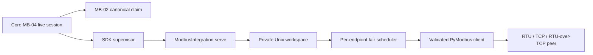

<!--
Copyright (c) 2026 DDP Engineering
This software is licensed under the PolyForm Noncommercial License 1.0.0.
Commercial use requires a separate commercial license.
See the LICENSE.txt in the .agentic folder for full license details.
SPDX-License-Identifier: LicenseRef-PolyForm-Noncommercial-1.0.0
-->

# TASK-107b2073 - MB-03 supervised Modbus runner and fair transport scheduler

stage: done
type: feature
path: full
interaction: autopilot
requirements: REQ-FUNC-aa89e3ad, REQ-REL-2ad3bbb0, REQ-REL-2d6babd5, REQ-REL-1878cffa, REQ-SEC-a3293f66, REQ-REL-feb1ff48
parent:
branch: ddp/modbus-client
base: eaad0f8dcfbade9872925b4650a2c203052206f5
opened: 2026-09-29

## Done checklist (current stage)

- [x] Validated candidate confirmed unchanged since proof.
- [x] Validation evidence, diff, exclusions, and outcome presented.
- [x] Delivery confirmed by the human.
- [x] Journal and report included in the local delivery commit.
- [x] Agreed local-commit outcome delivered without pushing.
- [x] Close-out carried by the delivery commit, which is itself the whole outcome.

## Frame

Problem: STATED continue with next ticket on same branch. OBSERVED Gitea #30 MB-03 requires a supervised Modbus runner and fair transport scheduler; MB-01 has an isolated simulation client and MB-02 has Core definitions and canonical claims, without a production runner.
Desired outcome: Implement an SDK-supervised private runner that executes validated FC01/02/03/04/05/06/15/16 on RTU, TCP and RTU-over-TCP, schedules multiple units fairly per endpoint, bounds retries/deadlines, and cleans up deterministically.
Actors: Core's future credential-bound session service supplies pinned approved configuration and private commands; SDK supervisor owns child process; runner owns one endpoint transport; independent fixture peers observe exact bytes.
Primary scenario: Core starts one runner with a pinned endpoint/profile in a mode-0700 workspace -> runner opens one transport and mode-0600 private socket -> concurrent unit requests enter bounded fair scheduling -> each produces a validated outcome -> stop/cancel closes transport/socket before supervisor exit.
Examples: Units 1 and 2 alternate when both have work; one slow unit's expired request does not block a new independent endpoint. Split TCP frames and partial RTU frames assemble into one response.
Counterexamples: Two concurrent calls on one client; stale RTU reply accepted after timeout; automatic write replay; raw client-supplied serial path or network URL; mode-world-readable socket; unbounded poll catch-up.
In scope: Python SDK lifecycle package, validated pinned runner startup/config, private Unix control messages, one per-endpoint scheduler, all eight baseline functions and framing validation, bounded read retries/recovery/deadlines, supervisor/process/fixture tests and documentation. Integration bridge remains internal for MB-04 composition.
Out of scope: MB-04 credential-bound Core sessions, finite approvals, durable writes, public HTTP/CLI/MCP and background poll persistence; maps, GUI, recordings, bundle/image promotion, physical I/O, real-target tests, Git staging/commit/push and deployment.
Constraints: STATED client/master only, TCP-only RTU-over-IP, shared definitions, one live owner and no per-write acceptance. OBSERVED MB-01 pins PyModbus 3.15.0/pySerial 3.5; MB-02 owns canonical claims. Root AGENTS requires AEGIS software workflow, same branch and current Git instruction for mutation; retain autopilot. User assets under 09_Others are unrelated.
Success signals: Independent peers cover eight functions in all modes, malformed frame identities/CRC/lengths fail closed, fair bounded queue with no overlap, separate endpoints progress together, writes transmit at most once, cancellation and crash leave private descriptors closed.
Evidence: OBSERVED #30, #31, 00_Planning/Modbus_Plugin_Plan.md sections 4/5/9/11, .agentic/knowledge/modbus-integration.md, integration-platform.md, 05_Software/integrations/modbus/{feasibility.py,requests.py,tests/peers.py}, SDK and Serial runner workspace. MB-02 commit eaad0f8dcfbade9872925b4650a2c203052206f5 is task base.
Assumptions: INFERRED runner can be independently supervised and fixture-tested before MB-04 wires a live Core session. Runner's private channel is trusted only inside Core-owned workspace; public authorization is MB-04. No package installation/registry publication is needed to prove this internal runner.
Unknowns: UNKNOWN physical RS-485 timing/direction, named gateway quirks, native ARM and appliance throughput remain later acceptance. Exact scheduler bounds and recovery timing need design and tests; no new product choice is blocking within ticket acceptance.
Decision-blocking questions: None. MB-01 decisions and ticket scope settle transport/function/security boundaries; detailed bounded scheduling is an implementation choice audited in design.
Proposed behaviors: Strict startup, private channel and deterministic cleanup; verified baseline transactions; single in-flight fair queue, deadline/cancellation and bounded read retry/recovery; independent endpoint concurrency.
Path and reason: Full path. New supervised process, private wire contract and scheduling behavior; quick-path criteria fail for observable behavior, interface, requirements and safety boundary. Closely coupled work remains one task, with no child tasks or subagents.

| Quick-path criterion | Yes | No | Evidence |
|---|---|---|---|
| No new externally observable behavior | | x | New runner transaction outcomes. |
| No new interface/data format | | x | Private socket contract. |
| No new dependency | x | Existing MB-01 pins suffice. |
| Existing requirement covers behavior | | x | MB-01 prototype and MB-02 claims do not specify production scheduling. |
| No security/data-handling change | | x | Private transport and process boundary. |

## Requirement coverage

| Frame outcome | Actor/system and trigger | Atomic behavior / requirement | Positive case | Boundary or failure | Verification / design seam |
|---|---|---|---|---|---|
| Baseline functions | Trusted private transaction | Eight functions / REQ-FUNC-aa89e3ad | All three transports return raw values | Unsupported/quantity bounds reject | runner client and independent peers |
| Framing | Peer response | Strict validation / REQ-REL-2ad3bbb0 | Complete exact response | CRC/MBAP/unit/function/count/echo faults | wire validator and malformed peer fixtures |
| Fairness | Multiple units/poll keys | Bounded per-endpoint scheduler / REQ-REL-2d6babd5 | Round-robin no overlap | Slow unit/backlog/second endpoint | scheduler unit and socket tests |
| Recovery | Expiry/cancel/loss | Bounded retries, quarantine and no replay / REQ-REL-1878cffa | TCP read retries within deadline | RTU late reply, uncertain write | late/drop peers and retry counts |
| Private boundary | Supervised startup/control | Owner-only socket and strict commands / REQ-SEC-a3293f66 | Core-owned workspace | Hostile path/message | socket mode and malformed input tests |
| Lifecycle | Stop/cancel/crash | Deterministic closure / REQ-REL-feb1ff48 | Clean exit after descriptor close | Child kill/active request | SDK process and Core claim seam tests |

## Design

Requirements coverage: REQ-FUNC-aa89e3ad uses MB-01 Request/encode and a production-configured PyModbus client. REQ-REL-2ad3bbb0 uses full observed ADU validation and fails closed. REQ-REL-2d6babd5 uses one event-loop worker, per-unit FIFO queues and round-robin selection. REQ-REL-1878cffa uses explicit deadline/attempt accounting, TCP-only safe read retries, RTU signature quarantine and quiet drain, with one write attempt. REQ-SEC-a3293f66 uses an owner-only workspace/socket and exact bounded JSON messages. REQ-REL-feb1ff48 joins SDK cancellation, scheduler drain, transport close and private socket teardown.

Components: The Python `nilo_modbus` package owns protocol bytes, private server and scheduling. Existing SDK `ProtocolServer` supervises lifecycle through `nilo.integration/1`; Core MB-02 keeps definition, claim and policy ownership. MB-04 later creates authenticated live sessions and invokes this runner. No public route/registry or reusable package delivery is introduced here.

Interface: `ModbusIntegration.execute(serve)` starts a workspace from a strict pinned endpoint/profile and trusted tty identity. A Unix socket uses the version-1 one-message-per-connection contract in specs/REQ-REL-2d6babd5.md. No transport address, serial path or approval assertion is accepted from a transaction. The private response distinguishes acknowledged, exception, pre-TX rejection, timeout, cancellation, protocol_error, disconnected and post-TX delivery_unknown, with request ID/attempts. Exact JSON and mode/owner checks occur before a transport call.

State and flow: SDK configure checks minimal plugin envelope without I/O. Serve validates snapshots and workspace -> opens a PyModbus client with no library retries/reconnect -> binds private socket mode0600 -> receives concurrent local commands -> validates/queues -> one worker selects next unit -> canonical request check/transact -> correlated result. A request deadline starts at admission using monotonic time. Read poll keys replace pending missed work. Different processes/endpoints have separate schedulers.

Failure/recovery: A malformed frame or transport uncertainty fences the current client. TCP read retry reconnects only within deadline and max 3 retries. RTU/RTU-over-TCP drain to a bounded quiet interval and quarantine exact timed-out signatures; identical replies cannot be fresh without transaction IDs. Writes never retry; possible TX without acknowledgement becomes delivery_unknown. Stop/cancel settles pending requests and closes the transport/socket before execute returns. Supervisor crash cleanup kills the child; the caller's MB-02 claim remains held/fenced until its lifetime function confirms cleanup.

Security: Directory must be absolute, existing, owned by runner UID, non-symlink and mode0700. Socket is mode0600, owned by same UID, bounded line/body and exact operation schema; no request-level target mutation. USB tty basename is matched against pinned sysfs identity before open. Configured network targets are pinned; policy/DNS approval is Core's MB-04 responsibility and prevents public use until composed. Runner fixture tests use loopback/PTYs only.

Concurrency: Event-loop scheduler has 128 total and 8 per-unit pending slots, one active client call and fair unit rotation. A bounded deadline limits a slow unit's occupancy. Per-unit poll key coalescing prevents missed-poll accumulation. Cancellation removes pending commands; active cancellation closes/fences the client and preserves write uncertainty. Cleanup never waits on a held global Core mutex.

Compatibility/dependencies: Retain MB-01 SimulationClient API and pinned PyModbus 3.15.0/pySerial 3.5 lock. Factor shared ADU validation into a production protocol helper only if its existing tests continue passing. SDK/Serial/Camera behavior is unchanged. Manifest/schema fixture is a development runner contract; target bundle promotion is MB-10.

Verification: Red-first unit tests for scheduler and private workspace, then independent peer protocol suites on all modes, malformed/late/drop fixtures, supervised SDK subprocess handshake, mode/closure and cross-endpoint concurrency. The configured full offline gate and lint run after review. Physical RS-485 direction, native ARM and named gateway are later gates.

Alternatives: Reusing the feasibility client directly would leave simulation-only target restriction and hard-coded framing; it stays a separate test contract. Per-request runner processes would prevent one persistent endpoint scheduler. Unbounded RTU reconnect/retry could label a late identical reply fresh, so quarantine is conservative. Shared serial workspace helper is Camera/Serial specific; the MB-03 private socket uses its ownership pattern without importing their device control API.

Expected files: `05_Software/integrations/modbus/{manifest.json,runner,schemas/,src/nilo_modbus/{__main__,plugin,workspace,runner_client,scheduler}.py,tests/}`; existing feasibility/wire source only if factoring validation; `.agentic/knowledge/{modbus-integration,integration-platform}.md`, `CHANGELOG.md`, and this task's requirements/spec/journal. No Go public service edits expected.

Risks/open decisions: Driver read-back and RS-485 capability cannot be proven with PTYs; Core MB-04 destination policy and operational limits still need design. No open decision blocks isolated runner tests.

### Proposed architecture - TASK-107b2073

## Log

- 2026-09-29 deliver close-out: The approved outcome is the local commit itself, with no push, PR or deployment. The AEGIS delivery report is appended; this close-out and the report travel in the same commit as the validated candidate. Four unrelated untracked media files under `09_Others/` remain excluded. No post-commit outcome is requested.

- 2026-09-29 deliver approval: User instructed "commit files" after the validated MB-03 presentation. Authorized outcome is one local commit on `ddp/modbus-client`; no push or PR. Candidate and unrelated media exclusions were rechecked unchanged, `git diff --check` exit 0. Report and close-out will be included in this local delivery commit.

- 2026-09-29 validate -> deliver: Final canonical offline command=`env NILO_WSL_HOST_VOLUME=/mnt/c NILO_KERNEL_MODULES_PATH=/lib/modules sh ./02_Tools/env/with-build-environment.sh --engine docker --image nilo/build-environment:noble-20260929-01 run env UV_NO_SYNC=true UV_OFFLINE=true UV_LINK_MODE=copy sh -c "./02_Tools/tests/build-environment/prepare-python-environments.sh && python .agentic/aegis.py check --task TASK-107b2073 --strict --run"`; exit=0 on verified candidate digest `sha256:ce12f5b644ca658b0d928787d059e9613015d235ffe09b2f7a63f2c586fc62bc`. All pinned Python environments and source-lock coverage prepared offline; configured full repository test command passed in 119.8s and lint in 12.1s; `strict: ok`. Advisory result WARN: 10 warnings (six pre-existing repository metadata findings and four unrelated untracked media files under `09_Others/`), four unrelated manual-verification notes; no MB-03 finding. Log: `02_Tools/cache/modbus-feasibility/mb03-final-validation.log`. Both round-2 verdicts approved, final evolution refreshed; no source/test/spec/knowledge change after proof. Initial provenance deviations remain documented.

- 2026-09-29 validate review round 2: Specification compliance approved after checking all six active requirements, exact private wire and recovery spec, ticket exclusions, and no public MB-04 work. Implementation quality approved after reviewing frame validation, timeout/cancel/crash paths, owner-only socket, serial identity recheck, bounded queue/retry, Windows/Linux fixture behavior, and test coverage. No `Manual:` or `Inspection:` methods exist in this task's six requirements. Evolution since the latest anchor shows only the two reviewed recovery source files; the full Git candidate review also covered files written before the first anchor. Advisory check is 10 unrelated warnings/4 notes after verdicts; no candidate-specific finding remains.

- 2026-09-29 build -> validate (review fix): RTU recovery now checks the Core-pinned sysfs identity before draining and again before reopening the tty. Focused command=`wsl -d Ubuntu -- sh ./02_Tools/env/with-tools.sh uv run --locked --project ./05_Software/integrations/modbus pytest -q ./05_Software/integrations/modbus/tests/test_runner.py::test_serial_recovery_refuses_changed_pinned_identity ./05_Software/integrations/modbus/tests/test_runner.py::test_serial_recovery_drains_until_quiet ./05_Software/integrations/modbus/tests/test_workspace.py`; exit=0, 5 passed. Ruff check passes; format corrected. Both review verdicts cleared pending round 2.

- 2026-09-29 build red: REQ-SEC-a3293f66; command=`wsl -d Ubuntu -- sh ./02_Tools/env/with-tools.sh uv run --locked --project ./05_Software/integrations/modbus pytest -q ./05_Software/integrations/modbus/tests/test_runner.py::test_serial_recovery_refuses_changed_pinned_identity`; exit=1; expected missing behavior=runner had no serial identity verifier for recovery after a tty was rebound.

- 2026-09-29 validate review round 1 -> build: Specification compliance approved for runner-only scope and six requirements. Implementation quality changes_required: `RunnerClient.recover` reopened RTU path without rechecking the pinned USB identity, allowing tty reattachment to switch adapters. Fix only this finding, then repeat both verdicts in round 2. Verification wording for crash cases was refined to the observable child/PTY/Core seams; killed child socket and queued-command closure tests passed.

- 2026-09-29 build -> validate: Six runner requirements activated with source/test links. Focused recovery/scheduler proof passed (7 tests); Core manifest loader accepted the source package (`go test ./internal/integration/manifest -run TestLoadModbusSourcePackage -count=1`, exit 0); final Modbus package suite `wsl -d Ubuntu -- sh ./02_Tools/env/with-tools.sh uv run --locked --project ./05_Software/integrations/modbus pytest -q ./05_Software/integrations/modbus/tests` passed 180 tests, exit 0. Ruff check and format check passed. Advisory `check --task` exit 0 with 10 warnings/4 notes: six repository-wide pre-existing metadata warnings plus four unrelated user media scan warnings. No candidate-specific uncovered paths remain.

- 2026-09-29 build deviation: Initial scheduler/workspace tests failed before their implementations, but exact selectors and exits were not preserved in this journal. The first anchor was also taken after the initial runner files existed; later red cases and the final full proof cover behavior, but historical test-first/evolution provenance is incomplete. Unrelated user media under `09_Others/` appeared during work and is excluded from the candidate.

- 2026-09-29 build red: REQ-REL-feb1ff48; command=`wsl -d Ubuntu -- sh ./02_Tools/env/with-tools.sh uv run --locked --project ./05_Software/integrations/modbus pytest -q ./05_Software/integrations/modbus/tests/test_runner.py::test_runner_caps_extreme_connect_timeout_for_cancel`; exit=1; expected missing behavior=Core-canonical maximum connect timeout allowed a 24-day runner startup wait.

- 2026-09-29 build red: REQ-REL-feb1ff48; command=`wsl -d Ubuntu -- sh ./02_Tools/env/with-tools.sh uv run --locked --project ./05_Software/integrations/modbus pytest -q ./05_Software/integrations/modbus/tests/test_workspace.py::test_scheduler_crash_stops_workspace_and_unlinks_socket`; exit=1; expected missing behavior=workspace awaited stop indefinitely after scheduler worker crashed.

- 2026-09-29 build red: REQ-FUNC-aa89e3ad; command=`wsl -d Ubuntu -- sh ./02_Tools/env/with-tools.sh uv run --locked --project ./05_Software/integrations/modbus pytest -q ./05_Software/integrations/modbus/tests/test_runner.py::test_runner_accepts_core_canonical_response_timeout`; exit=1; expected missing behavior=runner rejected valid Core canonical 1 ms and 20 s response timeouts.

- 2026-09-29 build red: REQ-REL-1878cffa; command=`wsl -d Ubuntu -- sh ./02_Tools/env/with-tools.sh uv run --locked --project ./05_Software/integrations/modbus pytest -q ./05_Software/integrations/modbus/tests/test_runner.py::test_serial_recovery_drains_until_quiet`; exit=1; expected missing behavior=serial recovery had no drain that waits for a quiet interval after late bytes.

- 2026-09-29 build red: REQ-REL-1878cffa; command=`wsl -d Ubuntu -- sh ./02_Tools/env/with-tools.sh uv run --locked --project ./05_Software/integrations/modbus pytest -q ./05_Software/integrations/modbus/tests/test_scheduler.py::test_rtu_timeout_quarantines_same_signature_but_other_unit_recovers`; exit=1; expected missing behavior=RTU and RTU-over-TCP accepted a different-address read with the same unit/function after timeout, although its late response is indistinguishable.

- 2026-09-29 design -> build: Audited six requirements and exact private protocol against SDK/Serial seams; one supervised endpoint runner with a fair bounded scheduler and conservative RTU quarantine is the implementation path. No public Core session/API/registry work.

- 2026-09-29 specify -> design: Created six draft atomic requirements, reused/revised/retired none. Exact private message, fair queue and conservative RTU quarantine contract is in specs/REQ-REL-2d6babd5.md; all Frame outcomes mapped without public MB-04 work.

- 2026-09-29 frame -> specify: Authenticated Gitea #30 and adjacent #31, full plan and current package/Core seams establish MB-03 runner-only scope. Full path chosen for private protocol, scheduling and process cleanup. Same branch eaad0f8; retained autopilot. No Git publication or real-device work authorized.

## Rulings

- RULING-001 | date=2026-09-29 | decision=Implement MB-03 only on ddp/modbus-client using AEGIS autopilot; leave Git uncommitted/unpushed | reason=User next-ticket instruction, retained mode and ticket Git limits | source=user | supersedes=none
- RULING-002 | date=2026-09-29 | decision=Commit validated MB-03 files locally on ddp/modbus-client without pushing | reason=User explicitly instructed "commit files" after deliver presentation | source=user | supersedes=RULING-001 (Git outcome only)

## Handoff

current: done
status: ready
next: none - MB-03 delivered by one local commit on ddp/modbus-client
must_read: .agentic/tasks/TASK-107b2073.md
blockers: none

## Stage report

stage: deliver
result: completed
current: done
changed: MB-03 runner, private socket and scheduler delivered in one local commit on ddp/modbus-client.
evidence: Offline full test and lint pass, strict check ok, both round-2 verdicts approved; delivery report appended.
issues: Ten unrelated advisory warnings and four notes; initial build provenance deviation; no native ARM or physical device acceptance.
next: none - local commit is the complete authorized outcome; no push

needs_user: no - local commit authorized; no push
spec_compliance: approved
implementation_quality: approved
review_round: 2

## Delivery report (2026-09-29)

- stage: deliver; type: feature; path: full; branch: ddp/modbus-client
- requirements:
  - REQ-FUNC-aa89e3ad - Execute the eight baseline Modbus functions on supported transports
  - REQ-REL-2ad3bbb0 - Reject inconsistent Modbus transport replies
  - REQ-REL-2d6babd5 - Schedule endpoint requests fairly within bounded queues
  - REQ-REL-1878cffa - Bound read recovery and prevent write replay
  - REQ-SEC-a3293f66 - Confine the Modbus runner control channel
  - REQ-REL-feb1ff48 - Close supervised Modbus resources deterministically
- deviations: none recorded
- explicit review: enabled; spec_compliance=approved; implementation_quality=approved; review_round=2
- diff vs task base eaad0f8: 43 file(s) changed, 2422 line(s) added; 4 file(s) not content-scanned
- checks: errors=0 warnings=12 notes=4
- checklist: 3/6 done; open: Journal and report included in a delivery commit.; Agreed outcome delivered.; Close-out committed after the outcome succeeded.
