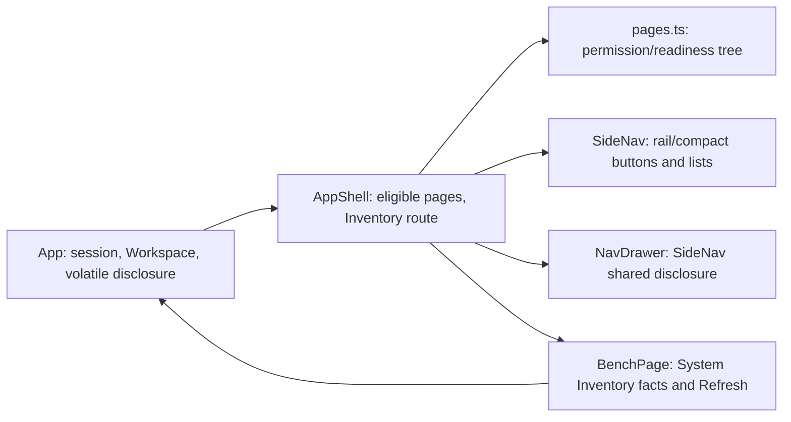

<!--
Copyright (c) 2026 DDP Engineering
This software is licensed under the PolyForm Noncommercial License 1.0.0.
Commercial use requires a separate commercial license.
See the LICENSE.txt in the .agentic folder for full license details.
SPDX-License-Identifier: LicenseRef-PolyForm-Noncommercial-1.0.0
-->

# TASK-1b87ad8a - Simplify Web UI navigation to collapsed Instruments and System sections; start on About

stage: validate
type: feature
path: full
interaction: autopilot
requirements: REQ-UX-30821068, REQ-UX-8fa0c15e, REQ-UX-b718864e, REQ-UX-2bc3a464, REQ-UX-eb84f037, REQ-UX-71cbafec, REQ-UX-57d10c15, REQ-UX-74d4256e, REQ-UX-afb79ae0, REQ-UX-8169ea1d, REQ-UX-f300b346, REQ-UX-adbe5465, REQ-UX-2687f591
parent:
branch: adore/pi-26
base: a89db2fa89b0fdf8a77f24833555b617122cb344
opened: 2026-09-28

## Done checklist (current stage)

- [x] diff reviewed against scope, requirements, design, error paths,
      portability, security, and unrequested work in the integrated tree
- [x] knowledge pages updated for every materially changed component
- [ ] requirements re-read: status, prose, verification, paths, and links true (appliance-browser observations outstanding)
- [ ] manual or inspection verification completed and recorded where applicable (browser inspection outstanding)
- [x] final evolution report refreshed after the last candidate edit (refresh again if candidate changes)
- [ ] final `check --strict --run` result recorded truthfully after all edits (current exit 1; successful final proof outstanding)
- [x] remaining warnings and pre-existing failures explained
- [ ] `stage: deliver`

## Frame

Problem: The authenticated browser starts on Bench and the left navigation exposes Bench alongside expanded nested groups; its Instruments and System labels are not collapsible controls.
Desired outcome: Two top-level navigation sections, initially collapsed, with About as the only initial tab; existing authorized instrument and system work remains accessible.
Actors: Administrator, Operator and Viewer using keyboard, screen reader, or pointer on desktop, compact rail or drawer; a second user signing in on the same browser.
Primary scenario: Restore an authenticated session or sign in -> open About alone, show Instruments and System collapsed -> expand a section to discover permitted destinations; nested groups open deliberately or as needed to expose subsequently selected active content.
Examples: On an empty inventory, opening Instruments reveals an explicit understandable empty state; after opening a System destination, a resource refresh preserves tabs and expansion choices.
Counterexamples: Do not automatically open System because About is active, inherit a previous user's expanded groups, hide either section when inventory is empty/unavailable, or remove Bench Core execution, capture, ownership or APIs.
In scope: Shell page registry, initial workspace state, session-scoped navigation expansion, keyboard/ARIA, role/readiness filtering, three catalogues and layouts, shell/startup/browser tests, relevant UI docs and active requirement reconciliation. Retain access to useful Bench-only diagnostic/inventory information when removing its navigation destination.
Out of scope: Backend services, instrument execution semantics, package delivery, publication and unrelated working-tree modifications. No child task: navigation, startup and documentation are tightly coupled.
Constraints: Existing active requirements for the single-screen status/inventories and empty/failure states (REQ-UX-8fa0c15e, REQ-UX-afb79ae0, REQ-UX-8169ea1d) and the working/core ordering (REQ-UX-30821068) conflict with removing Bench; preserve established information contracts unless explicitly authorized to retire them. Session permission and hardware readiness filtering continue. Git branch already adore/pi-26 and matches journal; no Git mutation permitted.
Success signals: Exactly two top-level section controls in all layouts; About sole initial tab after restoration/new sign-in; both initially collapsed; authorized entries reachable; refresh preserves in-session state; new session resets it; accessible translated controls and empty state; role/layout/startup tests and documentation reflect behavior.
Evidence: STATED: Ticket #26 requested scope, boundaries and acceptance, About proposed as default. OBSERVED: pages.ts registers Bench and DEFAULT_PAGE=bench, filters devices/plugins and role-bound core pages; SideNav.tsx defaults nested groups open and hides empty Instruments; App.tsx seeds ['bench'] and resets tabs on sign-out; AppShell.tsx re-mounts navigation across refresh and routes Bench and About; BenchPage.tsx alone displays detailed inventories, failures and Refresh; gui-foundation.md and Development_and_Simulation_Flow.md document existing navigation and Bench information. INFERRED: Removing Bench without another presentation route would make detailed status/inventory and refresh inaccessible; expansion state owned solely by SideNav would be lost on inventory refresh or drawer remount. UNKNOWN: exact destination/placement for Bench-only inventory and failure information, and whether failed inventory reads should use a distinct Instruments empty/unavailable message; specify/design must settle without removing established contracts.
Assumptions: Adopt the ticket's proposed About landing as the scope decision in this explicitly noninteractive autopilot run; keep Bench Core status and inventories accessible via a System child or equivalent focused view, not necessarily a Bench-named tab. Confirm exact placement in specify/design against existing contracts.
Decision-blocking questions: None requiring an external answer: About is explicitly proposed, and the information-preservation conflict has an in-scope solution; do not silently retire the existing inventory requirements.
Proposed behaviors: Remove Bench as a navigation and opening-tab destination; use About as the single startup/reset tab; keep both collapsible section controls present; default groups collapsed and expand only when explicit navigation within an opened section needs visibility; keep expansion across refresh/drawer, reset on session change; retain permission/readiness filtering and a differentiated zero-instrument display; provide three-language labels and keyboard/ARIA semantics; preserve Bench-only inventory/status/refresh behavior in an authorized System presentation route to be specified.
Path and reason: full. Criterion | result | evidence: no new externally observable behavior | no | two new controls, collapsed entry and changed landing; no new interface/data format | yes | frontend presentation only; no new dependency | yes | existing React/i18n; existing requirement covers behavior | no | REQ-UX-30821068 specifies different layout; no security/data handling change | yes | preserve existing role/authorization and resource handling. Any no selects full.

## Requirement coverage

Behavior inventory (STATED unless noted):

| Frame outcome | Actor/system | Trigger or state | Response | Positive case | Boundary or failure | Observable result |
| --- | --- | --- | --- | --- | --- | --- |
| Two-section navigation | Authenticated shell | Any role and inventory | Two section controls; System destinations permission-filtered | Authorized destinations reachable | No Bench entry; Viewer/Operator restrictions | Only Instruments and System headings |
| About landing/reset | App/workspace | Restore or new user's sign-in | About alone; sections closed | About active, System closed | Previous user's tabs/groups do not leak | One tab, two collapsed controls |
| Controlled hierarchy | Nav in wide/compact/drawer | Toggle/open/tab select | Disclose children without changing tab; expose needed nested ancestors | Keyboard/pointer access to ready device | No implicit top-section expansion for active About or tab switch | Accessible state and visible hierarchy |
| Refresh preservation | App/nav | In-session inventory refresh | Retain tabs and disclosure choices | New eligible entries visible | Failed read does not advertise unverified devices | Tabs/sections remain stable |
| Empty instruments | Nav | Expanded Instruments with no eligible destinations | Translated empty message and section controls | Valid zero inventory | Failed inventory is unknown, not zero | Distinct empty/unavailable copy |
| Information preservation | Authenticated user | Opens System Inventory | Status, integration states, device owners/availability and Refresh together | All reported entries | Valid empty and unreadable resource retain current empty/error handling | Single accessible screen |
| Filtering | Shell | Role/readiness changes | Existing eligible destinations only | Admin/Operator/Viewer routes | Ineligible or unreadable inventory has no instrument entries | Permitted paths only |
| Layout/language | Nav | Viewport/language change | Same disclosure model and translated controls | Wide, compact, drawer; en/de/ro | No unlabeled or non-keyboard controls | Accessible names and expanded state |
| Service boundary | Bench Core | Navigation changes | No service change (OBSERVED pages.ts and BenchPage.tsx are presentation) | Existing execution APIs | No backend removal | Existing contracts unaffected |

| Frame outcome | Atomic behavior | Requirement | Positive case | Boundary or failure | Verification | Design decision or no impact |
| --- | --- | --- | --- | --- | --- | --- |
| Two sections, roles | Section taxonomy/order and permission filtering | REQ-UX-30821068 (revised) | Authorized System routes in order | No Bench entry or unauthorized routes | Role-specific shell and browser assertions | `pages.ts` keeps former core relative order, appends Inventory; SideNav partitions roots |
| About landing/reset | Session initial tab and disclosure reset (inseparable session-entry presentation) | REQ-UX-2bc3a464 (new) | Restored and new sign-in show About only | Previous person's expansion not inherited; About does not open System | App restore, sign-out/sign-in, reload tests | `DEFAULT_PAGE=about`; App owns disclosure and workspace resets |
| Hierarchy | Section and nested toggle interactions across layouts, keyboard and language (one disclosure control contract) | REQ-UX-eb84f037 (new; spec) | Open authorized nested page | Closed section not forced open by active tab | SideNav keyboard/aria, shell and browser layouts | Explicit App-owned section/group toggles; no active-page effect |
| Refresh | Preserve in-session tabs and expansion | REQ-UX-71cbafec (new) | Valid inventory changes eligible children | Failed refresh does not erase tab/choices | App/shell refresh tests | App retains disclosure and workspace across shell remount |
| Empty instruments | Honest zero vs unknown section state | REQ-UX-57d10c15 (new) | Zero result explicitly empty | Unreadable inventory distinct; sections stay | SideNav/shell empty and failure tests | Explicit inventory reliability input selects zero/unavailable copy |
| Inventory status | Single-screen reported facts and refresh | REQ-UX-8fa0c15e (revised) | System Inventory screen | Missing resource | App Inventory and Refresh tests | Route `inventory` to retained BenchPage presentation, relabel screen |
| Inventory empty | Explicit valid empty inventory and usable refresh | REQ-UX-afb79ae0 (reused) | Valid zero | No false failure | App Inventory empty test | Retain per-resource empty presentation |
| Inventory failure | Resource-specific partial failure | REQ-UX-8169ea1d (reused) | Good resources remain | Malformed integration/device read | App Inventory partial failure tests | Retain independent resource rendering |
| Instrument filtering | Readiness filtering and empty child groups | REQ-UX-74d4256e (reused) | Ready integrations/devices | Failed read hides children, not section | pages.test.ts, serialNavigation.test.ts, shell tests | Preserve buildPages eligibility; filter displayed children only |
| Network nesting | Four focused Network destinations start closed | REQ-UX-b718864e (revised) | Expand Network, open child | Collapsing keeps tab | shell, layout and field-display tests | Nested groups default false in shared disclosure map |
| Tabs | Normal tab operation | REQ-UX-f300b346 (reused) | Activate/close | Last tab closed | shell tab tests | No design impact beyond initial page constant |
| Viewports | Compact/drawer navigation | REQ-UX-2687f591 (reused) | Same routes across layouts | Drawer Escape/focus | shell, layout and field-display tests | Same SideNav shared state through remount |
| Translations | Full catalogues | REQ-UX-adbe5465 (reused) | en/de/ro text | Identifiers unchanged | shell language tests | Extend existing message key set |
| Service boundary | Core APIs and execution continue | No frontend requirement: existing service contracts unaffected | Calls unchanged | No service modification | Diff review and existing service tests | No impact |

UNKNOWN: placement within System and exact display label of the inventory route are design-level choices; Inventory is the proposed label in the revised draft requirements. OBSERVED: BenchPage.tsx owns status/inventories/Refresh and pages.ts owns permission/readiness filtering; existing active UX requirements preserve empty and resource-specific failure displays. INFERRED: a dedicated System Inventory route preserves these contracts without opening it initially. No backend contract or new persistence is proposed.

## Design

**Requirements coverage:** The coverage table above maps all 13 linked IDs to decisions and test seams; service execution remains untouched. STATED: About is the proposed entry and two sections must stay present. OBSERVED: `App.tsx` holds workspace across the connecting phase; `AppShell.tsx` and drawer mount `SideNav` anew, while `SideNav.tsx` currently owns and auto-expands nested state. INFERRED: disclosure must live at App scope, not in a rail instance. UNKNOWN: none requiring product approval; Inventory label follows the revised requirement.

**Component responsibilities / contracts:** `pages.ts` retains permission/readiness eligibility and core order, removes the Bench descriptor, appends a fixed `inventory` System page, and sets `DEFAULT_PAGE` to `about` [REQ-UX-30821068, REQ-UX-2bc3a464, REQ-UX-74d4256e]. `AppShell` dispatches `inventory` to the existing `BenchPage` data view, now titled Inventory; status, integration/device details, independent failures, legitimate empties and Refresh remain as they are [REQ-UX-8fa0c15e, REQ-UX-afb79ae0, REQ-UX-8169ea1d]. No API, permission or backend change. `App` owns one volatile disclosure map keyed by stable section/group IDs alongside `useWorkspace`, supplies value/toggle/reset to `AppShell`/both SideNav mounts and resets both on session end/sign-out and successful new sign-in; restoration starts from initial defaults [REQ-UX-2bc3a464, REQ-UX-71cbafec]. The already mounted App survives an in-session `loadBench` refresh, so no persistence or migration is needed.

**State / execution / recovery:** Missing disclosure keys mean false. Top-level keys `instruments` and `system` exist independent of filtered page children. Toggling sections/groups updates only disclosure, not tabs; collapsing retains nested choices. Selecting a visible page opens its tab; tabs switching never auto-expand a closed section. Remove the active-page ancestor effect; reachable nested destinations are already visible through deliberately expanded ancestors. For non-nav programmatic child opens, retain closed section state and expand only its nested ancestors if their parent section is already open [REQ-UX-eb84f037, REQ-UX-b718864e, REQ-UX-f300b346]. `SideNav` renders semantic buttons (`aria-expanded`, `aria-controls`) and conditionally mounted child lists with translated names in wide, compact and drawer; a drawer toggle does not dismiss it, page selection retains existing dismissal/focus return [REQ-UX-eb84f037, REQ-UX-2687f591, REQ-UX-adbe5465].

**Partial failure / trust / ordering:** Always render both section controls, even with zero destinations. When expanded and empty, use a distinct localized unavailable state if an integration/device resource failed, the plugin inventory is not fresh, or core reachability is unverified; only claim no eligible instruments after successful reads. A failed refresh hides unverified instrument children without pruning existing workspace tabs: compute prunable IDs from authoritative successful inventories, temporarily include already-open instrument IDs when any required resource is unreadable or plugin data is stale; still prune newly unauthorized System IDs on role change. A successful authoritative refresh reapplies existing readiness pruning and repopulates eligible entries [REQ-UX-57d10c15, REQ-UX-74d4256e, REQ-UX-71cbafec]. Backend authorization remains authoritative; `buildPages` still filters role-scoped destinations; `inventory` has the same authenticated status/inventory access as the former Bench view [REQ-UX-30821068]. No concurrent writers besides React state updates; use functional updates to avoid lost rapid toggles [REQ-UX-eb84f037].

**Test seams / operations:** Start red tests in `pages.test.ts` for the registry, `App.test.tsx` for restore/new sign-in and Inventory partial reads, `SideNav.test.tsx`/`shell.test.tsx` for disclosure, role, refresh and focus, and update `e2e/shell.spec.ts`, `e2e/bench-core.spec.ts`, `e2e/authentication.spec.ts`, `e2e/field-display.spec.ts` and `layout.test.ts` for real-browser startup/layout assumptions [linked IDs in coverage table]. Inspect visible nav and tab state; no logging or telemetry added. Update three catalogues, `shell.css`, frontend README and development/simulation flow; reconcile GUI knowledge during validation [REQ-UX-2687f591, REQ-UX-adbe5465].

**Alternatives / risks / open decisions:** Keeping state in SideNav fails during AppShell/drawer remount; storing it in browser preferences leaks one user's choices into another session. Removing BenchPage entirely strands single-screen diagnostics, so retain its view behind Inventory. Risk: legacy tests rely on Bench as the startup tab; adjust oracles rather than weakening them. Risk: `usePruneClosedPages` may close previously open tabs when a successful inventory removes their destination; preserve the existing role/readiness rule while verifying failed refresh does not close them. No blocking decision or new data format.

### Proposed architecture - TASK-1b87ad8a

Expected files (frontend prefix `05_Software/frontend/`): `src/App.tsx`, `src/App.test.tsx`, `src/components/shell/{pages.ts,pages.test.ts,SideNav.tsx,SideNav.test.tsx,AppShell.tsx,useWorkspace.ts,shell.test.tsx,serialNavigation.test.ts}`, `src/components/pages/BenchPage.tsx`, `src/i18n/{en,de,ro}.ts`, `src/styles/shell.css`, `src/layout.test.ts`, `e2e/{shell,bench-core,authentication,field-display}.spec.ts`, `README.md`; `06_SoftwareDocu/Development_and_Simulation_Flow.md`, `.agentic/knowledge/gui-foundation.md`. `NavDrawer.tsx` and permission predicates should remain unchanged: shared SideNav and existing predicates suffice. Tests may reveal a smaller final list.

## Log

- 2026-09-28 frame: Autopilot scope accepted as requested, including proposed About landing and retention of Bench-only information; full path because observable navigation and startup change. Existing inventory/navigation requirement conflicts require reconciliation in specify. No children; unrelated dirty toolchain files excluded.
- 2026-09-28 specify: Four new draft UX requirements, three revised active UX requirements, six reused active requirements, none retired; coverage and disclosure spec recorded. Check reports zero format errors; unrelated tracked sidecar/stage-zone and other-task warnings remain.
- 2026-09-28 design: Session-owned disclosure, System Inventory route and resource-aware pruning plan recorded in ## Design; expected paths reconciled. Check: zero errors; 21 unrelated warnings, four notes.

- 2026-09-28 build red REQ-UX-30821068, REQ-UX-2bc3a464, REQ-UX-8fa0c15e: command=`cd 05_Software/frontend && npm exec vitest -- run src/components/shell/pages.test.ts`; exit=1; expected missing behavior=DEFAULT_PAGE is bench instead of about (registry also lacks Inventory).

- 2026-09-28 build red REQ-UX-eb84f037, REQ-UX-57d10c15: command=`cd 05_Software/frontend && npm exec vitest -- run src/components/shell/SideNav.test.tsx`; exit=1; expected missing behavior=no Instruments section button with expanded state for empty inventory.

- 2026-09-28 build partial green REQ-UX-30821068, REQ-UX-2bc3a464, REQ-UX-eb84f037, REQ-UX-57d10c15: `cd 05_Software/frontend && npm exec vitest -- run src/components/shell/pages.test.ts src/components/shell/SideNav.test.tsx` exit=0 (19 tests); `npm exec vitest -- run src/components/shell/shell.test.tsx -t 'opens About alone'` exit=0 (1 test); `npm run build` exit=0. Legacy shell and App tests still assert Bench startup or expanded navigation: shell=15 failures of 39, App=13 failures of 33; these require migration and additional refresh/session coverage before build completion.

- 2026-09-28 build red REQ-UX-71cbafec, REQ-UX-74d4256e: command=`cd 05_Software/frontend && npm exec vitest -- run src/App.test.tsx -t 'keeps an open instrument tab and disclosure'`; exit=1; expected missing behavior=failed device refresh hides unverified navigation but also drops an existing instrument tab.
- 2026-09-28 build partial green REQ-UX-71cbafec, REQ-UX-74d4256e: same focused selector exit=0 after preserving prior successful inventory for tab descriptors while hiding unverified navigation. Migrated App and shell test oracles; `cd 05_Software/frontend && npm exec vitest -- run src/App.test.tsx src/components/shell/shell.test.tsx src/components/shell/SideNav.test.tsx src/components/shell/pages.test.ts src/components/shell/serialNavigation.test.ts --reporter=dot` exit=0 (102 tests); `npm run build` exit=0. Browser tests, component coverage breadth, links and documentation reconciliation remain.

- 2026-09-28 build red REQ-UX-71cbafec: command=`cd 05_Software/frontend && npm run lint`; exit=1; expected missing behavior=retained inventory is read from React refs during render instead of reactive state (react-hooks/refs); callback dependency also incomplete.

- 2026-09-28 build red REQ-UX-71cbafec, REQ-UX-74d4256e: command=`cd 05_Software/frontend && npm exec vitest -- run src/App.test.tsx -t 'keeps a plugin-backed tab' --reporter=dot`; exit=1; expected missing behavior=plugin-backed Console tab disappears after inventory refresh with failed plugin read.

- 2026-09-28 build red REQ-UX-2bc3a464: command=`cd 05_Software/frontend && npm exec vitest -- run src/components/shell/shell.test.tsx -t 'opens About alone' --reporter=dot`; exit=1; expected missing behavior=About startup renders duplicate React child key `about` in the notification provider.

- 2026-09-28 build green REQ-UX-71cbafec, REQ-UX-74d4256e, REQ-UX-2bc3a464: focused selectors for plugin-backed refresh and About key exit=0; six-file `npm exec vitest -- run src/App.test.tsx src/components/shell/shell.test.tsx src/components/shell/SideNav.test.tsx src/components/shell/pages.test.ts src/components/shell/serialNavigation.test.ts src/layout.test.ts --reporter=dot` exit=0 (127 tests); `npm run lint`, `npm run format:check`, `npm run build` exit=0; Playwright test listing exit=0 (37 cases in four files), browser runtime awaits validate appliance-stage proof. Frontend build retains existing bundle-size advisory.
- 2026-09-28 build: all 13 linked requirements active with updated tests for changed behaviors; after last red anchor, evolution lists three modified files (App test, AppShell, shell test), all expected. Git diff name review also covers earlier anchored navigation, browser tests, catalogues, docs, changelog and requirement files; no unexpected ticket candidate. Advisory check: zero errors, seven unrelated warnings (stale data path, tracked sidecars, three other tasks' deliver checklists, two uncovered integration runners) and four unrelated manual notes; none accepted as candidate limitation. No manual verification method declared on linked requirements. Advanced to validate for semantic review, knowledge reconciliation and full browser/strict proof.

- 2026-09-28 validate review round 1: specification compliance approved against all 13 linked active requirements and design; implementation quality changes_required. Browser `e2e/shell.spec.ts` serial journey opens Network's group root (Overview tab) but then clicks the hidden Overview child in the following test without expanding the Network disclosure; nested groups now start closed. Return to build to fix only this browser oracle and rerun focused proof. GUI knowledge reconciled to candidate; no manual/inspection method declared on linked requirements. Full strict attempt exit 1: `test` failed in three unrelated temporary Git-fixture tests (`test_build_environment.py`) because conductor exports `GIT_DIR`, `GIT_WORK_TREE`, `GIT_COMMON_DIR` pointing at this checkout; fixture `git add`/`git commit` target the wrong repository. `lint` passed. No candidate test failure observed in this gate; final strict proof remains owed, with Git environment isolated for temporary fixture repos. Evolution refreshed since final build anchor: three expected App/AppShell/test paths; full merge-base diff includes unrelated executable-mode changes from other work, excluded from ticket scope.

- 2026-09-28 build review fix: Corrected only the recorded hidden Overview browser oracle: assert Network remains collapsed after selecting its root, then disclose the group before clicking Overview. Prior build red/anchor and requirement links remain applicable; evolution refreshed (four expected modified paths). Focused `npm exec vitest -- run src/components/shell/shell.test.tsx src/components/shell/SideNav.test.tsx --reporter=dot` exit=0 (42 tests); `npm exec playwright -- test --list e2e/shell.spec.ts` exit=0 (7 discovered, not executed); `npm run format:check` and `npm run lint` exit=0. Appliance prerequisite check exit=2: no Docker/Podman, so focused browser execution and final browser proof remain owed. Deviation accepted for this stage only: component coverage/listing cannot prove the corrected browser journey. Advisory check zero errors, seven unrelated warnings (stale data path, tracked sidecars, three other-task deliver/scope warnings and another task's scope drift), four unrelated manual notes. Advance to validate for fresh round-2 verdicts and final proof; no prior verdict carries over.

- 2026-09-28 validate round 2: Reviewed corrected Network Overview browser oracle and navigation/session/inventory implementation against frame, design and 13 linked active requirements, including permission filtering, failures, responsive disclosure, translations and security boundary. Both static verdicts approved for current candidate. Knowledge page already reconciled; requirement statuses/prose/paths/links inspected and consistent with source and component tests, but browser clauses in verification cannot yet be observed. No linked requirement declares a Manual:/Inspection: method; appliance-browser inspection specified by the verification prose remains outstanding. Evolution report refreshed: four expected modified paths since build anchor, no added/removed files; merge-base diff includes unrelated 02_Tools executable modes and integration runners, excluded. No ticket code changed in validation.
- 2026-09-28 validate final local gate: `PATH=/tmp/nilo-git-isolated:$PATH python .agentic/aegis.py check --task TASK-1b87ad8a --strict --run` exit 0 (`test` and `lint` both ok; strict ok). The temporary Git wrapper leaves checkout commands in the conductor-provided worktree and clears its Git environment only for temporary fixture repositories; without it the Git fixture tests target the wrong repository. Linux configured suite does not execute frontend/browser tests; focused frontend 42 tests, lint/format and browser test listing passed in build. No Docker, Podman or Chromium executable on host: appliance-browser run and browser-specific layout observation cannot be claimed. Gate warnings: stale data requirement path, tracked fingerprint sidecars, other tasks' deliver checklists and uncovered serial/sigrok runners are unrelated; review-state warning reflects the as-yet-unrecorded verdict at gate time. Four unrelated manual notes. No candidate warning accepted. Validation remains blocked on required appliance-browser execution; no transition to deliver.
- 2026-09-28 validate continuation: Re-read all 13 linked requirements, disclosure spec and GUI knowledge; source/browser verification clauses remain outstanding, with no declared Manual:/Inspection: method. `NILO_APPLIANCE_PREREQUISITE_ONLY=1 sh 02_Tools/tests/appliance/check.sh` exit 2: no Docker or Podman executable. Evolution refreshed after the unchanged candidate: four expected modified files, zero added/removed. No appliance browser run or layout observation possible here; retained prior strict result for unchanged candidate. Remain blocked in validate, without advancing or weakening required proof.
- 2026-09-28 validate resume: On the same clean branch, appliance prerequisite still exits 2 (Docker/Podman absent); browser/layout acceptance remains unobserved. No candidate edits or new proof; validation stays blocked rather than substituting browser test listing or the earlier Linux strict gate.
- 2026-09-29 validate integration reconciliation: Resolved ticket-owned working-tree conflict hunks in `e2e/shell.spec.ts`, `.agentic/knowledge/gui-foundation.md` and `CHANGELOG.md` by retaining the About/Inventory navigation changes alongside incoming administrator-only Nilo Settings and the 0.12.0 changelog release boundary. Updated the compact-rail administrator destination count to seven. Focused frontend pages/shell/SideNav tests 60/60, ESLint, Prettier and Playwright discovery (7 browser tests, listing only) passed; conflict-marker and scoped whitespace checks clean. Git index still reports these three paths unmerged: staging is forbidden without a Git instruction, so the conductor must reconcile index state. Two unrelated unmerged toolchain scripts are outside ticket scope. Appliance prerequisite again exits 2 without Docker/Podman; browser/layout observations remain unavailable. Earlier strict proof predates this integration, so final evolution and strict proof for this tree remain owed. Static verdicts from round 2 do not cover this integrated candidate; both reviews must be renewed after index reconciliation. Validation stays blocked.

- 2026-10-01 validate integrated tree: Conductor reconciled index before this session; branch `adore/pi-26` clean at `764c33b`, no unmerged paths. Re-read all 13 active linked requirements and disclosure spec; component knowledge and System Nilo Settings/Inventory ordering match source. Reviewed navigation/session/permission/refresh hunks and browser serial journey against design; incoming operating-settings and tooling changes are independent of this task. Round-3 static specification-compliance and implementation-quality verdicts approved for ticket-owned code; browser verification remains unobserved, so this is not completion approval. Frontend `npm run test:ci` 49 files/602 tests, build, lint and format all exit 0; build emits pre-existing >500kB chunk advisory. Evolution refreshed: 120 non-.agentic paths, predominantly unrelated integrated changes; ticket-owned modified paths include shell browser oracle, App test, AppShell/pages, shell test and catalogue/CSS; no new ticket-scope files. Final Linux `PATH=/tmp/nilo-git-isolated:$PATH python .agentic/aegis.py check --task TASK-1b87ad8a --strict --run` exit 1: configured `test` (252.2s) and `lint` (12.1s) both passed; zero errors, 30 warnings, four unrelated manual notes, three promoted `outside-layout` warnings for incoming `.gitea/{README.md,scripts/offline_ci.py,workflows/ci.yaml}`. These CI files are outside ticket scope and arrived on the integrated base; strict cannot pass until their owner reconciles `[layout]` or strict policy. Remaining warnings concern unrelated stale path, tracked sidecars, deliver checklists and uncovered incoming source; no ticket-owned defect found. Appliance-browser/layout proof still unavailable without a container engine (earlier prerequisite exit 2); do not advance to deliver or treat static/browser discovery as browser observation.
- 2026-10-01 validate continuation at clean `1f0bfb2`: Rechecked all 13 linked active requirement statuses and verification clauses; browser reload, wide/drawer inspection and constrained viewport evidence remain outstanding. Appliance prerequisite-only check exit 2 (no Docker/Podman); advisory strict check without `--run` exit 1 with zero errors, 30 warnings and the same three promoted incoming `.gitea` outside-layout findings. No candidate edits or executable browser observation; the earlier full gate predates this integration commit. Stay blocked in validate pending container-capable host, layout-policy reconciliation by its owner and fresh final strict run.

- 2026-10-01 validate continuation at clean `588ef54`: Re-read all 13 active requirements and the disclosure spec; browser and viewport observations remain required. Appliance prerequisite-only check exit 2: neither Docker nor Podman is available. Advisory `check --task TASK-1b87ad8a --strict` without `--run` exit 1: zero errors, 30 warnings, four notes, including three promoted incoming `.gitea` outside-layout warnings. No ticket edits or browser proof; full final `--strict --run` is still owed on the current tree. Do not advance while these blockers remain.
- 2026-10-01 validate continuation at clean `f926e87`: Re-read all 13 active requirements and disclosure spec, GUI knowledge and current shell browser journey; no changed ticket behavior found in this integration. Evolution refreshed: 120 non-.agentic paths, including ticket shell/UI files and unrelated tooling/settings/CI; no new ticket-scope path. Appliance prerequisite exit 2 (no Docker/Podman), so required real-browser and field-viewport observations remain unperformed. `check --task TASK-1b87ad8a --strict` without `--run` exit 1: zero errors, 30 warnings, four notes; three promoted incoming `.gitea` outside-layout findings persist. Other warnings concern unrelated stale requirement path, tracked sidecars, deliver tasks and uncovered incoming source. No candidate edits or manual substitute; full strict `--run` remains owed after the policy owner fixes layout and browser evidence is available. Validation stays blocked.
- 2026-10-01 validate continuation at clean `68e3230`: Evolution refreshed, still 120 integrated paths and no new ticket-owned path. Checked all 13 linked requirements' active statuses and verification clauses, disclosure spec, GUI knowledge and shell browser journey; browser/viewport clauses remain unobserved. Appliance stage exit 2 (no Docker/Podman). Advisory strict without `--run` reports zero errors, 30 warnings, four notes and exit 1 due to the same three incoming `.gitea` outside-layout paths; other warnings remain unrelated. No candidate edits, browser substitute or successful final full gate; remain blocked in validate.
- 2026-10-01 validate continuation at clean `3147c8b`: Re-read all 13 active linked requirements, disclosure spec, GUI knowledge and shell browser journey. Refreshed evolution: 120 integrated paths (31 added, 85 modified, 4 removed), including expected ticket UI paths and unrelated tooling, settings and CI; no new ticket change. Appliance prerequisite exits 2: no Docker or Podman on PATH, so real-browser and layout verification remain impossible on this host. `python .agentic/aegis.py check --task TASK-1b87ad8a --strict` (without `--run`) exits 1: zero errors, 30 warnings, four notes, with the same three unrelated incoming `.gitea` outside-layout paths promoted. No executable or documentation candidate edit and no manual substitute; the full final `--strict --run` remains owed when the blockers clear. Remain blocked in validate.
- 2026-10-01 validate continuation at clean `fcbf15d`: Re-read all 13 active linked requirements, disclosure spec, GUI knowledge and shell browser journey; only the task journal changed since `3147c8b`. Evolution refreshed for unchanged product candidate. Appliance check exits 2 without Docker/Podman; required browser/layout observation remains unperformed. Advisory `check --task TASK-1b87ad8a --strict` without `--run` exits 1: zero errors, 30 warnings, four notes, with three promoted unrelated incoming `.gitea` outside-layout findings. No ticket product edits or substituted proof. Final full strict gate on this tree remains owed after layout-policy reconciliation; validate remains blocked.
- 2026-10-01 validate continuation at clean `82b6cfb`: Re-read all 13 active linked requirements and disclosure spec, GUI knowledge and shell browser journey; no newly changed ticket-owned source observed. Evolution refreshed: 120 integrated paths (31 added, 85 modified, 4 removed), including unrelated CI/tooling/settings files. Appliance prerequisite exits 2 (no Docker/Podman); browser/layout evidence remains unobserved. `python .agentic/aegis.py check --task TASK-1b87ad8a --strict` without `--run` exits 1: zero errors, 30 warnings, four notes and the same three promoted unrelated `.gitea` outside-layout findings. No ticket product edits or substituted browser evidence; final full strict `--run` remains owed on the final tree. Remain blocked in validate.
- 2026-10-01 validate continuation at clean `fb4a38c`: Re-read all 13 active linked requirements, disclosure spec, GUI knowledge and shell browser journey; no new ticket-owned candidate change identified. Evolution refreshed: same 120 integrated paths (31 added, 85 modified, 4 removed), including incoming unrelated CI/tooling/settings. Appliance prerequisite exit 2: no Docker/Podman executable; browser and viewport observations still unavailable. Advisory `check --task TASK-1b87ad8a --strict` without `--run` exit 1: zero errors, 30 warnings and four notes, with the same three incoming `.gitea` outside-layout warnings promoted. No browser substitute or product edit; full final `--strict --run` remains owed. Stay blocked in validate.
- 2026-10-01 validate continuation at clean `34a2db9`: Re-read all 13 active requirement files, disclosure spec, GUI knowledge and shell browser journey; browser-specific clauses remain unobserved. Refreshed evolution: 120 integrated paths (31 added, 85 modified, 4 removed), including unrelated CI/tooling/settings; no new ticket-owned path or product edit. Appliance prerequisite exit 2 without Docker/Podman; real-browser and layout proof unavailable. Advisory `check --task TASK-1b87ad8a --strict` without `--run` exit 1: zero errors, 30 warnings, four unrelated manual notes and three promoted incoming `.gitea` outside-layout findings. Other findings are unrelated stale path, sidecars, deliver checklists and incoming uncovered sources. Full final `--strict --run` remains owed on the final tree after policy reconciliation. Stay blocked in validate.

## Rulings

## Handoff

current: validate
status: blocked
next: On a Docker/Podman-capable host run appliance-browser/layout proof; coordinate unrelated .gitea layout-policy reconciliation and rerun final strict gate on the final tree.
must_read: .agentic/steps/5_validate.md; .agentic/tasks/TASK-1b87ad8a.md; .agentic/context/environment.md; 05_Software/frontend/e2e/shell.spec.ts; .agentic/knowledge/gui-foundation.md
blockers: No Docker/Podman for browser/layout observation. Advisory strict exit 1 on three incoming .gitea outside-layout warnings; final full gate remains owed on current tree.

## Stage report

stage: validate
result: blocked
current: validate
changed: No product edits; clean 34a2db9 tree; evolution refreshed for integrated candidate.
evidence: All 13 linked requirements and disclosure spec re-read; appliance prerequisite exit 2 (no engine); strict without run exit 1 (zero errors, 30 warnings, four notes; three promoted .gitea warnings). Earlier full tests predate this tree.
issues: Browser/layout observation unavailable here; incoming .gitea layout warnings prevent strict success. Earlier static reviews approved; final full proof outstanding on current tree.
next: Obtain appliance-browser observation on capable host, coordinate .gitea policy owner, then run final strict --run on final tree.
needs_user: yes
spec_compliance: approved
implementation_quality: approved
review_round: 3
