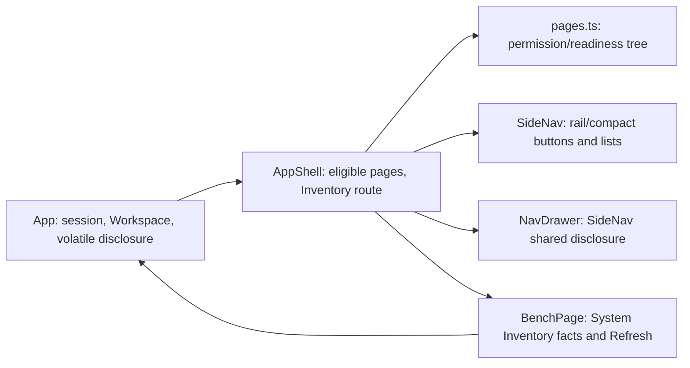

<!--
Copyright (c) 2026 DDP Engineering
This software is licensed under the PolyForm Noncommercial License 1.0.0.
Commercial use requires a separate commercial license.
See the LICENSE.txt in the .agentic folder for full license details.
SPDX-License-Identifier: LicenseRef-PolyForm-Noncommercial-1.0.0
-->

# TASK-1b87ad8a - Simplify Web UI navigation to collapsed Instruments and System sections; start on About

stage: build
type: feature
path: full
interaction: autopilot
requirements: REQ-UX-30821068, REQ-UX-8fa0c15e, REQ-UX-b718864e, REQ-UX-2bc3a464, REQ-UX-eb84f037, REQ-UX-71cbafec, REQ-UX-57d10c15, REQ-UX-74d4256e, REQ-UX-afb79ae0, REQ-UX-8169ea1d, REQ-UX-f300b346, REQ-UX-adbe5465, REQ-UX-2687f591
parent:
branch: adore/pi-26
base: a89db2fa89b0fdf8a77f24833555b617122cb344
opened: 2026-09-28

## Done checklist (current stage)

- [ ] each automated behavior increment has a pre-implementation red record
      with requirement IDs, exact selector or command, non-zero exit, and
      expected failure reason, plus one final focused green result; each manual
      increment has a consolidated post-implementation observation
- [ ] repository anchor recorded after red and evolution reviewed after implementation
- [ ] implementation makes those tests pass
- [ ] focused project tests green, with their actual scope recorded
- [ ] `affected_paths` and `linked_tests` updated on every requirement
- [ ] `status = "active"` on every requirement this task delivers — or
      `"retired"`, with the reason in its prose, where this task
      deliberately removed the behavior
- [ ] `check` clean, or each remaining warning explained in the log
- [ ] `stage: validate`

## Frame

Problem: The authenticated browser starts on Bench and the left navigation exposes Bench alongside expanded nested groups; its Instruments and System labels are not collapsible controls.
Desired outcome: Two top-level navigation sections, initially collapsed, with About as the only initial tab; existing authorized instrument and system work remains accessible.
Actors: Administrator, Operator and Viewer using keyboard, screen reader, or pointer on desktop, compact rail or drawer; a second user signing in on the same browser.
Primary scenario: Restore an authenticated session or sign in -> open About alone, show Instruments and System collapsed -> expand a section to discover permitted destinations; nested groups open deliberately or as needed to expose subsequently selected active content.
Examples: On an empty inventory, opening Instruments reveals an explicit understandable empty state; after opening a System destination, a resource refresh preserves tabs and expansion choices.
Counterexamples: Do not automatically open System because About is active, inherit a previous user's expanded groups, hide either section when inventory is empty/unavailable, or remove Bench Core execution, capture, ownership or APIs.
In scope: Shell page registry, initial workspace state, session-scoped navigation expansion, keyboard/ARIA, role/readiness filtering, three catalogues and layouts, shell/startup/browser tests, relevant UI docs and active requirement reconciliation. Retain access to useful Bench-only diagnostic/inventory information when removing its navigation destination.
Out of scope: Backend services, instrument execution semantics, package delivery, publication and unrelated working-tree modifications. No child task: navigation, startup and documentation are tightly coupled.
Constraints: Existing active requirements for the single-screen status/inventories and empty/failure states (REQ-UX-8fa0c15e, REQ-UX-afb79ae0, REQ-UX-8169ea1d) and the working/core ordering (REQ-UX-30821068) conflict with removing Bench; preserve established information contracts unless explicitly authorized to retire them. Session permission and hardware readiness filtering continue. Git branch already adore/pi-26 and matches journal; no Git mutation permitted.
Success signals: Exactly two top-level section controls in all layouts; About sole initial tab after restoration/new sign-in; both initially collapsed; authorized entries reachable; refresh preserves in-session state; new session resets it; accessible translated controls and empty state; role/layout/startup tests and documentation reflect behavior.
Evidence: STATED: Ticket #26 requested scope, boundaries and acceptance, About proposed as default. OBSERVED: pages.ts registers Bench and DEFAULT_PAGE=bench, filters devices/plugins and role-bound core pages; SideNav.tsx defaults nested groups open and hides empty Instruments; App.tsx seeds ['bench'] and resets tabs on sign-out; AppShell.tsx re-mounts navigation across refresh and routes Bench and About; BenchPage.tsx alone displays detailed inventories, failures and Refresh; gui-foundation.md and Development_and_Simulation_Flow.md document existing navigation and Bench information. INFERRED: Removing Bench without another presentation route would make detailed status/inventory and refresh inaccessible; expansion state owned solely by SideNav would be lost on inventory refresh or drawer remount. UNKNOWN: exact destination/placement for Bench-only inventory and failure information, and whether failed inventory reads should use a distinct Instruments empty/unavailable message; specify/design must settle without removing established contracts.
Assumptions: Adopt the ticket's proposed About landing as the scope decision in this explicitly noninteractive autopilot run; keep Bench Core status and inventories accessible via a System child or equivalent focused view, not necessarily a Bench-named tab. Confirm exact placement in specify/design against existing contracts.
Decision-blocking questions: None requiring an external answer: About is explicitly proposed, and the information-preservation conflict has an in-scope solution; do not silently retire the existing inventory requirements.
Proposed behaviors: Remove Bench as a navigation and opening-tab destination; use About as the single startup/reset tab; keep both collapsible section controls present; default groups collapsed and expand only when explicit navigation within an opened section needs visibility; keep expansion across refresh/drawer, reset on session change; retain permission/readiness filtering and a differentiated zero-instrument display; provide three-language labels and keyboard/ARIA semantics; preserve Bench-only inventory/status/refresh behavior in an authorized System presentation route to be specified.
Path and reason: full. Criterion | result | evidence: no new externally observable behavior | no | two new controls, collapsed entry and changed landing; no new interface/data format | yes | frontend presentation only; no new dependency | yes | existing React/i18n; existing requirement covers behavior | no | REQ-UX-30821068 specifies different layout; no security/data handling change | yes | preserve existing role/authorization and resource handling. Any no selects full.

## Requirement coverage

Behavior inventory (STATED unless noted):

| Frame outcome | Actor/system | Trigger or state | Response | Positive case | Boundary or failure | Observable result |
| --- | --- | --- | --- | --- | --- | --- |
| Two-section navigation | Authenticated shell | Any role and inventory | Two section controls; System destinations permission-filtered | Authorized destinations reachable | No Bench entry; Viewer/Operator restrictions | Only Instruments and System headings |
| About landing/reset | App/workspace | Restore or new user's sign-in | About alone; sections closed | About active, System closed | Previous user's tabs/groups do not leak | One tab, two collapsed controls |
| Controlled hierarchy | Nav in wide/compact/drawer | Toggle/open/tab select | Disclose children without changing tab; expose needed nested ancestors | Keyboard/pointer access to ready device | No implicit top-section expansion for active About or tab switch | Accessible state and visible hierarchy |
| Refresh preservation | App/nav | In-session inventory refresh | Retain tabs and disclosure choices | New eligible entries visible | Failed read does not advertise unverified devices | Tabs/sections remain stable |
| Empty instruments | Nav | Expanded Instruments with no eligible destinations | Translated empty message and section controls | Valid zero inventory | Failed inventory is unknown, not zero | Distinct empty/unavailable copy |
| Information preservation | Authenticated user | Opens System Inventory | Status, integration states, device owners/availability and Refresh together | All reported entries | Valid empty and unreadable resource retain current empty/error handling | Single accessible screen |
| Filtering | Shell | Role/readiness changes | Existing eligible destinations only | Admin/Operator/Viewer routes | Ineligible or unreadable inventory has no instrument entries | Permitted paths only |
| Layout/language | Nav | Viewport/language change | Same disclosure model and translated controls | Wide, compact, drawer; en/de/ro | No unlabeled or non-keyboard controls | Accessible names and expanded state |
| Service boundary | Bench Core | Navigation changes | No service change (OBSERVED pages.ts and BenchPage.tsx are presentation) | Existing execution APIs | No backend removal | Existing contracts unaffected |

| Frame outcome | Atomic behavior | Requirement | Positive case | Boundary or failure | Verification | Design decision or no impact |
| --- | --- | --- | --- | --- | --- | --- |
| Two sections, roles | Section taxonomy/order and permission filtering | REQ-UX-30821068 (revised) | Authorized System routes in order | No Bench entry or unauthorized routes | Role-specific shell and browser assertions | `pages.ts` keeps former core relative order, appends Inventory; SideNav partitions roots |
| About landing/reset | Session initial tab and disclosure reset (inseparable session-entry presentation) | REQ-UX-2bc3a464 (new) | Restored and new sign-in show About only | Previous person's expansion not inherited; About does not open System | App restore, sign-out/sign-in, reload tests | `DEFAULT_PAGE=about`; App owns disclosure and workspace resets |
| Hierarchy | Section and nested toggle interactions across layouts, keyboard and language (one disclosure control contract) | REQ-UX-eb84f037 (new; spec) | Open authorized nested page | Closed section not forced open by active tab | SideNav keyboard/aria, shell and browser layouts | Explicit App-owned section/group toggles; no active-page effect |
| Refresh | Preserve in-session tabs and expansion | REQ-UX-71cbafec (new) | Valid inventory changes eligible children | Failed refresh does not erase tab/choices | App/shell refresh tests | App retains disclosure and workspace across shell remount |
| Empty instruments | Honest zero vs unknown section state | REQ-UX-57d10c15 (new) | Zero result explicitly empty | Unreadable inventory distinct; sections stay | SideNav/shell empty and failure tests | Explicit inventory reliability input selects zero/unavailable copy |
| Inventory status | Single-screen reported facts and refresh | REQ-UX-8fa0c15e (revised) | System Inventory screen | Missing resource | App Inventory and Refresh tests | Route `inventory` to retained BenchPage presentation, relabel screen |
| Inventory empty | Explicit valid empty inventory and usable refresh | REQ-UX-afb79ae0 (reused) | Valid zero | No false failure | App Inventory empty test | Retain per-resource empty presentation |
| Inventory failure | Resource-specific partial failure | REQ-UX-8169ea1d (reused) | Good resources remain | Malformed integration/device read | App Inventory partial failure tests | Retain independent resource rendering |
| Instrument filtering | Readiness filtering and empty child groups | REQ-UX-74d4256e (reused) | Ready integrations/devices | Failed read hides children, not section | pages.test.ts, serialNavigation.test.ts, shell tests | Preserve buildPages eligibility; filter displayed children only |
| Network nesting | Four focused Network destinations start closed | REQ-UX-b718864e (revised) | Expand Network, open child | Collapsing keeps tab | shell, layout and field-display tests | Nested groups default false in shared disclosure map |
| Tabs | Normal tab operation | REQ-UX-f300b346 (reused) | Activate/close | Last tab closed | shell tab tests | No design impact beyond initial page constant |
| Viewports | Compact/drawer navigation | REQ-UX-2687f591 (reused) | Same routes across layouts | Drawer Escape/focus | shell, layout and field-display tests | Same SideNav shared state through remount |
| Translations | Full catalogues | REQ-UX-adbe5465 (reused) | en/de/ro text | Identifiers unchanged | shell language tests | Extend existing message key set |
| Service boundary | Core APIs and execution continue | No frontend requirement: existing service contracts unaffected | Calls unchanged | No service modification | Diff review and existing service tests | No impact |

UNKNOWN: placement within System and exact display label of the inventory route are design-level choices; Inventory is the proposed label in the revised draft requirements. OBSERVED: BenchPage.tsx owns status/inventories/Refresh and pages.ts owns permission/readiness filtering; existing active UX requirements preserve empty and resource-specific failure displays. INFERRED: a dedicated System Inventory route preserves these contracts without opening it initially. No backend contract or new persistence is proposed.

## Design

**Requirements coverage:** The coverage table above maps all 13 linked IDs to decisions and test seams; service execution remains untouched. STATED: About is the proposed entry and two sections must stay present. OBSERVED: `App.tsx` holds workspace across the connecting phase; `AppShell.tsx` and drawer mount `SideNav` anew, while `SideNav.tsx` currently owns and auto-expands nested state. INFERRED: disclosure must live at App scope, not in a rail instance. UNKNOWN: none requiring product approval; Inventory label follows the revised requirement.

**Component responsibilities / contracts:** `pages.ts` retains permission/readiness eligibility and core order, removes the Bench descriptor, appends a fixed `inventory` System page, and sets `DEFAULT_PAGE` to `about` [REQ-UX-30821068, REQ-UX-2bc3a464, REQ-UX-74d4256e]. `AppShell` dispatches `inventory` to the existing `BenchPage` data view, now titled Inventory; status, integration/device details, independent failures, legitimate empties and Refresh remain as they are [REQ-UX-8fa0c15e, REQ-UX-afb79ae0, REQ-UX-8169ea1d]. No API, permission or backend change. `App` owns one volatile disclosure map keyed by stable section/group IDs alongside `useWorkspace`, supplies value/toggle/reset to `AppShell`/both SideNav mounts and resets both on session end/sign-out and successful new sign-in; restoration starts from initial defaults [REQ-UX-2bc3a464, REQ-UX-71cbafec]. The already mounted App survives an in-session `loadBench` refresh, so no persistence or migration is needed.

**State / execution / recovery:** Missing disclosure keys mean false. Top-level keys `instruments` and `system` exist independent of filtered page children. Toggling sections/groups updates only disclosure, not tabs; collapsing retains nested choices. Selecting a visible page opens its tab; tabs switching never auto-expand a closed section. Remove the active-page ancestor effect; reachable nested destinations are already visible through deliberately expanded ancestors. For non-nav programmatic child opens, retain closed section state and expand only its nested ancestors if their parent section is already open [REQ-UX-eb84f037, REQ-UX-b718864e, REQ-UX-f300b346]. `SideNav` renders semantic buttons (`aria-expanded`, `aria-controls`) and conditionally mounted child lists with translated names in wide, compact and drawer; a drawer toggle does not dismiss it, page selection retains existing dismissal/focus return [REQ-UX-eb84f037, REQ-UX-2687f591, REQ-UX-adbe5465].

**Partial failure / trust / ordering:** Always render both section controls, even with zero destinations. When expanded and empty, use a distinct localized unavailable state if an integration/device resource failed, the plugin inventory is not fresh, or core reachability is unverified; only claim no eligible instruments after successful reads. A failed refresh hides unverified instrument children without pruning existing workspace tabs: compute prunable IDs from authoritative successful inventories, temporarily include already-open instrument IDs when any required resource is unreadable or plugin data is stale; still prune newly unauthorized System IDs on role change. A successful authoritative refresh reapplies existing readiness pruning and repopulates eligible entries [REQ-UX-57d10c15, REQ-UX-74d4256e, REQ-UX-71cbafec]. Backend authorization remains authoritative; `buildPages` still filters role-scoped destinations; `inventory` has the same authenticated status/inventory access as the former Bench view [REQ-UX-30821068]. No concurrent writers besides React state updates; use functional updates to avoid lost rapid toggles [REQ-UX-eb84f037].

**Test seams / operations:** Start red tests in `pages.test.ts` for the registry, `App.test.tsx` for restore/new sign-in and Inventory partial reads, `SideNav.test.tsx`/`shell.test.tsx` for disclosure, role, refresh and focus, and update `e2e/shell.spec.ts`, `e2e/bench-core.spec.ts`, `e2e/authentication.spec.ts`, `e2e/field-display.spec.ts` and `layout.test.ts` for real-browser startup/layout assumptions [linked IDs in coverage table]. Inspect visible nav and tab state; no logging or telemetry added. Update three catalogues, `shell.css`, frontend README and development/simulation flow; reconcile GUI knowledge during validation [REQ-UX-2687f591, REQ-UX-adbe5465].

**Alternatives / risks / open decisions:** Keeping state in SideNav fails during AppShell/drawer remount; storing it in browser preferences leaks one user's choices into another session. Removing BenchPage entirely strands single-screen diagnostics, so retain its view behind Inventory. Risk: legacy tests rely on Bench as the startup tab; adjust oracles rather than weakening them. Risk: `usePruneClosedPages` may close previously open tabs when a successful inventory removes their destination; preserve the existing role/readiness rule while verifying failed refresh does not close them. No blocking decision or new data format.

### Proposed architecture - TASK-1b87ad8a

Expected files (frontend prefix `05_Software/frontend/`): `src/App.tsx`, `src/App.test.tsx`, `src/components/shell/{pages.ts,pages.test.ts,SideNav.tsx,SideNav.test.tsx,AppShell.tsx,useWorkspace.ts,shell.test.tsx,serialNavigation.test.ts}`, `src/components/pages/BenchPage.tsx`, `src/i18n/{en,de,ro}.ts`, `src/styles/shell.css`, `src/layout.test.ts`, `e2e/{shell,bench-core,authentication,field-display}.spec.ts`, `README.md`; `06_SoftwareDocu/Development_and_Simulation_Flow.md`, `.agentic/knowledge/gui-foundation.md`. `NavDrawer.tsx` and permission predicates should remain unchanged: shared SideNav and existing predicates suffice. Tests may reveal a smaller final list.

## Log

- 2026-09-28 frame: Autopilot scope accepted as requested, including proposed About landing and retention of Bench-only information; full path because observable navigation and startup change. Existing inventory/navigation requirement conflicts require reconciliation in specify. No children; unrelated dirty toolchain files excluded.
- 2026-09-28 specify: Four new draft UX requirements, three revised active UX requirements, six reused active requirements, none retired; coverage and disclosure spec recorded. Check reports zero format errors; unrelated tracked sidecar/stage-zone and other-task warnings remain.
- 2026-09-28 design: Session-owned disclosure, System Inventory route and resource-aware pruning plan recorded in ## Design; expected paths reconciled. Check: zero errors; 21 unrelated warnings, four notes.

## Rulings

## Handoff

current: build
status: ready
next: Write and run a failing pages registry/initial-tab test before implementation, then anchor the candidate.
must_read: .agentic/steps/4_build.md; .agentic/tasks/TASK-1b87ad8a.md; .agentic/specs/REQ-UX-eb84f037.md; .agentic/knowledge/gui-foundation.md
blockers: none

## Stage report

stage: design
result: completed
current: build
changed: Recorded design and proposed architecture; mapped 13 requirements to test seams and updated affected paths for expected edits.
evidence: Audited App, AppShell, SideNav, pages, BenchPage, workspace and drawer seams; aegis check: errors=0, warnings=21, notes=4; no tests run in design.
issues: Existing readiness pruning on failed reads needs guarded IDs; unrelated check warnings cover toolchain edits, tracked sidecars and other tasks.
next: Begin test-first build at page registry, then session-owned disclosure and Inventory route.
needs_user: no
spec_compliance:
implementation_quality:
review_round:
