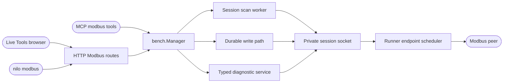

<!--
Copyright (c) 2026 DDP Engineering
This software is licensed under the PolyForm Noncommercial License 1.0.0.
Commercial use requires a separate commercial license.
See the LICENSE.txt in the .agentic folder for full license details.
SPDX-License-Identifier: LicenseRef-PolyForm-Noncommercial-1.0.0
-->

# TASK-206975eb - MB-09 Modbus bounded scans and advanced typed functions

stage: done
type: feature
path: full
interaction: autopilot
requirements: REQ-FUNC-28ad4c7d, REQ-REL-b7570e66, REQ-DATA-5084f2d5, REQ-FUNC-90e44759, REQ-FUNC-104739e7, REQ-SEC-4932de81, REQ-UX-1845d724
parent:
branch: ddp/modbus-client
base: ee6db4bc788817ac242802b6af94f6476baf23bf
opened: 2026-10-01

## Done checklist (current stage)

- [x] validated candidate confirmed unchanged; otherwise returned to validate
- [x] validation evidence, diff, exclusions, and outcome presented
- [x] delivery confirmed by the human
- [x] journal and report included in the delivery commit
- [x] agreed outcome delivered, normally a PR (user chose a local-only commit)
- [x] close-out committed after the outcome succeeded, or carried by the delivery commit where nothing could fail after it

## Frame

Problem: The current Modbus client can poll and write initial functions but offers no explicit bounded address/unit scan or typed FC22/23 and identification diagnostics. Gitea #36 is MB-09.
Desired outcome: An owner can deliberately scan finite read ranges without starving live polling, cancel and export truthful per-probe results, and use typed advanced functions within the same session, policy and uncertain-write boundary.
Actors: Live session owner, administrator, viewer, Bench Core, supervised runner, browser, CLI and MCP clients.
Primary scenario: Owner connects an approved endpoint -> submits an explicit finite read scan -> sees progress, failed probes and cancellation -> exports results; owner can preview and submit FC22/23 writes or request read-only identity diagnostics with exact validated results.
Examples: A unit times out at one address yet the scan continues and labels that probe failed; a successful FC03 response does not label an address writable or typed; an FC23 lost reply is delivery-unknown and never retried.
Counterexamples: Opening Tools starts an automatic subnet/full-bus scan; a scan bypasses the session owner or monopolizes the runner; a raw-frame/FC08/broadcast path appears without separate authorization.
In scope: MB-09 issue #36 and plan sections 4, 5, 7 and 11: explicit unit/address read scans with finite bounds/rate/deadline, fairness, cancel/progress/export; FC22 mask write, FC23 combined read/write, FC43/14 identity and selected typed read-only serial diagnostics; Core/runner/browser/API/CLI/MCP consistency and focused tests.
Out of scope: MB-10 full-suite and appliance/hardware acceptance, automatic discovery, raw-frame sending, broadcast, disruptive FC08 subfunctions, arbitrary device writes, deployment, Git commit/push, and seven unrelated planning/media paths.
Constraints: STATED user keeps the same branch, AEGIS autopilot and targeted tests only until the full Modbus plan ends. STATED previous answers require master/client only, shared definitions, one live owner, RTU over IP as TCP only, and no individual write acceptance. OBSERVED current initial functions in `bench/modbus_request.go`, `nilo_modbus/requests.py` and `feasibility.py`; runner `scheduler.py` already serializes work by unit and separates write retry behavior.
Success signals: Invalid or broad scans fail before I/O; each bounded scan reports progress/cancel/errors and export distinguishes failed from absent; polls keep progressing; exact FC22/23 wire/response limits and no replay are proved; identity/serial diagnostics honor capabilities and unsupported transport; no forbidden operation appears.
Evidence: STATED user continuation and Gitea #36; OBSERVED `00_Planning/Modbus_Plugin_Plan.md`, `.agentic/knowledge/modbus-integration.md`, current request/session/write/runner code; INFERRED session scheduler can carry scan probes without a competing master; UNKNOWN precise per-scan approval policy pending user answer.
Assumptions: All test traffic uses deterministic simulated peers; Core remains the authorization and durable write owner, runner the protocol and scheduling owner. Scan success is evidence of a read response only.
Unknowns: Whether each scan needs its own policy job; which capability-specific serial diagnostics should be exposed on each transport; device support and physical throughput remain acceptance work.
Decision-blocking questions: Asked asynchronously whether the existing approved live lease plus explicit Scan action suffices or each scan needs its own policy approval. Independent specification and protocol work can continue before that answer.
Proposed behaviors: Finite scan plan validation and lifecycle; fair probe execution with per-probe outcomes and export; FC22/23 through current durable write path; typed identity/read-only diagnostics with capability-aware refusals; matching controls and outcomes across surfaces.
Path and reason: Full path: new externally visible operations, protocol/API/data contracts, security and concurrent runner behavior. Existing `ddp/modbus-client` branch is required by the user; no new branch or Git delivery step is authorized.

| Quick-path criterion | Yes | No | Evidence |
|---|---|---|---|
| No new externally observable behavior | | x | Scans and typed advanced functions are new. |
| No new interface/data format | | x | Scan result and diagnostic API shape. |
| No new dependency | x | | Existing Go/Python/SQLite/React stack. |
| Existing requirement covers behavior | | x | Initial Modbus requirements omit MB-09. |
| No security/data-handling change | | x | Scan approval, ownership and durable write paths. |

## Requirement coverage

| Frame outcome | Actor/system | Trigger or state | Response | Positive case | Boundary or failure | Observable result |
|---|---|---|---|---|---|---|
| Finite scans | Core | Explicit plan on live session | Validate bounded unit/address/function/rate/deadline | Small selected FC03 range | Automatic/oversized/out-of-endpoint | Plan accepted or no-I/O denial |
| Fair scan lifecycle | Core/runner | Active scan plus polling | Pace one probe at a time; cancel/deadline | Poll interleaves | In-flight cancellation/session end | Monotonic progress and terminal reason |
| Truthful scan evidence | Core | Probe settles | Preserve coordinate/raw/outcome and export | Success and exception | Timeout is not absence; success is not type/write | Paged results and CSV/JSONL |
| Advanced writes | Core/runner | FC22/23 preview and submit | Exact PDU and durable one-attempt write | Acknowledged mask/combined operation | Bad limits/lost reply/policy denial | Preview and command outcome |
| Diagnostics | Core/runner | Identity or serial diagnostic request | Typed bounded response or unsupported | FC43 basic identity, FC11/17 on serial framing | Native TCP serial diagnostic, malformed reply | Structured data or explicit error |
| Authority | Core | Any new operation | Recheck lease, credential, scopes and plugin | Owner allowed | Foreign/revoked/viewer | No I/O and no data leakage |
| Browser Tools | Browser | Connected workspace | Deliberate scan/diagnostic controls | Progress, cancel and export | Disconnected/narrow layout | Localized accessible state |

| Frame outcome | Atomic behavior | Requirement | Positive case | Boundary or failure | Verification | Design decision or no impact |
|---|---|---|---|---|---|---|
| Finite scans | Validate explicit selected read plan | REQ-FUNC-28ad4c7d | Four probes for 2x2 plan | Full bus refused | Fake runner validation | Core scan service and one probe per request |
| Fair scan lifecycle | Interleave and settle scan worker | REQ-REL-b7570e66 | Poll runs between probes | Cancel/deadline/session stop | Deterministic scheduler/service | One worker per live session and existing runner scheduler |
| Truthful scan evidence | Bound result pages and export | REQ-DATA-5084f2d5 | Mixed result projection | No absent/type/write inference | Page/export round trip | In-memory 512-result cap and CSV/JSONL |
| Advanced writes | Exact FC22/23 through durable write boundary | REQ-FUNC-90e44759 | Golden PDU/reply | Limits, policy, lost reply | Independent protocol + Core tests | Extend canonical request, preview and runner validation |
| Diagnostics | Typed read-only capability-gated diagnostics | REQ-FUNC-104739e7 | FC43, FC11/17 | Native TCP serial/FC08 refusal | Protocol fixtures | Separate typed diagnostic request/result |
| Authority | Recheck all new entry points | REQ-SEC-4932de81 | Owner/scoped token | Foreign/revoked/disabled | Permission matrix | Reuse live session authority in Core |
| Browser Tools | Accessible explicit controls | REQ-UX-1845d724 | Start/cancel/export | Offline and narrow views | Component/layout fixture | Dedicated live Tools panel |

## Design

Requirements coverage: REQ-FUNC-28ad4c7d validates a finite plan before admission. REQ-REL-b7570e66 gives each session at most one paced scan worker, submitting one probe at a time through the existing runner scheduler. REQ-DATA-5084f2d5 keeps at most 512 per-probe results in Core memory for paged inspection and CSV/JSONL export. REQ-FUNC-90e44759 extends the existing canonical write request, preview, durable reservation and runner validation for FC22/23. REQ-FUNC-104739e7 adds a typed diagnostic entry point with capability checks, using the same private scheduler. REQ-SEC-4932de81 applies current session owner/scope checks on every control/read. REQ-UX-1845d724 adds a network live Tools panel, with deliberate controls and no mount-time I/O.

Core owns scan IDs, plan validation, authorization, progress, cancellation, bounded results and export; the Python runner owns exact PDU/ADU validation and serial execution. The browser, CLI and MCP call the same Core HTTP/service path. A scan is transient to its live session; no migration is needed. Its worker uses a server-owned context, checks current authority before each probe, sends one request through `modbusPrivateCall`, then paces the next probe. Session stop cancels the worker. Core never holds `Manager.mu` across network waits. A 512-result ceiling bounds memory, and one scan per session prevents competing scan workers. The runner's existing one-in-flight/fair unit queues arbitrate scan reads with poll work. The explicit Scan action relies provisionally on the policy-approved live session; this is revisable under RULING-002.

The private transaction contract gains function-specific optional FC22 masks and FC23 read span fields; strict parsing rejects irrelevant fields. `ModbusRequest` and Python `Request` carry those fields while preserving the wire shape of FC01–16. FC22/23 are classified as writes in every scheduler, preview and result path, so no automatic retry and no per-operation approval job are introduced. FC23 returns read-side words, while durable command metadata retains submitted write words. Independent golden vectors and malformed reply fixtures test both sides. For diagnostics, Core exposes a narrow typed request mapping to FC43/14 basic identity and FC11/17; runner response validation returns bounded typed data. Native TCP refuses serial-only FC11/17 before I/O; exceptions and malformed replies remain explicit.

HTTP adds `/endpoints/{id}/scans` start/status/results/cancel/export and `/endpoints/{id}/diagnostic`; existing preview/write routes accept the new write request fields. CLI `nilo modbus` and MCP `modbus_*` mirror the same outcomes. Browser Tools mounts only for a network live endpoint, presents scan plan/progress/results/export and capability-aware diagnostics, and never starts a scan from rendering. All public entry points preserve the current role/token/credential-bound owner checks. No raw FC08, broadcast or arbitrary PDU entry point is added.

Failure recovery: a cancelled/deadline/ended scan stops future probes and retains its settled prefix until session cleanup; failed probes retain explicit outcomes. A lost FC22/23 reply remains delivery-unknown in the existing durable command record and is never dispatched again. Unexpected runner fields or invalid identity lengths fail closed. Existing initial read/write contracts and endpoint scheduler behavior remain unchanged for old functions. No persistent data migration or new dependency is required.

Test seams: Core scan service fake runner and permission tests, Python request/validated-client/scheduler fixtures, Core write preview/idempotency/result tests, HTTP/CLI/MCP shape and denial tests, and frontend Tools component/keyboard/layout checks. Alternatives: a second scan transport client would violate one endpoint owner; a generic raw PDU API would bypass typed safety; persisting scans would overlap MB-08 recording without a ticket need. Risks: Python library result shape for FC43/17, cancellation during an in-flight read, and explicit policy choice. MB-10 retains full-suite, appliance and physical throughput checks.

### Proposed architecture - TASK-206975eb

## Log

- 2026-10-01 frame: Full MB-09 scope follows issue #36 on the existing branch under user autopilot; no real I/O or Git delivery. Scan approval granularity was asked asynchronously; independent specification proceeds while that decision is pending.
- 2026-10-01 specify: Seven draft requirements and five exact-contract specs cover finite scans, lifecycle/fairness, truthful results/export, FC22/23, typed diagnostics, authority and browser controls. Reused existing generic write/session/scheduler requirements as constraints; no existing requirement had the MB-09 outcome. Per-scan approval is provisionally the existing approved lease plus deliberate Scan action pending user response.
- 2026-10-01 design: The Design note maps all seven requirements to Core, runner and browser seams, with a transient bounded scan worker, existing write reservation path and typed diagnostic boundary. Advisory check reported zero format errors; proposed-file stale paths are expected until build creates them.
- 2026-10-01 build red: REQ-FUNC-90e44759 commands=`uv run --offline pytest -q tests/test_requests.py::test_advanced_write_vectors_and_limits` (exit 1) and `go test ./internal/bench -run TestModbusAdvancedWritePDUAndReadResult -count=1` (exit 1); expected missing behavior=Python and Go canonical requests lack typed FC22 masks and FC23 read span fields.
- 2026-10-01 build green: REQ-FUNC-90e44759 `go test ./internal/bench -run "TestModbusAdvancedWritePDUAndReadResult|TestModbusCanonicalRequestBounds|TestModbusWrite" -count=1` (exit 0) and `pytest -q tests/test_requests.py tests/test_feasibility.py::test_advanced_writes tests/test_feasibility.py::test_advanced_lost_reply_is_one_unknown_write` (exit 0, 42 tests); golden FC22/23 requests, independent simulated replies and one-attempt lost-write outcomes pass.
- 2026-10-01 build red: REQ-FUNC-28ad4c7d command=`go test ./internal/bench -run TestModbusScanPlanBounds -count=1`; exit=1; expected missing behavior=typed finite scan plan and validator do not exist.
- 2026-10-01 build green: REQ-FUNC-28ad4c7d `go test ./internal/bench -run TestModbusScanPlanBounds -count=1` (exit 0); invalid and oversized plan rejected before I/O.
- 2026-10-01 build red: REQ-REL-b7570e66, REQ-DATA-5084f2d5 command=`go test ./internal/bench -run TestModbusScanSettlesFiniteMixedProbes -count=1`; exit=1; expected missing behavior=session scan worker/status and per-probe outcomes do not exist.
- 2026-10-01 build red: REQ-DATA-5084f2d5 command=`go test ./internal/bench -run TestModbusScanExportPreservesFailedProbes -count=1`; exit=1; expected missing behavior=bounded CSV/JSONL scan export projection does not exist.
- 2026-10-01 build green: REQ-REL-b7570e66 and REQ-DATA-5084f2d5 `go test ./internal/bench -run "TestModbusScan" -count=1` (exit 0); finite mixed probes settle with explicit failure and export keeps failed rows.
- 2026-10-01 build red: REQ-FUNC-28ad4c7d and REQ-SEC-4932de81 command=`go test ./internal/httpapi -run TestModbusRoutesScopeAndStrictBody -count=1`; exit=1; expected missing behavior=scan HTTP route absent (read-only request receives 404 instead of scope denial).
- 2026-10-01 build green: REQ-FUNC-28ad4c7d and REQ-SEC-4932de81 `go test ./internal/httpapi -run TestModbusRoutesScopeAndStrictBody -count=1` (exit 0); scan HTTP routes enforce scope and strict request body.
- 2026-10-01 build red: REQ-FUNC-104739e7 command=`pytest -q tests/test_requests.py::test_typed_diagnostic_vectors_and_native_tcp_restriction`; exit=1; expected missing behavior=typed FC43/14 and FC11/17 request encoding/transport restrictions absent.
- 2026-10-01 build green: REQ-FUNC-104739e7 `pytest -q tests/test_requests.py::test_typed_diagnostic_vectors_and_native_tcp_restriction` (exit 0); exact diagnostic request bytes and native-TCP serial refusal pass.
- 2026-10-01 build red: REQ-FUNC-104739e7 command=`pytest -q tests/test_feasibility.py::test_typed_diagnostics`; exit=1; expected missing behavior=runner lacks diagnostic method routing and structured validated replies.
- 2026-10-01 build green: REQ-FUNC-104739e7 `pytest -q tests/test_feasibility.py::test_typed_diagnostics` (exit 0); simulated FC43/14, FC11 and FC17 validated replies normalize to typed data.
- 2026-10-01 build red: REQ-FUNC-104739e7 and REQ-SEC-4932de81 command=`go test ./internal/bench -run TestModbusDiagnosticTransportAndTypedResult -count=1`; exit=1; expected missing behavior=Core typed diagnostic service and result contract do not exist.
- 2026-10-01 build green: REQ-FUNC-104739e7 and REQ-SEC-4932de81 `go test ./internal/bench -run TestModbusDiagnosticTransportAndTypedResult -count=1` (exit 0); native TCP serial diagnostics denied before dispatch and basic identity returned with typed data.
- 2026-10-01 build red: REQ-FUNC-104739e7 and REQ-SEC-4932de81 command=`go test ./internal/httpapi -run TestModbusRoutesScopeAndStrictBody -count=1`; exit=1; expected missing behavior=diagnostic HTTP route absent (read-only request receives 404 instead of scope denial).
- 2026-10-01 build green: REQ-FUNC-104739e7 and REQ-SEC-4932de81 `go test ./internal/httpapi -run TestModbusRoutesScopeAndStrictBody -count=1` (exit 0); diagnostic HTTP route enforces scope and strict input.
- 2026-10-01 build red: REQ-FUNC-28ad4c7d, REQ-FUNC-104739e7 command=`go test ./cmd/nilo -run TestModbusCLIToolsUseCoreRoutes -count=1`; exit=1; expected missing behavior=CLI has no scan or diagnostic actions.
- 2026-10-01 build green: REQ-FUNC-28ad4c7d, REQ-FUNC-104739e7 `go test ./cmd/nilo -run TestModbusCLIToolsUseCoreRoutes -count=1` (exit 0); scan and diagnostic actions route through Core HTTP.
- 2026-10-01 build red: REQ-FUNC-28ad4c7d, REQ-FUNC-104739e7 command=`go test ./internal/mcp -run TestBenchTools -count=1`; exit=1; expected missing behavior=six scan and diagnostic MCP tools absent (83 tools vs 89 expected).
- 2026-10-01 build green: REQ-FUNC-28ad4c7d, REQ-FUNC-104739e7 `go test ./internal/mcp -run TestBenchTools -count=1` (exit 0); six typed scan/diagnostic tools registered and scoped.
- 2026-10-01 build red: REQ-UX-1845d724 command=`npm --prefix 05_Software/frontend run test:ci -- src/api/modbus.test.ts`; exit=1; expected missing behavior=browser API has no scan status parser and cannot represent failed probes.
- 2026-10-01 build green: REQ-UX-1845d724 `npm --prefix 05_Software/frontend run test:ci -- src/api/modbus.test.ts` (exit 0); scan parser distinguishes failed probes and rejects malformed rows.
- 2026-10-01 build red: REQ-UX-1845d724 command=`npm --prefix 05_Software/frontend run test:ci -- src/components/pages/ModbusToolsPanel.test.tsx`; exit=1; expected missing behavior=live Tools panel component does not exist.
- 2026-10-01 build green: REQ-UX-1845d724 `npm --prefix 05_Software/frontend run test:ci -- src/components/pages/ModbusToolsPanel.test.tsx` (exit 0); no mount-time scan and failed probe visible after explicit Scan action. Frontend production build also passed after type corrections.
- 2026-10-01 build red: REQ-DATA-5084f2d5 command=`go test ./internal/bench -run TestModbusScanExportPreservesFailedProbes -count=1`; exit=1; expected missing behavior=scan CSV/JSONL export omits the explicit plan metadata.
- 2026-10-01 build green: REQ-DATA-5084f2d5 `go test ./internal/bench -run TestModbusScanExportPreservesFailedProbes -count=1` (exit 0); CSV/JSONL now begin with the explicit plan and terminal status, followed by each settled probe.
- 2026-10-01 build red: REQ-DATA-5084f2d5 command=`go test ./internal/bench -run TestModbusScanSettlesFiniteMixedProbes -count=1`; exit=1; expected missing behavior=scan results omit bounded correlated raw frames for a successful read.
- 2026-10-01 build green: REQ-DATA-5084f2d5 `go test ./internal/bench -run TestModbusScanSettlesFiniteMixedProbes -count=1` (exit 0); scan retains at most two bounded raw frames per settled probe.
- 2026-10-01 build red: REQ-SEC-4932de81 `go test ./internal/bench -run TestModbusScanResultsStayWithOpeningCredential -count=1` (exit 1); same-user different credential could read/export the scan result. Focused fix binds non-administrator scan reads to the opening credential.
- 2026-10-01 build green: REQ-SEC-4932de81 same selector (exit 0); scan status and export deny a second credential while the opener retains access.
- 2026-10-01 build green: Go `go test ./internal/bench ./internal/httpapi ./internal/mcp ./cmd/nilo -run 'TestModbus|TestBenchTools' -count=1` (exit 0, four packages); WSL Python `pytest -q tests/test_requests.py tests/test_feasibility.py` (exit 0, 116 tests), `pytest -q tests/test_workspace.py` (exit 0, 3 tests), and scheduler fairness selector (exit 0, 1 test); frontend three focused Vitest files (exit 0, 15 tests), Modbus layout Playwright file in installed Chrome (exit 0, 22 tests), build, lint, Prettier and Python Ruff (exit 0). The combined Python selection stalled in a workspace test, while its same files passed as separate focused selections.
- 2026-10-01 build transition: seven requirements are active and linked to affected paths/tests; evolution saved for the current candidate. Advisory check has no errors and only existing repository-wide/unrelated warnings. Proceed to validate with the user's full-suite deferral.
- 2026-10-01 validate: Scope/specification review verdict=approved (round 1): finite FC01–04 scan, truthful bounded export, FC22/23 one-attempt write, typed diagnostics and EN/DE/RO Tools match the seven active requirements and design; no raw FC08 or mount-time scan path found. Implementation-quality review verdict=approved (round 1): inspected Core/Python/browser interfaces, authority/error paths, existing scheduler boundary and focused tests; same-user scan read credential leak was fixed and retested. Reviewed all changed paths against scope; unrelated planning/media files remain excluded.
- 2026-10-01 validate: Refreshed evolution after the last executable/test edit. Final focused proof: Go four Modbus packages selector (exit 0), WSL Python requests+feasibility (116 passed), workspace (3 passed), scheduler fairness (1 passed), frontend Vitest (15 passed), Modbus Playwright layout (22 passed), frontend build/lint/Prettier, Python Ruff and `git diff --check` (all exit 0). The combined Python selection stalled at a workspace test but each of its files passed separately. No physical peer or appliance acceptance was performed.
- 2026-10-01 validate deviation: User RULING-001 defers the repository-wide suite to completion of the full Modbus plan. `python .agentic/aegis.py check --task TASK-206975eb --strict` returned exit 0 (`strict: ok`, 0 errors, 15 warnings before verdict record); `--strict --run` was not executed because it invokes the full suite. Repository-wide regression confidence is therefore pending MB-10. Remaining advisory warnings concern pre-existing other-task journals/requirements and unrelated user planning/media; the current review-state warning is resolved by the two recorded verdicts. The frontend build's existing chunk-size warning does not affect the functional checks.
- 2026-10-01 deliver: User instructed a local commit in this turn. The candidate diff and `git diff --check` match validation; seven unrelated planning/media paths are excluded. The agreed outcome is one local commit on `ddp/modbus-client`, with no push.
- 2026-10-01 deliver close-out: The local commit is the complete agreed outcome. This journal, the generated report, and the done state are prepared in the same commit; no push or PR is authorized.

## Rulings

- RULING-001 | date=2026-10-01 | decision=Use targeted tests for MB-09 and defer the full repository suite until the complete Modbus plan ends | reason=User explicitly changed the verification schedule for successive tickets | source=user | supersedes=none
- RULING-002 | date=2026-10-01 | decision=Treat explicit Scan as an owner action within the existing policy-approved live session unless the user selects per-scan approval | reason=Recommended reversible interpretation after the clarification window, consistent with one live owner and no per-write acceptance | source=technical | supersedes=none

## Handoff

current: done
status: ready
next: The next Modbus ticket can continue on this branch; full-suite proof remains due at the plan end.
must_read: .agentic/tasks/TASK-206975eb.md
blockers: none

## Stage report

stage: deliver
result: completed
current: done
changed: Prepared the reviewed MB-09 candidate and AEGIS report for the user-authorized local-only commit on the existing branch.
evidence: Both review verdicts approved; focused Go/Python/browser checks and build/lints pass; final evolution refreshed; AEGIS strict advisory check exits 0 without running the full suite; user authorized the commit.
issues: Repository-wide strict run deferred by explicit user instruction; unrelated advisory warnings and the combined Python selection stall are recorded in the log.
next: Continue the next Modbus ticket when requested; run the full suite at the end of the plan.
needs_user: no
spec_compliance: approved
implementation_quality: approved
review_round: 1

## Delivery report (2026-10-01)

- stage: deliver; type: feature; path: full; branch: ddp/modbus-client
- requirements:
  - REQ-FUNC-28ad4c7d - Bound explicit Modbus read scans
  - REQ-REL-b7570e66 - Keep Modbus scans fair and cancellable
  - REQ-DATA-5084f2d5 - Retain and export truthful Modbus scan outcomes
  - REQ-FUNC-90e44759 - Execute typed FC22 and FC23 writes
  - REQ-FUNC-104739e7 - Read typed Modbus identity and serial diagnostics
  - REQ-SEC-4932de81 - Authorize Modbus tools within the live lease
  - REQ-UX-1845d724 - Operate Modbus scans and diagnostics in the live workspace
- deviations: none recorded
- explicit review: enabled; spec_compliance=approved; implementation_quality=approved; review_round=1
- diff vs task base ee6db4b: 53 file(s) changed, 3659 line(s) added; 5 file(s) not content-scanned
- checks: errors=0 warnings=15 notes=4
- checklist: 3/6 done; open: journal and report included in the delivery commit; agreed outcome delivered, normally a PR; close-out committed after the outcome succeeded, or carried by the delivery commit where nothing could fail after it
