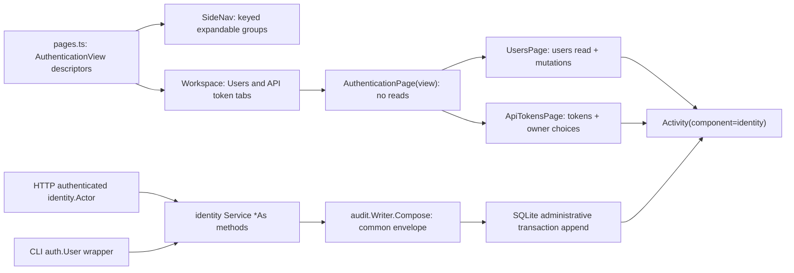

<!--
Copyright (c) 2026 DDP Engineering
This software is licensed under the PolyForm Noncommercial License 1.0.0.
Commercial use requires a separate commercial license.
See the LICENSE.txt in the .agentic folder for full license details.
SPDX-License-Identifier: LicenseRef-PolyForm-Noncommercial-1.0.0
-->

<!--
Task journal. One file per task, at .agentic/tasks/TASK-<id>.md, kept
after delivery as the task's historical record.

The header is the block of "key: value" lines directly under the title.
Keep it exactly in that form — one key per line, no blank lines inside
the block, no comments between the lines — so it stays machine-readable.

  stage         frame | specify | design | build | validate | deliver | done
                (adoption journals: survey | components | close | done)
  type          feature | fix | change | adopt
  path          full | quick
  requirements  comma-separated requirement IDs, empty until specify
  parent        optional top-level TASK-id; blank for an ordinary task
  branch        the branch this task is delivered on
  base          the commit this task started from, filled in at creation;
                the delivery report and `check --task` measure the diff
                against it, so leave it alone once it is written. Empty
                when the repository had no history yet.
  opened        YYYY-MM-DD

Header lines are edited in place; log lines are only ever appended.
Keep each log line to one sentence.

Stage report is one replaceable latest snapshot, not an evidence store.
Use plain one-line fields with no fences or bullets inside that section.
stage is the reported stage; current must match the journal header after any
transition. result is in_progress | completed | paused | blocked | skipped.
Keep all observations and decisions in the append-only Log as well.
Leave unknown fields blank; summary prints not recorded, never an assumed pass.
Refresh after work or decisions even if current has not changed.
-->

# TASK-26db1950 — Redesign Authentication administration navigation

stage: done
type: change
path: full
requirements: REQ-UX-c7a277c5, REQ-UX-93e1b747, REQ-UX-7c42d7ba, REQ-UX-833c9cd3, REQ-UX-ae7baff0, REQ-UX-b849ddb2, REQ-UX-96852626, REQ-UX-ed735941, REQ-UX-2b0b6d59, REQ-UX-4570c081, REQ-UX-38017d29, REQ-UX-e60cf375, REQ-UX-d697e8ec, REQ-UX-c4a0c9e7, REQ-DATA-cffc3af2, REQ-SEC-89034a8a, REQ-SEC-7595665c, REQ-SEC-66b84b2c, REQ-SEC-6e3ae992, REQ-TEST-fd794da4
parent:
branch: master
base: 8cf243345cd214357d19d9eb7533e46b199a71f0
opened: 2026-09-04

## Done checklist (current stage)

- [x] final repository test command passes on the committed candidate
- [x] Raspberry Pi core and GUI deployment verified with rollback copies retained
- [x] real appliance Authentication and Activity smoke check completed without an administrative mutation
- [x] user acceptance and local commit authorization recorded
- [x] unrelated review artifacts preserved and no remote push performed
- [x] task closed locally without further AEGIS commands, as instructed by the user

## Frame

Problem: The Authentication administration workspace combines user and API-token lifecycle controls in one dense page, mixes unrelated reads and actions, lacks contextual and workflow help, and writes administrative audit records in a legacy envelope that the common Activity component/category filters cannot discover or correctly distinguish for token-authenticated actors.
Desired outcome: Authentication becomes a permission-aware expandable System navigation group with focused Users and API tokens pages, compact and accessible record/action patterns, safe guided workflows, exactly-once durable common Activity records for every successful administrative mutation, and verified field-display behavior in English, German and Romanian.
Actors: Administrators managing identities and credentials; viewers or operators whose permissions must not expose unauthorized pages or actions; investigators reading or exporting Activity; user-session and API-token authenticated callers; keyboard, touch and screen-reader users.
Primary scenario: an authorized administrator expands Authentication -> selects Users or API tokens -> the shell opens or activates that page's own workspace tab -> the page fetches only its owned primary data and presents compact records -> a guided action is confirmed -> the backend commits the state change and one safe common audit event atomically -> View activity opens Activity filtered by component `identity`.
Examples: Users shows username, role, enabled state and an Actions dialog with Details for created time; API tokens shows name, owner, computed active/expired/revoked state, expiration and actions with Details for scopes; creating a token discloses its secret once and removes the secret from React state and the DOM when dismissed; disabling the last enabled administrator is refused with an explanation.
Counterexamples: retaining both resources on one page or adding an inner tab bar; Users fetching tokens; allowing a client-provided actor to control attribution; emitting a legacy or duplicate side-channel audit record; logging a password, token secret or verifier; treating an empty scopes list as no access; deleting users; horizontally scrolling the document at 1024x600.
In scope: shell registry, rail and drawer Authentication hierarchy, separate authentication view discriminator and workspace tabs; `UsersPage`, `ApiTokensPage` and shared administration pieces; permission-aware visibility and actions; compact table/card records, Details and `RowActions`; shared Field, HelpPopover and generalized WorkflowHelp use; English/German/Romanian copy; token-state and one-time-secret handling; canonical mutation audit envelope, request-context actor kind and identifier, atomic rollback and safe Activity/export visibility; relevant component, shell, API, Go, browser, layout and localization tests; GUI/authentication knowledge, operator/authentication documentation and Unreleased changelog.
Out of scope: deployment; Git staging, commit, push or publication; version assignment or VERSION mirrors; new dependencies; identity or token deletion; permission-matrix or backend route-semantic changes; audit storage replacement or a second audit subsystem; redesigning global Activity; ordinary list/read auditing; changing existing login and shared access-denial audit behavior except where common actor composition must remain consistent.
Constraints: remain on `master`; preserve the existing dirty/untracked review artifacts; keep implementation unstaged and uncommitted; never push; use existing REST endpoints, workspace tabs, rail/drawer, permission model, Activity mechanism, shared help and record primitives; retain canonical actions `identity.user.created`, `identity.user.role_changed`, `identity.user.enabled`, `identity.user.disabled`, `identity.user.password_reset`, `identity.token.created`, and `identity.token.revoked`; mutations and their audit event must commit or roll back together; secrets must not reach durable storage, audit, errors, logs, notifications, clipboard history controlled by the app, or other UI; keep 44-pixel touch targets and document-level vertical scrolling at 1024x600, 800x480 and larger desktops.
Success signals: Authentication exposes exactly the authorized focused destinations in rail and drawer; each destination owns one uniquely titled workspace tab and only its relevant primary fetch; record fields and action availability/reasons match current domain rules; contextual and workflow help is accessible and accurate, including the verified empty-scope meaning; token secrets disappear from state and DOM after dismissal; all seven mutation kinds produce exactly one complete `category=audit`, `component=identity` event with correct outcome/severity, subject and user/token actor attribution and no secret; audit insertion failure rolls back every mutation; both pages open the real component-filtered Activity view; GUI, Go, browser, responsive, localization and strict AEGIS validation pass.
Evidence: STATED - the attached implementation brief defines the information architecture, field hierarchy, help topics, security/audit invariants, responsive targets, test matrix, documentation and delivery constraints. OBSERVED - `05_Software/nilo_gui/src/components/AuthenticationPage.tsx` fetches users and tokens together and renders two inline-action panels; `AdministrationForms.tsx` owns a local Field and one-time disclosure; `components/shell/pages.ts`, `SideNav.tsx` and `AppShell.tsx` support the existing Network parent/child descriptor pattern but only one Authentication descriptor; `api/permissions.ts` currently exposes only a combined administration predicate; shared `help/Field.tsx`, `HelpPopover.tsx`, `WorkflowHelp.tsx`, `RowActions.tsx` and `Modal.tsx` provide the required primitives; `internal/auth/role.go` proves empty token scopes retain the owner's full role permissions; `internal/identity/service.go` writes canonical mutation actions transactionally through a raw legacy `audit.Event`; `internal/store/sqlite/audit_repository.go` filters Activity by envelope columns, so those legacy records do not match `category=audit` or `component=identity`; `internal/httpapi/activity.go` already has the common shared access guard and user/token actor model; existing identity and HTTP tests prove rollback, last-admin protection and secret-safe payloads but not complete envelope/filter/token-actor behavior. INFERRED - routing transaction-bound audit appends through the common event composer, while carrying the authenticated actor kind and identifier into the service boundary, is the smallest way to preserve atomicity and make Activity/export authoritative; generalizing the Network group renderer and WorkflowHelp contracts avoids an Authentication-only duplicate. UNKNOWN - physical seven-inch touch comfort and final pixel density remain user acceptance after automated CSS-pixel checks; exact implementation seams for transaction-bound event composition are a design-stage choice, not a product decision.
Assumptions: Users visibility follows `users.read` and its mutations follow `users.manage`; API-token visibility follows `tokens.read.all` and its mutations follow `tokens.manage.all`, with the backend remaining authoritative; an empty scopes list means the token is not narrowed and receives the owner's current role permissions; an API-token-authenticated mutation records actor kind `token` and the token identifier as actor ID, while safe owner context may remain metadata; CLI-originated administration retains a user-kind actor; the existing `authentication` page ID can remain the Users landing destination and `authentication:tokens` names the token destination.
Unknowns: no scope decision is blocked; the design must settle whether to expose a transaction-bound audit composer or bind the existing writer without weakening the single durable append or rollback guarantee, and responsive/browser validation will determine any compact CSS adjustments.
Decision-blocking questions: none; the brief resolves the observable behavior, permissions, audit actions, safety boundaries and delivery constraints.
Proposed behaviors: expandable permission-aware Authentication group in rail and drawer; Users and API tokens as separate uniquely titled workspace pages without local tabs; resource-specific loading and permission-aware actions; compact primary fields plus Details and explained RowActions; shared contextual and workflow help in three languages; accurate role/scope/expiration guidance and persistent critical warnings; one-time token-secret disclosure with state and DOM cleanup; exactly-once, complete and atomic common identity audit events with request-context user/token attribution and secret-safe Activity/export; real `component=identity` Activity links; responsive and accessibility coverage across the requested field sizes.
Path and reason: full - this introduces externally observable navigation, page and help behavior and changes security-relevant audit data handling and actor attribution; it needs atomic requirements, a design record, failing tests, implementation, documentation and full validation.

Quick-path criteria: no new observable behavior | no | focused destinations, actions and help are new; no new interface or data format | no | the shell descriptor and audit envelope/actor path change; no new dependency | yes | existing primitives and libraries suffice; existing requirement covers it | no | current requirements cover the combined page and legacy audit behavior only partially; no security or data-handling change | no | secret lifecycle and complete atomic audit attribution are explicit. Any no selects the full path.

Branch exception: the user explicitly required work on `master`; the journal branch matches the current checkout and no task branch was created.

## Requirement coverage

### Behavior inventory

| Frame outcome | Actor/system | Trigger or state | Response | Positive case | Boundary or failure | Observable result |
|---|---|---|---|---|---|---|
| Focused navigation | authorized administrator and shell | Authentication group selected | expose Users and API tokens as distinct rail/drawer destinations and workspace tabs | both pages open once with hierarchical titles | collapse does not close a child and repeated selection does not duplicate a tab | one group, two tabs, no inner tabs |
| Permission presentation | shell and focused pages | session permission set changes | show eligible destinations and actions and explain readable unavailable actions | read-only user can read the eligible page | unrelated or missing permission hides its destination; forbidden backend still refuses | UI matches the session without becoming the security boundary |
| Users records | Users page | users listing resolves | show compact identity records, details, workflows and safe action reasons without token reads or deletion | administrator changes a role through Actions | empty list is explicit; last enabled admin disable is unavailable; dismissed workflow sends nothing | identities only, correct fields and actions |
| Token records | API tokens page | tokens and owner labels resolve | show compact credential records, safe details and creation/revocation workflows | active token is revoked with visible impact | expired/revoked actions unavailable; secret/verifier absent; empty list explicit | token state and actions are unambiguous |
| Mutation feedback | focused page | administrative request is outstanding or completes | show progress then named success or backend reason | create user succeeds | session expiry signs out; permission refusal keeps session | one visible outcome per action |
| Contextual guidance | help control or workflow opens | user requests explanation | localized role/scope/lifetime/access-impact guidance through shared accessible help | keyboard opens role help and restores focus | critical warning remains outside help; only one popover; viewport edges clamp | en/de/ro guidance is accurate and operable |
| One-time secret | token creation succeeds | disclosure appears then closes | allow one explicit copy and purge secret-bearing UI state and DOM | copy exact secret then dismiss | Escape/navigation/remount cannot restore it; no durable/log/error sink receives it | canary leaves DOM and never returns |
| Activity routing | authorized page action | View activity activated | open common Activity with component identity | Users opens filtered Activity | no action prefix; no activity permission means no invokable link | Activity request uses component=identity |
| Mutation audit | identity service transaction | one of seven mutations succeeds | compose one complete safe common event and commit it with state | role change appears in listing and export | no-op/read/refusal emits none; audit insert failure rolls back state | exactly one filterable complete event |
| Actor attribution | HTTP administrative request | session or token credential authenticates | derive actor kind and identifier from credential context | token caller records token kind and token ID | body forgery ignored; insufficient actor cannot mutate | Activity distinguishes user and token actors |
| Responsive accessibility | browser layout | required viewport/theme rendered | use table/card record layout, page scrolling, minimum text and targets | 1024x600 opens Actions without clipping | 800x480 drawer and edge help remain usable with no horizontal overflow | measured layout constraints pass |
| Cross-layer proof | integrated browser and Go suites | validation run | exercise real frontend/backend administration and audit paths | create, disclose, dismiss, filter Activity | denial, rollback and field-size boundaries remain covered | deterministic automated evidence passes |

| Frame outcome | Atomic behavior | Requirement | Positive case | Boundary or failure | Verification | Design decision or no impact |
|---|---|---|---|---|---|---|
| Focused navigation | Authentication is one expandable group with two separate workspace destinations | REQ-UX-c7a277c5 | open Users and API tokens once | collapsed group retains active child | shell rail/drawer/tab tests | descriptor gains authenticationView and group-specific disclosure keys; SideNav stores expansion by group ID |
| Permission presentation | destinations and controls follow resource read/manage permissions | REQ-UX-93e1b747 | read-only page remains readable | missing permission hides destination; backend refusal persists | permission matrix plus HTTP test | buildPages evaluates users/tokens reads independently and pages evaluate manage permissions |
| Users records | Users owns identity loading, empty state, compact fields, Details and Actions without delete | REQ-UX-7c42d7ba | role workflow from Actions | no token fetch; last-admin reason; no Delete | component and request-spy tests | UsersPage owns only listUsers and user mutations; shared RowActions/Details render records |
| Dangerous confirmation | disable, reset and revoke require named explicit confirmation | REQ-UX-ae7baff0 | confirm sends one request | dismiss sends none | workflow tests | no semantic change; presentation moves |
| Mutation feedback | every offered mutation reports progress and final outcome | REQ-UX-b849ddb2 | named success | backend reason shown | component async tests | no semantic change; shared page controller |
| Refusal handling | expired session differs from insufficient permission | REQ-UX-96852626 | permission refusal keeps session | ended session signs out | client/page tests | no semantic change |
| Token records | Tokens owns token loading, optional owner labels, state, safe Details and revocation | REQ-UX-833c9cd3 | active token record | expired/revoked unavailable and no secret | component clock and canary tests | ApiTokensPage owns listTokens plus identities needed by owner selection and computes revoked-before-expired-before-active |
| Authentication help content | consequential fields and workflows have accurate localized content | REQ-UX-ed735941 | role/scopes how-to | warnings stay visible when help closes | localization and help-content tests | AdministrationForms uses shared Field/HelpPopover and extended WorkflowHelp prefixes with catalogue-owned content |
| Help interaction | shared popover works by pointer, touch and keyboard and remains in viewport | REQ-UX-2b0b6d59 | keyboard open/close | one open; Escape/outside/focus restore | existing plus Authentication help tests | shared primitive reused |
| Persistent safety | critical validation, access-impact and last-admin warnings remain outside help | REQ-UX-4570c081 | warning beside final action | help dismissal cannot hide it | workflow dialog tests | existing general contract extended to Authentication copy |
| Token authority | empty scopes, narrowing, owner role, expiration and revocation are explained | REQ-UX-38017d29 | empty scopes means full role | non-empty scopes do not widen role | form/details help tests | revised current semantics |
| One-time secret | disclosure is once-only and dismissal purges state and DOM | REQ-UX-e60cf375 | copy then close | Escape/navigation/remount never restores | canary DOM/storage/log tests | revised lifecycle contract |
| Credential browser sinks | passwords, secrets and CSRF tokens never enter durable browser storage, URL or console | REQ-SEC-66b84b2c | mutation body carries secret only where required | storage/URL/console canaries absent | existing and extended canary tests | no design change beyond cleanup ownership |
| Activity routing | both pages open common Activity with component identity | REQ-UX-d697e8ec | reuse Activity tab | no action prefix or unauthorized link | shell/client query test | AppShell passes openActivity({component:'identity'}) only when activity.read is present |
| Responsive accessibility | field sizes use natural page scroll, cards and minimum metrics | REQ-UX-c4a0c9e7 | 1024x600 table/card breakpoint | no nested list scroll or horizontal overflow at 800x480 | layout and browser measurements | revised from contradictory nested-scroll behavior |
| Mutation audit | seven successful mutations append exactly one complete safe common event atomically | REQ-DATA-cffc3af2 | filter/export finds role change | no-op emits none; failed append rolls back | service, repository, Activity and export tests | exact envelope in linked spec |
| Actor attribution | request credential supplies user or token actor kind and ID | REQ-SEC-89034a8a | token mutation records token ID | body forgery ignored; denial changes nothing | HTTP session/token actor tests | revised authenticated-identity contract |
| Server authorization | every administration route remains backend authorized | REQ-SEC-7595665c | administrator succeeds | absent/narrowed credential refused | existing HTTP matrix | no design impact |
| Safe representations | API and UI expose no verifier | REQ-SEC-6e3ae992 | safe metadata renders | verifier canary absent | existing response tests plus UI canary | no design impact |
| Integrated proof | real browser covers both pages, workflows, help, secret and Activity at required sizes/themes | REQ-TEST-fd794da4 | full administrator flow | geometry and cleanup boundaries | Playwright against real Bench Core | extend existing authentication and field-display specs; no screenshot output by default |

## Design

Requirements coverage: REQ-UX-c7a277c5 adds `AuthenticationView = users | tokens` and group-specific expand/collapse keys to the existing page descriptor; `authentication` remains Users when `users.read` is available and `authentication:tokens` remains the token destination, while a token-read-only session maps the landing descriptor to tokens and omits the duplicate child. SideNav replaces its Network-only Boolean with expansion state keyed by parent ID, preserving the same rail/drawer markup and Workspace as the sole tab owner. REQ-UX-93e1b747 keeps read permission filtering in `buildPages`, manage permission decisions inside the focused page, and all authoritative refusal in the unchanged HTTP guards covered by REQ-SEC-7595665c.

Component responsibilities: `AuthenticationPage(view)` is a fetch-free dispatcher. `authentication/UsersPage.tsx` alone lists and refreshes users and owns create, role, enabled and reset UI state (REQ-UX-7c42d7ba). `authentication/ApiTokensPage.tsx` lists tokens, loads users only for the create-owner control, computes state with precedence revoked -> expired -> active, and owns token create/revoke plus one-time disclosure state (REQ-UX-833c9cd3, REQ-UX-e60cf375). `AdministrationForms.tsx` remains the shared form library but replaces its local Field with the shared help Field and uses the existing Modal, RowActions, DetailsToggle and WorkflowHelp contracts (REQ-UX-ed735941, REQ-UX-2b0b6d59, REQ-UX-4570c081).

Interfaces and state: `AuthenticationPageProps` adds `view`, `canManageUsers`, `canManageTokens` and optional `onOpenActivity`; it passes a narrow operation surface to each child. A secret exists only in ApiTokensPage's active disclosure state and the disclosure subtree; every close path first clears that state and then dismisses the modal, so unmount removes the DOM and navigation/remount has no source from which to recreate it (REQ-UX-e60cf375, REQ-SEC-66b84b2c). WorkflowHelp extends its typed prefix union without changing Network callers. Catalogue keys own all en/de/ro prose, role-matrix explanations and empty-scope semantics (REQ-UX-ed735941, REQ-UX-38017d29).

Layout and execution: both pages render one normal-flow table whose cells carry mobile labels and whose secondary region is toggled by Details; RowActions opens the existing viewport-level modal. Authentication removes viewport-locked and nested-list overflow rules so the workspace page scrolls naturally; existing constrained breakpoint card rules, target sizes and overlay clamping remain authoritative (REQ-UX-c4a0c9e7). Users loads only `listUsers`; after a user mutation it reloads only users. API tokens loads tokens and owner choices, then reloads only tokens after create/revoke. Empty, loading and error states remain resource-local; mutation progress/outcome retains REQ-UX-b849ddb2 and session/permission error routing retains REQ-UX-96852626.

Audit composition and trust boundary: `audit.Writer.Compose` becomes the public, repository-independent common envelope composer while `Record` continues to compose then append. `identity.Options.Audit` becomes required and supplies both login recording and composition. The obsolete pre-appliance identity service construction in `app.Open` is removed, so bootstrap and later mutations all have appliance/boot composition available. Existing administrative transactions remain the only persistence boundary: identity composes an `audit.Record`, then appends the resulting event through the transaction-owned audit repository before commit (REQ-DATA-cffc3af2). No second store, post-commit event or migration is introduced.

Actor contract: existing user-taking service methods remain compatibility wrappers for CLI and tests and delegate to new `*As(ctx, identity.Actor, ...)` methods; HTTP handlers call the rich methods with the authenticated request actor. Session/CLI actors compose as `user` plus user ID; bearer actors compose as `token` plus token ID; stored-user lookup still enforces enabled administrator status and client body fields never participate (REQ-SEC-89034a8a). Bootstrap uses the created administrator as a user actor. Validation failures and no-op role/enabled requests return before composition, so they do not create mutation records.

Failure recovery, concurrency and observability: audit composition or transaction append failure returns the mutation error and SQLite rolls back identity, token and session changes; last-administrator checks remain inside the same immediate transaction, retaining concurrency safety. Complete events use category audit, component identity, outcome applied, severity info and the canonical action/detail mapping from `specs/REQ-DATA-cffc3af2.md`; Activity list and export therefore find the same rows with `component=identity` and no action prefix (REQ-DATA-cffc3af2, REQ-UX-d697e8ec). Secrets and verifiers remain absent from API representations and details (REQ-SEC-6e3ae992).

Compatibility and rollback: REST paths and response bodies, permission names, database schema, canonical actions and the global Activity page do not change. Existing `authentication` workspace IDs continue opening Users for ordinary administrators. Rollback is the prior combined page plus private compose method; no data migration is required. A token-read-only landing fallback is deliberate future-safe behavior and does not alter the current role matrix.

Test seams: shell/pages tests cover group state, permissions and tab identity; UsersPage and ApiTokensPage tests cover fetch ownership, tables/cards, details/actions, workflow help, denial and secret cleanup; layout/i18n tests cover CSS and catalogue parity; writer/service tests cover common composition, all actions, exact count, no-ops, rollback and canary leakage; HTTP administration/activity tests cover request-derived session/token actors and list/export filtering; existing Playwright authentication and field-display flows cover the real backend and requested viewports/themes (all listed UX, SEC, DATA and TEST requirements).

Alternatives: a local Authentication tab bar was rejected because Workspace already owns tabs. A synthetic navigation-only parent was rejected because a dynamically selected landing descriptor handles independent read permissions without adding a non-page to Workspace. Replacing the transaction with `audit.Writer.Record` after commit was rejected because it loses rollback atomicity. Duplicating the writer's envelope in identity was rejected because it would drift from common Activity conventions.

Expected files: shell `pages.ts`, `SideNav.tsx`, `AppShell.tsx` and tests; `AuthenticationPage.tsx`, new `authentication/UsersPage.tsx`, `ApiTokensPage.tsx` and their tests; `AdministrationForms.tsx`, shared WorkflowHelp, permissions, layout CSS/tests, en/de/ro catalogues and e2e authentication/field-display specs; Go audit writer/tests, identity service/tests, app composition, HTTP administration/activity tests; the audit spec and requirements; GUI/Bench Core knowledge, authentication/operator documentation and CHANGELOG. Risks: service compatibility wrappers could accidentally be used by HTTP and erase token attribution, so HTTP tests assert token ID; catalogue volume can create parity drift; long row action content can regress 800x480. Open decisions: none; exact CSS selectors and internal helper names are implementation details.

### Proposed architecture - TASK-26db1950

## Log

- 2026-09-04 frame: the attached brief is the source of truth for a focused Authentication navigation, record-action, help, audit and responsive redesign, with deployment, publication, versioning, user deletion and new subsystems excluded.
- 2026-09-04 frame: existing TASK-a86b32ec and TASK-35b7b070 are completed implementation histories at deliver and remain unchanged, so this distinct follow-up uses TASK-26db1950.
- 2026-09-04 frame deviation: the first attempt to read the installed AEGIS skill used an incorrect expanded path and exited non-zero before any repository file changed; the correct plugin cache path was then read completely.
- 2026-09-04 frame: source inspection found identity mutation records use canonical action names and atomic transactions but a legacy envelope, which prevents common Activity category/component filtering and discards API-token actor identity before the audit append.
- 2026-09-04 frame: full path selected because the work adds observable navigation and guidance and changes security-relevant audit composition, attribution and secret-lifecycle verification.
- 2026-09-04 frame: proposed requirements will cover focused permission-aware navigation, Users records/actions, API-token records/actions, shared help/workflows, one-time secret cleanup, complete atomic mutation audit records, responsive accessibility and cross-layer verification.
- 2026-09-04 frame: the work remains tightly coupled across one shell, one identity service and one audit transaction, so no child tasks are proposed.
- 2026-09-04 frame: the explicit user instruction to stay on master, preserve unrelated artifacts, leave changes unstaged and uncommitted and never push overrides the default task-branch convention.
- 2026-09-04 frame: the user explicitly confirmed the framed scope and instructed work to continue.
- 2026-09-04 specify deviation: the first requirement scaffold omitted TASK-26db1950 and exited non-zero without creating a file; the corrected bridge call created the governed requirement.
- 2026-09-04 specify deviation: a combined requirement patch addressed token text in the Users file and failed verification before changing either file; the corrected patch split the edits by target.
- 2026-09-04 specify: revised REQ-UX-c7a277c5, REQ-UX-c4a0c9e7, REQ-UX-e60cf375, REQ-UX-38017d29, REQ-DATA-cffc3af2 and REQ-SEC-89034a8a to replace combined-page, nested-scroll, incomplete secret, token-guidance, legacy-envelope and identity-only actor semantics.
- 2026-09-04 specify: created REQ-UX-93e1b747, REQ-UX-7c42d7ba, REQ-UX-833c9cd3, REQ-UX-ed735941, REQ-UX-d697e8ec and REQ-TEST-fd794da4 for resource permissions, focused records, help, Activity routing and integrated browser evidence.
- 2026-09-04 specify: reused the existing dangerous-confirmation, progress, refusal, shared-help, persistent-warning, browser-secret, server-authorization and sanitized-representation requirements without changing their established semantics.
- 2026-09-04 specify: added specs/REQ-DATA-cffc3af2.md for the canonical action mapping, complete envelope, actor and atomicity contract; no other behavior needs a separate format or state-machine spec.
- 2026-09-04 specify: AEGIS check reported zero errors, 29 advisory warnings and two notes; corrected the genuinely stale e2e and Activity paths before advancing.
- 2026-09-04 specify deviation: accepted warnings for not-yet-built UsersPage and ApiTokensPage paths, temporarily empty linked tests, preserved untracked review media, historical deliver checklists and a separate journal's invalid handoff because none is a specification format error or belongs to this task's product state.
- 2026-09-04 design deviation: a Windows rg call passed an internal/httpapi wildcard literally and exited non-zero after the preceding targeted search succeeded; the corrected `--glob` query completed without repository changes.
- 2026-09-04 design: selected fetch-free Authentication dispatch, focused resource-owning pages, keyed generic navigation groups, shared help/record primitives and transaction-bound common audit composition with rich HTTP actor methods.
- 2026-09-04 design: corrected the audit contract from an invented success outcome to the repository's actual common applied outcome before build.
- 2026-09-04 design deviation: an expected-path cleanup batch failed verification before applying because it assumed every generated requirement still used the same root component path; the corrected edit targeted the exact remaining paths.
- 2026-09-04 design: AEGIS check reported zero errors, 26 advisory warnings and two notes after stale real paths were corrected.
- 2026-09-04 design deviation: accepted the expected not-yet-built focused-page paths and empty build-stage test links plus the same preserved historical/untracked warnings; build must eliminate this task's future-path and no-link warnings.
- 2026-09-04 build deviation: a source-read command requested nonexistent internal/audit/writer_test.go after returning the needed service and HTTP excerpts; no file changed and writer coverage will use an existing audit test seam.
- 2026-09-04 build red: command=`cd 05_Software/nilo_assistant; ../../02_Tools/env/with-tools.ps1 go test ./internal/identity -run TestIdentityAndTokenChangesAreAuditedWithoutSecrets -count=1`; exit=1; expected missing behavior=category audit and component identity filtered out all eight legacy mutation records because they lack the common envelope.
- 2026-09-04 build deviation: the shell-test search named nonexistent src/components/shell/pages.test.ts; the existing shell.test.tsx and AuthenticationPage.test.tsx were found and selected instead without changing files.
- 2026-09-04 build red: command=`cd 05_Software/nilo_gui; ../../02_Tools/env/with-tools.ps1 node node_modules/vitest/vitest.mjs run src/components/AuthenticationPage.test.tsx -t "lets the Users destination own identity loading without fetching tokens"`; exit=1; expected missing behavior=Authentication ignored the users view, retained the combined heading and fetched/rendered API tokens.
- 2026-09-04 build deviation: rich token-actor plumbing was implemented as part of the atomic audit correction before the separate REQ-SEC-89034a8a HTTP test was written; the added test passed immediately, so this requirement lacks an honest pre-implementation red even though the behavior is now directly verified.
- 2026-09-04 build deviation: the first shell source read reused stale `src/app` and `src/components` paths and exited non-zero; `rg --files` resolved the current `src/components/shell` and `src/api` locations before editing.
- 2026-09-04 build deviation: a combined German/Romanian catalogue patch and a second Romanian workflow insertion failed verification before applying because Romanian wording and legacy encoding differed at the selected anchors; the catalogues were patched separately against stable keys.
- 2026-09-04 build red: command=`cd 05_Software/nilo_gui; ../../02_Tools/env/with-tools.ps1 node node_modules/vitest/vitest.mjs run src/components/shell/shell.test.tsx -t "expands Authentication into distinct Users and API tokens workspaces"`; exit=1; expected missing behavior=Authentication remained one leaf and exposed neither focused child destination nor independent workspace tab.
- 2026-09-04 build deviation: the repository npm PowerShell shim failed under the host language mode before running Vitest; all Node gates thereafter invoked the pinned Node executable and each tool's JavaScript entry point directly.
- 2026-09-04 build red: command=`cd 05_Software/nilo_gui; ../../02_Tools/env/with-tools.ps1 node node_modules/vitest/vitest.mjs run src/layout.test.ts -t "keeps focused administration listings in natural page flow"`; exit=1; expected missing behavior=Authentication still declared nested `overflow: auto` rather than normal workspace page flow.
- 2026-09-04 build red: command=`cd 05_Software/nilo_gui; ../../02_Tools/env/with-tools.ps1 node node_modules/vitest/vitest.mjs run src/components/shell/shell.test.tsx -t "shows only the Authentication destination that the session may read"`; exit=1; expected missing behavior=a single permitted destination collapsed to an Authentication leaf and hid its resource name.
- 2026-09-04 build deviation: a recursive `rg` search used Windows-incompatible glob arguments; repeating it with `--glob` resolved the CSS and layout-test locations without changing files.
- 2026-09-04 build deviation: the first full lint run rejected two callback-based effect loads and two terse Set toggles; the asynchronous reads were inlined in the effects and the toggles expanded to explicit branches before lint passed.
- 2026-09-04 build deviation: a quoted requirement-metadata regex was altered by PowerShell and failed to parse; fixed-string searches were used for the inventory before explicit patches.
- 2026-09-04 build deviation: the first integrated browser run failed on two stale help-aware selectors/text expectations; exact semantic roles and the catalogue's real workflow headings corrected them.
- 2026-09-04 build deviation: the second Authentication browser run found the Activity `Function` label also names diagnostics scope; the assertion was scoped to the Activity filter textbox.
- 2026-09-04 build deviation: the first viewport rerun navigated to Authentication before the existing Network editor checks completed and timed out at its 240-second guard; Authentication checks moved after the light Network sequence and the rerun passed.
- 2026-09-04 build: focused Users and API tokens pages, keyed Authentication navigation, permission-specific destinations and controls, shared field/workflow help, responsive record actions, secret-state cleanup and identity-filtered Activity routing are implemented with English, German and Romanian catalogue parity.
- 2026-09-04 build: every applied user/token mutation now composes one common audit envelope and appends it inside the identity transaction; session and bearer requests preserve user-ID and token-ID actor attribution respectively, and forced audit insertion failures roll back all mutation kinds.
- 2026-09-04 build verification: GUI Vitest 365/365, TypeScript build, ESLint and Prettier pass; Go `go test ./... -count=1` passes; Playwright Authentication 10/10 and field-display 7/7 pass against real development Bench Core, covering all requested viewports and both themes.
- 2026-09-04 build deviation: the first bridge evolution command incorrectly passed unsupported `--stage`, and a subsequent `evidence --help` probe was also unsupported; reading the installed operations reference supplied the correct required `--root` syntax.
- 2026-09-04 build: AEGIS evolution `0cfb1b783a816a0c` reports 3 added source files, 17 modified source files, 9 modified tests and 3 modified documentation files, all expected within the approved Authentication/audit scope and no removals.
- 2026-09-04 build: AEGIS check reports zero errors after all six task-specific requirement coverage warnings were corrected; every delivered requirement is active with current affected paths and linked tests.
- 2026-09-04 build deviation: accepted the remaining 13 warnings and one note because they concern preserved user-owned review artifacts, historical completed journals, the intentional root CHANGELOG layout, an unrelated manual-verification requirement and the catalog's bounded diff-content scan rather than this task's implementation.
- 2026-09-04 build: the anchor was recorded after the first expected red, the implementation and impacted/full focused suites are green, the final evolution matches the approved scope, and the journal advances to validate with the earlier token-actor red-order deviation retained.
- 2026-09-04 validate deviation: the first `check --task TASK-26db1950 --strict --run` exited 1 because its test and lint commands exited 127 when `go` was absent from the host PATH; the candidate fingerprint was unchanged, all 41 repository tooling tests completed successfully before that environment failure, and validation was rerun through the pinned repository tool environment.
- 2026-09-04 validate deviation: the pinned strict run exited 1 after lint passed and 32 of 33 integrated browser tests passed because the existing shell runtime-indicator journey failed at `e2e/shell.spec.ts:234`; the captured context was inspected before deciding whether to correct a stale assumption or the implementation.
- 2026-09-04 validate: the shell failure was a stale partial accessible-name selector that matched both the new Authentication group entry and its Collapse Authentication control; the test now uses an exact role/name match and is linked to REQ-UX-c7a277c5.
- 2026-09-04 build verification: command=`cd 05_Software/nilo_gui; ../../02_Tools/env/with-tools.ps1 npm.cmd run test:e2e -- e2e/shell.spec.ts --grep 'keeps one runtime indicator on every screen'`; exit=0; npm forwarded the grep phrase as positional arguments, so Playwright ran the stronger full shell spec and all 7 cases passed.
- 2026-09-04 build deviation: the AEGIS bridge rejected unsupported run kind `impacted` without changing files, so the documented impacted command was invoked directly through the repository's pinned tool environment.
- 2026-09-04 validation: the direct impacted command conservatively selected the full repository suite and exited zero after 41 tooling tests, all Go packages, 32 SDK tests, 7 passed plus 1 skipped fake-integration tests, 365 GUI tests, the production build and all 33 browser tests passed.
- 2026-09-04 workflow decision: the user instructed that AEGIS no longer be used, so no further AEGIS evolution, strict-check, summary or report command was run and the remaining close-out was recorded manually from observed evidence.
- 2026-09-04 deployment: the current ARM64 core binary and production GUI were installed on `ddp-remote`; the three NILO services remained active, HTTPS served the new assets, the unauthenticated status route returned 401, and rollback copies were retained at `/usr/local/bin/nilo.backup-20260904-174615` and `/opt/nilo/gui.backup-20260904-174615`.
- 2026-09-04 hardware smoke: a real browser signed in to the appliance as the supplied administrator, opened distinct Authentication / Users and Authentication / API tokens tabs, loaded real records, opened Activity with component `identity`, and signed out without applying an administrative mutation.
- 2026-09-04 delivery: the user tested the deployed result, accepted it, requested task closure and authorized a local commit on master; the preserved `09_Others` artifacts remain outside the commit and repository policy still forbids push.

## Rulings

<!-- Append decisions here; never edit history. Supersede with a new ruling.
- RULING-001 | date=YYYY-MM-DD | decision=<decision> | reason=<reason> | source=user | supersedes=none
source: user | repository | requirement | technical
-->

- RULING-001 | date=2026-09-04 | decision=perform this task on master, preserve unrelated and untracked review artifacts, leave the result unstaged and uncommitted, do not deploy and never push | reason=the user explicitly constrained repository and delivery handling | source=user | supersedes=none
- RULING-002 | date=2026-09-04 | decision=preserve the unrelated review artifacts, deploy the current result to the bench Raspberry Pi, accept the observed result, close the task and commit it locally on master without pushing | reason=the user explicitly superseded the earlier no-deploy and no-commit limits after testing the deployed result | source=user | supersedes=RULING-001

## Handoff

<!-- Replace these fields with the latest minimal resume snapshot.
status: ready | waiting | blocked
-->

current: done
status: ready
next: human may push the local commit if remote publication is desired
must_read: .agentic/tasks/TASK-26db1950.md
blockers: none

## Stage report

stage: deliver
result: completed
current: done
changed: focused Authentication workspaces, permission-aware administration, shared help, common atomic identity audit records, documentation and governed requirements
evidence: final full repository suite passed including 365 GUI and 33 browser tests; ARM64 core and GUI deployed; real appliance sign-in, both Authentication pages, identity-filtered Activity and sign-out verified; user accepted the result
issues: AEGIS close-out commands were intentionally not run after the user prohibited further AEGIS use; no push was performed
next: human may push the local commit if desired
needs_user: no
spec_compliance: disabled
implementation_quality: disabled
review_round:
