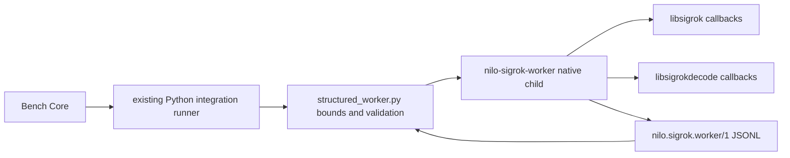

<!--
Copyright (c) 2026 DDP Engineering
This software is licensed under the PolyForm Noncommercial License 1.0.0.
Commercial use requires a separate commercial license.
See the LICENSE.txt in the .agentic folder for full license details.
SPDX-License-Identifier: LicenseRef-PolyForm-Noncommercial-1.0.0
-->

<!--
Task journal. One file per task, at .agentic/tasks/TASK-<id>.md, kept
after delivery as the task's historical record.

The header is the block of "key: value" lines directly under the title.
Keep it exactly in that form — one key per line, no blank lines inside
the block, no comments between the lines — so it stays machine-readable.

  stage         frame | specify | design | build | validate | deliver | done
                (adoption journals: survey | components | close | done)
  type          feature | fix | change | adopt
  path          full | quick
  requirements  comma-separated requirement IDs, empty until specify
  parent        optional top-level TASK-id; blank for an ordinary task
  branch        the branch this task is delivered on
  base          the commit this task started from, filled in at creation;
                the delivery report and `check --task` measure the diff
                against it, so leave it alone once it is written. Empty
                when the repository had no history yet.
  opened        YYYY-MM-DD

Header lines are edited in place; log lines are only ever appended.
The Log is a progress-and-evidence ledger, not an activity transcript. Append
only durable events that change the task's stage, scope, engineering outcome,
verification status, authority, or ability to proceed: stage transitions;
material scope or implementation decisions not already captured elsewhere;
consolidated automated or manual verification results; material discoveries;
blockers; approvals; deviations; and delivery outcomes.

Do not log routine searches, reads, edits, internal tool mechanics or corrected
command retries, and do not copy requirements, designs, specifications,
knowledge pages, Rulings, Handoff, or Stage report content into the Log. A
failed command belongs only when it exposes a candidate problem, changes the
implementation or tests, or remains an accepted verification limitation. Keep
each entry concise and self-contained; reference durable artifacts instead of
repeating them. Existing entries remain append-only under later contracts.

Stage report is one replaceable latest snapshot, not an evidence store.
Use plain one-line fields with no fences or bullets inside that section.
stage is the reported stage; current must match the journal header after any
transition. result is in_progress | completed | paused | blocked | skipped.
Leave unknown fields blank; summary prints not recorded, never an assumed pass.
Refresh at a stage transition, pause or session end, blocker, or completed
validation or delivery outcome. Do not refresh after routine work.
-->

# TASK-4023a58d — Prove structured Sigrok worker feasibility

stage: done
type: feature
path: full
requirements: REQ-FUNC-1f656691, REQ-FUNC-93362dc2, REQ-FUNC-cf21e27d, REQ-REL-c2695283, REQ-SEC-6b1dd726, REQ-TEST-11dc600f
parent:
branch: master
base: 3c8ba4e2a4f986228c04035721cde68e28e91a73
opened: 2026-09-05

## Done checklist (current stage)

- [x] validated candidate confirmed unchanged; otherwise returned to validate
- [x] validation evidence, diff, exclusions, and outcome presented
- [x] delivery confirmed by the human
- [x] journal and report included in the delivery commit
- [x] agreed outcome delivered, normally a PR
- [x] close-out committed after the outcome succeeded, or carried by the delivery commit where nothing could fail after it

## Frame

Problem: The current Sigrok adapter parses `sigrok-cli` prose and hard-codes an ATK-only digital envelope, so it cannot establish a generic structured capability, mixed-data, event, or decoder boundary.
Desired outcome: A bounded SW-01 feasibility slice proves direct structured libsigrok/libsigrokdecode access, records machine-readable Demo/fixture evidence and coverage, and selects the worker language/protocol for later work packages.
Actors: NILO integration maintainers; the isolated Sigrok worker; deployed libsigrok/libsigrokdecode runtimes; later Bench Core callers.
Primary scenario: A maintainer invokes the feasibility worker against the deployed Demo driver or deterministic fixtures -> the worker queries native APIs and emits bounded versioned NDJSON capability/data/decoder records -> tests and documentation show the evidence and selected boundary.
Examples: Demo reports D0-D7 and A0-A4 with typed settings and emits digital and analog packets; a deterministic UART fixture produces annotation records from the libsigrokdecode callback rather than console text.
Counterexamples: Parsing `sigrok-cli --scan` or decoder stdout, forwarding arbitrary configuration, exposing Demo pattern-generator/output controls, or treating fixture/ATK observations as electrical qualification does not satisfy SW-01.
In scope: A small native feasibility worker; driver/device/channel/group metadata; typed readable/listable settings; logic and analog packet normalization; trigger/frame event preservation where emitted; structured decoder catalog and UART annotation output; deterministic fixtures; Demo/deployed-runtime evidence; crash isolation decision; feature/device-class/build-option/dependency coverage; tests and operator/developer documentation.
Out of scope: Bench Core/API/GUI contract replacement (SW-02+); production capture storage and streaming; physical analyzer or electrical correctness claims; PWM and every other output operation; release/version assignment; packaging or deployment publication.
Constraints: Stay on `master`; one local commit only after complete validation; never push; preserve unrelated untracked files; keep project `VERSION` and mirrors at 0.2.0; use Demo and deterministic fixtures; worker output must be bounded and machine-readable; native faults must remain outside Bench Core.
Success signals: Repository tests validate schemas and PWM/output rejection; the worker compiles/runs against the deployed libraries; captured Demo evidence contains metadata, typed settings, both packet kinds and available frame/trigger facts; a fixture yields structured decoder annotations; documentation records versions, limitations, non-waveform classes, experimental options, dependencies, CLI comparison, and the selected boundary.
Evidence: STATED — delegated SW-01 scope, one-commit/no-push/master/version constraints. OBSERVED — `00_Planning/Sigrok_Waveform_Workspace/04_Implementation_Tasks.md` defines SW-01; `05_Software/integrations/sigrok/src/nilo_sigrok/plugin.py` parses ATK and UART CLI prose; `06_SoftwareDocu/Sigrok_Integration.md` documents that narrow bridge; deployed `ddp-remote.local` reports ARM64 libsigrok/libsigrokdecode 0.6.0/ABI 4 and sigrok-cli 0.8.0; the local WSL environment has neither the native libraries nor supported Python bindings; the deployed shared libraries and compiler are present. INFERRED — a small C worker behind the existing process boundary is the least-coupled production direction if direct API tests pass. UNKNOWN — which optional event kinds the Demo driver emits and which experimental build flags are active until the slice records them.
Assumptions: Read-only Demo acquisition on the authorized development appliance is within the requested normal validation; temporary build material may be placed outside runtime state and removed after evidence collection; no hardware behavior is inferred from Demo.
Unknowns: Demo may not emit trigger packets; frame boundaries may depend on configured frame limits; deployed headers are absent, so compilation uses the API-matched inspected source headers and installed shared ABI.
Decision-blocking questions: None; the user explicitly requested autonomous continuation and fixed all material scope/delivery choices.
Proposed behaviors: Emit versioned NDJSON with explicit record kinds and decimal sample positions; describe native versions, drivers/devices/channels/groups and typed settings without console parsing; emit bounded logic/analog/event records with output-capability suppression; decode a deterministic UART waveform through libsigrokdecode callbacks; reject output/PWM keys and unknown requests; keep the worker a separately supervised process; publish fixture and deployed-Demo evidence plus a coverage decision record.
Path and reason: Full path. Criteria — no new observable behavior: no (new worker evidence protocol); no new interface/data format: no (versioned NDJSON); no new dependency: no (native runtime/build dependency); existing requirement covers behavior: no; no security/data change: no (new native boundary and output exclusion). Children are not used because the feasibility code, evidence, and decision are tightly coupled. The required `master` exception replaces AEGIS branch creation. Autopilot applies because the user requested autonomous continuation unless a genuine decision is required.

## Requirement coverage

| Frame outcome | Atomic behavior | Requirement | Positive case | Boundary or failure | Verification | Design decision or no impact |
|---|---|---|---|---|---|---|
| Structured native capability access | Worker reports runtime, driver/device/channel/group, and typed setting metadata directly from native APIs | REQ-FUNC-1f656691 | Demo mixed device | Unknown driver or unavailable native value | Target build/run plus parsed record assertions | Exact record protocol in REQ-REL-c2695283 spec |
| Digital/analog/event datafeed access | Worker preserves ordered logic, analog, trigger, and frame callbacks that occur | REQ-FUNC-93362dc2 | Bounded Demo and packet fixtures | Absent optional event and record/output budget | Demo evidence plus deterministic callback fixtures | Explicit availability flags; no invented events |
| Structured decoder output | Worker emits libsigrokdecode annotation/binary callbacks with sample ranges | REQ-FUNC-cf21e27d | Deterministic UART fixture | Unknown decoder, mapping error, output cap | Target decoder callback run and negative fixtures | Fixed feasibility fixture; public graph deferred |
| Crash isolation and bounded protocol | Parent contains rejection, malformed output, hang, exit, and crash outside Bench Core | REQ-REL-c2695283 | Valid one-operation worker invocation | Timeout, crash, malformed/oversize output | Adapter containment tests | Native child beneath existing Python runner |
| No PWM/output boundary | Worker grammar and emitted capabilities exclude PWM/output operations and passthrough | REQ-SEC-6b1dd726 | Demo input channels only | Recursive PWM/output token fixtures | Worker and existing boundary regression tests | Reuse existing security behavior; extend its worker coverage |
| Durable feasibility/coverage evidence | Repository records reproducible machine-readable evidence and capability/dependency limitations | REQ-TEST-11dc600f | Deployed Demo plus UART fixture evidence | No hardware proof or unavailable build option | Evidence validator and documentation inspection | Separate observed, source, fixture, and physical evidence levels |

## Design

Requirements coverage: `REQ-FUNC-1f656691` maps native driver/device/config calls to capability records and target assertions; `REQ-FUNC-93362dc2` maps libsigrok callback packets to fixture/Demo assertions; `REQ-FUNC-cf21e27d` maps libsigrokdecode callbacks to the UART fixture; `REQ-REL-c2695283` maps the parent process adapter to malformed/timeout/crash tests; `REQ-SEC-6b1dd726` maps allowlisted commands plus recursive output inspection to worker tests; `REQ-TEST-11dc600f` maps checked-in evidence and coverage JSON to validator tests.

Component responsibilities: a small C executable under `integrations/sigrok/worker` owns native ABI interaction and record normalization. A Python `structured_worker.py` adapter owns process lifetime and strict record validation but is not wired into the current public operations in SW-01. Bench Core, current CLI-backed capture behavior, and public manifests remain unchanged. [REQ-REL-c2695283]

Interfaces: the C helper implements only `demo-capture --samples N` and `uart-fixture`, emitting `nilo.sigrok.worker/1` JSONL defined in the linked spec. Stderr is diagnostic. Decimal strings preserve sample/size integers. The adapter caps line, stream, record count, and runtime; it rejects wrong schemas, malformed lines, missing/duplicate summaries, extra output, and nonzero/signal exits. [REQ-FUNC-1f656691, REQ-FUNC-93362dc2, REQ-FUNC-cf21e27d, REQ-REL-c2695283]

Data/state: calls are read-only except the Demo driver's finite internal acquisition configuration. No output APIs or generic setters are exposed. Records live only for the invocation; canonical evidence JSONL is checked in without binaries. [REQ-SEC-6b1dd726, REQ-TEST-11dc600f]

Execution: the worker initializes both native libraries, scans only Demo, emits metadata/settings, registers the libsigrok datafeed callback, applies a bounded sample limit, captures, and summarizes observed packet kinds. The decoder path loads installed decoders, emits UART descriptors, configures a fixed deterministic waveform, and consumes annotation/binary callbacks. [REQ-FUNC-1f656691, REQ-FUNC-93362dc2, REQ-FUNC-cf21e27d]

Failure/recovery: every native call is checked; fatal failures produce one bounded error record and nonzero exit. The parent kills and awaits a timed-out child and discards an invalid stream. Each operation is retryable because it owns no durable state. [REQ-REL-c2695283]

Security/trust: fixed command grammar, hard bounds, no shell, no client path/config/driver passthrough, recursive PWM/output evidence checks, and a distinct native process preserve the current integration trust boundary. [REQ-SEC-6b1dd726, REQ-REL-c2695283]

Compatibility/packaging: SW-01 adds no public manifest operation and does not replace sigrok-cli. The build tool compiles against matching libsigrok/libsigrokdecode headers and deployed shared ABI; the report records embedded-Python compatibility and required decoder data. SW-02 may adopt the worker without a migration promise for this feasibility-only protocol. [REQ-TEST-11dc600f]

Observability/tests: local pytest uses deterministic fake executables for parent containment and validates canonical JSONL/coverage. Target evidence compiles/runs the C worker against the deployed ARM64 0.6.0/ABI-4 stack and is copied into `evidence/`; this proves integration shape only. [all requirements]

Alternatives: sigrok-cli remains adequate for the old finite ATK slice but loses typed callbacks; ctypes is rejected because it would bind opaque/native layouts and potentially load libsigrokdecode's Python 3.10 runtime into the Python runner; linking Go is rejected because it expands Bench Core's crash/dependency surface. A separate C helper is selected if target proof passes.

Expected files: `worker/nilo_sigrok_worker.c`; `src/nilo_sigrok/structured_worker.py`; `tests/test_worker.py`; `02_Tools/scripts/build-sigrok-worker.py`; `evidence/{demo-capture.jsonl,uart-fixture.jsonl,coverage.json}`; `06_SoftwareDocu/Sigrok_Structured_Worker_Feasibility.md`; updates to Sigrok integration documentation and component knowledge.

Risks/open decisions: ABI/header mismatch is tested on target. Demo may omit trigger/frame events, which remains an explicit coverage result. Decoder Python/runtime search paths may require packaging arguments discovered by the target proof. No product decision remains open in SW-01.

### Proposed architecture — TASK-4023a58d

## Log

- 2026-09-05 frame: Scope accepted under user-directed autopilot; full path selected for a new native worker protocol and dependency boundary, with PWM/output and electrical qualification excluded.
- 2026-09-05 specify: Created five atomic requirements, reused and extended one PWM security requirement, and specified the bounded native worker process protocol; no requirements revised or retired.
- 2026-09-05 design: Selected the separate C helper plus bounded Python child adapter described in `## Design` and `.agentic/specs/REQ-REL-c2695283.md`; the current public sigrok-cli operations remain unchanged in SW-01.
- 2026-09-05 build red: command=`.\02_Tools\env\with-tools.ps1 uv run --project 05_Software/integrations/sigrok --locked pytest -q 05_Software/integrations/sigrok/tests/test_worker.py`; exit=2; expected missing behavior=`nilo_sigrok.structured_worker` and the native/evidence artifacts do not exist for REQ-FUNC-1f656691, REQ-FUNC-93362dc2, REQ-FUNC-cf21e27d, REQ-REL-c2695283, REQ-SEC-6b1dd726, and REQ-TEST-11dc600f.
- 2026-09-05 build target proof: C11 warnings-as-errors compile and direct execution on the authorized ARM64 development appliance succeeded against libsigrok/libsigrokdecode 0.6.0 ABI 4; Demo emitted 64 logic and 320 analog samples with typed settings, and the deterministic UART fixture emitted 11 annotations and 2 binary records. Trigger/frame callbacks were available in the ABI but not observed; no physical hardware was opened.
- 2026-09-05 build green: command=`.\02_Tools\env\with-tools.ps1 python .agentic/aegis.py test --impacted --base HEAD`; exit=0; conservative routing ran 41 tooling tests, all Go packages, SDK 32 tests, fake integration 7 passed/1 skipped, Sigrok 28 tests, GUI 429 tests/build, and 38 browser tests for all linked requirements.
- 2026-09-05 build check: evolution contains the expected 10 product/tool/test/document paths with no unexpected files after reverting an incidental formatter-only blank-line change; task check has zero errors and only pre-existing unrelated stale requirements/journals plus user-owned untracked-file warnings.
- 2026-09-05 validate review: Returned to build because the native decoder's 4096-record cap exceeded the parent's 256-total-record contract; the correction is limited to aligning the native bound, spec, and regression assertion.
- 2026-09-05 build red: command=`.\02_Tools\env\with-tools.ps1 uv run --project 05_Software/integrations/sigrok --locked pytest -q 05_Software/integrations/sigrok/tests/test_worker.py::test_native_worker_omits_setters_outputs_and_arbitrary_driver_grammar`; exit=1; expected missing behavior=REQ-REL-c2695283 native decoder output cap must leave room below the parent's 256-total-record limit.
- 2026-09-05 build correction green: aligned the native decoder cap to 200 records, leaving protocol headroom under the parent's 256-total-record ceiling; command=`.\02_Tools\env\with-tools.ps1 python .agentic/aegis.py test --impacted --base HEAD`; exit=0; 41 tooling tests, all Go packages, SDK 32 tests, fake integration 7 passed/1 skipped, Sigrok 28 tests, GUI 429 tests/build, and 38 browser tests passed.
- 2026-09-05 validate review: Returned to build because the Demo callback cap independently allowed 240 datafeed records before adding capability metadata, which could exceed the parent's 256-total-record contract.
- 2026-09-05 build red: command=`.\02_Tools\env\with-tools.ps1 uv run --project 05_Software/integrations/sigrok --locked pytest -q 05_Software/integrations/sigrok/tests/test_worker.py::test_native_worker_omits_setters_outputs_and_arbitrary_driver_grammar`; exit=1; expected missing behavior=REQ-REL-c2695283 Demo callback output cap must leave room below the parent's 256-total-record limit.
- 2026-09-05 build final green: aligned both native callback caps to 200, the parent limit to 256 and the protocol spec; focused worker suite passed 14 tests, target C11 warnings-as-errors compile plus Demo/UART runs passed with 37/31 records, and `python .agentic/aegis.py test --impacted --base HEAD` exited 0 after 41 tooling tests, all Go packages, SDK 32, fake integration 7 passed/1 skipped, Sigrok 28, GUI 429/build, and browser 38.
- 2026-09-05 validate: Semantic diff review passed against SW-01 scope, exclusions, requirements, design, error paths, Windows/Linux boundaries, security and unrequested work; component knowledge and requirement links are current, no manual-only verification applies, and explicit review is disabled by repository configuration.
- 2026-09-05 validate final: command=`.\02_Tools\env\with-tools.ps1 python .agentic/aegis.py check --task TASK-4023a58d --strict --run`; exit=0; configured full test completed in 314.8s and lint in 8.4s, with zero errors. The 23 warnings and one manual-verification note are pre-existing stale requirement/journal records or user-owned untracked `09_Others/Preview.mp4` and `WORK_Ubuntu.conf`; none concerns the SW-01 candidate.
- 2026-09-05 deliver approval: The user explicitly authorized exactly one local commit on `master` after complete validation, with no push, no version change, and unrelated untracked files preserved; the validated scope, evidence, exclusions and local-only outcome were presented unchanged.
- 2026-09-05 deliver: Report-time advisory snapshot recorded zero errors, 24 warnings and one note; the additional warning was this journal's expected open delivery checklist. The approved outcome is the single repository-local commit carrying this close-out; no PR, push, release or deployment is in scope.

## Rulings

<!-- Append decisions here; never edit history. Supersede with a new ruling.
- RULING-001 | date=YYYY-MM-DD | decision=<decision> | reason=<reason> | source=user | supersedes=none
source: user | repository | requirement | technical
-->
- RULING-001 | date=2026-09-05 | decision=Remain on master, produce exactly one validated local commit, never push, preserve unrelated untracked files, and keep project version 0.2.0 | reason=Explicit user delivery authority and repository Git/version rules | source=user | supersedes=none
- RULING-002 | date=2026-09-05 | decision=Continue through the workflow without the frame checkpoint unless a genuine product decision is required | reason=The user requested autonomous continuation and supplied a bounded work package | source=user | supersedes=none

## Handoff

<!-- Replace these fields with the latest minimal resume snapshot.
status: ready | waiting | blocked
-->

current: done
status: ready
next: none; the local delivery commit is the complete authorized outcome.
must_read: .agentic/tasks/TASK-4023a58d.md
blockers: none

## Stage report

stage: deliver
result: completed
current: done
changed: The validated SW-01 feasibility slice, AEGIS records and local-only close-out are prepared in the single authorized delivery commit.
evidence: Strict check exited 0; report appended; explicit local-commit authority is recorded; no push, PR, release or deployment is required.
issues: Report-time advisory warnings are unrelated or the then-open delivery checklist; no candidate failure.
next: none.
needs_user: no — explicit autonomous continuation applies and no product decision is unresolved.
spec_compliance: disabled
implementation_quality: disabled
review_round:

## Delivery report (2026-09-05)

- stage: deliver; type: feature; path: full; branch: master
- requirements:
  - REQ-FUNC-1f656691 - Describe structured Sigrok capabilities
  - REQ-FUNC-93362dc2 - Normalize structured Sigrok datafeed
  - REQ-FUNC-cf21e27d - Decode through structured Sigrok callbacks
  - REQ-REL-c2695283 - Isolate the structured Sigrok worker
  - REQ-SEC-6b1dd726 - Exclude PWM from sigrok access
  - REQ-TEST-11dc600f - Record Sigrok worker feasibility coverage
- deviations: none recorded
- explicit review: disabled; existing validation remains required
- diff vs task base 3c8ba4e: 26 file(s) changed, 5636 line(s) added; 1 file(s) not content-scanned
- checks: errors=0 warnings=24 notes=1
- checklist: 3/6 done; open: journal and report included in the delivery commit; agreed outcome delivered, normally a PR; close-out committed after the outcome succeeded, or carried by the delivery commit where nothing could fail after it
