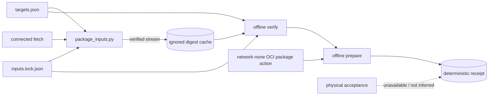

<!--
Copyright (c) 2026 DDP Engineering
This software is licensed under the PolyForm Noncommercial License 1.0.0.
Commercial use requires a separate commercial license.
See the LICENSE.txt in the .agentic folder for full license details.
SPDX-License-Identifier: LicenseRef-PolyForm-Noncommercial-1.0.0
-->

# TASK-4703beac - Implement offline packaging foundation

stage: deliver
type: feature
path: full
interaction: autopilot
requirements: REQ-PLAT-da89bf3b, REQ-SEC-628657e1, REQ-REL-f4a90899, REQ-SEC-dd110b06, REQ-TEST-c442102f
parent:
branch: master
base: 68d11c0a6b75c52b6eb3330c82187ff48c6edbc8
opened: 2026-09-18

## Done checklist (current stage)

- [x] validated candidate confirmed unchanged; otherwise returned to validate
- [x] validation evidence, diff, exclusions, and outcome presented
- [x] delivery confirmed by the human
- [ ] journal and report included in the delivery commit
- [x] agreed outcome delivered, normally a PR
- [ ] close-out committed after the outcome succeeded, or carried by the
      delivery commit where nothing could fail after it

## Frame

Problem: NILO has an approved packaging direction but no implementation of the
target-specific, verified-fetch and offline-build foundation. The current
delivery documentation also promises a minimum OS release plus every newer
release, while the revised implementation plan uses exact tested OS releases
and target-specific dependency pools.
Desired outcome: Deliver the first bounded implementation increment that can
describe both delivery targets, fetch locked external inputs into an ignored
cache, verify cache completeness and integrity, and enter package assembly only
from that verified cache with networking disabled. This increment establishes
the contracts on which `.deb`, `.run`, and Pi-image builders can safely follow.
Actors: Release engineer operating the packaging scripts; release reviewer
checking locks and evidence; appliance operator who later consumes an offline
artifact.
Primary scenario: A release engineer runs the connected fetch command once ->
the tool downloads only locked inputs and verifies their origins and digests ->
the engineer transfers the repository plus cache into an isolated build
environment -> the offline entry point validates the target and complete cache
before invoking any builder -> the result clearly identifies which target was
prepared and which later artifact stages remain unavailable.
Examples: A correct cached Ubuntu package is accepted by digest and target; a
corrupt or missing cached file is named and package assembly does not start.
The Raspberry Pi target can be prepared and statically checked without claiming
that an image booted on physical hardware.
Counterexamples: An Ubuntu 25.x host is not accepted merely because it is newer
than 24.04 when using an Ubuntu 24.04 dependency pool. A successful ARM64
cross-build is not recorded as Raspberry Pi boot, GPIO, or device acceptance.
In scope: PKG01-PKG03 foundation from
`00_Planning/Packaging_and_Delivery_Plan.md`: machine-readable target and input
contracts; connected fetch/cache semantics; digest and path validation; cache
completeness checks; network-disabled build entry boundaries; focused tests;
operator documentation; reconciliation of delivery/toolchain documentation
that directly governs this increment.
Out of scope: Building final `.deb`, `.run`, or `.img.xz` artifacts; application
first-admin, integration-upgrade, migration, or removal changes; package
signing; release version assignment; publication; committing; Raspberry Pi or
mini-PC physical acceptance.
Constraints: Use AEGIS; remain on branch `master`; do not commit; preserve
unrelated working-tree files; repository-local tools and ignored caches only;
no persistent host changes; no credential on a command line; fetch is the only
networked phase; offline assembly must fail closed; Raspberry Pi and mini-PC
hardware are unavailable and their acceptance remains outstanding.
Success signals: Target definitions are deterministic and validated; the fetch
path accepts only declared inputs and verifies size/digest; cache verification
rejects missing, corrupt, duplicate, unsafe, cross-target, or undeclared input;
the offline entry refuses a non-isolated or incomplete build; tests exercise
positive and failure cases without network or hardware; documentation states
exactly what is and is not proven.
Evidence: STATED - the release is one complete NILO application per Raspberry
Pi and Ubuntu PC target, fetch happens once, produced packages contain their
dependencies and install offline, hardware is unavailable, AEGIS is required,
the current branch must be used, and no commit is authorized. OBSERVED - the
revised contract and PKG01-PKG03 are in
`00_Planning/Packaging_and_Delivery_Plan.md`; current delivery policy still
promises a minimum release and every newer release in `07_Delivery/README.md`
and `.agentic/context/project.md`; repository-local cache/runtime and offline
OCI conventions exist in `.gitignore`, `02_Tools/README.md`, and
`.agentic/knowledge/repository-toolchain.md`; the existing
`02_Tools/scripts/build-appliance.sh` cross-builds binaries but is not a release
packager. INFERRED - the safe first increment is the target/cache/offline
foundation because it is hardware-independent and precedes artifact builders.
UNKNOWN - exact Raspberry Pi base-image release/digest, final OS package closure,
signing mechanism, supported upgrade source versions, and the date or equipment
for physical acceptance.
Assumptions: The first increment may stop before producing installable release
artifacts; target-specific locks can be populated incrementally without
weakening fail-closed validation; existing offline OCI infrastructure should be
reused rather than duplicated.
Unknowns: The exact Raspberry Pi base image and dependency closure remain PKG01
outputs. Hardware evidence cannot be produced in this task. Public signing and
upgrade-source policy remain later decisions.
Decision-blocking questions: Confirm that support is an exact tested release
matrix initially - Ubuntu 24.04 LTS `amd64` and Raspberry Pi OS based on Debian
13 `arm64` - replacing the current "minimum release and every newer release"
promise. Confirm the first implementation increment may cover the packaging
foundation above without yet producing final installers or images.
Proposed behaviors: One target ID selects exactly one OS release and
architecture; a connected fetch operation materializes immutable inputs named
by a lock; cache verification is deterministic and fail-closed; the offline
entry cannot fetch and refuses incomplete or incompatible inputs; all reports
separate static/cross-build evidence from unavailable physical acceptance.
Path and reason: Full path. This adds a packaging command interface, target and
lock formats, external-input handling, and security-sensitive integrity
boundaries; no current requirement fully governs it.

| Quick-path criterion | yes | no | evidence |
|---|---:|---:|---|
| No new externally observable behavior |  | x | New release-engineer commands and diagnostics |
| No new interface or data format |  | x | Target and input lock formats are new |
| No new dependency |  | x | External OS/base-image inputs become declared dependencies |
| Existing requirement already covers the behavior |  | x | No packaging-foundation requirement is linked |
| No security or data-handling change |  | x | Download trust, digests, cache paths, and offline isolation are security boundaries |

## Requirement coverage

### Behavior inventory

| Frame outcome | Actor/system | Trigger or state | Response | Positive case | Boundary or failure | Observable result |
|---|---|---|---|---|---|---|
| Exact release pools | Packaging tooling | Target selected | Resolve exact OS/architecture definition | Both declared targets resolve | Unknown, duplicate, malformed, or newer-but-undeclared target | Canonical target JSON or named error before lock access |
| Connected acquisition | Fetch command | Complete lock and target supplied | Stream and verify selected HTTPS inputs into immutable cache | Matching bytes appear at digest-derived path | Scheme, redirect, size, digest, interruption, duplicate, or wrong scope | Atomic object or named failure with no retained staging file |
| Cache closure | Cache verifier | Preparation requests a target | Validate complete lock and every selected/shared object | Stable verified inventory | Incomplete lock, unsafe metadata, missing or corrupt objects | All detectable defects reported and no receipt |
| Offline preparation | Preparation command | Complete cache in isolated Linux namespace | Verify only loopback/no default routes and write deterministic receipt | Receipt produced in network-none container | Non-Linux, extra interface, route, or cache defect | Exit `2` before output |
| Honest evidence | Preparation receipt | No physical target execution | Record target checklist as `not_run` | Both targets name required hardware checks | Cross-build/static checks cannot promote status | Receipt contains no passed hardware claim |

| Frame outcome | Atomic behavior | Requirement | Positive case | Boundary or failure | Verification | Design decision or no impact |
|---|---|---|---|---|---|---|
| Exact target-specific dependency contract | Resolve only declared exact OS/architecture targets | REQ-PLAT-da89bf3b | Ubuntu and Pi target metadata load | Unknown or inconsistent target rejected before lock | Registry/CLI tests | Target registry schema requires design |
| Fetch once, then build offline | Cache only verified target/shared inputs | REQ-SEC-628657e1 | HTTPS stream becomes immutable object | Scheme, size, digest, interruption, duplicate, or scope failure | Injected downloader tests | Lock/cache format requires design |
| Fail-closed cache boundary | Require complete matching input closure | REQ-REL-f4a90899 | Sorted inventory returned | Complete set of object/config defects reported | Fixture cache tests | Verifier aggregation requires design |
| Network-disabled assembly | Refuse preparation outside isolated Linux namespace | REQ-SEC-dd110b06 | Receipt written with loopback only | Platform, interface, route, or cache refusal | Probe and wrapper tests | Runtime isolation probe requires design |
| No inferred physical proof | Record unavailable hardware checks as `not_run` | REQ-TEST-c442102f | Target checklist appears in receipt | No caller override or passed inference | Receipt/parser tests | Receipt format requires design |

## Design

### Requirements coverage

- `REQ-PLAT-da89bf3b`: one strict JSON target registry is loaded before any
  lock, and the CLI exposes deterministic listing/selection.
- `REQ-SEC-628657e1`: one standard-library Python fetcher owns version/licence
  provenance, HTTPS validation, bounded streaming, hashing, staging cleanup,
  atomic cache placement, and provenance-bearing inventories.
- `REQ-REL-f4a90899`: the same library validates the complete lock and
  aggregates cache-object defects into a sorted inventory or one refusal.
- `REQ-SEC-dd110b06`: preparation is a fetch-free command reached through a new
  network-none build-environment `package` action with a read-only cache mount;
  a Linux runtime probe additionally requires only loopback and no default
  IPv4/IPv6 route.
- `REQ-TEST-c442102f`: preparation writes an immutable `not_run` hardware block
  from the target registry; no status override exists.

### Component responsibilities and interfaces

`02_Tools/packaging/package_inputs.py` owns format validation and the four
subcommands `list-targets`, `fetch`, `verify-cache`, and `prepare`. It uses only
the Python standard library. JSON configuration is repository-owned; downloaded
objects live only under ignored `02_Tools/cache/packaging`.

Thin PowerShell/POSIX fetch and verification wrappers enter the pinned
repository Python environment. `prepare-offline.sh` is Linux-only and is called
by a new `package <target>` action in `with-build-environment.*`. That action
retains the existing read-only checkout/network-none container boundary, mounts
the packaging cache read-only at `/packaging-cache`, and writes only beneath
the existing `/outputs` mount. The container command invokes the new wrapper as
`sh ./02_Tools/packaging/build/prepare-offline.sh ...`, so correctness does not
depend on a Git executable bit or the host filesystem's mode behavior (portable
checkout constraint).

### Data, execution, and state

The target registry, lock, cache layout, and deterministic receipt follow the
five linked specs. Fetch transitions one object through absent -> staging ->
verified immutable object. An existing valid object is terminal and reusable.
Verification and preparation never mutate cache content. The checked-in lock
starts explicitly incomplete and names the unresolved OS dependency closures
and Pi base image, so default production preparation fails closed.

### Failure, security, ordering, and recovery

Validation, including required version and licence provenance, precedes URL
opening and output creation. Lock-provided names never become paths; object
paths derive only from validated SHA-256. HTTPS redirects
are rechecked, URL credentials/fragments are refused, download size is bounded,
and staging cleanup runs on every exception. Concurrent fetches of the same
digest may race only at atomic replacement; identical verified bytes make that
safe. Preparation writes a sibling temporary and replaces the receipt only
after cache and isolation checks succeed, preserving any prior good receipt on
failure.

Exact-release targeting deliberately replaces the current minimum-and-newer
documentation. There is no migration because packaging scripts do not yet
exist. Release artifact construction, signing, install-time OS checks, and
application migrations remain later tasks.

### Observability and test seams

Policy/configuration failures are `PackagingError` messages on stderr with exit
`2`; successful JSON is canonical, stable, and retains declared version and
licence provenance. Downloader tests inject an
opener/response; network tests inject an observation; filesystem fixtures cover
atomicity and corruption; wrapper contract tests inspect network-none and
read-only mounts. Tests make no external request and claim no hardware proof.

### Alternatives, risks, and open decisions

Rejected: shell-only download logic (weak cross-platform validation and test
seams); cache paths from lock metadata (path-traversal surface); accepting newer
OS releases (offline pool incompatibility); treating a cross-build as target
proof. The main risk is a complete-looking but incomplete checked-in lock;
`complete: false` plus mandatory reasons prevents that. The exact package
closures, Pi image digest, signing method, and physical acceptance date remain
open and explicitly outside this increment.

### Expected files

- `02_Tools/packaging/package_inputs.py`
- `02_Tools/packaging/config/{targets.json,inputs.lock.json}`
- `02_Tools/packaging/fetch/fetch-all.{ps1,sh}`
- `02_Tools/packaging/verify/verify-cache.{ps1,sh}`
- `02_Tools/packaging/build/prepare-offline.sh`
- `02_Tools/packaging/README.md`
- `02_Tools/env/with-build-environment.{ps1,sh}`
- `05_Software/scripts/tests/test_packaging_inputs.py`
- `.gitignore`, `CHANGELOG.md`, `02_Tools/README.md`, `07_Delivery/README.md`
- `.agentic/context/project.md`, `.agentic/context/environment.md`,
  `.agentic/knowledge/repository-toolchain.md`

The current toolchain architecture page remains unchanged until validation
confirms that these responsibilities exist.

## Log

- 2026-09-18 frame: Full path proposed for the PKG01-PKG03 offline packaging foundation; scope is paused for confirmation of the exact-release support contract and bounded first increment before requirements are written.
- 2026-09-18 frame: User approved uninterrupted autopilot through delivery, accepting the exact initial target matrix and bounded PKG01-PKG03 scope; advanced to specify on the existing branch with no commit authority.
- 2026-09-18 specify: Created five draft requirements and five exact interface specs; no existing requirement matched the target registry, connected fetch, cache closure, offline preparation, or hardware-evidence behaviors, and none were revised or retired.
- 2026-09-18 design: Defined the standard-library input tool, digest cache, strict target/lock formats, network-none wrapper integration, deterministic receipt, failure recovery, and test seams in this Design and the five linked specs.
- 2026-09-18 build red: requirements=REQ-PLAT-da89bf3b, REQ-SEC-628657e1, REQ-REL-f4a90899, REQ-SEC-dd110b06, REQ-TEST-c442102f; command=`python -m unittest scripts.tests.test_packaging_inputs.PackagingInputTests.test_shipped_target_registry_is_exact -v`; exit=1; expected missing behavior=the repository has no packaging target registry or implementation entry point.
- 2026-09-18 build red: requirement=REQ-SEC-628657e1; command=`python -m unittest scripts.tests.test_packaging_inputs.PackagingInputTests.test_fetch_caches_only_verified_https_bytes_atomically -v`; exit=1; expected missing behavior=the packaging module has no connected fetch operation or immutable-cache placement.
- 2026-09-18 build red: requirement=REQ-REL-f4a90899; command=`python -m unittest scripts.tests.test_packaging_inputs.PackagingInputTests.test_verify_cache_reports_all_object_defects -v`; exit=1; expected missing behavior=the packaging module has no complete-cache verifier or aggregated defect reporting.
- 2026-09-18 build red: requirements=REQ-SEC-dd110b06, REQ-TEST-c442102f; command=`python -m unittest scripts.tests.test_packaging_inputs.PackagingInputTests.test_prepare_requires_linux_loopback_only_and_preserves_prior_output -v`; exit=1; expected missing behavior=the packaging module has no network observation, offline preparation, atomic receipt, or hardware-evidence state.
- 2026-09-18 build red: requirements=REQ-SEC-628657e1, REQ-REL-f4a90899, REQ-SEC-dd110b06; command=`python -m unittest scripts.tests.test_packaging_inputs.PackagingInputTests.test_cli_and_wrappers_keep_fetch_and_offline_paths_separate -v`; exit=1; expected missing behavior=the connected fetch/cache wrappers and network-none package action do not exist.
- 2026-09-18 build red: requirement=REQ-SEC-628657e1; command=`python -m unittest scripts.tests.test_packaging_inputs.PackagingInputTests.test_fetch_removes_a_corrupt_object_before_a_failed_retry -v`; exit=1; expected missing behavior=a failed refetch leaves a pre-existing corrupt cache object behind.
- 2026-09-18 build green: command=`python -m unittest scripts.tests.test_packaging_inputs -v`; exit=0; scope=12 target, lock, fetch, cache, isolation, receipt, CLI, and wrapper tests covering all five requirements; the existing build-environment checkout-isolation test, Python compilation, JSON parsing, PowerShell parsing, and WSL shell syntax checks also passed.
- 2026-09-18 build: Evolution reviewed 16 expected candidate paths with no unexpected or removed files. Advisory check reported no current-task errors or warnings; five stale-path warnings, tracked historical fingerprint sidecars, and an unticked delivery checklist belong to pre-existing requirements or TASK-2361ce94 and remain outside this task.
- 2026-09-18 validate review round 1: specification_compliance=changes_required because complete lock entries omitted the plan-required version and licence provenance; implementation_quality=changes_required because the internal OCI command assumed the new shell wrapper had an executable bit. Returned to specify/build for only these findings.
- 2026-09-18 specify correction: Amended REQ-SEC-628657e1 and its spec so every complete locked input requires non-empty version and licence provenance and every verified inventory/receipt retains both fields.
- 2026-09-18 design correction: Extended the locked-input/inventory data contract with version/licence provenance and required the OCI package action to invoke the new POSIX wrapper explicitly through `sh`; returned to build for test-first correction of only the round-1 review findings.
- 2026-09-18 build red: requirements=REQ-SEC-628657e1, REQ-SEC-dd110b06; command=`python -m unittest scripts.tests.test_packaging_inputs.PackagingInputTests.test_lock_rejects_unsafe_sources_duplicates_and_incomplete_state scripts.tests.test_packaging_inputs.PackagingInputTests.test_cli_and_wrappers_keep_fetch_and_offline_paths_separate -v`; exit=1; expected missing behavior=lock entries reject version/licence as unknown fields and the OCI package action invokes the new wrapper directly instead of through `sh`.
- 2026-09-18 build green correction: command=`python -m unittest scripts.tests.test_packaging_inputs -v`; exit=0; scope=12 packaging-foundation tests, including required version/licence provenance in inventories and receipts plus explicit `sh` invocation; Python compilation, PowerShell parsing, and WSL POSIX syntax checks also passed.
- 2026-09-18 build correction: Evolution reviewed the four files changed after the round-1 anchor with no unexpected or removed paths. Advisory check reported no current-task errors; five stale-path warnings, tracked historical fingerprint sidecars, and an unticked delivery checklist belong to pre-existing requirements or TASK-2361ce94 and remain outside this task.
- 2026-09-18 validate review round 2: specification_compliance=approved after re-reading the frame, exclusions, five active requirements/specs, corrected design, and target/cache/offline evidence contracts; implementation_quality=approved after reviewing the full candidate for integrity failures, cleanup and retry behavior, command injection, credential exposure, deterministic output, Windows/Linux portability, tests, documentation, and unrequested work.
- 2026-09-18 validate diagnostics: The first strict run used an unprepared PowerShell PATH and stopped after all 130 script tests passed because `go` was unavailable; the repository-local tool environment corrected that setup issue. Under unconstrained host load, unrelated Go deadline tests failed but `go test -count=1 ./internal/bench` and `go test -count=1 ./internal/integration/supervisor` then passed independently; with `GOFLAGS=-p=1`, the Go suites passed. One unrelated GUI capture test later failed under file-parallel load, then its file passed independently and the complete one-worker frontend suite passed 37 files and 506 tests.
- 2026-09-18 validate blocked: command=`$env:GOFLAGS='-p=1'; $env:VITEST_MAX_WORKERS='1'; .\02_Tools\env\with-tools.ps1 python .agentic/aegis.py check --task TASK-4703beac --strict --run`; exit=1 because configured test route exit=2 at `02_Tools/tests/appliance/check.sh`; all preceding script, Go, Python, GUI unit/build stages and configured lint completed, but Docker Desktop's daemon could not start due an inaccessible stale zero-byte `sailor-ingest.sock` reparse point. Docker/WSL processes were stopped and the exact socket was inspected, but recoverable rename and targeted removal were refused by Windows; no Docker data was reset and no required gate was skipped. Advisory catalog still reports only the seven pre-existing warnings already recorded. Candidate remains at validate pending host reboot or Docker Desktop repair and a fresh strict run.
- 2026-09-18 validate unblocked: Preserved and regenerated Docker Desktop's transient `Docker/run` and `docker-secrets-engine` runtime directories without resetting Docker data; Docker server 29.7.2 then answered from both Windows and Ubuntu WSL. The candidate was not edited during recovery.
- 2026-09-18 validate complete: command=`$env:GOFLAGS='-p=1'; $env:VITEST_MAX_WORKERS='1'; .\02_Tools\env\with-tools.ps1 python .agentic/aegis.py check --task TASK-4703beac --strict --run`; exit=0; configured tests passed in 1140.3s, configured lint passed in 46.5s, the Docker appliance/NetworkManager tests and appliance Playwright run completed, and the gate reported `strict: ok`. The seven advisory warnings are the same five stale-path records, 82 historical tracked fingerprint sidecars, and unticked TASK-2361ce94 delivery checklist already classified as pre-existing; three manual-verification notes are unrelated existing requirements. Physical Raspberry Pi and mini-PC acceptance remains `not_run` by stated scope.
- 2026-09-18 validate: Final diff and status review found the validated candidate unchanged, both round-2 review verdicts remain approved, no child tasks exist, and the task advanced to the mandatory pre-delivery boundary. Two untracked `09_Others/*.conf` files remain unrelated and excluded; no commit, staging, push, PR, version assignment, or publication is authorized.
- 2026-09-19 deliver: User requested that the two AEGIS verdicts be rerun by separate reviewer agents. Returned the unchanged candidate to validate for a third review round; one read-only agent is assigned specification compliance and a different read-only agent is assigned implementation quality.
- 2026-09-19 validate review round 3: Separate read-only reviewer agents both returned `changes_required` against the same unchanged candidate. Specification compliance found missing exact ID/OS/release/architecture tuple enforcement, a mismatch between the cache verifier's fail-fast configuration parsing and REQ-REL-f4a90899's joint-defect evidence language, and absent undersized/interrupted-stream fetch tests required by REQ-SEC-628657e1. Implementation quality independently reproduced acceptance of a cache-object symlink outside the cache and mismatched target metadata, and also found that preparation can mix multiple target/lock snapshots and that malformed HTTPS URLs can escape the documented `PackagingError`/exit-2 path; it noted associated test gaps and source-only wrapper inspection. The focused 12-test suite and `git diff --check` still pass, but those results do not discharge the findings. Round 3 is the final configured round, so validation is blocked under the bounded re-review rule. The newly appearing untracked `00_Planning/Camera_Plugin_Plan.md` and the two `09_Others/*.conf` files are unrelated and excluded; neither reviewer edited files or Git state.
- 2026-09-19 build: User explicitly authorized one additional bounded fix-and-review cycle for only the round-3 findings, resetting the review-policy limit for one cycle. Returned to build with both prior verdicts cleared; no broader scope or publication authority was granted.
- 2026-09-19 build red: requirements=REQ-PLAT-da89bf3b, REQ-SEC-628657e1, REQ-REL-f4a90899; command=`.\02_Tools\env\with-tools.ps1 python -m unittest scripts.tests.test_packaging_inputs -v` from `05_Software`; exit=1; expected missing behavior=the validator accepts five inconsistent exact-target variants, malformed HTTPS syntax escapes as `ValueError`, and preparation hashes a different lock read than the parsed inventory. The same run confirmed the added undersized/interrupted-transfer and joint object-defect evidence already behaves as required.
- 2026-09-19 build red: requirement=REQ-REL-f4a90899; command=`wsl.exe -d Ubuntu --exec sh -lc 'cd /mnt/d/ProjectsDDP/2026_Networked_Intelligent_Lab_Orchestrator/05_Software && python3 -m unittest scripts.tests.test_packaging_inputs.PackagingInputTests.test_verify_cache_rejects_symlinked_cache_objects -v'`; exit=1; expected missing behavior=a digest-path symlink to bytes outside the cache is accepted as a verified cache object.
- 2026-09-19 build red: requirement=REQ-SEC-dd110b06; command=`.\02_Tools\env\with-tools.ps1 python -m unittest scripts.tests.test_packaging_inputs.PackagingInputTests.test_ipv6_reject_route_does_not_imply_connectivity -v` from `05_Software`; exit=1; expected missing behavior=the route parser treats Docker network-none's non-forwarding IPv6 reject route on loopback as usable default-route connectivity, causing the actual OCI package action to refuse a correctly isolated namespace.
- 2026-09-19 build: The round-3 request for executable OCI boundary evidence adds `02_Tools/tests/packaging/{Dockerfile,check.sh}` beyond the original expected-file list but within the existing Repository-local toolchain component. The current component page was re-read and updated; the test derives a temporary image only from already-present local assets, runs the actual package action, and removes its uniquely named image and volume.
- 2026-09-19 build green: requirements=REQ-PLAT-da89bf3b, REQ-SEC-628657e1, REQ-REL-f4a90899, REQ-SEC-dd110b06; commands=`.\02_Tools\env\with-tools.ps1 python -m unittest scripts.tests.test_packaging_inputs -v` from `05_Software` and the equivalent `python3` suite under Ubuntu WSL; exit=0 for both; scope=15 packaging tests, with the Windows symlink case explicitly skipped because the host token cannot create links and the same test passing under Linux. `sh 02_Tools/tests/packaging/check.sh` also exited zero after the actual OCI package action ran with network-none/read-only cache, observed only loopback and no usable default route, wrote the complete-fixture receipt, retained hardware status `not_run`, and cleaned its temporary image/volume. Python compilation and POSIX syntax checks passed.
- 2026-09-19 build complete: Evolution after the final anchor reported only the expected `package_inputs.py` and changelog modifications; the `.agentic` requirement/spec/knowledge/journal changes are intentionally excluded from fingerprint evolution, while the new OCI test files predate the final anchor and were reconciled explicitly above. Advisory check has no errors and only the seven previously recorded repository warnings plus three unrelated manual-verification notes. `git diff --check` and final shell syntax checks pass. A concurrent change to `.agentic/aegis.toml` raised `max_fix_cycles` from 2 to 5; it was not made or reverted by this task and is excluded together with `00_Planning/Camera_Plugin_Plan.md` and the two `09_Others/*.conf` files. Advanced to separate-agent validation round 4 under the narrower one-cycle RULING-005.
- 2026-09-19 validate review round 4: Separate read-only reviewer agents both returned `changes_required` on the single extra cycle authorized by RULING-005. Specification compliance confirmed every round-3 finding was resolved, then found that the target registry/receipt contract accepts an incomplete Raspberry Pi hardware-check list, the reliability spec overstates oversized/non-regular/no-receipt fixture coverage, and `07_Delivery/README.md` incorrectly says direct cache verification runs inside the OCI network-none boundary. Implementation quality confirmed the round-3 corrections but reproduced a high-severity remaining case: opening a digest-path FIFO with blocking `O_RDONLY|O_NOFOLLOW` hangs before `fstat` can reject it; a three-second WSL diagnostic timed out with exit 124. Both reviewers made no file or Git-state change. Windows and WSL focused suites plus the OCI check remain green but do not cover or discharge the FIFO defect. Round 4 exhausts the exactly one additional cycle, so validation is blocked and no fresh strict suite or delivery transition is claimed.
- 2026-09-19 build: User explicitly authorized exactly one more bounded fix-and-review cycle for only the round-4 findings. Returned to build with both round-4 verdicts cleared; the authority does not expand scope, authorize publication, or change the outstanding physical-hardware status.
- 2026-09-19 build red: requirements=REQ-PLAT-da89bf3b, REQ-TEST-c442102f; command=`..\02_Tools\env\with-tools.ps1 python -m unittest scripts.tests.test_packaging_inputs.PackagingInputTests.test_shipped_target_registry_is_exact scripts.tests.test_packaging_inputs.PackagingInputTests.test_target_registry_rejects_ambiguous_or_inconsistent_metadata scripts.tests.test_packaging_inputs.PackagingInputTests.test_verify_cache_reports_all_object_defects -v` from `05_Software`; exit=1; expected missing behavior=the shipped Raspberry Pi checklist omits required physical checks and the registry accepts a checklist with a required check removed. The expanded long-object aggregation fixture already passed.
- 2026-09-19 build red: requirement=REQ-REL-f4a90899; command=`wsl.exe -d Ubuntu --exec sh -lc 'cd /mnt/d/ProjectsDDP/2026_Networked_Intelligent_Lab_Orchestrator/05_Software && timeout 3s python3 -m unittest scripts.tests.test_packaging_inputs.PackagingInputTests.test_verify_cache_rejects_fifo_without_blocking -v'`; exit=124; expected missing behavior=opening a digest-path FIFO blocks before the verifier can classify and reject the non-regular object.
- 2026-09-19 build green: requirements=REQ-PLAT-da89bf3b, REQ-REL-f4a90899, REQ-TEST-c442102f; commands=`..\02_Tools\env\with-tools.ps1 python -m unittest scripts.tests.test_packaging_inputs -v` from `05_Software` and the equivalent `python3` suite under Ubuntu WSL; exit=0 for both; scope=16 packaging tests, with Windows skipping the two POSIX filesystem cases and Linux passing all 16, including prompt FIFO rejection, exact target checklists, oversized-object aggregation, and exact `not_run` receipts. The actual OCI package action also exited zero with network-none/read-only cache, loopback-only isolation, and the exact Ubuntu checklist.
- 2026-09-19 build complete: Python compilation, target JSON parsing, packaging shell syntax, and `git diff --check` passed. Evolution reported the five expected post-anchor implementation/documentation files with no unexpected or removed paths; the changed pre-anchor regression test and `.agentic` records are intentionally outside that report. Advisory check has no errors and only the seven previously recorded repository warnings plus three unrelated manual-verification notes. The concurrent `.agentic/aegis.toml`, camera plan, and two `09_Others/*.conf` changes remain excluded. Returned to validate for separate-agent review round 5 under RULING-006.
- 2026-09-19 validate review round 5: Separate read-only reviewer agents both returned `approved` on the same corrected candidate. Specification compliance found the canonical complete Raspberry Pi checklist, exact `not_run` receipt comparison, reliability fixture/spec alignment, delivery-boundary wording, five requirements, and PKG01-PKG03 exclusions consistent. Implementation quality independently passed all 16 Linux tests under a bounded timeout, 16 Windows tests with two expected POSIX-only skips, and the actual OCI package action; it confirmed prompt FIFO rejection, exact checklist enforcement, defect aggregation, link/special-file handling, snapshot consistency, cleanup, portability, and temporary OCI resource removal. Neither reviewer changed files or Git state; final strict repository proof remains pending.
- 2026-09-19 validate complete: command=`$env:GOFLAGS='-p=1'; $env:VITEST_MAX_WORKERS='1'; .\02_Tools\env\with-tools.ps1 python .agentic\aegis.py check --task TASK-4703beac --strict --run`; exit=0; configured full test route passed in 699.7s, lint passed in 23.6s, and the gate reported `strict: ok`. Advisory output contains only the same seven pre-existing warnings and three unrelated manual-verification notes already classified outside this task. A final status/diff check confirmed branch `master`, no post-proof candidate change, both round-5 verdicts approved, and the unrelated `.agentic/aegis.toml`, camera-plan, and two `09_Others/*.conf` changes excluded. Advanced to the mandatory delivery boundary; no commit, staging, push, PR, version assignment, or publication is authorized.
- 2026-09-19 deliver: User approved the stated no-commit handoff. The validated candidate remains unstaged and uncommitted on `master`; no push, PR, version assignment, release, or publication was attempted. This approved working-tree handoff is the agreed outcome, while commit-dependent AEGIS close-out items remain truthfully unticked under RULING-002.

## Rulings

- RULING-001 | date=2026-09-18 | decision=Run this implementation through AEGIS despite its packaging focus | reason=The user explicitly requested AEGIS for this work | source=user | supersedes=none
- RULING-002 | date=2026-09-18 | decision=Work on the existing master branch and do not commit | reason=The user explicitly constrained branch and Git publication actions | source=user | supersedes=none
- RULING-003 | date=2026-09-18 | decision=Keep Raspberry Pi and mini-PC physical acceptance visibly outstanding | reason=The user stated that neither target is available for real testing | source=user | supersedes=none
- RULING-004 | date=2026-09-18 | decision=Use autopilot through delivery for this task | reason=The user requested continuation without further prompts | source=user | supersedes=none
- RULING-005 | date=2026-09-19 | decision=Authorize exactly one additional bounded fix-and-review cycle for the round-3 findings | reason=Both separately assigned reviewer agents returned changes_required on the configured final round | source=user | supersedes=none
- RULING-006 | date=2026-09-19 | decision=Authorize exactly one additional bounded fix-and-review cycle for the round-4 findings | reason=Both separately assigned reviewer agents returned changes_required after confirming the round-3 findings were corrected | source=user | supersedes=none

## Handoff

current: deliver
status: waiting
next: No action under the approved no-commit outcome; resume deliver only if the user later grants explicit commit authority.
must_read: .agentic/tasks/TASK-4703beac.md, .agentic/steps/6_deliver.md
blockers: Commit-dependent AEGIS close-out remains intentionally open because RULING-002 forbids committing. No staging, push, PR, version assignment, release, or publication authority has been granted. Physical Raspberry Pi and mini-PC evidence remains `not_run`; final installers/images remain outside this increment.

## Stage report

stage: deliver
result: completed
current: deliver
changed: Corrected only round-4 findings: canonical target-specific physical-check lists, non-blocking FIFO rejection, oversized and special-file fixture coverage, accurate no-receipt evidence language, and distinct host verification versus OCI preparation documentation.
evidence: User approved the no-commit handoff; the AEGIS delivery report is appended. Separate round-5 reviewers approved, Windows and WSL focused suites pass, the actual OCI package action passes, and the final configured test/lint gate completed with `strict: ok`.
issues: The approved handoff is intentionally unstaged and uncommitted, leaving the two commit-dependent checklist items open. The report-time eighth warning is this current unticked delivery close-out; the other seven warnings and three notes are pre-existing or unrelated. Physical hardware acceptance and final artifact production remain outside scope.
next: No further action is authorized or required for the approved working-tree handoff; an explicit later commit instruction would resume this deliver stage and permit AEGIS close-out.
needs_user: no
spec_compliance: approved
implementation_quality: approved
review_round: 5

## Delivery report (2026-09-19)

- stage: deliver; type: feature; path: full; branch: master
- requirements:
  - REQ-PLAT-da89bf3b - Select an exact delivery target
  - REQ-SEC-628657e1 - Fetch immutable packaging inputs
  - REQ-REL-f4a90899 - Reject incomplete packaging caches
  - REQ-SEC-dd110b06 - Keep package preparation offline
  - REQ-TEST-c442102f - Report unavailable hardware acceptance honestly
- deviations: none recorded
- explicit review: enabled; spec_compliance=approved; implementation_quality=approved; review_round=5
- diff vs task base 68d11c0: 37 file(s) changed, 5316 line(s) added
- checks: errors=0 warnings=8 notes=3
- checklist: 4/6 done; open: journal and report included in the delivery commit; close-out committed after the outcome succeeded, or carried by the delivery commit where nothing could fail after it
