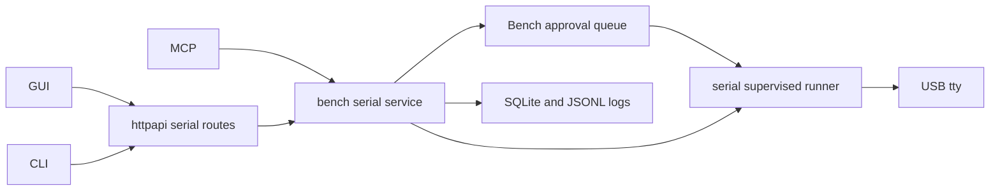

<!--
Copyright (c) 2026 DDP Engineering
This software is licensed under the PolyForm Noncommercial License 1.0.0.
Commercial use requires a separate commercial license.
See the LICENSE.txt in the .agentic folder for full license details.
SPDX-License-Identifier: LicenseRef-PolyForm-Noncommercial-1.0.0
-->

# TASK-5344100e - Implement USB to Serial plugin with approved sessions and bounded logs

stage: done
type: feature
path: full
interaction: autopilot
requirements: REQ-FUNC-455b5fe2, REQ-DATA-a67947e3, REQ-FUNC-f3baf991, REQ-SEC-a15f6f76, REQ-FUNC-41f2899a, REQ-REL-850598d6, REQ-FUNC-680bbebf, REQ-DATA-317db2cc, REQ-DATA-c9766274, REQ-FUNC-8b8aabad, REQ-UX-7338451f, REQ-FUNC-8bf074b9, REQ-PLAT-36597f39
parent:
branch: master
base: d2bb8be8803edb07b2f471937c12b5a6119f2320
opened: 2026-09-27

## Done checklist (current stage)

- [x] Implementation and integrated validation complete
- [x] Requested Pi deployment verified
- [x] User authorized task closure and local commit
- [x] Close-out included in this delivery commit

## Frame

Problem: NILO lacks a managed USB serial terminal and bounded session logs.
Desired outcome: Implement the accepted USB_to_Serial_Plugin_Plan with shared GUI/CLI/MCP services.
Actors: Administrator configures devices/policy/retention; Operator owns approved serial sessions; authorized readers inspect retained data.
Primary scenario: discover and enable port -> authorize connection -> receive/send and record -> inspect/export retained logs.
Examples: 115200 8N1 terminal; binary hex send; log rotation at 100 MiB.
Counterexamples: no arbitrary tty/network URL access, cross-owner transmission, stale-lease replay or production fake devices.
In scope: discovery, identity, lifecycle, session authorization, terminal, logging/retention/export, CLI/MCP, packaging, documentation and tests.
Out of scope: deployment, physical hardware acceptance, firmware/protocol automation, Git publication, version assignment.
Constraints: user requests AEGIS without prompts; 100 logs/2 GiB/100 MiB; user will supply adapter later.
Success signals: native pseudo-terminal exchange plus boundedness/authorization/recovery regressions, responsive GUI, parity across clients.
Evidence: STATED user decisions and plan; OBSERVED camera-specific managed-device hooks in internal/bench; INFERRED focused hooks can support serial; UNKNOWN actual adapter/driver/wiring.
Assumptions: proposed engineering bounds in accepted plan apply initially; physical tests remain pending.
Unknowns: physical USB enumeration, electrical modem lines and sustained Pi throughput await hardware.
Decision-blocking questions: none.
Proposed behaviors: see 00_Planning/USB_to_Serial_Plugin_Plan.md, including 60-minute session authorization and no TX replay.
Path and reason: full; new behavior, interfaces, persistence and dependency.

| Quick-path criterion | yes | no | Evidence |
|---|---|---|---|
| No new behavior | | x | Terminal and logging |
| No new interface/data format | | x | Serial endpoints/JSONL logs |
| No dependency | | x | pySerial |
| Existing requirement covers change | | x | Serial-specific contracts required |
| No authorization/data changes | | x | Session lease/retention |

## Requirement coverage

| Frame outcome | Atomic behavior | Requirement | Positive case | Boundary or failure | Verification | Design decision or no impact |
|---|---|---|---|---|---|---|
| Discover USB serial endpoints | Discover USB serial endpoints | REQ-FUNC-455b5fe2 | Normal authorized operation | Bounded/refused failure described in requirement | Linked focused test seam | usb-serial spec |
| Preserve serial port identity | Preserve serial port identity | REQ-DATA-a67947e3 | Normal authorized operation | Bounded/refused failure described in requirement | Linked focused test seam | usb-serial spec |
| Administer USB serial plugin | Administer USB serial plugin | REQ-FUNC-f3baf991 | Normal authorized operation | Bounded/refused failure described in requirement | Linked focused test seam | usb-serial spec |
| Bind serial session authority | Bind serial session authority | REQ-SEC-a15f6f76 | Normal authorized operation | Bounded/refused failure described in requirement | Linked focused test seam | usb-serial spec |
| Stream bounded serial data | Stream bounded serial data | REQ-FUNC-41f2899a | Normal authorized operation | Bounded/refused failure described in requirement | Linked focused test seam | usb-serial spec |
| Transmit serial bytes without replay | Transmit serial bytes without replay | REQ-REL-850598d6 | Normal authorized operation | Bounded/refused failure described in requirement | Linked focused test seam | usb-serial spec |
| Control serial port settings and signals | Control serial port settings and signals | REQ-FUNC-680bbebf | Normal authorized operation | Bounded/refused failure described in requirement | Linked focused test seam | usb-serial spec |
| Retain recoverable serial logs | Retain recoverable serial logs | REQ-DATA-317db2cc | Normal authorized operation | Bounded/refused failure described in requirement | Linked focused test seam | usb-serial spec |
| Enforce serial log retention | Enforce serial log retention | REQ-DATA-c9766274 | Normal authorized operation | Bounded/refused failure described in requirement | Linked focused test seam | usb-serial spec |
| Read export and delete serial logs | Read export and delete serial logs | REQ-FUNC-8b8aabad | Normal authorized operation | Bounded/refused failure described in requirement | Linked focused test seam | usb-serial spec |
| Provide responsive serial terminal and sessions | Provide responsive serial terminal and sessions | REQ-UX-7338451f | Normal authorized operation | Bounded/refused failure described in requirement | Linked focused test seam | usb-serial spec |
| Expose USB serial CLI and MCP | Expose USB serial CLI and MCP | REQ-FUNC-8bf074b9 | Normal authorized operation | Bounded/refused failure described in requirement | Linked focused test seam | usb-serial spec |
| Package supervised USB serial integration | Package supervised USB serial integration | REQ-PLAT-36597f39 | Normal authorized operation | Bounded/refused failure described in requirement | Linked focused test seam | usb-serial spec |

## Design

Requirements coverage: discovery/identity (455b5fe2, a67947e3) use the managed
repository and USB-only runner metadata; administration (f3baf991) extends
existing lifecycle hooks. Session authority (a15f6f76), bounded data (41f2899a),
TX deduplication (850598d6), signals (680bbebf) use a Core lease and private
supervised stream. Logs (317db2cc, c9766274, 8b8aabad) use SQLite metadata and
confined JSONL files with bounded exports. GUI (7338451f), clients (8bf074b9)
and package (36597f39) consume the exact shared serial spec.

Component responsibilities: parent owns Core bench/store/HTTP and integrated
proof. Governed children own non-overlapping production paths: TASK-b3882a7b
integration serial and 02_Tools packaging/verification; TASK-d4a1fded frontend;
TASK-3e541379 cmd/nilo and internal/mcpserver plus CLI/MCP references. Children
maintain their own journals and requirement links. No child edits parent files.

Interfaces: .agentic/specs/usb-serial.md defines public/private schemas, units,
defaults and failures. Core types are the source of truth for HTTP/MCP.
Data: approved finite connect job starts an independently supervised connection;
SQLite stores credential bindings, send reservations and log metadata. JSONL
stores original bytes. Recovery closes leases, marks uncertain sends unknown,
and salvages incomplete log prefixes. Serial rows use a separate migration.
Security: revalidate current credential and actor; physical endpoint injected
only by Core; read/log/delete ownership and admin stop cannot transfer TX rights.
Concurrency: one port owner, four streams, bounded rings and send admission;
per-stream serialization and storage lock prevent quota races. Long streams do
not consume Bench workers. Disk reservations protect concurrent writers.
Compatibility: additive family/routes/schema; Camera/Sigrok behavior preserved.
Observability: IDs, byte counts and outcomes in audit, payload only retainedlogs.
Tests: USB metadata/PTY tests in runner; Core lifecycle/approval/idempotency and
log limits/recovery; HTTP authorization; GUI reflow/encoding/actions; CLI/MCP
finite calls. Integration proof remains parent-owned after children reconcile.
Alternative: direct browser serial was rejected because appliance owns ports;
per-message approval was rejected by the user in favor of connection approval.
Expected files: bench serial_*.go and narrow lifecycle hooks, sqlite migration,
httpapi/serial.go; child paths above; knowledge/docs/changelog at validation.
Risks: unsupported baud/signals and actual USBdriver behavior need physical
acceptance later. Slow disks/ring overflow must produce explicit incomplete logs.
Open decisions: none blocking; hardware-specific support awaits suppliedadapter.

### Proposed architecture - TASK-5344100e

## Log

- 2026-09-27 frame: Full path accepted from the user-approved plan; unattended implementation authorized. Physical acceptance and deployment deferred. Existing master branch retained under repository Git authority; no new Git mutation authorized. Non-overlapping runner, GUI and client-interface children will follow the same governed implementation contracts; parent owns Core and integration proof.

- 2026-09-27 specify: Created 13 requirements, revised/reused/retired zero; exact public/private schemas and coverage recorded in usb-serial spec. Advisory check: zero format errors, planned serial paths not present yet, unrelated existing warnings retained.
- 2026-09-27 design: Component ownership, lifecycle, storage, trust boundaries and test seams recorded in Design; governed children assigned under stage 3 step 7.
- 2026-09-27 build red: REQ-SEC-a15f6f76, REQ-FUNC-f3baf991; command=`wsl.exe -d Ubuntu-24.04 --exec sh /mnt/f/2026_Networked_Intelligent_Lab_Orchestrator/02_Tools/env/with-build-environment.sh run sh /outputs/serial-core.sh` (`go test ./internal/bench -run TestSerial -count=1`); exit=1; expected missing behavior=valid serial connect rejected as invalid_parameters.

- 2026-09-27 DEVIATION build: Core send/log services were implemented after the connection-contract red test but before their individual failing tests. That historical test-first evidence is unavailable; focused behavioral authorization, idempotency, quotas and recovery regressions are required before integrated validation.

- 2026-09-27 build red: REQ-DATA-317db2cc; command=`wsl.exe -d Ubuntu-24.04 --exec sh /mnt/f/2026_Networked_Intelligent_Lab_Orchestrator/02_Tools/cache/serial-focused.sh`; exit=1; TestSerialRotationRetainsBufferedEventTimestamps observed 49152 retained of 102400 buffered bytes because segment rotation reset the recording admission timestamp.

- 2026-09-27 build red: REQ-FUNC-680bbebf; command=`wsl.exe -d Ubuntu-24.04 --exec sh /mnt/f/2026_Networked_Intelligent_Lab_Orchestrator/02_Tools/cache/serial-focused.sh`; exit=1; empty settings decoded as zero baud and false line states instead of specified defaults.

- 2026-09-27 build red: REQ-FUNC-680bbebf and REQ-REL-850598d6 strict input boundary; command=`wsl.exe -d Ubuntu-24.04 --exec sh /mnt/f/2026_Networked_Intelligent_Lab_Orchestrator/02_Tools/cache/serial-focused.sh`; exit=1; null RTS accepted as omitted default. Regression also covers explicit false and incomplete whitespace-separated hex pairs.

- 2026-09-27 build green: Core focused `wsl.exe -d Ubuntu-24.04 --exec sh /mnt/f/2026_Networked_Intelligent_Lab_Orchestrator/02_Tools/cache/serial-focused.sh` exit=0, including approved connect lifecycle, isolation, revocation, live signals, slow startup, encoding/defaults, queue cancellation, durable uncertain retry, interior gaps, drain/rotation, retention, exports and recovery; full affected Bench/SQLite/HTTP regression command `serial-regression.sh` exit=0. Linux runner, GUI and CLI/MCP scoped evidence is in the three child journals.
- 2026-09-27 review findings resolved: global lock held through startup/signals; interior cursor gaps; stale modem indicators; persisted TX retry after restart; missing read scope; old-startup/replacement race; uncancellable TX wait; stale-disable side effects; workspace/ring/lease cleanup. Independent specification and quality reviews approve Core after fixes; GUI review fixed event chronology, C1 controls and search target height. Explicit settings defaults/null validation conform to the spec. Scope remains unchanged.
- 2026-09-27 validate: All thirteen requirements active and linked; serial knowledge page, component routes, project/environment, integration/client guides and Unreleased changelog reconciled. The assigned child test seam additionally owns serial_lifecycle_test.go; parent reviewed it. Physical acceptance remains explicitly deferred. Candidate paths inspected against Git diff/evolution; all belong to the accepted serial work or its prior plan.

- 2026-09-27 validate -> build: First strict full proof exited 1 in Go; lint passed. Windows HTTP serial fixture omitted Simulation and MCP retained-log fixture omitted size_bytes required by bounded export. Correct test setup without weakening assertions, then renew both reviews and repeat full proof.

- 2026-09-27 build -> validate: Corrected the two test fixtures. Focused HTTP serial test on Windows and affected serial Core/SQLite/HTTP tests on Linux pass; entire MCP package passes on Windows and Linux. Existing exact-byte, permissions, CSRF and revocation assertions retained. Evolution records only these two test changes. Round 4 implementation-quality review approved.

- 2026-09-27 review round 4: Parent specification re-review approved for the two fixture-only corrections; both preserve the Linux appliance contract and bounded committed-log-prefix contract. Independent quality review approved. Production candidate unchanged; final integrated proof next.

- 2026-09-27 validate completed: Command `.\02_Tools\env\with-tools.ps1 python .agentic/aegis.py check --task TASK-5344100e --strict --run` exited 0. Configured full tests passed in 427.2s: tooling, native Go and Python suites, frontend component tests and production build, Linux appliance/browser acceptance, integration contracts. Configured lint passed in 9.5s. Strict catalog errors=0, warnings=5, notes=4. Existing warnings: stale path in REQ-DATA-8082c1dc; 82 tracked fingerprint sidecars; unfinished deliver checklists in unrelated TASK-2361ce94, TASK-3414777e, TASK-4703beac. Existing manual-verification notes are unrelated. No required current-task verification omitted; physical USB/Pi acceptance remains explicitly deferred by scope. Final external candidate fingerprint comparison unchanged; `git diff --check` clean.
- 2026-09-27 deliver prepared: 121 candidate files (45 modified, 76 new), covering 28 workflow records, 2 planning files, 9 tooling files, 78 software files, 3 software documentation files and CHANGELOG. Tracked diff 541 insertions/64 deletions; new source/tests/records accounted separately in status. Zero staged files. Three children independently reviewed and included in integrated proof. User authorized implementation only; Git publication, version assignment, deployment and physical acceptance remain excluded. Existing build test-first deviation remains disclosed: connection red preceded implementation but some send/log tests were added afterward; focused behavioral tests and final full proof now pass. Validated candidate left unpublished for a later user delivery instruction.

- 2026-09-27 live review -> build: User requested live Chrome inspection and corrections against Camera. Reload resolved stale pre-release JavaScript. Current findings: clipped session policy, inconsistent settings cards, fill/fullscreen composer below viewport, missing fullscreen exit label, duplicate Sessions storage label and misaligned controls. Scope remains REQ-UX-7338451f; GUI-only redeployment follows the ongoing live-testing request.
- 2026-09-27 build red: REQ-UX-7338451f; command=`.\02_Tools\env\with-tools.ps1 npm.cmd --prefix .\05_Software\frontend run test:ci -- src/components/pages/SerialWorkspacePage.test.tsx`; exit=1; settings disclosures lack individual Camera-style cards. Live screenshots reproduce overflow and labeling findings in ignored 02_Tools/cache/serial-live-audit.

- 2026-09-27 build -> validate: REQ-UX-7338451f focused component suite passes (7 tests); dedicated serial browser layout suite passes at 320x640, 800x480, 1024x600 and 1920x1080, including fill composer visibility for widths >=800 and fullscreen enter/exit. Production build passes. Commands: `npm run test:ci -- src/components/pages/SerialWorkspacePage.test.tsx`, `node node_modules/@playwright/test/cli.js test --config playwright.serial.config.ts`, `npm run build`, all through pinned with-tools wrapper. Settings cards, composer, policy width and Sessions controls corrected; port I/O and approval contracts unchanged.

- 2026-09-27 review rounds 5-6: Independent quality review found the production instrument grid overrode the page flex layout while a duplicate fixture stylesheet masked it. Corrected scoped body display, removed duplicate import and strengthened remaining-height assertion; all four browser sizes pass. Final independent quality verdict approved. Parent specification review approved: changes implement existing responsive Camera-style serial contract; permissions, session authority and I/O unchanged. Ten post-anchor paths are expected frontend/test/changelog changes. Final integrated proof next.

- 2026-09-27 validation gate failed: full strict check exited 1 in repository tooling tests (79.0s); lint passed. Prior 0.11.0 release replaced third-party Node engine strings and left GUI lockfile digests stale. Release metadata correction restores dependency entries exactly from HEAD, keeps only project version 0.11.0, and synchronizes toolchain/build-environment digests. No dependency update or image binary change.
- 2026-09-27 DEVIATION validate: Include release metadata repair beyond GUI files because the earlier version operation left failing integrity checks. Existing runtime versions and dependency graph remain unchanged. Targeted toolchain/build-environment tests and full proof will be renewed.

- 2026-09-27 release repair review: Eight toolchain tests and validate-lock/validate-reconstruction pass. Independent reviewer verified all third-party lock records exactly equal HEAD; only the two project version fields differ, and both checksum mirrors match bc6abc4590fbf021b3146bd30dc50816f515c2d03394b50754095872864b85a4. Specification and quality remain approved for unchanged GUI plus this metadata repair. Six observed tooling failures shared this stale-lock cause.

- 2026-09-27 validate completed and GUI delivered: Full strict command passed; tests 545.1s, lint 14.3s, errors=0, warnings=9, notes=4. Remaining warnings are existing stale path, tracked sidecars, unpublished task checklists and release-only buildinfo coverage. GUI-only deployment served hashes match over pinned HTTPS; backup /var/backups/nilo-serial-gui-review-20260927-100536. User explicitly approved restart of their active serial session. Chrome confirms Camera-style admin, separate settings cards, composer visible at 1024x600, fullscreen exit and retained Sessions. New post-deployment findings (disconnect poll race and populated-list checkbox spacing) are separately framed in TASK-1ef49b01; this delivered layout candidate and its review are complete. Git unchanged.

- 2026-09-27 close-out authorized: User requested "close tasks, commit". Complete this task with the repository-local delivery commit, incorporating integrated full proof and Pi deployment in `07_Delivery/NILO_0.11.0_RPi_Live_Test.md`. Physical RX/TX and unplug/replug acceptance remain outside the completed implementation scope. No push requested.

- 2026-09-27 closed: Implementation, regression verification and requested Pi delivery are complete. Closing with the authorized local commit; latest integrated full tests/lint passed (414.0s/9.5s). No executable changes since that proof. Live physical acceptance limitations remain documented in the deployment record.

## Rulings

- RULING-001 | date=2026-09-27 | decision=autopilot without stage prompts | reason=explicit user request | source=user | supersedes=none
- RULING-002 | date=2026-09-27 | decision=remain on master; no commit/push/deploy | reason=repository Git authority and user deferred hardware deployment | source=repository | supersedes=none

## Handoff

current: done
status: ready
next: No further implementation work; user live testing may continue
must_read: .agentic/tasks/TASK-5344100e.md, 07_Delivery/NILO_0.11.0_RPi_Live_Test.md
blockers: none

## Stage report

stage: deliver
result: completed
current: done
changed: Completed task closed in authorized local delivery commit; version 0.11.0 deployed
evidence: Latest integrated full tests 414.0s and lint 9.5s passed; Pi deployment verified
issues: Existing repository advisories; physical RX/TX and unplug/replug acceptance remain user testing
next: No further implementation work; user live testing
needs_user: no
spec_compliance: approved
implementation_quality: approved
review_round: 6

## Delivery report (2026-09-27)

- stage: deliver; type: feature; path: full; branch: master
- requirements:
  - REQ-FUNC-455b5fe2 - Discover USB serial endpoints
  - REQ-DATA-a67947e3 - Preserve serial port identity
  - REQ-FUNC-f3baf991 - Administer USB serial plugin
  - REQ-SEC-a15f6f76 - Bind serial session authority
  - REQ-FUNC-41f2899a - Stream bounded serial data
  - REQ-REL-850598d6 - Transmit serial bytes without replay
  - REQ-FUNC-680bbebf - Control serial port settings and signals
  - REQ-DATA-317db2cc - Retain recoverable serial logs
  - REQ-DATA-c9766274 - Enforce serial log retention
  - REQ-FUNC-8b8aabad - Read export and delete serial logs
  - REQ-UX-7338451f - Provide responsive serial terminal and sessions
  - REQ-FUNC-8bf074b9 - Expose USB serial CLI and MCP
  - REQ-PLAT-36597f39 - Package supervised USB serial integration
- deviations: 2 recorded
  - build: Core send/log services were implemented after the connection-contract red test but before their individual failing tests. That historical test-first evidence is unavailable; focused behavioral authorization, idempotency, quotas and recovery regressions are required before integrated validation.
  - validate: Include release metadata repair beyond GUI files because the earlier version operation left failing integrity checks. Existing runtime versions and dependency graph remain unchanged. Targeted toolchain/build-environment tests and full proof will be renewed.
- explicit review: enabled; spec_compliance=approved; implementation_quality=approved; review_round=6
- diff vs task base d2bb8be: 161 file(s) changed, 11420 line(s) added
- checks: errors=0 warnings=15 notes=4
- checklist: 5/6 done; open: User-authorized Git delivery (not requested).
