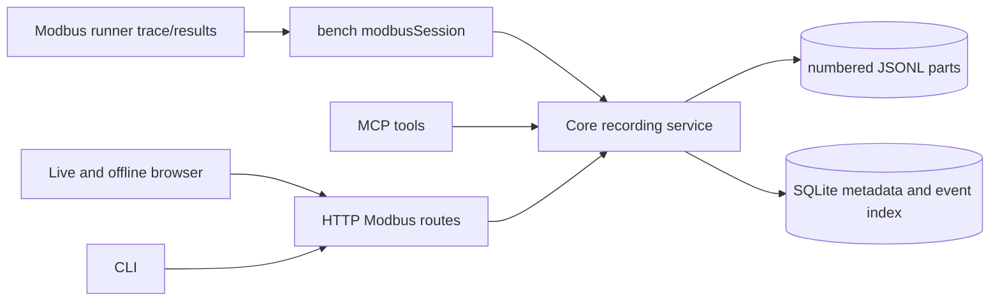

<!--
Copyright (c) 2026 DDP Engineering
This software is licensed under the PolyForm Noncommercial License 1.0.0.
Commercial use requires a separate commercial license.
See the LICENSE.txt in the .agentic folder for full license details.
SPDX-License-Identifier: LicenseRef-PolyForm-Noncommercial-1.0.0
-->

# TASK-7f22bd8a - MB-08 Modbus saved recordings, Find, exports and retention

stage: done
type: feature
path: full
interaction: autopilot
requirements: REQ-DATA-2490acc3, REQ-FUNC-b0d59f49, REQ-REL-e1048fd2, REQ-SEC-025e6e99, REQ-FUNC-69157924, REQ-DATA-797a97da, REQ-DATA-6c52a683, REQ-UX-e978db15
parent:
branch: ddp/modbus-client
base: 3f4f0bc556e132508431fe86de6aeefef3a901b1
opened: 2026-09-30

## Done checklist (current stage)

- [x] validated candidate confirmed unchanged; otherwise returned to validate
- [x] validation evidence, diff, exclusions, and outcome presented
- [x] delivery confirmed by the human
- [x] journal and report included in the delivery commit
- [x] agreed outcome delivered, normally a PR
- [x] close-out committed after the outcome succeeded, or carried by the delivery commit where nothing could fail after it

## Frame

Problem: MB-07 exposes bounded live events but no retained Modbus recording or offline Sessions viewer. Gitea #35 is MB-08.
Desired outcome: An authorized owner or administrator can start an explicit logical recording, search and inspect it offline, export faithful bounded data, and retain or delete it under quotas without silently claiming complete evidence after loss.
Actors: Live session owner, administrator, viewer, Bench Core, supervised Modbus runner, browser, CLI/MCP clients.
Primary scenario: Owner connects a saved TCP workspace -> starts logging in an explicit mode -> polls and writes -> stops logging -> opens the completed recording offline -> searches samples/traffic -> streams an export -> deletes it after confirmation.
Examples: A recording rotates at the configured part ceiling yet remains one logical session; a timeout stores quality/error without replacing a prior good value; a digest manifest detects a changed part.
Counterexamples: Loading an old recording reconnects hardware; a viewer sees another operator's log because definitions are shared; a disk-full log remains marked complete; deletion races an active download.
In scope: MB-08 logical recordings with pinned definition snapshots, UTC/relative ordering, raw traffic and typed/raw samples, modes and sampling semantics, rotation and recovery, metadata/tags, indexed paginated Find, offline grid/traffic/trends, streamed CSV/JSONL/text/bundle exports, digest manifests, quotas/retention, protected deletion and download leases, live MB-07 controls, HTTP/CLI/MCP consistency and targeted tests.
Out of scope: MB-09 scans/diagnostics, MB-10 full-suite/appliance/hardware acceptance, serial RTU browser workflow, real equipment I/O, Git staging/commit/push for MB-08, seven unrelated planning/media paths.
Constraints: STATED user chooses AEGIS autopilot, same `ddp/modbus-client` branch and targeted tests per ticket; full suite only at plan end. Earlier user chose TCP and RTU-over-TCP network workflow, shared definitions, one live owner, no per-write approval. OBSERVED `modbus_poll.go` retains only 256 live events, `modbus_session.go` has no recording field, and `modbus_settings.go` already owns count/byte/part limits. Recording visibility is owner/admin, separate from shared definition reading.
Success signals: Durable monotonic-ordered evidence survives restart as completed/incomplete honestly, authorized indexed searches remain bounded, exports preserve source values and verify digests, offline UI works without a session, and active/download leases and retention prevent unsafe deletion.
Evidence: STATED user thread and issue #35; OBSERVED `00_Planning/Modbus_Plugin_Plan.md` sections 7-9, `.agentic/knowledge/modbus-integration.md`, `bench/modbus_session.go`, `modbus_poll.go`, `modbus_settings.go`, and `serial_logs.go`; INFERRED existing Serial retention and leasing patterns can inform a distinct Modbus recording implementation. UNKNOWN runner raw-frame trace availability and selected logging-failure policy.
Assumptions: A complete logical recording may contain multiple immutable parts; the Core data directory remains Linux-local as required by the environment guide. Starting/stopping logging is independent from display and poll pause.
Unknowns: Raw frame capture path from the current runner; physical-device behavior and measured appliance throughput remain MB-10 acceptance.
Decision-blocking questions: None. The candidate follows the recommended continue-polling option after a storage failure because no answer arrived during independent build work.
Proposed behaviors: Explicit logging control and status; durable part/index model with incomplete recovery; owner/admin metadata and Find; offline viewer; bounded lossless exports with CSV safety; quota and lease-protected retention.
Path and reason: Full path: new persistent data format, public API, security/data handling and observable GUI behavior. Reuse the user's branch exception; no new branch or Git publication is authorized.

| Quick-path criterion | Yes | No | Evidence |
|---|---|---|---|
| No new externally observable behavior | | x | Recording controls and offline viewer. |
| No new interface/data format | | x | Public recording routes and retained parts. |
| No new dependency | x | | Existing Go/SQLite/React stack. |
| Existing requirement covers behavior | | x | MB-07 explicitly deferred persistence. |
| No security/data-handling change | | x | Owner-only retained evidence and exports. |

## Requirement coverage

| Frame outcome | Actor/system | Trigger or state | Response | Positive case | Boundary or failure | Observable result |
|---|---|---|---|---|---|---|
| Retained evidence | Core | Logging starts and polls/writes execute | Pin definitions and append sequence-ordered evidence in rotated parts | One ID across parts | Oversized event or lost raw frame | Exact durable prefix and explicit absence |
| Logging controls | Owner/Core | Start, stop, pause display/poll | Apply mode and sampling independently | Every, interval, change | Repeated start, quality transition | Effective status and stored classes |
| Recovery | Core | Restart or storage failure | Mark incomplete and retain last durable sequence | Clean stop completes | Torn tail, quota, digest mismatch | Reason and trustworthy prefix |
| Access | Core | Read or mutate retained recording | Enforce owner/admin and credential scopes | Owner/admin allowed | Foreign owner, narrow/revoked credential | Denial without content |
| Find | Core | Metadata or evidence search | Indexed bounded page with cursor/count | Filter and resume | No match, candidate cap | Explicit partial result |
| Export | Core | Authorized selected download | Stream source and projections with digests | JSONL/CSV/text/bundle | Tamper, cancel, formula text | Faithful output or error |
| Retention | Core | Quota or delete request | Reclaim oldest eligible, protect leases | Completed reclaim | Active/leased/no eligible | Audited refusal or deletion |
| Offline viewer | Browser | Open saved recording | Show paginated panels and actions inertly | Disconnected endpoint | Narrow view, denial, localization | No connect request |

| Frame outcome | Atomic behavior | Requirement | Positive case | Boundary or failure | Verification | Design decision or no impact |
|---|---|---|---|---|---|---|
| Retained evidence | Logical immutable parts | REQ-DATA-2490acc3 | Rotated ordered evidence | Oversized event, missing raw | Fake runner and digest check | Core recorder + SQLite index |
| Logging controls | Mode, sampling and control state | REQ-FUNC-b0d59f49 | Start/stop every/interval/change | Quality transition, repeated start | Focused control test | Session-owned recorder |
| Recovery | Incomplete truthful prefix | REQ-REL-e1048fd2 | Clean stop complete | Restart/torn tail/quota | Fault injection | Sync/index/recovery protocol |
| Access | Owner/admin authorization | REQ-SEC-025e6e99 | Owner/admin access | Foreign/narrow/revoked | Route permission matrix | Core gate before content |
| Find | Bounded indexed pages | REQ-FUNC-69157924 | Filters and cursor | No match/cap | Large rotated fixture | SQLite candidate index |
| Export | Faithful streamed formats | REQ-DATA-797a97da | Four formats and manifest | Tamper/cancel/formula | Round trip and cancel | Streaming reader with lease |
| Retention | Quota and protected delete | REQ-DATA-6c52a683 | Oldest eligible reclaim | Active/leased/no space | Tiny quota fixture | DB metadata + lease map |
| Offline viewer | Inert saved Sessions page | REQ-UX-e978db15 | Panels and actions | Denial/narrow/locales | Browser fixture/layout | Dedicated offline page |

## Design

Requirements coverage: REQ-DATA-2490acc3, REQ-FUNC-b0d59f49 and REQ-REL-e1048fd2 use one session-owned recorder and the file/index protocol in their specs. REQ-SEC-025e6e99 gates every public read before opening a file. REQ-FUNC-69157924 uses a SQLite event index and bounded candidate scans. REQ-DATA-797a97da streams from numbered parts under a reader lease. REQ-DATA-6c52a683 uses persisted sizes/status plus a Manager lease map for oldest-eligible reclamation. REQ-UX-e978db15 uses an inert Sessions page and live Start/Stop controls.

Core owns logical recording identity, snapshots, file writes, index transactions, integrity, quota and access. The Python runner supplies actual captured frames when available; it never decides who may log. Browser, CLI and MCP call Core's HTTP/service methods. A recording is `active` only while its session and file writer live; Stop closes and hashes its part before `completed`, while any failure or restart becomes `incomplete` with a durable cursor. Session disconnect finalizes a healthy recording before runner cleanup. Writes add command-outcome evidence after existing durable command reservation; no extra policy operation is introduced.

The data root is `DataDir/modbus-recordings`; migration 028 creates logical metadata, parts and event-index tables. A file line is synced before its index commit. Rotation hashes and closes the prior part, then starts the next numbered part. Startup reconciles active rows against files and only indexes complete, verified lines. Event search reads indexed candidates and seeks individual bounded lines, never whole files. Export opens a lease, validates each closed part digest, and streams fixed-name payloads through HTTP with context cancellation. Retention protects active and leased IDs; operations serialize under Manager.mu, with no lock held across a long export.

Access uses existing `bench.read` for owner/admin reads and `bench.execute` plus credential-bound session control for start/stop; metadata/delete use owner/admin authority and audit. The existing settings limits are applied when reserving or rotating storage. Existing live API shape remains backward compatible by adding optional status fields and new routes. A database migration is forward-only. No new external dependency is expected.

Focused seams: bench recorder/recovery tests for data and reliability; HTTP/MCP/CLI permission and shape tests; SQLite migration/index test; frontend page tests and narrow-layout check; Python runner trace tests. Alternatives: storing every event only as SQLite JSON would grow the database and make faithful part download/rotation awkward; reading entire JSONL files for Find would violate the bounded search contract. Risks: file sync/SQLite commit gap, trace callback fidelity, and storage quota races. Open decision: whether polling continues after logging failure; the failure will always stop logging and mark the record incomplete.

### Proposed architecture - TASK-7f22bd8a

## Log

- 2026-09-30 frame: Full MB-08 path on the existing branch under user autopilot; TCP network workflow, owner/admin log visibility and targeted-only verification are carried forward. The logging-failure action was asked asynchronously; independent specification proceeds. No Git mutation for MB-08 is authorized.
- 2026-09-30 specify: Eight new draft requirements and five exact-contract specs cover the frame outcomes; one logging-failure action choice remains open in the reliability spec.
- 2026-09-30 design: Recorder/file/index ownership and public seams are recorded in Design; logging failure polling choice stays explicit. `aegis check` found zero format errors; stale-path warnings are expected for proposed files and other warnings predate this task or concern unrelated changes.
- 2026-10-01 build red: REQ-DATA-2490acc3 command=`GOFLAGS=-buildvcs=false GOMAXPROCS=2 ../../02_Tools/env/with-tools.sh go test ./internal/store/sqlite -run TestModbusRecordingMigrationCreatesLogicalPartsAndEventIndex -count=1`; exit=1; expected missing behavior=logical recording tables and index do not yet exist.
- 2026-10-01 build green: REQ-DATA-2490acc3 targeted SQLite migration and foundation-table tests passed; exit=0.
- 2026-10-01 build red: REQ-DATA-2490acc3 command=`GOFLAGS=-buildvcs=false GOMAXPROCS=2 ../../02_Tools/env/with-tools.sh go test ./internal/bench -run TestModbusRecordingRetainsRotatedEvidence -count=1`; exit=1; expected missing behavior=recorder lifecycle and append APIs are absent.
- 2026-10-01 build deviation: Logging failure stops logging and keeps polling with an incomplete warning; the recommended choice was used after no answer arrived, and can be revised if the user chooses otherwise.
- 2026-10-01 build red: REQ-REL-e1048fd2 command=`GOFLAGS=-buildvcs=false GOMAXPROCS=2 ../../02_Tools/env/with-tools.sh go test ./internal/bench -run TestModbusRecordingRecoveryIndexesSyncedUnindexedLine -count=1`; exit=1; expected missing behavior=a synced line left by an index failure is rejected because its closed part size differs from the old index size.
- 2026-10-01 build green: REQ-REL-e1048fd2 synced unindexed line recovery and torn-tail recovery tests passed; exit=0.
- 2026-10-01 build red: REQ-DATA-797a97da command=`GOFLAGS=-buildvcs=false GOMAXPROCS=2 ../../02_Tools/env/with-tools.sh go test ./internal/bench -run TestModbusRecordingRetainsRotatedEvidence -count=1`; exit=1; expected missing behavior=CSV projection omits recording status metadata.
- 2026-10-01 build green: REQ-DATA-797a97da CSV status projection, bundle digest verification and tamper refusal passed; exit=0.
- 2026-10-01 build red: REQ-DATA-6c52a683 command=`GOFLAGS=-buildvcs=false GOMAXPROCS=2 ../../02_Tools/env/with-tools.sh go test ./internal/bench -run TestModbusRecordingRetainsRotatedEvidence -count=1`; exit=1; expected missing behavior=startup reconciliation for staged deletion directories is absent.
- 2026-10-01 build green: REQ-DATA-6c52a683 interrupted and orphan staged deletion reconciliation passed; exit=0.
- 2026-10-01 build red: REQ-FUNC-69157924 command=`GOFLAGS=-buildvcs=false GOMAXPROCS=2 ../../02_Tools/env/with-tools.sh go test ./internal/bench -run TestModbusRecordingRetainsRotatedEvidence -count=1`; exit=1; expected missing behavior=UTC timestamp filter for indexed event Find is absent.
- 2026-10-01 build green: REQ-FUNC-69157924 timestamp filter and indexed search tests passed; exit=0.
- 2026-10-01 build red: REQ-DATA-6c52a683 command=`GOFLAGS=-buildvcs=false GOMAXPROCS=2 ../../02_Tools/env/with-tools.sh go test ./internal/bench -run TestModbusRecordingRetainsRotatedEvidence -count=1`; exit=1; expected missing behavior=active deletion refusal produces no audit outcome.
- 2026-10-01 build green: REQ-DATA-6c52a683 active deletion denial audit passed; exit=0.
- 2026-10-01 build red: REQ-DATA-6c52a683 command=`GOFLAGS=-buildvcs=false GOMAXPROCS=2 ../../02_Tools/env/with-tools.sh go test ./internal/bench -run TestModbusRecordingRotationReservesNewHeader -count=1`; exit=1; expected missing behavior=rotated part header bytes bypass the configured recording quota.
- 2026-10-01 build green: REQ-DATA-6c52a683 rotation reserves header bytes before opening the next part; exit=0.
- 2026-10-01 build red: REQ-DATA-2490acc3 command=`GOFLAGS=-buildvcs=false GOMAXPROCS=2 ../../02_Tools/env/with-tools.sh go test ./internal/bench -run TestModbusRecordingRetainsRotatedEvidence -count=1`; exit=1; expected missing behavior=canonical JSONL export lacks the pinned definition snapshot.
- 2026-10-01 build green: REQ-DATA-2490acc3 self-contained JSONL export and rotated evidence tests passed; exit=0.
- 2026-10-01 build red: REQ-REL-e1048fd2 command=`GOFLAGS=-buildvcs=false GOMAXPROCS=2 ../../02_Tools/env/with-tools.sh go test ./internal/bench -run TestModbusRecordingRecoveryIndexesSyncedUnindexedLine -count=1`; exit=1; expected missing behavior=a closed writer's append error is shadowed and falsely reports success instead of incomplete.
- 2026-10-01 build green: REQ-REL-e1048fd2 closed-writer append failure now marks the recording incomplete with a visible warning; exit=0.
- 2026-10-01 build deviation: Physical part headers retain only identity and part number; the pinned snapshot is durable in SQLite and embedded in canonical JSONL and ZIP exports. This keeps rotation headers below the part limit while exports remain self-contained. The data spec was reconciled to the candidate.
- 2026-10-01 build red: REQ-FUNC-b0d59f49 command=`GOFLAGS=-buildvcs=false GOMAXPROCS=2 ../../02_Tools/env/with-tools.sh go test ./internal/bench -run TestModbusRecordingRetainsRotatedEvidence -count=1`; exit=1; expected missing behavior=values-only sample result retains captured traffic frames.
- 2026-10-01 build green: REQ-FUNC-b0d59f49 sampled events omit captured frames and traffic events omit decoded values; exit=0.
- 2026-10-01 build red: REQ-DATA-2490acc3 command=`GOFLAGS=-buildvcs=false GOMAXPROCS=2 ../../02_Tools/env/with-tools.sh go test ./internal/bench -run TestModbusRecordingRetainsRotatedEvidence -count=1`; exit=1; expected missing behavior=physical part header omits the pinned definition snapshot required by issue #35.
- 2026-10-01 build decision: Issue #35 confirms rotated parts contain pinned snapshots, so implement the snapshot in each bounded part header; this supersedes the earlier compact-header deviation while retaining self-contained exports.
- 2026-10-01 build green: REQ-DATA-2490acc3 every rotated part now carries a bounded pinned snapshot; recovery verifies it against SQLite, and targeted recorder tests pass; exit=0.
- 2026-10-01 build red: REQ-FUNC-b0d59f49 command=`GOFLAGS=-buildvcs=false GOMAXPROCS=2 ../../02_Tools/env/with-tools.sh go test ./internal/bench -run TestModbusRecordingWriteEvidenceHonorsMode -count=1`; exit=1; expected missing behavior=write evidence has no mode-aware projection of actual captured frames.
- 2026-10-01 build green: REQ-FUNC-b0d59f49 write evidence projects captured frames only for traffic-capable modes; exit=0.
- 2026-10-01 build red: REQ-DATA-6c52a683 command=`GOFLAGS=-buildvcs=false GOMAXPROCS=2 ../../02_Tools/env/with-tools.sh go test ./internal/bench -run TestModbusRecordingRetainsRotatedEvidence -count=1`; exit=1; expected missing behavior=authorized file-reader lease acquisition is separate from metadata lookup, leaving a delete race.
- 2026-10-01 build green: REQ-DATA-6c52a683 authorization and reader lease now acquire atomically against deletion; exit=0.
- 2026-10-01 build red: REQ-SEC-025e6e99 command=`GOFLAGS=-buildvcs=false GOMAXPROCS=2 ../../02_Tools/env/with-tools.sh go test ./internal/bench -run TestModbusRecordingRetainsRotatedEvidence -count=1`; exit=1; expected missing behavior=foreign recording ID is accepted as a metadata pagination cursor.
- 2026-10-01 build green: REQ-SEC-025e6e99 foreign cursor is rejected; exit=0.
- 2026-10-01 build consolidated proof: targeted Go selectors across `internal/store/sqlite`, `internal/bench`, `internal/httpapi`, `internal/mcp`, `cmd/nilo` passed; Python `test_scheduler.py::test_transaction_carries_exact_trace_frames` passed; frontend `ModbusWorkspacePage.test.tsx` 9/9 and TypeScript typecheck passed; Chrome layout/keyboard test passed 4/4 at 320, 800x480, 1024x600 and desktop in EN/DE/RO. `git diff --check` passed. No full repository suite was run, per RULING-001.
- 2026-10-01 build transition: Eight requirements are active and linked; evolution reviewed after the final build increment. `aegis check --task` has zero errors and no MB-08-specific warnings; remaining warnings concern prior journals/catalog state or preexisting unrelated planning/media files.
- 2026-10-01 validate review round 1: Specification compliance approved after reading all eight active requirements and five specs against the complete MB-08 candidate, issue #35, and the Modbus knowledge page; updated UX linked tests for the new offline Find/tag/protected-delete check. Implementation quality approved after reviewing storage/index ordering, recovery, ownership, leases, export integrity, public permissions, UI behavior, and cross-platform paths; no blocking candidate finding remains. Browser downloads currently buffer the returned Blob, so the bounded streaming guarantee applies to Core/CLI rather than browser memory.
- 2026-10-01 validate targeted proof: Go selectors `TestModbusRecording|TestModbusRoutesScopeAndStrictBody|TestModbusCLIRecordingControlsUseCore|TestBenchToolsUseCurrentTokenScopes` across store, bench, HTTP, MCP and CLI passed (exit 0); Python `test_scheduler.py::test_transaction_carries_exact_trace_frames` passed (exit 0); frontend `ModbusWorkspacePage.test.tsx` 10/10, `tsc --noEmit`, and `git diff --check` passed (exit 0). Chrome `playwright.modbus.config.ts -g 'Modbus saved sessions'` passed 4/4 at 320x640 EN, 800x480 DE, 1024x600 RO and 1920x1080 EN, exercising offline opening, keyboard activation, panels and reflow.
- 2026-10-01 validate deviation: User RULING-001 defers `check --strict --run` and the repository-wide suite to the end of the full Modbus plan. `aegis check --task TASK-7f22bd8a` passed with zero errors and 15 warnings; the review-state warning is resolved by this verdict, while remaining warnings are pre-existing catalog/journal findings or unrelated user planning/media files. Targeted proof does not establish repository-wide regression status, large-appliance performance, or hardware acceptance.
- 2026-10-01 validate transition: Evolution refreshed after the final source/test edit and its four changed paths inspected. Eight requirements remain active, component knowledge is current, and the candidate advances to deliver under the user's targeted-only verification ruling; Git delivery remains unrequested for MB-08.
- 2026-10-01 deliver checkpoint: Presented MB-08 scope, targeted proof, full-suite deferral, browser export-memory limit, exact exclusion of seven unrelated planning/media paths, and uncommitted local outcome. No MB-08 Git staging, commit or push was authorized; waiting for a current instruction.
- 2026-10-01 deliver approval: User instructed `commit` after the exact MB-08 staging and local commit commands were presented. This authorizes a local MB-08 commit only; no push or PR. Working-tree status matches the reviewed candidate, with seven unrelated planning/media paths excluded.
- 2026-10-01 deliver close-out: The authorized outcome is one local commit. This journal, requirement/spec records, validation evidence and delivery report are included in that commit; no subsequent remote outcome is authorized or pending. The full strict suite remains deferred per RULING-001.

## Rulings

- RULING-001 | date=2026-09-30 | decision=Use targeted tests for MB-08 and defer the full repository suite to the end of the complete Modbus plan | reason=User explicitly changed the verification schedule | source=user | supersedes=none
- RULING-002 | date=2026-10-01 | decision=Continue polling after logging storage failure; stop logging and visibly mark the recording incomplete | reason=Recommended option was stated and no reply arrived before dependent implementation; easily reversible if the user prefers stopping polls | source=technical | supersedes=none

## Handoff

current: done
status: ready
next: Commit the staged MB-08 candidate locally; do not push.
must_read: .agentic/steps/6_deliver.md, .agentic/knowledge/modbus-integration.md
blockers: none

## Stage report

stage: deliver
result: completed
current: done
changed: User authorized a local MB-08 commit; the AEGIS report and journal close-out are prepared for that same commit.
evidence: Working-tree status matches the reviewed MB-08 candidate; targeted validation, both review verdicts, and the appended delivery report are recorded above.
issues: Full strict suite deferred by user; browser Blob downloads can buffer a full export; unrelated planning/media paths remain excluded.
next: Commit MB-08 locally without pushing.
needs_user: no
spec_compliance: approved
implementation_quality: approved
review_round: 1

## Delivery report (2026-10-01)

- stage: deliver; type: feature; path: full; branch: ddp/modbus-client
- requirements:
  - REQ-DATA-2490acc3 - Retain immutable Modbus recording parts
  - REQ-FUNC-b0d59f49 - Control Modbus logging modes and sampling
  - REQ-REL-e1048fd2 - Report interrupted Modbus recordings honestly
  - REQ-SEC-025e6e99 - Authorize Modbus recording access
  - REQ-FUNC-69157924 - Find retained Modbus evidence with bounded pages
  - REQ-DATA-797a97da - Stream faithful Modbus recording exports
  - REQ-DATA-6c52a683 - Enforce Modbus retention and deletion leases
  - REQ-UX-e978db15 - Inspect Modbus recordings offline
- deviations: none recorded
- explicit review: enabled; spec_compliance=approved; implementation_quality=approved; review_round=1
- diff vs task base 3f4f0bc: 55 file(s) changed, 4443 line(s) added; 5 file(s) not content-scanned
- checks: errors=0 warnings=15 notes=4
- checklist: 5/6 done; open: close-out committed after the outcome succeeded, or carried by the delivery commit where nothing could fail after it
