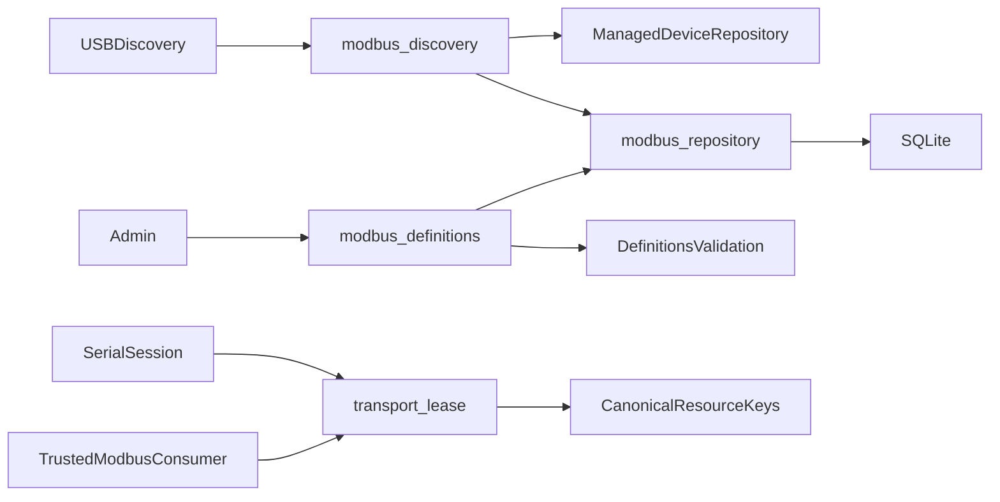

<!--
Copyright (c) 2026 DDP Engineering
This software is licensed under the PolyForm Noncommercial License 1.0.0.
Commercial use requires a separate commercial license.
See the LICENSE.txt in the .agentic folder for full license details.
SPDX-License-Identifier: LicenseRef-PolyForm-Noncommercial-1.0.0
-->

# TASK-833a0d3d - MB-02 Modbus endpoint profiles and shared transport leases

stage: done
type: feature
path: full
interaction: autopilot
requirements: REQ-DATA-a8c75050, REQ-DATA-2988e315, REQ-FUNC-eafa69bc, REQ-SEC-4b8a52fa, REQ-REL-5af947a8, REQ-REL-4e21290d
parent:
branch: ddp/modbus-client
base: be6aa6a207450628df5db3d579bee608a7684c6e
opened: 2026-09-29

## Done checklist (current stage)

- [x] validated candidate confirmed unchanged; otherwise returned to validate
- [x] validation evidence, diff, exclusions, and outcome presented
- [x] delivery confirmed by the human
- [x] journal and report included in the delivery commit
- [x] agreed outcome delivered
- [x] close-out committed after the outcome succeeded, or carried by the delivery commit where nothing could fail after it

## Frame

Problem: STATED continue with the next implementation ticket on ddp/modbus-client. OBSERVED Gitea #29 is MB-02, endpoint/profile persistence and shared serial-port ownership; Serial currently scopes admission to plugin/device and marks a connection stopped before runner cleanup finishes.
Desired outcome: OBSERVED ticket acceptance requires revisioned explicit USB/network endpoints and profiles, canonical shared ownership for Serial/Modbus, independent endpoints and cleanup-before-reuse. INFERRED implement these Core foundations while MB-03 owns the production runner and MB-04 owns live sessions/public automation surfaces.
Actors: STATED administrators, operators and viewers under accepted Modbus contracts; OBSERVED bench.Manager, SQLite, trusted discovery observations, Serial dedicated runner and future approved Modbus session consumers.
Primary scenario: Administrator saves a named endpoint/profile -> trusted session consumer reserves the canonical resource -> concurrent Serial/Modbus claim is refused -> disable/expiry/unplug/crash/shutdown requests cleanup -> resource becomes reusable only after cleanup confirmation.
Examples: Two endpoint aliases configured with one gateway resource ID share ownership; units on that bus share the endpoint resource; separate network peers and USB ports progress independently. A pending Serial runner shutdown keeps the physical adapter busy.
Counterexamples: Plugin instance names or tty aliases admitting two owners; TCP records fabricated as USB devices; changing live transport settings; observing network offline removing its saved definition; a timed-out cleanup freeing ownership.
In scope: MB-02 only: revisioned endpoint/profile storage and validated Core definition services; stable Core-owned USB identity and explicit administrator-assigned gateway/bus identity; shared full-lifetime transport ownership; narrow Serial admission/cleanup and affected lifecycle hooks; meaningful persistence/race/lifecycle regression tests and current documentation.
Out of scope: MB-03 runner/protocol scheduler, MB-04 public HTTP/CLI/MCP/session/write services, MB-05 maps/codecs, GUI administration/workspaces/recordings, bundle/image promotion, new dependency or environment rebuild, project version assignment, real-device/network I/O, staging/commit/push/PR/deployment and remote ticket changes.
Constraints: STATED same branch, continuing AEGIS/autopilot and no push. OBSERVED root Git authority requires a new delivery instruction; previous local commit covered MB-01 only. Preserve existing Camera/Serial contracts and three untracked user assets. Use current Go/SQLite interfaces and repository-local tools; no source edits before build.
Success signals: Durable revision conflicts cause no partial publication; network/USB models remain distinct; malformed profiles fail before storage/I/O; one canonical owner wins concurrent claims; normal stop and exceptional lifecycle events retain ownership until verified cleanup; existing Serial and Camera tests remain valid.
Evidence: OBSERVED authenticated tea read of #29/#30 and epic-backed 00_Planning/Modbus_Plugin_Plan.md; committed MB-01 schema/spec at .agentic/specs/REQ-DATA-6fcda58c.md. Exact seams are bench/{serial_session.go,serial_adapter.go,serial_lifecycle_test.go,managed_devices.go,hardware_monitor.go,packages.go}, sqlite/{managed_device_repository.go,migrations.go}, and existing integration supervisor cleanup. MB-01 commit be6aa6a207450628df5db3d579bee608a7684c6e is this task's base.
Assumptions: INFERRED definitions can be implemented as shared Core services before their public transports/GUI tickets; trusted discovery entry points are testable without a registered Modbus runner. Physical ownership is separate from the finite job's existing resource_leases, which finish when connection setup returns.
Unknowns: Physical adapter/gateway models, driver cleanup/RS-485 timing and native ARM64 behavior require later hardware acceptance. Numeric production limits remain later scoped decisions; structural profile bounds follow the MB-01 contract. Runner cleanup failure must retain ownership, not guess that it succeeded.
Decision-blocking questions: None; accepted MB-01 contract and explicit next-ticket instruction settle this foundation scope.
Proposed behaviors: Separate revisioned Modbus endpoint/profile tables; shared canonical resource claims for both families independent of installed Serial state; Core-only lease reservation with explicit cleanup completion; deterministic terminal fencing, lifecycle cancellation and alias/bus tests. Saving a definition never initiates I/O.
Path and reason: Full; new durable entities, concurrency ownership and lifecycle behavior require requirements/spec/design and full validation. This tightly coupled work needs no children or subagents.

| Quick-path criterion | Yes | No | Evidence |
|---|---|---|---|
| No new externally observable behavior | | x | Shared cross-family admission and endpoint records. |
| No new interface or data format | | x | Explicit endpoint/profile storage and lease contracts. |
| No new dependency | x | | Current Go/SQLite dependencies suffice. |
| Existing requirement covers behavior | | x | MB-01 specifies baseline contracts, not this implementation. |
| No security/data-handling change | | x | Shared definitions and resource ownership. |

## Requirement coverage

Behavior inventory and coverage (each row has one independently verifiable outcome):

| Frame outcome | Actor/system and trigger | Atomic behavior / requirement | Positive case | Boundary or failure | Verification / design seam |
|---|---|---|---|---|---|
| Durable definitions | Core save at expected revision | Atomic persistence / REQ-DATA-a8c75050 | Reopen preserves endpoint/profile | Stale/concurrent save conflicts | SQLite migration/repository CAS |
| Stable USB binding | Trusted discovery reconciliation | Identity/state / REQ-DATA-2988e315 | Alias/replug keeps configured identity | Weak duplicates, absence, unknown binding | Managed identity reconciliation and Modbus projection |
| Explicit transport model | Definition validation | Contract / REQ-FUNC-eafa69bc | RTU, TCP, RTU-over-TCP | Mixed fields, units, framing, malformed settings | Strict typed models and canonical resource keys |
| Shared access | Actor requests definition service | Authorization / REQ-SEC-4b8a52fa | Readers browse, admin saves | Nonadmin save, forged owner | Bench service authorization/audit |
| Single resource owner | Serial/Modbus claim | Atomic exclusivity / REQ-REL-5af947a8 | One race winner; independent resources | Aliases, units, family names | Shared claim registry |
| Cleanup before reuse | Stop/failure/lifecycle event | Cleanup-bound fencing / REQ-REL-4e21290d | Cancellation then verified release | Cleanup failure, delayed shutdown | Controlled Serial and Modbus cleanup barriers |

Existing MB-01 contracts remain unchanged. Public runner/session/API/GUI work is deliberately excluded. Physical acceptance stays unknown and cannot be inferred from fixture tests. No overlapping existing requirement implements these new Core outcomes.

## Design

Requirements coverage: REQ-DATA-a8c75050 uses additive SQLite migration 024 and transactional expected-revision writes. REQ-DATA-2988e315 uses existing managed USB reconciliation plus a retained Modbus projection. REQ-FUNC-eafa69bc uses typed definitions and strict profile decoding. REQ-SEC-4b8a52fa uses Bench permission/audit services and server-owned profile creators. REQ-REL-5af947a8 and REQ-REL-4e21290d use one Manager-owned canonical claim registry with cleanup-confirmed release.

Component responsibilities: OBSERVED bench.Manager serializes admission; store/sqlite owns durable entities; integration runners own OS transports. INFERRED internal/modbus owns pure definitions, validation and resource-key construction so bench and sqlite share one contract without a dependency cycle. No new production runner registration or public route.

Interfaces/contracts: Typed Endpoint/Profile follow MB-01, with explicit settings JSON validated against endpoint transport. Repository returns revision conflict/not-found/invalid sentinel errors; Bench translates established errors. Administrator input can change endpoint labels/network configuration/enabled state; USB identity and presence remain trusted. Current exact contract is specs/REQ-DATA-a8c75050.md.

State/flow: Save definition -> permission/validation/audit -> atomic CAS -> return durable revision. Trusted discovery -> managed USB reconciliation -> atomic endpoint projection retaining labels/settings -> cancel invalidated owners. Consumer checks endpoint/profile revisions and availability then atomically reserves all canonical keys before transport work. Live definitions are immutable except endpoint disable.

Failure/recovery: Cancellation precedes cleanup outside Manager.mu. Serial startup failures and all live endings confirm runner shutdown and local cleanup before token release. Cleanup failure fences resource for this Manager lifetime and is reported. Modbus's trusted consumer seam runs a supplied lifetime function whose return confirms cleanup; cancellation may come from context/expiry, endpoint/family disable, unplug or shutdown. No transport I/O in definition operations; no reconnect/write replay here.

Security/trust: USB observations and consumer admission are internal trusted seams. Public session policy belongs to MB-04. Existing Serial credential/policy checks remain; definitions are shared readable but admin-editable. Profile owner is the creating actor. DNS alias joining requires configured bus identity; no DNS probing is introduced.

Concurrency: Atomic multi-key claims under Manager.mu, unique token release, separate physical port and strong serial keys; registry entries outlive stopped Serial session flags. Family lifecycle inspects own claims, device mutation checks shared physical keys. Cleanup workers never hold Manager.mu while waiting. One manager per data directory remains the established invariant.

Compatibility/migration: Migration 024 is additive, preserves old digests and all Camera/Serial entities; exact-table inventory updates. Root version and dependencies unchanged. Startup resets unverified endpoint readiness without erasing configured records.

Observability: Existing audit/report routes expose accepted definition changes and cleanup failures; tests assert conflicts and fenced admission. UNKNOWN physical RS-485 driver cleanup and native ARM acceptance remain separate.

Test seams: First persistence red queries sqlite_master for the missing two tables; repository tests cover reopen/CAS/rollback. Validation tests invoke strict definitions with malformed boundaries. Discovery tests use trusted metadata with no enabled Serial plugin. Authorization tests use roles. Ownership/cleanup red extends real Serial Unix fixture with delayed Shutdown, then adds cross-family races and all lifecycle barriers using internal trusted consumers.

Alternatives/tradeoffs: Finite SQL job leases end at connect completion and cannot own live transports. Family/device-name keys miss physical aliases. A global OS lock would add unsupported process/topology behavior; established single-Manager admission suffices. In-memory failed-cleanup fencing favors safety over automatic reuse.

Expected files: internal/modbus/definitions{,_test}.go; internal/store/sqlite/modbus_repository{,_test}.go, migrations.go, migrations/024_modbus_definitions.sql, db_test.go; internal/bench/modbus_{definitions,discovery}{,_test}.go, transport_lease{,_test}.go, manager.go, serial_{adapter,session,lifecycle_test}.go, managed_devices.go, packages.go, hardware_monitor.go; CHANGELOG.md; selected bench/serial/modbus knowledge and project context. All source paths are beneath 05_Software/core except the changelog and AEGIS records.

Risks/open decisions: Hardware cleanup cannot be proven by fixtures; explicit failed-cleanup fences remain visible until operator recovery. No product decision blocks build. Trusted consumer lifetime is a foundation exercised by fixtures until MB-03/MB-04 connect production sessions.

### Proposed architecture - TASK-833a0d3d

## Log

- 2026-09-29 frame -> specify: Read authenticated MB-02 #29 and adjacent MB-03 #30, plan and current Core/Serial/storage seams. User instruction accepts this next bounded ticket on the existing branch; continuing session autopilot is recorded explicitly. Full path chosen for new persisted entities and shared ownership; no publication or target I/O authorized.

- 2026-09-29 specify: Created six atomic requirements and one exact contract spec; revised/reused/retired zero. Coverage inventory audited for all framed outcomes and later-ticket exclusions.

- 2026-09-29 design -> build: Audited responsibilities, typed contracts, additive migration, atomic canonical claims and cleanup/error boundaries in Design and linked spec. Advisory catalog has zero errors; draft paths will be realized in build, other warnings are pre-existing.

- 2026-09-29 build red: REQ-DATA-a8c75050 command=`wsl -d Ubuntu -- sh ./02_Tools/env/with-tools.sh sh -c 'cd 05_Software/core && go test ./internal/store/sqlite -run ^TestModbusDefinitionTablesAreDurableEntities$ -count=1'`; exit=1; expected missing behavior=modbus_endpoints durable entity table absent. Windows and WSL pinned readiness doctors passed.

- 2026-09-29 build green: REQ-DATA-a8c75050 `go test ./internal/store/sqlite -run "TestModbus|TestOpen" -count=1` under WSL pinned tools; exit=0. Additive migration, reopen fidelity, profile creator preservation, stale/concurrent CAS and no partial profile publication verified.

- 2026-09-29 build red: REQ-FUNC-eafa69bc `go test ./internal/store/sqlite -run "TestModbusRejectsInvalidTransportBeforePublication|TestModbusProfilesRequireExplicitTransportSettings" -count=1` under WSL; exit=1; expected missing behavior=invalid transport definitions and empty profile settings persisted.

- 2026-09-29 build green: REQ-FUNC-eafa69bc `go test ./internal/modbus ./internal/store/sqlite -run "TestModbus|TestNetworkCanonicalization|TestRTUFraming" -count=1` under WSL; exit=0. Canonical DNS/IP peers, explicit network/USB separation, unit/framing/timing boundaries and rejected-publication storage verified.

- 2026-09-29 build red: REQ-SEC-4b8a52fa `go test ./internal/bench -run ^TestModbusSharedDefinitionsAuthorizeRolesAndRetainCreator$ -count=1` under WSL; exit=1; expected missing behavior=Core shared Modbus definition service unavailable.

- 2026-09-29 build green: REQ-SEC-4b8a52fa `go test ./internal/bench -run ^TestModbusSharedDefinitionsAuthorizeRolesAndRetainCreator$ -count=1` under WSL; exit=0. Shared reader access, administrator mutations, server-owned profile creator, audit and closed-manager refusal verified.

- 2026-09-29 build red: REQ-DATA-2988e315 `go test ./internal/store/sqlite -run "TestModbusUSBReconciliation|TestModbusWeakDuplicate" -count=1` under WSL; exit=1; expected missing behavior=Modbus USB reconciliation unavailable independently of Serial plugin.

- 2026-09-29 build green: REQ-DATA-2988e315 `go test ./internal/store/sqlite ./internal/bench -run "TestModbus|TestManaged|TestSerialApproved|TestSerialCredential" -count=1` under WSL; exit=0. Atomic USB projection, strong/weak identities, binding revisions, disable/absence and restart freshness pass with existing managed-device and Serial regression seams.

- 2026-09-29 build red: REQ-REL-5af947a8 and REQ-REL-4e21290d `go test ./internal/bench -run "TestSerialStoppedRemainsBusyUntilRunnerCleanup|TestCanonicalModbusTransportOwnershipFoundation" -count=1` under WSL; exit=1; expected missing behavior=stopped Serial admits reuse before runner cleanup, and canonical Modbus consumer admission is unavailable. Related requirements share the admission/cleanup seam.

- 2026-09-29 build green: REQ-REL-5af947a8 and REQ-REL-4e21290d `go test ./internal/bench ./internal/modbus ./internal/store/sqlite -run "TestModbus|TestCanonical|TestSerial|TestUSBClaims|TestNetworkCanonicalization|TestRTUFraming|TestManaged" -count=1` under WSL; exit=0. Cross-family admission, physical/network aliases, independent ports/peers, snapshots, cleanup barriers for both families, failure fencing and startup failure release verified. Existing Serial/managed regressions pass.

- 2026-09-29 build red: REQ-FUNC-eafa69bc `go test ./internal/store/sqlite -run ^TestModbusProfilesRequireExplicitTransportSettings$ -count=1` under WSL; exit=1; expected missing behavior=Go JSON case folding accepts the unknown field READ_RETRIES contrary to the exact schema.

- 2026-09-29 build green: REQ-FUNC-eafa69bc exact field-name refinement `go test ./internal/modbus ./internal/store/sqlite -run "TestModbus|TestNetworkCanonicalization|TestRTUFraming" -count=1` under WSL; exit=0. Unknown case-folded setting names now reject before publication.

- 2026-09-29 build -> validate: All six requirements active with focused evidence; current component/context descriptions and short changelog reconciled. Evolution reports the last anchored refinement (definitions.go and CHANGELOG.md); full base-commit diff and untracked candidate inventory cover all preceding increments. Advisory catalog has zero errors; test paths added to affected paths to match overlapping source/test globs. Unrelated assets and pre-existing catalog warnings retained.

- 2026-09-29 validate review round 1 -> build: Independent specification review=changes_required (stale definition saves while claimed return busy instead of the specified revision conflict); implementation quality=changes_required (endpoint edit admission checks the submitted host before canonicalization, so equivalent peer spellings can bypass the busy edit check). Fix only these findings, add regression proof and re-review the candidate within the configured six-round bound.

- 2026-09-29 build red (review fixes): REQ-DATA-a8c75050/REQ-REL-5af947a8 `go test ./internal/bench -run ^TestModbusClaimedDefinitionRevisionAndCanonicalEditAdmission$ -count=1` under WSL; exit=1; expected missing behavior=stale claimed endpoint/profile return integration_busy and case-equivalent peer edit is accepted.

- 2026-09-29 build -> validate round 2: Recorded admission findings corrected; `go test ./internal/bench -run "TestModbus|TestCanonical|TestSerialAndModbus|TestUSBClaims" -count=1` under WSL exits 0. Expected revisions are checked before busy state and edit claims use canonical endpoint values; regression confirms both boundaries.

- 2026-09-29 validate review round 2: Independent specification compliance=approved (six requirements, exact transports, access/creator rules, stable discovery and cleanup contracts satisfied; later runner/API/GUI/hardware scope retained). Independent implementation quality=approved (atomic CAS/projection, canonical multi-key ownership, token-safe release, lifecycle barriers, failure fencing and narrow Camera/Serial compatibility reviewed). Canonical proof uses the existing local candidate image; archive/image promotion and real I/O remain excluded.

- 2026-09-29 validate -> deliver: Final offline proof exits 0 in explicit local candidate nilo/build-environment:noble-20260929-01 (OCI sha256:ce12f5b644ca658b0d928787d059e9613015d235ffe09b2f7a63f2c586fc62bc). Locked Python preparation passes; `CGO_ENABLED=1 go test -race ./internal/bench ./internal/store/sqlite -run 'Modbus|Canonical|SerialStopped|SerialTerminal|SerialFailed|USBClaims' -count=1` passes (47.747s/17.780s); `CGO_ENABLED=0 GOOS=linux GOARCH=arm64 go test -exec=/bin/true ./internal/bench ./internal/modbus ./internal/store/sqlite` compiles all three packages (compile-only, no native ARM execution). Final `python .agentic/aegis.py check --task TASK-833a0d3d --strict --run` passes configured full Go/Python/tool/runner tests (281.5s), lint (11.3s), strict catalog: 0 errors, 9 warnings, 4 notes. Complete console evidence: 02_Tools/cache/modbus-feasibility/mb02-final-validation.log. Existing warnings are unrelated stale REQ-DATA-8082c1dc paths, 82 tracked sidecars, three older unticked delivery journals, invalid TASK-c55f83d5 Handoff and binary scan exclusions for the three user assets; four existing manual-verification notes remain unrelated. No task warning/failure accepted and no deviation. Final evolution and both round-2 verdicts apply to the unchanged candidate; read-only source fingerprint before/after proof is 5308f2fa26ffabdacc8a0d5e2b920659b9b2b8cf59e50ba800f014e0aa68dbd7. Diff whitespace check passes, index empty, branch/base unchanged. Physical USB/RS-485, native ARM and appliance acceptance remain separate; accepted image/CI archive not promoted. No child tasks. Implementation ready; no staging, commit, push or remote changes.

- 2026-09-29 deliver: Prepared the exact 36-file candidate inventory (20 new/16 modified), excluding the three user media assets and generated caches/sidecars. Delivery proposal is one local MB-02 commit on ddp/modbus-client, no push or PR. Exact commands are `git add --pathspec-from-file=02_Tools/cache/modbus-feasibility/mb02-candidate-files.txt` and `git commit -F 02_Tools/cache/modbus-feasibility/mb02-commit-message.txt`. Validation/diff/exclusions and approve-local-commit, revise-outcome, return-to-validate or pause choices accompany the delivery report. Root Git authority and 6_deliver's mandatory checkpoint require a current human instruction; MB-01 commit approval was already consumed. Waiting with product candidate unchanged and index empty. No delivery executed.

- 2026-09-29 deliver close-out: User explicitly approved one local commit without push. `aegis.py report TASK-833a0d3d` appended its advisory snapshot: zero errors, ten warnings/four notes; the one additional warning is this task's intentionally unticked delivery checklist before close-out, and the report includes three excluded untracked media assets in its global diff count. The 36-file candidate inventory remains the exact approved commit set; both review verdicts and final runtime proof apply to the unchanged product source. This local commit is the whole approved outcome, so close-out is recorded in the same commit as instructed by 6_deliver.md. No remote action is authorized.

## Rulings

- RULING-001 | date=2026-09-29 | decision=Implement MB-02 only on ddp/modbus-client using AEGIS autopilot | reason=Current next-ticket instruction and retained AEGIS/autopilot preference | source=user | supersedes=none
- RULING-002 | date=2026-09-29 | decision=Preserve accepted MB-01 transport/access/write-policy contracts; no new Git publication or target I/O | reason=Existing scope decisions and root Git authority; MB-01 local commit authorization has been consumed | source=repository | supersedes=none
- RULING-003 | date=2026-09-29 | decision=Commit MB-02 locally on ddp/modbus-client without pushing | reason=Explicit delivery instruction after candidate presentation | source=user | supersedes=none

## Handoff

current: done
status: ready
next: None after the approved local commit; MB-03 remains the next feature ticket.
must_read: .agentic/tasks/TASK-833a0d3d.md; .agentic/steps/6_deliver.md; 02_Tools/cache/modbus-feasibility/mb02-candidate-files.txt
blockers: None; local commit authorized, remote publication prohibited.

## Stage report

stage: deliver
result: completed
current: done
changed: MB-02 implemented on ddp/modbus-client; 36 candidate files (20 new/16 modified).
evidence: Race tests, ARM64 compilation, full suite/lint and strict check pass; both review verdicts approved; user approved local commit.
issues: Nine unrelated warnings/four notes retained; hardware acceptance separate. Remote publication prohibited.
next: Complete the approved local commit; MB-03 remains future work.
needs_user: no
spec_compliance: approved
implementation_quality: approved
review_round: 2

## Delivery report (2026-09-29)

- stage: deliver; type: feature; path: full; branch: ddp/modbus-client
- requirements:
  - REQ-DATA-a8c75050 - Persist revisioned Modbus endpoints and profiles
  - REQ-DATA-2988e315 - Reconcile stable Modbus USB identities
  - REQ-FUNC-eafa69bc - Validate Modbus endpoint and profile transports
  - REQ-SEC-4b8a52fa - Authorize shared Modbus definitions
  - REQ-REL-5af947a8 - Serialize canonical cross-family transport ownership
  - REQ-REL-4e21290d - Retain transport claims until cleanup confirmation
- deviations: none recorded
- explicit review: enabled; spec_compliance=approved; implementation_quality=approved; review_round=2
- diff vs task base be6aa6a: 39 file(s) changed, 2826 line(s) added; 3 file(s) not content-scanned
- checks: errors=0 warnings=10 notes=4
- checklist: 3/6 done; open: journal and report included in the delivery commit; agreed outcome delivered; close-out committed after the outcome succeeded, or carried by the delivery commit where nothing could fail after it
