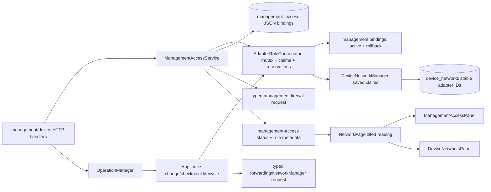

<!--
Copyright (c) 2026 DDP Engineering
This software is licensed under the PolyForm Noncommercial License 1.0.0.
Commercial use requires a separate commercial license.
See the LICENSE.txt in the .agentic folder for full license details.
SPDX-License-Identifier: LicenseRef-PolyForm-Noncommercial-1.0.0
-->

# TASK-8f18c927 - Enforce exclusive network adapter roles

stage: validate
type: feature
path: full
interaction: autopilot
requirements: REQ-SEC-b8719eb2, REQ-SEC-e0edbf63, REQ-DATA-194a7775, REQ-REL-57d6c54b, REQ-REL-a03b5a30, REQ-SEC-67959d35, REQ-FUNC-6c2c3616, REQ-UX-17ef27ef, REQ-UX-15904d9e, REQ-UX-e6437bf7, REQ-UX-e70d524a, REQ-REL-4c07b1ea, REQ-SEC-2e108f02, REQ-SEC-144b5e56, REQ-UX-b718864e, REQ-UX-b555166c, REQ-UX-4e08d371, REQ-UX-0773bc20, REQ-FUNC-d5c9784c
parent:
branch: master
base: b56f7f3f497368e939e967be59a35d7be95c718a
opened: 2026-09-11

## Done checklist (current stage)

- [ ] diff reviewed against scope, requirements, design, error paths, portability, security, and unrequested work
- [x] knowledge pages updated for every materially changed component
- [x] requirements re-read: status, prose, verification, paths, and links true
- [ ] manual or inspection verification completed and recorded where applicable
- [x] final evolution report refreshed after the last candidate edit
- [ ] final `check --strict --run` result recorded truthfully after all edits
- [x] remaining warnings and pre-existing failures explained
- [ ] stage: deliver

## Frame

Problem: A physical network adapter can currently be selected independently for the management listener allowlist and as a device network's device-facing adapter, permitting management HTTPS exposure on an equipment subnet and allowing an interface rename or replug to bypass name-only checks.
Desired outcome: Each physical adapter has exactly one exclusive role—management access or device-facing—and every API, persisted state, asynchronous operation, startup reconciliation, GUI choice, and helper mutation preserves that invariant while retaining at least one usable recovery path.
Actors: Administrators configuring management access or device networks; operators and viewers observing network state; Bench Core; the unprivileged-to-privileged network-helper boundary; the startup/maintenance reconciler.
Primary scenario: An administrator selects an adapter for one role -> Bench Core resolves and reserves its stable physical identity before any privileged mutation -> a conflicting selection is rejected with structured, secret-free details, while a valid selection follows the existing preview/acknowledge/confirm/recovery lifecycle -> the GUI reports the resulting pending, applied, failed, conflict, or recovered state.
Examples: Built-in Ethernet may carry confirmed management while Wi-Fi faces a wireless device; a separate USB Ethernet adapter may independently face another device network; the DDP hotspot/WireGuard path remains management while the isolated USB Ethernet link is exercised as device-facing on the Raspberry Pi development appliance.
Counterexamples: Ethernet plus WireGuard may both be management-only; a device network's local ingress adapter is not its device-facing role; an absent saved device-facing adapter is not available for management merely because its current Linux name cannot be observed.
In scope: Stable physical-adapter identity in management persistence and resolution; exclusive role claims for saved, enabled, and pending device-network changes and management changes; shared pre-mutation serialization/reservation; startup and maintenance conflict reconciliation; structured HTTP errors; administrator GUI filtering, explanations, repurposing guidance and states; a single Network Overview that places compact network status before management configuration and the adapter inventory, removes the separate Network adapters destination, keeps page actions in the Overview header, and reports management reading/failure/state-and-outcome through one status line; a contract-valid management inventory for interfaces with no observed address; backend, GUI, integration, browser, Linux network and Raspberry Pi early-signal verification; current architecture, network, deployment, security and user-operation documentation; an Unreleased changelog entry.
Out of scope: Wi-Fi hotspot/access-point support; restricting multiple non-conflicting management interfaces; changing device-network local or WireGuard ingress semantics; introducing broad capabilities into Bench Core; publishing, pushing, release packaging, or assigning a version; treating the personal Raspberry Pi as the reproducible release acceptance environment.
Constraints: Work remains on `master` as requested; AEGIS checkpoint mode applies; management changes must retain the current-session warning, confirmation window, recovery behavior, TLS admission and at least one usable management route; all conflicts are rejected before firewall, listener, forwarding, NetworkManager or helper mutations; secrets never enter responses, logs, persistence additions or GUI state; stable identity must survive Linux interface rename/replug and temporarily absent saved adapters; unrelated `09_Others/Preview.mp4` remains untouched.
Success signals: All ten issue acceptance cases pass at their appropriate verification levels; rejection tests prove zero downstream mutation; restart/reboot preserve claims; GUI choices and state text are accessible at supported viewports; the locked full and lint gates pass; the Raspberry Pi remains reachable through the DDP hotspot and WireGuard URL while the USB Ethernet adapter is tested only on an isolated device-facing segment.
Evidence: STATED—Gitea issue #5 and the user's approved implementation plan require exclusive roles, stable identity, safe recovery, GUI guidance, documentation and Raspberry Pi testing. STATED—the user requires work on `master`, AEGIS for implementation, DDP hotspot management, and supplied `https://10.205.148.11:8443/`. OBSERVED—`internal/network/management_access.go` persists and compares interface names and applies the management firewall before it knows device-network claims. OBSERVED—`internal/network/device_network_manager.go` persists device-side `AdapterID` values and validates management survivability, but does not reject an adapter merely because the management allowlist claims it. OBSERVED—`internal/network/management_access.go`, `internal/network/device_network_manager.go`, `internal/httpapi/management_access.go`, and the GUI management/device panels already provide the closest mutation and presentation seams. OBSERVED—`06_SoftwareDocu/Development_and_Simulation_Flow.md` and `.agentic/context/environment.md` require test-first focused checks, full repository validation, Linux system testing, and separately labelled Pi evidence. INFERRED—a single role-claim/coordinator boundary shared by both mutation paths is needed to close preview/apply races without granting privileges to Bench Core. UNKNOWN—the connected USB Ethernet adapter's final stable identity and Linux name until hardware inspection; those values are test evidence, not product configuration constants.
Assumptions: The user's “ok, implement” accepts the previously proposed conflict-recovery policy and the DDP hotspot remains the Pi's management uplink. Existing development state may be migrated in place because the issue explicitly requires legacy-state detection, even though general development compatibility is otherwise disposable. No new third-party dependency is needed.
Unknowns: Exact Pi adapter inventory and whether the USB Ethernet link has a peer/link carrier during the run; availability of a trusted client CA for browser TLS automation; these affect only the breadth of hardware evidence, not the product contract.
Decision-blocking questions: None. If no non-conflicting usable management route exists during legacy reconciliation, fail closed before starting the management listener and require console correction rather than guessing or exposing HTTPS on a device network.
Proposed behaviors: Persist physical management selections as stable adapter bindings with a last-observed interface name while retaining virtual-interface selections such as WireGuard by interface identity; compute normalized role claims from durable management configuration, every saved device network, and pending operations; reject conflicts through one typed `network_interface_role_conflict` carrying safe adapter identity/name and existing/requested roles; serialize claim validation and reservation before either path can invoke storage/helper/firewall/forwarding mutation; on startup give the durable device-facing claim precedence, remove conflicting management bindings only when another usable management path remains and record `recovered`, otherwise apply a fail-closed management firewall/listener outcome and record `failed`; expose role availability and conflict state through the API; disable conflicting GUI choices with an explanation and guide the administrator through confirm replacement management path -> remove old role -> assign device network; reconcile renamed, replugged and absent adapters by stable identity; document and test the contract at each boundary.
Path and reason: Full path. Criterion | yes | no | evidence: no externally observable behavior | no | new conflict responses and GUI states; no new interface or data format | no | management persistence/API gain stable role metadata; no new dependency | yes | existing Go/React/SQLite seams suffice; existing requirement covers behavior | no | issue #5 establishes a new invariant; no security/data behavior change | no | this closes a management exposure path and changes reconciliation. The work is tightly coupled across one network lifecycle, so no child task is proposed.

## Requirement coverage

### Behavior inventory

| Frame outcome | Actor/system | Trigger or state | Response | Positive case | Boundary or failure | Observable result |
|---|---|---|---|---|---|---|
| Exclusive role on management assignment | Bench Core | Management update selects a physical adapter | Check saved and pending device claims before mutation | Distinct management adapter proceeds | Saved disabled/absent or pending device claim conflicts | 409 conflict; no persistence or helper call |
| Exclusive role on device assignment | Bench Core | Device-network create/update/enable selects a physical adapter | Check applied, pending and rollback management claims before mutation | Distinct device adapter proceeds | Management claim under renamed interface conflicts | 409 conflict; no store, forwarder or helper call |
| Stable management identity | Management service/store | Physical adapter is selected, disappears or returns under a new name | Persist and resolve stable adapter identity | Replug follows the same role | Temporarily absent selection remains claimed; virtual interface remains name-bound | Reloaded status reports the same physical binding |
| Race-free role reservation | Role coordinator | Opposite-role operations overlap | Grant at most one reservation | Different adapters proceed concurrently | Failure/cancel/recovery releases reservation | One winner, one pre-mutation conflict, later retry succeeds |
| Recoverable legacy conflict | Startup/maintenance reconciler | Persisted roles overlap and another usable management route exists | Retain device claim and remove conflicting management binding | Wi-Fi/WireGuard remains management | Conflicting binding also appears in last-known-good state | Recovered state; listener admits only safe routes |
| All-path legacy conflict | Startup service | Every usable management binding overlaps a device claim | Fail before HTTPS listener/application requests | Adding a safe route permits recovered startup | No safe route exists | Console-safe conflict and no open listener |
| Structured conflict | HTTP API | Either conflict direction is refused | Return stable code and safe role/resource details | Administrator can identify the assignment | Secret fixtures and unknown roles | Exact 409 envelope; no secret serialization |
| Management selector role availability | Browser management panel | Device-claimed adapter is listed | Disable selection and associate localized reason | Unclaimed adapter remains selectable | Disabled, pending or absent saved device network | Visible disabled control and reason |
| Device selector role availability | Browser device editor | Management-claimed adapter is listed | Disable only the device-side choice and associate localized reason | It remains valid as local ingress | Applied or pending management claim | Visible disabled option and reason |
| Safe repurposing guidance | Browser interface | Administrator needs an adapter's opposite role | Present the three-step replacement/remove/assign sequence | Confirmed replacement makes old adapter available | Current or last management route | No one-click swap; warnings remain visible |
| Transition outcomes | Browser interface | Backend reports conflict, pending, failed or recovered | Keep localized state and safe detail visible | Later applied refresh supersedes it | Dialog/help closed; secret fixture present elsewhere | Persistent state without secret leakage |
| Last usable path protection | Network service | A role change would remove the only usable management path | Reuse established refusal contract | Second usable route allows change | Only route would be repurposed | Refusal names the protected path |
| Administrator authorization | HTTP API | Network management route is called | Reuse fixed permission matrix | Administrator succeeds | Viewer/operator/narrowed token | Server returns forbidden before mutation |
| Narrow privilege boundary | Privileged helper | Bench Core requests an allowed network mutation | Reuse typed allowlisted operation | Valid typed request applies | Arbitrary command/path/script fields | Helper refuses unsupported envelopes |
| Direct Network landing | Browser shell | Operator opens Network or Overview | Open one Overview containing status, management configuration and interfaces | Summary leads directly into adapter work | Compact rail and drawer expose no redundant adapter destination | Four Network destinations; one Overview workspace tab |
| Compact Overview controls | Browser Network Overview | Overview is active | Keep the three related actions in the page header and omit repeated management introduction | Activity, repurposing help and refresh remain available | 800x480 through desktop layouts | More vertical space remains for status and interface data |
| One management status | Browser management panel | Management inventory is reading, failed or available | Render one mutually exclusive status line | State and localized outcome share the line | Read failure replaces loading; TLS safety warning remains independent | No simultaneous error and reading text |
| Addressless management interface | Bench Core HTTP API | A detected interface has no IPv4 or IPv6 observation | Encode each absent address collection as an empty array | Connected interfaces retain reported addresses | Disconnected and infrastructure interfaces have nil observations | Strict browser client retains the complete inventory |

### Atomic coverage

| Frame outcome | Atomic behavior | Requirement | Positive case | Boundary or failure | Verification | Design decision or no impact |
|---|---|---|---|---|---|---|
| Exclusive roles | Reject management on device-facing physical identity before mutation | REQ-SEC-b8719eb2 | Separate management adapter | Saved disabled/absent and pending claims | Service/API mutation-spy tests | Shared stable role claims |
| Exclusive roles | Reject device-facing use of management physical identity before mutation | REQ-SEC-e0edbf63 | Separate device adapter | Applied, pending and rollback management claims | Manager/API mutation-spy tests | Shared stable role claims |
| Rename/replug/restart | Persist physical management selection by stable identity | REQ-DATA-194a7775 | Same ID under new name | Absent and legacy-unresolved binding | Migration/repository/service tests | Binding record replaces name-only persistence |
| Asynchronous safety | Serialize opposite-role reservations | REQ-REL-57d6c54b | Non-conflicting operations | Concurrent same-adapter request and terminal release | Deterministic concurrency tests | One unprivileged coordinator |
| Legacy reconciliation | Recover conflict when another safe management route exists | REQ-REL-a03b5a30 | Wi-Fi or WireGuard retained | Active and last-known-good conflict | Startup/reconciliation/destination-gate tests | Device-facing claim precedence per RULING-003 |
| Legacy reconciliation | Fail listener startup when every usable management path conflicts | REQ-SEC-67959d35 | Safe route added later | No non-conflicting usable route | Process startup test | Fail closed and require console correction |
| Administrator errors | Return exact structured secret-free conflict | REQ-FUNC-6c2c3616 | Both directions identify roles | Unknown role and secret fixtures | API/parser/redaction tests | Extend existing error envelope with details |
| GUI prevention | Disable device-claimed choices in management selector | REQ-UX-17ef27ef | Unclaimed adapter available | Disabled/enabled/pending/absent device records | Component/catalogue tests | Keep unavailable adapters visible |
| GUI prevention | Disable management-claimed device-side choices | REQ-UX-15904d9e | Distinct device adapter available | Applied/pending management and local-ingress distinction | Component/catalogue tests | Role metadata is selector-relative |
| GUI recovery workflow | Present ordered repurposing sequence and retain warnings | REQ-UX-e6437bf7 | Replacement path confirmed | Current/last route and no one-click swap | Component/browser tests | Reuse workflow-help layer |
| GUI states | Persist conflict, pending, failed and recovered outcomes | REQ-UX-e70d524a | Applied refresh replaces state | Help/dialog closed and secret fixture present | Component/catalogue tests | Safe backend detail is rendered as text |
| Preserve management recovery | Refuse removal of the only usable management path | REQ-REL-4c07b1ea | Second route allows repurposing | Single route refused | Existing service/browser tests plus regression | Reused unchanged requirement |
| Preserve authorization | Keep every management mutation administrator-only | REQ-SEC-2e108f02 | Administrator request | Viewer/operator/narrowed token | Existing permission route matrix | Reused unchanged requirement |
| Preserve privilege separation | Keep helper operations typed and allowlisted | REQ-SEC-144b5e56 | Exact role-related mutation | Arbitrary privileged request | Existing socket/protocol tests | Reused unchanged requirement |
| Direct Network landing | Offer four focused destinations and route Network to Overview | REQ-UX-b718864e | Overview is selected directly | Compact rail/drawer omit a separate adapters entry | Shell component, layout and browser tests | Revise the established five-destination navigation contract |
| Combined Overview content | Order compact status before management and interface configuration | REQ-UX-b555166c | Overview contains summary and adapter workflow | Other three destinations retain only their assigned concern | Network page matrix and browser tests | Revise the established focused-page allocation |
| Compact Overview controls | Place related actions in the page header and remove repeated management introduction | REQ-UX-4e08d371 | All three actions remain available | Supported small and large viewports | Component and field-display tests | Revise the established concise-configuration contract |
| One management status | Render exactly one reading, failure, or state-plus-outcome line | REQ-UX-0773bc20 | Applied/recovered state has localized outcome | Contract read fails while status is absent | Management panel/page component tests | New atomic presentation requirement; TLS warnings remain separate safety information |
| Addressless management interface | Serialize nil address observations as empty JSON arrays | REQ-FUNC-d5c9784c | Reported addresses remain arrays | Both address families absent | Go HTTP payload plus TypeScript parser contract tests | Reuse the existing versioned response shape; no compatibility alias |

Documentation and the Unreleased changelog entry describe these behaviors and
do not add an independent runtime behavior. Linux and Raspberry Pi exercises
are verification levels for the mapped requirements, not additional contracts.

## Design

### Requirements coverage

- `REQ-SEC-b8719eb2`, `REQ-SEC-e0edbf63`, `REQ-REL-57d6c54b`: add one unprivileged `AdapterRoleCoordinator` shared by management access and the appliance device-network manager. It serializes claim checks, exposes typed conflicts, and retains old/new device claims while a recoverable update is pending.
- `REQ-DATA-194a7775`: add `ManagementInterfaceBinding{AdapterID, LastKnownName}` to the core record. Keep the helper-facing interface-name allowlist derived from bindings; dual-decode the existing `interfaces_json` arrays and rewrite them as bindings on the next save, with no SQL DDL migration.
- `REQ-REL-a03b5a30`, `REQ-SEC-67959d35`: attach the device-network store without live reconciliation, load and reconcile management roles first, then apply the management firewall, then reconcile forwarding, and only afterwards build/open the HTTP listener.
- `REQ-FUNC-6c2c3616`: introduce `AdapterRoleConflictError` and a dedicated HTTP writer for the existing `{error,message}` envelope plus validated `details`; extend `BenchCoreError` with an optional typed conflict value.
- `REQ-UX-17ef27ef`, `REQ-UX-15904d9e`: enrich the administrator-only management-access adapter inventory with stable ID and role ownership; one lifted read in `NetworkPage` feeds both selectors.
- `REQ-UX-e6437bf7`, `REQ-UX-e70d524a`: reuse `WorkflowHelp`, persistent notices, operation polling and existing state styles for the ordered repurposing workflow and conflict/pending/failed/recovered outcomes.
- `REQ-REL-4c07b1ea`, `REQ-SEC-2e108f02`, `REQ-SEC-144b5e56`: no contract change; retain the management-path guard, route permission table and typed helper protocol, and run their existing regressions.

### Component responsibilities

- `internal/network/adapter_roles.go` owns only stable role vocabulary, safe conflict data, coordinator locking, claim-source registration and pending reservations. It performs no persistence or privileged I/O.
- `ManagementAccessService` owns resolution of submitted names to physical bindings, active/last-known-good management claims, safe legacy recovery, firewall application and destination-gate refresh.
- `DeviceNetworkManager` remains authoritative for saved device records. `Appliance` binds its snapshots and helper checkpoints to coordinator reservations and owns startup/maintenance ordering.
- SQLite remains the durable owner of management and device intent. `interfaces_json` and `last_good_interfaces_json` accept legacy string arrays on read and contain binding objects after a successful save; TLS names, ports and secrets are unchanged.
- HTTP handlers translate the typed domain conflict. The root helper continues to receive only the validated operational port/interface-name configuration.
- `NetworkPage` owns the single management-access reading used by `ManagementAccessPanel` and `DeviceNetworksPanel`; panels own only local form selection and presentation.

### Interfaces, state, and execution

1. `AdapterRoleClaim` contains stable adapter ID, last-known name, role, resource ID/name and reservation owner. Comparisons use a canonical lower-case stable ID; empty IDs never compare as physical claims.
2. `ManagementAccessConfiguration` carries durable bindings plus derived current interface names. Repository decoding normalizes legacy names; service refresh resolves present physical adapters and retains absent bindings unchanged (`REQ-DATA-194a7775`).
3. The coordinator registers read-only management and device claim sources. `CheckManagementAndRun` holds its mutex through firewall and record save. Device create holds the same mutex through record save. Recoverable device update reserves both snapshot and proposed device-side IDs before `ArmChange`; restore/discard releases the reservation after store recovery/commit (`REQ-REL-57d6c54b`).
4. Management conflict checks include every saved device network and device reservations. Device checks include active and last-known-good management bindings while management state is pending. Disable/delete may release a device claim but never bypass the existing last-management-path guard (`REQ-SEC-b8719eb2`, `REQ-SEC-e0edbf63`, `REQ-REL-4c07b1ea`).
5. Constructor/startup order becomes attach profiles/settings/device store (no appliance forwarding) -> construct/register management service -> resolve/reconcile role conflicts -> apply safe management firewall -> reconcile device forwarding -> adopt/reconcile operations -> construct handlers/listener. Maintenance runs management role reconciliation before device forwarding reconciliation.
6. Safe legacy recovery removes conflicting bindings from both active and last-known-good configurations, records `recovered`, reapplies the firewall and only then rebuilds allowed destination addresses. With no usable non-conflicting management binding, construction returns the typed conflict before handler/listener creation (`REQ-REL-a03b5a30`, `REQ-SEC-67959d35`).
7. The conflict response is HTTP 409, error `network_interface_role_conflict`, a fixed safe message, and typed adapter/interface/existing-role/requested-role/resource details. Generic refusal behavior is unchanged (`REQ-FUNC-6c2c3616`).
8. Management status entries add `adapter_id`, `role`, `role_available`, `role_detail`, `conflicting_resource_id`, and `conflicting_resource_name`. The TypeScript parser accepts only `management`, `device`, or empty role. `NetworkPage` fails the device editor closed when the appliance management inventory should exist but cannot be read.
9. The management checkbox is disabled for a device claim; the device-side option is disabled for a management claim, while the same adapter remains eligible as `local_interface`. Localized reasons use typed fields rather than interpolating backend prose (`REQ-UX-17ef27ef`, `REQ-UX-15904d9e`).
10. Repurposing help names the three required confirmed steps and offers no compound mutation. Immediate typed refusals and observed backend states remain persistent until a successful refresh supersedes them (`REQ-UX-e6437bf7`, `REQ-UX-e70d524a`).

### Proposed architecture - TASK-8f18c927

### Failure recovery, security, and ordering

- Lock order is coordinator -> service-local mutex/store/helper. Claim callbacks return snapshots and never reacquire the coordinator. No helper callback enters the coordinator. Tests force concurrent paths to detect deadlock and double mutation.
- A failed management firewall or record save uses the existing last-known-good recovery while the coordinator lock remains held. A failed device checkpoint arm releases its reservation; apply failure releases only after restore completes; rollback failure retains the reservation and blocks the opposite role.
- A legacy unresolved name is never added to the live destination gate merely because a same-named interface appeared: refresh resolves its stable ID and runs conflict reconciliation before firewall/gate activation.
- Error details and audit/status text contain only stable ID, Linux name, fixed role values and saved resource ID/name. The coordinator and helper receive no credentials or arbitrary commands (`REQ-FUNC-6c2c3616`, `REQ-SEC-144b5e56`).
- Simulation composes the same coordinator for domain/component tests but no management listener. Appliance startup alone defers forwarding until management reconciliation; existing simulation startup behavior remains immediate.

### Compatibility, migration, and operations

- The existing SQLite table and columns remain. Repository decoding first accepts binding objects, then legacy string arrays; saving writes canonical binding objects. This is the explicit issue-required legacy migration and avoids a schema-only migration that cannot resolve hardware identity.
- The request still submits interface names and the helper contract still carries names, so console/API and root protocol shapes do not broaden. The management response gains required role fields within the development API contract.
- Recovered/failed details and the structured conflict provide operator evidence; Activity remains the durable operation history. Documentation and knowledge pages are reconciled only after implementation is validated.

### Test seams

- New `adapter_roles_test.go`: opposite-role checks, same-role allowance, case normalization, concurrent winner, reservation release/retention and deadlock bound.
- `management_access_test.go` and repository tests: legacy decode/rewrite, absent/renamed physical adapter, virtual binding, active/rollback claims, zero firewall/store mutation, recovered and all-conflict startup.
- `device_network_manager_test.go`, appliance/profile tests and operation safety/reconcile tests: create/update/enable conflicts, old/new update reservation, restore/discard/failure, deferred startup and maintenance ordering.
- HTTP management/device/operation tests: exact 409 details, both directions, authorization/CSRF and recursive secret scan.
- TypeScript parser/client tests: required role metadata, exact conflict detail parsing and unknown-role rejection.
- Panel and `NetworkPage` tests: disabled controls with associated reasons, local-ingress exception, unreadable management inventory, sequential help and persistent outcomes; catalogue and field-display/network E2E regressions.
- `02_Tools/tests/network/run.sh`: no nftables/helper mutation on rejection and safe recovered allowlist. Pi early-signal: DDP/WireGuard management plus isolated USB Ethernet, replug and restart, with its stable ID recorded only as evidence.

### Expected files

- New: `internal/network/adapter_roles.go`, `internal/network/adapter_roles_test.go`, and focused TypeScript parser tests if existing client tests cannot keep the contract readable.
- Modify: management access, device-network manager, appliance/device-network composition, operation lifecycle tests, `cmd/nilo/main.go`, SQLite management repository/tests, HTTP management/device/operation handlers/tests, GUI management API/client, `NetworkPage`, both panels/tests, catalogues/tests, mock fixtures and browser network tests.
- Reconcile after green: `CHANGELOG.md`, `README.md`, `05_Software/README.md`, `06_SoftwareDocu/{Development_and_Simulation_Flow,Network_Operations}.md`, `07_Delivery/NILO_Dual_Path_Management_Verification.md`, and the Bench Core/GUI knowledge pages.

### Alternatives, risks, and open decisions

- Rejected name-only comparison because replug/rename bypasses it; rejected independent service checks because they race; rejected moving policy into the root helper because it would duplicate SQLite/application state and widen the privilege boundary; rejected treating local ingress as device-facing because it would forbid the intended routed topology; rejected one-click swaps because no atomic remote swap can guarantee a confirmed replacement path.
- Rejected a new SQL binding column: the existing JSON columns can dual-decode legacy arrays and only Bench Core can resolve names to observed stable IDs. This removes the previously estimated `013_interface_roles.sql` file from affected paths.
- Main risks are lock inversion, partially failed firewall/store recovery, an unresolved legacy name returning as a different physical device, and GUI state drifting between focused tabs. The explicit lock order, recovery-under-lock tests, resolve-before-admit rule and lifted polling owner address them.
- No open product decisions. Hardware names, carrier state and certificate trust remain run observations, not design inputs.

### RULING-005 revision design

- `REQ-UX-b718864e`: remove `network:adapters` from `CORE_PAGES` and remove `adapters` from `NetworkView`. Existing open adapter tabs are pruned by `usePruneClosedPages`; no compatibility alias is added because development contracts replace superseded behavior directly.
- `REQ-UX-b555166c`: the `overview` branch renders `NetworkOverview` first, then the management selector for administrators, then the existing interface table and settings dialog. Device access, VPN profiles and Diagnostics keep their current isolated branches.
- `REQ-UX-4e08d371`, `REQ-UX-e6437bf7`: lift `WorkflowHelp` and the manual refresh control from `ManagementAccessPanel` into the Overview `page-head` beside View activity. Manual refresh starts the network-status, device-network and management-access reads together so the summary, role metadata and table converge on one observation cycle.
- `REQ-UX-0773bc20`, `REQ-UX-e70d524a`: `NetworkPage` continues to own the shared management reading and passes its reading/read/failed state to `ManagementAccessPanel`. The panel renders one primary line with mutation failure first, then read failure, then reading, then localized state plus outcome. TLS coverage, current-path confirmation and failed rollback remain separate safety notices.
- `REQ-FUNC-d5c9784c`: normalize every nested management interface's nil IPv4/IPv6 slices to empty arrays in `managementAccessPayload`, matching the established `/network/status` HTTP mapper. Keep the strict TypeScript parser unchanged so malformed payloads still fail closed.
- `REQ-REL-57d6c54b`: correct the existing round-4 finding in the second checkpoint-save failure branch. If restoring the prepared checkpoint errors or is unverified, set `manager.inFlight` to that operation ID before releasing the mutex; a deterministic second acknowledgement must receive the established connectivity-operation conflict until recovery reconciliation clears the interlock.
- The UI structure changes only ownership and placement: `NetworkPage` remains the data owner, `ManagementAccessPanel` remains the management form owner, and `NetworkOverview` remains a read-only summary. No API permission, persisted state, helper request or network safety boundary changes.
- Test seams: Go HTTP payload test for nil address slices; TypeScript parser contract test for the exact payload; management-panel tests for one mutually exclusive status line and headerless content; NetworkPage tests for ordering, header actions and refresh fan-out; shell/page matrix and browser tests for four destinations; operation-manager test for the retained in-flight interlock and second acknowledgement.
- Expected source/test edits: `internal/httpapi/management_access{,_api_test}.go`, `internal/network/operation.go` and its focused operation test; GUI `pages.ts`, `views.ts`, `NetworkPage{,.test}.tsx`, `ManagementAccessPanel{,.test}.tsx`, shell tests, network/field-display E2E, catalogues, and current GUI/network documentation during validation.
- Rejected duplicating adapter content on both destinations because it preserves two navigation concepts and risks divergent state. Rejected relaxing the client parser to accept JSON `null` because the versioned HTTP contract already uses arrays for address collections. Main risks are an orphaned open adapter tab, duplicated polling, loss of management failure detail, and field-height regression; pruning, one parent refresh owner, localized failure priority and viewport E2E cover them. No open product decision remains.

## Log

- 2026-09-11 frame: full path selected for a new cross-component security invariant and observable API/GUI behavior; scope is presented for checkpoint acceptance before requirements are written.
- 2026-09-11 frame: user accepted the framed scope and continued to specify.
- 2026-09-11 specify: created eleven draft requirements and one shared exact contract, reused three active protections, revised none and retired none.
- 2026-09-11 specify: user accepted the requirements and shared contract and continued to design.
- 2026-09-11 design: constrained the implementation path in `## Design` and the shared exclusive-role spec; no product decisions remain open.
- 2026-09-11 design: user accepted the implementation design and continued to build.
- 2026-09-11 build red: `REQ-REL-57d6c54b`, `REQ-SEC-b8719eb2`, `REQ-SEC-e0edbf63`; command=`& 'F:\2026_Networked_Intelligent_Lab_Orchestrator\02_Tools\env\with-tools.ps1' go test ./internal/network -run TestAdapterRoleCoordinator -count=1`; exit=1; expected missing behavior=the shared stable-identity role coordinator, typed conflict, and reservation lifecycle do not exist.
- 2026-09-11 build red: `REQ-DATA-194a7775`; command=`& 'F:\2026_Networked_Intelligent_Lab_Orchestrator\02_Tools\env\with-tools.ps1' go test ./internal/network ./internal/store/sqlite -run 'TestManagementAccess(Repository|Follows)' -count=1`; exit=1; expected missing behavior=management records have no stable adapter bindings, legacy JSON migration, or rename-aware status.
- 2026-09-11 build green: command=`& 'F:\2026_Networked_Intelligent_Lab_Orchestrator\02_Tools\env\with-tools.ps1' go test ./internal/network ./internal/store/sqlite -run ManagementAccess -count=1`; exit=0; covered=`REQ-DATA-194a7775` stable binding resolution, legacy JSON rewrite, restart persistence, and existing recovery/secret regressions.
- 2026-09-11 build red: `REQ-SEC-b8719eb2`, `REQ-SEC-e0edbf63`; command=`& 'F:\2026_Networked_Intelligent_Lab_Orchestrator\02_Tools\env\with-tools.ps1' go test ./internal/network -run 'Test(ManagementAccessRejectsADeviceClaim|DeviceNetworkManagerRejectsAManagementClaim)' -count=1`; exit=1; expected missing behavior=management and device managers do not compose with the shared coordinator or reject opposite-role claims before mutation.
- 2026-09-11 build red: `REQ-REL-a03b5a30`, `REQ-SEC-67959d35`; command=`& 'F:\2026_Networked_Intelligent_Lab_Orchestrator\02_Tools\env\with-tools.ps1' go test ./internal/network -run 'TestManagementAccessStartup(Recovers|Fails)' -count=1`; exit=1; expected missing behavior=startup rejects every persisted collision instead of removing a conflicting management binding when a separate safe path remains.
- 2026-09-11 build red: `REQ-REL-a03b5a30`, `REQ-DATA-194a7775`; command=`& 'F:\2026_Networked_Intelligent_Lab_Orchestrator\02_Tools\env\with-tools.ps1' go test ./internal/network -run TestManagementAccessMaintenanceReconcilesRoles -count=1`; exit=1; expected missing behavior=maintenance resolves a renamed binding but admits it to the gate without reconciling a newly visible device-role conflict first.
- 2026-09-11 build red: `REQ-REL-57d6c54b`; command=`& 'F:\2026_Networked_Intelligent_Lab_Orchestrator\02_Tools\env\with-tools.ps1' go test ./internal/network -run TestApplianceRetainsOldAndNewDeviceRoleClaims -count=1`; exit=1; expected missing behavior=a recoverable device-network update retains only the new durable adapter claim and releases the old rollback claim before confirmation.
- 2026-09-11 build red: `REQ-FUNC-6c2c3616`; command=`& 'F:\2026_Networked_Intelligent_Lab_Orchestrator\02_Tools\env\with-tools.ps1' go test ./internal/httpapi -run TestAdapterRoleConflictResponse -count=1`; exit=1; expected missing behavior=the HTTP layer has no exact 409 adapter-role conflict envelope with typed safe details.
- 2026-09-11 build red: `REQ-UX-17ef27ef`, `REQ-UX-15904d9e`; command=`& 'F:\2026_Networked_Intelligent_Lab_Orchestrator\02_Tools\env\with-tools.ps1' go test ./internal/network -run TestManagementAccessRejectsADeviceClaim -count=1`; exit=1; expected missing behavior=the management adapter inventory exposes no role availability or conflicting resource metadata for either selector.
- 2026-09-11 build deviation: `REQ-REL-a03b5a30`, `REQ-SEC-67959d35`; the appliance store-attachment deferral was edited before its dedicated red test while the shared coordinator was composed; accepted cost=missing pre-implementation red observation for this ordering increment, mitigated by a focused regression and later full startup validation.
- 2026-09-11 build red: `REQ-FUNC-6c2c3616`, `REQ-UX-17ef27ef`, `REQ-UX-15904d9e`; command=`& 'F:\2026_Networked_Intelligent_Lab_Orchestrator\02_Tools\env\with-tools.ps1' npm.cmd --prefix .\05_Software\nilo_gui exec vitest run src/api/management-access.test.ts src/api/client.test.ts`; exit=1; expected missing behavior=the frontend contract drops adapter role metadata and structured 409 details and accepts unknown role values.
- 2026-09-11 build red: `REQ-UX-17ef27ef`, `REQ-UX-15904d9e`; command=`& 'F:\2026_Networked_Intelligent_Lab_Orchestrator\02_Tools\env\with-tools.ps1' npm.cmd --prefix .\05_Software\nilo_gui run test:ci -- src/components/network/ManagementAccessPanel.test.tsx src/components/network/DeviceNetworksPanel.test.tsx`; exit=1; expected missing behavior=role-conflicting adapters remain enabled in both selectors and have no persistent explanation.
- 2026-09-11 build red: `REQ-UX-15904d9e`; command=`& 'F:\2026_Networked_Intelligent_Lab_Orchestrator\02_Tools\env\with-tools.ps1' npm.cmd --prefix .\05_Software\nilo_gui run test:ci -- src/components/pages/NetworkPage.test.tsx`; exit=1; expected missing behavior=the focused Device access view does not read or receive management-role observations, so its device-side selector cannot disable the claimed adapter.
- 2026-09-11 build red: `REQ-UX-e6437bf7`; command=`& 'F:\2026_Networked_Intelligent_Lab_Orchestrator\02_Tools\env\with-tools.ps1' npm.cmd --prefix .\05_Software\nilo_gui run test:ci -- src/components/network/ManagementAccessPanel.test.tsx src/components/network/DeviceNetworksPanel.test.tsx`; exit=1; expected missing behavior=neither selector opens dedicated localized guidance for the three-step safe repurposing workflow.
- 2026-09-11 build red: `REQ-UX-17ef27ef`, `REQ-UX-15904d9e`; command=`& 'F:\2026_Networked_Intelligent_Lab_Orchestrator\02_Tools\env\with-tools.ps1' npm.cmd --prefix .\05_Software\nilo_gui run test:ci -- src/api/network.test.ts`; exit=1; expected missing behavior=the authenticated development mock has no management-access route or role-aware inventory, leaving the mock selectors without representative state.
- 2026-09-11 build red: `REQ-FUNC-6c2c3616`, `REQ-SEC-b8719eb2`; command=`& 'F:\2026_Networked_Intelligent_Lab_Orchestrator\02_Tools\env\with-tools.ps1' go test ./internal/network -run TestAdapterRoleCoordinatorRejectsUnknownRoles -count=1`; exit=1; expected missing behavior=the internal coordinator accepts unknown requested or persisted role values as ordinary claims.
- 2026-09-11 build red: `REQ-REL-57d6c54b`; command=`& 'F:\2026_Networked_Intelligent_Lab_Orchestrator\02_Tools\env\with-tools.ps1' go test ./internal/network -run TestSimulationReservesTheProposedDeviceAdapterUntilRecovery -count=1`; exit=1; expected missing behavior=simulation exposes only the legacy recovery hook and therefore cannot reserve the proposed device-side adapter during an in-flight change.
- 2026-09-11 build red: `REQ-UX-e70d524a`, `REQ-FUNC-6c2c3616`; command=`& 'F:\2026_Networked_Intelligent_Lab_Orchestrator\02_Tools\env\with-tools.ps1' npm.cmd --prefix .\05_Software\nilo_gui run test:ci -- src/components/pages/NetworkPage.test.tsx src/components/network/ManagementAccessPanel.test.tsx`; exit=1; expected missing behavior=a validated structured role conflict is displayed using backend wording instead of localized persistent adapter-role text.
- 2026-09-11 build green: command=`& 'F:\2026_Networked_Intelligent_Lab_Orchestrator\02_Tools\env\with-tools.ps1' go test ./... -count=1`; exit=0; covered=`REQ-DATA-194a7775`, `REQ-FUNC-6c2c3616`, `REQ-REL-57d6c54b`, `REQ-REL-a03b5a30`, `REQ-SEC-67959d35`, `REQ-SEC-b8719eb2`, `REQ-SEC-e0edbf63` including stable bindings, both conflict directions, zero downstream mutation, recovery precedence, startup deferral, pending reservations and exact HTTP envelopes.
- 2026-09-11 build green: command=`& 'F:\2026_Networked_Intelligent_Lab_Orchestrator\02_Tools\env\with-tools.ps1' npm.cmd --prefix .\05_Software\nilo_gui run test:ci`; exit=0; scope=34 files and 446 tests; covered=`REQ-FUNC-6c2c3616`, `REQ-UX-15904d9e`, `REQ-UX-17ef27ef`, `REQ-UX-e6437bf7`, `REQ-UX-e70d524a` including strict parsers, shared role observation, disabled/explained selectors, localized outcomes, guidance, mock contract and prior GUI regressions.
- 2026-09-11 build green: command=`& 'F:\2026_Networked_Intelligent_Lab_Orchestrator\02_Tools\env\with-tools.ps1' .\node_modules\.bin\playwright.cmd test --grep 'keeps opposite-role adapters visible'`; exit=0; scope=one real-browser journey against the WSL-backed development topology with appliance presentation fixtures; covered=`REQ-UX-15904d9e`, `REQ-UX-17ef27ef`, `REQ-UX-e6437bf7`, `REQ-UX-e70d524a`.
- 2026-09-11 build green: commands=`npm run lint` and `npm run build` through the repository tool wrapper; exits=0; scope=full GUI lint and TypeScript/Vite production build; note=existing Vite chunk-size warning only.
- 2026-09-11 build: reviewed the anchored evolution artifact after implementation: 46 changed candidate files, comprising 4 added and 42 modified files, with no removed files; the unrelated untracked `09_Others/Preview.mp4` is outside the candidate and remains untouched.
- 2026-09-11 build: scoped full AEGIS check completed with errors=0, warnings=22, notes=1; all task-specific requirement coverage warnings were resolved. Remaining warnings concern pre-existing stale repository paths, requirements without linked tests, incomplete/invalid older task records, one existing manual-verification note, and the unrelated untracked `09_Others/Preview.mp4` secret-pattern warning.
- 2026-09-11 validate: user accepted the build checkpoint and continued to validation; optional explicit review remains disabled by repository policy, while semantic diff review and final strict proof remain required.
- 2026-09-11 validate finding: `REQ-SEC-b8719eb2`, `REQ-SEC-e0edbf63`, `REQ-UX-15904d9e`; pending management state reserves both proposed and last-known-good physical adapters in the coordinator, but management status marks only proposed enabled bindings as `management`. The device selector can therefore offer a rollback-protected adapter that the backend correctly rejects. Returned to build for a status-contract regression and correction before further validation.
- 2026-09-11 corrective build red: `REQ-SEC-e0edbf63`, `REQ-UX-15904d9e`; command=`& 'F:\2026_Networked_Intelligent_Lab_Orchestrator\02_Tools\env\with-tools.ps1' go test ./internal/network -run TestManagementAccessStatusMarksPendingRollbackAdaptersAsManagementOwned -count=1`; exit=1; expected missing behavior=a last-known-good physical adapter reserved during a pending management change reports no management role or recovery detail in status.
- 2026-09-11 corrective build green: command=`go test ./internal/network -count=1`; exit=0; command=`npm run test:ci -- src/api/management-access.test.ts src/components/network/DeviceNetworksPanel.test.tsx src/components/network/ManagementAccessPanel.test.tsx src/components/pages/NetworkPage.test.tsx`; exit=0, scope=4 files and 49 tests; covered=`REQ-SEC-e0edbf63`, `REQ-UX-15904d9e` pending rollback bindings now remain visible as management-owned and unavailable to the device-side selector while `Enabled` continues to describe only the proposed allowlist.
- 2026-09-11 corrective build: refreshed and reviewed the evolution record at 46 candidate files (4 added, 42 modified, 0 removed). Scoped full AEGIS check completed with errors=0, warnings=32, notes=1; no task-specific coverage warning remains. The warnings are pre-existing stale paths, unrelated requirements without linked tests, incomplete older task records, one existing manual-verification note, and the unrelated untracked `09_Others/Preview.mp4` scan warning.
- 2026-09-11 validate: user accepted the corrective build checkpoint and continued to validation. A concurrent checkout edit enables optional explicit review in `.agentic/aegis.toml`; it is preserved as unrelated to this ticket, and validation will apply the resulting two-review policy.
- 2026-09-11 validate review round 1: candidate=`9ee58c8fa12cb99bb17a928d4fd2a5c37a41ee60a7a96eccf5780acc374f14d2`; independent specification-compliance verdict=`changes_required`; findings=management publication and failed-save recovery escape the coordinator boundary, the device editor fails open while management inventory is unknown, and raw/stale transition details violate the localized supersession contract; limitation=`REQ-SEC-67959d35` still lacks a process-level startup proof.
- 2026-09-11 validate review round 1: candidate=`9ee58c8fa12cb99bb17a928d4fd2a5c37a41ee60a7a96eccf5780acc374f14d2`; independent implementation-quality verdict=`changes_required`; findings=the same publication race and fail-open editor plus simulation rollback restoring SQLite without refreshing the manager claim cache; no tests were run by either reviewer and both observed the candidate digest unchanged.
- 2026-09-11 build: routed review-round-1 findings into corrective build cycle 1 of 2; both verdicts are invalidated for the edited candidate and will be reacquired independently after focused proof.
- 2026-09-11 corrective build red: deterministic focused tests reproduced the review findings: management publication/recovery escaped the coordinator boundary, simulation rollback left cached claims stale, and the device editor remained enabled while management inventory was unknown. Each failed before its implementation correction.
- 2026-09-11 corrective build green: management firewall/persistence publication now completes under one role-coordinator exclusion and uncertain recovery retains both possible physical claims; simulation restores through `DeviceNetworkManager`; the device editor fails closed on reading/failed role inventory; typed, locale-owned outcomes replace backend prose and successful observation supersedes immediate conflict. Focused Go and GUI tests passed, including repeated successful-update races.
- 2026-09-11 corrective build green: added a real Linux process test for `REQ-SEC-67959d35`; an all-conflicting SQLite state exited before listening without changing helper recovery or nftables state, then a separate management adapter produced a serving `recovered` startup. The requirement now links this process proof.
- 2026-09-11 validate: full portable proof passed: `go test ./... -count=1`; GUI `test:ci` 34 files/454 tests; lint with zero warnings; production TypeScript/Vite build with only the established chunk-size advisory. Full disposable Linux network proof passed, including NetworkManager checkpoint/restart, WireGuard lifecycle, forwarding/VPN topology, independent recovery, helper protocol and both real appliance-process tests.
- 2026-09-11 validate: reconciled Bench Core and GUI component knowledge plus Network Operations guidance with in-lock claim publication, uncertain-failure reservations, manager-mediated simulation restore, fail-closed UI inventory, and fixed localized management outcomes. Unknown persisted typed outcomes are rejected on write and withheld as typed browser metadata on legacy/corrupt reads.
- 2026-09-12 validate review round 2: candidate=`dc555c9b36c2b5d7060dd1e3b957be5df532925b46aa83aeba92f4315a301a31`; independent specification-compliance verdict=`changes_required`; findings=failed management recovery claims are enforced but absent from selector inventory, unchanged polling clears a still-current conflict, malformed structured conflicts fall back to backend prose, and deterministic cancellation/retry acceptance evidence is incomplete. The process-level startup proof closes the prior startup-evidence limitation; candidate remained unchanged.
- 2026-09-12 validate review round 2: candidate=`dc555c9b36c2b5d7060dd1e3b957be5df532925b46aa83aeba92f4315a301a31`; independent implementation-quality verdict=`changes_required`; findings=pending device rollback snapshots/union claims are in-memory only and can be lost across restart before helper reconciliation, and one principal publication-race test uses elapsed time rather than a synchronization barrier. Candidate remained unchanged.
- 2026-09-12 build: routed both round-2 verdicts into corrective build cycle 2 of 2. Raspberry Pi installation remains paused; staged ARM64 binaries only were checksum-verified in `/home/dpasare/nilo-role-candidate` and the running appliance was not changed.
- 2026-09-12 corrective build red: `REQ-REL-57d6c54b`, `REQ-SEC-b8719eb2`, `REQ-SEC-e0edbf63`, `REQ-UX-15904d9e`; command=`go test ./internal/network -run 'Test(ApplianceRehydratesDeviceNetworkRecoveryAcrossRestart|ManagementAccessFailedRecoveryRetainsTheCandidateRoleClaim)' -count=1`; exit=1; expected missing behavior=restart lost the pre-change device inventory and old/new claim union, restored helper phases did not restore the device store, and failed management recovery claims were absent from status.
- 2026-09-12 corrective build red: `REQ-FUNC-6c2c3616`, `REQ-UX-e70d524a`; command=`npm run test:ci -- src/components/pages/NetworkPage.test.tsx src/components/network/ManagementAccessPanel.test.tsx`; exit=1; expected missing behavior=unchanged inventory polling cleared a current conflict and malformed structured conflict details rendered backend prose instead of localized fallback text.
- 2026-09-12 corrective build green: device-network update/delete recovery now persists a versioned pre-change snapshot and union claims before mutation, rehydrates them before management composition, restores store/cache for restored or missing helper records, releases only confirmed/restored claims, retains failed-recovery unions, and refuses legacy device recovery records without metadata. Confirmed create remains deliberately outside recovery and reclaims its role from durable device inventory after restart. Failed management recovery appears in selector status. Deterministic barrier and cancellation tests replace elapsed-time proof. Focused Go tests passed.
- 2026-09-12 corrective build green: conflict notices now survive unchanged polling and clear only when the corresponding role claim disappears; malformed role conflicts use localized English/German/Romanian fallback text and the API client withholds backend prose. Focused client/page/panel tests passed (3 files, 80 tests), followed by full GUI tests (34 files, 457 tests), lint and production build; only the established Vite chunk-size advisory remains.
- 2026-09-12 corrective build green: `go test ./... -count=1`; exit=0 across all Go packages. Evolution reviewed 48 candidate files (4 added, 44 modified, 0 removed). Scoped AEGIS check reported errors=0, warnings=32, notes=1; all warnings are pre-existing stale requirements/task records or the unrelated untracked `09_Others/Preview.mp4` scan limitation.
- 2026-09-12 validate: correction cycle 2 completed and both prior verdicts are invalidated by the changed candidate. Entered final allowed review round 3 before Raspberry Pi installation and strict proof.
- 2026-09-12 validate review round 3: candidate=`de33530dafcd34fcb33f9f2665820d9d856de6570b751dfb00a36ae0e3d3d7aa`; independent specification-compliance verdict=`changes_required`; findings=interrupted checkpoint-less device creates fail startup, acknowledgement-time role conflicts lose localized adapter detail, and management-panel conflicts do not clear when a later device inventory supersedes them. Candidate remained unchanged.
- 2026-09-12 validate review round 3: candidate=`de33530dafcd34fcb33f9f2665820d9d856de6570b751dfb00a36ae0e3d3d7aa`; independent implementation-quality verdict=`changes_required`; findings=the first-save/helper-prepare/second-save crash window can strand checkpoint-less recovery and the pre-lock concurrency hook does not deterministically establish contender ordering. Candidate remained unchanged. This is the final configured review round, so validation is blocked pending an explicit human Ruling before any further correction cycle.
- 2026-09-12 build: the user authorized one additional correction and independent review cycle for the recorded round-3 findings. Review round 4 is the one-time human-authorized final round; both prior verdicts are invalidated for the corrective candidate.
- 2026-09-12 corrective build red: `REQ-REL-57d6c54b`; command=`go test ./internal/network -run 'Test(ManagementAccessPublishesClaimsBeforeAWaitingDeviceMutation|CancelledManagementPublicationReleasesRoleForWaitingDeviceMutation)' -count=1`; exit=1; expected missing behavior=the coordinator has no post-unlock/pre-return seam with which the tests can prove a waiting opposite-role request observes publication before the winning call returns.
- 2026-09-12 corrective build red: `REQ-FUNC-6c2c3616`, `REQ-UX-e70d524a`; command=`npm run test:ci -- src/components/pages/NetworkPage.test.tsx src/components/network/ManagementAccessPanel.test.tsx`; exit=1; expected missing behavior=acknowledgement-time role conflicts collapse to a generic refusal, while a still-current management-update conflict is cleared by the next successful observation instead of being reconciled against its typed adapter claim.
- 2026-09-12 corrective build red: `REQ-REL-57d6c54b`, `REQ-SEC-b8719eb2`, `REQ-SEC-e0edbf63`; command=`go test ./internal/network -run 'TestAppliance(PersistsDeviceRecoveryMetadataBeforeHelperPreparation|RestoresPreparedDeviceRecoveryWhenCheckpointPersistenceIsCancelled|ReconcilesInterruptedDeviceNetworkCreateWithoutRecoveryMetadata)' -count=1`; exit=1; expected missing behavior=the first durable update record lacks rollback metadata, cancellation after helper preparation discards instead of restores the prepared checkpoint, and either side of an interrupted checkpoint-less create makes startup reconciliation fail.
- 2026-09-12 corrective build green: `REQ-REL-57d6c54b`, `REQ-SEC-b8719eb2`, `REQ-SEC-e0edbf63`; command=`go test ./internal/network -count=1`; exit=0; covered=the first applying record carries recovery metadata before helper preparation, prepared checkpoints are restored with an uncancelled bounded context when their second save fails, checkpoint-less operations converge on restart, and the post-unlock barrier deterministically proves publication ordering.
- 2026-09-12 corrective build green: `REQ-FUNC-6c2c3616`, `REQ-UX-e70d524a`; command=`npm run test:ci -- src/components/pages/NetworkPage.test.tsx src/components/network/ManagementAccessPanel.test.tsx`; exit=0; scope=2 files and 45 tests; covered=acknowledgement-time conflicts preserve localized typed adapter detail and management-update notices persist only while the observed conflicting claim remains. `npm run build`; exit=0 with only the established Vite chunk-size advisory.
- 2026-09-12 corrective build: evolution reviewed 11 round-4 candidate files (0 added, 11 modified, 0 removed). Scoped AEGIS check reported errors=0; remaining catalog warnings are pre-existing stale requirement/task records plus the unrelated untracked `09_Others/Preview.mp4` scan limitation. Requirement links were updated for all round-4 source and test changes.
- 2026-09-12 validate: correction cycle 3 completed under RULING-004 and the round-3 verdicts are invalidated by the changed candidate. Entered human-authorized review round 4; Raspberry Pi installation and final strict proof remain gated on both independent approvals.
- 2026-09-12 validate review round 4: candidate=`c95e197c0836a02a42c1d043d29e928f74af88326fd5f8799316adcc9f434bc0`; independent specification-compliance verdict=`approved`; findings=none. The reviewer confirmed all four round-3 corrections against the requirements and exact unchanged candidate; final strict and Raspberry Pi evidence remain pending.
- 2026-09-12 validate review round 4: candidate=`c95e197c0836a02a42c1d043d29e928f74af88326fd5f8799316adcc9f434bc0`; independent implementation-quality verdict=`changes_required`; finding=if the second checkpoint save fails and restoring the prepared helper checkpoint errors or is unverified, the operation becomes `rollback_failed` without setting `manager.inFlight`, so a later connectivity acknowledgement can start while uncertain automatic recovery remains possible. Required correction=set the in-flight interlock for this rollback-failed branch and add a focused second-acknowledgement regression. Candidate remained unchanged. This is the final human-authorized review round, so validation is blocked pending another explicit Ruling; Raspberry Pi installation and strict proof were not started.
- 2026-09-12 deployment deviation: at the user's explicit direction, the review-blocked candidate `c95e197c0836a02a42c1d043d29e928f74af88326fd5f8799316adcc9f434bc0` was provisionally deployed to Raspberry Pi `ddp-remote` for early-signal testing without treating it as validated or deliverable. ARM64 hashes matched staged core=`a72680546c69bfb09932c8e900c533678842763e0794965eeab470573e061b96` and helper=`a0d142e6e5e808bc063273a3d25b2f100396cbf0ae00cd109b787989e636d6b7`; root backup `/var/backups/nilo/pre-role-c95e197-20260912T041019Z/files-and-state.tar` passed a complete tar listing; core, helper and recovery timer were active/enabled with zero restarts and no error-priority journal entries.
- 2026-09-12 Raspberry Pi early signal: WireGuard `10.205.148.11:8443` served HTTP 200 and protected status returned 401 unauthenticated; management recovered to `nilo0,wlan0`; existing active PLC network retained physical `eth0`; USB adapter `eth1` resolved as stable ID `fc:e9:98:e0:01:d7`, remained disconnected/unaddressed and was available for a successful device-network preview. A live management request for device-owned `eth0` returned structured 409 `network_interface_role_conflict` and left the allowlist unchanged. The configured device-network check passed adapter, address and current WireGuard-handshake facts; its whole-subnet target probe was correctly unknown. Direct Windows access to the Pi's hotspot address timed out and ICMP to the PLC did not reply, so neither local-hotspot client reachability nor PLC application communication is claimed.
- 2026-09-12 specify: the user expanded the GUI scope after the blocked round-4 review: combine Overview and Network adapters into one direct landing page, move adapter help/refresh into its header, remove duplicated management heading/prose, and use one management status/outcome line. Inspection traced the deployed “management access lists an invalid interface” notice to nil IPv4/IPv6 slices serialized as JSON `null` for addressless interfaces while the browser contract requires arrays. Returned to specify under RULING-005; the prior review verdicts no longer describe the revised candidate.
- 2026-09-12 specify: created two draft requirements for one management status line and valid addressless management inventory; revised `REQ-UX-b718864e`, `REQ-UX-b555166c`, and `REQ-UX-4e08d371` from five destinations/separate adapters to four destinations/combined Overview; reused the existing repurposing and persistent-outcome contracts; retired none. RULING-005 is a scope-changing human decision, so the bounded review count restarts when the revised candidate returns to validation. AEGIS check reported format errors=0; remaining findings are pre-existing catalog/task warnings, the expected stage-zone view of the already-built candidate, and the unrelated `09_Others/Preview.mp4` scan limitation.
- 2026-09-12 design: the user selected autopilot through validation with no commit or push and required an instruction/ticket/requirements reread after every stage. The RULING-005 revision design removes the redundant destination, keeps one parent reading/refresh owner, defines status precedence, preserves strict JSON parsing through backend normalization, and includes the unresolved round-4 in-flight interlock correction.
- 2026-09-12 build red: `REQ-FUNC-d5c9784c`; command=`.\02_Tools\env\with-tools.ps1 go -C .\05_Software\nilo_assistant test ./internal/httpapi ./internal/network -run 'TestManagementAccessPayloadUsesEmptyAddressArrays|TestUnverifiedCheckpointCleanupKeepsTheConnectivityInterlock'`; exit=1; expected missing behavior=an addressless management interface encodes nested IPv4/IPv6 collections as JSON null instead of arrays.
- 2026-09-12 build red: `REQ-REL-57d6c54b`; command=`.\02_Tools\env\with-tools.ps1 go -C .\05_Software\nilo_assistant test ./internal/httpapi ./internal/network -run 'TestManagementAccessPayloadUsesEmptyAddressArrays|TestUnverifiedCheckpointCleanupKeepsTheConnectivityInterlock'`; exit=1; expected missing behavior=unverified cleanup after the second checkpoint save fails does not retain the connectivity interlock, so a second acknowledgement starts.
- 2026-09-12 build red: `REQ-UX-b718864e`, `REQ-UX-b555166c`, `REQ-UX-4e08d371`, `REQ-UX-0773bc20`; command=`.\02_Tools\env\with-tools.ps1 npm.cmd --prefix .\05_Software\nilo_gui run test:ci -- src/components/network/ManagementAccessPanel.test.tsx src/components/pages/NetworkPage.test.tsx src/components/shell/shell.test.tsx src/api/management-access.test.ts`; exit=1; expected missing behavior=Overview does not contain adapter management or the interface table, the redundant destination and panel heading/actions remain, and a failed management read renders raw failure plus a simultaneous reading line.
- 2026-09-12 build green: `REQ-FUNC-d5c9784c`, `REQ-REL-57d6c54b`; command=`.\02_Tools\env\with-tools.ps1 go -C .\05_Software\nilo_assistant test ./internal/httpapi ./internal/network -run 'TestManagementAccessPayloadUsesEmptyAddressArrays|TestUnverifiedCheckpointCleanupKeepsTheConnectivityInterlock' -count=1`; exit=0; covered=addressless management inventory now encodes empty address arrays and an unverified prepared-checkpoint cleanup retains the in-flight gate against a second connectivity acknowledgement.
- 2026-09-12 build green: `REQ-UX-b718864e`, `REQ-UX-b555166c`, `REQ-UX-4e08d371`, `REQ-UX-0773bc20`; command=`.\02_Tools\env\with-tools.ps1 npm.cmd --prefix .\05_Software\nilo_gui run test:ci -- src/components/network/ManagementAccessPanel.test.tsx src/components/pages/NetworkPage.test.tsx src/components/shell/shell.test.tsx src/api/management-access.test.ts`; exit=0; scope=4 files and 88 tests; covered=four Network destinations, status-first combined Overview, header action/refresh fan-out, strict addressless parsing, headerless management selector and one localized management status line.
- 2026-09-12 build green: full GUI lint and production TypeScript/Vite build exited 0; only the established Vite chunk-size advisory remains. Current-state Network documentation, changelog and Bench Core/GUI knowledge now describe the combined Overview, valid addressless inventory and retained recovery interlock.
- 2026-09-12 build: evolution reviewed 16 post-anchor implementation files (0 added, 16 modified, 0 removed); the complete working candidate also retains the earlier ticket implementation and pre-anchor tests. AEGIS check reported errors=0; remaining findings are pre-existing stale requirements and older task records, expected stage-zone history for this resumed candidate, one unrelated manual-verification note, and no task-specific coverage error.
- 2026-09-12 validate: autopilot advanced after all build checklist conditions were met. RULING-005 changed scope, so independent review restarts at round 1 against the revised candidate; final strict proof and Raspberry Pi deployment remain pending.
- 2026-09-12 validate review round 1: independent specification-compliance verdict=`changes_required`; findings=the retained rollback-failed connectivity interlock is process-local rather than durably rehydrated and reconciled, the pending management presentation creates a second status announcement, the role-conflict browser fixture omitted typed outcome metadata and asserted forbidden backend prose, and tracked `09_Others/Preview.mp4` contradicts the explicit task exclusion. Candidate changed after review to correct the fixture metadata, invalidating both verdicts; returned to build for correction cycle 1 of 2.
- 2026-09-12 corrective build red: `REQ-REL-57d6c54b`; command=`.\02_Tools\env\with-tools.ps1 go -C .\05_Software\nilo_assistant test ./internal/network -run 'TestUnverifiedCheckpointCleanup(ClearsAfterVerifiedRecovery|SurvivesRestart)' -count=1`; exit=1; expected missing behavior=rollback-failed cleanup is neither reconciled in-process nor loaded after restart, so verified helper restoration cannot clear it and restart silently drops its interlock.
- 2026-09-12 corrective build red: `REQ-UX-0773bc20`; command=`.\02_Tools\env\with-tools.ps1 npm.cmd --prefix .\05_Software\nilo_gui run test:ci -- src/components/network/ManagementAccessPanel.test.tsx`; exit=1; expected missing behavior=pending management state renders two status announcements and a second explanatory status line instead of one primary status with adjacent confirmation controls.
- 2026-09-12 corrective build red: `REQ-UX-e70d524a`; command=`playwright test --grep 'keeps opposite-role adapters visible'`; exit=1; expected missing behavior=the corrected typed-outcome fixture exposes that the browser acceptance test still expects forbidden raw backend detail instead of the localized outcome line.
- 2026-09-12 corrective build green: `REQ-REL-57d6c54b`; command=`.\02_Tools\env\with-tools.ps1 go -C .\05_Software\nilo_assistant test ./internal/network ./internal/store/sqlite ./cmd/nilo -count=1`; exit=0; covered=unverified cleanup stays durably unfinished, is rehydrated and blocks before helper recovery, periodic operation reconciliation clears it only after matching verified restoration, and SQLite retains the record across restart.
- 2026-09-12 corrective build green: `REQ-UX-0773bc20`, `REQ-UX-e70d524a`; commands=`npm run test:ci -- src/api/management-access.test.ts src/components/network/ManagementAccessPanel.test.tsx src/components/pages/NetworkPage.test.tsx src/components/shell/shell.test.tsx` and `playwright test --grep 'keeps opposite-role adapters visible'`; exits=0; scope=90 component/API tests and one browser scenario; covered=pending state has one status line with separate controls, the browser route uses typed outcome metadata, displays localized outcome, and suppresses raw backend prose. GUI lint and `git diff --check` also exited 0.
- 2026-09-12 corrective build exclusion: removed tracked `09_Others/Preview.mp4` from the deliverable index and ignored that local-only capture while verifying the 14,337,733-byte working file remains present and unchanged; no commit or push was performed.
- 2026-09-12 corrective build: evolution reviewed 12 post-anchor paths (0 added, 11 modified, 1 removed); the removed Git artifact is the excluded video whose local working file remains present. Scoped AEGIS check reported errors=0, warnings=31, notes=1; all warnings are the established stale catalog/task records or unrelated manual-verification note, with no task-specific coverage error.
- 2026-09-12 validate: correction cycle 1 completed and both round-1 verdicts are invalidated by the changed candidate. Entered revised-candidate review round 2; strict proof and final Raspberry Pi deployment remain gated on both approvals.
- 2026-09-12 validate review round 2: candidate=`c3a6a67c0263364f4251121765be82a7ba71d82f2b0a91a4b6dddbcbe89718e0`; independent implementation-quality verdict=`changes_required`; findings=periodic composition continued into management and device reconciliation after upstream recovery errors instead of preserving fail-fast safety ordering, and one operator document still named the removed Network adapters destination. The specification reviewer withheld its verdict once notified that the candidate would change. Both reviewers observed the candidate unchanged; returned to build for correction cycle 2 of 2.
- 2026-09-12 corrective build red: `REQ-REL-57d6c54b`; command=`.\02_Tools\env\with-tools.ps1 go -C .\05_Software\nilo_assistant test ./cmd/nilo -run TestRuntimeReconciliationStopsBeforeUnsafeDownstreamWork -count=1`; exit=1; expected missing behavior=runtime reconciliation has no testable fail-fast composition boundary that prevents management and device work after an upstream operation-recovery error or prevents device forwarding after a management-safety error.
- 2026-09-12 corrective build green: `REQ-REL-57d6c54b`; command=`.\02_Tools\env\with-tools.ps1 go -C .\05_Software\nilo_assistant test ./cmd/nilo ./internal/network ./internal/store/sqlite -count=1`; exit=0; covered=periodic operation recovery precedes management reconciliation, either upstream error stops the sequence, and device forwarding runs only after both safety boundaries succeed. Current Markdown contains no stale `Network adapters` destination reference; the only remaining occurrence is the intentional shell-test absence assertion.
- 2026-09-12 corrective build: evolution reviewed 3 post-anchor paths (0 added, 3 modified, 0 removed); the pre-anchor deterministic test and requirement/knowledge changes remain part of the complete candidate. Scoped AEGIS check reported errors=0, warnings=31, notes=1; warnings remain the established unrelated catalog/task records.
- 2026-09-12 validate: correction cycle 2 completed and the round-2 verdict is invalidated by the changed candidate. Entered final configured revised-candidate review round 3; strict proof and final Raspberry Pi deployment remain gated on both approvals.
- 2026-09-12 validate review round 3: candidate=`9128f4b3409a93f032c5503c4214576d504aea31b3ac65a64f53aaecc929da92`; independent specification-compliance verdict=`approved`; findings=none. Independent implementation-quality verdict=`changes_required`; finding=durable rollback-failed operations are omitted from GUI reattachment and polling, so a reload hides the authoritative blocking failure and its later verified recovery even though the backend remains safely interlocked. Both reviewers observed the exact candidate unchanged. This is the final configured review round, so validation is blocked pending an explicit human Ruling; strict proof and final Raspberry Pi deployment were not started.
- 2026-09-12 build: RULING-006 authorizes one additional bounded correction and review cycle for the round-3 GUI reattachment finding. Returned only that finding to build; both prior verdicts are invalidated once the candidate changes, and the next review is round 4.
- 2026-09-12 corrective build red: `REQ-UX-e70d524a`; command=`.\02_Tools\env\with-tools.ps1 npm.cmd --prefix .\05_Software\nilo_gui run test:ci -- src/components/pages/NetworkPage.test.tsx`; exit=1; expected missing behavior=the browser neither reattaches a durable rollback-failed operation after reload nor reacquires the backend's authoritative operation after an uncertain acknowledgement, so it cannot poll and display later verified recovery.
- 2026-09-12 corrective build green: `REQ-UX-e70d524a`; command=`.\02_Tools\env\with-tools.ps1 npm.cmd --prefix .\05_Software\nilo_gui run test:ci -- src/components/pages/NetworkPage.test.tsx`; exit=0; scope=39 tests; covered=reload reattaches and displays rollback-failed state, polling replaces it with later verified recovery, and an uncertain acknowledgement reacquires the appliance's authoritative operation. Full GUI lint and format checks also exited 0.
- 2026-09-12 corrective build: evolution reviewed 3 post-anchor source paths (0 added, 3 modified, 0 removed): the operation reattachment implementation plus mechanical Prettier normalization of two already-task-modified GUI files. Scoped AEGIS check reported errors=0, warnings=32, notes=1; one task-specific warning identified the invalid temporary Handoff status and was corrected, while the remaining warnings are established unrelated catalog and older-task records.
- 2026-09-12 validate: completed the RULING-006 correction cycle and invalidated both round-3 verdicts for the changed candidate. Re-read root and AEGIS instructions, live Gitea issue #5, and all 19 active task requirements after build; their scope remains aligned. Entered human-authorized review round 4; strict proof and final Raspberry Pi deployment remain gated on both independent approvals.
- 2026-09-12 validate review round 4: candidate=`0ebf3a1e912da0de405ba3d7f90e722b76d7eb591cb2636f159fefa638d48d98`; independent specification-compliance verdict=`changes_required`; finding=an uncertain acknowledgement can reacquire an authoritative rollback-failed operation without displaying or polling it when an older terminal notice remains in `running`, because reattachment preserves any existing operation. Required correction=replace older terminal state with the matching authoritative unfinished operation and add a retained-terminal regression. Candidate remained unchanged.
- 2026-09-12 validate review round 4: candidate=`0ebf3a1e912da0de405ba3d7f90e722b76d7eb591cb2636f159fefa638d48d98`; independent implementation-quality verdict=`changes_required`; findings=restart adoption restores the global connectivity interlock only for awaiting-confirmation and rollback-failed states even though applying and rolling-back operations can remain durably unfinished under helper recovery; and the same older-terminal GUI replacement gap identified by specification review. Required correction=rehydrate the interlock for every unfinished connectivity state still owned by helper recovery, add a persisted-applying/helper-applied restart regression through matching restoration, and correct the GUI replacement behavior. Candidate remained unchanged. This is the final RULING-006 review round, so validation is blocked pending another explicit human Ruling; strict proof and final Raspberry Pi deployment were not started.
- 2026-09-12 build: RULING-007 authorizes one additional bounded correction and review cycle for the recorded round-4 backend interlock and GUI replacement findings. Returned only those findings to build; both prior verdicts will be invalidated when the candidate changes, and the next review is round 5.
- 2026-09-12 corrective build red: `REQ-REL-57d6c54b`; command=`.\02_Tools\env\with-tools.ps1 go -C .\05_Software\nilo_assistant test ./internal/network -run TestApplyingConnectivityOperationSurvivesRestartWithInterlock -count=1`; exit=1; expected missing behavior=adoption of a persisted applying connectivity operation whose matching helper checkpoint remains applied does not restore the global in-flight interlock, so a second acknowledgement starts before verified recovery.
- 2026-09-12 corrective build red: `REQ-UX-e70d524a`; command=`.\02_Tools\env\with-tools.ps1 npm.cmd --prefix .\05_Software\nilo_gui run test:ci -- src/components/pages/NetworkPage.test.tsx`; exit=1; expected missing behavior=after an older confirmed notice remains visible, uncertain acknowledgement finds the matching authoritative rollback-failed operation but preserves the terminal notice, so the failure is neither displayed nor polled through verified recovery.
- 2026-09-12 corrective build green: `REQ-REL-57d6c54b`; commands=`.\02_Tools\env\with-tools.ps1 go -C .\05_Software\nilo_assistant test ./internal/network -run TestApplyingConnectivityOperationSurvivesRestartWithInterlock -count=1` and `go -C .\05_Software\nilo_assistant test ./internal/network -count=1`; exits=0; covered=adoption restores the global interlock for every unfinished connectivity state, a helper-applied operation blocks a second acknowledgement after restart, and matching restoration settles and releases it.
- 2026-09-12 corrective build green: `REQ-UX-e70d524a`; command=`.\02_Tools\env\with-tools.ps1 npm.cmd --prefix .\05_Software\nilo_gui run test:ci -- src/components/pages/NetworkPage.test.tsx`; exit=0; scope=40 tests; covered=uncertain acknowledgement selects the matching authoritative operation, replaces an older terminal notice, displays rollback failure, and continues polling through verified recovery. Full GUI lint and format checks also exited 0.
- 2026-09-12 corrective build: evolution reviewed 3 post-anchor paths (0 added, 3 modified, 0 removed); both production corrections and the Prettier-normalized GUI regression are expected, while the backend regression was anchored after its observed failure. Scoped AEGIS check reported errors=0, warnings=31, notes=1; all findings are established stale catalog paths, unrelated older task review state, or one unrelated manual-verification note.
- 2026-09-12 validate: completed the RULING-007 correction cycle and invalidated both round-4 verdicts for the changed candidate. Entered human-authorized review round 5; strict proof and final Raspberry Pi deployment remain gated on both independent approvals.
- 2026-09-12 validate review round 5: candidate=`9c189e953779db1c453e73c3e6c1c25a60eaa7ffd212a078effa7dac7bfc8593`; independent specification-compliance verdict=`changes_required`; finding=a persisted applying connectivity operation with an empty core checkpoint can be reconciled through the checkpoint-less fallback and release its adopted interlock even while the helper has the same operation in a nonterminal phase. Required correction=consult a matching helper record before checkpoint-less fallback and add an empty-checkpoint/helper-applied restart regression through matching restoration. The reviewer approved the GUI replacement correction and observed the candidate unchanged.
- 2026-09-12 validate review round 5: candidate=`9c189e953779db1c453e73c3e6c1c25a60eaa7ffd212a078effa7dac7bfc8593`; independent implementation-quality verdict=`changes_required`; finding=a temporarily absent stable management binding can still authorize a different physical adapter that later reuses its stale Linux name because firewall, destination gate and usability consume the name while role conflict checks consume the stable ID. Required correction=derive effective management activation from an identity-aware binding-to-observation match and add startup/maintenance same-name/different-ID regressions including a device-owned replacement. The reviewer independently ran focused and broader Go/GUI suites successfully, confirmed both authorized round-4 corrections, and observed the candidate unchanged. This is the final RULING-007 review round, so validation is blocked; strict proof and final Raspberry Pi deployment were not started.

- 2026-09-12 build: RULING-008 authorizes one additional correction/review cycle; use existing recovery and binding resolution boundaries, without new frameworks or user workflow steps.
- 2026-09-12 build red: `REQ-REL-57d6c54b`; command=`.\02_Tools\env\with-tools.ps1 go -C .\05_Software\nilo_assistant test ./internal/network -run TestApplyingConnectivityOperationSurvivesRestartWithInterlock -count=1`; exit=1; empty persisted checkpoint with matching helper-applied recovery incorrectly permits the next acknowledgement.

- 2026-09-12 build green: `REQ-REL-57d6c54b`; the same focused restart command exited 0 for both saved and missing checkpoint IDs; matching helper recovery retains the interlock until restoration.
- 2026-09-12 build red: `REQ-DATA-194a7775`, `REQ-SEC-b8719eb2`; command=`.\02_Tools\env\with-tools.ps1 go -C .\05_Software\nilo_assistant test ./internal/network -run 'TestManagementAccess(DoesNotAdmitAReplacement|ClosesAdmission)' -count=1`; exit=1; startup and refresh admit a different physical adapter through the saved name, including when it is the only observed path.
- 2026-09-12 build red: `REQ-SEC-144b5e56`; command=`.\02_Tools\env\with-tools.ps1 go -C .\05_Software\nilo_assistant test ./internal/nethelper -run TestManagementFirewallCanDenyAllAfterAdaptersDisappear -count=1`; exit=1; the existing typed helper cannot install an empty effective allowlist when every saved adapter disappears. Extend only that existing request to deny new management connections, while user configuration still requires a management selection.

- 2026-09-12 build green: replacement startup/maintenance and all-absent regressions pass with the full network/helper package tests; effective identity matching gates firewall and destination admission while durable absent claims survive return under a new name.
- 2026-09-12 build red: `REQ-UX-17ef27ef`; command=`.\02_Tools\env\with-tools.ps1 npm.cmd --prefix .\05_Software\nilo_gui run test:ci -- src/components/network/ManagementAccessPanel.test.tsx`; exit=1; same-name replacement and absent saved adapter have duplicate row identity and no visible stable identity; the absent checkbox follows the replacement selection.

- 2026-09-12 build red: `REQ-DATA-194a7775`; command=`.\02_Tools\env\with-tools.ps1 go -C .\05_Software\nilo_assistant test ./internal/network -run TestManagementAccessSavePreservesAnAbsentSelectedAdapter -count=1`; exit=1; the stale-name correction drops an unambiguous unplugged selection from the form; preserve saved intent across ordinary updates while keeping live admission identity-bound.

- 2026-09-12 build green: commands=`.\02_Tools\env\with-tools.ps1 go -C .\05_Software\nilo_assistant test ./internal/network ./internal/nethelper ./internal/httpapi ./internal/store/sqlite ./cmd/nilo -count=1` and `npm run test:ci -- src/components/network/ManagementAccessPanel.test.tsx src/components/pages/NetworkPage.test.tsx src/api/management-access.test.ts`; exits=0; scope=five backend packages and 58 GUI tests. Final absent-selection correction also passed network/helper/HTTP packages; GUI lint passed. Covered=matching checkpoint-less helper recovery retains the interlock, identity-aware startup/maintenance/firewall/gate deny replacement adapters, failed firewall refresh revokes admission and retries, all-absent inventory denies new connections, saved unplugged selection retains identity, and explicit unclaimed replacement selection uses normal confirmation.
- 2026-09-12 build: evolution reviewed the final post-anchor management selection correction; all earlier increments remain in the complete candidate. `git diff --check` passed; scoped AEGIS check errors=0, warnings=31, notes=1, all remaining findings concern established unrelated catalog/older-task records. Re-read root/Aegis instructions, project constraints, live Gitea issue #5 and all 19 task requirements at build completion. No new workflow, route, persistence format or privilege capability was introduced.
- 2026-09-12 validate: completed RULING-008 correction cycle, invalidated round-5 verdicts and entered human-authorized round 6. Final strict proof and Raspberry Pi deployment remain pending both independent reviews.

- 2026-09-12 validate review round 6: candidate=`3133b2da517ff1e0819970b9c4b00aab5355b4cd65a80887eb2e33fa636c1f70`; independent specification-compliance verdict=`changes_required`; finding=when absent saved adapter A and replacement B share a name, the unchanged displayed configuration omits A; saving and confirming it silently discards A's durable identity. Preserve saved intent or explicitly refuse ambiguous removal until the administrator expresses that choice; add unchanged read/save/confirm coverage with name reuse. The reviewer confirmed the recorded checkpoint-less helper and effective-admission corrections and observed the candidate unchanged.
- 2026-09-12 validate review round 6: same candidate; independent implementation-quality verdict=`changes_required`; finding=two saved physical management bindings acquire duplicate last-known names when one is absent and another returns under its name, causing durable configuration validation to fail at startup or refresh despite a usable safe path. Distinguish durable stable-ID uniqueness from effective observed-name uniqueness and cover startup/refresh with two already-selected adapters. Candidate remained unchanged; reviewers performed read-only inspection, no tests or writes. Both reviews resumed after a usage interruption and returned complete verdicts.
- 2026-09-12 validate system proof: command=`wsl.exe -d Ubuntu-24.04 -- sh -lc 'cd /mnt/f/2026_Networked_Intelligent_Lab_Orchestrator && sh 02_Tools/tests/network/check.sh'`; exit=1; `TestWireGuardInstallSystem` fails acknowledgement with `re-observe wireguard.install on wireguard: wireguard_unsupported`, preventing subsequent network/appliance cases. Inspection confirms `PreviewChange` assigns private `change.operationID` after initial observation, while `nethelper.Client.Inspect` clears only Origin before comparing the entire Change to an empty-extra-fields literal. The operation ID was introduced earlier in this task (base-to-HEAD diff); this is a task-relevant regression, not an environment failure. No final strict job was launched; no passing Linux proof is claimed.
- 2026-09-12 validation blocked: round 6 exhausts the one correction/review cycle authorized by RULING-008. All three findings remain uncorrected pending a new explicit human Ruling. No commit, push or final deployment occurred. Pi SSH and HTTPS at 10.205.148.11 timed out from Windows, with SSH also timing out from WSL, including after the user enabled DDP; deployment additionally needs restored reachability. Disposable test container cleanup completed through its script.

- 2026-09-12 build: user authorized one additional correction/review cycle for both round-6 saved-identity findings and the WireGuard installation regression. Returned only those findings to build; current verdicts cleared and next review round is 7.

- 2026-09-12 build red: `REQ-DATA-194a7775`, `REQ-UX-17ef27ef`; commands=`.\02_Tools\env\with-tools.ps1 go -C .\05_Software\nilo_assistant test ./internal/network -run TestManagementAccessPreservesSavedIdentitiesWhenNamesAreReused -count=1` and `npm run test:ci -- src/components/network/ManagementAccessPanel.test.tsx`; exits=1; expected failures=unchanged save drops absent identity, selected replacement causes duplicate-name startup/validation failure, and retained absent selection is shown unchecked. Preserve ambiguous absent claims through name-only saves; removal remains available when the saved adapter's name is unambiguous.

- 2026-09-12 build green: `go test ./internal/network ./internal/store/sqlite -run Management -count=1` and `npm run test:ci -- src/components/network/ManagementAccessPanel.test.tsx`; exits=0; management startup/refresh and unchanged-save cases preserve absent identities across reused names, and the 13 GUI panel cases show the retained selection independently of the replacement.
- 2026-09-12 build red: `REQ-SEC-144b5e56`, `REQ-REL-57d6c54b`; command=`.\02_Tools\env\with-tools.ps1 go -C .\05_Software\nilo_assistant test ./internal/network -run TestOperationInspectionExcludesInternalRecoveryIdentity -count=1`; exit=1; acknowledgement leaks process-local recovery correlation into strict parameter inspection and returns wireguard_unsupported. This reproduces the Linux installation failure with a portable test while asserting apply still receives its recovery identity.

- 2026-09-12 build red: `REQ-DATA-194a7775`, `REQ-UX-17ef27ef`; command=`.\02_Tools\env\with-tools.ps1 go -C .\05_Software\nilo_assistant test ./internal/network -run TestManagementReplacementRevocationSurvivesFirewallFailureAndRetry -count=1`; exit=1; preserving the absent identity exposes duplicate active/rollback rows during replacement confirmation. Publish each saved physical identity once.

- 2026-09-12 build green: `go test ./internal/network ./internal/nethelper ./internal/store/sqlite ./internal/httpapi ./cmd/nilo -count=1`; exit=0; final management inventory deduplication also passed network/SQLite packages. GUI panel suite passed 13 cases. Covered=unchanged ambiguous saves retain absent physical claims, distinct saved IDs survive duplicate last-known names in SQLite and startup, one row represents active/rollback identity, and repeat operation inspection excludes internal correlation while apply retains it. The disposable Linux installation test now passes through asynchronous completion and idempotent repeat; remaining system cases are still running.
- 2026-09-12 build: reviewed final evolution, current component knowledge and requirement links; `git diff --check` passed and AEGIS check reported errors=0, warnings=31, notes=1, all established unrelated catalog/older-task findings. Re-read root AGENTS, .agentic/AGENTS, live Gitea issue #5 and all linked task requirements after build. No API shape, new privilege or workflow framework was added.
- 2026-09-12 validate: RULING-009 corrections complete; entered human-authorized round 7 with both verdicts cleared. Final strict validation and deployment remain pending. Latest Pi SSH attempt still timed out.

- 2026-09-12 workflow representation: the installed reporter rejects `review_round: 7` with `expected 1 through 6`. Under the one-cycle policy extension expressly authorized by RULING-009, the schema field uses extension round 1; the cumulative review ordinal remains 7 in Log/Handoff/review requests. This extension permits exactly this one review and no automatic additional correction cycles; the managed workflow payload is unchanged.

- 2026-09-12 validate overall round 7 (RULING-009 extension round 1): candidate=`7d9f81c5224e50a230bc687f426021044f9e194582b1caba9765634cbea70039`; both independent verdicts=`changes_required`. Both reviewers confirmed two defects: (1) if both saved adapters sharing a last-known name become absent, unchanged read/save/confirm resolves every repeated submitted name to only the first saved identity and drops the other claim; preserve ambiguous groups and represent them consistently in the selector; (2) current-path confirmation checks durable last-known names, so retaining absent A/wlan0 bypasses explicit acknowledgement when a name-only API update removes live B/wlan0; check effective identity-matched admission and prove refusal before mutation. Both reviewers independently inspected actual source and observed the exact candidate unchanged; no tests or edits were run by reviewers. The WireGuard inspection correction was confirmed.
- 2026-09-12 validate Linux proof: `wsl.exe -d Ubuntu-24.04 -- sh -lc 'cd /mnt/f/2026_Networked_Intelligent_Lab_Orchestrator && sh 02_Tools/tests/network/check.sh'`; exit=1. Real WireGuard installation, all helper tests, management firewall including deny-all, NetworkManager checkpoint/restart/settings, WireGuard lifecycle, forwarding/VPN, independent recovery and HTTPS/core-restart acceptance passed. Final `TestApplianceSystemFailsClosedBeforeListeningOnAnAllPathRoleConflict` fails its safe-path recovery phase: the dummy `safe0` fixture supplies a physical MAC binding that its NetworkManager inventory does not expose as a physical identity. Correct that fixture to virtual/name-bound selection before rerunning required system proof; no skipped test or overall pass is claimed. Fixture remained unchanged to preserve the reviewed candidate.
- 2026-09-12 validate blocked: this completes the single review authorized by RULING-009; its schema round 1 does not grant configured automatic cycles. The two confirmed management defects and Linux fixture correction await a new human Ruling. The pinned `build-appliance.sh` completed Linux ARM64 and amd64 binaries successfully. Final strict validation was not launched, and no commit, push or deployment occurred. Pi SSH still timed out and Windows reports its VPN neighbor unreachable. No verification job remains active.

## Rulings

- RULING-001 | date=2026-09-11 | decision=Perform this task directly on master and do not publish or push it | reason=The user explicitly requested implementation on master and repository Git authority prohibits agent pushes | source=user | supersedes=none
- RULING-002 | date=2026-09-11 | decision=Use the DDP hotspot and WireGuard HTTPS path for Raspberry Pi management, and reserve the USB Ethernet adapter for an isolated device-facing test segment | reason=This preserves a known recovery path while exercising two distinct physical roles without exposing the local LAN | source=user | supersedes=none
- RULING-003 | date=2026-09-11 | decision=During legacy conflict reconciliation, retain device-facing claims; recover by removing conflicting management bindings only when another usable management path remains, otherwise fail closed and require console correction | reason=The approved plan preserves segmentation without silently losing every recovery route | source=user | supersedes=none
- RULING-004 | date=2026-09-12 | decision=Authorize one additional AEGIS correction and review cycle for the recorded round-3 findings | reason=Resolve the final independent-review findings rather than accepting or deferring them | source=user | supersedes=none
- RULING-005 | date=2026-09-12 | decision=Combine Network Overview and Network adapters into the Overview destination with compact status first and adapter information next; move Refresh interfaces and How to repurpose an adapter into the Overview header; remove the duplicated management heading and explanatory prose; present management reading, failure, or state-and-outcome through one status line; preserve the `Network / Overview` breadcrumb title | reason=The separate Overview is too empty and the duplicated labels, prose, and status blocks consume space without improving the operator workflow | source=user | supersedes=none
- RULING-006 | date=2026-09-12 | decision=Authorize one additional AEGIS correction and review cycle for the recorded round-3 GUI reattachment finding | reason=Resolve the remaining durable rollback-failed GUI visibility and recovery gap instead of accepting or deferring it | source=user | supersedes=none
- RULING-007 | date=2026-09-12 | decision=Authorize one additional AEGIS correction and review cycle for the recorded round-4 backend interlock and GUI replacement findings | reason=Resolve both final recorded review findings rather than accepting or deferring them | source=user | supersedes=none
- RULING-008 | date=2026-09-12 | decision=Authorize one additional AEGIS correction and review cycle for the recorded round-5 checkpoint-less helper interlock and stale-name management admission findings | reason=Resolve the recorded safety failures with simple, clear changes covering ordinary human and agentic workflows | source=user | supersedes=none

- RULING-009 | date=2026-09-12 | decision=Authorize one additional AEGIS correction and review cycle for the round-6 saved-identity findings and WireGuard installation regression | reason=Correct the three recorded defects while preserving simple ordinary configuration flows | source=user | supersedes=none

## Handoff

current: validate
status: blocked
next: Obtain a Ruling for the two overall round-7 findings and the Linux safe0 fixture correction
must_read: AGENTS.md; .agentic/AGENTS.md; .agentic/tasks/TASK-8f18c927.md; .agentic/steps/5_validate.md; .agentic/context/project.md; .agentic/context/environment.md; .agentic/knowledge/gui-foundation.md; .agentic/knowledge/bench-core-foundation.md; .agentic/specs/REQ-SEC-b8719eb2.md
blockers: RULING-009 cycle exhausted; two saved-name defects; required Linux fixture proof fails; Pi unreachable

## Stage report

stage: validate
result: blocked
current: validate
changed: WireGuard correction verified; overall round-7 reviews found two remaining name-ambiguity defects
evidence: Both reviews require changes; ARM64/amd64 builds pass; Linux suite fails only final safe0 recovery fixture
issues: Both-absent save drops identity; current-path warning bypass; Linux fixture mismatch; Pi unreachable
next: Authorize the two management corrections and Linux fixture correction with one further review
needs_user: yes
spec_compliance: changes_required
implementation_quality: changes_required
review_round: 1
