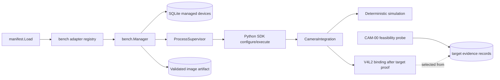

<!--
Copyright (c) 2026 DDP Engineering
This software is licensed under the PolyForm Noncommercial License 1.0.0.
Commercial use requires a separate commercial license.
See the LICENSE.txt in the .agentic folder for full license details.
SPDX-License-Identifier: LicenseRef-PolyForm-Noncommercial-1.0.0
-->

# TASK-91a63be3 - Freeze camera contracts and prove V4L2 feasibility

stage: build
type: feature
path: full
interaction: autopilot
requirements: REQ-FUNC-3d711f4f, REQ-DATA-49c54101, REQ-FUNC-ac306a12, REQ-FUNC-0141b9d4, REQ-DATA-8082c1dc, REQ-REL-de43509b, REQ-TEST-dcc25f09, REQ-REL-1d5863b6, REQ-DATA-3e86a281, REQ-SEC-09df2645, REQ-FUNC-a9657141
parent:
branch: NILO_camera_plugin
base: a61f20d7956fb0de54d653185a3b2f7aa2f18d57
opened: 2026-09-19

## Done checklist (current stage)

- [ ] each automated behavior increment has a pre-implementation red record
      with requirement IDs, exact selector or command, non-zero exit, and
      expected failure reason, plus one final focused green result; each manual
      increment has a consolidated post-implementation observation
- [x] repository anchor recorded after red and evolution reviewed after implementation
- [x] implementation makes those tests pass
- [x] focused project tests green, with their actual scope recorded
- [ ] `affected_paths` and `linked_tests` updated on every requirement
- [ ] `status = "active"` on every requirement this task delivers, or
      `"retired"` with a reason where behavior was deliberately removed
- [x] `check` clean, or each remaining warning explained in the log
- [ ] `stage: validate`

## Frame

Problem: The camera plan introduces a second hardware-plugin family, but the
current package, supervisor, bench manager, artifact route, and clients still
encode Sigrok-specific contracts. Production implementation cannot safely
start until the cross-component envelopes and the usable V4L2 dependency are
settled with target-hardware evidence.

Desired outcome: Complete CAM-00 as the first governed implementation slice:
accepted managed-device and camera contracts plus recorded Raspberry Pi 4
arm64 and Ubuntu mini-PC amd64 feasibility evidence selecting one Python V4L2
binding. The result must be sufficient for CAM-01, CAM-02, and CAM-03 to
implement one shared contract without inventing incompatible variants.

Actors: NILO maintainers and hardware verifiers define and prove the contract;
Administrators manage device identity and configuration; Operators and scoped
agents submit camera work; Viewers consume only authorized retained evidence.

Primary scenario: A maintainer translates the plan into traceable requirements
and a precise cross-component specification -> a bounded probe compares
candidate V4L2 bindings on both target architectures with a webcam and HDMI
capture device -> discovery, grouping, MJPEG/YUYV capture, typed control
enumeration/set/read-back, cancellation, warm-up, and packaging evidence are
recorded -> the selected dependency and accepted envelopes unblock CAM-01 to
CAM-03.

Examples:
- One physical USB camera exposing capture and metadata nodes is represented by
  one hardware identity with candidate endpoints and one validated capture
  endpoint; no public request supplies `/dev/video*`.
- A completed `snapshot` declares an `image` artifact with a validated JPEG or
  PNG media type and reports effective parameters and actual control read-back.
- A supported integer/menu control is writable through a typed descriptor;
  another valid V4L2 control type remains discoverable as read-only with a
  reason.

Counterexamples:
- CAM-00 does not add the production adapter registry, database migration,
  camera runner, HTTP/CLI/MCP/UI surfaces, udev installation, or live preview.
- A successful probe on Windows/WSL simulation alone is not evidence that a
  binding works on either appliance target.
- Raw ioctl values, device-node paths, arbitrary media types, and unbounded
  images are not public contract extensions.

In scope:
- Confirm the CAM-00-dependent recommendations in plan section 12: identity
  and constrained rebind, unconfigured-device gating, overlay coordinates,
  reset boundaries, manifest authority/contract-first order, and bounded
  pending snapshot behavior.
- Create/update AEGIS requirements and a specification for managed-device,
  physical/endpoint identity, capability, plugin/device configuration,
  operation canonicalisation, dynamic resource, artifact, and typed-error
  envelopes, including manifest/adapter agreement and configure-before-use.
- Design and implement a bounded, non-production feasibility probe and evidence
  record for candidate Python V4L2 bindings, Pillow integration, cancellation,
  warm-up, and locked dependency closure on linux/arm64 and linux/amd64.
- Exercise one UVC webcam and one HDMI-to-USB capture device on the Pi 4 and
  mini PC, record unsupported formats/control types, and select or reject a
  dependency from observed results.
- Preserve the existing Sigrok public behavior and `nilo.integration/1` wire
  invariants while defining the extension contract.

Out of scope:
- CAM-01 through CAM-09 production implementation; each becomes a later
  governed task after CAM-00 acceptance.
- Phase-2 live-preview transport and CAM-10 through CAM-12; preview credential
  recommendation 7 is deferred to CAM-10.
- The broader plugin-workflow navigation redesign, waveform work, arbitrary
  V4L2 passthrough, audio/video recording, computer vision, and release or
  publication work.

Constraints:
- The current protocol keeps bounded correlated NDJSON on stdout and confines
  package paths/processes; the existing job/artifact limits and authorization
  model remain preserved.
- The development host and stock WSL2 kernel provide no qualifying UVC proof;
  target observations are required on Raspberry Pi OS/Debian 13 arm64 and
  Ubuntu 24.04 amd64.
- Runtime dependencies must be pinned, checksum-verifiable, licence-reviewed,
  and packageable inside the repository's offline bundle model.
- Camera inputs, decoded pixels, encoded bytes, replies, timings, paths, media
  types, and errors require explicit bounds; camera access uses
  `bench.execute`, not `bench.read`.
- No product code is written before full-path requirements and design are
  accepted; build follows failing-test-first where an automated assertion can
  represent the behavior.

Success signals:
- Accepted requirements/specification define every envelope named by CAM-00
  and map their ownership across manifest, adapter, core, runner, and clients.
- The same probe and evidence schema run on both target architectures and
  record discovery, node grouping, MJPEG, YUYV, controls, cancellation,
  warm-up, and packaging/dependency closure for the named devices.
- One dependency is supported by evidence on both targets, or a failed
  feasibility item causes an explicit scope revision before production code.
- Existing Sigrok contracts remain intentionally unchanged and the next work
  packages can cite one frozen contract.

Evidence:
- STATED: The user supplied `00_Planning/Camera_Plugin_Plan.md`, requested a
  new `NILO_` workspace/branch from remote master, and requested implementation
  through AEGIS.
- OBSERVED: `00_Planning/Camera_Plugin_Plan.md` marks implementation as not
  started, makes CAM-00 precede production work, identifies recommendations
  awaiting confirmation, and defines its hardware feasibility gate.
- OBSERVED: `05_Software/schemas/integration/v1/manifest.schema.json` declares
  one app configuration schema and operation/event/artifact schema references,
  while `operation.schema.json` requires static resources.
- OBSERVED: `05_Software/nilo_assistant/internal/bench/parameters.go` admits
  only `sigrok` capture/decode inputs and derives one Sigrok-shaped resource.
- OBSERVED: `05_Software/nilo_assistant/internal/integration/protocol/types.go`
  already defines a generic configure payload, typed remote errors, and
  artifact declarations; the supervisor interface in
  `internal/integration/supervisor/process.go` exposes Describe and Execute but
  no configure operation.
- OBSERVED: `05_Software/integrations/sigrok/manifest.json` is the current
  concrete package reference for both target architectures.
- OBSERVED: `.agentic/knowledge/integration-platform.md` and
  `.agentic/knowledge/bench-integrations.md` route protocol/package concerns
  and managed lifecycle/job concerns to separate but adjacent components.
- INFERRED: CAM-00 is the smallest safe first task because CAM-01 to CAM-03
  explicitly depend on its accepted contracts and dependency result.
- UNKNOWN: Which candidate Python V4L2 bindings satisfy every probe on both
  targets and what native transitive dependencies/licences they introduce.
- STATED: On 2026-09-21 the user requested implementation of the plan on this
  branch and stated that neither the Raspberry Pi nor mini PC is connected for
  real tests.
- UNKNOWN: When the required Pi 4, mini PC, webcam, and HDMI capture hardware
  will be available for the target runs.

Assumptions:
- "Start implementation" means begin with the mandatory CAM-00 gate rather
  than combine all thirteen work packages in one task.
- The copied plan is the authoritative brief for this branch; its recommended
  decisions are proposals until this frame checkpoint accepts them.
- Target-hardware work may be prepared after design, but CAM-00 hardware
  acceptance remains open until both target runs are observed.

Unknowns:
- The exact candidate-binding shortlist and measurement/evidence file format
  will be settled during specify/design from repository and target constraints.
- Hardware identities, available V4L2 formats/controls, warm-up behavior, and
  packaging results remain unknown until measured.

Decision-blocking questions:
1. Accept CAM-00 as this task's complete scope, with CAM-01 onward opened as
   later tasks after the contract/dependency gate?
2. Accept plan recommendations 4, 5, 6, 8, 9, and 10 as the contract inputs for
   CAM-00 (identity/rebind, unconfigured gating, overlay frame, reset boundaries,
   manifest authority, and pending snapshot behavior)?
3. Confirm that the required Pi 4, mini PC, UVC webcam, and HDMI capture dongle
   can be made available for the build/validation hardware runs; otherwise the
   task can progress through contract/design and probe preparation but cannot
   complete CAM-00.

Proposed behaviors:
- The manifest remains authoritative for declared operations, schemas, policy,
  timeout, state-changing semantics, and artifacts; a typed adapter supplies
  family-specific canonicalisation, identities, dynamic resources, and
  core-owned paths, and load rejects disagreement.
- Managed-device contracts separate durable record identity, physical hardware
  identity, and validated capture endpoint identity; operations never accept a
  public device-node path.
- Plugin and per-device configuration are revisioned, schema-validated, and
  delivered in a versioned configure-before-use payload.
- Camera capability, snapshot/result, artifact, and typed-error envelopes are
  bounded and preserve only allowlisted public failure codes.
- The feasibility probe produces comparable target records and selects a V4L2
  dependency only when both architectures pass the required behavior subset.

Path and reason: Full path. Criterion matrix:

| criterion | yes | no | evidence |
|---|---:|---:|---|
| no new externally observable behavior |  | x | new managed devices and camera operations |
| no new interface or data format |  | x | manifest, configuration, identity, capability, artifact, and error envelopes |
| no new dependency |  | x | a V4L2 binding, Pillow, and possibly a font/native closure |
| existing requirement already covers behavior |  | x | the plan requires new CAM-00 requirements/contracts |
| no security or data-handling change |  | x | camera privacy, image artifacts, device paths, and new authorization boundaries |

No optional child task is proposed for CAM-00 because the contract and binding
choice are tightly coupled. Later work packages should be separate AEGIS tasks.

Scope acceptance: The 2026-09-21 request authorizes progress on the plan, with
CAM-00 as its first dependent work package. Recommendations 4, 5, 6, 8, 9 and
10 are working contract inputs from the requested plan. The missing target
hardware leaves the binding choice and target acceptance unresolved; neither
will be represented as proven by simulation.

## Requirement coverage

Behavior inventory and traceability (one row per independently checked outcome):

| Frame outcome | Actor/system | Trigger or state | Response and positive case | Boundary or failure | Requirement | Verification | Design decision or no impact |
|---|---|---|---|---|---|---|---|
| Manifest authority and adapter extension | Loader | Package load | Matching adapter adds only typed family behavior | Mismatch refused before launch | REQ-FUNC-3d711f4f | Hostile and matching fixture loads, Sigrok regression | D1: manifest/adapter ownership |
| Durable hardware identity | Core | Discovery | Strong serial or port rule reuses monotonic record; endpoint separate | Weak duplicate serial, node multiplicity, rebind history guard | REQ-DATA-49c54101 | Reconcile/restart fixtures | D2: three identities and persisted serial quality |
| Configure-before-use | Supervisor | Runner start | Versioned validated plugin/device payload precedes work | Invalid/refused configure prevents hardware method | REQ-FUNC-ac306a12 | Recording runner lifecycle | D3: configure ordering |
| Camera operation contract | Runner | Discovery or device operation | Typed endpoints, formats, controls and bounded operation response | Unsupported node/format/control, image and warm-up bounds | REQ-FUNC-0141b9d4 | Simulation contract and later target runs | D4: camera grammar; binding open |
| Image evidence | Core and runner | Completed snapshot | Validated image plus provenance retained | Oversize, mislabeled, unauthorized read refused | REQ-DATA-8082c1dc | Store, HTTP and runner assertions | D5: core-validated evidence |
| Public typed errors | Core | Terminal failure | Known code survives to job and clients | Unknown code maps to execution_failed | REQ-REL-de43509b | Fixture runner and client reads | D5: terminal code allowlist |
| Bounded snapshot client response | CLI and MCP | Accepted camera snapshot | Completed image or durable pending id within wait | Timeout/disconnect does not cancel; Ask mode stays pending | REQ-FUNC-a9657141 | Delayed/Ask fixture and client tests | D5: durable job, bounded wait |
| Target dependency proof | Hardware verifier | Candidate binding probe | Four target/device records establish behavior and closure | Missing or failed target observation leaves choice open | REQ-TEST-dcc25f09 | Manual target acceptance matrix | D6: comparable target records |
| Presence and reset lifecycle | Core | Startup, discovery or reset point | Atomic states, configured baseline, admission gate | Failed discovery unknown; initialising/busy refused | REQ-REL-1d5863b6 | State-machine tests | D2: atomic state transitions |
| Settings ownership and revision | Administrator/core | Plugin or device mutation | Schema and NFKC Casefold validated, revision advanced | Stale, duplicate or unauthorized mutation refused | REQ-DATA-3e86a281 | Repository and route race tests | D2/D3: revision and schema checks |
| Path confinement | Core | Public camera submission | Stored validated endpoint resolved from record id | Client node path or raw ioctl refused | REQ-SEC-09df2645 | HTTP, CLI and MCP hostile inputs | D1/D2: core-resolved endpoint |

The camera plan's later HTTP, CLI, MCP, browser and packaging work belongs to
subsequent governed work packages. This task freezes the shared contracts and
prepares feasibility evidence without treating simulation as target proof.

## Design

### Requirements coverage and test seams

| Requirement | Design decision | Failing or regression seam |
|---|---|---|
| REQ-FUNC-3d711f4f | D1: manifest owns declarations; registered adapter owns family derivation | manifest-load mismatch fixture, existing Sigrok jobs |
| REQ-DATA-49c54101 | D2: three identities and persisted weak-serial rule | managed-record reconciliation and restart fixtures |
| REQ-FUNC-ac306a12 | D3: validated configure precedes runner work on every launch | recording supervisor and Python SDK fixture |
| REQ-FUNC-0141b9d4 | D4: bounded camera capability and operation grammar | camera simulation contract suite; target probe later |
| REQ-DATA-8082c1dc | D5: core validates one image artifact and result provenance | artifact-store and HTTP media/ownership tests |
| REQ-REL-de43509b | D5: allowlisted remote code survives terminal storage | remote-error fixture and client read tests |
| REQ-FUNC-a9657141 | D5: bounded client wait does not own job lifetime | Ask-mode, delayed and disconnected-client tests |
| REQ-TEST-dcc25f09 | D6: one versioned probe and four target/device records | local parser/fixture tests, then manual target matrix |
| REQ-REL-1d5863b6 | D2: atomic presence and readiness transitions | SQLite rollback and state-machine tests |
| REQ-DATA-3e86a281 | D2/D3: schema and revision checks before settings commit | concurrent repository and Unicode-name tests |
| REQ-SEC-09df2645 | D1/D2: adapter receives a core-resolved endpoint | hostile HTTP/MCP/CLI parameters and runner spy |

### Component responsibilities and contracts

- **D1 — Package and adapter boundary** (REQ-FUNC-3d711f4f,
  REQ-SEC-09df2645): the manifest loader remains authoritative for declared
  operations, schemas, policy, timeout, state mutation and artifacts. A
  package-id registry in `internal/bench` selects a typed adapter that
  canonicalises family inputs, validates discovered identity, derives a lease
  resource, supplies curated runner arguments and resolves core-owned paths.
  Package admission checks agreement before launching a runner. Neither the
  adapter nor a public request may add a manifest operation or provide a raw
  endpoint path. Keep the existing `nilo.integration/1` NDJSON envelope and
  Sigrok public operation ids.
- **D2 — Durable device owner** (REQ-DATA-49c54101,
  REQ-REL-1d5863b6, REQ-DATA-3e86a281): Bench Core owns record ids, a
  per-plugin sequence, strong/weak serial decisions, selected endpoint,
  configuration revisions, presence and readiness. A future SQLite migration
  replaces `bench_plugins.devices_json` with records and atomic discovery
  reconciliation. The runner only reports candidates; the core validates and
  selects. Initialisation uses the device lease and a system actor, and blocks
  user submission until read-back succeeds. A failed discovery leaves unknown
  presence; a stale write leaves the old revision intact. Sigrok's current
  `Device` JSON shape remains a regression target until its adapter migrates.
- **D3 — Configuration delivery** (REQ-FUNC-ac306a12,
  REQ-DATA-3e86a281): extend the confined manifest with a device schema
  reference. Validate both settings documents against the installed package
  before supervisor creation; send the existing `configure` method after
  `hello` and before `describe` or `execute` on every new process. Use the
  versioned `configuration` object in the linked spec. A refusal fails health
  and prevents device use. The current Python SDK already parses `configure`;
  the Go supervisor needs the new ordering. Revision and schema checks stay in
  core, outside the untrusted runner.
- **D4 — Camera runner contract** (REQ-FUNC-0141b9d4): the future camera
  package follows the Python SDK with separate real and deterministic
  simulation backends. Backend output is translated to the typed, bounded
  public grammar in its linked spec. Discovery groups sysfs video nodes by
  physical USB parent, reports all candidates and excludes metadata-only
  capture. The real backend binding is deliberately undecided until D6.
- **D5 — Results and clients** (REQ-DATA-8082c1dc,
  REQ-REL-de43509b, REQ-FUNC-a9657141): the core verifies artifact id,
  signature, MIME type, size, digest, safe filename and owner before serving.
  Known camera error codes survive terminal storage; unknown codes become
  `execution_failed`. CLI and MCP waits observe a durable job but never own or
  cancel it. A pending response carries the transaction id; completed MCP
  content uses a separately bounded image preview.

### Proposed architecture - TASK-91a63be3

### Feasibility implementation and evidence

- **D6 — Non-production probe** (REQ-TEST-dcc25f09): put an isolated
  command and its unit tests under `02_Tools/tests/camera/`. It enumerates
  `/dev/video[0-9]+`, reads sysfs USB ancestry and by-id links, inspects V4L2
  capabilities, and runs each candidate through the same bounded capture and
  control protocol. Device paths are probe-local inputs, never product API
  fields. Candidate adapters live beside the probe; no candidate becomes a
  production dependency by being tested. The shortlist is `pyrav4l2` and
  `linuxpy`, subject to packaging and licence review. `v4l2py` 3.x is a
  linuxpy shim, so it is not an independent third candidate. Upstream
  documentation supports the shortlist but proves nothing about these target
  devices. See [pyrav4l2](https://github.com/antmicro/pyrav4l2),
  [linuxpy](https://pypi.org/project/linuxpy/) and
  [v4l2py](https://pypi.org/project/v4l2py/).
- One invocation writes a schema-versioned JSON record and a short text
  summary to an explicit output directory. A record includes target OS,
  architecture and kernel, USB identity, candidate endpoints, advertised and
  attempted formats, control descriptors and set/read-back outcomes, frame
  byte counts and hashes, cancellation timing, warm-up timings, Python and
  dependency versions, wheel hashes, native closure and licence inventory.
  It never records image bytes as accepted evidence. Each step has an absolute
  deadline, bounded frame count and byte limit; a hung read is terminated
  through an owned child process and marked failed. Temporary files and
  device handles are closed on success, failure and cancellation.
- The acceptance matrix has four required target/device cells: Pi arm64 with
  webcam and HDMI capture, Ubuntu amd64 with webcam and HDMI capture. The same
  probe version and schema run in each cell. An advertised MJPEG or YUYV mode
  must be attempted; a missing mode is recorded as unsupported. Control tests
  preserve the original value and restore it in `finally`, with restoration
  failure explicit. A binding is chosen only after all mandatory cells and
  offline closure checks pass. WSL simulation exercises parser, orchestration
  and deterministic fixtures, and never fills a target cell.

### Failure, security, concurrency and compatibility

- The probe treats open, ioctl, timeout, decode and restoration errors as
  typed step failures, preserving raw diagnostics only in the local evidence
  record. It must not change an unrelated video device. One probe run opens
  one selected physical camera at a time; device exclusivity is a probe
  precondition. It records a busy device rather than retrying indefinitely
  (REQ-TEST-dcc25f09).
- Production camera operations require `bench.execute`; managed-device and
  plugin configuration mutations require `plugins.manage`. The core selects
  the endpoint and checks bounds before running a package. Artifact access
  keeps owner-or-administrator policy and safe response headers
  (REQ-SEC-09df2645, REQ-DATA-3e86a281, REQ-DATA-8082c1dc).
- The existing 32-job queue, two workers, lease serialization, approval mode,
  artifact ceiling and supervisor environment confinement remain the
  compatibility baseline. A future direct migration of `devices_json` follows
  the development compatibility policy; it preserves unrelated appliance
  data and existing Sigrok capture/decode behavior
  (REQ-FUNC-3d711f4f, REQ-REL-1d5863b6).
- Probe output identifies its own version, target profile and pass/fail per
  check. A missing target is `not_run`, not pass. Build and validation reports
  link exact evidence records and name the unavailable hardware. No release
  bundle, dependency lock or runtime font is selected from desktop evidence
  alone (REQ-TEST-dcc25f09).

### Expected files, alternatives and open decisions

- CAM-00 build: `02_Tools/tests/camera/probe.py`,
  `02_Tools/tests/camera/candidate_probe.py`, `02_Tools/tests/camera/test_probe.py`,
  `02_Tools/tests/camera/evidence.schema.json` and a target run guide. The
  contract remains in the linked `.agentic/specs/` files. Later packages
  implement `internal/bench` adapters and records, the SQLite migration,
  supervisor configuration, camera package, HTTP/CLI/MCP surfaces and GUI.
- A single privileged `v4l2-ctl` shell script is simpler for inspection but
  cannot prove the Python binding's capture, cancellation and control behavior.
  OpenCV would add a wider dependency and still require typed V4L2 control
  evidence. Both remain outside the initial candidate comparison
  (REQ-TEST-dcc25f09).
- Open: the actual binding and its redistribution decision, observed endpoint
  grouping on the named devices, unsupported formats/control types, target
  warm-up and cancellation behavior, and locked wheel/native closure. In
  particular linuxpy's published GPL-3.0-or-later licence requires review
  before bundling; no compatibility conclusion is made here. The target
  machines are unavailable in this workspace, so these decisions cannot be
  closed in design (REQ-TEST-dcc25f09).

## Log

- 2026-09-19 frame: Proposed full-path CAM-00 scope as the mandatory contract
  and dual-target V4L2 feasibility gate; scope and plan recommendations await
  the checkpoint decision.
- 2026-09-21 frame: User requested implementation of the plan and identified
  missing target hardware. Accepted CAM-00 as the first full-path package;
  target feasibility and acceptance remain open pending hardware access.
- 2026-09-21 specify: Drafted eleven atomic CAM-00 requirements and ten exact
  contract specs; advisory check found zero format errors. Target binding and
  acceptance remain open until real Pi and mini-PC probe results exist.
- 2026-09-21 design: User chose to continue from the specify checkpoint.
- 2026-09-21 design: Recorded D1-D6 architecture and a bounded, versioned
  dual-target probe design in `## Design`; all eleven requirements map to
  decisions and test seams. Candidate binding and packaging licence remain
  open pending target evidence and review.
- 2026-09-21 build: User chose to continue from the design checkpoint and
  specifically build the CAM-00 feasibility probe.
- 2026-09-21 build red: REQ-TEST-dcc25f09;
  command=`python -m unittest discover -s 02_Tools/tests/camera -p test_probe.py -v`;
  exit=1; expected missing behavior=probe.py is absent, so fixture grouping
  and non-claiming target evidence cannot run.
- 2026-09-21 build red: REQ-TEST-dcc25f09;
  command=`python -m unittest discover -s 02_Tools/tests/camera -p test_probe.py -v`;
  exit=1; expected missing behavior=hardware nodes have no selected endpoint
  before candidate inspection, so the probe never calls a binding.
- 2026-09-21 build red: REQ-TEST-dcc25f09;
  command=`python -m unittest discover -s 02_Tools/tests/camera -p test_probe.py -v`;
  exit=1; expected missing behavior=candidate_probe.py is absent, so optional
  binding availability has no structured report.
- 2026-09-21 build red: REQ-TEST-dcc25f09;
  command=`python -m unittest discover -s 02_Tools/tests/camera -p test_probe.py -v`;
  exit=1; expected missing behavior=the probe has no owned cancellation path
  for a ready candidate child.
- 2026-09-21 build red: REQ-TEST-dcc25f09;
  command=`python -m unittest discover -s 02_Tools/tests/camera -p test_probe.py -v`;
  exit=1; expected missing behavior=a matching OS alone marks incomplete
  candidate and wheel evidence target-eligible.
- 2026-09-21 build red: REQ-TEST-dcc25f09;
  command=`python -m unittest discover -s 02_Tools/tests/camera -p test_probe.py -v`;
  exit=1; expected missing behavior=pyrav4l2's Motion-JPEG description is not
  normalised to its MJPG FourCC, so capture is skipped.
- 2026-09-21 build red: REQ-TEST-dcc25f09;
  command=`python -m unittest discover -s 02_Tools/tests/camera -p test_probe.py -v`;
  exit=1; expected missing behavior=generic Debian arm64 is mislabeled as a
  Raspberry Pi target without observed board identity.
- 2026-09-21 build red: REQ-TEST-dcc25f09;
  command=`python -m unittest discover -s 02_Tools/tests/camera -p test_probe.py -v`;
  exit=1; expected missing behavior=a worker that exits immediately after
  readiness is falsely counted as a successful cancellation.
- 2026-09-21 build red: REQ-TEST-dcc25f09;
  command=`python -m unittest discover -s 02_Tools/tests/camera -p test_probe.py -v`;
  exit=1; expected missing behavior=an empty wheelhouse and empty lock falsely
  verify offline dependency closure.
- 2026-09-21 build red: REQ-TEST-dcc25f09;
  command=`python -m unittest discover -s 02_Tools/tests/camera -p test_probe.py -v`;
  exit=1; expected missing behavior=an MJPG image whose decoded dimensions
  exceed the probe limit is loaded before the size check.
- 2026-09-21 build red: REQ-TEST-dcc25f09;
  command=`python -m unittest discover -s 02_Tools/tests/camera -p test_probe.py -v`;
  exit=1; expected missing behavior=sysfs traversal has no identity helper
  including the resolved USB interface directory and loses its number.
- 2026-09-21 build green: REQ-TEST-dcc25f09;
  command=`python -m unittest discover -s 02_Tools/tests/camera -p test_probe.py -v`;
  exit=0; eleven local fixture and mocked boundary tests pass, including
  grouping, ineligible fixture evidence, candidate selection, cancellation,
  wheel inventory, decoded image limit and USB interface traversal.
- 2026-09-21 build verification: `ruff format --check 02_Tools/tests/camera`,
  `ruff check 02_Tools/tests/camera`, `python -m compileall -q
  02_Tools/tests/camera`, schema JSON parsing and `git diff --check` passed.
  `doctor.ps1` cannot complete because pinned repository-local Go 1.27.0 is
  absent; target hardware runs and the full suite remain for validate.
- 2026-09-21 build review: Successive evolutions from the red/anchor points
  contain the intended initial five probe files, the two image-limit edits,
  then the sysfs traversal edit in `probe.py`. AEGIS check: errors=0, warnings=18,
  notes=3. Three stale paths belong to drafted future camera implementation;
  the other stale-path, tracked-sidecar, scope-drift and unticked-deliver
  warnings concern existing tasks or repository state outside this probe.
  No warning is treated as target acceptance.
- 2026-09-21 build: User directed continuation through delivery without a
  commit. Resolved interaction mode is autopilot for this task; the CAM-00
  hardware acceptance gate and prohibition on committing remain in force.
- 2026-09-21 build red: REQ-TEST-dcc25f09;
  command=`python -m unittest discover -s 02_Tools/tests/camera -p test_probe.py -v`;
  exit=1; expected missing behavior=an incomplete hardware record returns
  success instead of a nonzero outcome while preserving its evidence.
- 2026-09-21 build red: REQ-TEST-dcc25f09;
  command=`python -m unittest discover -s 05_Software/scripts/tests -p test_aegis_test.py -v`;
  exit=1; expected missing behavior=the full repository runner omits the
  camera probe tests and cannot fail when they regress.
- 2026-09-21 build green: REQ-TEST-dcc25f09;
  commands=`python -m unittest discover -s 02_Tools/tests/camera -p test_probe.py -v`
  and `python -m unittest discover -s 05_Software/scripts/tests -p test_aegis_test.py -v`;
  exits=0/0; twelve probe tests and twelve test-router tests pass. An
  incomplete hardware run now writes evidence and exits 3; the full runner
  includes the probe tests. Ruff format and lint pass on all changed Python.
- 2026-09-21 build setup/verification: The pinned Windows and WSL2 toolchain
  bootstrap and doctors pass; the generated fake integration environment was
  restored from its lockfile. Direct Go tests pass. A strict repository run
  before adding camera test discovery passed test and lint (exit 0,
  errors=0, warnings=33), including appliance browser acceptance. Its result
  is superseded by the runner change and will be rerun for the final tree.
- 2026-09-21 build red: REQ-TEST-dcc25f09;
  command=`python -m unittest discover -s 02_Tools/tests/camera -p test_probe.py -v`;
  exit=1; expected missing behavior=evidence has no digests tying four
  target records to the exact probe and worker sources.
- 2026-09-21 build green: REQ-TEST-dcc25f09;
  command=`python -m unittest discover -s 02_Tools/tests/camera -p test_probe.py -v`;
  exit=0; thirteen probe tests pass. Schema 2 evidence includes SHA-256 digests
  of the probe and worker source files; Ruff format/lint and schema JSON parse
  pass. The final evolution contains only the four intended probe files.
- 2026-09-21 build verification: `.\02_Tools\env\with-tools.ps1 python
  .agentic/aegis.py check --task TASK-91a63be3 --strict --run` exited 0 on the
  final candidate: full test 412.4s (camera probe, scripts, Go, Python,
  frontend and appliance browser stage), lint 9.3s, errors=0, warnings=33,
  notes=3, strict=ok. A schema-2 fixture record also passed Draft 2020-12
  validation. Warnings concern drafted future camera paths, previously tracked
  AEGIS sidecars, other tasks and files inherited from the old task base; none
  proves or replaces the four hardware acceptance runs.
- 2026-09-21 build blocker: CAM-00 cannot satisfy REQ-TEST-dcc25f09's manual
  target matrix or activate the remaining drafted contracts without Pi 4 and
  mini PC observations. The task remains in build despite the locally green
  suite; no binding is selected and no production CAM-01+ implementation is
  started. User forbids a commit.
- 2026-09-21 build: User asked to simulate the target runs and use this PC's
  camera. Windows PnP reports an available integrated camera; WSL has no
  `/dev/video*`. A Windows Media Foundation capture produced one 640x480 frame
  and an in-memory JPEG/Pillow decode; no image was saved. Windows and WSL
  fixture runs grouped two synthetic devices and kept all four target cells
  `not_run`. Linuxpy 0.24.0 and pyrav4l2 Git commit 9c0beeb9a8a6 both passed
  dependency self-checks in temporary WSL environments, without device access.
- 2026-09-21 build red: REQ-TEST-dcc25f09;
  command=`python -m unittest discover -s 02_Tools/tests/camera -p test_probe.py -v`;
  exit=1; expected missing behavior=WSL Ubuntu 24.04 is incorrectly identified
  as the physical mini PC target from its OS release alone.
- 2026-09-21 build green: REQ-TEST-dcc25f09;
  command=`python -m unittest discover -s 02_Tools/tests/camera -p test_probe.py -v`;
  exit=0; fourteen probe tests pass. Ruff format/lint and `git diff --check`
  pass; a real WSL check reports `WSL_TARGET_PROFILE=None`. Evolution after
  the final red/anchor contains only the intended probe and guide edits.
- 2026-09-21 build manual observation: On this Windows PC, Media Foundation
  camera index 0 produced a 640x480 frame; an in-memory JPEG of 69,067 bytes
  passed the probe worker's MJPG/Pillow decoder at 640x480. No image file was
  retained. Synthetic two-device fixtures on Windows and WSL both grouped two
  physical devices and left all four target cells `not_run`. WSL candidate
  imports reached the missing `/dev/video0` boundary; WSL has no video node.
  This verifies local code paths, not Pi/mini-PC capture or control behavior.
- 2026-09-21 build deviation: At the user's renewed implementation direction,
  host-verifiable CAM-01 work began as TASK-e17947b8 against provisional
  envelopes before CAM-00 target acceptance. The real V4L2 binding and four
  hardware records remain open; local simulation is not promoted to proof.
- 2026-09-24 build hardware observation: User attached one FaceCam 1000X (USB 0458:708f) to the Raspberry Pi 4 running Debian 13 arm64. `v4l2-ctl` reports `/dev/video0` as UVC capture and `/dev/video1` as metadata from the same USB interface, with YUYV and MJPEG formats and typed controls including automatic white balance. The camera has no serial in the media descriptor; by-id and by-path links identify both nodes. This confirms a Pi webcam inspection target, not either binding's capture/control behavior or a completed CAM-00 evidence cell. The Python binding candidates are absent on the Pi, and the HDMI and Ubuntu target runs remain open.
- 2026-09-24 build hardware observation: A bounded `v4l2-ctl` MJPEG stream on Pi `/dev/video0` yielded one 640x480 JPEG (7,812 bytes) that Pillow decoded; the file was removed and the prior 640x480 YUYV format restored and read back. This confirms capture hardware is usable but does not compare the planned Python bindings, typed control restoration, cancellation, warm-up or offline wheel closure.
- 2026-09-24 build hardware evidence: On the Pi webcam, isolated locked wheels for linuxpy 0.24.0, pyrav4l2 1.0 at Antmicro commit 9c0beeb9a8a6941e8e0dbc6f65830b8d713e0bdf and Pillow 11.3.0 were hash-verified. The probe selected `/dev/video0`, excluded metadata-only `/dev/video1`, and observed pyrav4l2 MJPEG/YUYV capture, brightness set/read-back/restoration and bounded cancellation. The cell is `needs_review` and linuxpy inspection failed on an API field rename; no binding is selected yet.
- 2026-09-24 build red: REQ-TEST-dcc25f09; command=`python -m unittest discover -s 02_Tools/tests/camera -p test_probe.py -k test_linuxpy_image_format_uses_current_pixel_format_field`; exit=1; expected missing behavior=the probe does not read linuxpy 0.24.0 `ImageFormat.pixel_format`.
- 2026-09-24 build green: REQ-TEST-dcc25f09; focused pinned-linuxpy format test exited 0; inspection now reads the current `pixel_format` field and retains support for numeric V4L2 codes.
- 2026-09-24 build red: REQ-TEST-dcc25f09; command=`python -m unittest discover -s 02_Tools/tests/camera -p test_probe.py -k test_linuxpy_node_capabilities_and_capture_formats`; exit=1; expected missing behavior=linuxpy's flag name is not interpreted and metadata-only formats are not excluded from capture format inspection.
- 2026-09-24 build green: REQ-TEST-dcc25f09; focused endpoint classification test exited 0; linuxpy inspection uses node-specific device capabilities and retains only supported video formats.
- 2026-09-24 build hardware evidence: Repeated the Pi webcam probe after the inspected API fixes. Both pinned bindings now classify `/dev/video0` as capture and `/dev/video1` as metadata, enumerate controls, restore the changed control, decode MJPEG and YUYV after two warm-up frames, and pass bounded cancellation. The locked wheel inventory verifies; source hashes and raw schema-2 output are preserved in `.agentic/evidence/camera/pi-webcam/`. The Pi webcam cell remains `needs_review` pending manual review and cross-target comparison.
- 2026-09-24 build verification: All 16 camera probe unit tests exit 0 after the linuxpy fixes.

## Rulings

- RULING-001 | date=2026-09-21 | decision=Proceed through the camera plan in dependency order, beginning with CAM-00; use recommendations 4, 5, 6, 8, 9 and 10 as contract inputs while leaving real target feasibility unverified | reason=The user requested plan implementation and reported both target machines unavailable for real tests | source=user | supersedes=none
- RULING-002 | date=2026-09-21 | decision=Proceed with host-verifiable software work packages against the provisional CAM-00 envelopes while leaving the real V4L2 binding, target-specific behavior and CAM-00 acceptance open | reason=The user reiterated implementation of the plan despite absent target machines and challenged the earlier stop | source=user | supersedes=RULING-001
- RULING-003 | date=2026-09-24 | decision=Continue implementation against the available Pi webcam and simulation, and perform the missing HDMI and Ubuntu mini PC hardware checks at the end when those devices exist | reason=The user confirmed neither missing device is available and explicitly prioritized implementation | source=user | supersedes=RULING-002

## Handoff

current: build
status: blocked
next: Keep the Pi webcam evidence; complete the HDMI and Ubuntu target records when those devices become available. Continue physical-only host implementation.
must_read: .agentic/tasks/TASK-91a63be3.md; .agentic/steps/4_build.md; .agentic/specs/REQ-TEST-dcc25f09.md
blockers: Pi webcam evidence is recorded; HDMI capture dongle and Ubuntu mini PC are unavailable for the remaining target cells.

## Stage report

stage: build
result: in_progress
current: build
changed: Built schema-2 probe and target evidence; selected the physical V4L2 binding after a real Pi webcam probe.
evidence: Pi webcam reports USB identity, capture/metadata endpoints, formats and controls; 32 Camera/probe tests passed; real Pi frames and retained NILO snapshots completed, including a selected 15 fps frame interval and Unicode text overlay.
issues: HDMI capture and Ubuntu target cells remain untested because the devices are unavailable.
next: Collect those target records when hardware is available; continue software implementation and Pi checks meanwhile.
needs_user: no
spec_compliance:
implementation_quality:
review_round:
