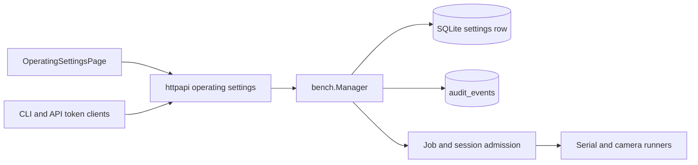

<!--
Copyright (c) 2026 DDP Engineering
This software is licensed under the PolyForm Noncommercial License 1.0.0.
Commercial use requires a separate commercial license.
See the LICENSE.txt in the .agentic folder for full license details.
SPDX-License-Identifier: LicenseRef-PolyForm-Noncommercial-1.0.0
-->

# TASK-95cf116e - Make concurrency and operating limits administrator-configurable platform settings

stage: done
type: feature
path: full
interaction: autopilot
requirements: REQ-PLAT-16d70b80, REQ-FUNC-46dd5987, REQ-FUNC-5d897991, REQ-SEC-aa791b1e, REQ-UX-ba9953bb, REQ-UX-7bf4e0c2, REQ-REL-1d70d023
parent:
branch: task/25-platform-operating-limits
base: a89db2fa89b0fdf8a77f24833555b617122cb344
opened: 2026-09-28

## Done checklist (current stage)

- [x] validated candidate and spec newline correction reviewed
- [x] final strict gate and staged whitespace check passed
- [x] user approved local commit; Gitea issue #25 is closed
- [x] final delivery report included in the local commit
- [x] single local commit made and working tree verified
- [x] task close-out carried by that commit

## Frame

Problem: STATED issue #25: appliance-wide concurrency and operating limits are hardcoded, so administrators cannot tune them to hardware or workload without rebuilding.
Desired outcome: STATED: persistent administrator-managed platform settings preserve the present defaults, govern admissions and new work, and expose current usage and effective timing.
Actors: STATED: Administrator changes settings; Operator/Viewer and API/CLI/MCP clients submit or observe authorized work; Core, SQLite and supervised runners enforce it.
Primary scenario: Administrator reads current limits and usage -> submits a revision-checked update -> Core validates, persists and audits it -> new admissions use the new limits while existing work continues.
Examples: STATED: raising the active serial limit should permit another distinct port; lowering it below active usage leaves those connections running and refuses further connections. Serial capture and camera capture can overlap, and two distinct serial devices can capture together.
Counterexamples: A second controller for the same camera or serial port remains disallowed regardless of the appliance-wide limit; an invalid or stale update must not alter settings.
In scope: STATED: finite executing jobs, outstanding jobs, active serial connections and camera streams; default and maximum finite-job timeout; serial connection lifetime and idle disconnect; camera session lifetime and corresponding runner timeout; persistent SQLite record; authorized shared API and administrator Settings UI with descriptions, units, ranges, usage and effective timing; audit and conflict rejection; CLI/MCP access documentation as applicable; Core/runner/frontend consistency; camera shared-mutex review; overlap, capacity and release verification; broader parameter classification and follow-ups.
Out of scope: INFERRED from the issue's “further parameter inventory” wording: exposing every inventory constant in this first phase, changing password/activity/serial log/camera media retention controls, production hardware acceptance without hardware, and release/version assignment.
Constraints: STATED: preserve policy approval, credential checks, per-device exclusivity, cancellation and cleanup. OBSERVED: the Manager serializes admission (`05_Software/core/internal/bench/manager.go`), job dispatch is limited to two (`scheduler.go`), outstanding jobs to 32 (`model.go`, `jobs.go`), serial sessions to four (`serial_session.go`) and camera streams to two (`camera_workspace.go`). The existing requirements and component invariants must be reconciled as the settings become current behavior.
Success signals: Administrator can save/reload valid settings across restart; unauthorized, invalid and stale writes fail; accepted writes create audit records; measured admission follows configured capacities and releases capacity after terminal paths; existing work survives a lower limit; new work receives documented timeout/lifetime values; GUI/API agree; targeted and full verification report their exact coverage.
Evidence: STATED: issue #25 body and acceptance criteria at the linked Gitea URL. OBSERVED: `.agentic/knowledge/{bench-integrations,serial-integration,camera-integration,gui-foundation}.md`, `05_Software/core/internal/bench/{manager.go,scheduler.go,model.go,jobs.go,parameters.go,serial_session.go,camera_workspace.go}`, `.agentic/context/{project,environment}.md`. INFERRED: this is a cross-component contract change requiring the full path. UNKNOWN: safe upper bounds, the exact settings route and presentation grouping, and which broader inventory candidates merit follow-up.
Assumptions: The proposed new-work-only rule applies to accepted timeout/lifetime settings unless the user changes it at this checkpoint; already admitted deadlines and active session expiries remain fixed. Current default values remain 2 executing, 32 outstanding, 4 serial, 2 camera, 60-second default and 300-second maximum job timeout, 1-hour serial lifetime, 1-minute serial idle timeout, 55-minute camera session with a longer runner timeout.
Unknowns: Numeric allowed ranges and resource ceilings require design against runner/frontend bounds and appliance constraints. Current UI settings organization and API permission mapping require inspection at specify/design. The broader parameter inventory requires a documented classification.
Decision-blocking questions: None for framing. Setting ranges and wire shapes will be proposed in specify/design for review before code.
Proposed behaviors: (1) persistent, revisioned, audited Core limits with current usage; (2) shared authorized API and administrator UI; (3) capacity enforcement for jobs, serial and camera with stable active work during reductions and immediate new admission when raised; (4) new-work-only timeout/lifetime snapshots with consistent runner ceilings; (5) narrowed Manager lock duration for camera runner calls; (6) coverage for overlap, exclusivity, release and restart; (7) inventory classification with follow-ups.
Path and reason: full. New observable behavior: no (criterion fails); new interface/data format: no (criterion fails); new dependency: yes (none required); existing requirement already covers behavior: no (criterion fails); security/data-handling unchanged: no (administrator write authority, auditing and persistence change). No independent child tasks: the settings contract and Manager admissions are tightly coupled.

## Requirement coverage

| Frame outcome | Atomic behavior | Requirement | Positive case | Boundary or failure | Verification | Design decision or no impact |
|---|---|---|---|---|---|---|
| Persistent bounded settings | Revisioned complete SQLite record | REQ-PLAT-16d70b80 | Restart returns update | Invalid/stale update unchanged | Repository and API tests | Singleton row; compare-and-swap |
| Admissions and exclusivity | Enforce configured capacities | REQ-FUNC-46dd5987 | Raised limit admits distinct work | Lowered limit preserves active work; same device refused | Manager concurrency tests | Read limits under admission lock |
| Effective timing | Snapshot timeout/lifetime on new work | REQ-FUNC-5d897991 | New work receives update | Old deadline unchanged; over-max refused | Manager and runner tests | Capture values at admission/start |
| Authorized update | Admin-only change and audit | REQ-SEC-aa791b1e | Administrator update audited | Operator, viewer, narrow token rejected | HTTP tests | Dedicated permission |
| Nilo Settings management | Platform rows, usage and errors visible | REQ-UX-ba9953bb | Valid table-cell save and updated usage | Range/conflict feedback | Component tests | Four platform fields on Nilo Settings |
| Plugin settings management | Camera and Serial rows live on their own plugin pages | REQ-UX-7bf4e0c2 | Valid plugin-field save preserves other values | Stale revision leaves draft visible | Plugin-page tests | Shared revisioned API, plugin-specific presentation |
| Independent control | Camera waits do not hold shared admission lock | REQ-REL-1d70d023 | Serial action proceeds during camera wait | Same-camera control serialized | Concurrent Manager tests | Camera-local lock |

Behavior inventory: administrator opens Nilo Settings or Camera/Serial plugin settings -> Core returns revision, bounded fields and live usage; each screen presents its owned rows with range, editable value, usage where relevant and contextual help; administrator sends a complete replacement preserving other fields -> Core validates, compare-and-swaps and audits, or returns invalid/conflict while the browser retains the draft; client submits work -> Core checks current capacity, device exclusivity and deadline; current work continues after a reduction; resource release permits future admission; camera runner wait leaves unrelated controls responsive. The broader inventory is a documentation classification, not a newly configurable behavior.

## Design

Requirements coverage: `REQ-PLAT-16d70b80` owns storage and the exact spec; `REQ-FUNC-46dd5987` admission; `REQ-FUNC-5d897991` deadline snapshots; `REQ-SEC-aa791b1e` authorization and atomic audit; `REQ-UX-ba9953bb` page; `REQ-REL-1d70d023` camera lock scope.

Component responsibilities: Bench Manager owns settings cache and live usage because it already serializes admission. SQLite owns one revisioned row via a migration. HTTP owns route authorization and wire decoding. The browser renders administrator controls through the same API. Integration runners receive bounded session deadlines through their existing Core supervisor context. Core remains authoritative for all clients.

Interface/state: The linked platform spec defines names, bounds, defaults, GET/PUT envelopes and errors. A complete replacement requires a matching revision; the Manager mutex orders it with admissions. Repository update and `audit.Writer.Compose` plus `AuditRepository.AppendInTransaction` share one SQLite transaction. The in-memory cache changes only after commit. Restart reads persisted settings. Usage reads under the Manager mutex and counts active maps and nonterminal job rows.

Execution/failure: New job admission canonicalizes timeout using current settings, then checks outstanding capacity; dispatch checks executing capacity. Serial and camera startup check their respective capacities and snapshot lifetimes. Active deadlines and expiries do not change. A failed validation, stale revision, failed audit append or failed commit leaves both storage and cache unchanged. Cleanup removes resource occupancy on the existing terminal paths.

Security: A dedicated `platform.settings.manage` permission belongs only to Administrator; scoped tokens must carry it. HTTP route guard and Manager service each enforce it. Audit details contain changed numeric values and revision only. The route refuses unknown fields and partial settings.

Concurrency: Camera runner startup/control is serialized per camera while shared Manager state is locked only for state checks/reservations. Runner socket waits take place outside the shared mutex. Camera session ownership and map access remain under the shared mutex. The existing camera control path holds the shared lock across runner calls, so this is the most regression-sensitive seam.

Compatibility/migration: Migration 023 adds the row; fresh and upgraded databases receive the same defaults. No development-build compatibility alias is added. Existing fixed-number prose in component pages and the bench/serial specs will be revised to the current configurable contract after code passes.

Observability/tests: Repository tests cover restart, ranges, stale revision and audit atomicity. Manager tests cover admissions, lower/raise and lifetime snapshots. HTTP tests cover roles, scopes and errors. Browser tests cover units, ranges, usage and conflicts. A blocked camera-call test checks independent serial progress. Existing full suite and AEGIS strict check are the final gate.

Alternatives: Reading SQLite on every admission would complicate lock ordering and introduce needless I/O; the cache is reconciled only after a successful commit. A single global camera mutex would serialize unrelated physical cameras; use a per-device guard. Allowing partial PUTs would make concurrent administration ambiguous; use complete replacement.

### User-directed browser revision - 2026-09-28

`REQ-UX-ba9953bb` owns the Nilo Settings table with the four platform job fields. `REQ-UX-7bf4e0c2` owns the Camera and Serial plugin tables with their respective fields. A shared table form reads the same complete Core snapshot, edits only its visible field subset, and submits all nine values with the loaded revision; this preserves the atomic API, other values, audit and conflict behavior. The form shows label, range, editable value and usage columns, places Save above the rows, and uses the existing accessible `HelpPopover` beside every label. The overall new-work rule remains in the relevant help text. Plugin administration renders the form only for a session with `platform.settings.manage`; the Core still checks the write. Concurrent tabs can conflict, and the draft remains visible with reload guidance. The table scrolls on narrow viewports. Risks: integration with plugin-page polling and independent settings state; focused page tests cover both plugin variants and conflicts.

Expected files: `internal/bench/operating_settings.go`, admission and session files, `internal/store/sqlite/migrations/023_operating_settings.sql`, `migrations.go`, `internal/httpapi/operating_settings.go`, `server.go`, auth permission, frontend API/client/page/shell/i18n and focused tests; docs, knowledge and changelog. Risk: shared camera lock currently protects many state transitions; moving runner calls outside it requires targeted race and cancellation coverage. Open decisions: none; the ticket's proposed new-work-only timing and the spec's bounded ranges are the implementation contract.

### Proposed architecture - TASK-95cf116e

## Log

- 2026-09-28 frame: Proposed issue #25 scope and full path on task branch; awaiting checkpoint scope acceptance before specify.
- 2026-09-28 frame: User directed continuation through delivery without prompts and without commit; scope accepted, interaction switched to autopilot.
- 2026-09-28 specify: Created six draft requirements and a revisioned settings contract; reused no existing requirement, retired none. Advisory check reported no format errors; new source paths do not exist until build.
- 2026-09-28 design: Recorded storage, API, audit, admission, camera concurrency and verification decisions in Design; advancing to build.
- 2026-09-28 build red: REQ-PLAT-16d70b80; command=`with-tools.ps1 go test ./internal/bench -run TestOperatingSettingsReplacementPersistsAndRejectsStaleOrInvalidValues -count=1`; exit=1; expected missing behavior=Manager operating-settings read/replace methods do not exist.
- 2026-09-28 build green: REQ-PLAT-16d70b80 focused replacement/persistence/range test passed with `go test ./internal/bench -run TestOperatingSettingsReplacementPersistsAndRejectsStaleOrInvalidValues -count=1` (exit 0).
- 2026-09-28 build red: REQ-FUNC-46dd5987 and REQ-FUNC-5d897991; command=`with-tools.ps1 go test ./internal/bench -run 'TestConfiguredJob(CapacitiesRaiseAndRelease|TimeoutAppliesOnlyToNewSubmissions)' -count=1`; exit=1; expected missing behavior=outstanding cap remains 32 and default timeout remains 60 despite saved settings.
- 2026-09-28 build green: REQ-FUNC-46dd5987 and REQ-FUNC-5d897991 focused configured-job tests passed with `go test ./internal/bench -run 'TestConfiguredJob(CapacitiesRaiseAndRelease|TimeoutAppliesOnlyToNewSubmissions)' -count=1` (exit 0).
- 2026-09-28 build red: REQ-SEC-aa791b1e; command=`with-tools.ps1 go test ./internal/httpapi -run TestOperatingSettingsRoutesRequireAuthorityAndRevision -count=1`; exit=1; expected missing behavior=administrator GET returns 404 because the platform settings route is absent.
- 2026-09-28 build green: REQ-SEC-aa791b1e focused HTTP authority/revision/audit test passed with `go test ./internal/httpapi -run TestOperatingSettingsRoutesRequireAuthorityAndRevision -count=1` (exit 0).
- 2026-09-28 build red: REQ-UX-ba9953bb; command=`with-tools.ps1 npm.cmd run test:ci -- src/components/pages/OperatingSettingsPage.test.tsx`; exit=1; expected missing behavior=page skeleton renders no settings label, usage, range or save action.
- 2026-09-28 build green: REQ-UX-ba9953bb focused browser page test and TypeScript/Vite build passed (exit 0); current UI source displays all nine fields, units, ranges and usage.
- 2026-09-28 build red: REQ-REL-1d70d023; command=`with-tools.ps1 go test ./internal/bench -run TestCameraControlWaitDoesNotBlockOperatingSettingsRead -count=1`; exit=1; expected missing behavior=blocking camera runner call holds shared Manager mutex and delays an unrelated settings read.
- 2026-09-28 build green: REQ-REL-1d70d023 focused blocked-camera and graceful-stop tests and full bench package tests passed (exit 0); runner I/O now releases the shared lock under a per-camera gate.
- 2026-09-28 build red: REQ-FUNC-5d897991; command=`with-tools.ps1 uv run --locked pytest -q tests/test_workspace.py::test_session_lifetime_is_a_bounded_core_parameter`; exit=1; expected missing behavior=Camera runner has no bounded session-lifetime parameter and still uses 55 minutes.
- 2026-09-28 build green: REQ-FUNC-5d897991 Camera runner lifetime test passed (19 focused Python tests, exit 0); WSL serial lifecycle test confirmed new-session lifetime snapshot (exit 0).
- 2026-09-28 build deviation: Serial lifetime regression test was added after its implementation. Its WSL result covers behavior but lacks a test-first red observation for that increment.
- 2026-09-28 build red: REQ-FUNC-5d897991; command=`with-tools.ps1 go test ./internal/bench -run TestConfiguredTimeoutKeepsIdempotentRetriesStable -count=1`; exit=1; expected missing behavior=retrying an admitted job after reducing the timeout setting returned transaction_conflict rather than the original transaction.
- 2026-09-28 build green: REQ-FUNC-5d897991 idempotent retry remains stable across configured timeout changes; focused test and full bench package passed (exit 0). Expanded camera-lock test now observes serial event ingestion, authenticated read and disconnect during a blocked camera call (exit 0).
- 2026-09-28 build: Final build evolution after the latest red anchor identified jobs.go and operating_settings_test.go; full Git status and diff review cover the prior build increments. Advisory check: 0 errors, 5 unrelated warnings (one legacy stale requirement path, tracked sidecars, three other deliver journals), 4 unrelated manual-verification notes.
- 2026-09-28 validate inspection: Compared all six active requirements and the platform spec with the Core, HTTP, runner and GUI diff; checked authorization, bounds, persistence, idempotent retries, lower/raise behavior, per-device exclusivity, camera lock order, Windows/WSL paths and documentation inventory. The implementation and independent test seams match the agreed scope; no manual-only verification is claimed.
- 2026-09-28 validate review round 1: Specification compliance approved against issue #25 and six requirements. Implementation quality approved after the timeout retry, serial-event concurrency and restart-load checks were corrected before verdicts; no open candidate finding. Final evolution refreshed after these edits; Git status/diff also reviewed all earlier increments.
- 2026-09-28 validate: Final strict test command failed because `layout.test.ts` found the new settings card's literal `#777` fallback; lint passed. Returned to build for this candidate style finding; both prior verdicts invalidated. An earlier unwrapped gate invocation could not locate repository-local Go; the wrapper corrected that operational setup error.
- 2026-09-28 build red: REQ-UX-ba9953bb; command=`with-tools.ps1 python .agentic/aegis.py check --task TASK-95cf116e --strict --run`; exit=1; expected missing behavior=Operating settings CSS still carried a literal fallback color, violating the shared token contract checked by `layout.test.ts`.
- 2026-09-28 build green: REQ-UX-ba9953bb; replaced the literal fallback with the shared `--border` token; `npm run test:ci -- src/layout.test.ts` passed 24 tests (exit 0). Evolution after the new anchor reports only shell.css; the full candidate remains covered by Git diff review.
- 2026-09-28 validate review round 2: Specification compliance approved on the unchanged scope, API contract, active requirements and documentation. Implementation quality approved after inspecting the corrected CSS against the palette rule, the 24-test layout run, and the previously reviewed Core/runner/API paths. No current review finding remains.
- 2026-09-28 validate: Final strict test command reached appliance browser proof and failed `e2e/shell.spec.ts` because its fixed administrator navigation list omitted Operating settings; 40 browser tests passed before the assertion. Lint passed. Returned to build for this stale candidate test; both round-2 verdicts invalidated.
- 2026-09-28 build red: REQ-UX-ba9953bb; command=`with-tools.ps1 python .agentic/aegis.py check --task TASK-95cf116e --strict --run`; exit=1; expected missing behavior=the existing shell browser assertion still expected the prior administrator navigation list without Operating settings.
- 2026-09-28 build green: REQ-UX-ba9953bb; updated the real-browser shell assertion for the administrator's sixth core destination and its narrow-rail count; focused `npm run test:ci -- src/components/shell/pages.test.ts` passed 15 tests, while the affected browser spec awaits the final appliance run. Requirement trace links and GUI knowledge updated. Evolution reports shell.spec.ts; advisory check remains at 0 errors, 5 unrelated warnings.
- 2026-09-28 validate review round 3: Specification compliance approved after confirming the sixth destination is the authorized Operating settings page and the route/requirement contract is unchanged. Implementation quality approved after inspecting both affected browser assertions, permission filtering and the prior focused page tests; no current review finding remains.
- 2026-09-28 validate: Final strict test command passed the full project suite and appliance browser stage (exit 0); lint failed because `e2e/shell.spec.ts` needs Prettier formatting. Returned to build for the formatting finding; both round-3 verdicts invalidated.
- 2026-09-28 build red: REQ-UX-ba9953bb; command=`with-tools.ps1 python .agentic/aegis.py check --task TASK-95cf116e --strict --run`; exit=1; expected missing behavior=the edited shell browser assertion did not meet the frontend Prettier format gate, although the full test command passed.
- 2026-09-28 build green: REQ-UX-ba9953bb; repository Prettier formatted `e2e/shell.spec.ts`, its focused format check passed (exit 0), and Git diff contains only the intended navigation assertions. Final evolution refreshed after the edit.
- 2026-09-28 validate review round 4: Specification compliance approved; formatting changes leave the accepted navigation, API and requirement behavior unchanged. Implementation quality approved after comparing the formatted diff, focused Prettier check, and the prior full test result. No current review finding remains.
- 2026-09-28 validate final: `with-tools.ps1 python .agentic/aegis.py check --task TASK-95cf116e --strict --run` exited 0: configured full tests passed (406.0 seconds), including Go, Python, frontend and WSL appliance browser coverage; configured lint passed (10.0 seconds). Strict advisory result: 0 errors, 5 warnings, 4 notes. The warnings concern a pre-existing stale path in REQ-DATA-8082c1dc, 82 tracked fingerprint sidecars, and three unrelated open deliver journals; notes identify unrelated manual checks. None limits this candidate's proof. `git diff --check` passed. No child tasks.
- 2026-09-28 deliver: Validated working tree on task/25-platform-operating-limits contains 42 modified tracked files and 18 untracked candidate files. User requested delivery without prompting and explicitly prohibited committing; no staging, commit, push or PR was performed. The uncommitted candidate is ready for review; publication steps remain outside this instruction.
- 2026-09-28 deliver live: At the user's request, deployed the unchanged validated Core, GUI and refreshed Camera package to the DDP Raspberry Pi. Verified archive and installed Core/GUI/Camera hashes, certificate-verified HTTPS assets, a revision-checked settings update and restoration, two audit events, restart persistence, active services, and token revocation. Predeployment Core, GUI, Camera catalog and runtime state have a checksum-verified backup. The detailed delivery record is `07_Delivery/NILO_0.11.0_RPi_Live_Test.md`; physical instrument I/O was not exercised. No Git state was changed beyond the working-tree delivery record.
- 2026-09-28 specify return: User revised the browser organization after live deployment: Nilo Settings becomes a compact editable table for platform fields; Camera and Serial controls move to their respective plugin administration pages; contextual `?` help follows the existing password-policy pattern. The existing Core settings contract and audit semantics remain in scope. Prior validation verdicts are stale for the revised candidate.
- 2026-09-28 specify/design revision: Updated REQ-UX-ba9953bb and added REQ-UX-7bf4e0c2 for the two distinct browser surfaces. The revision keeps the complete API envelope and plugin-neutral Core authority, using one shared table form with scoped rows and HelpPopover. No backend or migration change is required.
- 2026-09-28 build red: REQ-UX-ba9953bb and REQ-UX-7bf4e0c2; command=`with-tools.ps1 npm.cmd run test:ci -- src/components/pages/OperatingSettingsPage.test.tsx src/components/pages/CameraPluginPage.test.tsx`; exit=1; expected missing behavior=Nilo Settings table is absent and Camera/Serial plugin pages do not expose their settings rows. Seven existing focused tests passed.
- 2026-09-28 build green: REQ-UX-ba9953bb and REQ-UX-7bf4e0c2; focused frontend command=`with-tools.ps1 npm.cmd run test:ci -- src/components/pages/OperatingSettingsPage.test.tsx src/components/pages/CameraPluginPage.test.tsx src/components/shell/pages.test.ts`; exit=0, 26 tests. Production TypeScript/Vite build exited 0. Tests cover four platform rows, Camera and Serial placement, table help, complete save preservation, invalid timing and stale conflict.
- 2026-09-28 build revised: Evolution from the new anchor lists 11 changed non-AEGIS files, all expected for the browser revision and its documentation. Advisory check has 0 errors and the same five unrelated warnings and four manual-verification notes as before. The new requirement covers CameraPluginPage tests and current source paths. User-directed scope RULING-001 resets explicit review to round 1.
- 2026-09-28 validate review round 1: Specification compliance approved: the four platform, two Camera and three Serial fields occupy their requested destinations with the requested table columns, top save and contextual help; complete Core semantics remain unchanged. Implementation quality approved: shared form preserves hidden fields and compare-and-swap revision, plugin route checks permission, labels and table semantics are accessible, narrow screens scroll, and focused tests cover save, invalid timing and conflict. No current review finding.
- 2026-09-28 validate final revision: `with-tools.ps1 python .agentic/aegis.py check --task TASK-95cf116e --strict --run` exited 0: full configured tests passed (441.3s) and lint passed (9.4s), including frontend browser and appliance coverage. The strict output briefly included a review-state warning because the journal verdict was written while the long test ran; a subsequent advisory check has 0 errors, the original five unrelated warnings and four unrelated manual notes. `git diff --check`, focused 26 tests, frontend build, lint and Prettier check passed. No manual physical I/O is claimed.
- 2026-09-28 deliver GUI refresh: Deployed the revised production GUI to the DDP Pi with a GUI-only rollback copy. The Core cached the prior HTML index, so a NILO restart followed a zero-work preflight. Certificate-verified served index points to the new JS/CSS; both asset hashes match the validated build. Both services are active, Core/Camera hashes and settings revision 3 are unchanged. Details and rollback paths are in `07_Delivery/NILO_0.11.0_RPi_Live_Test.md`. No staging, commit, push or PR.
- 2026-09-28 deliver advisory: Post-deployment `aegis check` has 0 errors, five unrelated warnings and one expected `unticked-deliver` warning on this task because the user explicitly prohibited committing. `git diff --check` passed and the Git index is empty.
- 2026-09-28 build return: User requested a View activity action on Nilo Settings. Core already writes `operating_settings.changed` audit records under the platform component, so the change is limited to browser navigation and an authorized Activity filter. REQ-UX-ba9953bb now includes this action; prior browser validation is stale for the revised candidate.
- 2026-09-28 build red: REQ-UX-ba9953bb; command=`with-tools.ps1 npm.cmd run test:ci -- src/components/shell/shell.test.tsx -t 'Nilo Settings'`; exit=1; expected missing behavior=Nilo Settings has no View activity button for an Activity-authorized administrator. The runner executed the entire shell file (39 other tests passed) because npm parsed `-t` as a CLI option; the observed failure is the intended missing behavior.
- 2026-09-28 build green: REQ-UX-ba9953bb; focused `with-tools.ps1 npm.cmd run test:ci -- src/components/shell/shell.test.tsx src/components/pages/OperatingSettingsPage.test.tsx` exited 0 with 43 tests. The shell tests prove the audit/category/component/action filter and permission-dependent button. Frontend production build, lint and Prettier check passed. Evolution reports five expected non-AEGIS paths; advisory check has 0 errors and the same five unrelated warnings.
- 2026-09-28 validate review round 1 after RULING-002: Specification compliance approved because the existing Core audit action is `operating_settings.changed` in the platform component and the button reaches those audit records, matching Network's page-title action. Implementation quality approved because the button is permission-gated, uses the existing Activity router, does not submit settings, and the shell tests cover visible and hidden states plus the exact filter. No current finding.
- 2026-09-28 validate final after RULING-002: `with-tools.ps1 python .agentic/aegis.py check --task TASK-95cf116e --strict --run` exited 0; configured full tests passed (436.6 seconds), lint passed (9.7 seconds), 0 errors, five unrelated warnings and four unrelated manual-verification notes. `git diff --check` passed. The current candidate's specification and implementation verdicts are approved.
- 2026-09-28 delivery/version: At the user's direction, assigned project version 0.12.0 before the next Pi deployment. This repository/package operation rolled Unreleased into the dated 0.12.0 changelog, updated the canonical version and prescribed mirrors, and passed mirror comparison, Core buildinfo/CLI tests, 73 frontend tests and production frontend build. The ARM64 Core build succeeded. It does not modify the issue #25 behavior proven by the strict gate.
- 2026-09-28 delivery/live: Installed the 0.12.0 Core and GUI on the DDP Pi after zero-work preflight, with a checksum-verified stopped-service backup and rollback script. Certificate-verified HTTPS assets, Core version and installed hashes match the builds; Core and network helper are active. The Camera catalog is unchanged. The current settings row is revision 4 with serial limit 2, identical to the predeployment backup, and the three existing settings audit events remain. Details in `07_Delivery/NILO_0.12.0_RPi_Live_Test.md`; physical I/O was not exercised. No Git staging, commit or push.
- 2026-09-28 deliver advisory: Final `git diff --check` and canonical-version mirror comparison passed; Git index is empty. Post-version `aegis check` reports 0 errors, 9 warnings and 4 notes: the prior five unrelated warnings, this task's expected unticked-deliver warning under the no-commit instruction, and three uncovered version-mirror files because version assignment is outside AEGIS. No source behavior changed after the final strict implementation gate apart from the version literal and package mirrors, which received focused checks.
- 2026-09-28 deliver approval: The user reports live testing and explicitly requests that the task be closed and committed. This supersedes the earlier no-commit limit for one local delivery commit. The final working-tree inventory and diff check show the expected issue #25 source, tests, requirements, version mirrors, documentation and Pi delivery records; no child tasks and no unrelated candidate files were found. The authorized outcome is to close Gitea issue #25 and make one local commit on `task/25-platform-operating-limits`, without staging unrelated files or pushing.
- DEVIATION build: The serial lifetime regression test was added after its implementation, so that increment lacks a test-first red result. Its focused WSL test and the final strict suite passed.
- 2026-09-28 deliver outcome: Gitea issue #25 was closed and read back as closed. The user reports testing and accepted closure. One local delivery commit is the remaining outcome; the task close-out is included with it because no push or PR was requested. The agent's deployment checks did not include physical instrument I/O, so no such agent verification is claimed.
- 2026-09-28 validate return: Staged `git diff --check` found CRLF line endings in the newly added platform spec. Normalized that file to LF and proved its content identical after newline normalization; the staged whitespace check now passes. Returned to validate for the required final gate before the local commit. Runtime source and deployed artifacts did not change.
- 2026-09-28 validate version mirror: The refreshed strict gate found the frontend package-lock digest stale in `02_Tools/toolchain.versions` and `02_Tools/containers/build/build-environment.lock.json` after the requested 0.12.0 version bump; tests failed, lint passed. Updated both derived digest declarations to the independently measured lockfile SHA-256 `03dd48636e79bab0d7fda1d8244ccad4ca87845250a4028d12d4f78f63906b21`. Mirror comparison and staged whitespace check pass; the strict gate is being rerun. No deployed binary or GUI asset changed.
- 2026-09-28 validate review round 2: Specification compliance approved: the platform spec has identical words after newline normalization, all seven requirement contracts still match the implementation, and the version/toolchain hashes agree with the lockfile bytes. Implementation quality approved: the two changed toolchain fields are derived checksums, the production Core/GUI sources are unchanged since deployment, and the final staged diff has no whitespace errors. No candidate finding remains.
- 2026-09-28 validate final after delivery corrections: `with-tools.ps1 python .agentic/aegis.py check --task TASK-95cf116e --strict --run` exited 0; configured full tests passed (453.9 seconds), lint passed (9.9 seconds), and the advisory result has 0 errors, 8 warnings and 4 unrelated manual notes. Five warnings concern the pre-existing stale requirement path, tracked fingerprint sidecars and three other deliver journals; three uncovered-source warnings concern version mirrors outside AEGIS. Evolution lists the 13 expected later paths, including the two derived toolchain checksums; staged and working-tree `git diff --check` pass. No runtime code or Pi artifact changed during this correction.
- 2026-09-28 deliver close-out: Gitea issue #25 is confirmed closed, the user accepted testing, both current review verdicts are approved, and the refreshed final gate passed. The report-time advisory has 0 errors, 9 warnings and 4 notes; its ninth warning is this task's unticked deliver checklist before close-out. The one requested local commit is the entire remaining Git outcome, so this done record and report are carried in that same commit. No push or PR is authorized.

## Rulings

- RULING-001 | date=2026-09-28 | decision=Place Camera and Serial operating limits on their respective plugin pages; rename the platform page Nilo Settings and display its remaining controls in an editable table with contextual help. Continue without committing. | reason=The user revised the delivered browser organization for more settings and common-user explanation. | source=user | supersedes=none
- RULING-002 | date=2026-09-28 | decision=Add View activity to Nilo Settings, leading to its settings audit events; continue without committing. | reason=The user explicitly requested parity with Network's Activity action. | source=user | supersedes=none
- RULING-003 | date=2026-09-28 | decision=Close issue #25 and commit the validated 0.12.0 task candidate locally. | reason=The user reports testing and explicitly requests task closure and a commit, overriding the earlier no-commit limit without changing the UI decisions. | source=user | supersedes=none

## Handoff

current: done
status: ready
next: Verify the committed working tree; no further task action is authorized.
must_read: .agentic/tasks/TASK-95cf116e.md
blockers:

## Stage report

stage: deliver
result: completed
current: done
changed: Nilo Settings links to its audited Activity records; NILO 0.12.0 Core and GUI are live on the DDP Pi.
evidence: Refreshed strict tests passed (453.9s), lint passed (9.9s), 0 errors; version/toolchain hashes and staged whitespace check pass; Gitea issue #25 is closed.
issues: Agent did not perform physical instrument I/O; user reports live testing. Eight explained final-gate warnings and four unrelated manual notes remain.
next: Verify the local commit and clean working tree; do not push.
needs_user: no
spec_compliance: approved
implementation_quality: approved
review_round: 2

## Delivery report (2026-09-28)

- stage: deliver; type: feature; path: full; branch: task/25-platform-operating-limits
- requirements:
  - REQ-PLAT-16d70b80 - Persist bounded operating settings
  - REQ-FUNC-46dd5987 - Enforce configurable work capacity
  - REQ-FUNC-5d897991 - Apply configured lifetimes to new work
  - REQ-SEC-aa791b1e - Authorize and audit operating settings changes
  - REQ-UX-ba9953bb - Manage Nilo settings in an expandable browser table
  - REQ-UX-7bf4e0c2 - Manage Camera and Serial limits on their plugin pages
  - REQ-REL-1d70d023 - Keep camera control independent of shared admission
- deviations: none recorded
- explicit review: enabled; spec_compliance=approved; implementation_quality=approved; review_round=1
- diff vs task base a89db2f: 70 file(s) changed, 2635 line(s) added
- checks: errors=0 warnings=9 notes=4
- checklist: 3/6 done; open: journal and report included in a delivery commit; agreed Git outcome delivered; close-out committed after the outcome

## Delivery report (2026-09-28)

- stage: deliver; type: feature; path: full; branch: task/25-platform-operating-limits
- requirements:
  - REQ-PLAT-16d70b80 - Persist bounded operating settings
  - REQ-FUNC-46dd5987 - Enforce configurable work capacity
  - REQ-FUNC-5d897991 - Apply configured lifetimes to new work
  - REQ-SEC-aa791b1e - Authorize and audit operating settings changes
  - REQ-UX-ba9953bb - Manage Nilo settings in an expandable browser table
  - REQ-UX-7bf4e0c2 - Manage Camera and Serial limits on their plugin pages
  - REQ-REL-1d70d023 - Keep camera control independent of shared admission
- deviations: 1 recorded
  - build: The serial lifetime regression test was added after its implementation, so that increment lacks a test-first red result. Its focused WSL test and the final strict suite passed.
- explicit review: enabled; spec_compliance=approved; implementation_quality=approved; review_round=1
- diff vs task base a89db2f: 70 file(s) changed, 2653 line(s) added
- checks: errors=0 warnings=9 notes=4
- checklist: 3/6 done; open: journal and report included in a delivery commit; agreed Git outcome delivered; close-out committed after the outcome

## Delivery report (2026-09-28)

- stage: deliver; type: feature; path: full; branch: task/25-platform-operating-limits
- requirements:
  - REQ-PLAT-16d70b80 - Persist bounded operating settings
  - REQ-FUNC-46dd5987 - Enforce configurable work capacity
  - REQ-FUNC-5d897991 - Apply configured lifetimes to new work
  - REQ-SEC-aa791b1e - Authorize and audit operating settings changes
  - REQ-UX-ba9953bb - Manage Nilo settings in an expandable browser table
  - REQ-UX-7bf4e0c2 - Manage Camera and Serial limits on their plugin pages
  - REQ-REL-1d70d023 - Keep camera control independent of shared admission
- deviations: 1 recorded
  - build: The serial lifetime regression test was added after its implementation, so that increment lacks a test-first red result. Its focused WSL test and the final strict suite passed.
- explicit review: enabled; spec_compliance=approved; implementation_quality=approved; review_round=2
- diff vs task base a89db2f: 72 file(s) changed, 2678 line(s) added
- checks: errors=0 warnings=9 notes=4
- checklist: 3/6 done; open: final delivery report included in the local commit; single local commit made and working tree verified; task close-out carried by that commit
