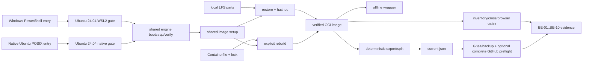

<!--
Copyright (c) 2026 DDP Engineering
This software is licensed under the PolyForm Noncommercial License 1.0.0.
Commercial use requires a separate commercial license.
See the LICENSE.txt in the .agentic folder for full license details.
SPDX-License-Identifier: LicenseRef-PolyForm-Noncommercial-1.0.0
-->

<!--
Task journal. One file per task, at .agentic/tasks/TASK-<id>.md, kept
after delivery as the task's historical record.

The header is the block of "key: value" lines directly under the title.
Keep it exactly in that form — one key per line, no blank lines inside
the block, no comments between the lines — so it stays machine-readable.

  stage         frame | specify | design | build | validate | deliver | done
                (adoption journals: survey | components | close | done)
  type          feature | fix | change | adopt
  path          full | quick
  requirements  comma-separated requirement IDs, empty until specify
  parent        optional top-level TASK-id; blank for an ordinary task
  branch        the branch this task is delivered on
  base          the commit this task started from, filled in at creation;
                the delivery report and `check --task` measure the diff
                against it, so leave it alone once it is written. Empty
                when the repository had no history yet.
  opened        YYYY-MM-DD

Header lines are edited in place; log lines are only ever appended.
The Log is a progress-and-evidence ledger, not an activity transcript. Append
only durable events that change the task's stage, scope, engineering outcome,
verification status, authority, or ability to proceed: stage transitions;
material scope or implementation decisions not already captured elsewhere;
consolidated automated or manual verification results; material discoveries;
blockers; approvals; deviations; and delivery outcomes.

Do not log routine searches, reads, edits, internal tool mechanics or corrected
command retries, and do not copy requirements, designs, specifications,
knowledge pages, Rulings, Handoff, or Stage report content into the Log. A
failed command belongs only when it exposes a candidate problem, changes the
implementation or tests, or remains an accepted verification limitation. Keep
each entry concise and self-contained; reference durable artifacts instead of
repeating them. Existing entries remain append-only under later contracts.

Stage report is one replaceable latest snapshot, not an evidence store.
Use plain one-line fields with no fences or bullets inside that section.
stage is the reported stage; current must match the journal header after any
transition. result is in_progress | completed | paused | blocked | skipped.
Leave unknown fields blank; summary prints not recorded, never an assumed pass.
Refresh at a stage transition, pause or session end, blocker, or completed
validation or delivery outcome. Do not refresh after routine work.
-->

# TASK-998d1b00 — Implement reproducible OCI development build environment

stage: build
type: change
path: full
requirements: REQ-PLAT-80e40361, REQ-PLAT-dd007527, REQ-PLAT-6023db98, REQ-FUNC-a29c7664, REQ-SEC-0cf66a6f, REQ-REL-37fe088c, REQ-PLAT-32c44b0c, REQ-TEST-74c72bbe, REQ-TEST-5c90b63f, REQ-UX-dc08eeab, REQ-SEC-2efc54bc, REQ-NFR-1ad0cee7
parent:
branch: master
base: 8d326898aec25de98052c59b5b2d67981f014d26
opened: 2026-09-05

## Done checklist (current stage)

- [ ] each automated behavior increment has a pre-implementation red record with requirement IDs, exact selector or command, non-zero exit, and expected failure reason, plus one final focused green result; each manual increment has a consolidated post-implementation observation
- [x] repository anchor recorded after red and evolution reviewed after implementation
- [ ] implementation makes those tests pass
- [ ] `test --impacted` green
- [ ] `affected_paths` and `linked_tests` updated on every requirement
- [x] `status = "active"` on every requirement this task delivers — or `"retired"`, with the reason in its prose, where this task deliberately removed the behavior
- [ ] `check` clean, or each remaining warning explained in the log
- [ ] `stage: validate`

## Frame

Problem: The repository-local toolchain is host-specific and cannot yet provide the complete, locked, offline-capable OCI build boundary approved in the development/build environment plan.
Desired outcome: A reviewed and tested `02_Tools` implementation can build, archive, restore, verify, and run the complete shared Linux amd64 build environment from Windows/WSL2 or native Ubuntu 24.04 x86-64 without Docker Desktop, while keeping acquisition, publication, and host changes explicit.
Actors: Windows developers, native Ubuntu developers, WSL2 and native Ubuntu build hosts, human archive maintainers, the authoritative personal Gitea service, the optional GitHub source/archive mirror, and an authorized ARM64 appliance operator.
Primary scenario: A developer with an already-cloned checkout and local LFS objects invokes the PowerShell Windows/WSL2 entry point or the native-Ubuntu POSIX entry point -> the host gate verifies Ubuntu 24.04 x86-64, systemd, and a direct Docker/Podman engine -> shared scripts validate and import the exact local multipart OCI archive (or explicitly rebuild from pinned inputs), verify its digest/inventory -> offline build/test commands run headlessly in the same container.
Examples: `bootstrap-build-environment.ps1 -Distribution Ubuntu-24.04` and `bootstrap-build-environment.sh` restore the same local parts; their matching `with-build-environment` wrappers run the mandatory no-network suite; an explicit rebuild constructs the same locked environment from reviewed inputs.
Counterexamples: setup fetching Git/LFS or contacting a forge; silently installing WSL/engines; accepting a tag, pointer file, partial GitHub replica, oversized part, corrupt archive, wrong OCI digest, or missing tool as usable; omitting content to fit a hosting quota.
In scope: ENV-01 through ENV-05 source machinery and documentation; OCI definition and lock; native GCC/binutils and ARM64 cross toolchain; Windows/WSL2 and native Ubuntu 24.04 x86-64 Docker/Podman orchestration over shared helpers; host-bootstrap package archive machinery; local-only multipart restore; explicit pinned rebuild; offline command wrapper; publication/readback preflight; BE-01 through BE-10 automated and manual evidence surfaces; existing-tool migration without premature retirement.
Out of scope: ARM64 developer workstations; product/appliance packaging and deployment; installing or modifying the current host without an explicit user switch; Git/LFS publication; credentials; claiming unperformed Gitea, backup, independent clean-runner, clean-host matrix, or physical ARM64 evidence; resuming the paused Sigrok task itself.
Constraints: Work on existing `master`; preserve all pre-existing changes; no commit or push; all environment artifacts and tooling live under `02_Tools`; extracted runtimes remain ignored; default split is 1 GiB and hard maximum is 2 GB; GCC/binutils only; mandatory browser gate is Linux-container headless; setup never runs forge acquisition commands; complete Gitea authority and all-or-nothing GitHub semantics.
Success signals: Source and contract tests cover every safety boundary; clean supported Windows/WSL2 and native Ubuntu hosts can build/import and inventory the same image; normal test/build is network-disabled; multipart corruption/missing/order/digest checks fail closed; ARM64 compile/ABI hooks are explicit; documentation matches commands; unperformable external evidence remains honestly pending.
Evidence: STATED in `00_Planning/Development_Build_Environment_Plan.md` and the implementation prompt; OBSERVED existing conventions in `02_Tools/`, `05_Software/scripts/tests/test_toolchain_bootstrap.py`, `.agentic/knowledge/repository-toolchain.md`, and `06_SoftwareDocu/Development_and_Simulation_Flow.md`; INFERRED that exact hosted-capacity, independent-runner, and physical-appliance evidence cannot be produced solely from source; UNKNOWN current Gitea capacity/backup headroom and availability of the authorized ARM64 appliance.
Assumptions: Ubuntu 24.04 amd64 remains the selected build host; Docker Engine is primary and Podman compatibility is supported through one OCI contract; existing host-local bootstraps remain until equivalence is proven.
Unknowns: Exact resulting archive size/digest, two-run digest equality, Gitea/backup measured capacity, optional GitHub allowance, and physical ARM64 Sigrok ABI outcome remain evidence fields populated only after their real procedures run.
Decision-blocking questions: None; the user explicitly identified the plan as approved and supplied all architecture decisions while forbidding fabricated external evidence.
Proposed behaviors: Implement the complete locked definition, explicit host bootstrap, local-only restore, reproducible export/split/manifest verification, no-network execution wrapper, inventory and cross-build verification, replica publication preflight/readback tooling, acceptance evidence recorder/checker, tests, policy, and runbooks.
Path and reason: Full path. The work adds public command interfaces, dependency locks, archive schemas, security boundaries, host orchestration, and independently verifiable failure behavior.

## Requirement coverage

| Frame outcome | Atomic behavior | Requirement | Positive case | Boundary or failure | Verification | Design decision or no impact |
|---|---|---|---|---|---|---|
| Complete locked definition | Build exact complete OCI image | REQ-PLAT-80e40361 | Clean build and inventory | Mutable/unlisted/missing input | Definition and inventory tests | Lock drives one Containerfile and embedded inventory |
| Explicit WSL engine | Verify/install selected in-WSL engine | REQ-PLAT-dd007527 | Existing Docker or Podman | Missing/unsupported/unverified packages | Injected WSL tests | Host archive is separate; installation opt-in |
| Native Ubuntu host | Verify native host and share engine/image setup | REQ-PLAT-6023db98 | Ubuntu 24.04 x86-64 with Docker or Podman | Wrong OS/architecture/systemd or implicit install | Injected POSIX host-boundary tests | Native and WSL entry points converge on shared helpers |
| Local archive restore | Verify/import local multipart image | REQ-FUNC-a29c7664 | Synthetic round trip | Missing/order/pointer/hash/digest failures | Restore integration tests | One normalized engine adapter and fail-closed phases |
| Offline execution | Run ordinary commands isolated | REQ-SEC-0cf66a6f | Build/test with no network | Socket/credential/privilege mount | Invocation and offline tests | Fixed mounts, no network, unprivileged user |
| Exact archive | Deterministically export/split/describe | REQ-REL-37fe088c | Default 1 GiB ordered parts | Over 2 GB/corruption/extra part | Synthetic archive tests | Streaming gzip/split plus schema 1 manifest |
| Replica authority | Preflight complete Gitea and optional GitHub | REQ-PLAT-32c44b0c | Complete OID readback | Partial GitHub or missing backup | Manifest/preflight tests | Human-operated evidence files; no agent publication |
| Native/ARM64 proof | Compile/link/build/browser/ABI gates | REQ-TEST-74c72bbe | All in-container checks plus appliance | Missing cross tool/browser/appliance | Verification scripts and evidence checker | Container mandatory; physical evidence explicit |
| Honest acceptance | Report BE-01 through BE-10 | REQ-TEST-5c90b63f | Complete fresh evidence | Missing/stale/inconsistent proof | Evidence-schema tests | Status is derived, never hand-waved |
| Recovery guidance | Name local defects and two recovery paths | REQ-UX-dc08eeab | Missing content output | Pointer/corrupt content | Captured error-output tests | Restore returns structured diagnostics to both wrappers |
| No forge/credentials | Keep ordinary setup local-only | REQ-SEC-2efc54bc | Local import | Hidden Git/LFS/network/persistent env | Static plus injected boundary tests | Only explicit rebuild invokes upstream build path |

## Design

Requirements coverage: REQ-PLAT-80e40361 owns the reviewed definition/lock/inventory; REQ-PLAT-dd007527 owns Windows/WSL2 host-engine verification and explicit local-package installation; REQ-PLAT-6023db98 owns native Ubuntu host validation and shared-helper convergence; REQ-FUNC-a29c7664 owns setup/restore/import; REQ-SEC-0cf66a6f owns isolated execution; REQ-REL-37fe088c owns export/split/manifest; REQ-PLAT-32c44b0c owns human publication preflight; REQ-TEST-74c72bbe owns toolchain/browser/cross/ABI proof; REQ-TEST-5c90b63f owns gate evidence status; REQ-UX-dc08eeab owns actionable recovery; REQ-SEC-2efc54bc owns the no-forge/no-credential boundary.

Component responsibilities: `containers/build` is immutable definition and inventory metadata; PowerShell and POSIX entry points validate their Windows/WSL2 or native Ubuntu host while `bootstrap-container-engine.sh` and `setup-build-environment-image.sh` provide the shared Linux boundaries; `scripts` implement engine-neutral build/export/restore/verification and human publication preflight; `env` runs normal commands; `tests/build-environment` records and evaluates acceptance; existing host-specific bootstrap remains compatible until real equivalence evidence permits retirement.

Interfaces and contracts: PowerShell only discovers/selects WSL and invokes the existing `Wsl.ps1` boundary; the POSIX entry point performs the corresponding native host probes. Shared Linux scripts accept `--engine docker|podman` and normalize engine verification and image inspection/import. Archive and host CLI details are fixed in four linked specs. Exit 2 means usage, ordinary nonzero means unmet prerequisite/integrity/gate; child process exit codes propagate (all requirements).

Data ownership and state: tracked definitions/manifests/evidence templates live under `02_Tools`; multipart payloads alone are LFS; joined archives are temporary outside the checkout; engine state/caches use Linux-native paths on WSL2 or native Ubuntu; extracted runtime/cache stays ignored. `current.json` begins as an explicit ungenerated placeholder and is replaced only by a verified export (REQ-FUNC-a29c7664, REQ-REL-37fe088c).

Execution flow: PowerShell verifies WSL2 Ubuntu/systemd or POSIX verifies native Ubuntu/systemd -> the shared Linux bootstrap explicitly installs or conditionally verifies one engine only for a selected image action -> expected digest is checked -> local parts restore or explicit network rebuild -> common inventory verification. Normal wrappers validate the same digest each invocation then use `--network none`, stable `/workspace`, declared cache/output paths, no socket/credentials, and caller UID/GID (REQ-PLAT-dd007527, REQ-PLAT-6023db98, REQ-FUNC-a29c7664, REQ-SEC-0cf66a6f).

Failure recovery: All validation is phase-ordered and fail-closed. Restore diagnoses every local part before joining, preserves user LFS/cache content, and deletes only its temporary join. Rebuild is never automatic. Publication scripts are dry-run/preflight by default and require explicit human execution for remote transfer/readback. Acceptance output distinguishes failed from pending external proof (REQ-FUNC-a29c7664, REQ-UX-dc08eeab, REQ-PLAT-32c44b0c, REQ-TEST-5c90b63f).

Security: No setup code invokes Git acquisition, accepts forge URLs, mounts credentials/engine sockets, or persists environment changes. Base/download/package identities are lock/digest based. Container execution is unprivileged, capability-dropped, no-new-privileges, and offline for normal commands (REQ-SEC-0cf66a6f, REQ-SEC-2efc54bc).

Concurrency and ordering: Archive part order is ordinal and duplicate-free; exporter writes staging then atomically replaces metadata. No shared publication mutation is automated. Engine commands are synchronous and preserve exit codes (REQ-REL-37fe088c, REQ-PLAT-32c44b0c).

Compatibility and migration: Existing `with-tools`, native Windows headed browser, development launcher, and WSL-named compatibility wrapper remain. Documentation makes OCI the required acceptance boundary without deleting old entry points before observed equivalence. Docker is primary; Podman and both supported host routes share the same definition/archive contract (repository constraint, REQ-PLAT-dd007527, REQ-PLAT-6023db98).

Observability and operations: Every invocation prints generation/digest; inventory is machine-readable; export records creation/verifications; acceptance JSON has timestamps, command/evidence paths, and pending states; maintenance records capacity/readback/backup without credentials (REQ-PLAT-80e40361, REQ-PLAT-32c44b0c, REQ-TEST-5c90b63f).

Test seams: One Python contract/integration module exercises schemas, static safety, injected native host probes/helpers, synthetic archive round trips/corruption, wrapper invocations, and acceptance derivation. Shell self-tests cover executable behavior where available. Real clean-host matrix runs, offline browser, independent builds, Gitea/backup, clean clones, and appliance ABI remain named commands/evidence (all requirements).

Alternatives and tradeoffs: Clang is rejected by user decision. Docker Desktop is rejected as a prerequisite. Registry-only distribution is rejected because local LFS archive is authoritative. Embedding opaque binaries in normal Git is rejected; narrow multipart LFS escrow is allowed. A partial GitHub archive is rejected rather than labelled degraded.

Expected files: `.gitattributes`, `.gitignore`, policy/docs/knowledge; `02_Tools/{containers,archives,bootstrap,env,scripts,tests}/...`; `05_Software/scripts/tests/test_build_environment.py`; eleven requirements and four specs.

Risks: Ubuntu snapshot/package hashes and actual image digest need networked generation; container size may be large; WSL or native-Ubuntu engine installation changes host state only under explicit authority; physical ARM64, clean-host matrix, and hosted capacity/readback are externally dependent. Tests must not fake those as accepted.

Open decisions: None for product behavior. Real generation identifiers/digests/sizes and external acceptance observations remain evidence values, not design choices.

### Proposed architecture - TASK-998d1b00

## Log

- 2026-09-05 frame: Scope accepted from the approved authoritative plan and implementation prompt; full path selected for new command, dependency, archive, and trust-boundary contracts; no child tasks because the source changes share one lock/manifest and integrated acceptance boundary.
- 2026-09-05 specify: Created ten atomic requirements and three exact-contract specs; no existing requirement fully covered the OCI archive, engine, offline, replica, and acceptance behavior; no requirements revised, reused, or retired.
- 2026-09-05 design: Accepted the integrated source/host/archive/run/evidence architecture in `## Design`; existing host-specific tooling remains until observed OCI equivalence, and external acceptance values stay evidence rather than constants.
- 2026-09-05 build red: command=`python -m unittest 05_Software.scripts.tests.test_build_environment -v`; exit=1; requirements=REQ-PLAT-80e40361, REQ-PLAT-dd007527, REQ-FUNC-a29c7664, REQ-SEC-0cf66a6f, REQ-REL-37fe088c, REQ-PLAT-32c44b0c, REQ-TEST-74c72bbe, REQ-TEST-5c90b63f, REQ-UX-dc08eeab, REQ-SEC-2efc54bc; expected missing behavior=definition, lock, setup, wrapper, archive core, policy, and evidence artifacts do not yet exist.
- 2026-09-05 test: test exit 127 (79.5s)
- 2026-09-05 test: test exit 0 (332.5s)
- 2026-09-05 build: Implemented the digest-pinned OCI definition, WSL engine boundary, local-only streaming archive restore/export, isolated command wrapper, host-bootstrap/archive publication machinery, acceptance evidence surfaces, policy, documentation, and Linux-native headless browser topology support; focused command=`python -m unittest 05_Software.scripts.tests.test_build_environment 05_Software.scripts.tests.test_toolchain_bootstrap -v`; result=16 passed.
- 2026-09-05 build: Real Windows/Ubuntu-24.04 WSL2 setup verified the distribution/kernel/systemd boundary and existing Docker engine, then stopped fail-closed because `skopeo` is not installed; a pre-final network build reached the pinned Ubuntu snapshot package closure and failed on repeated HTTP 503 responses, so no image/archive digest was accepted.
- 2026-09-05 build: Repository regression command=`.\\02_Tools\\env\\with-tools.ps1 python .agentic/aegis.py test --impacted --base HEAD --task TASK-998d1b00`; result=green in 332.5s with 49 script tests, Go suite, Python suites (32 + 7/1 skipped + 28), 429 GUI tests, production build, and 38 browser tests; the preceding ambient-PATH run exited 127 after its 49 Python tests because host `go` was absent.
- 2026-09-05 build: AEGIS evolution records 47 candidate files; scoped check reports zero errors. Remaining warnings are pre-existing stale requirements/journals and user-owned untracked files, plus the intentional root `.gitattributes` policy file outside configured layout.
- 2026-09-05 deviation build: Real image/archive generation and BE-03 through BE-09 verification remain pending because this WSL host lacks skopeo, the attempted Ubuntu snapshot package fetch returned HTTP 503, and hosted-replica/backup/ARM64-appliance proof requires external systems; requirements remain draft and the task remains paused rather than claiming acceptance.
- 2026-09-05 build review red: command=`python -m unittest 05_Software.scripts.tests.test_build_environment -v`; exit=1; requirements=REQ-PLAT-80e40361, REQ-FUNC-a29c7664, REQ-SEC-0cf66a6f, REQ-REL-37fe088c, REQ-TEST-5c90b63f; expected missing behavior=fresh offline cache seeding, fail-closed incomplete reconstruction input closure, pending-before-round-trip evidence, corrupt-parts explicit rebuild fallback, clean source identity, generation equality, and portable manifest paths are not implemented.
- 2026-09-05 build review correction: Added image-seed-to-writable-volume initialization for first offline use; explicit corrupt-part inspection with selected rebuild continuation; pending archive verification plus evidence-gated promotion; generation/portable-path checks; and clean relevant-tree provenance enforcement. Incomplete apt/Python/Chromium reconstruction inputs now stop before engine or network access.
- 2026-09-05 build review green: command=`.\\02_Tools\\env\\with-tools.ps1 python .agentic/aegis.py test --impacted --base HEAD --task TASK-998d1b00`; exit=0; covered=REQ-PLAT-80e40361, REQ-FUNC-a29c7664, REQ-SEC-0cf66a6f, REQ-REL-37fe088c, REQ-TEST-5c90b63f; result=52 script tests, Go suite, Python suites (32 + 7/1 skipped + 28), 429 GUI tests, production build, and 38 browser tests passed in 331.0s; Dockerfile check, shell syntax, Python compilation, and diff whitespace checks also passed.
- 2026-09-05 deviation build: Complete hermetic reconstruction remains unimplemented: apt transitive packages, managed Python, and Chromium are not yet materialized and consumed by hash. `validate-reconstruction` and `build-build-environment.sh` both exit 1 before engine/network work, BE-02 through BE-09 remain pending, and the task stays in build.
- 2026-09-05 test: test exit 0 (331.0s)
- 2026-09-05 build final-review red: focused candidate-identity tests exit 1 as expected; dirty relevant content is still rejected, source identity is not structured or content-derived, committed-candidate and stale-image checks are absent, and archive provenance still accepts only a HEAD commit.
- 2026-09-05 build final-review correction: Replaced the clean-tree prerequisite with a deterministic relevant-candidate digest covering tracked and non-ignored untracked paths, bytes, deletions, symlink targets, and applicable executable modes while excluding runtime/cache/archive outputs. Build labels and generated provenance now distinguish base HEAD, content-tree SHA-256, and clean/dirty status; export rejects a missing or stale image label, and `verify-committed-source` checks the eventual human-created clean commit against the approved digest.
- 2026-09-05 build final-review green: focused 13-test environment suite passes, including dirty-candidate acceptance, content/untracked sensitivity, ignored cache/archive stability, post-approval clean-commit matching, and stale-image rejection. Python compilation, WSL shell syntax, placeholder-manifest validation, and diff whitespace checks pass; Windows and WSL calculate the same candidate identity for the shared checkout.
- 2026-09-05 build final-review identity: base HEAD=`8d326898aec25de98052c59b5b2d67981f014d26`; approved uncommitted relevant candidate SHA-256=`5c3f6f252c7286ccc1ab1372c73afadfb7834723b5ad491af9239481b38ef440`; status=`dirty`. Post-approval verification must use this digest after the human commit.
- 2026-09-05 build final-review process: AEGIS evolution records 9 modified files since the review-red anchor; scoped check reports zero errors, with 24 pre-existing/unrelated or intentional warnings and two notes.
- 2026-09-05 build reconstruction red: command=`.\02_Tools\env\with-tools.ps1 python -m unittest 05_Software.scripts.tests.test_build_environment.BuildEnvironmentTests.test_reconstruction_lock_is_complete_and_consumed_offline 05_Software.scripts.tests.test_build_environment.BuildEnvironmentTests.test_materialized_input_directory_rejects_missing_and_tampered_payloads -v`; exit=1; requirements=REQ-PLAT-80e40361, REQ-SEC-0cf66a6f; expected missing behavior=the closure is still marked incomplete, materialized-directory verification is absent, and the consuming build still contains network downloads.
- 2026-09-05 build reconstruction: Materialized and verified the complete 650-record, 995486423-byte Linux amd64 input closure: 235 apt packages, 264 npm tarballs, 126 Go proxy objects, 18 Python wheels, three browser payloads, and one each of Go, uv, Node, and managed CPython. The locked manifest SHA-256 is `784a1d020ef72bd4c567a3f85287e2b72e456f2f7bc28db7c470d0e82579da3f`; missing, extra, symlinked, size-mismatched, and hash-mismatched materialized inputs fail closed before the engine starts.
- 2026-09-05 build reconstruction green: A real Docker build from the digest-pinned local Ubuntu base completed with `--network=none` and the verified `nilo_inputs` named context. Offline apt, npm, Go module, Python wheel, and browser stages succeeded; inventory reported Go 1.27.0, Python 3.12.10, uv 0.11.25, Node 24.20.0, npm 11.19.0, GCC/AArch64 GCC 13.3.0, binutils 2.42, and Chromium, while native x86-64 and AArch64 compile/link smokes passed under dropped capabilities and no-new-privileges.
- 2026-09-05 build reconstruction verification: Focused 15-test environment suite, reconstruction/materialized-input validators, Python compilation, WSL shell syntax, Dockerfile static check, and the AEGIS impacted fallback full repository suite all passed; the full suite completed in 313.8s with 56 script tests, Go, Python suites, 429 GUI tests, production build, and 38 browser tests. `REQ-PLAT-80e40361` is active; scoped AEGIS check has zero errors, with only pre-existing/unrelated and intentional large-manifest warnings; canonical archive/export, independent rebuild equality, hosted replicas, clean clones, and physical ARM64 appliance evidence remain pending.
- 2026-09-05 build reconstruction identity: base HEAD=`8d326898aec25de98052c59b5b2d67981f014d26`; current uncommitted relevant candidate SHA-256=`2a15535145f96310bbc8f620746ea1be76d5b325d4b43f2a0e8f013bf6436b54`; status=`dirty`. This supersedes the earlier pre-reconstruction candidate digest for any later approval/commit comparison.
- 2026-09-05 build independent-review red: command=`.\02_Tools\env\with-tools.ps1 python -m unittest 05_Software.scripts.tests.test_build_environment.BuildEnvironmentTests.test_pending_archive_reports_recovery_before_missing_tool_errors 05_Software.scripts.tests.test_build_environment.BuildEnvironmentTests.test_explicit_rebuild_reports_selected_action_then_missing_tool 05_Software.scripts.tests.test_build_environment.BuildEnvironmentTests.test_acceptance_reports_pending_external_gates_and_never_infers_pass 05_Software.scripts.tests.test_build_environment.BuildEnvironmentTests.test_policy_lfs_and_documented_commands_match_the_plan -v`; exit=1; requirements=REQ-FUNC-a29c7664, REQ-UX-dc08eeab, REQ-TEST-5c90b63f, REQ-PLAT-80e40361; expected missing behavior=bootstrap gates on skopeo before pending-archive recovery/action selection, BE-02 and the definition README still describe the completed closure as pending, and BE-04 does not distinguish the noncanonical unlabeled closure-test image.
- 2026-09-05 build independent-review correction: Bootstrap now inspects pending/local archive state before requiring image tools, reports all three recovery choices without engine/skopeo on an unselected pending archive, and gates only the chosen current-image, restore, or rebuild action. The definition documentation and evidence record now identify the 650-record closure and BE-02 pass while explicitly retaining BE-04 as pending because `nilo/build-environment:closure-test` is noncanonical and lacks provenance labels.
- 2026-09-05 build independent-review green: focused command from the review red passed four tests, the complete environment module passed 17 tests, reconstruction and 650-file materialization validation passed, shell syntax and diff checks passed, and command=`.\02_Tools\env\with-tools.ps1 python .agentic/aegis.py test --impacted --base HEAD --task TASK-998d1b00`; exit=0; covered=REQ-FUNC-a29c7664, REQ-UX-dc08eeab, REQ-TEST-5c90b63f, REQ-PLAT-80e40361; fallback full suite passed in 332.3s with 58 script tests, Go, Python suites, 429 GUI tests, production build, and 38 browser tests. Current relevant candidate SHA-256 is `34a291adde4ec3b7ce1d94d894a1a1bf294101c76cc7e19567333ab63d86b000`.
- 2026-09-05 build host-bootstrap red: command=`.\02_Tools\env\with-tools.ps1 python -m unittest 05_Software.scripts.tests.test_build_environment.BuildEnvironmentTests.test_host_bootstrap_preserves_an_existing_selected_engine -v`; exit=1; requirements=REQ-PLAT-dd007527; expected missing behavior=the explicit verified-package installer always includes the selected engine closure even when that engine is already installed and healthy, causing an unnecessary pinned engine upgrade when only common tooling is required.
- 2026-09-05 build host-closure red: command=`.\02_Tools\env\with-tools.ps1 python -m unittest 05_Software.scripts.tests.test_build_environment.BuildEnvironmentTests.test_host_archive_uses_apts_selected_dependency_closure -v`; exit=1; requirements=REQ-PLAT-dd007527; expected missing behavior=the host archive generator expands every dependency alternative with `apt-cache depends` instead of downloading APT's selected no-recommends solution, so it includes unrelated packages and violates the minimal selected closure.
- 2026-09-05 build host-closure noninteractive red: command=`.\02_Tools\env\with-tools.ps1 python -m unittest 05_Software.scripts.tests.test_build_environment.BuildEnvironmentTests.test_host_archive_uses_apts_selected_dependency_closure -v`; exit=1; requirements=REQ-PLAT-dd007527; expected missing behavior=APT's selected download-only closure still prompts for confirmation, so unattended checksum-locked archive generation aborts without `-y`.
- 2026-09-05 scope expansion: Added native Ubuntu 24.04 x86-64 as a supported developer host with a POSIX entry point while retaining Windows x86-64 plus Ubuntu 24.04 WSL2; both paths share one Linux amd64 image, reconstruction lock, multipart archive, verification suite, and offline boundary, and ARM64 developer hosts remain out of scope.
- 2026-09-05 build host-metadata red: command=`.\02_Tools\env\with-tools.ps1 python -m unittest 05_Software.scripts.tests.test_build_environment.BuildEnvironmentTests.test_host_archive_reads_raw_deb_control_field_values -v`; exit=1; requirements=REQ-PLAT-dd007527, REQ-PLAT-6023db98; expected missing behavior=the generator parses multi-field `dpkg-deb -f` label lines as raw values, so a correct checksum-pinned root package is rejected after resolution.
- 2026-09-05 build native-host red: command=`.\02_Tools\env\with-tools.ps1 python -m unittest 05_Software.scripts.tests.test_build_environment.BuildEnvironmentTests.test_native_ubuntu_entry_point_uses_shared_boundaries 05_Software.scripts.tests.test_build_environment.BuildEnvironmentTests.test_native_ubuntu_rejects_unsupported_hosts_before_engine 05_Software.scripts.tests.test_build_environment.BuildEnvironmentTests.test_windows_and_native_entry_points_share_linux_helpers -v`; exit=1; requirements=REQ-PLAT-6023db98, REQ-PLAT-dd007527, REQ-FUNC-a29c7664; expected missing behavior=the POSIX entry point is only an image helper, does not validate native Ubuntu/systemd/architecture or expose explicit host installation, and the Windows path still names WSL-only rather than shared Linux helpers.
- 2026-09-05 build host-matrix metadata red: command=`.\02_Tools\env\with-tools.ps1 python -m unittest 05_Software.scripts.tests.test_build_environment.BuildEnvironmentTests.test_archive_round_trip_and_corruption_fail_closed -v`; exit=1; requirements=REQ-PLAT-6023db98, REQ-REL-37fe088c; expected missing behavior=a real canonical export labels the generated archive as WSL2-only even though the accepted artifact supports native Ubuntu and WSL2 hosts.
- 2026-09-05 test: test exit 0 (313.8s)
- 2026-09-05 build archive-round-trip red: command=`./02_Tools/tests/build-environment/verify-archive-round-trip.sh --engine docker --manifest 02_Tools/archives/build-environment/current.json --archive-path 02_Tools/archives/build-environment`; exit=1; requirements=REQ-REL-37fe088c, REQ-TEST-5c90b63f; observed missing behavior=the archive reassembled, imported, matched digest `sha256:5346b3e08433c6b26b69d120cda0a5fc5e2e04ede16d75c2197bdc05f7f69d68`, and passed inventory/native/AArch64 smokes, but full network-disabled Go tests used the empty runtime-cache path instead of the image's cache seed and therefore attempted the unreachable public proxy; the manifest correctly remained pending.
- 2026-09-05 build archive-round-trip unit red: command=`.\\02_Tools\\env\\with-tools.ps1 python -m unittest 05_Software.scripts.tests.test_build_environment.BuildEnvironmentTests.test_full_verification_seeds_the_offline_runtime_cache -v`; exit=1; requirements=REQ-REL-37fe088c, REQ-TEST-5c90b63f; expected missing behavior=the full verifier does not seed `/work/runtime-cache` from the immutable in-image cache before network-disabled repository tests.
- 2026-09-05 build offline-suite ordering red: command=`./02_Tools/scripts/verify-build-environment.sh --engine docker --image nilo/build-environment:noble-20260905-01`; exit=1 after cache seeding; requirements=REQ-REL-37fe088c, REQ-TEST-5c90b63f; observed missing behavior=the verifier's hand-written partial test sequence runs Go acceptance tests before the canonical offline build creates integration virtual environments, causing missing `.venv-linux-x86_64` failures; verification must invoke the build-before-test canonical offline suite.
- 2026-09-05 build Python-wheelhouse red: command=`./02_Tools/scripts/verify-build-environment.sh --engine docker --image nilo/build-environment:noble-20260905-01`; exit=1 in canonical offline build after runtime-cache seeding; requirements=REQ-PLAT-80e40361, REQ-REL-37fe088c, REQ-TEST-5c90b63f; observed missing behavior=the image contains every locked Python wheel under `/opt/nilo/inputs/python-packages`, but runtime `uv sync --offline --frozen` is not configured to search that immutable wheelhouse and rejects absent cache entries such as `annotated-types` and `ruff`.
- 2026-09-05 build Python-lock resolution red: command=`./02_Tools/scripts/verify-build-environment.sh --engine docker --image nilo/build-environment:noble-20260905-01`; exit=1 after adding `UV_FIND_LINKS`; requirements=REQ-PLAT-80e40361, REQ-REL-37fe088c, REQ-TEST-5c90b63f; observed missing behavior=frozen registry URLs remain authoritative to `uv sync` even with a local find-links directory, so the runtime contract must explicitly create `.venv-linux-x86_64`, install only the locked wheelhouse with `--no-index`, and install repository-local projects without dependency resolution.
- 2026-09-05 build offline-lint-root red: command=`./02_Tools/scripts/verify-build-environment.sh --engine docker --image nilo/build-environment:noble-20260905-01`; exit=1 after successful offline Python/npm preparation; requirements=REQ-REL-37fe088c, REQ-TEST-5c90b63f; observed missing behavior=the canonical lint helper was invoked from repository root instead of `05_Software`, so recursive Go-suite discovery entered ignored resolver artifacts under `02_Tools/cache` and vetted third-party module tests; the lint root must be the software tree.
- 2026-09-05 build clean-clone fixture red: command=`./02_Tools/scripts/verify-build-environment.sh --engine docker --image nilo/build-environment:noble-20260905-01`; exit=1 in script tests after offline lint passed; requirements=REQ-TEST-5c90b63f, REQ-SEC-2efc54bc; observed missing behavior=three source tests read the generated, ignored archive `current.json`, so they fail before export and on clean clones; pending-manifest tests must use a self-contained fixture rather than runtime evidence.
- 2026-09-05 build isolated-host fixture red: command=`./02_Tools/scripts/verify-build-environment.sh --engine docker --image nilo/build-environment:noble-20260905-01`; exit=1 in two bootstrap script tests; requirements=REQ-PLAT-6023db98, REQ-TEST-5c90b63f; observed missing behavior=the tests now inject archive/engine state but still depend on ambient systemd, so a network-disabled container correctly fails the native-host gate before reaching the behavior under test; the fixture must inject all supported-host probes.
- 2026-09-05 build arm64-cross-test red: command=`./02_Tools/scripts/verify-build-environment.sh --engine docker --image nilo/build-environment:noble-20260905-01`; exit=1 after the complete amd64 Go suite passed; requirements=REQ-PLAT-32c44b0c, REQ-TEST-74c72bbe; observed missing behavior=the x86-64 verification host attempts to execute cross-compiled AArch64 test binaries and receives `exec format error`; local verification must compile every arm64 test package via Go's `-exec` hook while retaining physical ARM64 execution as separate BE-06 evidence.
- 2026-09-05 build supervisor-test race red: canonical archive reassembly/import matched image digest `sha256:62f770799813f05fb180fb1d0c617cd308d9bec7c7eb02fe471686902ec232a3`, but offline verification failed in `TestSupervisorContainsInvalidRunnerOutput`; a same-image `-count=10` diagnostic failed 7 runs. requirements=REQ-TEST-5c90b63f; observed missing behavior=the malformed/overflow/exit test-helper modes act immediately after hello instead of after receiving execute, racing the supervisor's request write and yielding pipe-close errors rather than the intended post-request protocol conditions.
- 2026-09-05 test: test exit 0 (332.3s)
- 2026-09-05 build supervisor-test race green: command=`.\02_Tools\env\with-tools.ps1 go -C 05_Software/nilo_assistant test ./internal/integration/supervisor -run TestSupervisorContainsInvalidRunnerOutput -count=20`; exit=0; covered=REQ-NFR-1ad0cee7, REQ-TEST-5c90b63f; all malformed-runner stress repetitions passed after the helper deferred malformed/overflow/exit behavior until it received the execute request.
- 2026-09-05 build host-bootstrap observation: Explicit checksum-verified installation from the 191743998-byte local host archive added git-lfs 3.4.1, jq/libjq1, libonig5, and skopeo, and upgraded four Kerberos libraries from the pinned Ubuntu 24.04 closure; the already-working Docker and Podman installations were preserved. The archive has SHA-256 `d2bf7348487e170edcaccc917350cbae90fcc960d0fa63bc74f5228d213da09f`.
- 2026-09-05 build infrastructure incident: The first definitive archive round-trip encountered a WSL process segmentation fault and a read-only `/tmp`; a full WSL shutdown recovered the distribution, ext4 replayed 44 orphan inodes, the filesystem remounted read-write, systemd and Docker returned healthy, and no user data was deleted. Superseded exports remain recoverable under ignored `02_Tools/cache/containers/stale-exports/`.
- 2026-09-05 build canonical artifact green: The final relevant source tree SHA-256 is `08b9f4f52e6393b5ba4dbd8c0b46c2244adf28a8a005e9bf42094caa06b7f95d`; canonical image digest is `sha256:0a2b92fbc26480f6b8673bc6d3bd58abe46555485ba16ca628927cd7e785818b`; the 2856957630-byte three-part OCI archive has SHA-256 `6c5bc9d46d3a3f952fd14824d2cdbb93c16173c8a90c2e81a04eb5b73ca693b1`. Exact archive import matched the image digest and the complete offline suite passed: 67 scripts with 27 expected Windows-only skips, amd64 Go execution, arm64 Go package compilation, Python 8+28+32, GUI 429, and Playwright 38; manifest status promoted to `local-round-trip-complete` with `metadata/noble-20260905-01/round-trip.log`.
- 2026-09-05 build acceptance reconciliation: Local gates BE-01, BE-02, BE-04, BE-05, BE-07, and BE-10 pass. BE-03 clean Windows/WSL2 plus native-Ubuntu host matrix, BE-06 physical ARM64 execution, BE-08 hosted capacity, and BE-09 hosted/backup readback remain pending; the verifier exits 1 as designed. Repeated same-host builds used evolving sources and are not claimed as independent same-source reproducibility evidence.
- 2026-09-05 build completion: All delivered requirements are active and the final evolution report covers 16 post-anchor changes. Scoped check reports zero errors; remaining task-relevant warnings are intentional binary/LFS payloads that the heuristic secret scanner does not content-scan, while the other warnings belong to unrelated existing tasks/requirements or user-owned `WORK_Ubuntu.conf`.
- 2026-09-05 validate formatting red: command=`.\02_Tools\env\with-tools.ps1 python .agentic/aegis.py check --task TASK-998d1b00 --strict --run`; exit=1 after the full test phase passed in 294.8s; requirements=REQ-PLAT-6023db98; observed candidate problem=Prettier rejected `05_Software/nilo_gui/e2e/topology.ts`, so validation returned to candidate correction and required a fresh image/archive identity rather than accepting stale provenance.
- 2026-09-05 validate artifact supersession: Prettier normalization changed only formatting in the native-Linux/WSL topology implementation. The previous manifest, three archive parts, and metadata remain recoverable under ignored `02_Tools/cache/containers/stale-exports/prettier-reformat-superseded-0a2b92fb-artifacts/`; no payload was deleted or overwritten.
- 2026-09-05 validate definitive artifact: Supersedes the earlier canonical-artifact log. Final source tree SHA-256=`4f24373a08a5d9e43527cf76a8c33e3d6011392404b97dff467b101309cd5e3a`; image digest=`sha256:f84413d65e0f69f99b2b9eef8785b4944af896423d8bbd9a2f416d5003b9f530`; archive size=`2856928484`; archive SHA-256=`9bccae5d4a04e5eda81ea3fcbe05ec6c8c60c6a9d177e3c9cf356d2019872bf3`; part SHA-256 values are `bdaf2bbb2f0eec0128e342d3ed28c4b7a419fde92f7090149b12e86184e7b114`, `501250490d0aeabf926032e2075a5a1b0df33c9723845d05c4a1ec33e16b222a`, and `eaf316361e26cac5527bfb755bd9f35844fd1bc56f1f719aa88c09bbb1090f5b`. Exact import and the complete offline suite passed, and the manifest was promoted to `local-round-trip-complete`.
- 2026-09-05 validate final: command=`.\02_Tools\env\with-tools.ps1 python .agentic/aegis.py check --task TASK-998d1b00 --strict --run`; exit=0; full tests passed in 294.0s and lint in 7.7s. The final evolution report covers 17 post-anchor files. Strict check has zero errors and 29 warnings: task-relevant warnings are expected non-content-scanning of intentional binary/LFS archives plus `.gitattributes` outside the configured layout; the remaining warnings are unrelated pre-existing requirement/task records or user-owned `WORK_Ubuntu.conf`. Explicit review is disabled; semantic review found the host-matrix, offline, archive, security, recovery, and error-path behavior aligned with the task frame and linked requirements.
- 2026-09-05 deliver review changes-required: Independent review rejected the validated candidate for five concrete defects: shell/build files lack LF checkout attributes; dirty-source identity treats untracked shell entry points as 100644 and would disagree with an eventual 100755 Git index; generated provenance hardcodes WSL2; the BE-08 example invokes nonexistent `-PreflightOnly` and preflight does not verify local part materialization/integrity; and the runbook still describes the live verified manifest as pending-generation. Returned to build for focused regression fixes and fresh provenance-consistent artifacts.
- 2026-09-05 build review-fix red: command=`.\02_Tools\env\with-tools.ps1 python -m unittest 05_Software.scripts.tests.test_build_environment.BuildEnvironmentTests.test_untracked_shell_identity_matches_later_executable_index_mode 05_Software.scripts.tests.test_build_environment.BuildEnvironmentTests.test_publication_preflight_delegates_to_local_part_integrity_check 05_Software.scripts.tests.test_build_environment.BuildEnvironmentTests.test_publication_preflight_rejects_bad_local_parts_and_accepts_complete_set 05_Software.scripts.tests.test_build_environment.BuildEnvironmentTests.test_generated_builder_identity_is_host_neutral_and_consistent 05_Software.scripts.tests.test_build_environment.BuildEnvironmentTests.test_policy_lfs_and_documented_commands_match_the_plan -v`; exit=1; requirements=REQ-PLAT-80e40361, REQ-PLAT-6023db98, REQ-REL-37fe088c, REQ-PLAT-32c44b0c, REQ-TEST-5c90b63f; expected missing behavior=untracked shell identity differs after 100755 indexing, LF attributes are unspecified, provenance says WSL2 only, publication preflight accepts missing/corrupt/pointer/extra parts, the evidence command names an absent switch, and the runbook describes the live manifest as pending-generation.
- 2026-09-05 test: test exit 0 (297.8s)

- 2026-09-05 build review-fix green: The five focused regressions pass and the complete build-environment module passes 30 tests. `git check-attr` reports `eol: lf` for shell entry points and the Containerfile. All 19 new task-owned shell files plus `.gitattributes` are staged without committing; every shell entry is mode 100755 and the candidate digest remained `b8fe50b2422933e85913b953e231e3a066e14f3f5340312a370fcd660df1d0b4` before and after indexing. Real local publication preflight hashed the current three parts, passed with 4 GB synthetic capacity inputs, and made no remote change. command=`.\02_Tools\env\with-tools.ps1 python .agentic/aegis.py test --impacted --base HEAD --task TASK-998d1b00`; exit=0 after safe full-suite fallback in 297.8s with 71 scripts, Go, Python, 429 GUI tests, production build, and 38 browser tests; covered=REQ-PLAT-80e40361, REQ-PLAT-6023db98, REQ-REL-37fe088c, REQ-PLAT-32c44b0c, REQ-TEST-5c90b63f.
- 2026-09-05 build review-fix artifact: Review-corrected source tree SHA-256=`b8fe50b2422933e85913b953e231e3a066e14f3f5340312a370fcd660df1d0b4`; image digest=`sha256:88ec9769aaba4398d64407cf326c84d5c49be8e0f72359ed7382d182f3aef2dc`; archive size=`2856973703`; archive SHA-256=`3556066f412f328dd40c8eb5828e52b0089b60ac5875ae7e7bd57f9ebb4aa686`; part SHA-256 values=`3fae1ec75b970acc5fb534de1ca5362b3638df335ad8a635c278fa9137309340`, `1f840f56e15cdd5383ebe99ec981105bf53c612e64ce7be4952db941a022165b`, and `a72fc00a73cbf598464624847084cdb92acec3cf16a0dc04f6058542b8ef53ac`. Manifest and every local part pass Windows-side schema, order, materialization, size, and SHA-256 inspection; provenance builder is `local Ubuntu 24.04 linux/amd64 OCI engine (native or WSL2)`.
- 2026-09-05 build infrastructure blocker: The unchanged review-corrected archive round-trip failed during OCI import when WSL `/tmp` remounted read-only; subsequent full shutdown, targeted termination, root startup, and another shutdown/start consistently failed with `Wsl/Service/E_UNEXPECTED`. Restarting `WslService` requires unavailable administrator rights. The manifest correctly remains `pending-round-trip`; no source, archive part, or Windows-volume data was lost. A Windows reboot or elevated WSL service restart is required, then rerun `verify-archive-round-trip.sh` and strict validation.
- 2026-09-06 build oci-acquisition red: command=`python -m unittest 05_Software.scripts.tests.test_build_environment.BuildEnvironmentTests.test_reconstruction_acquires_base_and_frontend_images_by_digest 05_Software.scripts.tests.test_build_environment.BuildEnvironmentTests.test_oci_image_acquisition_verifies_digest_and_never_uses_a_mutable_tag -v`; exit=1; requirements=REQ-PLAT-80e40361, REQ-SEC-0cf66a6f; expected missing behavior=the lock records no acquirable base/build-frontend OCI identities and no `acquire-oci-images` command exists, so `--pull=false --network=none` reconstruction silently depends on a pre-existing local base image.
- 2026-09-06 build host-isolation red: command=`python -m unittest 05_Software.scripts.tests.test_build_environment.BuildEnvironmentTests.test_container_execution_isolates_the_host_checkout 05_Software.scripts.tests.test_build_environment.BuildEnvironmentTests.test_host_isolation_gate_proves_dependencies_are_untouched`; exit=1; requirements=REQ-SEC-0cf66a6f, REQ-PLAT-80e40361; expected missing behavior=the wrapper and verifier mount the checkout read-write and run `npm ci` plus virtual-environment creation inside it, so container verification replaces host `node_modules` and creates Linux `.venv-linux-x86_64` trees, and no host-isolation gate exists.
- 2026-09-06 build restore-space red: command=`python -m unittest 05_Software.scripts.tests.test_build_environment.BuildEnvironmentTests.test_restore_checks_space_and_avoids_duplicate_full_size_temporaries 05_Software.scripts.tests.test_build_environment.BuildEnvironmentTests.test_space_check_reports_required_and_available_and_fails_closed 05_Software.scripts.tests.test_build_environment.BuildEnvironmentTests.test_streamed_join_verifies_the_complete_archive_digest`; exit=1; requirements=REQ-FUNC-a29c7664, REQ-REL-37fe088c; expected missing behavior=restore creates both a full compressed join and a full decompressed OCI tar with no free-space preflight, no selectable temporary directory, and no streamed whole-archive digest verification.
- 2026-09-06 build host-transaction red: command=`python -m unittest 05_Software.scripts.tests.test_build_environment.BuildEnvironmentTests.test_host_installation_plans_the_transaction_before_changing_anything 05_Software.scripts.tests.test_build_environment.BuildEnvironmentTests.test_host_installation_fails_closed_on_downgrades_and_architecture_changes 05_Software.scripts.tests.test_build_environment.BuildEnvironmentTests.test_engine_installer_plans_before_it_mutates_the_host`; exit=1; requirements=REQ-PLAT-dd007527; expected missing behavior=the explicit installer runs `sudo dpkg -i` over the verified package set with no transaction plan, so downgrades and incompatible architecture replacements of core host packages such as libc6 and dpkg are neither detected nor refused.
- 2026-09-06 build candidate-correction green: command=`python -m unittest 05_Software.scripts.tests.test_build_environment`; exit=0; covered=REQ-PLAT-80e40361, REQ-PLAT-dd007527, REQ-FUNC-a29c7664, REQ-SEC-0cf66a6f, REQ-REL-37fe088c; result=40 tests pass, including nine new contracts for digest-pinned base/frontend acquisition, host-checkout isolation, streamed single-temporary restore with free-space preflight, and fail-closed host package transaction planning.
- 2026-09-06 build wsl-host-volume red: command=`python -m unittest 05_Software.scripts.tests.test_build_environment.BuildEnvironmentTests.test_space_check_accounts_for_the_wsl_host_volume`; exit=1; requirements=REQ-FUNC-a29c7664, REQ-REL-37fe088c; expected missing behavior=the free-space preflight trusts the figure reported inside the distribution, but a WSL ext4 virtual disk is sparse and can only grow while its Windows volume has room, so an 8.6 GB staging file is accepted and then fails mid-import.
- 2026-09-06 build clean-machine reconstruction green: The pinned base `ubuntu@sha256:1e0a86e5...` and build frontend `docker/dockerfile:1.7@sha256:a57df69d...` were removed from the Docker daemon store and confirmed absent, then `./02_Tools/scripts/build-build-environment.sh --engine docker` acquired and digest-verified both, materialized the 650-record closure from cache, resolved the frontend, and completed the `--network=none` offline build in 4m06s. New canonical image digest is `sha256:34e9d028e3a02d535390481f44112c6eb791de04987db6fee4a4fb5dcd01378a`; inventory reported Go 1.27.0, Python 3.12.10, uv 0.11.25, Node 24.20.0, npm 11.19.0, GCC/AArch64 GCC 13.3.0, binutils 2.42 and Chromium. This closes the gap where reconstruction silently depended on a pre-existing local base image.
- 2026-09-06 build host-isolation green: `./02_Tools/tests/build-environment/verify-host-isolation.sh --engine docker` passed. `npm ci` and every integration virtual environment were created under the container's `/work/source` copy; the host `05_Software/nilo_gui/node_modules` kept its 176 entries and its host-owned sentinel, and no `.venv-linux-x86_64` appeared in the checkout. A container smoke run confirmed `/workspace` is read-only, the isolated copy is 29 MB, and read-only Git metadata still answers `check-attr`, `ls-files` and `status`.
- 2026-09-06 build infrastructure discovery: This distribution's `ext4.vhdx` lives on `C:\Users\dpasare\AppData\Local\wsl\{ca4adca7-...}` where only 8.4 GB is free, while `df` inside the distribution reports 739 GB. The sparse virtual disk can only grow while the Windows volume has room, which is the most likely cause of the earlier read-only `/tmp` and `Wsl/Service/E_UNEXPECTED` incident. The space preflight now checks the backing Windows volume as well, and large temporaries are directed off the virtual disk.
- 2026-09-06 test: test exit 0 (345.4s)
- 2026-09-06 build host-volume policy: The free-space preflight distinguishes an operation that certainly writes new bytes from one that may not. The staging temporary is checked strictly against the Windows volume backing the ext4 virtual disk; the engine store is advisory, because a sparse disk can reuse space it already holds and an import can reuse existing layers. command=`python -m unittest 05_Software.scripts.tests.test_build_environment.BuildEnvironmentTests.test_engine_store_space_check_warns_rather_than_blocking_deduplicated_imports`; exit=0.
- 2026-09-06 build candidate green: command=`.\\02_Tools\\env\\with-tools.ps1 python .agentic/aegis.py test --impacted --base HEAD --task TASK-998d1b00`; exit=0 in 345.4s; covered=REQ-PLAT-80e40361, REQ-PLAT-dd007527, REQ-FUNC-a29c7664, REQ-SEC-0cf66a6f, REQ-REL-37fe088c, REQ-TEST-5c90b63f, REQ-UX-dc08eeab; result=Python script tests, Go suites (85 assistant tests plus packages), Python project suites, 429 GUI tests, production build and 38 Playwright tests all passed. The complete build-environment module passes 45 tests including twelve new contracts.
- 2026-09-06 build stale-image guard observed: the first export attempt after the clean rebuild correctly refused with `stale image: source-tree SHA-256 label does not match the current candidate`, because documentation and test sources were edited after that image was built. The candidate was frozen and rebuilt rather than exporting a mismatched image.
- 2026-09-06 build infrastructure blocker reproduced: the export chain's own rebuild step completed and produced image digest `sha256:8ee956ee217ea77df309ae9bd4548d4efd683ef0e54b0cd72291e213d4ee236a` for candidate tree `6fc178cd7315441ba08a64869f2240c86f2b17d92ba024fcc44be009393f1195`, but the following container run failed with `write /var/lib/containerd/io.containerd.metadata.v1.bolt/meta.db: read-only file system`. This is the same failure mode that blocked the task before. Root cause is now identified: the distribution's `ext4.vhdx` is 236.5 GB on a Windows C: volume with 6.1 GB free, so the sparse disk cannot grow and ext4 remounts read-only under `errors=remount-ro`. Docker and the filesystem recovered without intervention and no data was lost. Freeing space on the Windows system volume is a human action.
- 2026-09-06 deviation build: BE-04 is downgraded from passed to pending. The recorded pass described the superseded candidate `b8fe50b2`, whose metadata set is still present under `02_Tools/archives/build-environment/metadata/`. The current candidate `6fc178cd` built and passed inventory verification, but its provenance, SBOM and licence collection was interrupted, so no metadata set exists for it. The interrupted evidence set was moved to the ignored `02_Tools/cache/containers/stale-exports/interrupted-metadata-34e9d028/` rather than deleted.
- 2026-09-06 build acceptance reconciliation: passed BE-01, BE-02, BE-10; pending BE-03, BE-04, BE-05, BE-06, BE-07, BE-08, BE-09. `verify-acceptance` exits 1 as designed. Maturity records implemented and locally_integrity_checked only; round_trip_verified, clean_host_verified, published, independently_backed_up and fully_accepted all remain false.
- 2026-09-06 build candidate identity: base HEAD=`8d326898aec25de98052c59b5b2d67981f014d26`; current uncommitted relevant candidate SHA-256=`6fc178cd7315441ba08a64869f2240c86f2b17d92ba024fcc44be009393f1195`; status=`dirty`. The matching built image is `sha256:8ee956ee217ea77df309ae9bd4548d4efd683ef0e54b0cd72291e213d4ee236a`, which carries that tree digest as its `io.nilo.source-tree.sha256` label. This supersedes the earlier review-corrected candidate digest for any later approval or commit comparison.
- 2026-09-06 build audit-fix red: command=`python -B -m unittest -v 05_Software.scripts.tests.test_build_environment.BuildEnvironmentTests.test_engine_store_space_probe_does_not_require_user_write_access 05_Software.scripts.tests.test_build_environment.BuildEnvironmentTests.test_host_transaction_rejects_unresolved_dependencies_before_install 05_Software.scripts.tests.test_build_environment.BuildEnvironmentTests.test_downgrade_override_is_explicit_in_supported_entry_points 05_Software.scripts.tests.test_build_environment.BuildEnvironmentTests.test_wsl_space_check_requires_the_actual_backing_volume 05_Software.scripts.tests.test_build_environment.BuildEnvironmentTests.test_host_isolation_sentinel_cleanup_is_interruption_safe 05_Software.scripts.tests.test_build_environment.BuildEnvironmentTests.test_acceptance_evidence_commands_include_required_arguments`; exit=1; requirements=REQ-FUNC-a29c7664, REQ-PLAT-dd007527, REQ-PLAT-6023db98, REQ-REL-37fe088c, REQ-TEST-5c90b63f; expected missing behavior=daemon-owned engine storage is rejected as non-writable, package dependencies are not resolved before host mutation, downgrade authorization is not exposed by supported entry points, WSL assumes the VHDX is on C:, interrupted isolation checks can leave host sentinels, and recorded gate commands omit mandatory arguments.
- 2026-09-06 build audit-fix green: command=`python -B -m unittest 05_Software.scripts.tests.test_build_environment`; exit=0; covered=REQ-FUNC-a29c7664, REQ-PLAT-dd007527, REQ-PLAT-6023db98, REQ-SEC-0cf66a6f, REQ-REL-37fe088c, REQ-TEST-5c90b63f; result=51 tests pass, including six audit regressions. A real read-only WSL probe of daemon-owned `/var/lib/docker` passed while reporting both guest and explicitly supplied host-volume capacity; no archive import, host package mutation, or external action ran.

## Rulings

<!-- Append decisions here; never edit history. Supersede with a new ruling.
- RULING-001 | date=YYYY-MM-DD | decision=<decision> | reason=<reason> | source=user | supersedes=none
source: user | repository | requirement | technical
-->
- RULING-001 | date=2026-09-05 | decision=Implement directly on existing master and leave every change uncommitted | reason=The user explicitly required the saved checkout, prohibited branch creation, commits, and pushes, and approved preserving existing planning changes | source=user | supersedes=none
- RULING-002 | date=2026-09-05 | decision=Treat the named development/build environment plan as scope-approved and continue past the frame checkpoint | reason=The implementation prompt calls it the approved authoritative plan and requests completion rather than a new scope proposal | source=user | supersedes=none
- RULING-003 | date=2026-09-05 | decision=Record external archive generation, Gitea capacity/readback/backup, independent rebuild, and ARM64 appliance proof as pending unless actually observed | reason=Acceptance gates prohibit satisfying them with plans or fabricated checksums, while the user explicitly requested exact remaining commands when large artifacts cannot be generated | source=user | supersedes=none
- RULING-004 | date=2026-09-05 | decision=Officially support both Windows x86-64 through Ubuntu 24.04 WSL2 and native Ubuntu 24.04 x86-64 through a POSIX entry point, backed by the same Linux amd64 OCI artifact and verification boundary | reason=The user expanded the approved host matrix and explicitly excluded Docker Desktop assumptions and unproven ARM64 developer-host support | source=user | supersedes=none

## Handoff

<!-- Replace these fields with the latest minimal resume snapshot.
status: ready | waiting | blocked
-->

current: build
status: blocked
next: Free space on the Windows system volume (it is at roughly 0.6 GB and the WSL ext4 virtual disk cannot grow), then rerun export, corruption gates and round trip from `02_Tools/cache/containers/staging-export/noble-20260905-01` with TMPDIR and NILO_TMPDIR on a roomy volume, and finish with strict AEGIS validation.
must_read: .agentic/tasks/TASK-998d1b00.md; .agentic/steps/4_build.md; 02_Tools/tests/build-environment/evidence.local.json; 02_Tools/archives/build-environment/current.json; 02_Tools/README.md
blockers: the Windows volume holding this distribution's 242 GB ext4.vhdx has under 1 GB free, so the sparse disk cannot grow and the guest filesystem remounts read-only during a large export or import; this is the same failure that blocked the task before and it needs a human to reclaim host space

## Stage report

stage: build
result: blocked
current: build
changed: closed the clean-machine reconstruction gap by acquiring and digest-verifying the pinned base and build-frontend images in an explicit networked phase; isolated container build/test from the host checkout; made restore stream one verified pass with free-space preflight including the Windows volume behind a WSL virtual disk; made explicit host engine installation plan its package transaction and refuse downgrades; and reconciled documentation and acceptance evidence with what has actually been observed
evidence: complete build-environment module passes 45 tests including twelve new contracts; AEGIS impacted suite exit 0 in 345.4s covering Go, Python, 429 GUI tests, production build and 38 Playwright tests; a real reconstruction with the base and frontend removed from the engine store acquired both by digest and completed the network-disabled build; the host-isolation gate proved host node_modules and virtual environments are untouched
issues: export, corruption gates and round trip for the new candidate could not run because the Windows system volume backing the WSL virtual disk is full; BE-04 was downgraded to pending because the current candidate's metadata collection was interrupted; the existing archive was never overwritten and remains intact
next: reclaim Windows system-volume space, then export to staging, run verify-archive-failures.sh and verify-archive-round-trip.sh, move the promoted archive into place, run the wrapper test action, and run strict AEGIS validation
needs_user: yes - free space on the Windows system volume; the agent must not delete the user's images, build caches or files to do it
spec_compliance: disabled
implementation_quality: disabled
review_round:
