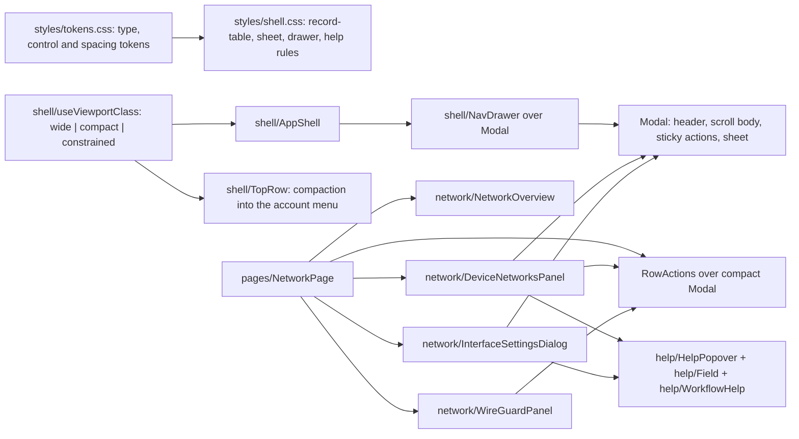

<!--
Copyright (c) 2026 DDP Engineering
This software is licensed under the PolyForm Noncommercial License 1.0.0.
Commercial use requires a separate commercial license.
See the LICENSE.txt in the .agentic folder for full license details.
SPDX-License-Identifier: LicenseRef-PolyForm-Noncommercial-1.0.0
-->

<!--
Task journal. One file per task, at .agentic/tasks/TASK-<id>.md, kept
after delivery as the task's historical record.

The header is the block of "key: value" lines directly under the title.
Keep it exactly in that form — one key per line, no blank lines inside
the block, no comments between the lines — so it stays machine-readable.

  stage         frame | specify | design | build | validate | deliver | done
                (adoption journals: survey | components | close | done)
  type          feature | fix | change | adopt
  path          full | quick
  requirements  comma-separated requirement IDs, empty until specify
  parent        optional top-level TASK-id; blank for an ordinary task
  branch        the branch this task is delivered on
  base          the commit this task started from, filled in at creation;
                the delivery report and `check --task` measure the diff
                against it, so leave it alone once it is written. Empty
                when the repository had no history yet.
  opened        YYYY-MM-DD

Header lines are edited in place; log lines are only ever appended.
Keep each log line to one sentence.

Stage report is one replaceable latest snapshot, not an evidence store.
Use plain one-line fields with no fences or bullets inside that section.
stage is the reported stage; current must match the journal header after any
transition. result is in_progress | completed | paused | blocked | skipped.
Keep all observations and decisions in the append-only Log as well.
Leave unknown fields blank; summary prints not recorded, never an assumed pass.
Refresh after work or decisions even if current has not changed.
-->

# TASK-9ca3f883 — Compact field interface and contextual help

stage: deliver
type: feature
path: full
requirements: REQ-UX-c8c16d33, REQ-UX-c5f7c0cd, REQ-UX-2687f591, REQ-UX-2de87216, REQ-UX-2b0b6d59, REQ-UX-4570c081, REQ-UX-1860069d, REQ-UX-cde0b9e2, REQ-UX-ff989933, REQ-UX-8859ce12, REQ-UX-f30891b4, REQ-NFR-aa1a4734, REQ-TEST-5da12a09
parent:
branch: master
base: 542cf362ce0ffef95e58794457857678422372ee
opened: 2026-09-04

## Done checklist (current stage)

- [x] validated candidate confirmed unchanged; otherwise returned to validate
- [x] validation evidence, diff, exclusions, and outcome presented
- [x] delivery confirmed by the human
- [ ] journal and report included in the delivery commit
- [ ] agreed outcome delivered, normally a PR
- [ ] close-out committed after the outcome succeeded, or carried by the delivery commit where nothing could fail after it

## Frame

Problem: The NILO browser interface was sized for a desktop monitor. On the seven-inch Raspberry Pi display (1024x600 and 800x480 CSS px) and a field laptop, text is small (body 14px, table cells 12.5px, column headers and field labels under 10px), controls are 25-33px tall, the navigation becomes an unlabeled icon rail, configuration dialogs have no sticky actions, and the only explanation of a setting is a hover `title` or nothing. Operators cannot safely complete Network configuration there.
Desired outcome: Every page is readable and complete at 1024x600 (primary) and 800x480 (fallback) without document-level horizontal scrolling; ordinary text is 16px, dense values at least 15px, labels/help/status at least 14px; touch targets are at least 44x44px; the Network page shows Interfaces, WireGuard profiles and Device networks with status, address, gateway/access and actions in a responsive table/details/card pattern; settings carry a progressive help system (persistent guidance, accessible popover, "How to configure" workflow help) localized in en/de/ro; backend, API, authorization, confirmation and the single SIM/LIVE indicator are unchanged.
Actors: bench operator on the seven-inch appliance display (touch or mouse), administrator on a field laptop or desktop browser, keyboard and screen-reader users, translators.
Primary scenario: operator opens Network at 1024x600 -> sees the overview, the three lists with essential columns and an Actions menu per row -> opens a device-network editor -> reads field help and the how-to-configure help -> corrects an invalid address flagged beside the field -> reaches the Review summary and the Preview action without the dialog leaving the viewport -> acknowledges and confirms as before.
Examples: management computer 192.168.1.13; NILO uplink in 192.168.1.0/24; NILO device side 192.168.0.1/24; device 192.168.0.130; Modbus TCP commonly 502 but a device may use 504, so the port stays editable.
Counterexamples: a table made to fit by shrinking its font below 14px; a tooltip that is the only place the rollback deadline or an external-route dependency is stated; a mobile component tree separate from the desktop one; a wizard that chooses network policy silently.
In scope: typography and metric tokens; responsive shell (compact labeled rail, constrained navigation drawer, bounded top row and tab strip); dialog sizing and full-screen sheet; help primitives; Network overview, responsive lists, editors, help copy; readability and overflow fixes on Bench, Activity, Authentication, About and placeholder pages; en/de/ro catalogues; component tests and a Playwright field-display suite; documentation, changelog and journal.
Out of scope: backend, HTTP contract, permission, persistence or appliance-policy changes; new dependencies, fonts or remote assets; redesigning the workflows of pages other than Network; deployment to a Raspberry Pi or a change to live networking; version or Git state changes.
Constraints: stay on master and preserve the dirty tree (STATED); never stage or commit (repository AGENTS.md); no operator text below 14px (STATED); touch targets 44x44px on field layouts (STATED); keep one SIM/LIVE indicator and existing shell requirements REQ-UX-5503457a (one 44-48px top row), REQ-UX-0018c647 (one viewport, no page scroll), REQ-UX-30821068 (core cluster order) (OBSERVED .agentic/requirements/ux/).
Success signals: automated audit at the four viewports finds no rendered text under 14px and no document overflow; targets at 1024x600 and 800x480 are at least 44px; help opens by mouse, keyboard and touch, closes on Escape and returns focus; existing Network, shell, authentication and browser suites still pass; before/after screenshots in both themes.
Evidence: STATED - the request and 00_Planning/PLAN_COMPACT_FIELD_UI.md. OBSERVED - baseline audit 09_Others/compact-field-ui-20260904/before/baseline-audit.json (body 14px, .data-table 12.48px, thead th and .nav-section 9.6px, .field label 9.92px, .network-secondary 10.4px, .sim-badge 10.24px, buttons 25-27px, .nav-entry 33px, .tab-close 18px, checkbox 13px; no document overflow at any viewport because tables scroll inside .table-scroll; icon-only rail below 60rem in src/styles/shell.css; hover-only `title` on interface names, device-network status and the not-reported dash in NetworkPage.tsx and DeviceNetworksPanel.tsx; Modal.tsx has no close control or sticky actions). OBSERVED - TASK-943403e2 (Network managed service) is `done`; its GUI requirements REQ-UX-1c5eab92, REQ-UX-4e08d371, REQ-UX-b7f24069 and REQ-UX-584f9bad describe the current Network presentation. INFERRED - the existing row action clusters (up to six buttons per device network) cannot meet 44px targets inside a 1024px table without a per-row menu. UNKNOWN - rendering on the physical seven-inch panel (pixel density, touch calibration, browser chrome height) is not observable in this environment.
Assumptions: the appliance browser is a Chromium-class browser at 100% zoom; the usable viewport on the seven-inch panel is close to 1024x600 CSS px; existing e2e specs may be updated to the new information architecture where a control moved into a row menu, without removing any assertion.
Unknowns: physical display acceptance; software-keyboard behavior on the panel; exact Chromium kiosk chrome height.
Decision-blocking questions: none; the plan and the request settle every material choice.
Proposed behaviors: readable type scale; 44px controls; compact rail / drawer / bounded top row; dialogs that fit with sticky actions; help popover; persistent safety copy; workflow help; Network overview; responsive Network lists with details and row menus; grouped editors with review; other-page consistency; complete catalogues; Playwright field matrix.
Path and reason: full - new externally observable behavior, new components (help, drawer, record lists) and new tests; no existing requirement covers it.

Quick-path criteria: no new observable behavior | no | new help, drawer, cards; no new interface or data format | yes | none; no new dependency | yes | none; existing requirement covers it | no | none does; no security or data-handling change | yes | none. Any `no` selects the full path.

Branch exception: the user instructed to stay on the current branch (master) and the repository convention is that work lands on master and the human commits, so no task branch was created.

## Requirement coverage

| Frame outcome | Atomic behavior | Requirement | Positive case | Boundary or failure | Verification | Design decision or no impact |
|---|---|---|---|---|---|---|
| Readable text | No operator text below 14px; body 16, dense 15, labels 14, in both themes | REQ-UX-c8c16d33 | Network table cells render at 15px | Column headers, badges and secondary lines were 9.6-10.4px | layout.test.ts token and stylesheet assertions; browser audit | Semantic type tokens in tokens.css; all shell.css sizes rewritten |
| Usable controls | 44x44 targets, 44px inputs, visible focus, no hover dependence | REQ-UX-c5f7c0cd | Actions menu trigger 44px at 1024x600 | Tab close, checkbox and menu triggers were 13-30px | layout.test.ts; browser target audit | control-height and target tokens; base button rule |
| Responsive shell | Compact labeled rail at 1024x600, labeled drawer at 800x480, page name in header, bounded tab strip, SIM/LIVE kept, secondary controls into the account menu | REQ-UX-2687f591 | Drawer lists Network with its label at 800x480 | Narrow layout was an unlabeled icon rail | shell.test.tsx with a stubbed media query; field-display.spec.ts | useViewportClass hook; NavDrawer over Modal; TopRow compaction |
| Dialogs fit | Dialog inside 100dvh, full-screen sheet on short/narrow, title, close and sticky actions reachable, Escape and focus return | REQ-UX-2de87216 | Device-network editor at 800x480 shows Preview without leaving the sheet | Editor taller than the viewport | Modal.test.tsx; field-display.spec.ts | Modal header/body/actions structure and sheet media query |
| Help popover | Opens on click, keyboard and touch, hover optional, ARIA, Escape, focus return, one at a time, in viewport, not title-only | REQ-UX-2b0b6d59 | Help for Gateway opens with Enter and closes with Escape | Two popovers cannot be open together | HelpPopover.test.tsx; field-display.spec.ts | HelpPopover with a document-level single-open registry |
| Persistent safety | Confirmation window, rollback, validation and route prerequisites visible outside any popover | REQ-UX-4570c081 | Confirmation dialog states the two-minute window | Help closed: safety copy still present | NetworkPage.test.tsx, DeviceNetworksPanel.test.tsx | FieldGuidance and existing notices; help never carries the only copy |
| Workflow help | How-to-configure help with goal, values needed, addressing example, what NILO changes, external prerequisites, verification and recovery | REQ-UX-1860069d | Device-network editor opens the help with the 192.168.0.130 example | Help says a local probe is not remote proof | DeviceNetworksPanel.test.tsx, InterfaceSettingsDialog test | WorkflowHelp component over Modal with catalogue sections |
| Overview | One concise overview: uplink, device side, active profile, pending or failed operation | REQ-UX-cde0b9e2 | Overview names enp1s0 192.168.10.24/24 | No device network: device side reads none | NetworkPage.test.tsx | NetworkOverview derived from status, device networks and operation |
| Responsive lists | Table on wide, essential columns plus details on 1024x600, cards at 800x480; one compact Actions dialog per row; no data silently dropped | REQ-UX-ff989933 | Details for enp1s0 expose link speed, traffic, adapter identity | Disabled action keeps its reason and cannot be clipped by table scrolling | RowActions, NetworkPage, WireGuardPanel, DeviceNetworksPanel tests; field-display.spec.ts | RecordTable CSS pattern, body-level RowActions modal, details rows |
| Grouped editors | Identity, Device side, Access path, Addressing, Services, Advanced (collapsed), Review; validation beside fields; ports editable | REQ-UX-8859ce12 | Review says which interface receives 192.168.0.1/24 | Invalid address and port 70000 are refused beside the field | DeviceNetworksPanel.test.tsx | Fieldsets and a computed review summary |
| Other pages | Bench, Activity, Authentication, About, placeholders readable at 1024x600 without horizontal scrolling; Activity keeps time, outcome, action, subject, actor | REQ-UX-f30891b4 | Activity at 1024x600 hides category and function into details | Long token scopes wrap | ActivityPage.test.tsx; field-display.spec.ts | Shared record-table classes |
| Localization | Every new key in en, de, ro | REQ-NFR-aa1a4734 | messages.test.ts passes | Missing key is a type error | messages.test.ts | Catalogue additions |
| Browser proof | Playwright at 1920x1080, 1366x768, 1024x600, 800x480, light and dark, no overflow, help, editors, validation, pending confirmation, drawer and sheet | REQ-TEST-5da12a09 | Suite passes against WSL2 Bench Core | Physical display remains unverified | e2e/field-display.spec.ts | New spec on the existing topology |

## Design

Requirements coverage: REQ-UX-c8c16d33 -> semantic type tokens (`--text-title 22px`, `--text-section 18px`, `--text-body 16px`, `--text-dense 15px`, `--text-label 14px`, line heights) in tokens.css, body 16px in index.css, every shell.css font-size rewritten to a token, uppercase/letter-spacing headers replaced by sentence case; REQ-UX-c5f7c0cd -> `--control-height 44px`, `--target-min 44px`, a base `button, .button` rule, 44px inputs and selects, 22px checkboxes inside 44px labels, tab close 44px; REQ-UX-2687f591 -> `useViewportClass` (matchMedia, `wide | compact | constrained`), compact rail `--nav-width-compact 160px` at width <= 72rem with labels kept, constrained layout at width <= 56rem or height <= 520px hides the rail and shows a labeled Menu button that opens `NavDrawer` (Modal variant `drawer` holding SideNav), TopRow hides appearance and language menus when constrained and repeats them inside the account menu, tab strip keeps its own horizontal scroll; REQ-UX-2de87216 -> Modal renders header (title, Close button), scrollable body and lets `.modal-actions` stick to the bottom; sheet media query (width <= 56rem or height <= 640px) makes the dialog 100dvh; NetworkConfirmation bounded to the viewport; REQ-UX-2b0b6d59 -> `HelpPopover` (trigger `aria-label` "Help for {name}", `aria-expanded`, `aria-controls`; panel `role="dialog"` non-modal with close; click toggles, focus and hover open transiently, Escape/outside close and focus returns; a document event closes any other open popover; position flips to fit the viewport); REQ-UX-4570c081 -> `Field` renders label, help trigger, control, persistent `field-guidance` and `field-error` linked by `aria-describedby`; confirmation, countdown, rollback and route prerequisites stay in notices and dialogs, never only in a popover; REQ-UX-1860069d -> `WorkflowHelp` button "How to configure" opening a Modal with six catalogue sections per workflow (`help.dn.*`, `help.if.*`); REQ-UX-cde0b9e2 -> `NetworkOverview` fact grid computed from status, device networks, WireGuard status and the running operation; REQ-UX-ff989933 -> one markup per list: `table.data-table.record-table` with `data-label` on cells, CSS turns rows into cards below 56rem, secondary values live only in an explicit details row toggled by a Details button, and every row has one `RowActions` menu (Menu with `MenuAction` items, disabled items showing their reason); REQ-UX-8859ce12 -> device-network editor grouped into fieldsets with Advanced in a closed `
`, format validation beside the field, a Review paragraph computed from the draft; interface settings grouped likewise; REQ-UX-f30891b4 -> the same classes applied to Bench, Activity (category and function moved into the details row), Authentication and About tables; REQ-NFR-aa1a4734 -> catalogue keys; REQ-TEST-5da12a09 -> `e2e/field-display.spec.ts`.

Component responsibilities: `styles/tokens.css` owns sizes; `styles/shell.css` owns layout and every component rule; `components/help/HelpPopover.tsx`, `components/help/Field.tsx`, `components/help/WorkflowHelp.tsx` own help behavior; `components/shell/useViewportClass.ts` owns breakpoint detection; `components/shell/NavDrawer.tsx` owns the constrained navigation; `components/RowActions.tsx` owns per-row action menus; `components/network/NetworkOverview.tsx` owns the overview; existing panels keep their data flow and callbacks.

Interfaces and contracts: no API or prop contract of the pages changes; NetworkPage, DeviceNetworksPanel, WireGuardPanel and InterfaceSettingsDialog keep their props. Menu gains `MenuAction`. Modal gains `variant?: 'dialog' | 'drawer'`. Existing tests that clicked a row action directly are updated to open the row's Actions menu first; no assertion is removed.

Data ownership and state: help open state is local to each popover plus one document-level custom event; drawer open state lives in AppShell; details expansion lives in each panel.

Execution flow: unchanged reads and previews; the review summary is derived from the draft on every render.

Failure recovery: no new failure paths; a refused preview is still shown beside the editor.

Security and trust: no credential handling changes; help copy contains no secret and only private example addresses.

Compatibility: CSS only reflows; `useViewportClass` returns `wide` where matchMedia is absent (jsdom), so component tests render the desktop shell unless a test installs a media query.

Observability: the Playwright suite writes review screenshots only when `NILO_FIELD_REVIEW=1`, matching the existing network spec.

Test seams: layout.test.ts reads the stylesheets; component tests render each panel; HelpPopover.test.tsx and Modal.test.tsx cover keyboard behavior; field-display.spec.ts drives the real browser.

Alternatives rejected: a separate mobile component tree (drift); a table font reduction (violates the readability contract); a third-party tooltip or table library (dependency rule).

Expected files: 05_Software/nilo_gui/src/styles/{tokens,shell}.css, src/index.css, src/components/{Modal,RowActions}.tsx, src/components/help/{HelpPopover,Field,WorkflowHelp}.tsx, src/components/shell/{AppShell,TopRow,SideNav,Menu,NavDrawer,useViewportClass}.tsx/ts, src/components/pages/{NetworkPage,ActivityPage,BenchPage,SimplePages}.tsx, src/components/AuthenticationPage.tsx, src/components/network/{NetworkOverview,DeviceNetworksPanel,WireGuardPanel,InterfaceSettingsDialog,NetworkConfirmation}.tsx, src/i18n/{en,de,ro,messages.test}.ts, tests beside them, e2e/field-display.spec.ts, e2e/{shell,network}.spec.ts, 06_SoftwareDocu/*.md, CHANGELOG.md.

Risks: the physical panel may expose a browser chrome height that leaves less than 600px; the Playwright viewport proves CSS pixels only. Open decisions: none.

### Proposed architecture - TASK-9ca3f883

## Log

- 2026-09-04 frame: scope is the compact field interface and contextual help plan; exclusions are backend, contract, permission, version and Git state; full path because the behavior, components and tests are new.
- 2026-09-04 frame: TASK-943403e2 (Network managed service) is done, so this is a focused GUI follow-on whose requirements cite the Network presentation requirements REQ-UX-1c5eab92, REQ-UX-4e08d371, REQ-UX-b7f24069 and REQ-UX-584f9bad rather than rewriting that journal.
- 2026-09-04 frame: stayed on master by user instruction and repository convention; no task branch.
- 2026-09-04 frame: the user asked for implementation without stopping after the audit, so the frame checkpoint is treated as autopilot; the pre-delivery presentation stays.
- 2026-09-04 frame: baseline captured with 02_Tools/env/with-tools.ps1 node capture.cjs against nilo-dev.ps1 start (Ubuntu-24.04, healthy) into 09_Others/compact-field-ui-20260904/before (24 views, both themes) with baseline-audit.json listing every rendered size below 14px, every target below 44px and any overflow.
- 2026-09-04 frame: reconciliation with the plan - no document overflow exists today because tables scroll inside .table-scroll, so CFUI-02 is about readable columns rather than a broken layout; the real defects are type size, target size, the icon rail, dialog actions, and hover-only titles.
- 2026-09-04 specify: created REQ-UX-c8c16d33, REQ-UX-c5f7c0cd, REQ-UX-2687f591, REQ-UX-2de87216, REQ-UX-2b0b6d59, REQ-UX-4570c081, REQ-UX-1860069d, REQ-UX-cde0b9e2, REQ-UX-ff989933, REQ-UX-8859ce12, REQ-UX-f30891b4, REQ-NFR-aa1a4734, REQ-TEST-5da12a09; none reused because no existing requirement states a size, target or help behavior.
- 2026-09-04 design: note written above; one markup per list with CSS reflow instead of a second component tree; help is three components over the existing Modal and Menu.

- 2026-09-04 build red: command=`cd 05_Software/nilo_gui; ../../02_Tools/env/with-tools.ps1 node node_modules/vitest/vitest.mjs run src/layout.test.ts src/components/help/HelpPopover.test.tsx src/components/Modal.test.tsx src/components/shell/shell.test.tsx -t 'field readability|labeled compact rail|drawer|HelpPopover|Modal|constrained shell'`; exit=1; expected missing behavior=11 failures: no type-scale or 44px tokens, font sizes below 14px in shell.css, no 72rem/56rem media blocks, no .modal-body or sticky actions, no HelpPopover module, no Modal close control or drawer variant, no Menu control or Navigation drawer in the shell (REQ-UX-c8c16d33, REQ-UX-c5f7c0cd, REQ-UX-2687f591, REQ-UX-2de87216, REQ-UX-2b0b6d59, REQ-UX-ff989933 stylesheet rule).
- 2026-09-04 build red: command=`cd 05_Software/nilo_gui; ../../02_Tools/env/with-tools.ps1 node node_modules/vitest/vitest.mjs run src/components/pages/NetworkPage.test.tsx src/components/network/WireGuardPanel.test.tsx src/components/network/DeviceNetworksPanel.test.tsx src/components/network/InterfaceSettingsDialog.test.tsx`; exit=1; expected missing behavior=27 failures: no Overview region, no Details regions or record columns, no per-row Actions menu with reasons, no grouped editor, field validation, review or how-to help, hover-only titles still present (REQ-UX-cde0b9e2, REQ-UX-ff989933, REQ-UX-8859ce12, REQ-UX-1860069d, REQ-UX-4570c081, REQ-UX-2b0b6d59).
- 2026-09-04 build: implemented the type and metric tokens, the compact rail and drawer, the dialog head/body/sticky actions and sheet, the layer stack for Escape, HelpPopover/Field/WorkflowHelp, RowActions over Menu/MenuAction, NetworkOverview, the responsive record tables on Network, Activity, Bench, Authentication and About, the grouped device-network and adapter editors with format validation and the review, and 134 catalogue keys in en/de/ro.
- 2026-09-04 build: RULING-001 applied - the existing Network component tests and e2e/network.spec.ts now open the row's Actions menu before choosing an action; no assertion was removed, and the WireGuard endpoint/DNS/routes assertions moved to the Details region they now live in.
- 2026-09-04 build: green - component suite `node node_modules/vitest/vitest.mjs run`; exit=0; 24 files, 351 tests passed. `tsc -b` exit=0. `eslint . --max-warnings 0` exit=0. `prettier --check .` exit=0.
- 2026-09-04 build: browser proof `node node_modules/@playwright/test/cli.js test e2e/field-display.spec.ts` with NILO_FIELD_REVIEW=1; exit=0; 7 passed in 22.1s over 1920x1080, 1366x768, 1024x600 and 800x480 in both themes; 17 review screenshots under test-results/field/.
- 2026-09-04 build: measured evidence - the capture harness signed in against the running nilo-dev topology and audited 32 views (four viewports, two themes, Bench, Network, the device-network editor and Activity) before and after. Before: 17 distinct rendered sizes below 14px (down to 9.6px), 25 to 40 targets below 44x44 per view, buttons 25-27px, nav entries 33px, tab close 18px. After: no rendered text below 14px, no document-level horizontal overflow, no element overflowing its container, no control clipped by the viewport edge, and the only sub-44 targets are the 22px checkboxes inside 44px labels.
- 2026-09-04 build: two defects the audit found and the code fixed - the sticky action bar's negative margins overflowed the dialog body, and the Activity date filters were clipped at 1024x600 because a date input's intrinsic width exceeds its grid track.
- 2026-09-04 build: two token colour values changed with the sizes - --text-muted from #5e747c to #566a72 in light and from #8fa5ae to #9bb0b8 in dark, so secondary and status text stays legible at 14px on a panel read at arm's length; every other palette value is untouched and the token-parity test still holds.
- 2026-09-04 build: two visible labels were renamed for the new structure - the WireGuard section is "WireGuard profiles" and the adapter dialog's method field is "Address source", because "Addressing" is now a group heading in both editors. Both are translated in all three catalogues.
- 2026-09-04 build: full browser suite `node node_modules/@playwright/test/cli.js test`; exit=0; 32 passed in 3.5m, including the unaccelerated 120-second rollback case and the seven field-display cases. An earlier run exited 1 on two spec-side expectations - the shell spec's plain address match became ambiguous once the overview names the same address, and a withheld menu item's accessible name now carries its reason - both corrected in the specs, with the overview assertion added rather than removed.
- 2026-09-04 build: compatibility reflow at 600x800 and 320x800 - no document overflow and no text below 14px at either width. Measuring the top row at 320px found the account menu pushed past the right edge, so the wordmark and the Menu button's visible word give way to their icons below 26rem, with the accessible name moved onto the button; every control is inside the viewport at 320, 600 and 800px afterwards.
- 2026-09-04 validate: the first strict gate reported ten `uncovered-source` findings for the new test files and Icon.tsx, which this repository answers by listing a behaviour's tests in its requirement's affected_paths; twelve requirements were extended and the finding is gone. No source, test or documentation file changed with it.
- 2026-09-04 validate: thirteen advisory warnings accepted and none of them mine to fix - four `unticked-deliver` and one `journal-header` belong to other tasks' journals, which this task must not edit; `secret-in-diff` is the scanner declining to read binary files, namely the pre-existing 09_Others/Preview.mp4 and this task's own before/after screenshots; `outside-layout` is CHANGELOG.md, which the repository keeps at its root by rule. The same set was accepted by TASK-943403e2.
- 2026-09-04 validate: plan phases P0 to P8 are all done. P0 measured and reconciled against the running application; P1 the type and metric tokens; P2 the compact rail, the drawer and the bounded top row; P3 the three help primitives with a shared layer stack; P4 the overview and the responsive Interfaces, WireGuard profiles and Device networks; P5 the grouped editors, the field help, the validation and the review; P6 Bench, Activity, Authentication, About and the three catalogues; P7 the component, stylesheet and browser proof plus the format, lint, build and strict gate; P8 the dev-flow document, the Network status document, the changelog, the knowledge page and this journal.
- 2026-09-04 validate: acceptance IDs CFUI-01 to CFUI-14 are met by the evidence above. CFUI-15 is met in part - the before/after screenshots are here, and the check that could not be run on an actual seven-inch display is recorded as an open limitation rather than claimed.
- 2026-09-04 build reconciliation: the implementation, requirements and tests were present but the task header, build checklist, Handoff and Stage report were stale; fresh review confirmed all thirteen requirements active, the recorded red tests and anchor/evolution evidence present, and the build evidence sufficient to advance the journal to validate.
- 2026-09-04 review: direct inspection covered the help/layer/modal/menu primitives, responsive shell, Network overview and lists, editor grouping, translations, CSS tokens and field-display browser specification; no candidate defect or unrequested backend/API behavior was found.
- 2026-09-04 review verification: direct pinned-tool commands passed Prettier, ESLint, 24 Vitest files with 351 tests, TypeScript compilation and the Vite production build; the focused field-display Playwright suite then passed seven scenarios in 23.9 seconds at all required viewports.
- 2026-09-04 review deviation: invoking npm.ps1 through the pinned PowerShell wrapper was blocked by the host language mode before checks ran, so the same pinned Prettier, ESLint, Vitest, TypeScript and Vite executables were invoked through Node and all exited zero.
- 2026-09-04 browser-topology deviation: the ordinary development status command found an unrelated partially stale topology on ports 5173/8090 and exited five; it was left untouched and the Playwright suite used its own isolated topology successfully.
- 2026-09-04 deployment authorization: the user explicitly asked to deploy the reviewed GUI to the bench Raspberry Pi for personal inspection; no backend binary, helper, interface, Device Network, WireGuard profile or PLC setting is changed by this deployment.
- 2026-09-04 deployment: production GUI archive SHA-256 `5f4799ace8d03bc3128b09debc837f4e1c854db78aead4c545b07afa751931e3` was installed at `/opt/nilo/gui` on `ddp-remote`, with the prior assets preserved at `/opt/nilo/gui.backup-20260904-123700`; `nilo.service`, `nilo-nethelper.service` and `nilo-nethelper-recovery.timer` were active and external HTTPS reads returned the new JS and CSS assets with status 200.
- 2026-09-04 deployment deviation: two guarded attempts restored the previous GUI as designed, first because readiness was checked immediately after restart and then because the running server caches its bootstrapped index; the successful attempt restarted the service and waited for the new asset hash before accepting the swap.
- 2026-09-04 validate evolution: `python .agentic/aegis.py evolution --task TASK-9ca3f883` exited zero and refreshed the report over 90 task-related paths, 55 added and 35 modified, with no removed file; the list matches the planned GUI, test, documentation, knowledge and screenshot scope.
- 2026-09-04 validate final: `02_Tools/env/with-tools.ps1 python .agentic/aegis.py check --task TASK-9ca3f883 --strict --run` exited zero; the configured test command passed in 267.7 seconds, lint passed in 6.2 seconds, strict was ok, errors were zero, warnings were 12 and notes one.
- 2026-09-04 validate advisory deviation: the twelve warnings are binary/non-text secret-scan limits, root `CHANGELOG.md` outside configured layout, and stale deliver/Handoff records in other tasks; none reports a defect in this candidate and those other journals are not edited by this task.
- 2026-09-04 build re-entry: user inspection of the deployed interface found row action menus clipped below their table scroll container, so the candidate returns from deliver to build to replace them with compact modal action dialogs; backend and action semantics remain unchanged.
- 2026-09-04 build red: command=`cd 05_Software/nilo_gui; ../../02_Tools/env/with-tools.ps1 node node_modules/vitest/vitest.mjs run src/components/RowActions.test.tsx`; exit=1; expected missing behavior=pressing Actions still opens a role-menu inside `.table-scroll`, so there is no viewport-level compact dialog identifying DDP_Remote, its type and status with visible action choices.
- 2026-09-04 build: implemented RULING-003 with a document-body Modal portal, a compact actions variant, visible object type and status, full-width choices, explicit disabled reasons, a separated destructive section, Cancel and focus return; Interfaces, WireGuard profiles and Device networks provide the required context without changing action callbacks or backend behavior.
- 2026-09-04 build: focused component and stylesheet verification passed twice after implementation and documentation alignment, ending with 7 files and 72 tests green; the RowActions test proves the dialog is outside `.table-scroll` and the browser test proves it stays inside 1024x600 and 800x480 while page scroll remains unchanged.
- 2026-09-04 build formatting deviation: the first focused Prettier check exited one on five edited files because their layout did not match the formatter; the pinned formatter rewrote only those files and the subsequent repository-wide Prettier check exited zero.
- 2026-09-04 build browser deviation: a combined field-display plus Network Playwright run exited one after all nine reached checks passed because the existing 120-second rollback test exhausted its timeout before its first login action; the test passed in 1.1 seconds in isolation and the complete Network specification then passed all five cases in 2.6 minutes, while the field-display specification had passed all seven cases.
- 2026-09-04 build green: the complete Vitest suite passed 25 files and 353 tests; TypeScript compilation, ESLint with zero warnings, repository-wide Prettier check and the Vite production build all exited zero; production assets are `index-DvTgba1B.js` and `index-Bd3AuXxs.css`.
- 2026-09-04 build impacted: `02_Tools/env/with-tools.ps1 python .agentic/aegis.py test --impacted --base HEAD` selected the full command because a browser selector is unsafe to reduce and exited zero in 264.6 seconds; 41 repository-tool tests, Go, two Python integrations, 353 GUI tests, the GUI build and all 32 browser tests passed.
- 2026-09-04 build evolution: `python .agentic/aegis.py evolution --task TASK-9ca3f883` exited zero and recorded 19 modified files since the refreshed correction anchor, exactly the dialog, its three consumers, translations, tests, styles and documentation expected by RULING-003.
- 2026-09-04 build check: the advisory scan exited zero with no errors and one actionable `uncovered-source` warning after the obsolete Menu dependency was removed from this requirement; Menu remains part of the original compact-interface task, so its affected-path entry was restored before the strict gate.
- 2026-09-04 validate review: direct inspection covered Modal portal and focus behavior, RowActions grouping and selection, all three Network consumers, compact and sheet media rules, translations, component and browser tests, requirement links and operator documentation; no unresolved implementation defect or backend/API change was found.
- 2026-09-04 validate requirements and knowledge: REQ-UX-ff989933 now names the viewport-level compact dialog and links RowActions, all three consumers, stylesheet geometry and both browser specifications; Development and Simulation Flow, Network Service Implementation Status, GUI knowledge and the Unreleased changelog describe the same behavior.
- 2026-09-04 validate advisory deviation: the twelve remaining warnings are binary/non-text secret-scan limits, root `CHANGELOG.md` outside configured layout, and stale deliver/Handoff records in other tasks; none reports a candidate defect and those other journals are not edited by this task.
- 2026-09-04 validate final: `02_Tools/env/with-tools.ps1 python .agentic/aegis.py check --task TASK-9ca3f883 --strict --run` exited zero; configured tests passed in 266.5 seconds, lint passed in 6.3 seconds, strict was ok and errors were zero.
- 2026-09-04 validate journal deviation: that strict snapshot included one new stale-Handoff warning for this task because its Handoff current field still said build after the header advanced to validate; the journal-only field was corrected immediately and does not alter the validated candidate.
- 2026-09-04 deliver packaging deviation: the first archive-reporting command created the production archive but exited one because restricted PowerShell rejected a temporary custom object; plain-string metadata readback then confirmed SHA-256 `e884cd004f12f972349a096a9a7a037908796d752552ddb45752bf958c85caae` without changing the archive.
- 2026-09-04 deliver authentication deviation: the first scp command omitted the remote username and inherited the Windows account name, so the Pi refused authentication before any transfer; it was stopped after one attempt and repeated successfully as the documented `dpasare` account.
- 2026-09-04 deliver probe deviation: the first guarded swap restored the prior GUI because its readiness probe used loopback while `nilo.service` binds only `192.168.1.103:8443`; service status confirmed the restored application healthy, the probe was corrected to the configured bind address and the same verified archive was redeployed.
- 2026-09-04 deliver deployment: the compact-actions-dialog GUI is installed at `/opt/nilo/gui` on `ddp-remote`, with the prior GUI at `/opt/nilo/gui.backup-20260904-131352`; `nilo.service`, `nilo-nethelper.service` and `nilo-nethelper-recovery.timer` are active, and external HTTPS reads returned 200 for the index, `index-DvTgba1B.js` and `index-Bd3AuXxs.css`.
- 2026-09-04 deliver Git boundary: the candidate remains unstaged and uncommitted on master because the user requested no commit and repository Git authority absolutely forbids agent commits; the human can inspect and commit the working tree.

## Rulings

- RULING-001 | date=2026-09-04 | decision=Row actions move into one Actions menu per row and existing tests are updated to open it first | reason=Six visible buttons cannot meet 44px targets inside a 1024px table; the plan calls for one menu per row | source=requirement | supersedes=none
- RULING-002 | date=2026-09-04 | decision=the reviewed production GUI may be deployed to the disposable bench Raspberry Pi `ddp-remote` for user inspection, preserving a rollback copy and leaving backend binaries, network interfaces, Device Networks, WireGuard and the PLC unchanged | reason=the user explicitly requested deployment after Claude reported implementation | source=user | supersedes=none
- RULING-003 | date=2026-09-04 | decision=row Actions controls open a compact modal dialog above the page, with object type/status, large action buttons, visible disabled reasons, separated destructive actions and Cancel, instead of an anchored dropdown menu | reason=user inspection found the dropdown clipped by the table scroll container and explicitly approved the compact actions-dialog proposal | source=user | supersedes=RULING-001

## Handoff

current: deliver
status: ready
next: present the deployed candidate and leave the unstaged working tree for human inspection and commit
must_read: .agentic/tasks/TASK-9ca3f883.md, .agentic/steps/6_deliver.md, .agentic/requirements/ux/REQ-UX-ff989933.toml
blockers:

## Stage report

stage: deliver
result: paused
current: deliver
changed: row Actions controls now open a compact viewport-level modal with object context, visible disabled reasons, separated destructive actions and Cancel
evidence: strict configured test passed in 266.5 seconds, lint in 6.3 seconds, 353 GUI tests and 32 browser tests passed; Pi serves index-DvTgba1B.js and index-Bd3AuXxs.css with HTTP 200 and all three appliance services are active
issues: twelve advisory warnings remain for binary scan limits, root changelog layout and unrelated historical journals; all are explained in the log
next: human inspects the deployed interface and commits the unstaged candidate when satisfied
needs_user: no - the user explicitly approved implementation and requested AEGIS
spec_compliance: disabled
implementation_quality: disabled
review_round:

## Delivery report (2026-09-04)

- stage: deliver; type: feature; path: full; branch: master
- requirements:
  - REQ-UX-c8c16d33 - Render operator-facing text at readable field sizes
  - REQ-UX-c5f7c0cd - Size field-layout controls and touch targets for a seven-inch display
  - REQ-UX-2687f591 - Adapt the shell navigation and top row to compact and constrained viewports
  - REQ-UX-2de87216 - Fit dialogs inside the viewport with reachable title, close and actions
  - REQ-UX-2b0b6d59 - Offer settings help through an accessible popover that never requires hover
  - REQ-UX-4570c081 - Keep safety, validation and confirmation information persistent outside help
  - REQ-UX-1860069d - Explain complex Network workflows with a localized how-to-configure help
  - REQ-UX-cde0b9e2 - Summarize the appliance network in one concise overview
  - REQ-UX-ff989933 - Present Network lists as responsive tables, details and cards
  - REQ-UX-8859ce12 - Group Network editors by operator task with a plain-language review
  - REQ-UX-f30891b4 - Apply the field readability rules to the other pages
  - REQ-NFR-aa1a4734 - Localize every field-interface and help message in English, German and Romanian
  - REQ-TEST-5da12a09 - Prove the field-display layouts in a browser at the required viewports
- deviations: none recorded
- explicit review: disabled; existing validation remains required
- diff vs task base 542cf36: 157 file(s) changed, 19704 line(s) added; 84 file(s) not content-scanned
- checks: errors=0 warnings=13 notes=1
- checklist: 3/6 done; open: journal and report included in the delivery commit; agreed outcome delivered, normally a PR; close-out committed after the outcome succeeded, or carried by the delivery commit where nothing could fail after it
