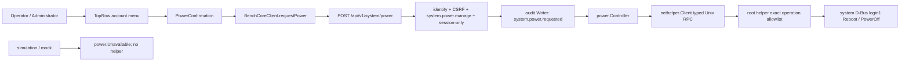

<!--
Copyright (c) 2026 DDP Engineering
This software is licensed under the PolyForm Noncommercial License 1.0.0.
Commercial use requires a separate commercial license.
See the LICENSE.txt in the .agentic folder for full license details.
SPDX-License-Identifier: LicenseRef-PolyForm-Noncommercial-1.0.0
-->

<!--
Task journal. One file per task, at .agentic/tasks/TASK-<id>.md, kept
after delivery as the task's historical record.

The header is the block of "key: value" lines directly under the title.
Keep it exactly in that form — one key per line, no blank lines inside
the block, no comments between the lines — so it stays machine-readable.

  stage         frame | specify | design | build | validate | deliver | done
                (adoption journals: survey | components | close | done)
  type          feature | fix | change | adopt
  path          full | quick
  requirements  comma-separated requirement IDs, empty until specify
  parent        optional top-level TASK-id; blank for an ordinary task
  branch        the branch this task is delivered on
  base          the commit this task started from, filled in at creation;
                the delivery report and `check --task` measure the diff
                against it, so leave it alone once it is written. Empty
                when the repository had no history yet.
  opened        YYYY-MM-DD

Header lines are edited in place; log lines are only ever appended.
The Log is a progress-and-evidence ledger, not an activity transcript. Append
only durable events that change the task's stage, scope, engineering outcome,
verification status, authority, or ability to proceed: stage transitions;
material scope or implementation decisions not already captured elsewhere;
consolidated automated or manual verification results; material discoveries;
blockers; approvals; deviations; and delivery outcomes.

Do not log routine searches, reads, edits, internal tool mechanics or corrected
command retries, and do not copy requirements, designs, specifications,
knowledge pages, Rulings, Handoff, or Stage report content into the Log. A
failed command belongs only when it exposes a candidate problem, changes the
implementation or tests, or remains an accepted verification limitation. Keep
each entry concise and self-contained; reference durable artifacts instead of
repeating them. Existing entries remain append-only under later contracts.

Stage report is one replaceable latest snapshot, not an evidence store.
Use plain one-line fields with no fences or bullets inside that section.
stage is the reported stage; current must match the journal header after any
transition. result is in_progress | completed | paused | blocked | skipped.
Leave unknown fields blank; summary prints not recorded, never an assumed pass.
Refresh at a stage transition, pause or session end, blocker, or completed
validation or delivery outcome. Do not refresh after routine work.
-->

# TASK-a3a3d7b2 — Add appliance power controls

stage: done
type: feature
path: full
requirements: REQ-FUNC-f533ef04, REQ-SEC-7dfb5ae6, REQ-DATA-d39efd95, REQ-UX-4e77cf3d, REQ-UX-0926f3e2, REQ-PLAT-03156dc8, REQ-TEST-bb17bd0a, REQ-SEC-5d0cfe7e, REQ-SEC-62e54172, REQ-SEC-49fe784b, REQ-SEC-144b5e56, REQ-FUNC-5ffce0e4
parent:
branch: NILO_power_options
base: e78080ec4e59ac42fd3171ea10c3b2b9653df1f9
opened: 2026-09-08

## Done checklist (current stage)

- [x] validated candidate confirmed unchanged; otherwise returned to validate
- [x] validation evidence, diff, exclusions, and outcome presented
- [x] delivery confirmed by the human
- [x] journal and report included in the delivery commit
- [x] agreed outcome delivered, normally a PR
- [x] close-out committed after the outcome succeeded, or carried by the
      delivery commit where nothing could fail after it

## Frame

Problem: NILO's authenticated account menu can end the current browser session, but it cannot request an orderly restart or power-off of the appliance.
Desired outcome: A signed-in Operator or Administrator can choose Restart or Power off beside the existing Sign out action, confirm the disruptive action, and have a live NILO appliance perform it through the existing unprivileged-core/privileged-helper boundary without making simulation destructive.
Actors: signed-in human; Administrator, Operator and Viewer roles; browser GUI; unprivileged Bench Core; privileged local helper; Linux system manager; development simulation; Raspberry Pi bench observer.
Primary scenario: Operator or Administrator opens the account menu -> selects Restart or Power off -> reviews an action-specific warning -> confirms -> GUI sends one authenticated, CSRF-protected request -> Bench Core authorizes and audits it -> the typed privileged boundary asks Linux to reboot or power off -> the interface reports that the request was accepted before connectivity is expected to disappear.
Examples: On an appliance, Restart changes the Raspberry Pi boot identifier and the NILO services become healthy again after boot. Power off makes the appliance unreachable and leaves it halted until power is restored. Sign out continues to invalidate only the current browser session and returns to sign-in.
Counterexamples: Closing or cancelling a confirmation performs no action; a Viewer cannot invoke a power endpoint even by bypassing the GUI; simulation and mock mode never restart or power off Windows or WSL; Restart does not merely restart the Bench Core process under the accepted interpretation.
In scope: account-menu presentation in all three languages; action-specific confirmation and pending/accepted/error states; typed GUI client and mock parity; a versioned HTTP power-action contract; a new fixed Operator-and-Administrator permission and server-side enforcement; CSRF protection; attributable audit; a narrow privileged Linux implementation; dependency injection for inert simulation and tests; installer/systemd hardening updates; unit, contract, browser, Linux-system and Raspberry Pi bench verification; affected requirements, component knowledge, software documentation and changelog.
Out of scope: changing existing sign-out semantics; scheduled or delayed shutdown; service-only restart; remote wake or automatic power restoration; Windows as an appliance target; arbitrary commands, targets, delays or environment values crossing the helper socket; release packaging, version assignment, commit, push or deployment to production hardware.
Constraints: Bench Core must remain non-root; only fixed allow-listed operations may cross the peer-credential-checked Unix socket; every protected route declares one permission; session changes require the matching CSRF token; no physical action may be claimed by simulation; the accepted HTTP response may race with loss of connectivity; the Raspberry Pi is disposable early-signal hardware, not reproducible release evidence, and an actual power-off needs a human or documented out-of-band way to restore power.
Success signals: Operators and Administrators with an effective `system.power.manage` permission can see and invoke Restart and Power off while Viewers cannot; cancellation and duplicate activation are inert; accepted actions create durable attributable audit evidence before dispatch; an action is executed at most once per accepted request; simulation remains safe; automated suites pass; a Pi restart is evidenced by down/up reachability, changed boot ID and healthy services; a Pi power-off is evidenced by orderly halt and loss of reachability, then a human-controlled recovery check.
Evidence: STATED - add restart and power-off options while retaining existing logoff, create an isolated `F:\\NILO_...` workspace from remote master, and account for the connected Raspberry Pi. OBSERVED - sign-out is `POST /api/v1/auth/logout`, invalidates the server session, clears cookies and is rendered in the account menu (`05_Software/nilo_assistant/internal/httpapi/{server.go,identity.go,identity_test.go}`, `05_Software/nilo_gui/src/{App.tsx,components/shell/TopRow.tsx,api/contract.ts,api/client.ts}`). OBSERVED - every protected route declares a fixed permission, state-changing session requests receive the shared CSRF check, and current roles define no power permission (`05_Software/nilo_assistant/internal/{httpapi/server.go,httpapi/identity.go,auth/role.go}`). OBSERVED - appliance Bench Core refuses root, while `nilo-nethelper` runs as root behind a typed, bounded, peer-UID-checked Unix RPC and already connects to the system D-Bus (`05_Software/nilo_assistant/cmd/nilo/network_runtime_linux.go`, `05_Software/nilo_assistant/internal/nethelper/{protocol.go,socket_linux.go,networkmanager_linux.go}`, `02_Tools/scripts/install-nethelper.sh`). OBSERVED - simulation must not contact real hardware or claim a physical result; the optional bench Pi is reachable today at `ddp-remote.local`, but its observations are not a repository gate or release evidence (`06_SoftwareDocu/Development_and_Simulation_Flow.md` sections 5 and 9; `06_SoftwareDocu/Local_Hardware_Access.md` sections 1 and 2). INFERRED - the lowest-complexity privileged path is an exact action allow-list over the existing helper socket, backed by the already-pinned D-Bus library, rather than executing a request-supplied shell command. UNKNOWN - whether product policy should permit a scoped Administrator bearer token, rather than only an interactive browser session, to invoke a power action.
Assumptions: `restart` means an orderly operating-system reboot of the NILO appliance; the controls belong in the existing account menu beside Sign out; Restart and Power off are available to Operators and Administrators; the API uses a distinct `system.power.manage` permission so authorization and audit denials remain explicit; power actions require an interactive browser session and are not available to bearer tokens; the GUI asks for confirmation for both actions; simulation exposes no real power driver and cannot act on the development host.
Unknowns: exact accepted-response/post-disconnect wording and whether Restart should automatically poll for recovery; whether the privileged package should be generalized in name now or retain `nethelper` for a narrow change; availability of a human or out-of-band switch to repower the bench Pi after the power-off test.
Decision-blocking questions: none. A real Pi power-off remains conditional on a human-confirmed recovery method and is not required to implement or automate the feature.
Proposed behaviors: Keep Sign out unchanged and available to every signed-in browser session. Show Restart and Power off to Operators and Administrators when the effective session permissions include `system.power.manage` and the backend reports appliance mode. Require an action-specific modal confirmation, with Power off visually and textually more severe. Submit one typed session-authenticated action to a single protected endpoint, persist an attributable audit result before privileged dispatch, accept only exact restart/power-off values, and treat refusal/unavailability distinctly. Refuse bearer-token power requests even when the token owner is otherwise authorized. Let the root helper invoke exact system-manager methods with no caller-controlled command or argument. Supply an inert/fake power controller in simulation and automated tests. After acceptance, explain that the connection will close; do not automatically retry a lifecycle-changing request when connectivity disappears.
Path and reason: full. This adds externally observable behavior, a new HTTP and helper contract, a new authorization permission, security-sensitive privileged behavior and hardware-specific verification.

Path analysis:

| Criterion | Yes | No | Evidence |
|---|---:|---:|---|
| No new externally observable behavior |  | x | Two new appliance actions and UI states |
| No new interface or data format |  | x | New HTTP action and typed helper operation |
| Existing requirement already covers behavior |  | x | Search found sign-out requirements but no appliance power-control requirement |
| No new dependency | x |  | The existing pinned `github.com/godbus/dbus/v5` can address the Linux system manager |
| No security or data-handling change |  | x | New Operator-and-Administrator permission, privileged dispatch and audit obligation |

Optional children: none. The GUI, HTTP authorization, helper RPC and hardware proof are one tightly coupled vertical slice; splitting them would create overlapping contracts and validation.

## Requirement coverage

| Frame outcome | Atomic behavior | Requirement | Positive case | Boundary or failure | Verification | Design decision or no impact |
|---|---|---|---|---|---|---|
| Whole-appliance control | Dispatch one exact restart or power-off operation | REQ-FUNC-f533ef04 | Matching controller call returns 202 | Unknown action or controller failure cannot dispatch another action | HTTP/controller capture | Linked protocol spec constrains endpoint and helper operations |
| Operator and Administrator access | Fixed roles carry the new permission | REQ-SEC-5d0cfe7e | Operator and Administrator permission sets include power | Viewer set excludes it | Exact role matrix test | Extend compiled role matrix |
| Session-only power access | Only Operator/Administrator browser sessions reach dispatch | REQ-SEC-7dfb5ae6 | Both authorized sessions succeed | Viewer and bearer token receive 403 | HTTP credential matrix | Handler checks credential kind after shared permission guard |
| Server authorization | Route declares and enforces its permission | REQ-SEC-62e54172 | Authorized session reaches handler | Missing credential 401; missing permission 403 | Real handler requests | Reuse shared access guard |
| Browser request intent | State-changing session request carries matching CSRF | REQ-SEC-49fe784b | Matching token proceeds | Missing or different token is inert | HTTP CSRF cases | Reuse shared identity middleware |
| Privileged isolation | Helper accepts only empty exact power operations from allowed UID | REQ-SEC-144b5e56 | Restart and power-off map to login1 | Extra fields, arbitrary op or wrong peer refused | Protocol/socket/Linux driver tests | Extend typed helper; no shell execution |
| Durable accountability | Persist request audit before privileged dispatch | REQ-DATA-d39efd95 | Actor/action record precedes controller call | Audit error prevents call | Ordered fake audit/controller | Synchronous append before dispatch |
| Role-aware presentation | Show power actions only for live Operator/Administrator appliance sessions | REQ-UX-4e77cf3d | Both operating roles see controls | Viewer/simulation do not; Sign out remains | Component role/profile matrix | Derive from status plus effective permission |
| Confirm disruption | Confirm once and report pending/accepted/refused/ambiguous connection loss | REQ-UX-0926f3e2 | Each confirmed action sends once | Cancel sends none; network loss is not called success | Component and browser flows | Dedicated modal and terminal notice state |
| Safe development | Simulation and mock have no live power controller | REQ-PLAT-03156dc8 | Direct request returns unavailable | No helper connection or host action | Composition/mock tests | Inject unavailable controller in simulation |
| Layered evidence | Automate contracts and observe real ARM64 lifecycle separately | REQ-TEST-bb17bd0a | Pi restart changes boot ID and recovers | User owns recoverable power cycle; neither is a repository gate | Automated suite plus recorded manual observations | No automated destructive hardware contact |
| Preserve logoff | Existing Sign out still invalidates only the browser session | REQ-FUNC-5ffce0e4 | Sign out returns to login | Power UI does not alter logout request | Existing App regression test | No design impact beyond retaining the menu action |

Behavior inventory:

| Frame outcome | Actor/system | Trigger or state | Response | Positive case | Boundary or failure | Observable result |
|---|---|---|---|---|---|---|
| Restart/power off | Live appliance | Accepted exact action | Invoke matching OS action once | Capturing controller sees one call | Invalid input or failed controller returns error | Typed 202 or error and call count |
| Role boundary | Identity/HTTP | Power request | Authorize Operator/Admin session | Both roles reach fake | Viewer/token/invalid CSRF denied | HTTP status and zero calls |
| Audit ordering | HTTP boundary | Authorized valid request | Persist actor/action before controller | Ordered fakes show audit first | Audit failure stops request | Durable event or 500 with no call |
| GUI availability | Browser | Appliance session/menu open | Render according to role permission | Operator/Admin see actions | Viewer/simulation do not | Accessible menu items |
| GUI confirmation | Browser | Power item selected | Confirm, submit once, show outcome | 202 accepted state | cancel/refusal/network loss distinct | Dialog/request/notice state |
| Simulation safety | Simulation/mock | Direct or UI request | No physical controller | Typed unavailable response | No helper/process/host effect | Fake count and process continuity |
| Hardware evidence | Bench observer | Installed ARM64 candidate | Observe reboot and user-operated power cycle | Boot ID changes, services return | Power restoration is human-owned | Journal evidence, not gate claim |

## Design

### Requirements coverage

- `REQ-FUNC-f533ef04`: add a two-value `power.Action`, a consuming `power.Controller`
  interface and one HTTP handler; the exact wire/helper contract remains in its spec.
- `REQ-SEC-5d0cfe7e`, `REQ-SEC-7dfb5ae6`, `REQ-SEC-62e54172` and
  `REQ-SEC-49fe784b`: add `system.power.manage` to Operator and Administrator,
  register the route in the central permission table, then require a session actor
  inside the handler after the shared authentication, CSRF and permission guards.
- `REQ-SEC-144b5e56`: extend the existing helper protocol with only
  `system.restart` and `system.power_off`; both require an otherwise empty envelope.
- `REQ-DATA-d39efd95`: write `system.power.requested` synchronously through the
  shared audit writer before any controller call; audit failure ends the request.
- `REQ-UX-4e77cf3d` and `REQ-UX-0926f3e2`: derive menu availability from live
  appliance status, session credential and effective permission; use the shared
  modal primitives for action-specific confirmation and outcome reporting.
- `REQ-PLAT-03156dc8`: compose `power.Unavailable` in simulation and return 503
  on direct calls; the mock mirrors that answer and never presents the controls.
- `REQ-TEST-bb17bd0a`: automate all safe seams, observe restart on the bench Pi,
  and leave the destructive power cycle to the user under `RULING-002`.
- `REQ-FUNC-5ffce0e4`: no design change; Sign out remains the same menu callback.

### Component responsibilities

`internal/power` owns the platform-neutral action and controller contract, including
the typed unavailable error. `httpapi` owns JSON validation, session-only enforcement,
audit ordering and response mapping. `nethelper` owns the root-side login-manager
adapter and closed RPC operations. `cmd/nilo` selects unavailable versus helper-backed
controllers by profile. The GUI contract/client own the typed request; `AppShell`
owns transient dialog/outcome state; `TopRow` only renders eligible menu actions.

### Proposed architecture - TASK-a3a3d7b2

### Interfaces, state and execution

The request/response/error schemas and exact login1 calls are fixed by
`REQ-FUNC-f533ef04`. `power.Controller` exposes `Restart(context.Context)` and
`PowerOff(context.Context)` so arbitrary action strings cannot cross a consuming
boundary. The handler decodes one bounded JSON value with unknown fields rejected,
checks `Actor.CredentialSession`, records the request, invokes one method and returns
202 only if the method returns before connectivity disappears. No operation row,
retry queue or durable pending state is added: systemd owns the accepted lifecycle.

`AppShell` holds `null | restart | power_off` dialog state and a terminal result.
Submission disables dismissal and confirmation, so one dialog emits at most one
request. A 202 becomes an accepted/disconnecting notice. A typed HTTP refusal remains
an error. An unavailable transport after submission is explicitly "not confirmed"
and is never retried. Sign out continues to reset the workspace and invalidate the
session through `App`.

### Failure, security, concurrency and compatibility

Strict body decoding rejects missing, unknown, trailing or extra data. Shared
middleware supplies 401/CSRF behavior and the access guard supplies permission-denial
auditing; the handler adds the session-only denial. The synchronous requested audit
must succeed before dispatch. A helper error returns `power_action_failed`; an absent
controller maps to 503. Helper peer UID, frame limits, deadlines and concurrency caps
remain unchanged, and its power calls accept no payload fields (`REQ-SEC-144b5e56`).

Concurrent raw API requests can each ask once; the implementation does not invent a
cross-request idempotency key because a successful first call immediately transfers
lifecycle ownership to systemd and cannot reliably persist a completion. The GUI
prevents accidental double submission. There is no schema migration. Adding a fixed
permission changes session permission arrays; the API version stays `nilo.http/1`
during the repository's documented active-development compatibility policy. Tokens
may compute the role permission but the endpoint refuses bearer credentials, and the
token-creation UI omits this non-scopeable action.

### Observability and operations

The pre-dispatch Activity event is the durable evidence that an authenticated human
requested the action, not evidence that Linux completed it. Helper/systemd errors are
returned without command output. Pi restart proof records old/new boot IDs, observed
down/up reachability and service health. The user's power-cycle observation is recorded
separately and remains early bench evidence, never a repository gate.

### Test seams

Role tests fix the 16-permission matrix. HTTP tests inject ordered audit and power
fakes for actions, credential kinds, CSRF, malformed bodies, unavailable controller
and audit/controller failure. Helper tests validate exact empty envelopes and a fake
login1 driver; an opt-in Linux test addresses the real D-Bus method boundary without
halting CI. GUI client and component tests cover parsing, visibility, focus, cancel,
single submit and all outcome states; the integrated simulation browser test asserts
the controls are absent. ARM64 build plus the recoverable Pi restart close the live seam.

### Alternatives, risks and open decisions

Rejected: executing `systemctl` from request data (shell/argument injection surface),
running Bench Core as root (breaks an enforced invariant), and creating a second helper
(same allowed UID and no useful privilege separation for this slice). Direct
`unix.Reboot` is rejected because it bypasses orderly systemd service shutdown.
The existing helper name is retained to avoid an unrelated migration; its package
documentation and unit description will say privileged appliance helper.

Risks: the HTTP response can be lost during the intended shutdown; the UI therefore
never converts transport loss into success. A misconfigured system bus or login1 is a
typed failure. Real power-off cannot be remotely recovered and is user-operated.
Open decisions: none.

Expected files: `internal/power/power.go`; `internal/httpapi/{power.go,power_test.go,server.go}`;
`internal/auth/{role.go,role_test.go}`; `internal/nethelper/{protocol.go,client.go,engine.go,power_linux.go,power_linux_test.go}`;
`cmd/nilo-nethelper/serve_linux.go`; `cmd/nilo/main.go`; `02_Tools/scripts/install-nethelper.sh`;
GUI `api/{contract.ts,client.ts,mock.ts}`; `components/{PowerConfirmation.tsx,PowerConfirmation.test.tsx}`;
`components/shell/{TopRow.tsx,AppShell.tsx,Icon.tsx,shell.test.tsx}`; i18n catalogues,
`styles/shell.css`, browser simulation coverage, component knowledge, development/hardware docs and `CHANGELOG.md`.

## Log

- 2026-09-08 frame: Proposed the full path for an Administrator-only, confirmed appliance reboot/power-off slice that preserves sign-out and keeps simulation inert; paused at the scope checkpoint for the appliance-vs-service meaning, bearer-token policy and recoverable Pi power-off boundary.
- 2026-09-08 frame: User accepted implementation and required both Operators and Administrators to restart and power off NILO; the full path advances with Viewers denied, whole-appliance semantics, browser-session-only invocation and destructive Pi power-off conditional on recoverable power restoration.
- 2026-09-08 specify: Created seven atomic power-control requirements, revised the fixed-role and privileged-helper requirements, reused four authorization/sign-out requirements, and added the exact HTTP/helper contract spec; no requirements were retired.
- 2026-09-08 design: Constrained the implementation in `## Design` and `REQ-FUNC-f533ef04` to a session-only guarded HTTP route, audit-before-dispatch, two exact helper operations backed by login1 D-Bus, inert simulation composition, truthful connection-loss UX and layered automated/Pi verification.
- 2026-09-08 build red: `REQ-SEC-5d0cfe7e`; command=`wsl.exe -- bash -lc 'cd /mnt/f/NILO_power_options/05_Software/nilo_assistant && /mnt/f/2026_Networked_Intelligent_Lab_Orchestrator/02_Tools/env/with-go.sh go test ./internal/auth -run "TestRolePermissionsMatchTheFixedMatrix|TestPowerPermissionBelongsToOperatorsAndAdministrators" -count=1'`; exit=1; expected missing behavior=`PermissionSystemPowerManage` and its Operator/Administrator role mapping do not exist.
- 2026-09-08 build red: `REQ-FUNC-f533ef04`, `REQ-SEC-7dfb5ae6`, `REQ-DATA-d39efd95`, `REQ-PLAT-03156dc8`; command=`wsl.exe -- bash -lc 'cd /mnt/f/NILO_power_options/05_Software/nilo_assistant && /mnt/f/2026_Networked_Intelligent_Lab_Orchestrator/02_Tools/env/with-go.sh go test ./internal/httpapi -run "Test.*Power" -count=1'`; exit=1; expected missing behavior=`HandlerOptions.Power`, the guarded route and the power controller do not exist.
- 2026-09-08 build red: `REQ-FUNC-f533ef04`, `REQ-SEC-144b5e56`; command=`wsl.exe -- bash -lc 'cd /mnt/f/NILO_power_options/05_Software/nilo_assistant && /mnt/f/2026_Networked_Intelligent_Lab_Orchestrator/02_Tools/env/with-go.sh go test ./internal/nethelper -run "TestPower|TestLoginManager" -count=1'`; exit=1; expected missing behavior=the helper engine/client power methods and login1 adapter do not exist.
- 2026-09-08 build red: `REQ-UX-4e77cf3d`, `REQ-UX-0926f3e2`, `REQ-TEST-bb17bd0a`; command=`npm.cmd test -- --run src/api/client.test.ts src/components/PowerConfirmation.test.tsx src/components/shell/shell.test.tsx`; exit=1; expected missing behavior=the client power call, dedicated confirmation dialog and permission/profile-gated account-menu actions do not exist.
- 2026-09-08 build red: `REQ-UX-0926f3e2`; command=`vitest.cmd run src/components/PowerConfirmation.test.tsx`; exit=1; expected missing behavior=a typed server refusal is still rendered as an unconfirmed connection loss rather than as a distinct refusal.
- 2026-09-08 test: test exit 127 (52.1s)
- 2026-09-08 test: test exit 1 (86.9s)
- 2026-09-08 build: Added the session-only guarded power endpoint, audit-before-dispatch, Operator/Administrator permission, exact privileged-helper restart and power-off operations, login1 D-Bus adapter, inert simulation composition, confirmed multilingual account-menu UX and documentation; all six implemented behavior requirements are active while the cross-environment test requirement remains draft pending the user's power-cycle observation.
- 2026-09-08 build verification: The AEGIS impacted command conservatively ran the full suite and exited zero after 41 tooling tests, every Go package, 32 SDK tests, 7 passed plus 1 skipped fake-integration tests, 437 GUI tests, the production build and all 38 browser tests passed; the separate lint gate passed Go vet, Python compilation, Prettier and ESLint.
- 2026-09-08 build hardware: Cross-built ARM64 core (`47beaf1584152a1464dd166342ac68b5df60c3191752aa83452f252b715ced6d`) and helper (`899956cb526464cc780491ec56917f183427871ff061354182e0dfe7497a687b`), deployed the candidate binaries and GUI to the disposable Raspberry Pi with rollback backup `/var/backups/nilo/power-20260908T1812Z`, and invoked the exact helper restart operation; reachability went down at 18:22:59 +03:00 and returned at 18:23:34 with boot ID changing from `b8f95db2-5219-4a5b-9677-0a94b864ab18` to `d73e4f9d-afb2-4d91-b8d2-14c94721b4fc`, both NILO services active and HTTPS 200.
- 2026-09-08 build verification note: The automatically recorded exits 127 and 1 were fresh-worktree setup failures caused by absent ignored Windows/WSL pinned runtimes and virtual environments, not candidate failures; recreating them through the repository bootstrap made the same gate pass. Advisory check reports zero errors; ten warnings are pre-existing stale diagnostic paths or old journal state, and the remaining warning is the policy-required root `CHANGELOG.md` lying outside AEGIS layout globs.
- 2026-09-08 build pause: Implementation and all recoverable proof are complete; the user retained and is about to perform the destructive power-off/physical-power-on observation, which is the remaining manual increment before activation of `REQ-TEST-bb17bd0a` and transition to validate.
- 2026-09-08 build manual verification: The user reported the power-off/power-on sequence tested successfully and authorized committing the files; this completes the user-owned destructive observation and activates `REQ-TEST-bb17bd0a`. A subsequent remote readback could not resolve `ddp-remote.local` and the former `192.168.1.103` address timed out, so no new boot identifier or service output is claimed beyond the user's direct acceptance.
- 2026-09-08 build: All behavior increments, traceability, active requirements, anchor/evolution evidence and impacted verification are complete; advanced to validate for the final strict repository proof.
- 2026-09-08 validate deviation: At the user's direction, cancelled the already-running duplicate final `check --strict --run`; its candidate fingerprint was unchanged. Delivery relies on the immediately preceding full AEGIS impacted suite (exit 0), separate lint gate (exit 0), final focused HTTP rerun (exit 0), static check with zero errors, recoverable Pi restart evidence and the user's successful power-cycle acceptance.
- 2026-09-08 validate: Semantic diff, requirements, knowledge, portability, security and error paths were reconciled; explicit review is disabled, all current requirements are active, and the unchanged candidate advances to deliver with the user-directed final-rerun deviation retained.
- 2026-09-08 test: test exit 0 (275.1s)
- 2026-09-08 deliver: The user accepted the hardware result and authorized committing the current files, explicitly declined another test run, and requested no publication; the local commit is the entire delivery outcome, so the task closes in that commit and the human retains all push authority.

## Rulings

<!-- Append decisions here; never edit history. Supersede with a new ruling.
- RULING-001 | date=YYYY-MM-DD | decision=<decision> | reason=<reason> | source=user | supersedes=none
source: user | repository | requirement | technical
-->

- RULING-001 | date=2026-09-08 | decision=Restart and Power off are whole-appliance controls available to Operator and Administrator browser sessions; Viewers and bearer-token requests are denied | reason=The user explicitly granted both fixed operating roles; session-only invocation keeps the new disruptive capability out of existing broad Administrator tokens | source=user | supersedes=none
- RULING-002 | date=2026-09-08 | decision=The user will execute and observe the physical power-off/power-on sequence | reason=Power restoration is not remotely documented and the user explicitly retained the destructive recovery step | source=user | supersedes=none
- RULING-003 | date=2026-09-08 | decision=Do not rerun the tests; commit the current files | reason=The user accepted the physical test and explicitly requested the local commit without another duplicate suite | source=user | supersedes=none

## Handoff

<!-- Replace these fields with the latest minimal resume snapshot.
status: ready | waiting | blocked
-->

current: done
status: ready
next: none; the human may reconcile with the newer remote master and push the local branch when desired
must_read: .agentic/tasks/TASK-a3a3d7b2.md
blockers: none

## Stage report

stage: deliver
result: completed
current: done
changed: complete backend, helper, GUI, tests, component knowledge, operator documentation and changelog implementation for appliance restart and power off
evidence: full impacted suite and lint passed immediately before manual acceptance; evolution and semantic review match scope; Raspberry Pi restart proof and the user's successful physical power-cycle acceptance complete the hardware evidence
issues: final duplicate strict run was cancelled at the user's direction with its candidate fingerprint unchanged; post-cycle SSH readback remained unavailable and no inferred boot identifier is claimed
next: local commit is the approved delivery outcome; leave remote publication to the human
needs_user: no - local commit is explicitly authorized and publication remains prohibited
spec_compliance: disabled
implementation_quality: disabled
review_round:

## Delivery report (2026-09-08)

- stage: deliver; type: feature; path: full; branch: NILO_power_options
- requirements:
  - REQ-FUNC-f533ef04 - Restart or power off the appliance
  - REQ-SEC-7dfb5ae6 - Authorize and isolate appliance power actions
  - REQ-DATA-d39efd95 - Record appliance power requests before dispatch
  - REQ-UX-4e77cf3d - Offer power controls to operating roles
  - REQ-UX-0926f3e2 - Confirm power actions in the account menu
  - REQ-PLAT-03156dc8 - Keep simulated power control inert
  - REQ-TEST-bb17bd0a - Verify appliance power control across environments
  - REQ-SEC-5d0cfe7e - Map fixed roles to explicit permissions
  - REQ-SEC-62e54172 - Authorize protected HTTP requests server-side
  - REQ-SEC-49fe784b - Require a session CSRF token for state-changing requests
  - REQ-SEC-144b5e56 - Confine privileged appliance changes to an allowlisting helper
  - REQ-FUNC-5ffce0e4 - Sign out of the browser interface
- deviations: none recorded
- explicit review: disabled; existing validation remains required
- diff vs task base e78080e: 55 file(s) changed, 5311 line(s) added
- checks: errors=0 warnings=12 notes=1
- checklist: 3/6 done; open: journal and report included in the delivery commit; agreed outcome delivered, normally a PR; close-out committed after the outcome succeeded, or carried by the delivery commit where nothing could fail after it
