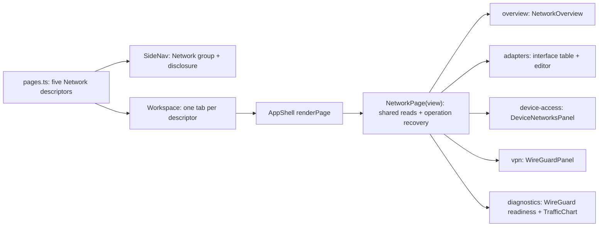

<!--
Copyright (c) 2026 DDP Engineering
This software is licensed under the PolyForm Noncommercial License 1.0.0.
Commercial use requires a separate commercial license.
See the LICENSE.txt in the .agentic folder for full license details.
SPDX-License-Identifier: LicenseRef-PolyForm-Noncommercial-1.0.0
-->

<!--
Task journal. One file per task, at .agentic/tasks/TASK-<id>.md, kept
after delivery as the task's historical record.

The header is the block of "key: value" lines directly under the title.
Keep it exactly in that form — one key per line, no blank lines inside
the block, no comments between the lines — so it stays machine-readable.

  stage         frame | specify | design | build | validate | deliver | done
                (adoption journals: survey | components | close | done)
  type          feature | fix | change | adopt
  path          full | quick
  requirements  comma-separated requirement IDs, empty until specify
  parent        optional top-level TASK-id; blank for an ordinary task
  branch        the branch this task is delivered on
  base          the commit this task started from, filled in at creation;
                the delivery report and `check --task` measure the diff
                against it, so leave it alone once it is written. Empty
                when the repository had no history yet.
  opened        YYYY-MM-DD

Header lines are edited in place; log lines are only ever appended.
Keep each log line to one sentence.

Stage report is one replaceable latest snapshot, not an evidence store.
Use plain one-line fields with no fences or bullets inside that section.
stage is the reported stage; current must match the journal header after any
transition. result is in_progress | completed | paused | blocked | skipped.
Keep all observations and decisions in the append-only Log as well.
Leave unknown fields blank; summary prints not recorded, never an assumed pass.
Refresh after work or decisions even if current has not changed.
-->

# TASK-b225b22e — Split Network into focused navigation pages

stage: done
type: change
path: full
requirements: REQ-UX-b718864e, REQ-UX-b555166c, REQ-UX-4e08d371, REQ-UX-ff989933, REQ-UX-cb91fedb, REQ-UX-823c3e13
parent:
branch: master
base: 542cf362ce0ffef95e58794457857678422372ee
opened: 2026-09-04

## Done checklist (current stage)

- [x] validated candidate confirmed unchanged; otherwise returned to validate
- [x] validation evidence, diff, exclusions, and outcome presented
- [x] delivery confirmed by the human
- [x] journal and report included in the delivery commit
- [x] agreed outcome delivered, normally a PR
- [x] close-out committed after the outcome succeeded, or carried by the delivery commit where nothing could fail after it

## Frame

Problem: The Network workspace combines overview, interface configuration, device access, WireGuard, diagnostics and traffic statistics in one long page, so operators must scan and scroll through unrelated controls on a seven-inch display.
Desired outcome: Network becomes one expandable System navigation group with focused Overview, Network adapters, Device access, VPN profiles and Diagnostics pages, each opening as its own workspace tab and containing only its relevant information and actions.
Actors: Viewer reading network state; administrator configuring adapters, device access or VPN profiles; field operator diagnosing a remote device path; keyboard, touch and screen-reader users.
Primary scenario: operator expands Network in the left rail or drawer -> chooses a focused child page -> the shell opens or activates one tab for that page -> only that function's content is shown -> existing actions and confirmations behave unchanged.
Examples: Network opens the Overview; Network adapters lists wlan0, eth0 and USB Ethernet; Device access lists the 192.168.0.130 connection; VPN profiles lists imported WireGuard profiles; Diagnostics shows readiness and traffic history.
Counterexamples: five full Network sections remain mounted in one page behind anchor links; a second horizontal tab bar duplicates the workspace tabs; diagnostics continue below VPN profiles; Activity is moved inside Network.
In scope: nested Network navigation in the rail and drawer; five page descriptors and localized titles in en/de/ro; conditional presentation of the existing overview, adapter, device-access, VPN and diagnostics/statistics content; separate tabs; component, stylesheet and browser coverage; GUI knowledge, operator documentation and changelog.
Out of scope: backend/API, permissions, persistence, network operation semantics, routes/NAT/VPN behavior, audit schema, global Activity placement, new dependencies, versioning and Git publication.
Constraints: stay on master; preserve the existing dirty tree; never stage or commit; keep current backend calls and confirmations; keep labels and 44-pixel targets on 1024x600 and the drawer at 800x480; keep one SIM/LIVE indicator; do not repeat the same content across subpages.
Success signals: navigation exposes the five localized pages as a nested group; selecting each opens one named tab and focused heading; Overview has no configuration tables; adapters, device access and VPN show only their own controls; Diagnostics alone shows readiness and statistics; no document overflow at field sizes; existing action flows and full validation remain green.
Evidence: STATED - the user says the Network panel is too complicated and approved the proposed five-page System submenu. OBSERVED - `src/components/pages/NetworkPage.tsx` currently renders NetworkOverview, Interfaces, DeviceNetworksPanel, WireGuardPanel and Statistics in one page; `src/components/shell/pages.ts`, `SideNav.tsx` and `AppShell.tsx` provide flat descriptors, navigation and tab routing; `src/styles/shell.css` already gives the rail and drawer their own vertical scrolling. INFERRED - extending the current descriptor/workspace model preserves one tab system and avoids a second local tab bar. UNKNOWN - physical touch acceptance remains for the user to inspect on the Pi.
Assumptions: the existing `network` page identifier may remain the Overview route for compatibility while four `network:*` identifiers name the focused pages; the Network group is expanded by default for discoverability and can be collapsed; the global Activity page remains outside the group with per-page links filtering existing activity data.
Unknowns: none that block implementation; exact physical-panel comfort is verified by deployment and user inspection after automated CSS-pixel checks.
Decision-blocking questions: none; the user explicitly approved the proposed information architecture and asked for implementation.
Proposed behaviors: nested and collapsible Network group; Network Overview landing page; separate adapter, device-access, VPN-profile and diagnostics/statistics pages; one workspace tab per page; localized titles and activity links; responsive rail/drawer behavior.
Path and reason: full - this adds externally observable navigation and page structure and needs a new UX requirement, design record, tests and documentation, although it changes no backend contract or dependency.

Quick-path criteria: no new observable behavior | no | five separately navigable pages; no new interface or data format | yes | backend and on-disk formats unchanged; no new dependency | yes | none; existing requirement covers it | no | current requirements describe one combined Network page; no security or data-handling change | yes | none. Any no selects the full path.

Branch exception: the user previously instructed work to remain on the same branch and not be committed; the checkout remains master and no task branch was created.

## Requirement coverage

<!-- A broad Frame outcome may produce several atomic behavior rows. Each
atomic behavior maps to exactly one requirement. Keep this table current
through design.
-->

| Frame outcome | Atomic behavior | Requirement | Positive case | Boundary or failure | Verification | Design decision or no impact |
|---|---|---|---|---|---|---|
| Focused navigation | One collapsible Network group exposes five localized destinations and separate tabs in rail and drawer | REQ-UX-b718864e | Selecting Device access opens one Device access tab | Collapsing the group does not close the active child; repeated selection does not duplicate a tab | shell.test.tsx, layout.test.ts, field-display.spec.ts | Descriptor parent relationship rendered once by SideNav; existing Workspace owns tabs |
| Focused content | Each destination renders only its assigned concern while common operation recovery remains reachable | REQ-UX-b555166c | Diagnostics shows readiness and traffic history without profile management | Overview contains no configuration table; statistics are not requested outside Diagnostics | NetworkPage.test.tsx matrix and browser cases | NetworkPage receives a view discriminator and gates sections and statistics reads |
| Concise configuration | Each of the three configuration destinations retains its one responsive list and conditional editor | REQ-UX-4e08d371 | VPN profiles contains one profile table and import | No page-level runtime badge or unrelated table | panel tests and field browser suite | Existing panels remain owners; placement changes only |
| Responsive records | Tables, Details, action dialogs and selectable technical values survive the page split | REQ-UX-ff989933 | Interface action dialog remains viewport-level | 800x480 cards remain readable and unclipped | existing RowActions/panel/layout tests plus field-display update | No markup duplication; existing record components move unchanged |
| Self-explanatory traffic history | The chart identifies RX/TX, labels byte and time scales, preserves gaps and reveals exact samples | REQ-UX-cb91fedb | Pointer, touch or keyboard selection shows time, RX, TX and total | A missing minute stays horizontally empty; long periods keep one tab stop | TrafficChart.test.tsx and field-display.spec.ts | Timestamp-positioned stacked bars with visible legend/axes and a roving sample focus |
| At-a-glance diagnostics | Readiness facts and the initial traffic chart fit in the Diagnostics workspace without vertical scrolling at 1024x600 and larger | REQ-UX-823c3e13 | Network manager is paired with its value and the chart is visible immediately | 800x480 remains readable and may scroll vertically | WireGuardPanel.test.tsx and field-display.spec.ts | Compact fact grid plus one responsive statistics header preserves chart semantics |

## Design

Requirements coverage: REQ-UX-b718864e adds flat `PageDescriptor.parentId`, `navigationTitleKey` and `overviewTitleKey` metadata; the existing Workspace remains the only owner of open and active tabs. SideNav groups descriptors by parent, renders Network as a page-opening group row plus a separate 44-pixel disclosure, and renders Overview plus four child destinations in a nested list. The group starts expanded, remains expanded while a child is active, and collapse changes only SideNav-local presentation state. REQ-UX-b555166c adds a `NetworkView` discriminator to NetworkPage; AppShell maps the five descriptors to one NetworkPage implementation, so API bindings, permissions, proposals, confirmations and recovery stay shared. REQ-UX-4e08d371 and REQ-UX-ff989933 keep the existing interface, DeviceNetworksPanel, WireGuardPanel and record/action markup; conditional placement changes, not panel contracts.

Component responsibilities: `pages.ts` declares five routable descriptors and their parent relationship; `SideNav.tsx` alone renders the hierarchy in rail and drawer; `AppShell.tsx` binds a descriptor's `networkView` to NetworkPage; `NetworkPage.tsx` owns common reads and operation lifecycle and conditionally renders one destination; `WireGuardPanel.tsx` exports its readiness facts separately so Diagnostics owns them while VPN profiles owns lifecycle/import.

Interfaces and state: `NetworkView = overview | adapters | device-access | vpn | diagnostics` is an internal union. `NetworkPageProps.view` is required. The existing `network` id remains Overview for compatibility; new ids are `network:adapters`, `network:device-access`, `network:vpn` and `network:diagnostics`. SideNav expansion is ephemeral UI state and neither closes nor rewrites Workspace tabs. No API, database, permission or on-disk format changes.

Execution and recovery: selecting a destination calls the existing `workspace.open_`; repeated selection activates the existing tab. Each active Network destination mounts the same operation controller, rediscovers in-flight operations through `listOperations`, and shows common refusal, confirmation, countdown and recovery notices before its focused content. Statistics polling starts only when `view === diagnostics`; all other reads retain their current error presentation. A failed child page read affects only the data already governed by that read and does not hide sibling navigation.

Compatibility and security: the top-row Network summary continues opening id `network`, now Overview. Activity remains a peer System page. Permission booleans and backend authorization are untouched. Existing deep browser flows are updated to open the owning destination before selecting an action. No migration is needed and rollback is the previous static GUI.

Test seams: shell tests prove the hierarchy, disclosure, drawer, tab uniqueness and localization (REQ-UX-b718864e); NetworkPage tests render a five-view matrix, prove exclusive sections and diagnostics-only statistics, and retain action/confirmation cases (REQ-UX-b555166c, REQ-UX-4e08d371); current panel, RowActions and layout tests remain regression evidence (REQ-UX-ff989933); field-display and Network Playwright cases navigate by destination at 1024x600 and 800x480.

Alternatives: a page-local second tab bar was rejected because the shell already owns tabs and two tab systems would compete on the seven-inch display. Five unrelated top-level System entries were rejected because they would hide the shared Network context. Separate stateful page components were rejected because they would duplicate operation recovery and API bindings.

Expected files: `pages.ts`, `SideNav.tsx`, `AppShell.tsx`, `NetworkPage.tsx`, `WireGuardPanel.tsx`, their tests, `shell.css`, `layout.test.ts`, en/de/ro catalogues, `field-display.spec.ts`, `network.spec.ts`, GUI knowledge, Development and Simulation Flow, Network Service Implementation Status and CHANGELOG. Risk: multiple open Network tabs each poll status; existing shell already polls summary data, and diagnostics-only statistics avoids the costly extra history read. Open decisions: none.

### Proposed architecture - TASK-b225b22e

## Log

- 2026-09-04 build re-entry: the user requested a compact Diagnostics-at-a-glance layout, so deliver re-entered build with REQ-UX-823c3e13 while retaining the same master branch and uncommitted working tree.
- 2026-09-04 build red: command=`cd 05_Software/nilo_gui; ../../02_Tools/env/with-tools.ps1 node node_modules/vitest/vitest.mjs run src/components/network/WireGuardPanel.test.tsx -t "groups every expanded readiness label with its value"`; exit=1; expected missing behavior=only the tool used one label/value fact wrapper while Network manager, Kernel support and Network helper remained ungrouped stacked terms.
- 2026-09-04 build deviation: the first Playwright red attempt exited 1 with `No tests found` because its Windows path selector was not accepted; the corrected title selector exercised the intended browser case.
- 2026-09-04 build red: command=`cd 05_Software/nilo_gui; ../../02_Tools/env/with-tools.ps1 node node_modules/@playwright/test/cli.js test --grep "signs in|1024x600: the shell"`; exit=1; expected missing behavior=the initial Diagnostics `.page-body` overflowed vertically by 235 CSS pixels at 1024x600 before any chart scrolling.
- 2026-09-04 build green: the focused readiness test passed and the five real-browser setup/display scenarios passed at 1920x1080, 1366x768, 1024x600 and the scrolling 800x480 boundary; Diagnostics has no initial workspace overflow at the three larger sizes.
- 2026-09-04 build deviation: the impacted selector again rejected a prose browser-test reference and fell back to the complete suite; that run exited 1 after 361 component tests passed because the production TypeScript build required the new `querySelectorAll` result to be typed as `HTMLElement` rather than `Element`.
- 2026-09-04 build full: after tightening the test query type, `./02_Tools/env/with-tools.ps1 python .agentic/aegis.py test --impacted --base HEAD` exited 0 through its full-suite fallback in 274.3 seconds: 41 tooling tests, all Go packages, 32 SDK tests, 7 passed plus 1 skipped fake-integration tests, 361 GUI tests, production build and all 32 browser cases passed.
- 2026-09-04 build: evolution records the expected six post-anchor modified files and no additions or removals; the browser and component tests were deliberately written before the anchor, and the advisory check reports zero errors plus 36 accepted warnings from the preserved dirty interface tree, historical unfinished journals, review media and CHANGELOG outside configured layout globs.
- 2026-09-04 validate: semantic review found the compact fact grid and shared statistics header satisfy REQ-UX-823c3e13 without changing data, network operations, permissions or traffic-chart semantics; 800x480 deliberately retains vertical scrolling rather than shrinking text or targets.
- 2026-09-04 validate: all six task requirements are active and current; GUI knowledge, Network implementation status and CHANGELOG describe the final layout, the saved architecture remains accurate, and no requirement declares manual verification.
- 2026-09-04 validate: explicit specification-compliance and implementation-quality verdicts are disabled because `.agentic/aegis.toml` has no review section; semantic review and strict proof remain required.
- 2026-09-04 validate: final command=`./02_Tools/env/with-tools.ps1 python .agentic/aegis.py check --task TASK-b225b22e --strict --run`; exit=0; full test passed in 279.2 seconds, lint passed in 6.7 seconds, errors=0, warnings=36 and strict=ok.
- 2026-09-04 validate deviation: accepted the same 36 advisory warnings from the preserved pre-existing dirty interface tree, historical unfinished journals, review media and CHANGELOG outside configured layout globs; none belongs to the compact Diagnostics correction.
- 2026-09-04 deliver deviation: `nilo-dev.ps1 start` exited 1 after treating the protected status route's expected HTTP 401 as a timeout, although it left both processes running; direct checks returned frontend 200, backend 401 as the documented Bench Core signature, and `admin` / `admin_password` login returned 200.
- 2026-09-04 deliver: the user accepted the Raspberry Pi result, instructed the task to be closed and will make the repository commit; Git staging and committing remain human-owned under the root AGENTS.md authority.
- 2026-09-04 done: TASK-b225b22e is closed after validated Raspberry Pi deployment; the final journal, requirements and delivery report are prepared for the user's repository-local commit.

- 2026-09-04 frame: scope is the user-approved five-page Network information architecture in the existing System navigation and workspace tabs; backend, permissions, operation semantics, Activity placement, version and Git state are excluded.
- 2026-09-04 frame: full path selected because nested navigation and separately observable pages require a new requirement, design, tests and documentation; no child tasks because shell navigation and conditional Network presentation are tightly coupled.
- 2026-09-04 frame: the user's “ok, do this” follows the detailed proposal and is recorded as the frame checkpoint approval, so work continues without another scope question.
- 2026-09-04 frame: stayed on master by the user's standing instruction and repository Git authority; no branch, staging or commit operation is permitted.
- 2026-09-04 frame: proposed requirement behavior is one collapsible Network group with Overview, Network adapters, Device access, VPN profiles and Diagnostics pages, separate workspace tabs, responsive rail/drawer access and no duplicated content.
- 2026-09-04 specify: created REQ-UX-b718864e for nested navigation and tab behavior and REQ-UX-b555166c for exclusive content assignment; revised REQ-UX-4e08d371 and REQ-UX-ff989933 from a singular combined Network page to focused configuration pages without weakening their table, editor, responsive-record or action-dialog behavior.
- 2026-09-04 specify: no spec is needed because the page identifiers, parent relationship and view discriminator are internal TypeScript interfaces with no persisted, API or migration contract.
- 2026-09-04 specify deviation: the first journal transition patch matched a placeholder marker that the generated journal did not contain and exited non-zero without changing the file; the same coverage was applied against the actual section boundary.
- 2026-09-04 specify check deviation: the advisory check reported zero errors and 81 warnings because the task begins on the explicitly preserved dirty tree and therefore classifies prior compact-interface edits as design-stage and partially uncovered changes; a fresh anchor after this task's red tests will separate the new evolution.
- 2026-09-04 design: chose flat routable descriptors with parent metadata, SideNav-local disclosure, the existing Workspace for tabs, and one discriminated NetworkPage operation controller; no backend, persistence, permission or migration contract changes.
- 2026-09-04 design: retained id `network` for Overview so the top-row summary and existing links remain compatible; four new `network:*` identifiers are internal and do not form a browser URL contract.
- 2026-09-04 build red: command=`cd 05_Software/nilo_gui; ../../02_Tools/env/with-tools.ps1 node node_modules/vitest/vitest.mjs run src/components/pages/NetworkPage.test.tsx src/components/shell/shell.test.tsx -t "renders only|requests traffic history|expands Network"`; exit=1; expected missing behavior=seven failures because the flat navigation has no five-page Network group, NetworkPage ignores the requested destination and renders all sections, every heading remains only Network, and adapters still requests traffic history.
- 2026-09-04 build: anchor recorded 564 files after the expected red at base `542cf36`; implementation added five internal page descriptors, the nested disclosure, view-gated Network content, Diagnostics-owned readiness/statistics and localized labels without changing any backend contract.
- 2026-09-04 build deviation: one journal patch, one verification search and two documentation/metadata patches exited non-zero on mismatched text or quoting and changed no files; each was reapplied against observed contents.
- 2026-09-04 build deviation: the first production build exposed a typed `Array.map` callback mismatch in SideNav and the focused regression run exposed one stale Overview table-cell wait; both were corrected before final proof.
- 2026-09-04 build green: `vitest run src/components/pages/NetworkPage.test.tsx src/components/shell/shell.test.tsx` passed 63 tests; the complete Vitest suite passed 359 tests; ESLint passed; TypeScript and the Vite production build passed.
- 2026-09-04 build browser: `field-display.spec.ts` passed all seven scenarios across 1920x1080, 1366x768, 1024x600 and 800x480; `shell.spec.ts` passed seven scenarios; `network.spec.ts` passed five scenarios including readiness separation, installation, adapter changes, profile lifecycle and the production 120-second rollback.
- 2026-09-04 build deviation: early browser runs found legacy substring selectors for Network/Netzwerk and one cross-section adapter assertion on the VPN page; exact selectors and an explicit absence assertion made the focused-page contract observable.
- 2026-09-04 build deviation: `aegis test --impacted --base HEAD` fell back because pre-existing requirement links contain spaces and then exited 127 after 41 tooling tests passed because Windows PATH has no `go`; this task changes no Go code, and all frontend tests plus the WSL-backed browser topology passed through repository-pinned tools.
- 2026-09-04 build: evolution reports the expected 19 files (one added internal view type, 18 modified, no removals); advisory check reports zero errors and 37 warnings, with the current shell-spec path mapping corrected and the remainder attributable to the pre-existing dirty compact-interface tree, historical journals/review media and CHANGELOG outside configured layout globs.
- 2026-09-04 validate: semantic review found the built hierarchy matches the proposed descriptor-to-SideNav-to-Workspace-to-NetworkPage architecture, preserves backend/permission/persistence contracts and introduces no unrequested behavior; specification-compliance and implementation-quality verdicts are disabled because `.agentic/aegis.toml` has no explicit review section.
- 2026-09-04 validate: GUI knowledge, development flow, implementation status, changelog and all four requirement records now describe the five focused destinations; every requirement is active and its affected paths and file-level test links are current.
- 2026-09-04 validate deviation: the first direct strict run passed 41 tooling tests then failed test and lint with exit 127 because the Windows host PATH omitted the repository-local Go runtime; rerunning through `02_Tools/env/with-tools.ps1` resolved the environment issue.
- 2026-09-04 validate: final command=`.\\02_Tools\\env\\with-tools.ps1 python .agentic/aegis.py check --task TASK-b225b22e --strict --run`; exit=0; full test command passed in 267.2 seconds, lint passed in 9.3 seconds, errors=0, warnings=36, strict=ok.
- 2026-09-04 validate deviation: accepted 36 final advisory warnings belonging to the pre-existing dirty compact-interface tree, historical unfinished journals/review media and CHANGELOG outside configured layout globs; the task evolution remains the expected 19 files and has no unexplained path.
- 2026-09-04 deliver deviation: the shared development status command exited 1 because frontend 5173 is up while an unrelated unresponsive NILO process holds backend port 8090; no process was stopped or replaced.
- 2026-09-04 deliver deviation: an npm-forwarded mock launch exited 1 on misparsed Vite options without starting a process; direct pinned-Node launch succeeded and the review interface now answers HTTP 200 at `http://127.0.0.1:5174/`.
- 2026-09-04 build re-entry: the user requested that the ambiguous traffic graphic be updated after its meaning was explained; scope adds only a self-explanatory Diagnostics chart with legend, axes and selectable values under REQ-UX-cb91fedb, leaving statistics data and APIs unchanged.
- 2026-09-04 build re-entry deviation: the first chart test run failed before behavior because its Vitest globals import was omitted, so it was corrected and not counted as requirement evidence.
- 2026-09-04 build red: command=`cd 05_Software/nilo_gui; ../../02_Tools/env/with-tools.ps1 node node_modules/vitest/vitest.mjs run src/components/network/TrafficChart.test.tsx`; exit=1; expected missing behavior=the existing bare SVG has no visible RX/TX legend, axes, scale or selectable exact-value readout.
- 2026-09-04 build green: the TrafficChart and NetworkPage focused suite passed 32 tests after adding the visible RX/TX legend, byte/time axes, timestamp-positioned gaps, exact minute selection and one-tab-stop arrow-key navigation.
- 2026-09-04 build browser deviation: the first field-display run exited 1 because the fresh real backend had not completed a sampling minute, so the chart correctly remained in its empty state; the browser fixture now routes only statistics to a deterministic measured window while every other API remains real.
- 2026-09-04 build browser: the setup plus 1024x600 and 800x480 field-display cases passed three scenarios, proving the chart remains within the viewport and exposes its legend and exact selected-minute readout at both field sizes.
- 2026-09-04 build deviation: the impacted selector rejected a pre-existing browser-test title containing spaces and fell back to the configured full test command; the first full run exited 1 only because the Romanian selected-minute sentence matched English byte for byte, then the translated wording and catalogue guard passed.
- 2026-09-04 build full: `.\02_Tools\env\with-tools.ps1 python .agentic/aegis.py test --impacted --base HEAD` exited 0 through its full-suite fallback after 41 tooling tests, all Go packages, 32 SDK tests, 7 passed plus 1 skipped fake-integration tests, 360 GUI tests, a production build and 32 browser cases passed.
- 2026-09-04 build: evolution records the expected 11 modified files and no additions or removals for the chart update; the advisory check reports zero errors and 36 accepted warnings from the preserved dirty compact-interface tree, historical unfinished journals/review media and CHANGELOG outside configured layout globs.
- 2026-09-04 validate: semantic review found the timestamp-positioned stacked bars match REQ-UX-cb91fedb, preserve the existing statistics contract and empty/stale handling, and add bounded keyboard navigation without changing backend, permissions or persistence; the existing proposed Network architecture still matches the implementation.
- 2026-09-04 validate: the GUI knowledge page, development flow, implementation status and changelog describe the legend, axes, gaps and exact sample selection; all five task requirements are active with current paths and tests, and none declares manual verification.
- 2026-09-04 validate: explicit independent review verdicts remain disabled because `.agentic/aegis.toml` has no review section; specification compliance and implementation quality fields remain disabled while semantic review and strict proof continue.
- 2026-09-04 validate deviation: the first strict run passed the complete 270.2-second test command then exited 1 because the Romanian catalogue was edited after its formatting pass; Prettier corrected that file, its focused nine-test catalogue suite passed and evolution remained the expected 11 files.
- 2026-09-04 validate: final command=`.\02_Tools\env\with-tools.ps1 python .agentic/aegis.py check --task TASK-b225b22e --strict --run`; exit=0; the full test command passed in 269.4 seconds, lint and formatting passed in 6.6 seconds, errors=0, warnings=36, strict=ok.
- 2026-09-04 validate deviation: accepted 36 final advisory warnings belonging to the preserved pre-existing dirty compact-interface tree, historical unfinished journals/review media and CHANGELOG outside configured layout globs; the chart evolution has no unexplained path.
- 2026-09-04 deliver: post-proof `git diff --check` passed, the AEGIS evolution remains 11 modified files with no additions or removals, the mock review interface answers HTTP 200 at `http://127.0.0.1:5174/`, and the candidate remains unstaged and uncommitted by user instruction and repository Git authority.
- 2026-09-04 deliver deployment: with explicit user authorization, production GUI archive SHA-256 `746ccfcca6cc70408a0b7b74429e015cd8868ee10d58aee61f219aee3a53911c` was installed at `/opt/nilo/gui` on `ddp-remote`; the prior GUI is preserved at `/opt/nilo/gui.backup-20260904-145450`, all three NILO services are active, and external HTTPS reads returned 200 for the index, `index-D9IHab0f.js` and `index-3AW1vtG1.css` before transfer files were removed.

## Rulings

<!-- Append decisions here; never edit history. Supersede with a new ruling.
- RULING-001 | date=YYYY-MM-DD | decision=<decision> | reason=<reason> | source=user | supersedes=none
source: user | repository | requirement | technical
-->

## Handoff

<!-- Replace these fields with the latest minimal resume snapshot.
status: ready | waiting | blocked
-->

current: done
status: ready
next: user stages and commits the prepared working tree
must_read: .agentic/tasks/TASK-b225b22e.md, .agentic/steps/6_deliver.md, .agentic/requirements/ux/REQ-UX-823c3e13.toml, .agentic/knowledge/gui-foundation.md
blockers:

## Stage report

stage: deliver
result: completed
current: done
changed: Diagnostics readiness is a compact label/value grid and its Statistics title shares one responsive row with the interface and period controls
evidence: final strict proof exited 0; the accepted Pi deployment serves the validated assets over HTTPS with all three services active and login verified
issues: impacted routing falls back to the full suite for an existing prose browser-test reference; the preserved dirty tree still produces advisory warnings
next: user stages and commits; repository remains on master, unstaged and uncommitted because AGENTS.md reserves Git writes for the human
needs_user: no
spec_compliance: disabled
implementation_quality: disabled
review_round:

## Delivery report (2026-09-04)

- stage: deliver; type: change; path: full; branch: master
- requirements:
  - REQ-UX-b718864e - Split Network into focused navigation pages
  - REQ-UX-b555166c - Show each Network function only on its focused page
  - REQ-UX-4e08d371 - Present each Network configuration list concisely
  - REQ-UX-ff989933 - Present Network lists as responsive tables, details and cards
  - REQ-UX-cb91fedb - Make the traffic history chart self-explanatory
  - REQ-UX-823c3e13 - Keep Diagnostics visible without initial scrolling
- deviations: none recorded
- explicit review: disabled; existing validation remains required
- diff vs task base 542cf36: 169 file(s) changed, 25059 line(s) added; 84 file(s) not content-scanned
- checks: errors=0 warnings=37 notes=1
- checklist: 4/6 done; open: journal and report included in the delivery commit; close-out committed after the outcome succeeded, or carried by the delivery commit where nothing could fail after it
