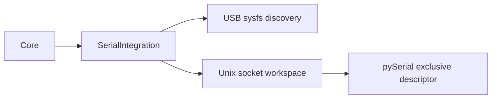

<!--
Copyright (c) 2026 DDP Engineering
This software is licensed under the PolyForm Noncommercial License 1.0.0.
Commercial use requires a separate commercial license.
See the LICENSE.txt in the .agentic folder for full license details.
SPDX-License-Identifier: LicenseRef-PolyForm-Noncommercial-1.0.0
-->

# TASK-b3882a7b - Implement serial runner and bundle tooling

stage: done
type: feature
path: full
interaction: autopilot
requirements: REQ-FUNC-455b5fe2, REQ-FUNC-680bbebf, REQ-PLAT-36597f39
parent: TASK-5344100e
branch: master
base: d2bb8be8803edb07b2f471937c12b5a6119f2320
opened: 2026-09-27

## Done checklist (current stage)

- [x] Implementation and integrated validation complete
- [x] Requested Pi deployment verified
- [x] User authorized task closure and local commit
- [x] Close-out included in this delivery commit

## Frame

Problem: STATED USB serial capability requires a supervised physical runner.
Desired outcome: USB-only discovery and bounded exclusive sessions in the NILO package.
Actors: Core supervisor; appliance operator.
Primary scenario: Discover, approve through Core, open matching endpoint, receive/send, close.
Examples: USB UART; multiple USB interfaces; Linux pseudo-terminal verification.
Counterexamples: Non-USB UART discovery; direct public stream opening; replay after restart.
In scope: Serial integration, offline bundle tooling, focused tests and integration documentation.
Out of scope: Core, GUI and client interfaces owned by sibling/parent tasks; hardware acceptance.
Constraints: STATED no adapter yet; no Git mutation or deployment authority.
Success signals: Real PTY byte exchange, exclusivity, closure and bounded memory pass.
Evidence: OBSERVED camera SDK integration and package builder provide supervised seams.
Assumptions: INFERRED pySerial 3.5 supports target Linux runtimes.
Unknowns: USB chipset signal/baud support awaits hardware.
Decision-blocking questions: None.
Proposed behaviors: See specs/usb-serial.md private runner contract.
Path and reason: Full; new physical integration and dependency.

## Requirement coverage

| Requirement | Decision | Verification |
|---|---|---|
| REQ-FUNC-455b5fe2 | USB sysfs ancestry metadata without opening | Metadata fixture discovery and identity tests |
| REQ-FUNC-680bbebf | pySerial + Linux exclusivity and bounded socket | Real PTY RX/TX/close and unsupported signal tests |
| REQ-PLAT-36597f39 | SDK manifest and verified offline wheel | Package inventory, checksum and handshake tests |

## Design

Use narrow discovery, settings, transport and SDK modules. Core owns approvals,
identity, retention and logging; runner owns only one exclusive descriptor and
a bounded event ring. A private Unix HTTP socket carries control and reads.
Alternatives: direct Core serial I/O rejected because integrations already use
the supervised SDK boundary. Risks: physical modem-line support and open-time
line transients remain chipset-dependent and require appliance acceptance.

### Proposed architecture - TASK-b3882a7b

## Log

- 2026-09-27 frame: Scoped child to runner/tooling; explicit user autopilot applies; remain on master without Git mutation.
- 2026-09-27 specify: Parent's shared usb-serial spec supplies exact private socket and identity contract; three linked requirements assigned.
- 2026-09-27 design: Module boundaries and hardware verification limits recorded above; proceed to build.
- 2026-09-27 build red: REQ-PLAT-36597f39 command=`python -m unittest discover -s 05_Software/integrations/serial/tests -p test_package.py -v`; exit=1; expected missing behavior=Serial package is unavailable.
- 2026-09-27 build red: REQ-FUNC-455b5fe2, REQ-FUNC-680bbebf command=`python -m unittest discover -s 05_Software/integrations/serial/tests -v`; exit=1; expected missing behavior=USB discovery and bounded serial transport absent. PTY case requires Linux focused proof.
- 2026-09-27 build: Accepted-image Linux runner tests reached 11 passing cases, three tooling tests passed, and an offline 177-file bundle completed SDK handshake. Lockfile consistency passed `uv lock --check --offline --project /workspace/05_Software/integrations/serial`.
- 2026-09-27 build red: REQ-FUNC-680bbebf command=`/tmp/serial-test/bin/python -m pytest -q -p no:cacheprovider 05_Software/integrations/serial/tests` in accepted-image `/outputs/serial-focused.sh`; exit=1; expected missing behavior=RTS status echoed requested output instead of modem ioctl observation.
- 2026-09-27 build red: REQ-FUNC-680bbebf same accepted-image focused command; exit=1; real PTY silently coerced requested five data bits to eight and the runner did not reject the mismatch. Add effective termios verification before exposing a session.
- 2026-09-27 build green: Accepted-image `/outputs/serial-focused.sh`; exit=0; 11 integration tests, three tooling tests, 177-file verified offline bundle handshake, and Ruff passed. Termios mismatch rejection, observed modem bits and status drain cursor covered.
- 2026-09-27 build: Evolution reviewed: runner and documentation changes match scope; concurrent frontend paths are sibling-owned. Advisory check errors=0; fixed child Handoff status; existing fingerprints/stale paths and concurrent uncovered source remain parent integration concerns.
- 2026-09-27 validate: Scoped specification and implementation-quality reviews approved. Own requirement paths/links and integration guide reconciled. Parent owns shared knowledge/context and one final integrated strict run; no deployment or Git publication performed.
- 2026-09-27 validate finding: Windows focused `with-tools.ps1 uv run --locked --project 05_Software/integrations/serial pytest -q 05_Software/integrations/serial/tests` exited 1 during collection because Linux-only modules imported tty/socket APIs before platform selection. Returned to build for test-platform correction; production runner remains Linux-only.
- 2026-09-27 build correction: Linux-only test modules now select platform before importing private socket/PTY modules; portable discovery fixtures model resolved ancestry without privileged symlinks or Windows-invalid filenames. Portable settings checks run separately. New tooling prologues and callable documentation align with Code_Style.md.
- 2026-09-27 validate green: Windows focused serial plus tooling pytest exited 0 (8 passed, 5 Linux-only skips); accepted-image `/outputs/serial-focused.sh` exited 0 (12 Linux integration tests, three tooling tests, 177-file offline bundle handshake, Ruff). No Linux tests skipped. Refreshed evolution includes expected parent/sibling edits. Both scoped verdicts approved on review round 2; integrated strict proof remains with parent.
- 2026-09-27 validate integrated: Parent TASK-5344100e reports final unchanged-candidate `.\02_Tools\env\with-tools.ps1 python .agentic/aegis.py check --task TASK-5344100e --strict --run` exit=0. Full test command passed in 427.2s (tooling, native Go/Python suites, GUI tests/build, Linux appliance browser and integration contracts); lint passed in 9.5s. Advisory errors=0, warnings=5 from pre-existing stale paths, tracked fingerprints and old journals, notes=4. Parent journal holds consolidated proof; scoped Linux PTY and bundle evidence above remains applicable.
- 2026-09-27 deliver: Validated unpublished child candidate handed to parent. Runner, dependency preparation, bundle tooling, target permissions and integration documentation are included. Physical adapter acceptance remains deferred by user instruction. No commit, push, version assignment or deployment authorized or performed; source is frozen.

- 2026-09-27 close-out authorized: User requested "close tasks, commit". Complete this task with the repository-local delivery commit, incorporating integrated full proof and Pi deployment in `07_Delivery/NILO_0.11.0_RPi_Live_Test.md`. Physical RX/TX and unplug/replug acceptance remain outside the completed implementation scope. No push requested.

- 2026-09-27 closed: Implementation, regression verification and requested Pi delivery are complete. Closing with the authorized local commit; latest integrated full tests/lint passed (414.0s/9.5s). No executable changes since that proof. Live physical acceptance limitations remain documented in the deployment record.

## Rulings

## Handoff

current: done
status: ready
next: No further implementation work; user live testing may continue
must_read: .agentic/tasks/TASK-b3882a7b.md, 07_Delivery/NILO_0.11.0_RPi_Live_Test.md
blockers: none

## Stage report

stage: deliver
result: completed
current: done
changed: Completed task closed in authorized local delivery commit; version 0.11.0 deployed
evidence: Latest integrated full tests 414.0s and lint 9.5s passed; Pi deployment verified
issues: Existing repository advisories; physical RX/TX and unplug/replug acceptance remain user testing
next: No further implementation work; user live testing
needs_user: no
spec_compliance: approved
implementation_quality: approved
review_round: 2

## Delivery report (2026-09-27)

- stage: deliver; type: feature; path: full; branch: master
- requirements:
  - REQ-FUNC-455b5fe2 - Discover USB serial endpoints
  - REQ-FUNC-680bbebf - Control serial port settings and signals
  - REQ-PLAT-36597f39 - Package supervised USB serial integration
- deviations: none recorded
- explicit review: enabled; spec_compliance=approved; implementation_quality=approved; review_round=2
- diff vs task base d2bb8be: 161 file(s) changed, 11447 line(s) added
- checks: errors=0 warnings=64 notes=4
- checklist: 2/6 done; open: delivery confirmed by the human; journal and report included in the delivery commit; agreed publication outcome delivered; close-out committed after the approved outcome succeeds
