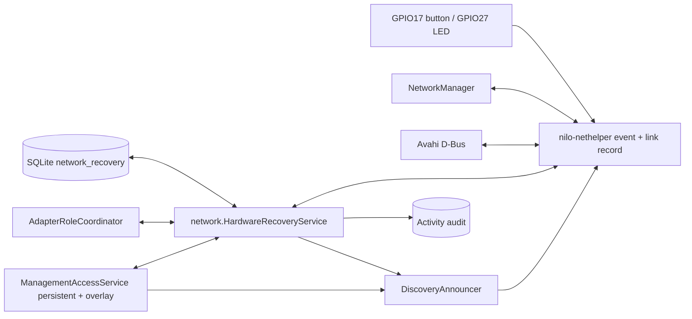

<!--
Copyright (c) 2026 DDP Engineering
This software is licensed under the PolyForm Noncommercial License 1.0.0.
Commercial use requires a separate commercial license.
See the LICENSE.txt in the .agentic folder for full license details.
SPDX-License-Identifier: LicenseRef-PolyForm-Noncommercial-1.0.0
-->

# TASK-bcd66e18 - Discover and recover a NILO by one local name

stage: validate
type: feature
path: full
interaction: autopilot
requirements: REQ-FUNC-243c38a6, REQ-SEC-a1012bc5, REQ-FUNC-554b9bbd, REQ-SEC-83deb5c6, REQ-FUNC-d2d75f06, REQ-FUNC-6334add6, REQ-PLAT-c6a335b0, REQ-FUNC-2b5bfab7, REQ-FUNC-4249d837, REQ-SEC-281ef5e4, REQ-SEC-e834fda5, REQ-SEC-640ba150, REQ-REL-321fa631, REQ-REL-59115be5, REQ-DATA-2c5b4a4d, REQ-FUNC-fb666359, REQ-UX-8062385f, REQ-PLAT-ca44573d
parent:
branch: master
base: bdcd757404e3810c2ea660533cbc37935544265c
opened: 2026-09-13

## Done checklist (current stage)

- [x] diff reviewed against scope, requirements, design, error paths,
      portability, security, and unrequested work
- [x] knowledge pages updated for every materially changed component
- [x] requirements re-read: status, prose, verification, paths, and links true
- [x] manual or inspection verification completed and recorded where applicable
- [x] final evolution report refreshed after the last candidate edit
- [x] final `check --strict --run` result recorded truthfully after all edits
- [x] remaining warnings and pre-existing failures explained
- [ ] `stage: deliver`

## Frame

Problem: NILO's current first-boot discovery is temporary and requires an operator to apply link-local addressing; a commissioned appliance has neither permanent service discovery nor a bounded, hardware-requested direct-connect recovery path. The current Raspberry Pi delivery also has no GPIO button or visible recovery indication.
Desired outcome: Any supported Ethernet port can commission a fresh appliance, every commissioned appliance remains uniquely discoverable, and the Raspberry Pi delivery can temporarily expose authenticated HTTPS as `nilo.local` over one newly connected safe Ethernet link without disturbing production networking; a longer press returns network access to commissioning under an explicitly defined reset contract.
Actors: installer commissioning a new appliance; authenticated administrator recovering a commissioned appliance; bench engineer wiring and validating the Raspberry Pi delivery; nearby DNS-SD browser/client.
Primary scenario: on a commissioned Raspberry Pi, a 3-to-under-10-second button press arms recovery and indicates that state; only a later link-up on an unassigned and unprotected physical Ethernet adapter may win; NILO temporarily adds IPv4 link-local addressing, management admission, and interface-scoped `nilo.local`; normal TLS, authentication, CSRF/admission and audit remain in force; expiry restores the exact pre-recovery state and indication. Independently, `_nilo._tcp.local` continuously identifies the appliance by its stable UUID and commissioned hostname/URL.
Examples: a direct cable plugged into a free second Ethernet adapter after arming becomes the one recovery link; a freshly installed appliance with no DHCP obtains IPv4LL through RFC 3927 probing on either supported Ethernet adapter and is reachable as `nilo.local`.
Counterexamples: an Ethernet adapter already connected when recovery is armed is unchanged; a PLC/device-network, explicit management, static-production, externally managed, or otherwise claimed adapter is never reconfigured or served by recovery; DHCP absence alone never activates recovery; simultaneous eligible link-ups do not create two recovery links.
In scope: automatic safe IPv4LL commissioning support on every supported physical Ethernet interface; permanent commissioned DNS-SD service publication; Raspberry Pi-only button classification and status indication; bounded recovery arming, post-arm link transition, eligibility, first-wins arbitration, temporary IPv4LL/name/admission, exact restoration, audit and failure handling; a >=10-second commissioning-reset action once its data boundary is agreed; privileged-helper protocol and NetworkManager/Avahi integration; configuration, packaging/systemd, unit/contract/system tests, controlled Raspberry Pi observations, user/operator/deployment documentation, knowledge and changelog updates.
Out of scope: BOOTP or a custom discovery protocol; DHCP/DNS/router/NAT/forwarding/RA service; a fixed recovery subnet; automatic fallback at boot or on DHCP failure; a discovery client application; cross-VLAN discovery; a hardware button on generic mini-PC/PC/laptop deliveries; password recovery, credential reset, or an undifferentiated factory reset; Git commit, stage, push, branch creation, or ticket edits beyond the already-updated issue.
Constraints: work directly on `master` and do not commit; all existing links and profiles stay unchanged unless the selected temporary recovery link is safely checkpointed and later restored; adapter safety is decided from durable roles/settings plus live facts, never DHCP alone or interface names; at most one recovery link; no weakening of TLS, authentication, authorization, CSRF, destination admission, audit, or helper ownership; action occurs on button release with <3 s no-op, 3-<10 s recovery, and >=10 s reset; generic Ubuntu hardware remains console/reinstall recovery; the personal Pi is useful observation but not certified release evidence.
Success signals: permanent `_nilo._tcp` browsing yields a unique instance, stable appliance ID, system hostname and usable current HTTPS target without making all commissioned units `nilo.local`; first boot works by direct cable without DHCP on either eligible Ethernet port; recovery cannot touch protected/already-connected links, chooses only one new eligible link, visibly indicates state, is audited, expires, and proves byte-for-behavior restoration; long-press reset obeys the approved preservation/deletion boundary; portable, privileged-container, and available Pi checks pass at their stated evidence levels.
Evidence: STATED — issue #12 as updated in this conversation, Raspberry Pi-only dual-role button, `master`, no commit, and the connected DDP Pi. OBSERVED — provisioning derives all eligible physical interfaces (`internal/network/management_access.go`, REQ-FUNC-243c38a6); `cmd/nilo/main.go` composes `MDNSAnnouncer` only while provisioning; `internal/network/mdns.go` carries only host label/interfaces and `internal/nethelper/avahi_render.go` owns one global Avahi host configuration, with no DNS-SD service record; link-local is only an explicit interface method (`internal/network/interface_settings.go`, `internal/nethelper/networkmanager_settings_linux.go`, REQ-FUNC-9a19ad36); durable management/device claims meet in `internal/network/adapter_roles.go`; the stable UUID is available from `internal/appliance/identity.go`; no GPIO/button component or dependency exists; `06_SoftwareDocu/Local_Hardware_Access.md` identifies `ddp-remote` as an ARM64 Pi bench target and warns that its observations are not certified acceptance. INFERRED — recovery must coordinate an ephemeral role/admission with durable claims and delegate NetworkManager/Avahi/GPIO mutation to the privileged helper; permanent DNS-SD should reuse the stable identity and actual configured management port rather than add another identity store.
Assumptions: IPv4-only recovery is intentional; the recovery alias is interface-scoped and never becomes the commissioned hostname; permanent discovery is published only where commissioned management access is allowed; the implementation may add a pinned pure-Go GPIO dependency or use an installed libgpiod interface if the design proves that is the safer packaging boundary; live Pi deployment will preserve current state and create a rollback backup.
Unknowns: exact GPIO pins, pull/polarity, debounce and LED/electrical circuit; configured recovery duration and repeat-press extension behavior; exact state cleared by the >=10-second action; permanent DNS-SD instance/TXT version schema and hostname-collision policy; exact NetworkManager profile ownership/restoration mechanism for fresh provisioning; direct-client OS convergence matrix; whether the current Pi has a physically wired button and LED available for HIL.
Decision-blocking questions: (1) May the >=10-second action perform a network commissioning reset that preserves stable appliance identity/hostname, TLS, users/passwords/tokens, audit, integrations and PLC/device-network assignments, while clearing only the commissioned lifecycle/explicit management selection and temporary recovery state? (2) May recovery default to 10 minutes, with another 3-to-under-10-second press restarting the timeout without switching an already-active link? (3) For the Pi reference wiring, approve BCM GPIO17 as an active-low button to ground with internal pull-up and BCM GPIO27 as an active-high status LED through a resistor, or provide the actual wired pins/polarities.
Proposed behaviors: P1 publish a versioned, uniquely named `_nilo._tcp.local` service continuously on commissioned management interfaces, with SRV/TXT derived from system hostname, stable UUID, actual HTTPS port/path and lifecycle state; surface collisions/publication failures and retry. P2 during provisioning, give every safe physical Ethernet adapter IPv4LL when it lacks a usable routable address, without replacing an existing usable profile, while `nilo.local` follows the serving set. P3 on Pi builds, classify release-duration button input into no-op/recovery/reset, debounce it, expose disabled/configured operation explicitly, and drive idle/armed/active/reset-pending/failure indication. P4 arm recovery by snapshotting current link state; accept only a subsequent down-to-up transition on an Ethernet adapter that passes durable role, saved-profile, live-address/profile and ownership checks; serialize candidates first-wins. P5 activate a helper-owned, checkpointed temporary IPv4LL profile and ephemeral management/firewall admission plus interface-scoped `nilo.local`, never DHCP service or routing options, and keep all web controls unchanged. P6 on timeout, cancellation, process restart or partial failure, restore NetworkManager, admission and mDNS state exactly or fail closed with durable recovery ownership retained for retry; audit arm, refusal, activation, expiry, restoration and reset requests without secrets. P7 implement the approved >=10-second reset boundary as a separate audited transition into provisioning, never as password recovery or an implicit full factory reset. P8 add deterministic fakes/unit tests, helper protocol/render tests, disposable NetworkManager/Avahi system tests, Pi packaging/GPIO tests where wired, and update network, first-boot, hardware-access, delivery and operator documentation.
Path and reason: full path. It adds externally observable discovery and recovery behavior, new helper/data/interface contracts, likely a GPIO dependency, security-sensitive network admission, hardware-specific packaging and lifecycle mutation. Quick-path matrix: no new observable behavior = no (new DNS-SD/recovery/button); no new interface/data format = no (helper protocol, DNS-SD TXT, configuration/audit state); no new dependency = unknown/no (GPIO boundary); existing requirement fully covers it = no; no security/data-handling change = no (temporary management admission and reset state).

## Requirement coverage

### Behavior inventory

| Frame outcome | Actor/system | Trigger or state | Response | Positive case | Boundary or failure | Observable result |
|---|---|---|---|---|---|---|
| P2 | Provisioning network | Provisioning reconcile | Derive access from present eligible unprotected physical adapters | Either Ethernet may serve | Protected/absent adapters excluded | Persisted firewall/admission selection follows safe hardware |
| P2 | Provisioning network | Safe Ethernet lacks routable address | Add helper-owned RFC 3927 addressing | Direct cable obtains IPv4LL | Existing usable/foreign profile unchanged | 169.254 address without route or DNS changes |
| P2 | Discovery | Provisioning serving set exists or changes | Publish scoped `nilo.local` address records | Installer resolves one name | Empty/failing responder stays address-reachable and retries | Alias follows only commissioning interfaces |
| P1 | Discovery | Appliance commissioned | Publish permanent `_nilo._tcp.local` service | Browser obtains unique identity and HTTPS target | Collision updates only effective target; failure retries | UUID instance, SRV and exact TXT on management interfaces |
| P1/P5 | Privileged helper | Publication request | Accept typed records and own only its Avahi groups | Service/alias installed | Raw/foreign/unsupported responder refused | No responder configuration injection or takeover |
| P5 | Management policy | Commissioned reconcile or recovery | Keep persistent selection frozen and recovery overlay separate | Explicit management remains stable | Newly attached interface not persisted | Recovery cannot widen durable policy |
| P3 | Pi helper | Stable button press released | Classify <3, 3-<10, and >=10 seconds | One recovery/reset event | Bounce and held state execute nothing | Exact release-boundary event |
| P3 | Pi helper | Recovery state or long hold changes | Drive documented GPIO27 pattern | Local state is visible | GPIO failure changes no networking | Idle/armed/active/reset/failure indication |
| P3 | Generic appliance | No Pi hardware configuration | Start without GPIO | x86/mini-PC remains supported | Partial GPIO configuration refused | Console/reinstall remains recovery path |
| P4 | Recovery coordinator | Recovery-duration event while commissioned | Arm ten minutes and snapshot connected links | Later safe link may qualify | Already-connected/DHCP absence do nothing; repeat press extends | Durable armed/active deadline and stable selection |
| P4 | Recovery policy | New link becomes a candidate | Refuse every assigned, protected, foreign, routed, or uncertain adapter | Unclaimed physical Ethernet passes | DHCP only adds refusal and never proves safety | Refusal precedes all mutation |
| P4/P5 | Recovery coordinator | Multiple candidates arrive | Reserve one deterministic first winner | Either port can win | All losers unchanged | One role claim and no ambiguous route |
| P5 | Network/helper | First eligible candidate wins | Add volatile IPv4LL, ephemeral admission, scoped alias | Authenticated direct HTTPS works | No DHCP/DNS/router/NAT/forwarding/RA | One bounded local recovery link |
| P5 | HTTP security | Recovery active | Use existing HTTPS security and destination controls | Authorized user signs in normally | Unauthenticated/CSRF/role violations refused | Reachability without credential bypass |
| P6 | Audit | Recovery transition or refusal | Append bounded secret-free system event | Operator can diagnose lifecycle | Injected secrets/helper prose excluded | Persisted event kind/outcome/reason/adapter label |
| P6 | Recovery coordinator/helper | Expiry, cancellation, restart, or partial failure | Restore exact pre-recovery state or retain fail-closed retry record | Owned temporary objects disappear | Unproved/foreign restoration blocks reuse | Exact comparison or durable nonterminal failure |
| P7 | Commissioning | >=10-second release while commissioned | Restore recovery then transactionally return access to provisioning | Safe interfaces derive automatically | Failure leaves commissioned access intact | Lifecycle/selection/recovery/audit transition together |
| P7 | Persistence | Network commissioning reset | Preserve all non-network-reset appliance state | Identity and login continue | No password/factory erase | Byte-identical protected data classes |

| Frame outcome | Atomic behavior | Requirement | Positive case | Boundary or failure | Verification | Design decision or no impact |
|---|---|---|---|---|---|---|
| P2 | Derive provisioning access only on eligible unprotected physical interfaces | REQ-FUNC-243c38a6 | Safe interfaces join and persist | Protected/absent leave | Controlled provider/claim tests | Extend role-aware derivation |
| P2 | Automatically provide safe RFC 3927 addressing | REQ-FUNC-d2d75f06 | Addressless Ethernet gets IPv4LL | Usable/foreign profile unchanged | Unit plus disposable NetworkManager | Helper-owned volatile profile |
| P2 | Answer `nilo.local` only during provisioning | REQ-FUNC-554b9bbd | Current address records resolve | Empty/failure retries without outage | Announcer and Avahi tests | Replace global hostname configuration with scoped records |
| P1 | Permanently advertise unique commissioned DNS-SD service | REQ-FUNC-6334add6 | UUID instance yields HTTPS target | Collision/failure/interface change | Browse and replacement tests | Exact wire schema in linked spec |
| P1/P5 | Keep responder control typed and helper-owned | REQ-SEC-83deb5c6 | Owned entry groups publish | Raw/foreign/unsupported refused | Helper protocol/ownership tests | Avahi D-Bus groups replace raw config ownership |
| P5 | Freeze persistent management selection | REQ-SEC-a1012bc5 | Explicit selection survives recovery | New adapter never persists | Persistence/admission tests | Add ephemeral overlay beside persistent policy |
| P3 | Classify Pi button at release boundaries | REQ-PLAT-c6a335b0 | Recovery/reset event emitted once | Bounce/<3/held state no action | Fake clock/GPIO plus ARM64 build | Exact electrical/timing spec |
| P3 | Indicate physical recovery state | REQ-UX-8062385f | Five states visibly differ | GPIO/restart uses failure/durable state | Fake output and optional Pi observation | Exact cadence shared with button spec |
| P3 | Disable hardware path on generic hosts | REQ-PLAT-ca44573d | x86/simulation starts without GPIO | Partial/invalid config refused | Portable startup/install inspection | Explicit install-time enablement |
| P4 | Arm only for a later link and extend timeout | REQ-FUNC-2b5bfab7 | New safe transition activates | Existing link/DHCP absence does nothing | Deterministic state-machine tests | Durable coordinator spec |
| P4 | Refuse protected or uncertain adapters | REQ-SEC-281ef5e4 | Unclaimed Ethernet passes | Each role/profile/address condition refuses | Eligibility matrix | Recheck at core and helper boundaries |
| P4/P5 | Select only one simultaneous recovery link | REQ-REL-59115be5 | Canonically first candidate in one observed sample wins | Losers untouched | Deterministic reversed-input tests | Stable tie-break and atomic role claim |
| P5 | Activate minimal direct-connect services | REQ-FUNC-4249d837 | IPv4LL + admission + alias work | Partial activation restores; no routed services | Unit/helper/disposable network tests | Low-level contract in linked spec |
| P5 | Preserve all management security controls | REQ-SEC-e834fda5 | Authenticated HTTPS works | Auth/CSRF/role/destination failures unchanged | Appliance-profile security journey | No new HTTP endpoint |
| P6 | Audit recovery without secrets | REQ-SEC-640ba150 | Every transition is attributable | Secrets and raw errors absent | Persisted Activity assertions | Bounded event vocabulary |
| P6 | Restore exact state and retry fail closed | REQ-REL-321fa631 | Expiry removes owned objects | Restart/partial/restore failure retains interlock | Snapshot and recovery tests | Durable helper/core recovery records |
| P7 | Return network access to provisioning | REQ-FUNC-fb666359 | Long press derives safe access | Preparation/transaction failure leaves commissioned | Transition/failure tests | Atomic reset spec |
| P7 | Preserve non-network-reset state | REQ-DATA-2c5b4a4d | Identity/security/device data unchanged | No password/factory reset | Seed-and-compare repository test | Shares reset transaction spec |

## Design

### Requirements coverage

The Requirement coverage table is authoritative. Discovery records implement
REQ-FUNC-554b9bbd, REQ-FUNC-6334add6 and REQ-SEC-83deb5c6; role-aware
provisioning and the ephemeral overlay implement REQ-FUNC-243c38a6 and
REQ-SEC-a1012bc5; the recovery coordinator covers REQ-FUNC-2b5bfab7,
REQ-FUNC-4249d837, REQ-SEC-281ef5e4, REQ-SEC-e834fda5,
REQ-SEC-640ba150, REQ-REL-321fa631 and REQ-REL-59115be5; GPIO covers
REQ-PLAT-c6a335b0, REQ-UX-8062385f and REQ-PLAT-ca44573d; the reverse
commissioning transaction covers REQ-FUNC-fb666359 and REQ-DATA-2c5b4a4d;
provisioning link maintenance covers REQ-FUNC-d2d75f06.

### Component responsibilities and interfaces

- `internal/network` owns validated discovery values, persistent/ephemeral
  management admission, protected-role eligibility, the deterministic recovery
  state machine, reset ordering and audit vocabulary. It never opens GPIO,
  D-Bus, files, nftables or responder configuration (all listed requirements).
- `internal/store/sqlite` owns migration 014 and the singleton core recovery
  record. Commissioning reset uses one repository transaction for lifecycle,
  management selection, recovery clearance and composed audit event
  (REQ-FUNC-fb666359, REQ-DATA-2c5b4a4d).
- `internal/nethelper` owns a typed hardware/recovery RPC extension, a separate
  root-only `direct-recovery.json`, Linux GPIO character-device access,
  NetworkManager volatile profiles, nftables overlay rendering, and Avahi D-Bus
  entry groups. No raw configuration or command crosses the socket
  (REQ-SEC-83deb5c6, REQ-SEC-281ef5e4).
- `cmd/nilo` composes one discovery publication after management/recovery
  reconciliation. `cmd/nilo-nethelper` enables GPIO only with an explicit Pi
  installation flag; other builds open no GPIO (REQ-PLAT-ca44573d).

The helper protocol adds exact typed `discovery.publish`,
`hardware.recovery.read`, `hardware.recovery.ack`,
`hardware.indicator.set`, `recovery.link.activate`, `recovery.link.extend`, and
`recovery.link.restore` operations. Hardware events carry a generation, action,
and UTC release time; recovery-duration events additionally carry the sorted
connected-adapter snapshot and snapshot-valid flag, while reset needs no link snapshot;
responses otherwise carry bounded recovery metadata only. Existing operations
remain unchanged.

### Data, execution and ordering

`network_recovery` stores version, state, handled event generation, arm/expiry
UTC timestamps, the pre-arm connected adapter IDs, selected adapter ID/name,
helper record ID and bounded outcome. Reset retains an idle highest-generation
tombstone. The helper event queue coalesces pending actions safely and both it
and the link record are atomically renamed private JSON. Commissioning-profile
ownership is a separate root-only inventory keyed by exact adapter ID,
interface, and NetworkManager UUID. No secrets or raw profile data are stored.

Startup order is existing managed-change reconciliation, management composition,
recovery restoration, discovery publication, device forwarding, then HTTPS.
An active, restoring, failed, or expired recovery record is restored rather
than re-adopted before another hardware event is handled. Maintenance observes
helper events and links, serializes through the role
coordinator, updates the ephemeral management overlay, publishes discovery, and
handles expiry before accepting a new candidate. A recovery role conflicts with
both persistent roles; same-owner rechecks are idempotent. Provider snapshots are
sorted by stable adapter ID for a deterministic same-sample tie break.

Provisioning link-local and recovery use different NILO-owned volatile
NetworkManager connection IDs, IPv4 `link-local`, IPv6 disabled,
`never-default`, and ignored automatic routes/DNS; commissioning profiles
autoconnect at low priority, while recovery profiles do not autoconnect. A
profile is only created when no active or available foreign/saved profile and
no routable address exists. Provisioning reconciliation recognizes and removes
only an exact UUID/settings match from its root-owned inventory; a foreign
same-prefix profile is unchanged and causes no inferred ownership.

Management access retains the persisted configuration and adds one in-memory
overlay interface. Firewall application receives the effective union; socket
admission builds from the same union. Overlay removal reapplies the persisted
configuration before releasing the recovery role (REQ-SEC-a1012bc5).

### Discovery, GPIO and recovery

One validated `DiscoveryPublication` carries optional scoped `nilo.local`
address records and optional permanent service data. The helper replaces only
its process-owned Avahi entry group over D-Bus, using current interface indexes
and addresses. The former global `avahi-daemon.conf` renderer is removed; the
stock responder is a prerequisite. The configured certificate-covered host
drives SRV and TXT URL, and an Avahi collision-renamed effective host fails
closed until the collision is resolved (REQ-FUNC-6334add6,
REQ-SEC-83deb5c6).

GPIO uses direct Linux GPIO v2 character-device ioctls through `x/sys/unix`, so
the CGO-free module gains no dependency. A platform-neutral classifier and
indicator scheduler take injected clocks/lines. Pi installation enables
`/dev/gpiochip0`, BCM17 input pull-up active-low, BCM27 output active-high;
generic installation leaves the feature absent (REQ-PLAT-c6a335b0,
REQ-UX-8062385f, REQ-PLAT-ca44573d).

### Failure, security, migration and operations

Helper intent persists before mutation; activation completes only after IPv4LL,
effective firewall/socket admission and alias publication. Any later failure
restores in reverse order. Recovery-profile deletion first proves the durable
UUID, adapter/interface/MAC binding, in-memory status, and complete non-routing
settings. An unproved restore remains nonterminal and owns its
role until later reconciliation. A helper restart frees Avahi groups, so core
reconciliation republishes; a core restart adopts SQLite/helper records before
serving. Audit append is fail-closed before exposure-widening actions;
required audits that cannot be appended after a state advance or network effect
retain a bounded durable pending marker in that first advanced record and retry
without repeating the network mutation. Diagnostic
refusal/failure records remain bounded (REQ-SEC-640ba150).

Migration 014 adds only an empty recovery singleton/table; upgraded appliances
remain commissioned and unchanged. The install script keeps its existing
two-argument generic form and accepts an explicit third Pi option, validates the
model, requires Avahi, and grants only GPIO chip access. Removing the candidate
binary/unit option rolls back hardware input; recovery reconciliation removes
owned temporary network objects.

### Proposed architecture - TASK-bcd66e18

### Test seams, alternatives, files and risks

Portable table tests cover validation, button boundaries, state transitions,
role/profile exclusions, overlay admission, audit redaction, reset persistence
and restart. Helper fakes cover protocol ownership and reverse cleanup. Linux
tests cover Avahi/NetworkManager/GPIO ioctl adapters; the disposable network and
appliance stages cover real D-Bus/firewall/HTTPS behavior. ARM64 builds and the
connected Pi provide early packaging/discovery evidence; physical GPIO is
reported only if the button/LED are wired.

Rejected: BOOTP/custom clients, NetworkManager `shared`, dnsmasq, fixed subnets,
global Avahi config takeover, GPIO shell tools, interface-name allowlists, and
automatic DHCP-absence fallback. Each either creates routing/server behavior,
requires a dedicated port/client, weakens ownership, or cannot preserve links.

Expected edits are the requirement/spec paths plus `internal/network/{mdns,
mdns_announcer,management_access,adapter_roles,hardware_recovery,
commissioning_link,commissioning_reset}.go` and tests;
`internal/nethelper/{protocol,client,mdns,avahi_linux,recovery_link,
networkmanager_recovery_linux,gpio_button,gpio_button_linux,gpio_indicator}.go`
and tests; SQLite migration/repositories, app/main composition, install and
disposable system-test scripts, changelog and network/first-boot/hardware docs.

Risks are NetworkManager/Avahi D-Bus API variance, GPIO v2 availability,
certificate SAN mismatch for `nilo.local`, interruption between firewall and DB
commit, and accidental production-port selection. Mitigations are capability
refusal, exact ownership markers, double eligibility checks, durable intent,
reverse restoration, existing TLS/admission, and Pi observation. The remaining
open operational decision is whether the current Pi is physically wired; it
does not alter the implementation contract.

## Log

- 2026-09-13 frame: Full path selected and scope paused for checkpoint acceptance; the existing manual IPv4LL and provisioning-only mDNS contracts do not cover permanent DNS-SD, privileged Pi GPIO, temporary commissioned admission, or reset lifecycle reversal.
- 2026-09-13 frame: User accepted the full scope and the recommended reset boundary, ten-minute extension behavior, and BCM17/BCM27 Raspberry Pi reference wiring; advanced to specify.
- 2026-09-13 specify: Created 14 draft requirements, revised 4 existing discovery/management requirements to resolve recovery conflicts, retired 0, reused 0 unchanged, and wrote five exact DNS-SD, recovery, GPIO, and commissioning-reset specifications.
- 2026-09-13 specify: User authorized uninterrupted progress through validation; interaction changed to autopilot with deliver explicitly excluded.
- 2026-09-13 design: Completed the design in this journal: core owns durable policy/state, the helper owns typed privileged GPIO/NetworkManager/firewall/Avahi effects, and all temporary effects use exact ownership plus reverse restoration.
- 2026-09-13 build red: command=`& '..\\..\\02_Tools\\env\\with-tools.ps1' go test ./internal/network -run 'TestCommissionedAnnouncer|TestProvisioningAnnouncer'`; exit=1; requirements=REQ-FUNC-554b9bbd, REQ-FUNC-6334add6, REQ-SEC-83deb5c6; expected missing behavior=commissioned DNS-SD and the fixed provisioning alias have no constructors or service model.
- 2026-09-13 build red: command=`& '..\\..\\02_Tools\\env\\with-tools.ps1' go test ./internal/network ./internal/nethelper -run 'TestRecovery|TestClassifyRecoveryButton'`; exit=1; requirements=REQ-PLAT-c6a335b0, REQ-FUNC-2b5bfab7, REQ-FUNC-4249d837, REQ-SEC-281ef5e4, REQ-REL-321fa631, REQ-REL-59115be5, REQ-UX-8062385f, REQ-PLAT-ca44573d; expected missing behavior=button thresholds/indication and the safe post-arm first-winner recovery state machine do not exist.
- 2026-09-13 build red: command=`& '..\\..\\02_Tools\\env\\with-tools.ps1' go test ./internal/network -run TestRecoveryManagementOverlay`; exit=1; requirements=REQ-SEC-a1012bc5, REQ-FUNC-4249d837, REQ-SEC-e834fda5; expected missing behavior=management access has no temporary non-persistent recovery admission overlay.
- 2026-09-13 build red: command=`& '..\\..\\02_Tools\\env\\with-tools.ps1' go test ./internal/nethelper -run TestDirectRecoveryProtocol`; exit=1; requirements=REQ-FUNC-4249d837, REQ-SEC-281ef5e4, REQ-REL-321fa631; expected missing behavior=the privileged helper protocol has no closed recovery-link activation/restoration envelope.
- 2026-09-13 build red: command=`& '..\\..\\02_Tools\\env\\with-tools.ps1' go test ./internal/nethelper -run TestRecoveryDeviceSafetyMatrix`; exit=1; requirements=REQ-SEC-281ef5e4, REQ-REL-59115be5; expected missing behavior=the helper has no independent refusal matrix for protected, configured, transitioning, or identity-mismatched adapters.
- 2026-09-13 build red: command=`wsl.exe -d Ubuntu-24.04 -- bash -lc "cd /mnt/f/2026_Networked_Intelligent_Lab_Orchestrator/05_Software/nilo_assistant && ../../02_Tools/env/with-tools.sh go test ./internal/nethelper -run TestRecoveryConnectionIsVolatile"`; exit=1; requirements=REQ-FUNC-4249d837, REQ-REL-321fa631; expected missing behavior=the Linux helper has no volatile, non-routing, DNS-free IPv4LL NetworkManager profile renderer.
- 2026-09-13 build red: command=`& '..\\..\\02_Tools\\env\\with-tools.ps1' go test ./internal/nethelper -run TestAvahiPublicationPlan`; exit=1; requirements=REQ-FUNC-554b9bbd, REQ-FUNC-6334add6, REQ-SEC-83deb5c6; expected missing behavior=the helper cannot translate validated scoped aliases and permanent services into process-owned Avahi entries.
- 2026-09-13 build red: command=`& '..\\..\\02_Tools\\env\\with-tools.ps1' go test ./internal/store/sqlite -run 'TestHardwareRecoveryRecord|TestOpenConfiguresDurable'`; exit=1; requirements=REQ-FUNC-2b5bfab7, REQ-REL-321fa631; expected missing behavior=SQLite has no migration or singleton repository for restart-safe core recovery state.
- 2026-09-13 build red: command=`& '..\\..\\02_Tools\\env\\with-tools.ps1' go test ./internal/nethelper -run TestButtonDetector`; exit=1; requirements=REQ-PLAT-c6a335b0, REQ-UX-8062385f; expected missing behavior=the Pi hardware path has no debounced press/release detector that emits one bounded action.
- 2026-09-13 build red: command=`& '..\\..\\02_Tools\\env\\with-tools.ps1' go test ./internal/nethelper -run TestHardwareRecoveryProtocol`; exit=1; requirements=REQ-PLAT-c6a335b0, REQ-FUNC-fb666359, REQ-UX-8062385f, REQ-PLAT-ca44573d; expected missing behavior=the helper protocol has no bounded hardware-event acknowledgement or indicator operations.
- 2026-09-13 build red: command=`& '..\\..\\02_Tools\\env\\with-tools.ps1' go test ./internal/network -run TestCommissionedAnnouncerScopes`; exit=1; requirements=REQ-FUNC-6334add6, REQ-FUNC-4249d837, REQ-SEC-a1012bc5; expected missing behavior=a commissioned publication cannot add the temporary `nilo.local` alias on only the active recovery link without widening its permanent service.
- 2026-09-13 build red: command=`& '..\\..\\02_Tools\\env\\with-tools.ps1' go test ./internal/store/sqlite -run 'TestNetworkCommissioningReset|TestUpgradedDatabase'`; exit=1; requirements=REQ-FUNC-fb666359, REQ-DATA-2c5b4a4d; expected missing behavior=there is no atomic network-only reset that clears lifecycle/management/recovery while preserving appliance identity.
- 2026-09-13 build red: command=`& '..\\..\\02_Tools\\env\\with-tools.ps1' go test ./internal/network -run TestProvisioningArmsEverySafe`; exit=1; requirements=REQ-FUNC-d2d75f06, REQ-FUNC-243c38a6; expected missing behavior=first boot has no role-aware reconciler that arms every safe unconfigured Ethernet adapter for automatic IPv4LL.
- 2026-09-13 build red: command=`& '..\\..\\02_Tools\\env\\with-tools.ps1' go test ./internal/network ./internal/nethelper -run 'TestRecovery|TestDirectRecoveryDeadline'`; exit=1; requirements=REQ-REL-321fa631, REQ-REL-59115be5, REQ-SEC-281ef5e4; expected missing behavior=ordinary IPv6 link-local state is incorrectly treated as production configuration, and the helper has no durable, independently expiring recovery-link deadline or extension operation.

- 2026-09-13 build red: command=`& '..\\..\\02_Tools\\env\\with-tools.ps1' go test ./internal/nethelper -run TestAvahiEffectiveHost`; exit=1; requirements=REQ-FUNC-554b9bbd, REQ-FUNC-6334add6; expected missing behavior=the Avahi adapter does not reconcile a collision-renamed effective hostname into the SRV target and advertised management URL.

- 2026-09-13 build red: command=`& '..\\..\\02_Tools\\env\\with-tools.ps1' go test ./internal/network -run 'TestRecoveryAudit|TestRecoveryFailureAudit'`; exit=1; requirements=REQ-SEC-640ba150; expected missing behavior=the recovery coordinator has no audit collaborator and cannot record bounded arm/refusal/activation/extension/expiry/restoration/failure events while suppressing injected helper detail.

- 2026-09-13 build red: command=`& '..\\..\\02_Tools\\env\\with-tools.ps1' go test ./internal/network -run TestRecoveryCancel`; exit=1; requirements=REQ-FUNC-fb666359, REQ-REL-321fa631; expected missing behavior=a network-only return to commissioning cannot synchronously cancel and restore an active temporary recovery link before clearing its durable coordinator record.

- 2026-09-13 build red: command=`wsl.exe -d Ubuntu-24.04 -- bash -lc "cd /mnt/f/2026_Networked_Intelligent_Lab_Orchestrator/05_Software/nilo_assistant && ../../02_Tools/env/with-tools.sh go test ./internal/nethelper -run TestMissingVolatileRecoveryProfile"`; exit=1; requirements=REQ-REL-321fa631; expected missing behavior=restoration does not recognize that a helper-owned in-memory recovery profile lost during NetworkManager restart is already absent and safe to clear.

- 2026-09-13 build red: command=`& '..\\..\\02_Tools\\env\\with-tools.ps1' go test ./internal/network -run TestAnnouncerWithdraws`; exit=1; requirements=REQ-FUNC-554b9bbd, REQ-SEC-83deb5c6; expected missing behavior=when the last provisioning interface leaves, the announcer forgets its state but does not withdraw the helper-owned Avahi entry group, leaving a stale `nilo.local` answer.

- 2026-09-13 build red: command=`wsl.exe -d Ubuntu-24.04 -- bash -lc "cd /mnt/f/2026_Networked_Intelligent_Lab_Orchestrator && sh 02_Tools/tests/network/check.sh -test.run 'TestAvahiSystemPublishesResolvableCommissionedService|TestRecoveryConnectionIsVolatileLinkLocalAndNeverRoutesOrResolves'"`; exit=1; requirements=REQ-FUNC-d2d75f06; expected missing behavior=an empty commissioning reconciliation serializes as JSON null instead of an explicit empty typed list, so commissioned appliance startup cannot request removal of stale helper-owned first-boot profiles.

- 2026-09-13 build red: command=`& '..\\..\\02_Tools\\env\\with-tools.ps1' go test ./internal/network -run TestCommissionedAnnouncerAcceptsTheApplianceUUIDv7Identity`; exit=1; requirements=REQ-FUNC-6334add6; expected missing behavior=DNS-SD validation accepts only UUID versions 1-5 and rejects NILO's canonical UUIDv7 appliance identities, preventing a commissioned process from starting.

- 2026-09-13 build red: command=`wsl.exe -d Ubuntu-24.04 -- bash -lc "cd /mnt/f/2026_Networked_Intelligent_Lab_Orchestrator/05_Software/nilo_assistant && ../../02_Tools/env/with-tools.sh go test ./internal/nethelper -run TestGPIOV2RequestMatchesLinuxABI"`; exit=1; requirements=REQ-PLAT-c6a335b0; expected missing behavior=the Go GPIO v2 request places `fd` before the reserved padding, unlike Linux's ABI, causing Raspberry Pi GPIO17 acquisition to fail with EINVAL.

- 2026-09-13 build manual observation: method=isolated Raspberry Pi capability check; action=built the current `nilo-nethelper` CGO-free for Linux ARM64, copied it to the recorded `ddp-remote` identity at its current address, and started it with an alternate root-owned state directory/socket plus `--raspberry-pi-recovery`; observed=Raspberry Pi 4 Model B Rev 1.2, aarch64, NetworkManager 1.52.1 and Avahi 0.8, with GPIO17 claimed as `nilo-recovery-button` active-low input and GPIO27 as `nilo-recovery-led` low output, both released on graceful shutdown; limitation=no button/LED circuit is physically wired, so press durations and visible indication were not asserted.

- 2026-09-13 build green: command=`& '..\\..\\02_Tools\\env\\with-tools.ps1' go test ./cmd/nilo ./internal/network ./internal/nethelper ./internal/store/sqlite`; exit=0; requirements=REQ-FUNC-243c38a6, REQ-FUNC-554b9bbd, REQ-SEC-83deb5c6, REQ-SEC-a1012bc5, REQ-DATA-2c5b4a4d, REQ-FUNC-2b5bfab7, REQ-FUNC-4249d837, REQ-FUNC-6334add6, REQ-FUNC-d2d75f06, REQ-FUNC-fb666359, REQ-PLAT-c6a335b0, REQ-PLAT-ca44573d, REQ-REL-321fa631, REQ-REL-59115be5, REQ-SEC-281ef5e4, REQ-SEC-640ba150, REQ-SEC-e834fda5, REQ-UX-8062385f.
- 2026-09-13 build green: command=`wsl.exe -d Ubuntu-24.04 -- bash -lc "cd /mnt/f/2026_Networked_Intelligent_Lab_Orchestrator && sh 02_Tools/tests/network/check.sh -test.run 'TestAvahiSystemPublishesResolvableCommissionedService|TestRecoveryConnectionIsVolatileLinkLocalAndNeverRoutesOrResolves'"`; exit=0; requirements=REQ-FUNC-6334add6, REQ-FUNC-4249d837, REQ-FUNC-d2d75f06, REQ-SEC-e834fda5.
- 2026-09-13 build check: evolution reviewed all 57 candidate paths (20 added, 36 modified, one intentionally removed Avahi global-renderer file) as matching the agreed discovery/recovery/install/test/documentation design; `python .agentic/aegis.py check` reported zero errors. Its stale-path warning for the deliberately removed `avahi_render.go` remains to keep the removal traceable; the other advisory warnings belong to pre-existing requirements and task journals outside this task.

- 2026-09-13 validate review round 1: specification_compliance=changes_required; implementation_quality=changes_required. Consolidated findings: preserve helper record identity and all cleanup interlocks after partial activation; reassert process-owned Avahi publication after helper/responder restart; keep owned first-boot IPv4LL profiles stable while refusing foreign profiles and ordinary IPv6 link-local safely; make the long-press reset compare-and-transition, audited on failure, and hand the live process deterministically into provisioning; reconcile failed restoration before pending hardware events; make cleanup proceed despite audit failure; persist unacknowledged GPIO events, expose reset-pending while held, and report GPIO I/O failures; validate `nilo.local` TLS coverage and add a recovery-security journey; transition live commissioning into permanent discovery; update stale delivery verification and wiring warning. Returned to build for bounded correction cycle 1.
- 2026-09-14 validate review round 2: specification_compliance=changes_required; implementation_quality=changes_required. Consolidated findings: capture release time and the connected-link snapshot in the durable helper event; preserve the highest handled generation across idle/reset and safely coalesce pending hardware actions; restore rather than blindly re-adopt recovery after service restart; retain helper record identity through the runtime error boundary; replace prefix-only commissioning-profile ownership with a durable exact UUID/settings inventory; withdraw the shared alias before a collision-failed commissioned replacement; audit armed expiry and make arm audit failure retryable. Returned to build for bounded correction cycle 2, the final configured fix cycle.

- 2026-09-13 build red review-cycle-1: command=`& '..\\..\\02_Tools\\env\\with-tools.ps1' go test ./internal/network ./internal/nethelper -run 'TestProvisioningRetains|TestAnnouncerReasserts|TestRecoveryActivationFailureRetains|TestRecoveryExpiryRestoresEven|TestButtonDetectorReports'`; exit=1; requirements=REQ-FUNC-d2d75f06, REQ-FUNC-554b9bbd, REQ-FUNC-6334add6, REQ-FUNC-4249d837, REQ-REL-321fa631, REQ-SEC-640ba150, REQ-PLAT-c6a335b0, REQ-UX-8062385f; expected missing behavior=owned IPv4LL is removed, stale helper publication is trusted, partial activation loses its helper ID, audit failure blocks expiry cleanup, and held reset-pending state is unavailable.
- 2026-09-13 build red review-cycle-1: command=`& '..\\..\\02_Tools\\env\\with-tools.ps1' go test ./internal/nethelper -run 'TestButtonDetectorReportsResetPendingOnlyWhileAStableLongPressIsHeld|TestHardwareEventQueueRetainsUnacknowledgedReleaseAndMonotonicGenerationAcrossRestart'`; exit=1; requirements=REQ-PLAT-c6a335b0, REQ-FUNC-2b5bfab7; expected missing behavior=held reset-pending state was not exposed and helper button events had no durable generation/acknowledgement queue.
- 2026-09-13 build red review-cycle-1: command=`& '..\\..\\02_Tools\\env\\with-tools.ps1' go test ./internal/network -run 'TestRecoveryArmEventIsIdempotentAcrossCoreRestartBeforeAcknowledgement|TestRecoveryExpiryRestoresEvenWhenAuditIsUnavailable'`; exit=1; requirements=REQ-FUNC-2b5bfab7, REQ-SEC-640ba150, REQ-REL-321fa631; expected missing behavior=hardware-event generation was not persisted and audit failure prevented safety cleanup.
- 2026-09-13 build red review-cycle-1: command=`& '..\\..\\02_Tools\\env\\with-tools.ps1' go test ./internal/network -run TestNetworkCommissioningResetPreparationAppliesOnlySafeDerivedAdmissionAndCanRollback`; exit=1; requirements=REQ-FUNC-fb666359, REQ-DATA-2c5b4a4d, REQ-SEC-a1012bc5; expected missing behavior=the live management service could not stage safe derived provisioning admission and roll it back before the database transition.
- 2026-09-13 build red review-cycle-1: command=`& '..\\..\\02_Tools\\env\\with-tools.ps1' go test ./internal/store/sqlite -run TestNetworkCommissioningResetClearsOnlyLifecycleManagementAndRecovery`; exit=1; requirements=REQ-FUNC-fb666359, REQ-DATA-2c5b4a4d; expected missing behavior=reset did not accept and atomically persist the safe derived management record or reject replay from provisioning.
- 2026-09-13 build red review-cycle-1: command=`& '..\\..\\02_Tools\\env\\with-tools.ps1' go test ./cmd/nilo -run 'TestLiveCommissioningReplacesNiloAliasWithPermanentService|TestLongPressTransitionsTheLiveRuntimeToSafeProvisioningWithoutARebootGap'`; exit=1; requirements=REQ-FUNC-554b9bbd, REQ-FUNC-6334add6, REQ-FUNC-fb666359, REQ-DATA-2c5b4a4d; expected missing behavior=the running process retained startup discovery mode and the long press lacked a safe audited live transition into provisioning.
- 2026-09-13 build red review-cycle-1: command=`& '..\\..\\02_Tools\\env\\with-tools.ps1' go test ./internal/nethelper -run TestDirectRecoveryActivationFailureReturnsItsDurableIdentityForCleanup -count=1`; exit=1; requirements=REQ-FUNC-4249d837, REQ-REL-321fa631; expected missing behavior=the helper discarded the new durable record identity when activation or active-record persistence failed, preventing exact cleanup after a partial effect.
- 2026-09-13 build red review-cycle-1: command=`& '..\\..\\02_Tools\\env\\with-tools.ps1' go test ./internal/nethelper -run TestDirectRecoveryRefusesToOverwriteAnExistingOwnedLink -count=1`; exit=1; requirements=REQ-FUNC-4249d837, REQ-REL-321fa631; expected missing behavior=a refused retry against an existing owned recovery link did not return that durable identity for stale-core adoption and restoration.
- 2026-09-13 build red review-cycle-1: command=`& '..\\..\\02_Tools\\env\\with-tools.ps1' go test ./cmd/nilo -run 'TestLegacyPrivateListenerPermanentDiscoveryFollowsItsBoundInterface|TestDiscoveryCertificateNamesAddTheSharedAliasOnlyForPiRecovery' -count=1`; exit=1; requirements=REQ-FUNC-6334add6, REQ-SEC-e834fda5; expected missing behavior=legacy private listeners had no permanent interface scope and certificate validation did not distinguish permanent discovery from the Pi-only recovery alias.
- 2026-09-13 build red review-cycle-1: command=`wsl.exe -d Ubuntu-24.04 -- bash -lc "cd /mnt/f/2026_Networked_Intelligent_Lab_Orchestrator/05_Software/nilo_assistant && ../../02_Tools/env/with-tools.sh go test ./internal/nethelper -run TestCommissioningDeviceKeepsOnlyItsOwnedLinkLocalProfile -count=1"`; exit=1; requirements=REQ-FUNC-d2d75f06, REQ-SEC-281ef5e4; expected missing behavior=first-boot reconciliation accepted an unowned manual IPv4LL address and could replace network state it did not own.
- 2026-09-13 build red review-cycle-1: command=`& '..\\..\\02_Tools\\env\\with-tools.ps1' go test ./internal/nethelper -run TestHardwareEventQueueRejectsInconsistentOrExhaustedDurableState -count=1`; exit=1; requirements=REQ-PLAT-c6a335b0, REQ-FUNC-2b5bfab7; expected missing behavior=the root-owned GPIO event queue accepted a partially populated durable event and could wrap its monotonic generation.
- 2026-09-13 build integration correction: command=`wsl.exe -d Ubuntu-24.04 -- bash -lc "cd /mnt/f/2026_Networked_Intelligent_Lab_Orchestrator && sh 02_Tools/tests/network/check.sh -test.run 'TestAvahiSystemPublishesResolvableCommissionedService|TestRecoveryConnectionIsVolatileLinkLocalAndNeverRoutesOrResolves|TestCommissioningDeviceKeepsOnlyItsOwnedLinkLocalProfile'"`; exit=1; observed problem=the disposable container used a random hostname, so the intended configured-hostname publication correctly failed closed as a collision; the harness now gives Avahi the configured `nilo-system-test` hostname.
- 2026-09-13 build integration correction: same command; exit=1; observed problem=the appliance regression uses an intentionally dynamic loopback test listener and discovery-port validation rejected port zero before recognizing that loopback is never advertised; loopback remains allowed while discoverable private listeners require a fixed port.
- 2026-09-13 build green review-cycle-1: command=`& '..\\..\\02_Tools\\env\\with-tools.ps1' go test ./cmd/nilo ./cmd/nilo-nethelper ./internal/httpapi ./internal/network ./internal/nethelper ./internal/store/sqlite`; exit=0; scope=command/runtime, HTTP recovery security journey, discovery, GPIO, commissioning/recovery state machines, helper protocol/ownership and SQLite preservation tests.
- 2026-09-13 build green review-cycle-1: command=`wsl.exe -d Ubuntu-24.04 -- bash -lc "cd /mnt/f/2026_Networked_Intelligent_Lab_Orchestrator && sh 02_Tools/tests/network/check.sh -test.run 'TestAvahiSystemPublishesResolvableCommissionedService|TestRecoveryConnectionIsVolatileLinkLocalAndNeverRoutesOrResolves|TestCommissioningDeviceKeepsOnlyItsOwnedLinkLocalProfile'"`; exit=0; scope=disposable real NetworkManager/Avahi commissioned discovery, recovery/commissioning profile safety, helper install behavior, and appliance HTTPS/helper recovery system journeys.
- 2026-09-13 build green review-cycle-1: command=`wsl.exe -d Ubuntu-24.04 -- bash -lc "cd /mnt/f/2026_Networked_Intelligent_Lab_Orchestrator/05_Software/nilo_assistant && GOOS=linux GOARCH=arm64 CGO_ENABLED=0 ../../02_Tools/env/with-tools.sh go build -o /tmp/nilo-arm64 ./cmd/nilo && GOOS=linux GOARCH=arm64 CGO_ENABLED=0 ../../02_Tools/env/with-tools.sh go build -o /tmp/nilo-nethelper-arm64 ./cmd/nilo-nethelper"`; exit=0; scope=statically linked Linux ARM64 core and Pi-capable helper binaries.
- 2026-09-13 build check review-cycle-1: evolution reviewed all 63 candidate paths (22 added, 40 modified, one intentionally removed Avahi global-renderer file) as matching the agreed discovery/recovery/install/test/documentation design; `git diff --check` was clean; `python .agentic/aegis.py check --task TASK-bcd66e18 --full` reported zero task-specific errors or warnings, with 35 unrelated pre-existing catalog/task warnings and one unrelated manual-verification note.
- 2026-09-13 validate red review-cycle-1: command=`& '..\\..\\02_Tools\\env\\with-tools.ps1' go test ./internal/network -run TestRecoveryRestoresTheHelperEffectWhenActiveStateCannotBePersisted -count=1`; exit=1; requirements=REQ-FUNC-4249d837, REQ-REL-321fa631; expected missing behavior=after helper activation succeeded, failure to persist the core active record returned without restoring the exact temporary helper effect.
- 2026-09-13 validate focused green review-cycle-1: command=`& '..\\..\\02_Tools\\env\\with-tools.ps1' go test ./internal/network ./internal/nethelper ./cmd/nilo ./internal/httpapi ./internal/store/sqlite`; exit=0; scope=the crash-window correction plus recovery/discovery/helper/HTTP/persistence runtime regressions.
- 2026-09-13 validate reconciliation: re-read all 18 active requirements and five linked specs; corrected the simultaneous-candidate requirement to the already designed canonical same-sample ordering, replaced stale effective-host/event/open-decision spec text, and updated Bench Core routing, invariants, architecture, discovery behavior, and file map to the current process-owned Avahi, IPv4LL, GPIO, recovery, and live-reset implementation.
- 2026-09-14 build red review-cycle-2: command=`& '..\..\02_Tools\env\with-tools.ps1' go test ./cmd/nilo -run 'TestRuntimeRecoveryDriverPreservesPartialHelperIdentity|TestRuntimeStartupRestoresAnActiveRecoveryLinkInsteadOfReadoptingIt|TestLiveCommissioningWithdrawsSharedAliasBeforeAFailedPermanentReplacement' -count=1`; exit=1; requirements=REQ-FUNC-4249d837, REQ-REL-321fa631, REQ-FUNC-554b9bbd, REQ-FUNC-6334add6; expected missing behavior=the runtime dropped a partial helper identity, startup re-adopted recovery instead of restoring it, and a collision-failed discovery replacement could leave the shared alias advertised.
- 2026-09-14 build red review-cycle-2: command=`& '..\..\02_Tools\env\with-tools.ps1' go test ./internal/network -run 'TestRecoveryArmUsesTheDurableButtonReleaseTimeAndLinkSnapshot|TestRecoveryEventGenerationSurvivesIdleAndClockRollbackCannotExtendTheWindow' -count=1`; exit=1; requirements=REQ-FUNC-2b5bfab7, REQ-SEC-640ba150, REQ-REL-321fa631; expected missing behavior=core had no durable release-time/snapshot event contract and discarded the handled generation on return to idle, allowing delayed or replayed events to reopen recovery.
- 2026-09-14 build red review-cycle-2: command=`& '..\..\02_Tools\env\with-tools.ps1' go test ./internal/nethelper -run 'TestHardwareEventQueueCoalescesRecoveryAndLetsResetSupersede|TestRecoveryLinkSnapshotRejectsAnUnidentifiedConnectedEthernet' -count=1`; exit=1; requirements=REQ-PLAT-c6a335b0, REQ-FUNC-2b5bfab7, REQ-SEC-281ef5e4; expected missing behavior=the helper event lacked release snapshot metadata, could overwrite a pending reset with recovery, and could not fail closed on an unidentified connected Ethernet interface.
- 2026-09-14 build red review-cycle-2: command=`wsl.exe -d Ubuntu-24.04 -- bash -lc "cd /mnt/f/2026_Networked_Intelligent_Lab_Orchestrator && sh 02_Tools/tests/network/check.sh -test.run '^TestCommissioningReconcileNeverDeletesAForeignSamePrefixProfile$'"`; exit=1; requirements=REQ-FUNC-d2d75f06, REQ-SEC-281ef5e4; expected missing behavior=prefix-only ownership let commissioning reconciliation delete a foreign persistent static profile whose name resembled a NILO profile.
- 2026-09-14 build integration correction review-cycle-2: the first combined disposable Linux run passed every selected NetworkManager/Avahi test but the later appliance journey returned `network_preview_stale`; observed cause=the new real-profile proof temporarily recreated the shared `eth0` fixture and left NetworkManager observations settling; correction=the proof now uses and removes an isolated disposable veth without perturbing appliance `eth0`.
- 2026-09-14 build green review-cycle-2: command=`& '..\..\02_Tools\env\with-tools.ps1' go test ./internal/network ./internal/nethelper ./cmd/nilo ./internal/store/sqlite -run 'TestRecoveryArmUsesTheDurableButtonReleaseTimeAndLinkSnapshot|TestRecoveryEventGenerationSurvivesIdleAndClockRollbackCannotExtendTheWindow|TestRecoveryRetriesArmAndArmedExpiryWhenTheirAuditIsUnavailable|TestHardwareEventReplayAfterAcknowledgementFailureDoesNotRearmOrReset|TestHardwareEventQueueCoalescesRecoveryAndLetsResetSupersede|TestRecoveryLinkSnapshotRejectsAnUnidentifiedConnectedEthernet|TestRuntimeRecoveryDriverPreservesPartialHelperIdentity|TestRuntimeStartupRestoresAnActiveRecoveryLinkInsteadOfReadoptingIt|TestLiveCommissioningWithdrawsSharedAliasBeforeAFailedPermanentReplacement|TestNetworkCommissioningResetClearsOnlyLifecycleManagementAndRecovery' -count=1`; exit=0; scope=all round-two event timing/replay/coalescing, audit retry, restart restore, helper identity, discovery switch and reset tombstone corrections.
- 2026-09-14 build green review-cycle-2: command=`& '..\..\02_Tools\env\with-tools.ps1' go test ./cmd/nilo ./cmd/nilo-nethelper ./internal/httpapi ./internal/network ./internal/nethelper ./internal/store/sqlite`; exit=0; scope=all affected command/runtime, HTTP, network, helper and SQLite packages including the 143-second runtime suite.
- 2026-09-14 build green review-cycle-2: command=`wsl.exe -d Ubuntu-24.04 -- bash -lc "cd /mnt/f/2026_Networked_Intelligent_Lab_Orchestrator && sh 02_Tools/tests/network/check.sh -test.run 'TestAvahiSystemPublishesResolvableCommissionedService|TestRecoveryConnectionIsVolatileLinkLocalAndNeverRoutesOrResolves|TestCommissioningDeviceKeepsOnlyItsOwnedLinkLocalProfile|TestCommissioningReconcileNeverDeletesAForeignSamePrefixProfile|TestCommissioningReconcileCreatesAndRemovesAnInventoriedVolatileProfile'"`; exit=0; scope=real disposable NetworkManager/Avahi discovery, exact commissioning/recovery profile ownership and appliance HTTPS/helper security journeys.
- 2026-09-14 build green review-cycle-2: command=`wsl.exe -d Ubuntu-24.04 -- bash -lc "cd /mnt/f/2026_Networked_Intelligent_Lab_Orchestrator/05_Software/nilo_assistant && GOOS=linux GOARCH=arm64 CGO_ENABLED=0 ../../02_Tools/env/with-tools.sh go build -o /tmp/nilo-arm64 ./cmd/nilo && GOOS=linux GOARCH=arm64 CGO_ENABLED=0 ../../02_Tools/env/with-tools.sh go build -o /tmp/nilo-nethelper-arm64 ./cmd/nilo-nethelper"`; exit=0; scope=CGO-free Linux ARM64 core and Pi-capable helper.
- 2026-09-14 build check review-cycle-2: evolution reviewed all 63 candidate paths (22 added, 40 modified, one intentionally removed global Avahi renderer); `git diff --check` was clean; `python .agentic/aegis.py check --task TASK-bcd66e18 --full` reported zero task-specific errors or warnings, with 35 unrelated pre-existing catalog/task warnings and one unrelated manual-verification note.
- 2026-09-14 validate review round 3: candidate=`d665790485c6c88b1ea0fd91e0ae489bb9eb6d739e7d1f9dfb564f058a8081bc`; specification_compliance=changes_required; implementation_quality=changes_required; both before/after digest checks matched. Consolidated blocking findings: provisioning-time refusals acknowledge without persisting the handled generation, so an ACK failure can replay after commissioning; future-dated releases are retried until wall time catches up and can exceed the elapsed ten-minute bound; helper restoration deletes a same-UUID/prefix connection without proving exact adapter/MAC/settings/volatile ownership; a stale Avahi group after responder restart can permanently block lifecycle discovery withdrawal; a GPIO read discontinuity can preserve and later classify a stale gesture as reset; activation/restoration audit failures can become permanently unaudited after state advances; active prose incorrectly requires a link snapshot on reset events; and four requirement test links name the wrong GPIO test file. Wired Pi duration/LED and real dual-Ethernet recovery remain unverified. This was the final configured review round, so validation is blocked and strict proof was not run.
- 2026-09-14 build red review-cycle-3: command=`& '..\..\02_Tools\env\with-tools.ps1' go test ./cmd/nilo -run TestProvisioningRefusalConsumesEventBeforeAcknowledgementFailure -count=1`; exit=1; requirements=REQ-FUNC-2b5bfab7; expected missing behavior=a provisioning refusal did not durably consume generation 21 before injected helper acknowledgement failure.
- 2026-09-14 build red review-cycle-3: command=`& '..\..\02_Tools\env\with-tools.ps1' go test ./internal/network -run 'TestFutureDatedHardwareEventIsConsumedBeforeWallClockCatchesUp|TestRecoveryRetriesPostMutationAuditWithoutRepeatingTheMutation' -count=1`; exit=1; requirements=REQ-FUNC-2b5bfab7, REQ-SEC-640ba150; expected missing behavior=future releases were not durably refused and activation/restoration had no durable audit-pending states for retry without repeating network mutation.
- 2026-09-14 build red review-cycle-3: command=`& '..\..\02_Tools\env\with-tools.ps1' go test ./internal/nethelper -run 'TestAvahiMissingGroupErrorsAreAlreadyWithdrawn|TestButtonDetectorDiscontinuityCannotTurnAShortPressIntoReset' -count=1`; exit=1; requirements=REQ-FUNC-554b9bbd, REQ-FUNC-6334add6, REQ-PLAT-c6a335b0; expected missing behavior=vanished Avahi groups were not classified as already withdrawn and the button detector could not invalidate a gesture after a GPIO read discontinuity.
- 2026-09-14 build red review-cycle-3: command=`wsl.exe -d Ubuntu-24.04 -- bash -lc "cd /mnt/f/2026_Networked_Intelligent_Lab_Orchestrator/05_Software/nilo_assistant && ../../02_Tools/env/with-tools.sh go test ./internal/nethelper -run TestRecoveryProfileOwnershipRequiresExactSettingsAndVolatileState -count=1"`; exit=1; requirements=REQ-FUNC-4249d837, REQ-REL-321fa631; expected missing behavior=recovery restore had no exact adapter/interface/MAC/non-routing-settings and volatile-profile ownership matcher.
- 2026-09-14 build red review-cycle-3: command=`& '..\..\02_Tools\env\with-tools.ps1' go test ./internal/network -run TestPendingActivationAuditCannotBlockExpiryCleanup -count=1`; exit=1; requirements=REQ-SEC-640ba150, REQ-REL-321fa631; expected missing behavior=a pending post-activation audit failure prevented expiry from physically restoring the temporary recovery link.
- 2026-09-14 build red review-cycle-3: command=`wsl.exe -d Ubuntu-24.04 -- bash -lc "cd /mnt/f/2026_Networked_Intelligent_Lab_Orchestrator/05_Software/nilo_assistant && ../../02_Tools/env/with-tools.sh go test ./internal/nethelper -run TestRecoveryProfileOwnershipRequiresExactSettingsAndVolatileState -count=1"`; exit=1; requirements=REQ-FUNC-4249d837, REQ-REL-321fa631; expected missing behavior=the exact matcher still accepted foreign recovery-like profiles carrying gateway, address-data, DNS, or other forbidden payload fields.
- 2026-09-14 build green review-cycle-3: command=`& '..\..\02_Tools\env\with-tools.ps1' go test ./internal/network ./internal/store/sqlite ./cmd/nilo -run 'TestProvisioningRefusalConsumesEventBeforeAcknowledgementFailure|TestFutureDatedHardwareEventIsConsumedBeforeWallClockCatchesUp|TestRecoveryRetriesPostMutationAuditWithoutRepeatingTheMutation|TestPendingActivationAuditCannotBlockExpiryCleanup|TestRecoveryExpiryRestoresEvenWhenAuditIsUnavailable|TestHardwareRecoveryRecordSurvivesRestartWithoutNetworkPayload' -count=1`; exit=0; scope=durable pre-ack refusal consumption, bounded future-event refusal, restart-safe audit queue retry, and expiry cleanup without repeated network mutation.
- 2026-09-14 build green review-cycle-3: command=`wsl.exe -d Ubuntu-24.04 -- bash -lc "cd /mnt/f/2026_Networked_Intelligent_Lab_Orchestrator/05_Software/nilo_assistant && ../../02_Tools/env/with-tools.sh go test ./internal/nethelper -run 'TestAvahiMissingGroupErrorsAreAlreadyWithdrawn|TestButtonDetectorDiscontinuityCannotTurnAShortPressIntoReset|TestRecoveryProfileOwnershipRequiresExactSettingsAndVolatileState' -count=1"`; exit=0; scope=stale Avahi-group withdrawal, GPIO gesture discontinuity, and exact volatile NetworkManager recovery-profile ownership.
- 2026-09-14 build green review-cycle-3: command=`& '..\..\02_Tools\env\with-tools.ps1' go test ./cmd/nilo ./cmd/nilo-nethelper ./internal/httpapi ./internal/network ./internal/nethelper ./internal/store/sqlite`; exit=0; scope=all affected command/runtime, helper protocol, HTTP recovery security, discovery/recovery state machines, platform adapters, and SQLite migration/repository packages.
- 2026-09-14 build green review-cycle-3: command=`wsl.exe -d Ubuntu-24.04 -- bash -lc "cd /mnt/f/2026_Networked_Intelligent_Lab_Orchestrator && sh 02_Tools/tests/network/check.sh -test.run 'TestAvahiSystemPublishesResolvableCommissionedService|TestRecoveryConnectionIsVolatileLinkLocalAndNeverRoutesOrResolves|TestCommissioningDeviceKeepsOnlyItsOwnedLinkLocalProfile|TestCommissioningReconcileNeverDeletesAForeignSamePrefixProfile|TestCommissioningReconcileCreatesAndRemovesAnInventoriedVolatileProfile|TestRecoveryProfileOwnershipRequiresExactSettingsAndVolatileState'"`; exit=0; scope=disposable real NetworkManager/Avahi restart and publication, exact commissioning/recovery ownership, and appliance HTTPS/helper recovery security journeys.
- 2026-09-14 build green review-cycle-3: command=`wsl.exe -d Ubuntu-24.04 -- bash -lc "cd /mnt/f/2026_Networked_Intelligent_Lab_Orchestrator/05_Software/nilo_assistant && GOOS=linux GOARCH=arm64 CGO_ENABLED=0 ../../02_Tools/env/with-tools.sh go build -o /tmp/nilo-arm64 ./cmd/nilo && GOOS=linux GOARCH=arm64 CGO_ENABLED=0 ../../02_Tools/env/with-tools.sh go build -o /tmp/nilo-nethelper-arm64 ./cmd/nilo-nethelper"`; exit=0; scope=CGO-free Linux ARM64 core and Raspberry Pi helper after the GPIO and ownership corrections.
- 2026-09-14 build check review-cycle-3: evolution reviewed all 20 correction-cycle paths (one added Linux Avahi test and 19 modified source/test/persistence/documentation paths) as limited to the recorded review findings; `git diff --check` was clean; `python .agentic/aegis.py check --task TASK-bcd66e18 --full` reported zero task-specific errors, with 35 unrelated pre-existing repository warnings and one unrelated manual-verification note.
- 2026-09-14 validate review round 4: candidate=`a2f6e4556684e939f039cb648fbf4a20bd73cb3fba3257f99d935ed206b03abd`; specification_compliance=changes_required; implementation_quality=changes_required; both before/after digest checks matched and neither reviewer edited. Consolidated blocking findings: after a GPIO read discontinuity, a continuously held button must not establish a fresh press without a stable released baseline; the durable audit queue must cover every required transition that can advance or settle after audit failure, not only activation/restoration; helper/core event prose must limit the carrier snapshot to recovery-duration events; NetworkManager restoration must compare a normalized complete owned profile, including `may-fail` and unexpected properties; initial arm save failure must not publish in-memory generation/state that can later be acknowledged and lost; and core/helper elapsed-time deadlines must fail closed across a backward wall-clock discontinuity. The human-authorized additional review cycle is exhausted, so validation is blocked and strict proof was not run.
- 2026-09-14 build red review-cycle-4: command=`& '..\..\02_Tools\env\with-tools.ps1' go test ./internal/nethelper -run TestButtonDetectorDiscontinuityRequiresAReleasedBaseline -count=1`; exit=1; requirements=REQ-PLAT-c6a335b0; expected missing behavior=a continuously held button after a GPIO read outage established a new press and emitted `reset_commissioning` when finally released.
- 2026-09-14 build red review-cycle-4: command=`wsl.exe -d Ubuntu-24.04 -- bash -lc "cd /mnt/f/2026_Networked_Intelligent_Lab_Orchestrator/05_Software/nilo_assistant && ../../02_Tools/env/with-tools.sh go test ./internal/nethelper -run TestRecoveryProfileOwnershipRequiresExactSettingsAndVolatileState -count=1"`; exit=1; requirements=REQ-FUNC-4249d837, REQ-REL-321fa631; expected missing behavior=the restore ownership matcher accepted changed `may-fail`, an unexpected connection property, and a foreign security section.
- 2026-09-14 build red review-cycle-4: command=`& '..\..\02_Tools\env\with-tools.ps1' go test ./cmd/nilo -run TestArmPersistenceFailureCannotPublishHandledStateBeforeRetryAndRestart -count=1`; exit=1; requirements=REQ-FUNC-2b5bfab7, REQ-REL-321fa631; expected missing behavior=an initial arm save failure published the unpersisted generation/state in memory, allowing a later pass to acknowledge state that restart would lose.
- 2026-09-14 build red review-cycle-4: command=`& '..\..\02_Tools\env\with-tools.ps1' go test ./internal/network -run 'TestRecoveryQueuesExpiryAndRestoreRequestAuditsWithoutRepeatingCleanup|TestRecoveryQueuesFailureAuditsUntilTheyCanBeRecorded|TestRecoveryQueuesExtensionAndRestorationFailureAudits' -count=1`; exit=1; requirements=REQ-SEC-640ba150, REQ-REL-321fa631; expected missing behavior=expiry, restore-request, activation-failure, extension-failure, and restoration-failure audit errors advanced or settled state without durable retry markers.
- 2026-09-14 build red review-cycle-4: commands=`& '..\..\02_Tools\env\with-tools.ps1' go test ./internal/network -run TestRecoveryExpiresByElapsedTimeAfterWallClockRollback -count=1` and `& '..\..\02_Tools\env\with-tools.ps1' go test ./internal/nethelper -run 'TestDirectRecoveryExpiresByElapsedTimeAcrossWallClockRollback|TestDirectRecoveryRestartFailsClosedOnPersistedClockRollback' -count=1`; exits=1,1; requirements=REQ-FUNC-2b5bfab7, REQ-REL-321fa631; expected missing behavior=core and helper expose no independent steady-clock deadline, and helper persisted state carries no last wall-clock observation for fail-closed restart after rollback.

- 2026-09-14 build red review-cycle-4: command=`& '..\..\02_Tools\env\with-tools.ps1' go test ./internal/network -run TestRecoveryPersistsPendingAuditWithTheFirstAdvancedFailureOrCancelState -count=1`; exit=1; requirements=REQ-SEC-640ba150, REQ-REL-321fa631; expected missing behavior=activation-failure and armed-cancellation state could be persisted before their failed required-audit retry marker, leaving a crash window that permanently lost the audit.

- 2026-09-14 build red review-cycle-4: command=`wsl.exe -d Ubuntu-24.04 -- bash -lc "cd /mnt/f/2026_Networked_Intelligent_Lab_Orchestrator && sh 02_Tools/tests/network/check.sh -test.run '^TestNetworkManagerProducesAnExactlyOwnedRestorableRecoveryProfile$'"`; exit=1; requirements=REQ-FUNC-4249d837, REQ-REL-321fa631; expected missing behavior=the normalized exact matcher did not yet recognize NetworkManager's real empty permissions/address/route collections plus false Ethernet defaults, so a helper-created owned profile could not be restored.

- 2026-09-14 build red review-cycle-4: command=`& '..\..\02_Tools\env\with-tools.ps1' go test ./internal/network ./internal/nethelper -run 'TestRecoveryRestartFailsClosedAfterTheLastPersistedClockObservation|TestDirectRecoveryPersistsItsLastClockObservationForRestart' -count=1`; exit=1; requirements=REQ-FUNC-2b5bfab7, REQ-REL-321fa631; expected missing behavior=core and helper did not persist their last live wall-clock observation, so a restart after a rollback that remained later than the original state mutation could extend the window.

- 2026-09-14 build green review-cycle-4: command=`& '..\..\02_Tools\env\with-tools.ps1' go test ./internal/network ./internal/nethelper ./cmd/nilo -run 'TestButtonDetectorDiscontinuityRequiresAReleasedBaseline|TestArmPersistenceFailureCannotPublishHandledStateBeforeRetryAndRestart|TestRecoveryQueuesExpiryAndRestoreRequestAuditsWithoutRepeatingCleanup|TestRecoveryQueuesFailureAuditsUntilTheyCanBeRecorded|TestRecoveryQueuesExtensionAndRestorationFailureAudits|TestRecoveryPersistsPendingAuditWithTheFirstAdvancedFailureOrCancelState|TestRecoveryExpiresByElapsedTimeAfterWallClockRollback|TestRecoveryRestartFailsClosedAfterTheLastPersistedClockObservation|TestDirectRecoveryExpiresByElapsedTimeAcrossWallClockRollback|TestDirectRecoveryRestartFailsClosedOnPersistedClockRollback|TestDirectRecoveryPersistsItsLastClockObservationForRestart|TestRecoveryProfileOwnershipRequiresExactSettingsAndVolatileState' -count=1`; exit=0; scope=all round-four GPIO baseline, persistence ordering, complete audit retry, exact profile normalization, and dual-clock/restart rollback corrections.
- 2026-09-14 build green review-cycle-4: command=`& '..\..\02_Tools\env\with-tools.ps1' go test ./cmd/nilo ./cmd/nilo-nethelper ./internal/httpapi ./internal/network ./internal/nethelper ./internal/store/sqlite -count=1`; exit=0; scope=all affected runtime, helper protocol, HTTP security, discovery/recovery state machines, platform adapter and SQLite repository packages after the final timing correction.
- 2026-09-14 build green review-cycle-4: command=`wsl.exe -d Ubuntu-24.04 -- bash -lc "cd /mnt/f/2026_Networked_Intelligent_Lab_Orchestrator && sh 02_Tools/tests/network/check.sh -test.run 'TestAvahiSystemPublishesResolvableCommissionedService|TestRecoveryConnectionIsVolatileLinkLocalAndNeverRoutesOrResolves|TestCommissioningDeviceKeepsOnlyItsOwnedLinkLocalProfile|TestCommissioningReconcileNeverDeletesAForeignSamePrefixProfile|TestCommissioningReconcileCreatesAndRemovesAnInventoriedVolatileProfile|TestRecoveryProfileOwnershipRequiresExactSettingsAndVolatileState|TestNetworkManagerProducesAnExactlyOwnedRestorableRecoveryProfile'"`; exit=0; scope=disposable real NetworkManager/Avahi publication, exact commissioning ownership, normalized complete recovery creation/restoration, and authenticated appliance/helper security journeys.
- 2026-09-14 build green review-cycle-4: command=`wsl.exe -d Ubuntu-24.04 -- bash -lc "cd /mnt/f/2026_Networked_Intelligent_Lab_Orchestrator/05_Software/nilo_assistant && GOOS=linux GOARCH=arm64 CGO_ENABLED=0 ../../02_Tools/env/with-tools.sh go build -o /tmp/nilo-arm64 ./cmd/nilo && GOOS=linux GOARCH=arm64 CGO_ENABLED=0 ../../02_Tools/env/with-tools.sh go build -o /tmp/nilo-nethelper-arm64 ./cmd/nilo-nethelper"`; exit=0; scope=CGO-free Linux ARM64 core and Raspberry Pi helper after the GPIO/deadline changes.
- 2026-09-14 build check review-cycle-4: evolution reviewed all 10 correction-cycle source/test paths and found only the recorded round-four findings; `git diff --check` was clean; all 18 active requirements and five linked specs were re-read and corrected for recovery-only snapshots, complete audit retry, normalized profile ownership and persisted deadline observations; `python .agentic/aegis.py check --task TASK-bcd66e18 --full` reported zero errors and no task-specific warnings, with 35 unrelated pre-existing repository warnings and one unrelated manual-verification note.

- 2026-09-14 validate review round 5: candidate=`eeb435f5fc5eac26a15bd408c338316e67f38c74e1a638c3ef645e9bdd961fe5`; specification_compliance=changes_required; implementation_quality=changes_required; both before/after digest checks matched and neither reviewer edited or changed Git state. Consolidated blocking findings: physical-event arming persists the handled generation before its `already_connected_when_armed` refusal audits and the physical snapshot path does not retain candidates for those audits, so an audit failure can be acknowledged and permanently lost; and the exact-profile spec does not yet document the implementation's narrowly accepted empty NetworkManager `proxy` section. The six recorded round-four findings otherwise passed both reviews. Wired Pi duration/LED and real dual-Ethernet recovery remain unverified. The human-authorized additional correction cycle is exhausted, so validation is blocked and strict proof was not run.

- 2026-09-14 build red review-cycle-5: command=`& '..\..\02_Tools\env\with-tools.ps1' go test ./cmd/nilo -run TestPhysicalArmRefusalAuditPrecedesHandledGenerationAndAcknowledgement -count=1`; exit=1; requirements=REQ-SEC-640ba150, REQ-FUNC-2b5bfab7; expected missing behavior=a physical arm with an already-connected snapshot persisted and acknowledged its handled generation without attempting the required refusal audit, so an audit outage could permanently lose that event.

- 2026-09-14 build green review-cycle-5: command=`& '..\..\02_Tools\env\with-tools.ps1' go test ./cmd/nilo ./internal/network -run 'TestPhysicalArmRefusalAuditPrecedesHandledGenerationAndAcknowledgement|TestArmPersistenceFailureCannotPublishHandledStateBeforeRetryAndRestart|TestRecoveryAuditsBoundedLifecycleAndRefusal|TestRecoveryArmUsesTheDurableButtonReleaseTimeAndLinkSnapshot|TestRecoveryRetriesArmAndArmedExpiryWhenTheirAuditIsUnavailable' -count=1`; exit=0; scope=the round-five physical snapshot refusal, audit outage/restart retry, handled-generation persistence order, and neighboring recovery audit contracts.
- 2026-09-14 build green review-cycle-5: command=`& '..\..\02_Tools\env\with-tools.ps1' go test ./cmd/nilo ./cmd/nilo-nethelper ./internal/httpapi ./internal/network ./internal/nethelper ./internal/store/sqlite -count=1`; exit=0; scope=all affected runtime, helper protocol, HTTP security, discovery/recovery state machines, platform adapter, and SQLite repository packages after the correction.
- 2026-09-14 build green review-cycle-5: command=`wsl.exe -d Ubuntu-24.04 -- bash -lc "cd /mnt/f/2026_Networked_Intelligent_Lab_Orchestrator/05_Software/nilo_assistant && GOOS=linux GOARCH=arm64 CGO_ENABLED=0 ../../02_Tools/env/with-tools.sh go build -o /tmp/nilo-arm64 ./cmd/nilo && GOOS=linux GOARCH=arm64 CGO_ENABLED=0 ../../02_Tools/env/with-tools.sh go build -o /tmp/nilo-nethelper-arm64 ./cmd/nilo-nethelper"`; exit=0; scope=CGO-free Linux ARM64 core and Raspberry Pi helper after the audit-ordering correction.
- 2026-09-14 build check review-cycle-5: the refreshed evolution report contains the one post-anchor executable correction, `hardware_recovery.go`; the new red test was already present in the post-red anchor. Semantic review found the correction limited to retaining physical snapshot candidates and completing their refusal audits before durable handled-generation publication; requirement traceability, the exact-profile spec, and component knowledge now state the same contracts. `git diff --check` was clean; `python .agentic/aegis.py check --task TASK-bcd66e18 --full` reported zero errors and no task-specific warnings, with 35 unrelated pre-existing repository warnings and one unrelated manual-verification note.

- 2026-09-14 validate review round 6: candidate=`cc3b93ac5b345068a3baf4af62edd975f846c4503989d0cb7193353c3188627e`; specification_compliance=approved; implementation_quality=approved; both before/after digest checks matched over the same 91 non-journal paths and neither reviewer edited files or changed Git state. Both confirmed that physical-event snapshot candidates are retained, their required refusal audits precede handled-generation persistence and helper acknowledgement, audit outage leaves the event safely retryable through restart without network mutation, and the empty NetworkManager `proxy` exception is documented and limited to a generated empty section. Both also confirmed all earlier findings remain resolved. Wired Pi duration/LED and real dual-Ethernet recovery remain explicitly unverified physical-acceptance limitations.

- 2026-09-14 validate strict blocked: command=`node C:\Users\dpasare\.codex\plugins\cache\personal\aegis\0.9.1\scripts\aegis.mjs run --root F:\2026_Networked_Intelligent_Lab_Orchestrator --task TASK-bcd66e18 --kind validate`; job=`c759cdb1-3ff9-48ae-a31b-3ca640df5b53`; exit=1; candidate_before=candidate_after=`4e3550619bb1e1698382680cc3c449dd5a1172ddd14d3863ed2bad37f0f98b95` over 1066 Git-visible files, branch `master`, head `bdcd757404e3810c2ea660533cbc37935544265c`. The test command stopped after 118 script tests with five failures, all caused by the same pre-existing reconstruction-lock defect: clean task-untouched `05_Software/nilo_gui/package-lock.json` hashes to `6f4e96974d44d5b490f85f59f8c4b98cbddf4b3dfe03701b13bbc8c00649b6cf`, while clean task-untouched `02_Tools/containers/build/build-environment.lock.json` still expects its parent digest `5f35c00f92d6d06a76075f3ac3446e124fc85008b57a6c7a2ce3ff421f88510a`; Git history shows commit `4df2b14` changed the package lock from the expected digest without updating this pin. Because the script-test stage exits early, strict proof did not reach the remaining Go, Python, GUI, or appliance suites. The AEGIS lint subprocess separately exited 127 because the bridge process did not inherit the repository-local Go path; diagnostic command=`& '..\02_Tools\env\with-tools.ps1' python scripts/aegis_test.py lint` then passed Go vet, Python compilation, Prettier, ESLint, and script compilation with exit 0. Advisory output contains the same 35 unrelated pre-existing repository warnings and one manual-verification note plus one current-task review-counter warning; the latter is explained by human RULING-011 authorizing review round 6 beyond the configured three-round default. No ticket candidate file was changed to conceal or bypass these failures, so validation remains blocked and deliver is not entered.

- 2026-09-14 validate manual Chrome/Raspberry Pi observation: method=Google Chrome 152.0.7977.83 on the current Windows DDP client against deployed NILO 0.4.0 on `ddp-remote`; action=loaded the authenticated appliance through the loopback-only preview, verified live Network Overview data and the About build block, expanded NILO's `Usable NILO URLs`, then followed its advertised `https://ddp-remote.local:8443/` link; observed=the preview showed live appliance state (`wlan0` management at `10.44.118.42/24`, protected `eth0` device role, NILO 0.4.0/appliance profile), while the advertised local link failed in Chrome with `ERR_NAME_NOT_RESOLVED`; the Windows client also timed out on a direct `_nilo._tcp.local` multicast query and could not resolve the host through `ping` or `Resolve-DnsName`, despite enabled public-profile mDNS firewall rules; the Pi remained healthy and advertised one correctly scoped `_nilo._tcp` instance on `wlan0` with the expected stable UUID, hostname, HTTPS URL and port. Conclusion=server-side publication works, but the requirement/spec acceptance statement that DNS-SD yields a usable HTTPS URL is not satisfied for this representative current Chrome/Windows client; a client discovery/resolution path or an explicitly supported alternative is required before discoverability can be called end-user usable. The loopback preview is diagnostic only and is not acceptance evidence for discovery.

- 2026-09-14 validate corrected connected Chrome/Raspberry Pi observation: the preceding failure was reassessed after the workstation was found disconnected from DDP, so it is retained as an invalidated observation rather than product evidence. With the Windows client reconnected to DDP at `10.44.118.126/24`, `ping ddp-remote.local` and `Resolve-DnsName ddp-remote.local` resolved the Raspberry Pi at `10.44.118.42`, and an interface-bound multicast PTR query received the advertised `_nilo._tcp.local` instance, stable UUID, hostname and HTTPS target from the Pi. Following NILO's displayed `https://ddp-remote.local:8443/` link in current Google Chrome 152.0.7977.83 then loaded the live NILO application directly at that URL and visibly reported appliance profile, healthy service state and build version 0.4.0. Conclusion=permanent mDNS/DNS-SD publication and the commissioned local management URL are usable on the representative connected DDP client; no discovery redesign or correction is warranted by the invalidated disconnected-client result.

- 2026-09-14 validate review round 7: post-round-six scope was limited to user-requested version 0.4.0/reconstruction-lock maintenance, the one corrected `test_toolchain_bootstrap.py` lock-digest expectation, and corrected connected-client evidence; discovery/recovery executable behavior was unchanged. specification_compliance=approved; implementation_quality=approved; both reviewers reported stable before/after fingerprints (`97b8566b0415549af06a8a9c8c361babb7f4be1cd27849ec1557686ea7fdd684` across 101 changed paths; quality additionally reported AEGIS candidate `93cc45f661f9cf12f9146efb16d53e245f15a347737ed57609385d4bc0116a4c`) and neither edited files or Git state. Both confirmed the connected Chrome/DNS-SD evidence satisfies commissioned discovery, all version mirrors report 0.4.0, the actual GUI lock SHA-256 `cc0d0ba650b3cd0cd56d5c7cfe42f2ee960b79d14fa7460bbe0b08424b23fb73` matches the toolchain/build-lock/test mirrors, and no new security, portability, scope or contract finding exists. Wired Pi button/LED timing and real dual-Ethernet recovery remain physical-acceptance limitations.

- 2026-09-14 validate strict environment retry: job=`9e2a79a4-3536-4f6f-9f98-68143ea2d425`; candidate before/after=`93cc45f661f9cf12f9146efb16d53e245f15a347737ed57609385d4bc0116a4c`; unchanged=true; result=operational failure because the bridge child did not inherit the repository-local Go path. All 118 script tests passed, including the corrected lock digest, before `go test ./...` and lint both returned 127 (`go` not found). The same wrapped lint command passed earlier, so the bridge was relaunched through `02_Tools/env/with-tools.ps1` without changing the candidate.

- 2026-09-14 validate red appliance acceptance: wrapped strict job=`2e0208d0-d669-470d-8fa2-8291935a76a1`; candidate before/after=`93cc45f661f9cf12f9146efb16d53e245f15a347737ed57609385d4bc0116a4c`; unchanged=true; lint exit=0; test exit=1 after 900.4 seconds. The full run reached the disposable appliance stage and exposed that its Go and Playwright fixtures minted ephemeral certificates for only loopback/management IP, while the commissioned discovery contract correctly requires the runtime system hostname `<container-hostname>.local`; Bench Core failed closed with `the appliance certificate is missing required discovery SAN`. This is a test-infrastructure defect caused by the new security contract, so validation returned narrowly to build.

- 2026-09-14 build green appliance certificate fixtures: `cmd/nilo/appliance_stage_linux_test.go` now mints each disposable certificate for both `127.0.0.1` and the actual `os.Hostname()+".local"`; `nilo_gui/e2e/topology.ts` adds that same runtime DNS SAN beside its management-IP SAN. No production code changed. Evidence: Linux focused Go compile/test exit=0; disposable appliance stage real helper/NetworkManager tests passed; all 40 appliance Playwright tests passed; `vitest run e2e/topology.test.ts` passed 24/24; Prettier and `git diff --check` passed; evolution refreshed after the final candidate edit.

- 2026-09-14 validate review round 8: specification_compliance=approved; implementation_quality=approved; both reviewers reported stable before/after changed-path fingerprint `ee7772b345572fa131e7ff4a72e79a76b56754390699cbd8a2ef2da409c542e6` across 103 paths (quality additionally reported AEGIS candidate `4c9f0a0f4856984df524e67cdd0ad28aa4474643337f9e85882a17dd865659be`) and neither edited files or Git state. Both confirmed the changes are confined to disposable acceptance fixtures, retain their required IP SANs, add only the exact runtime `<system-hostname>.local` SAN, introduce no wildcard trust or certificate bypass, and are covered by the focused Go, real helper/NetworkManager, 40-test Playwright and 24-test topology evidence. No blocking finding exists; the wired Pi button/LED and real dual-Ethernet limitations remain.

- 2026-09-14 validate review round 8 evidence correction: candidate=`4c9f0a0f4856984df524e67cdd0ad28aa4474643337f9e85882a17dd865659be`; specification_compliance=approved; implementation_quality=approved; both before/after digest checks matched and neither reviewer edited files or changed Git state. The preceding round-eight prose remains the detailed evidence; this normalized record supplies the journal parser's exact current-verdict fields.

- 2026-09-14 validate strict passed: command=`02_Tools/env/with-tools.ps1 node C:\Users\dpasare\.codex\plugins\cache\personal\aegis\0.9.1\scripts\aegis.mjs run --root F:\2026_Networked_Intelligent_Lab_Orchestrator --task TASK-bcd66e18 --kind validate`; job=`5bea31f3-c2d0-4d04-90b7-ffe80ea93833`; exit=0; candidate before/after=`4c9f0a0f4856984df524e67cdd0ad28aa4474643337f9e85882a17dd865659be`; unchanged=true; test exit=0 in 419.2 seconds; lint exit=0 in 9.5 seconds; strict passed=true. The full command covered 118 repository script tests, Go packages, Python compilation/tests, GUI unit/build checks, disposable Linux network/appliance paths and all 40 real appliance Playwright tests. Advisory result=WARN with zero errors, 45 warnings and one note: pre-existing stale-path/incomplete-journal findings remain outside this task; current version/test-harness files are reported as uncovered or outside layout because version assignment is repository maintenance rather than a ticket requirement; review round 8 exceeds the configured default but is covered by the user's return-to-design/build direction and RULING-012. Wired GPIO duration/LED and real dual-Ethernet recovery remain explicitly unverified physical-acceptance limitations.

## Rulings

- RULING-001 | date=2026-09-13 | decision=Perform the task directly on master without staging, committing, pushing, or creating a task branch; use the connected DDP Raspberry Pi for controlled observations without calling it certified acceptance | reason=explicit working and delivery constraints | source=user | supersedes=none
- RULING-002 | date=2026-09-13 | decision=A press released at or after ten seconds performs a network commissioning reset that preserves the stable appliance identity and hostname, TLS, users, credentials and tokens, audit history, integrations, and PLC/device-network assignments while clearing only the commissioned lifecycle, explicit management selection, and temporary recovery state | reason=keeps network recovery separate from password recovery and factory reset | source=user | supersedes=none
- RULING-003 | date=2026-09-13 | decision=The recovery window defaults to ten minutes and another recovery-duration press restarts that timeout without switching an already-active recovery interface | reason=accepted recommended bounded recovery behavior | source=user | supersedes=none
- RULING-004 | date=2026-09-13 | decision=The Raspberry Pi reference wiring uses an active-low button from BCM GPIO17 to ground with the internal pull-up and an active-high status LED on BCM GPIO27 through a resistor | reason=accepted recommended portable reference wiring | source=user | supersedes=none
- RULING-005 | date=2026-09-13 | decision=Permanent discovery uses `_nilo._tcp.local`, stable instance `NILO <UUID>`, and an exact version-1 TXT allowlist; an Avahi hostname collision may change only the effective SRV/URL target while configured hostname and appliance identity remain unchanged | reason=keeps every service instance unique and its advertised URL usable under standard mDNS collision handling | source=technical | supersedes=none
- RULING-006 | date=2026-09-13 | decision=Run design, build, and validation without intermediate checkpoint prompts, then stop before deliver; this grants no Git staging, commit, push, or publication authority | reason=explicit user continuation limit | source=user | supersedes=none
- RULING-007 | date=2026-09-13 | decision=Use Linux GPIO v2 character-device ioctls through the existing x/sys dependency and replace global Avahi configuration takeover with process-owned D-Bus entry groups | reason=keeps the appliance CGO-free, avoids an external GPIO command dependency, and allows interface-scoped aliases/services without rewriting responder policy | source=technical | supersedes=none
- RULING-008 | date=2026-09-13 | decision=Permanent DNS-SD advertises only the configured, certificate-covered system hostname; if Avahi reports a collision-renamed effective hostname, fail the publication and retry until the hostname collision is resolved rather than advertising an uncertified URL | reason=TLS cannot authenticate a responder-chosen suffix and discovery must never direct an operator to a name outside the installed certificate | source=technical | supersedes=RULING-005
- RULING-009 | date=2026-09-14 | decision=Reopen one additional bounded correction cycle for the findings recorded by validation review round 3, then repeat both independent reviews and strict validation if approved | reason=explicit human authorization after the configured correction limit was reached | source=user | supersedes=none
- RULING-010 | date=2026-09-14 | decision=Reopen one additional bounded correction cycle for the findings recorded by validation review round 4, then repeat both independent reviews and strict validation if approved | reason=explicit human authorization after review round 4 remained blocked | source=user | supersedes=none
- RULING-011 | date=2026-09-14 | decision=Reopen one additional bounded correction cycle for the two findings recorded by validation review round 5, then repeat both independent reviews and strict validation if approved | reason=explicit human authorization after review round 5 remained blocked | source=user | supersedes=none
- RULING-012 | date=2026-09-14 | decision=Return to design/build after the initial Chrome observation, reassess it on the reconnected DDP network, and continue through validation without prompts; no discovery redesign is required when the connected retest passes | reason=explicit user direction followed by evidence that the earlier failure was a disconnected-client artifact | source=user | supersedes=none
- RULING-013 | date=2026-09-14 | decision=Treat the user-directed return to design/build in RULING-012 as a fresh bounded validation-review cycle; the two post-return review passes are cycle rounds 1 and 2 even though the append-only narrative log labels them global rounds 7 and 8 | reason=keeps the current Stage report within the configured cycle while preserving the complete historical review count | source=user | supersedes=none

## Handoff

current: validate
status: waiting
next: Await an explicit delivery decision; the validated candidate remains uncommitted on master
must_read: .agentic/tasks/TASK-bcd66e18.md, .agentic/steps/5_validate.md, .agentic/requirements/functional/REQ-FUNC-6334add6.toml, .agentic/specs/REQ-FUNC-6334add6.md, .agentic/knowledge/bench-core-foundation.md
blockers:

## Stage report

stage: validate
result: completed
current: validate
changed: Corrected release lock-test and appliance-certificate fixtures; no production discovery/recovery behavior changed after the approved implementation
evidence: Chrome 152 directly rendered deployed NILO 0.4.0 through `https://ddp-remote.local:8443/`; both round-eight reviews approved candidate `4c9f0a...`; final strict job `5bea31f3-c2d0-4d04-90b7-ffe80ea93833` passed its full test and lint commands with an unchanged candidate
issues: Wired Pi button/LED duration behavior and real dual-Ethernet recovery remain unavailable for physical acceptance; advisory contains only explained pre-existing repository and release-layout warnings
next: Stop before deliver and await explicit human direction; do not stage, commit or push
needs_user: yes
spec_compliance: approved
implementation_quality: approved
review_round: 2
