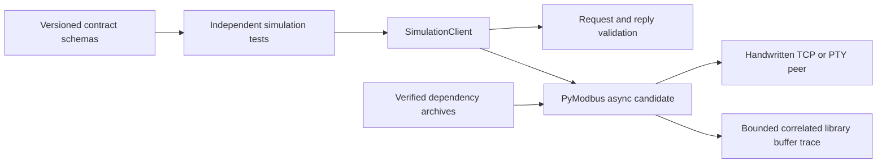

<!--
Copyright (c) 2026 DDP Engineering
This software is licensed under the PolyForm Noncommercial License 1.0.0.
Commercial use requires a separate commercial license.
See the LICENSE.txt in the .agentic folder for full license details.
SPDX-License-Identifier: LicenseRef-PolyForm-Noncommercial-1.0.0
-->


# TASK-c55f83d5 - MB-01 Modbus feasibility and protocol contracts

stage: done
type: feature
path: full
interaction: autopilot
requirements: REQ-DATA-6fcda58c, REQ-FUNC-cfadd842, REQ-TEST-3e971d35, REQ-REL-5c6b6a83, REQ-REL-689b7d81, REQ-PLAT-81822827
parent:
branch: ddp/modbus-client
base: 6c11c483041a7028c693a747a522fb23fb511e17
opened: 2026-09-29

## Done checklist (current stage)

- [x] Validated candidate confirmed unchanged; otherwise return to validate.
- [x] Validation evidence, diff, exclusions and outcome presented.
- [x] Delivery confirmed by the human.
- [x] Journal and report included in the delivery commit.
- [x] Agreed outcome delivered.
- [x] Close-out carried by the delivery commit when local commit is the whole outcome.

## Frame

Problem: STATED NILO needs a Modbus master/client integration. OBSERVED epic #27 and MB-01 #28 propose contracts and a dependency spike before production implementation; the existing plan's individual write-approval proposal conflicts with the user's current decision.
Desired outcome: INFERRED begin with MB-01: accepted scope decisions, reproducible protocol/dependency evidence, and draft contracts that later work packages can implement. The broader feature includes RTU serial, native TCP and RTU over TCP, shared typed maps/workspaces, one live owner, and retained recordings.
Actors: STATED administrators, operators and viewers under the accepted access rules; OBSERVED GUI, CLI/MCP clients, Bench Core and supervised Python integration processes; INFERRED independent simulated peers/gateways for this feasibility package.
Primary scenario: Operator requests a session against a configured endpoint -> Core admits credential-bound ownership under plugin policy -> the endpoint scheduler performs permitted reads and successive writes -> clients receive correlated values, errors and write outcomes. This task specifies and proves the foundations with isolated fixtures; production orchestration belongs to later packages.
Examples: STATED typed register maps with units/scaling and CSV/JSON interchange in the first delivery. INFERRED acceptance examples: serial RTU and both TCP modes read holding register wire address 0; an enabled write policy permits successive typed writes without individual approval prompts; a lost write reply remains delivery_unknown and is never automatically retransmitted.
Counterexamples: UDP added under the RTU-over-IP name; a blanket role/token bypass of plugin write disablement; per-write acceptance prompts; two masters sharing one physical port; late RTU replies presented as fresh samples; uncertain writes replayed after restart; opening a definition initiating I/O.
In scope: MB-01 requirements and contracts for endpoint/profile/map/workspace/session/recording/command boundaries and errors; reconciliation of current user decisions against the proposed plan; isolated independent RTU/TCP/RTU-over-TCP feasibility fixtures and golden address/CRC/MBAP/quantity vectors; fragmented/coalesced/late reply, physical opening exclusivity, cancellation, trace correlation and zero automatic write-retry evidence; exact dependency/runtime versions, archive hashes, license/notices and offline closure proposal. User extended this scope to the reviewed build-environment input recipe and local candidate rebuild needed for offline proof. Contract changes are drafts until validated, and do not implement MB-02 through MB-10.
Out of scope: Complete production plugin, shared-port lease implementation, production persistence/UI/API/CLI/MCP implementation, advanced function implementation, UDP/ASCII/TLS transports, broadcasts/raw frames/disruptive diagnostics, release/version assignment, package publication, Git staging/commit/push, deployment and real-target I/O.
Constraints: STATED use AEGIS now; prior branch preparation remains outside AEGIS. OBSERVED checkpoint mode and explicit review enabled in .agentic/aegis.toml. Reuse ddp/modbus-client from remote master; leave the existing preview videos untouched. Follow the existing nilo.integration/1 boundary, code style and repository-local toolchain. Runtime state and Unix sockets stay on Linux storage. Existing Camera/Serial and generic policy behavior remain unchanged by this task. Simulated evidence remains distinct from physical acceptance.
Success signals: User decisions remain distinct from assumptions; initial FC01/02/03/04/05/06/15/16 are exercised with independent peers on all three transports; tests prove framing/quantity limits, stream fragmentation, late-response handling and absence of automatic write retransmission; exclusivity/cancel/trace limitations are recorded; schemas and error semantics are reviewable; exact dependency/license/offline evidence is reproducible, with physical gates explicitly pending.
Evidence: STATED current conversation confirms client-only/shared definitions/one owner, typed maps, TCP-only RTU-over-IP, plugin-level successive-write permission without per-operation acceptance, and creator/admin editing with owner/admin recordings. OBSERVED .agentic/tasks/TASK-d32571d3.md is planning-only, while 00_Planning/Modbus_Plugin_Plan.md and Gitea #27/#28 contain the baseline and acceptance. OBSERVED integration-platform.md routes to the v1 protocol/SDK/supervisor; serial-integration.md and serial_session.go/serial_control.go establish approved credential-bound connections and durable successive send reservations. OBSERVED bench/adapter.go uses serial/device resource claims; bench/operating_settings.go has revisioned platform settings. OBSERVED frontend shell/pages.ts still sets DEFAULT_PAGE to BENCH_PAGE.id. Gitea #25 is closed and #26 remains open with failed automation comments; current source, rather than ticket state, determines the integration baseline.
Assumptions: INFERRED MB-01 is the next bounded work package, matching the epic's dependency order. A Python Modbus library is a candidate, not selected. The Serial connection pattern can inform session authorization; exact Ask/Auto/Full mapping and write-disable revalidation are design questions, with successive writes never requiring individual acceptance. No proposed numeric default becomes accepted merely by appearing in the plan.
Unknowns: Exact library/version/hash/license closure and whether it meets all framing, cancellation, tracing, exclusivity and no-write-retry requirements; exact public/private schemas and error vocabulary; administrator limit ranges and active-session update rules; logging-failure action, reconnect contract and quota accounting; supported physical adapters/gateways and safe real target maps. Resolve software feasibility within MB-01; retain hardware measurements as later acceptance obligations.
Decision-blocking questions: None for the proposed MB-01 frame. Scope acceptance at the checkpoint is still required by checkpoint mode. A dependency that cannot prove an essential property must trigger a recorded finding and a revised proposal, not weakened acceptance.
Proposed behaviors: Draft shared revisioned definitions with creator/admin edits and viewer inspection; owner/admin recording access; credential-bound session control; plugin-policy-gated successive writes without per-write approval; canonical durable write identities, validated typed payloads and delivery_unknown without replay; appliance-owned transports and one request in flight per endpoint. These connect scope, schema and feasibility evidence to later implementation packages.
Path and reason: Full. This feature adds external behavior, interfaces/data formats, a dependency and authorization/data handling. MB-01 remains one tightly coupled task; no child tasks or agents are needed at frame.

| Quick-path criterion | Yes | No | Evidence |
|---|---|---|---|
| No new externally observable behavior | | x | Session-based Modbus acquisition and successive writes. |
| No new interface or data format | | x | Endpoint, map, workspace, session, command and recording contracts. |
| No new dependency | | x | Modbus dependency requires measured selection and pinning. |
| Existing requirement covers behavior | | x | Existing Serial/integration requirements cover adjacent services, not Modbus. |
| No security or data-handling change | | x | Plugin write gating, shared definitions, owner control and recording access. |

## Requirement coverage

### Behavior inventory

| Frame outcome | Actor/system | Trigger or state | Response | Positive case | Boundary or failure | Observable result |
|---|---|---|---|---|---|---|
| Declare Modbus contract boundaries | Contract consumers | Read record | define strict versioned endpoint, profile, map, workspace, session, recording, command and private-runner messages with explicit ownership, revision, address, error and plugin-level successive-write permission semantics. | Valid entity | Extra field/type | Validate representative records and malformed extra-field, address, transport and integer-precision cases against the contract schemas; inspect every route, ownership rule and state transition against the accepted scope. |
| Validate initial Modbus requests | Feasibility client | Prepare request | accept FC01/02/03/04/05/06/15/16 only with unicast unit, wire address, quantity and payload consistent with the transport and function-specific protocol bounds. | Golden PDU | Range/type overflow | Prepare golden requests and boundary-sized reads/writes; assert exact PDU bytes, bit packing and 125-read/123-write limits while invalid types, values, unsupported functions and address overflow fail before transmission. |
| Prove three Modbus client transports | Simulation peers | Run explicit simulation | exercise all initial functions against independent serial RTU, native TCP and RTU-over-TCP peers using golden CRC/MBAP vectors and fragmented or coalesced responses. | 8 functions x 3 modes | Fragmented/coalesced | Run a handwritten peer without PyModbus imports over loopback and real Linux PTYs; compare requests and results for eight functions across three transports, including split bytes and duplicate coalesced responses. |
| Reject inconsistent Modbus responses | Client transport | Receive reply | reject it without publishing a successful sample or write acknowledgement. | Valid sample | CRC/MBAP/echo mismatch | Inject independently encoded malformed replies on each applicable transport; assert protocol_error or timeout, absence of successful results and a closed client after failure. |
| Fence uncertain Modbus transactions | Client lifecycle | Lose/cancel reply | close and fence that instance without automatic retry or reconnect, reporting writes as delivery_unknown and preserving bounded correlated trace observations. | One observed TX | No replay/late reply | Count peer requests after lost replies, task cancellation and delayed replies; assert one write at most, no second request from a fenced instance, bounded trace IDs and release of Linux exclusive serial ownership after close. |
| Record reproducible Modbus dependency closure | Dependency tooling | Prepare locked inputs | declare exact dependency versions and a checksum-verifiable offline runtime closure with upstream license evidence for Linux amd64 and arm64. | Matched hash/license | Hash mismatch | Check project and lock versions, downloaded wheel/source hashes and license member digests against the dependency manifest; exercise the locked package on repository Python 3.12.10 and inspect architecture-independent wheels versus outstanding target-native acceptance. |

### Coverage

The inventory's positive/boundary/oracle columns apply to each identically named atomic row below. Each row maps to one requirement.

| Frame outcome / atomic behavior | Requirement | Verification | Design decision or no impact |
|---|---|---|---|
| Declare Modbus contract boundaries | REQ-DATA-6fcda58c | Validate representative records and malformed extra-field, address, transport and integer-precision cases against the contract schemas; inspect every route, ownership rule and state transition against the accepted scope. | Design maps this ID to the named implementation and independent test seam |
| Validate initial Modbus requests | REQ-FUNC-cfadd842 | Prepare golden requests and boundary-sized reads/writes; assert exact PDU bytes, bit packing and 125-read/123-write limits while invalid types, values, unsupported functions and address overflow fail before transmission. | Design maps this ID to the named implementation and independent test seam |
| Prove three Modbus client transports | REQ-TEST-3e971d35 | Run a handwritten peer without PyModbus imports over loopback and real Linux PTYs; compare requests and results for eight functions across three transports, including split bytes and duplicate coalesced responses. | Design maps this ID to the named implementation and independent test seam |
| Reject inconsistent Modbus responses | REQ-REL-5c6b6a83 | Inject independently encoded malformed replies on each applicable transport; assert protocol_error or timeout, absence of successful results and a closed client after failure. | Design maps this ID to the named implementation and independent test seam |
| Fence uncertain Modbus transactions | REQ-REL-689b7d81 | Count peer requests after lost replies, task cancellation and delayed replies; assert one write at most, no second request from a fenced instance, bounded trace IDs and release of Linux exclusive serial ownership after close. | Design maps this ID to the named implementation and independent test seam |
| Record reproducible Modbus dependency closure | REQ-PLAT-81822827 | Check project and lock versions, downloaded wheel/source hashes and license member digests against the dependency manifest; exercise the locked package on repository Python 3.12.10 and inspect architecture-independent wheels versus outstanding target-native acceptance. | Design maps this ID to the named implementation and independent test seam |

## Design

Requirements coverage: REQ-DATA-6fcda58c -> strict schema plus contract document; REQ-FUNC-cfadd842 -> pure request validation/encoding; REQ-TEST-3e971d35 -> independent asyncio loopback/PTYS; REQ-REL-5c6b6a83 -> independent wire-response checks; REQ-REL-689b7d81 -> serialized fail-closed client and bounded trace; REQ-PLAT-81822827 -> exact candidate lock and hash/license manifest.

Component responsibilities: A feasibility-only Python project lives under integrations/modbus, with no runner manifest or registration. The existing Core, GUI and production packages are unchanged. Repository tooling prepares verified candidate dependency inputs; runtime state remains in Linux temporary storage.

Interfaces and contracts: The shared spec defines entities/routes/private messages for later packages. The spike exposes Request (function/unit/address/count/values), prepare(), and a SimulationClient explicitly restricted to loopback or PTYs. It uses the PyModbus async API candidate with retries=0 and reconnect_delay=0; these explicit settings and behavior are measured, not inferred from documentation.

State/data: A client starts disconnected, explicitly connects, serves one locked request at a time and becomes permanently fenced after uncertainty/protocol error/cancel. Write errors after trace TX are delivery_unknown; pre-TX refusal is rejected. No production persistence or retry queue is implemented.

Flow and recovery: Validate before any library call, establish request correlation, encode via the library, verify outgoing ADU against independent expected PDU, trace buffered RX, check framing/function/count/echo and decode only validated replies. On failure close/fence before releasing the transaction lock. RTU late-response ambiguity is handled by prohibiting reuse after timeout; production recovery remains an explicit later contract, not an unproven claim.

Trust/concurrency: Simulation endpoints cannot address lab targets. Client inputs are typed and bounded. Trace callbacks retain at most 256 observations / 64 KiB; overflow fences acquisition. Private full-session resource ownership is deferred to the endpoint package; Linux OS-level exclusive opening is measured with a real PTY and pySerial competing owner.

Compatibility: No generic policy changes. Modbus plugin policy grants successive write capability rather than creating write approval jobs. Schema declarations are a versioned design contract; there are no production routes to migrate.

Observability: Evidence records exact test commands/counts, wire vectors, candidate package hashes, upstream license member hashes and unperformed physical gates. Trace labels library_buffer describe callback accumulation honestly.

Test seams: requests tests use frozen byte vectors and bounds. Handwritten peers implement eight functions using struct, socket/asyncio and a bitwise CRC. Response tests mutate independent bytes. Cancellation/late reply tests count peer requests and assert fence/cleanup. Schema tests use pinned jsonschema. Dependency tests compare downloaded exact inputs against lock/manifest.

Alternatives/tradeoffs: Synchronous library clients make cancellation depend on blocking driver timeouts, so evaluate async clients. Default retries/reconnect violate write ambiguity rules, so disable both and own recovery. A library server cannot independently prove client encoding, so use handwritten peers. Raw test bytes are internal fixtures, never a public arbitrary-frame operation.

Expected files: integrations/modbus/{pyproject.toml,uv.lock,README.md,schemas/contracts.schema.json,src/nilo_modbus/{__init__,requests,feasibility}.py,tests/{test_requests,test_contracts,test_feasibility,test_dependencies,peers}.py,evidence/dependencies.json}; 02_Tools/scripts/prepare-modbus-dependencies.py; .agentic requirements/spec/journal/knowledge and layout. Root changelog and Modbus planning document reconcile the accepted policy and describe the feasibility slice in build. No existing production module changes.

Authorized environment extension: `02_Tools/containers/build/{build-environment.lock.json,reconstruction-inputs.json,inventory.json,provenance.json,sbom.spdx.json,README.md,Containerfile}` and source inventory documentation/tests adopt exact runtime/source-license inputs under a distinct local candidate generation. The existing accepted archive generation stays immutable. Materialize all reviewed inputs, then use the existing offline build script, inventory verification, generated metadata and explicit candidate-image verification. Image output and build evidence stay ignored; no export/publication is part of this task.

Risks/open decisions: The candidate may accept malformed replies or have cancellation/trace limitations; independent validation fences such behavior. PTYs do not prove RS-485 direction or real timing. Native ARM64 and hardware proof remain pending. Numeric defaults/logging-failure/recovery limits remain proposed and must not become live behavior in this spike.

### Proposed architecture - TASK-c55f83d5



## Log

- 2026-09-29 frame: Opened MB-01 on the user-requested feature branch after reviewing the planning journal, tickets and current integration/Serial seams. Full path selected; frame is ready for scope acceptance in checkpoint mode. No software implementation or tests performed during frame.
- 2026-09-29 frame verification: Advisory check --task TASK-c55f83d5 returned errors=0, warnings=7, notes=5. Existing findings cover a stale requirement path, tracked fingerprint sidecars, three other delivery checklists and two untouched binary previews; notes cover four existing manual checks and the expected missing pre-build anchor. Git diff --check returned zero; only this journal is a new task artifact. No product files or Git publication state changed.
- 2026-09-29 frame -> specify: User enabled task autopilot, accepting the framed scope for autonomous continuation. Windows and WSL readiness doctors both passed at pinned tool versions.
- 2026-09-29 specify: Created six atomic requirements and one contract spec; revised/reused/retired counts are zero. Existing Serial session/no-replay requirements remain unchanged because their scope is Serial. User decisions replace the Modbus planning proposals. Production library adoption remains conditional on independent feasibility tests; physical and numeric limit acceptance remain separate.
- 2026-09-29 specify -> design: Audited all six requirement rows, accepted-scope coverage and shared contract spec. Advisory check reports zero format errors; missing draft paths are expected before build. No production behavior changed.
- 2026-09-29 design -> build: Selected an isolated async feasibility package and independent loopback/PTYS, strict response validation and permanent post-error fencing; exact files, test seams, tradeoffs and target gaps are in Design. PyModbus 3.15.0 is the evaluated candidate; its wheel checksum matches upstream metadata.
- 2026-09-29 build red: REQ-FUNC-cfadd842; command=`./02_Tools/env/with-tools.ps1 uv run --project ./05_Software/integrations/modbus pytest -q ./05_Software/integrations/modbus/tests/test_requests.py -k encode_golden`; exit=1; eight assertions show request validation is unavailable before encoder implementation.
- 2026-09-29 build green: REQ-FUNC-cfadd842; same wrapper/project with `pytest -q ./05_Software/integrations/modbus/tests/test_requests.py`; exit=0, 33 passed. Golden PDUs, bit packing, quantity/type/unit/address bounds and presentation conversion are covered.
- 2026-09-29 build red: REQ-TEST-3e971d35; command=`wsl -d Ubuntu -- sh ./02_Tools/env/with-tools.sh uv run --project ./05_Software/integrations/modbus pytest -q ./05_Software/integrations/modbus/tests/test_feasibility.py -k initial_functions --tb=line -x`; exit=1; explicit assertion reports three-mode client unavailable. Anchor 8bd9f5be1088a3d5 enumerates the pre-encoder tree; requests.py is absent from its file list.
- 2026-09-29 build green: REQ-TEST-3e971d35; WSL wrapper/project with `pytest -q ./05_Software/integrations/modbus/tests/test_feasibility.py --tb=short`; exit=0, 27 passed. All eight functions work over three independent transport peers with fragmented replies, CRC/MBAP golden evidence and coalesced duplicate frames.
- 2026-09-29 build red: REQ-REL-5c6b6a83; same WSL wrapper/project with `pytest -q ./05_Software/integrations/modbus/tests/test_feasibility.py -k inconsistent_reply --tb=line -x`; exit=1; a TCP reply carrying one register for a two-register request is incorrectly acknowledged. Strict wrapper response validation is required; the library alone is insufficient.
- 2026-09-29 build green: REQ-REL-5c6b6a83; WSL wrapper/project with `pytest -q ./05_Software/integrations/modbus/tests/test_feasibility.py --tb=short`; exit=0, 45 passed, including fifteen inconsistent-reply cases and three device-exception cases. Invalid bytes cannot become a successful result; post-TX writes remain delivery_unknown.
- 2026-09-29 build red: REQ-REL-689b7d81; same WSL wrapper/project with `pytest -q ./05_Software/integrations/modbus/tests/test_feasibility.py -k 'cancellation_after_tx or trace_is_bounded' --tb=line -x`; exit=1; cancelled reads report timeout instead of cancelled. The increment also specifies bounded trace retention and exclusivity/late-response evidence.
- 2026-09-29 build green: REQ-REL-689b7d81; WSL wrapper/project with `pytest -q ./05_Software/integrations/modbus/tests/test_feasibility.py --tb=short`; exit=0, 68 passed. Twelve dropped-write cases observe one request each; cancellation and late replies fence clients; trace bounds/correlation and real PTY exclusive-owner release pass. No physical RS-485 claim is made.
- 2026-09-29 build red: REQ-DATA-6fcda58c; Windows wrapper/project with `pytest -q ./05_Software/integrations/modbus/tests/test_contracts.py --tb=line -x`; exit=1; explicit assertion reports contract schemas not declared before schema implementation.
- 2026-09-29 build green: REQ-DATA-6fcda58c; Windows wrapper/project with `pytest -q ./05_Software/integrations/modbus/tests/test_contracts.py --tb=short`; exit=0, 19 passed. Strict entities, separate USB/network identity, precision tags and private payload/approval-assertion rejection pass; current-user policy/access rules and baseline route/state tables inspected against the full spec.
- 2026-09-29 build red: REQ-PLAT-81822827; Windows wrapper/project with `pytest -q ./05_Software/integrations/modbus/tests/test_dependencies.py --tb=line -x`; exit=1; explicit assertion reports dependency closure evidence unavailable before manifest/helper implementation. All four evaluated runtime wheel/source archive hashes match PyPI; pySerial's wheel omits license text, so its verified source archive supplies notices.
- 2026-09-29 build green: REQ-PLAT-81822827; Windows wrapper/project with `pytest -q ./05_Software/integrations/modbus/tests/test_dependencies.py --tb=short`; exit=0, four passed. `with-tools.ps1 python ./02_Tools/scripts/prepare-modbus-dependencies.py --offline` verifies all four pinned inputs and retained license hashes without network. Runtime wheel closure is architecture-independent; target-native interpreter/hardware gates remain unperformed.
- 2026-09-29 build red: REQ-FUNC-cfadd842 and REQ-REL-5c6b6a83; Windows request selector `-k display_reference_conversion --tb=line` exits 1 because the full 16-bit reference range is truncated; WSL feasibility selector `-k library_encoding --tb=line` exits 1 because a deliberately changed library PDU reaches the peer. Complete the designed pre-TX independent canonical-byte check and area-explicit full wire conversion.
- 2026-09-29 build -> validate: WSL wrapper/project with `pytest -q ./05_Software/integrations/modbus/tests --tb=short` exits 0, 125 passed. This final focused proof covers canonical pre-TX refusal, full-range area-explicit references and all six requirements. Package metadata follows current root VERSION 0.12.0; no release version was assigned. Local plan and changelog describe the isolated foundation and current user decisions; remote issues remain unchanged.

- 2026-09-29 validate -> build, review round 1: Specification compliance and implementation quality both require changes. The private reply grammar only represents transactions, leaving status/poll/cancel/events/close responses and shared errors undefined. Complete this existing contract scope and regression coverage; reviewed source/package/helper behavior otherwise matches the isolated design. Current component knowledge reconciled to the implemented prototype.
- 2026-09-29 build red: REQ-DATA-6fcda58c; command=`./02_Tools/env/with-tools.ps1 uv run --locked --project ./05_Software/integrations/modbus pytest -q ./05_Software/integrations/modbus/tests/test_contracts.py -k typed_reply --tb=line -x`; exit=1; status reply fails because operation/payload fields are unsupported. Six parametrized reply cases precede the schema correction.

- 2026-09-29 build green: REQ-DATA-6fcda58c; Windows wrapper/project `pytest -q ./05_Software/integrations/modbus/tests/test_contracts.py --tb=short` exits 0, 25 passed. All six private success payloads and exclusive typed error envelopes are representable; unknown fields and mixed success/error payloads fail.
- 2026-09-29 scope extension: User explicitly selected local candidate build-environment update/rebuild after the current source-lock diagnostic exited 1 for missing pymodbus==3.15.0. Read existing build/materialization/metadata procedures and toolchain component. Add the exact candidate wheel and source-license inputs, update source recipe metadata, use the pinned connected materializer then network-none build, and verify the local image. Existing authoritative archive/current.json, Git and archive publication remain outside this action.

- 2026-09-29 build red: REQ-PLAT-81822827; Windows wrapper/project `pytest -q ./05_Software/integrations/modbus/tests/test_dependencies.py -k offline_build_recipe --tb=line` exits 1 because the offline recipe lacks the pinned PyModbus wheel. The full offline invocation also exits 1 for that missing input before running its suite; retain that failure as the cause for the authorized local candidate rebuild.

- 2026-09-29 DEVIATION build: Accepted the explicitly user-requested environment recipe/local rebuild extension; this adds toolchain work beyond the original feasibility-only candidate. Revised Frame/Design and REQ-PLAT-81822827 paths carry the change; existing authoritative archive/current.json remains unchanged.

- 2026-09-29 environment reconciliation: The initial tooling gate exposed an example-record hash/generation tied to the old recipe and an unrelated stale pending-gate list in ignored evidence.local.json. Updated the example's candidate pins and preserved all pending statuses. Backed up the local evidence to ignored modbus-feasibility/preexisting-evidence.local.json and corrected only its pending-gate prose; recorded outcomes and underlying evidence remain unchanged. Build stopped before materialization to freeze the final source metadata before computing image provenance.

- 2026-09-29 build -> validate: REQ-PLAT-81822827; the exact same dependency suite exits 0, five passed, with all four archives represented in the recipe. `with-tools.ps1 python -m unittest discover -s 02_Tools/tests/software -p test_build_environment.py -q` exits 0: 52 tests, one platform skip. Candidate recipe has 680 pinned inputs, exact notices/import probe and distinct generation noble-20260929-01. Source coverage, Ruff checks, Ruff format check (10 files) and git diff --check pass. Local materialization/build is running; final image/full gates remain pending.
- 2026-09-29 validate inspections: Read all six active requirements, semantic spec, exact requests/client/peer/test/helper source and each recipe diff. Entity ownership, credential pinning, policy revalidation and intended routes align with current user decisions and are clearly future service contracts. Independent peers import no PyModbus codecs; PTYs/loopback constrain all I/O. Lock/archive/license hashes match, universal wheels establish Python closure only, and named physical/native ARM64 gates remain unperformed. Current knowledge/architecture matches Design. Existing production Core/GUI/Serial behavior and unrelated previews are outside this candidate.
- 2026-09-29 review round 2: Specification compliance approved for the same current candidate against the amended Frame/Design, exclusions and all six requirements. Implementation quality independently approved after error, cancellation/fencing, concurrency, bounded traces, fixture independence, strict private messages and offline pin/license tooling review. No remaining source correction; final proof is next. The accepted archive/CI environment still needs a separate promoted generation before remote CI can consume the new dependency; local candidate verification is the authorized validation boundary.

- 2026-09-29 evolution reconciliation: Reviewed all fourteen paths in the final 12:10:29Z report against the authorized environment extension. Thirteen candidate paths are expected; newly appearing 09_Others/contact.jpg was not created by this task and stays outside delivery alongside both existing preview videos. No user asset is edited, staged or removed. The report describes the whole observed tree, while the delivery inventory names only this task's candidate.

- 2026-09-29 validate -> build, review round 2 follow-up: The new mixed-success/error reply regression retained the earlier injected unknown field, so that assertion could fail for either reason. Removed that field before the mixed-envelope assertion to isolate the exclusivity boundary; schema behavior stays unchanged. This strengthens existing verification. Stopped the active final gate and candidate build; neither cancelled run counts as completed proof. Re-review and fresh final proof will follow for the corrected candidate.

- 2026-09-29 build -> validate, review round 3: The corrected contract suite exits 0, 25 passed (same wrapper/project/selector). Specification compliance approved against the unchanged schema and amended scope; implementation quality independently approved after checking that each negative case now isolates extra-field rejection and success/error exclusivity. No other candidate change; final evolution and fresh strict/full/local-image proof follow. Cancelled runs remain excluded from completed evidence.

- 2026-09-29 final evolution: Refreshed 12:15:50Z report adds the corrected contract test to the already reviewed environment change set; all fifteen paths are reconciled, with contact.jpg still excluded as unrelated. No further source, test, schema or verification configuration change precedes final proof.

- 2026-09-29 review round 4: Reconciled requirement coverage for the package README/namespace and the environment guide's 680-input candidate generation versus the accepted archive. Specification compliance and implementation quality independently approved after this prose/traceability-only correction; executable source, tests and image source fingerprint stay unchanged. Windows frontend prerequisites restored offline through the repository bootstrap. The first final gate failed in unchanged Go runner/Bench tests and missing frontend prerequisites; focused cancellation diagnostic subsequently passes. Fresh full proof is running and no failed or cancelled run counts as passed.

- 2026-09-29 local candidate rebuild: Existing build-build-environment.sh --engine docker exits 0 after verified 680-input acquisition and network-none build. Generation noble-20260929-01 has OCI digest sha256:ce12f5b644ca658b0d928787d059e9613015d235ffe09b2f7a63f2c586fc62bc; inventory imports report PyModbus 3.15.0 / pySerial 3.5. Generated ignored SBOM/licenses/provenance retain the Modbus BSD notices and bind source hash 7794ecba4b196b98e471f28e710602c2cfbf23cfef5bd002b72f39d598b317d5, matching the unchanged candidate. Full explicit-image offline verification is running. This proves one local rebuild, not independent clean rebuilds, native ARM64 execution, archive promotion or remote CI provisioning.

- 2026-09-29 final validation: `env NILO_WSL_HOST_VOLUME=/mnt/c NILO_KERNEL_MODULES_PATH=/lib/modules sh ./02_Tools/scripts/verify-build-environment.sh --engine docker --image nilo/build-environment:noble-20260929-01` exits 0; complete log is ignored `02_Tools/cache/modbus-feasibility/candidate-offline-final.log`. Network-none proof includes inventory and exact source-lock/archive closure, amd64/ARM64 C smoke, amd64/ARM64 appliance builds, complete amd64 Go Core tests, ARM64 Go test compilation (`-exec=/bin/true`, not native execution), lint, 220 tooling tests with 35 expected platform skips, all 244 integration/shared-contract Python tests (32 Camera, 132 Modbus, 12 SDK, 28 Serial, 29 Sigrok, 11 shared contracts), 49 GUI test files/596 tests and GUI production build. Host-isolation checks pass with node_modules and platform virtual environments unchanged. Final OCI digest is sha256:ce12f5b644ca658b0d928787d059e9613015d235ffe09b2f7a63f2c586fc62bc.
- 2026-09-29 final strict proof: `env NILO_WSL_HOST_VOLUME=/mnt/c NILO_KERNEL_MODULES_PATH=/lib/modules sh ./02_Tools/env/with-build-environment.sh --engine docker --image nilo/build-environment:noble-20260929-01 run env UV_NO_SYNC=true UV_OFFLINE=true UV_LINK_MODE=copy sh -c "./02_Tools/tests/build-environment/prepare-python-environments.sh && python .agentic/aegis.py check --task TASK-c55f83d5 --strict --run"` exits 0; configured full test command passes (121.6s), lint passes (15.5s), catalog errors=0/warnings=8/notes=4, strict ok. Complete log is ignored `02_Tools/cache/modbus-feasibility/strict-candidate-final.log`. The existing offline preparation verifies exact source locks, archive hashes and installed dependency compatibility before each project environment is used; disabling uv's subsequent resync preserves this verified installation, including Camera's pinned Git-source archive, without omitting any suite. Linux AEGIS routing covers tooling, Go and all Python suites; GUI coverage is supplied by the successful complete offline gate above. Windows catalog also exits 0 with the same eight warnings/four notes. `git diff --check` exits 0. Final source-state verification matches image provenance: base 6c11c483041a7028c693a747a522fb23fb511e17, dirty source hash 7794ecba4b196b98e471f28e710602c2cfbf23cfef5bd002b72f39d598b317d5. Round-4 independent review approvals remain bound to this unchanged candidate.
- 2026-09-29 accepted findings: Eight catalog warnings are unrelated existing stale Sigrok requirement REQ-DATA-8082c1dc, 82 tracked fingerprint sidecars, unticked delivery checklists in TASK-2361ce94/TASK-3414777e/TASK-4703beac, and three excluded unscanned user assets under 09_Others. Four manual-verification notes belong to existing unrelated requirements. No current-task finding remains. Existing Vite large-chunk warning is retained with no GUI source change. Native Windows full retry exits 1 in unchanged Bench/Supervisor tests; its lint passes (177.6s). The detailed Go diagnostic identifies nine failed tests, including TestAdapterDeclaredImageArtifactPersists and eight Supervisor cancellation/shutdown/launch tests; a focused cancellation rerun passes, but does not turn the full failure green. Mounted-WSL full retry also exits 1 in unchanged Go tests, with lint passing (255.4s); its diff-timeout coverage gap is filled by successful complete image and Windows catalog checks. Logs strict-full-retry.log, go-diagnostic.jsonl and strict-linux-final.log are retained in ignored modbus-feasibility cache. No cause is established for host-specific failures, and native Windows browser stage was not reached. The full Core suite passes in the isolated image.
- 2026-09-29 DEVIATION validate: Advance using successful isolated-image full AEGIS and offline repository proof plus Windows catalog/lint evidence while native Windows and mounted-WSL full runs fail in unchanged Core tests. Native-host full-suite proof remains unresolved; no Core code or test was changed to bypass it. The accepted remote CI archive still lacks PyModbus 3.15.0, so separate environment promotion/provisioning is required before remote CI can consume this candidate. One local rebuild is proved; independent clean rebuilds, archive export/import/backup readback, native ARM64 runtime, physical UART/RS-485/gateway and hardware/browser appliance acceptance remain unperformed and outside this authorized foundation.
- 2026-09-29 validate -> deliver: All validate checklist obligations are complete with named evidence and limitations. Task autopilot advances to the delivery presentation; no Git staging, commit, push, PR, archive promotion, deployment or real-target I/O is authorized. The 42-file candidate comprises 19 modified tracked files and 23 new files: 15 AEGIS artifacts, 12 tooling files, 13 Modbus package files and two planning/changelog files. The three user assets, ignored runtimes/evidence/image outputs, accepted archive, Core, frontend and project version remain outside delivery. No child tasks are visible.

- 2026-09-29 delivery presentation: Confirmed the final source fingerprint, branch/base, 19-file tracked diff (188 insertions/44 deletions) and 23 new candidate files against the approved scope. The exact 42-path inventory and proposed local-only Git commands below define the reviewable outcome; no command has been executed. Both independent review verdicts remain approved, round 4. Await the user's choice to stage and commit these paths locally, change the delivery outcome, return to validate or pause. Repeat build and validate deviation notices in the presentation.

- 2026-09-29 delivery approved: User instructed "commit files, do not push" after clarification that this candidate implements MB-01 only. This authorizes the necessary staging of the exact presented 42 paths and one repository-local commit on ddp/modbus-client. No push, PR, archive promotion, deployment or real-target I/O is included. Prepare/read the AEGIS report and carry local-only close-out in this same commit.

- 2026-09-29 delivery report reconciliation: The first advisory snapshot's malformed verdict field reflects a temporary journal result token; the current round-4 specification/quality approvals remain unchanged. Corrected the field before report refresh. Its Git-diff timeout is a report-time limitation and does not replace or invalidate the successful final image/Windows catalog proof or matching source fingerprint.

- 2026-09-29 local-only delivery close-out: Read the refreshed delivery report: both round-4 verdicts approved, advisory errors=0/warnings=6/notes=10; its diff timeout remains a report-time coverage limitation, with successful final full image/Windows catalog proof retained above. Exactly the approved 42 paths are staged; no user asset or generated output is included. The new schema retains the same CRLF bytes used in the validated image; JSON has no LF-only attribute or code-style constraint. Default staged whitespace check flags those CR terminators; `git -c core.whitespace=blank-at-eol,blank-at-eof,space-before-tab,cr-at-eol diff --cached --check` passes while preserving all ordinary whitespace checks. Source, tests, requirements, specs and knowledge are unchanged since final proof; only delivery journal records/report were added. Under 6_deliver.md's local-commit rule, this close-out is carried by the authorized commit itself. No push, PR, archive promotion, deployment or real-target I/O is part of the outcome.

## Delivery candidate

Proposed outcome: stage and commit exactly these 42 files locally on ddp/modbus-client. The candidate implements MB-01 feasibility/contracts and the authorized local build-environment recipe. Production plugin/Core/UI work remains MB-02 through MB-10. No child tasks exist.

Inventory: 19 tracked modifications (188 insertions/44 deletions) plus 23 new files; 15 AEGIS, 12 tooling, 13 Modbus package, two plan/changelog. Exact paths:

```text
.agentic/aegis.toml
.agentic/context/environment.md
.agentic/context/project.md
.agentic/knowledge/integration-platform.md
.agentic/knowledge/modbus-integration.md
.agentic/knowledge/README.md
.agentic/knowledge/repository-toolchain.md
.agentic/requirements/data/REQ-DATA-6fcda58c.toml
.agentic/requirements/functional/REQ-FUNC-cfadd842.toml
.agentic/requirements/platform/REQ-PLAT-81822827.toml
.agentic/requirements/reliability/REQ-REL-5c6b6a83.toml
.agentic/requirements/reliability/REQ-REL-689b7d81.toml
.agentic/requirements/test/REQ-TEST-3e971d35.toml
.agentic/specs/REQ-DATA-6fcda58c.md
.agentic/tasks/TASK-c55f83d5.md
00_Planning/Modbus_Plugin_Plan.md
02_Tools/containers/build/build-environment.lock.json
02_Tools/containers/build/Containerfile
02_Tools/containers/build/inventory.json
02_Tools/containers/build/provenance.json
02_Tools/containers/build/README.md
02_Tools/containers/build/reconstruction-inputs.json
02_Tools/containers/build/sbom.spdx.json
02_Tools/README.md
02_Tools/scripts/prepare-modbus-dependencies.py
02_Tools/tests/build-environment/evidence.example.json
02_Tools/tests/build-environment/README.md
02_Tools/tests/software/test_build_environment.py
05_Software/integrations/modbus/evidence/dependencies.json
05_Software/integrations/modbus/pyproject.toml
05_Software/integrations/modbus/README.md
05_Software/integrations/modbus/schemas/contracts.schema.json
05_Software/integrations/modbus/src/nilo_modbus/__init__.py
05_Software/integrations/modbus/src/nilo_modbus/feasibility.py
05_Software/integrations/modbus/src/nilo_modbus/requests.py
05_Software/integrations/modbus/tests/peers.py
05_Software/integrations/modbus/tests/test_contracts.py
05_Software/integrations/modbus/tests/test_dependencies.py
05_Software/integrations/modbus/tests/test_feasibility.py
05_Software/integrations/modbus/tests/test_requests.py
05_Software/integrations/modbus/uv.lock
CHANGELOG.md
```

Excluded: 09_Others/NILO_preview.mp4, 09_Others/Nilo_preview1.mp4, 09_Others/contact.jpg; ignored runtimes, caches, downloaded archives, local image/evidence and build outputs. The accepted archive/current.json, existing Core/frontend and project version are unchanged.

Proposed commands, from the repository root, only after the user explicitly instructs both staging and committing:

```powershell
git add -- ".agentic/aegis.toml" ".agentic/context/environment.md" ".agentic/context/project.md" ".agentic/knowledge/integration-platform.md" ".agentic/knowledge/modbus-integration.md" ".agentic/knowledge/README.md" ".agentic/knowledge/repository-toolchain.md" ".agentic/requirements/data/REQ-DATA-6fcda58c.toml" ".agentic/requirements/functional/REQ-FUNC-cfadd842.toml" ".agentic/requirements/platform/REQ-PLAT-81822827.toml" ".agentic/requirements/reliability/REQ-REL-5c6b6a83.toml" ".agentic/requirements/reliability/REQ-REL-689b7d81.toml" ".agentic/requirements/test/REQ-TEST-3e971d35.toml" ".agentic/specs/REQ-DATA-6fcda58c.md" ".agentic/tasks/TASK-c55f83d5.md" "00_Planning/Modbus_Plugin_Plan.md" "02_Tools/containers/build/build-environment.lock.json" "02_Tools/containers/build/Containerfile" "02_Tools/containers/build/inventory.json" "02_Tools/containers/build/provenance.json" "02_Tools/containers/build/README.md" "02_Tools/containers/build/reconstruction-inputs.json" "02_Tools/containers/build/sbom.spdx.json" "02_Tools/README.md" "02_Tools/scripts/prepare-modbus-dependencies.py" "02_Tools/tests/build-environment/evidence.example.json" "02_Tools/tests/build-environment/README.md" "02_Tools/tests/software/test_build_environment.py" "05_Software/integrations/modbus/evidence/dependencies.json" "05_Software/integrations/modbus/pyproject.toml" "05_Software/integrations/modbus/README.md" "05_Software/integrations/modbus/schemas/contracts.schema.json" "05_Software/integrations/modbus/src/nilo_modbus/__init__.py" "05_Software/integrations/modbus/src/nilo_modbus/feasibility.py" "05_Software/integrations/modbus/src/nilo_modbus/requests.py" "05_Software/integrations/modbus/tests/peers.py" "05_Software/integrations/modbus/tests/test_contracts.py" "05_Software/integrations/modbus/tests/test_dependencies.py" "05_Software/integrations/modbus/tests/test_feasibility.py" "05_Software/integrations/modbus/tests/test_requests.py" "05_Software/integrations/modbus/uv.lock" "CHANGELOG.md"
git commit -m "Add Modbus feasibility foundation and offline build inputs" -m "REQ-DATA-6fcda58c REQ-FUNC-cfadd842 REQ-TEST-3e971d35 REQ-REL-5c6b6a83 REQ-REL-689b7d81 REQ-PLAT-81822827"
```

These commands grant no authority. Before execution, append the approved outcome, generate/read the AEGIS report and prepare the local-only close-out record. No push, PR, image export, archive promotion, deployment or target I/O is included.

## Rulings


- RULING-001 | date=2026-09-29 | decision=Use AEGIS for the Modbus development workflow in configured checkpoint mode | reason=Current user instruction; no autopilot override supplied | source=user | supersedes=none
- RULING-002 | date=2026-09-29 | decision=First delivery includes named typed maps, units/scaling and CSV/JSON interchange; RTU over IP means RTU over TCP only | reason=User answers 1 and 2 in this conversation | source=user | supersedes=none
- RULING-003 | date=2026-09-29 | decision=Plugin-level policy enables or disables successive writes; individual writes require no separate acceptance | reason=User answer 3 supersedes the per-write approval proposal in the plan and tickets; exact integration mapping remains to be specified | source=user | supersedes=none
- RULING-004 | date=2026-09-29 | decision=Definitions are appliance-shared, creator/admin editable and viewer readable; recordings are owner/admin visible; one credential-bound live owner | reason=Accepted access proposal and confirmed epic scope | source=user | supersedes=none
- RULING-005 | date=2026-09-29 | decision=Reuse ddp/modbus-client; no staging, commit, push, deployment or real-target I/O | reason=User authorized branch creation only; repository Git authority and current request define the remaining boundaries | source=repository | supersedes=none
- RULING-006 | date=2026-09-29 | decision=Use autopilot for this task and continue the framed MB-01 scope through validation | reason=User instruction to turn autopilot on; publication remains separately authorized | source=user | supersedes=RULING-001
- RULING-007 | date=2026-09-29 | decision=Extend MB-01 to update the verified build-environment recipe and rebuild/verify a local candidate image | reason=User selected the scope extension after missing PyModbus offline input was observed | source=user | supersedes=none
- RULING-008 | date=2026-09-29 | decision=Stage the exact presented 42 MB-01 candidate files and commit locally on ddp/modbus-client; do not push | reason=Current user instruction "commit files, do not push"; staging is necessary to commit the named candidate | source=user | supersedes=RULING-005

## Handoff


current: done
status: completed
next: MB-01 local-only delivery complete; production Modbus packages remain subsequent work.
must_read: .agentic/tasks/TASK-c55f83d5.md; .agentic/steps/6_deliver.md; .agentic/knowledge/modbus-integration.md; 02_Tools/containers/build/README.md
blockers: None for MB-01; push prohibited.

## Stage report

stage: deliver
result: completed
current: done
changed: MB-01 foundation plus the authorized local environment rebuild; 42 candidate files.
evidence: Strict full image gate and offline verification exit 0; 132 Modbus and 596 GUI tests pass; zero catalog errors.
issues: Eight existing warnings; native-host Core test failures; remote image promotion and physical/native ARM64 acceptance pending.
next: MB-01 locally committed; no push requested or performed.
needs_user: no - approved local-only outcome
spec_compliance: approved
implementation_quality: approved
review_round: 4

## Delivery report (2026-09-29)

- stage: deliver; type: feature; path: full; branch: ddp/modbus-client
- requirements:
  - REQ-DATA-6fcda58c - Declare Modbus contract boundaries
  - REQ-FUNC-cfadd842 - Validate initial Modbus requests
  - REQ-TEST-3e971d35 - Prove three Modbus client transports
  - REQ-REL-5c6b6a83 - Reject inconsistent Modbus responses
  - REQ-REL-689b7d81 - Fence uncertain Modbus transactions
  - REQ-PLAT-81822827 - Record reproducible Modbus dependency closure
- deviations: 2 recorded
  - build: Accepted the explicitly user-requested environment recipe/local rebuild extension; this adds toolchain work beyond the original feasibility-only candidate. Revised Frame/Design and REQ-PLAT-81822827 paths carry the change; existing authoritative archive/current.json remains unchanged.
  - validate: Advance using successful isolated-image full AEGIS and offline repository proof plus Windows catalog/lint evidence while native Windows and mounted-WSL full runs fail in unchanged Core tests. Native-host full-suite proof remains unresolved; no Core code or test was changed to bypass it. The accepted remote CI archive still lacks PyModbus 3.15.0, so separate environment promotion/provisioning is required before remote CI can consume this candidate. One local rebuild is proved; independent clean rebuilds, archive export/import/backup readback, native ARM64 runtime, physical UART/RS-485/gateway and hardware/browser appliance acceptance remain unperformed and outside this authorized foundation.
- explicit review: enabled; evidence=malformed verdict evidence; read journal
- diff vs task base 6c11c48: unavailable (git diff failed)
- checks: errors=0 warnings=6 notes=10
- checklist: 3/6 done; open: Journal and report included in the delivery commit.; Agreed outcome delivered.; Close-out carried by the delivery commit when local commit is the whole outcome.

## Delivery report (2026-09-29)

- stage: deliver; type: feature; path: full; branch: ddp/modbus-client
- requirements:
  - REQ-DATA-6fcda58c - Declare Modbus contract boundaries
  - REQ-FUNC-cfadd842 - Validate initial Modbus requests
  - REQ-TEST-3e971d35 - Prove three Modbus client transports
  - REQ-REL-5c6b6a83 - Reject inconsistent Modbus responses
  - REQ-REL-689b7d81 - Fence uncertain Modbus transactions
  - REQ-PLAT-81822827 - Record reproducible Modbus dependency closure
- deviations: 2 recorded
  - build: Accepted the explicitly user-requested environment recipe/local rebuild extension; this adds toolchain work beyond the original feasibility-only candidate. Revised Frame/Design and REQ-PLAT-81822827 paths carry the change; existing authoritative archive/current.json remains unchanged.
  - validate: Advance using successful isolated-image full AEGIS and offline repository proof plus Windows catalog/lint evidence while native Windows and mounted-WSL full runs fail in unchanged Core tests. Native-host full-suite proof remains unresolved; no Core code or test was changed to bypass it. The accepted remote CI archive still lacks PyModbus 3.15.0, so separate environment promotion/provisioning is required before remote CI can consume this candidate. One local rebuild is proved; independent clean rebuilds, archive export/import/backup readback, native ARM64 runtime, physical UART/RS-485/gateway and hardware/browser appliance acceptance remain unperformed and outside this authorized foundation.
- explicit review: enabled; spec_compliance=approved; implementation_quality=approved; review_round=4
- diff vs task base 6c11c48: unavailable (git diff failed)
- checks: errors=0 warnings=6 notes=10
- checklist: 3/6 done; open: Journal and report included in the delivery commit.; Agreed outcome delivered.; Close-out carried by the delivery commit when local commit is the whole outcome.
