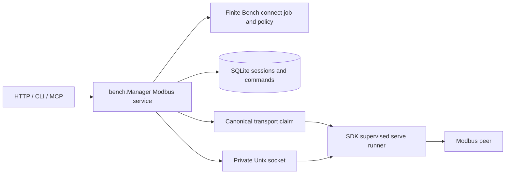

<!--
Copyright (c) 2026 DDP Engineering
This software is licensed under the PolyForm Noncommercial License 1.0.0.
Commercial use requires a separate commercial license.
See the LICENSE.txt in the .agentic folder for full license details.
SPDX-License-Identifier: LicenseRef-PolyForm-Noncommercial-1.0.0
-->

# TASK-c8dd0cab - MB-04 Core Modbus sessions, polling and durable writes

stage: done
type: feature
path: full
interaction: autopilot
requirements: REQ-SEC-aed9d424, REQ-FUNC-41b61ddb, REQ-FUNC-1f21b986, REQ-REL-f258c750, REQ-FUNC-acdfe32c
parent:
branch: ddp/modbus-client
base: b936eb2a0d435e14543d4b3313af53e5ae81f29d
opened: 2026-09-29

## Done checklist (current stage)

- [x] validated candidate confirmed unchanged; otherwise returned to validate
- [x] validation evidence, diff, exclusions and outcome presented
- [x] delivery confirmed by the human
- [x] journal and report included in the delivery commit
- [x] agreed outcome delivered, locally without push
- [x] close-out carried by that single local delivery commit

## Frame

Problem: MB-03 supplies a private runner, but Core has no credential-bound live Modbus session, polling, durable write or public interface for it. Gitea #31 is the next work package.
Desired outcome: Approved, pinned live sessions with bounded polling and exact durable commands, reachable with equivalent HTTP, CLI and MCP semantics.
Actors: Administrator, Operator, Viewer, scoped token, Core, Modbus runner and external peer.
Primary scenario: An operator requests a session against pinned endpoint/profile revisions -> a finite admission job resolves plugin policy -> Core starts the private runner while holding the canonical lease -> owner polls and submits a canonical write with an idempotency key -> Core persists the write intent before one attempt and returns its durable outcome.
Examples: A repeated write key returns the original command; an expired credential stops polling; a lost write reply is delivery_unknown and never retried.
Counterexamples: Token approving a pending admission, another credential controlling the session, endpoint edit during a live lease, replaying a write after restart, or one live session indefinitely occupying a finite worker slot.
In scope: Core admission/lease, private runner bridge, polling, durable write semantics and status, typed HTTP, CLI and MCP paths, tests and component knowledge.
Out of scope: MB-05 maps/codecs, MB-06 GUI administration/navigation, MB-07 live GUI, MB-08 recordings, MB-09 scans, physical I/O, deployment, Git staging/commit/push.
Constraints: STATED same branch, autopilot, client only, TCP-only RTU-over-IP, plugin policy allows/denies successive writes without per-write acceptance. OBSERVED existing finite Bench job approval, identity and canonical lease services, private runner socket; no public Modbus service exists. Unrelated 09_Others media stays untouched.
Success signals: Approved connect returns a live ID and exits finite capacity; polling has explicit pause and bounded results; exact write digest/key persists before transmission; restart/duplicate/lost reply never replays a write; current role/token/plugin state gates every operation; HTTP/CLI/MCP agree.
Evidence: STATED user thread; OBSERVED Gitea #31, 00_Planning/Modbus_Plugin_Plan.md sections 9/10/12, .agentic/knowledge/modbus-integration.md, bench/serial_session.go, bench/transport_lease.go, modbus/workspace.py.
Assumptions: INFERRED Serial's admission pattern can be adapted while preserving a separate long-lived transport lease. Private runner transaction remains trusted only behind Core.
Unknowns: Target hardware timing and capacity defaults require later MB-10 measurement; no real target will be contacted.
Decision-blocking questions: None; user decisions and planning contract settle scope.
Proposed behaviors: Finite approved admission and revocable live lease; bounded read/poll lifecycle; durable exactly-once write admission and uncertain-delivery fencing; equivalent authenticated surfaces.
Path and reason: Full path because externally visible interfaces, persistent state and safety behavior change. The same branch is explicitly requested. No child tasks or subagents.

| Quick-path criterion | Yes | No | Evidence |
|---|---|---|---|
| No new externally observable behavior | | x | Live session and write results. |
| No new interface/data format | | x | API, CLI, MCP, SQLite records. |
| No new dependency | x | MB-03 runner and existing Go stack. |
| Existing requirement covers behavior | | x | MB-01 through MB-03 stop at the private runner. |
| No security/data-handling change | | x | Credential-bound session and durable writes. |

## Requirement coverage

| Frame outcome | Actor/system and trigger | Atomic behavior / requirement | Positive case | Boundary or failure | Verification / design seam |
|---|---|---|---|---|---|
| Revocable authority | Current actor accesses session | Credential-bound checks / REQ-SEC-aed9d424 | Owner controls live lease | Revoked token, stale revision, disabled plugin | Core session checks |
| Finite admission | Connect requested | Pinned policy job / REQ-FUNC-41b61ddb | Approved job returns live ID | Stale revision, competing claim, expired approval | Bench job and lease |
| Live acquisition | Read or poll | Bounded polling / REQ-FUNC-1f21b986 | Multi-unit cursor results | Queue, pause, revocation, gap | Private runner and ring |
| Safe mutation | Write submitted | Durable exact reservation / REQ-REL-f258c750 | Single acknowledged frame | Duplicate, lost reply, restart | SQLite reservation and peer |
| Public parity | HTTP/CLI/MCP call | One Core service / REQ-FUNC-acdfe32c | Same IDs and outcomes | Token cannot approve Ask | Surface tests |

## Design

Requirements coverage: REQ-FUNC-41b61ddb uses Bench's finite `Submit`/`Action` policy job, with `connect` handled by a Core adapter. REQ-SEC-aed9d424 uses credential and pinned-revision checks for each call plus an expiry monitor. REQ-FUNC-1f21b986 uses one per-session poll loop and a bounded cursor ring. REQ-REL-f258c750 uses a durable pre-TX SQLite reservation and conservative unknown default. REQ-FUNC-acdfe32c routes all surfaces into the same Manager methods.

Components: Core Manager owns admission, policy, current credentials, session states, durable command rows and canonical claims. The Python runner owns only the private transport scheduler/bytes. HTTP and MCP call Manager directly; CLI uses HTTP. No UI or map codec is added.

Interface: Connect accepts endpoint ID/revision, profile ID/revision, bounded read groups, idempotency key and finite timeout; the immutable groups enter the admission digest. `connect` is an adapter operation, while `serve` remains the supervised long-lived runner operation. Session methods use a session ID plus originating credential. Private transactions are version-1 newline JSON over a mode-0600 Unix socket, bounded to 8192-byte requests and 64-KiB responses. Public read/write methods accept raw FC/address/count/values; typed map writes wait for MB-05.

State: A connect job reaches `completed` after the private socket is ready and returns session ID/expiry. Poll and display pauses are orthogonal flags; changing the approved read plan requires a new admission. The SQLite session row survives a crash as closed; no live session resumes on startup. Each write row starts as delivery_unknown before any socket call. The poll loop samples at a bounded interval, never accumulates catch-up work, and uses a per-request runner poll key.

Failure/security: Reject stale revisions before claiming. A bad current credential, plugin disable, endpoint disable/unplug, lease expiry, runner exit or Core shutdown cancels the runner; claim release follows confirmed cleanup. Unknown write delivery never causes an automatic resend. A read may return a transport failure but cannot grant authority for writes. Tokens cannot approve Ask jobs; the existing human-only `bench.Action` path remains authoritative. No live device I/O is used in tests.

Concurrency: Manager.mu protects maps/state; private socket calls and runner shutdown occur outside it. A per-session command gate serializes write reservation and dispatch. Runner itself retains fair per-unit scheduling. Limit four endpoint sessions initially; capacity measurement remains MB-10.

Migration/compatibility: Add a new SQLite migration for durable session and command rows. Development state does not require translation. Serial/Camera/Sigrok interfaces remain unchanged. The Modbus manifest adds the Core-only finite `connect` operation, and runner describe may list it for contract parity.

Verification: Red-first focused Go tests for admission, revocation, live private socket reads/polls, duplicate/unknown writes, then HTTP/MCP/CLI parity; independent loopback peers observe frames. Finish with the configured offline full gate and strict AEGIS check. Physical ARM/RS-485 evidence is later MB-10 work.

Alternatives: A long-running Bench job would consume finite execution capacity and conflate approval with acquisition. Per-write policy jobs contradict the user-confirmed successive-write rule. Reusing Serial's HTTP runner channel would add an unnecessary HTTP implementation to the MB-03 private protocol.

### Proposed architecture - TASK-c8dd0cab

## Log

- 2026-09-29 frame: Full path accepted in task-specific autopilot for Gitea #31; same branch, no Git mutation, no physical I/O.
- 2026-09-29 specify: Five new draft requirements; one durable-write spec; no existing requirement exactly covers the public Core behavior.
- 2026-09-29 design: Separate finite admission from live runner/claim; persist exact writes before socket dispatch. See Design and REQ-REL-f258c750 spec.
- 2026-09-29 build red: command=`go test ./internal/bench -run '^TestModbusCanonicalRequestBounds$' -count=1`; exit=1; expected missing behavior=ModbusRequest and canonicalModbusRequest do not exist (REQ-FUNC-1f21b986, REQ-REL-f258c750).
- 2026-09-29 build red: command=`go test ./internal/bench -run '^TestModbusConnectValidation$' -count=1`; exit=1; expected missing behavior=public connect canonicalization/operation boundary absent (REQ-FUNC-41b61ddb).
- 2026-09-29 build red: command=`go test ./internal/bench -run '^TestModbusPollPlanBounds$' -count=1`; exit=1; expected missing behavior=bounded read-only poll plan and event types absent (REQ-FUNC-1f21b986).
- 2026-09-29 build red: command=`go test ./internal/bench -run '^TestModbusWriteReservationNoReplay$' -count=1`; exit=1; expected missing behavior=durable ModbusWrite reservation and dispatch method absent (REQ-REL-f258c750).
- 2026-09-29 build red: command=`go test ./internal/httpapi -run '^TestModbusRoutesScopeAndStrictBody$' -count=1`; exit=1; expected missing behavior=Modbus HTTP routes absent (404), so permission and strict-body contracts are not applied (REQ-FUNC-acdfe32c).
- 2026-09-29 build red: command=`go test ./internal/mcp -run '^TestBenchToolsUseCurrentTokenScopes$' -count=1`; exit=1; expected missing behavior=twelve Modbus MCP tools absent (40 vs 52; REQ-FUNC-acdfe32c).
- 2026-09-29 build red: command=`go test ./cmd/nilo -run '^TestModbusCLIUsesAuthenticatedCoreRoute$' -count=1`; exit=1; expected missing behavior=nilo modbus authenticated command handler absent (REQ-FUNC-acdfe32c).
- 2026-09-29 build red: command=`go test ./internal/bench -run '^TestModbusConnectPinsReadPlanForApproval$' -count=1`; exit=1; expected missing behavior=immutable read plan absent from finite approval payload (REQ-FUNC-41b61ddb, REQ-FUNC-1f21b986).
- 2026-09-29 build red: command=`go test ./internal/bench -run '^TestModbusWritePreviewPDUAndDigest$' -count=1`; exit=1; expected missing behavior=exact canonical write PDU preview absent (REQ-REL-f258c750).
- 2026-09-29 build red: command=`go test ./internal/bench -run '^TestModbusWriteReservationNoReplay$' -count=1`; exit=1; expected missing behavior=durable command-ID lookup absent (REQ-REL-f258c750).
- 2026-09-29 build green: pinned Windows Go `go test -p 1 ./internal/bench ./internal/httpapi ./internal/mcp ./cmd/nilo ./internal/store/sqlite -run 'TestModbus|TestBenchToolsUseCurrentTokenScopes|TestOpenConfiguresDurableDatabaseAndMigratesAllFoundationTables' -count=1`; exit=0 for Core request/admission/poll/write, route/scope, MCP registration, CLI and migration cases (all five requirements).
- 2026-09-29 build green: pinned WSL Linux `go test ./internal/bench -run '^TestModbus(FiniteApprovalAndLiveRunner|DisableStopsLiveLease)$' -count=1 -v`; exit=0, verified Ask/human admission, two-unit private runner reads/polls, one live write with no duplicate, pause controls, disconnect and disable claim cleanup (REQ-SEC-aed9d424, REQ-FUNC-41b61ddb, REQ-FUNC-1f21b986, REQ-REL-f258c750).
- 2026-09-29 build: `evolution --task TASK-c8dd0cab` found 30 candidate software/changelog paths, no removals. Advisory `check --task` exit=0, errors=0; remaining 11 warnings concern pre-existing stale path/tracked sidecars/other task journals and four unrelated untracked `09_Others` binary files, left untouched.
- 2026-09-29 validate review round 1, specification compliance=approved: five active requirements, the pinned admission/read plan, successive-write policy ruling and MB-04 exclusions match the candidate; user-confirmed no-per-write-acceptance supersedes ticket acceptance wording.
- 2026-09-29 validate review round 1, implementation quality=approved: checked Core lock/lease/error paths, durable reservation order, private response validation, route/scope forwarding, Linux runner lifecycle and Windows/Linux test boundaries; no open candidate finding. Final full proof remains pending.
- 2026-09-29 validate: Final software evolution refreshed after CLI input guard, two-unit lifecycle coverage, requirements and knowledge reconciliation; 30 software/changelog paths, no removals.
- 2026-09-29 validate inspection: Compared HTTP and MCP Modbus handlers and CLI routes with the exported Manager methods; all typed actions enter that one Core service, current token scopes are applied at the surfaces, and the Ask approval path remains the existing human-only Action. Focused route/tool/CLI tests and the Linux Ask admission test supplement this interface inspection.
- 2026-09-29 validate final: pinned offline candidate image `nilo/build-environment:noble-20260929-01`; command=`python .agentic/aegis.py check --task TASK-c8dd0cab --strict --run` after locked Python preparation; exit=0, full repository test=ok (265.5s), lint=ok (9.3s), catalog errors=0, warnings=11, strict=ok. Warnings concern pre-existing stale requirement path, tracked task sidecars, other tasks' journal state, and four unrelated untracked `09_Others` binaries; none were changed for MB-04. Physical hardware acceptance remains later MB-10 scope.
- 2026-09-29 deliver checkpoint: candidate validated and unchanged; local commit awaits a current user instruction, and no push is authorized.
- 2026-09-30 deliver decision: User instructed "commit" for the validated MB-04 candidate on ddp/modbus-client. Local commit only; no push, PR, deployment or unrelated 09_Others files. Validation fingerprint and both review verdicts remain current.
- 2026-09-30 deliver close-out: `aegis report TASK-c8dd0cab` appended the report-time advisory snapshot (errors=0, warnings=12, notes=4; four unscanned unrelated binaries). The approved outcome is one local commit of MB-04 files with this close-out; no remote publication.

## Rulings

- RULING-001 | date=2026-09-30 | decision=Commit the validated MB-04 candidate locally on ddp/modbus-client without pushing | reason=The user explicitly instructed "commit" at the delivery checkpoint | source=user | supersedes=none

## Handoff

current: done
status: ready
next: No further MB-04 work after the authorized local commit; do not push
must_read: .agentic/tasks/TASK-c8dd0cab.md
blockers: none

## Stage report

stage: deliver
result: completed
current: done
changed: User approved a single local commit of the validated MB-04 candidate; delivery report and close-out are in the same journal
evidence: Pinned offline full test and lint exit zero; strict AEGIS check errors=0, warnings=11, strict=ok; report-time advisory errors=0
issues: Pre-existing catalog warnings and unrelated untracked media excluded; physical target measurements deferred by ticket
next: Complete and verify local commit; no push
needs_user: no
spec_compliance: approved
implementation_quality: approved
review_round: 1

## Delivery report (2026-09-30)

- stage: deliver; type: feature; path: full; branch: ddp/modbus-client
- requirements:
  - REQ-SEC-aed9d424 - Bind Modbus sessions to current credential authority
  - REQ-FUNC-41b61ddb - Admit a pinned Modbus session through a finite approval job
  - REQ-FUNC-1f21b986 - Poll and read a bounded live Modbus session
  - REQ-REL-f258c750 - Reserve exact Modbus writes durably before transmission
  - REQ-FUNC-acdfe32c - Expose equivalent typed Modbus operations
- deviations: none recorded
- explicit review: enabled; spec_compliance=approved; implementation_quality=approved; review_round=1
- diff vs task base b936eb2: 43 file(s) changed, 2618 line(s) added; 4 file(s) not content-scanned
- checks: errors=0 warnings=12 notes=4
- checklist: 5/6 done; open: close-out carried by that single local delivery commit
