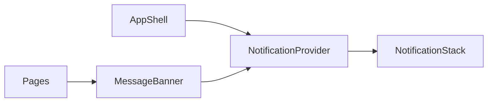

# TASK-e2a95ed4 - Shared workspace notifications and compact instrument headers

stage: done
type: change
path: full
interaction: autopilot
requirements: REQ-UX-0f3e6722, REQ-UX-020a1c13
parent:
branch: master
base: d2bb8be8803edb07b2f471937c12b5a6119f2320
opened: 2026-09-27

## Done checklist (current stage)

- [x] Implementation and integrated validation complete
- [x] Requested Pi deployment verified
- [x] User authorized task closure and local commit
- [x] Close-out included in this delivery commit

## Frame

Problem: STATED feedback bands and status rows consume instrument display space.
Desired outcome: STATED common notifications across all plugins and system settings.
Actors: Authenticated operators and administrators.
Primary scenario: Action completes or fails -> shared callout -> user reads and dismisses while workspace retains its height.
Examples: Serial connection failure appears at upper right with Error prefix and left X.
Counterexamples: Approval and destructive confirmation remain actionable in context.
In scope: Shared component, shell host, page feedback migration, compact Camera/Serial action headers, serial counters, localization, tests and current documentation.
Out of scope: Backend contracts, physical I/O, Git changes, versioning and deployment.
Constraints: Responsive wrapping, 44-pixel targets, theme and language support; no persistent notification data.
Success signals: No page-height cost from feedback; notifications dismiss, coalesce and survive fullscreen; actions stay available.
Evidence: OBSERVED MessageBanner.tsx already serves plugin and system pages; AppShell.tsx owns active workspace. STATED user approved prior proposal and common implementation.
Assumptions: INFERRED five-second info timeout is suitable; warning/error messages persist. Context-specific validation stays beside its field.
Unknowns: Hardware behavior unaffected and not tested by this task.
Decision-blocking questions: None.
Proposed behaviors: See workspace-notifications.md.
Path and reason: Full, new observable notification lifecycle.
Path criteria: new behavior=no quick path; no new wire format=yes; no dependency=yes; existing complete requirement=no; no security/data change=yes.

## Requirement coverage

| Outcome | Atomic behavior | Requirement | Positive case | Boundary | Verification | Design |
|---|---|---|---|---|---|---|
| Free feedback space | Shared dismissible callouts | REQ-UX-0f3e6722 | Info expires, error dismisses | Duplicate, polling, fullscreen, approval | Component and browser | Provider and MessageBanner |
| Free instrument space | Right-aligned wrapping actions and compact counters | REQ-UX-020a1c13 | Wide header alignment | Narrow wrapping | Browser geometry | Shared action class, serial disclosure |

## Design

- REQ-UX-0f3e6722: NotificationProvider owns a page-scoped registry; MessageBanner registers ordinary feedback or renders explicit inline contextual content. Active-page changes clean up registry. A single stack deduplicates equal severity/text and bounds overflow.
- MessageBanner outside a provider keeps contextual inline rendering for isolated pages/dialogs. Explicit inline mode handles approvals and critical action explanations.
- Registry registration uses stable content identity; polling identical messages neither restarts expiry nor reverses dismissal. Source removal unregisters. No storage/API dependencies.
- Portal follows fullscreen element so browser top-layer rules do not hide notifications. Normal host is workspace-positioned, not viewport-over-navigation.
- REQ-UX-020a1c13: Explicit action groups align with margin-inline-start:auto. Camera header toolbar adopts same class. Serial counters stay atomic; owner/expiry are in keyboard-operable details.
- Risks: Feedback migration must preserve irreversible warnings and token secrecy; local form errors stay inline. Tests exercise state transitions and browser geometry.
- Expected files: frontend components MessageBanner/NotificationProvider, shell AppShell, plugin/system feedback callers, styles, i18n, focused tests/fixture, GUI knowledge and changelog.
- Alternative: fixed positioning each banner overlaps simultaneous messages; rejected in favor of one shared host.
- Open decisions: None. Existing working changes preserved. Current branch retained under repository Git authority.

### Proposed architecture - TASK-e2a95ed4

## Log

- 2026-09-27 frame: Full path accepted under user's continuing implementation autopilot; prior serial/release working changes preserved. No Git mutation authority.
- 2026-09-27 specify: Two draft UX requirements cover feedback lifecycle and compact instrument layout; contextual warnings and approvals preserved.
- 2026-09-27 design: Shared registry and explicit inline escape hatch selected; see Design and linked spec. Build starts with notification lifecycle tests.

- 2026-09-27 build red: command=`node node_modules/@playwright/test/cli.js test --config playwright.serial.config.ts --grep 1024x600`; exit=1; expected missing behavior=right-aligned action group absent.

- 2026-09-27 build red: command=`npm.cmd --prefix 05_Software/frontend run test:ci -- src/components/MessageBanner.test.tsx`; exit=1; expected missing behavior=general feedback has no dismiss button.

- 2026-09-27 build: Focused shared, Camera, Serial, Network, Authentication, About and Activity component tests pass; four browser sizes pass including no overlay height cost, header alignment, 44-pixel dismiss targets and fullscreen dismissal. Saved browser images at 320 and 800 inspected: wrapping controls and compact callouts remain within workspace.

- 2026-09-27 validate review round 1: Specification compliance approved after checking both requirements against page coverage, responsive layout, notification lifecycle and inline exceptions. Implementation quality independently reviewed for state cleanup, timer stability, fullscreen, scope lifecycle, permissions and secret handling; approved. No backend or storage changes; contextual token and irreversible-action content remains local.
- 2026-09-27 validate: Evolution contains 22 expected frontend/changelog paths; requirements and GUI/Camera knowledge reconciled. Strict advisory check has zero errors; uncovered-source warnings concern pre-existing serial/Core work outside these two UI requirements, with existing stale-path, tracked-sidecar and open-delivery warnings retained.

- 2026-09-27 validate: First final gate failed (tests 337.1s): browser assertions expected management feedback within its old panel and exact rollback text without its new severity prefix; 25 browser scenarios passed, 19 were blocked by serial-suite prerequisites. Return to build to preserve a separately addressable message body and update the relocated management-feedback assertions. No acceptance condition removed.

- 2026-09-27 build/validate round 2: Message body remains separately addressable inside severity-labelled callouts; management browser assertions now locate the shared notification region while pending-confirmation checks stay inline. Seven shared component tests pass. Isolated appliance recheck reports both previously failing browser scenarios passed (23.1s); PowerShell logged Docker stderr as NativeCommandError, so final authoritative proof remains the Python-driven full gate.
- 2026-09-27 validate review round 2: Specification and implementation-quality verdicts both approved for corrected candidate; existing recovery assertions preserved with new feedback location. Evolution adds only expected network browser test coverage.

- 2026-09-27 validate completed: `python .agentic/aegis.py check --task TASK-e2a95ed4 --strict --run` exited 0; full tests passed in 397.8s and lint in 9.7s. Errors=0, warnings=64, notes=4. Existing stale-path, tracked-sidecar, unclosed-delivery and prior serial/Core coverage warnings remain outside this UI scope; no new relevant failure accepted. Full log: 02_Tools/cache/notification-final-gate-2.log. `git diff --check` clean.
- 2026-09-27 deliver: Candidate is 23 expected frontend/test/changelog paths plus two UX requirements, notification spec, GUI/Camera knowledge and this task record. Shared component, scoped host, migrated general feedback, responsive headers and tests are implemented. Existing serial/release changes preserved; no backend changes, deployment, version assignment or Git mutation performed. Software implementation delivered locally; publication remains unrequested.

- 2026-09-27 close-out authorized: User requested "close tasks, commit". Complete this task with the repository-local delivery commit, incorporating integrated full proof and Pi deployment in `07_Delivery/NILO_0.11.0_RPi_Live_Test.md`. Physical RX/TX and unplug/replug acceptance remain outside the completed implementation scope. No push requested.

- 2026-09-27 closed: Implementation, regression verification and requested Pi delivery are complete. Closing with the authorized local commit; latest integrated full tests/lint passed (414.0s/9.5s). No executable changes since that proof. Live physical acceptance limitations remain documented in the deployment record.

## Rulings

- RULING-001 | date=2026-09-27 | decision=Autopilot implementation on current branch | reason=User requested AEGIS implementation without prompts; repository prohibits unrequested Git mutation | source=user | supersedes=none

## Handoff

current: done
status: ready
next: No further implementation work; user live testing may continue
must_read: .agentic/tasks/TASK-e2a95ed4.md, 07_Delivery/NILO_0.11.0_RPi_Live_Test.md
blockers: none

## Stage report

stage: deliver
result: completed
current: done
changed: Completed task closed in authorized local delivery commit; version 0.11.0 deployed
evidence: Latest integrated full tests 414.0s and lint 9.5s passed; Pi deployment verified
issues: Existing repository advisories; physical RX/TX and unplug/replug acceptance remain user testing
next: No further implementation work; user live testing
needs_user: no
spec_compliance: approved
implementation_quality: approved
review_round: 2

## Delivery report (2026-09-27)

- stage: deliver; type: change; path: full; branch: master
- requirements:
  - REQ-UX-0f3e6722 - Shared dismissible workspace notifications
  - REQ-UX-020a1c13 - Compact instrument action headers
- deviations: none recorded
- explicit review: enabled; spec_compliance=approved; implementation_quality=approved; review_round=2
- diff vs task base d2bb8be: 161 file(s) changed, 11475 line(s) added
- checks: errors=0 warnings=74 notes=4
- checklist: 3/4 done; open: Git publication or deployment only on a current user instruction
