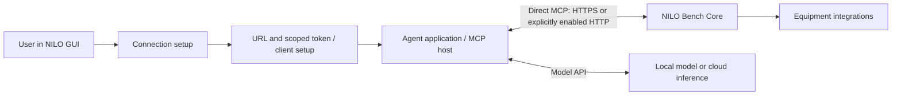

# NILO Agent and MCP Connection Plan

**Date:** 2026-09-30  
**Status:** Proposed; analysis and planning only  
**Audience:** Electronics users who can operate a GUI but should not need Linux administration  
**Workflow:** Written directly in `00_Planning`, without AEGIS, as requested  
**Revision:** Bench companion on a home/corporate LAN, accessed locally or through the network's existing VPN

## 1. Recommended product direction

NILO is a **bench companion**: it remains next to the equipment on a home or
corporate network. The normal user is either on that network or joins it through
an existing VPN. Remote access must work when the VPN terminates at the home's
router or the company's gateway; NILO need not run the VPN or have a tunnel interface.

Primary remote scenario:

```text
Laptop away from home
    -> existing VPN -> home router/gateway
    -> home LAN -> NILO -> bench equipment
```

The corporate equivalent uses the company's approved VPN, routing and access
policy. A VPN terminating directly on the Pi is another supported topology, not
a requirement. No public NILO port, cloud relay or additional desktop application
is required for these direct connections.

Add **Settings > Agent connections > Connect an agent** to NILO. Prioritize a
direct connection from the chosen agent to NILO, using an endpoint URL and scoped
token. The deployment boundary is the local network or an existing VPN.

Retain the existing HTTPS `/mcp` endpoint. Add an optional, separately configured
**MCP-only HTTP listener** on an approved LAN interface, reachable locally or through
the network VPN, plus an optional direct-VPN-interface mode. HTTP requires no TLS
certificate; the VPN supplies transport
protection only along its encrypted path. Ordinary LAN HTTP remains unencrypted.
All modes retain bearer authentication, authorization and equipment policy.

**A companion application is no longer the default or a prerequisite.** Evaluate
actual remote-HTTP client support before building one. NILO Connect remains a
deferred fallback for clients that need a bridge or deployments that need private
certificate handling. This revision supersedes the initial companion-first proposal.

The intended experience is:

1. In NILO, select **Connect an agent**.
2. Choose where the agent runs and which application it uses.
3. Choose **Local network** or **Through my network's VPN**, then an enabled
   HTTPS/HTTP endpoint. An administrator enables HTTP explicitly; advanced setup
   distinguishes a network gateway from a VPN terminating on NILO.
4. Choose **Observe** or **Operate equipment**, name the connection and generate access.
5. Use the harness's supported Add/Import flow, or follow its short generated
   setup instructions. Enter the token in the client's supported credential field.
6. Open/reload the agent. NILO shows an observed MCP connection when one occurs.

The goal is no certificate extraction, SSH or Linux administration for supported
HTTP paths. A web page cannot silently edit another application's configuration.
Prefer native setup/import buttons; some harnesses may still require a generated
configuration entry or command. Record that friction honestly in the support
matrix rather than promising a universal one-click flow. HTTP eliminates the
certificate step, not client registration, token storage or network routing.

## 2. What exists today

This analysis concerns the current Go/React checkout, whose root `VERSION` is
`0.12.0`. There is concurrent, uncommitted Modbus work; these observations are not
a claim about every released image or the exact software currently on the Pi.

| Area | Observed implementation | Consequence for onboarding |
| --- | --- | --- |
| MCP transport | Bench Core mounts Streamable HTTP at `/mcp` on the management listener. The Go MCP SDK manages the protocol. | Reuse the same MCP service behind HTTPS and the proposed restricted HTTP listener. |
| Authentication | MCP requires a bearer token. Browser login cookies do not authorize it. Every request is authenticated; tool calls resolve the current actor again. Sessions are bound to token ID. | Connecting the GUI does not connect an agent. Expiration, revocation and owner changes must be handled. |
| Authorization | Effective permissions intersect owner role and token scopes. An empty scope list means the owner's full role. Transport admission needs `network.read`, or `bench.read` with Bench enabled. | The wizard must always create explicit scopes and explain effective access. |
| Token GUI | API Tokens can create, list, revoke and delete tokens; the secret is disclosed once. HTTP administration requires all-token permissions. | Reuse identity services in the setup wizard. Existing token secrets cannot be recovered from storage. |
| Equipment policy | Integration policy and human approvals remain enforced behind MCP. | A connection grant never approves a measurement, serial write or other equipment operation by itself. |
| Tools | Network, plugin administration, bench/jobs, Camera, Serial and current Modbus registrations exist. | Discover the deployed catalog. Do not hard-code a count or infer authorization from `tools/list`. |
| TLS | The privileged helper generates a self-signed P-256 **server certificate**, with `.local` DNS SANs. It retains the private key and signs for Core. | There is no separate appliance CA hierarchy to download today. The public certificate/key is sufficient for scoped client trust; its private key stays on NILO. |
| Certificate renewal | `ActivateNames` can replace the certificate while reusing the persisted key. Names and certificate validity can change. | Pinning the full certificate alone would break ordinary renewal/alias changes. A paired public-key identity needs a defined lifecycle. |
| Discovery | Permanent serial name, friendly alias, provisioning identity, mDNS/DNS-SD and SSDP support local discovery. Existing printed QR labels encode a management URL. | Discovery and a URL label are not cryptographic proof of appliance identity. |
| VPN/networking | WireGuard profiles and management-interface controls exist. Management exposure is restricted by the configured interface allowlist. | A VPN handshake alone does not establish a working agent route or allowed management access. |
| Network HTTP policy | Network deployments currently require HTTPS; the GUI uses Secure session cookies. Plain HTTP is used for loopback development. | Optional network HTTP MCP needs an intentional listener/policy change, not merely replacing `https` with `http` in a URL. |
| CLI | The HTTP API client supports a supplied CA file. | Useful implementation precedent, but users still must obtain the file and resolve a valid hostname manually. |
| Missing setup layer | The reviewed routes/components have no dedicated agent-connection wizard, optional network HTTP MCP setup or MCP OAuth authorization service. | These are proposed features, not configuration switches already available. |

Evidence: [MCP handler](../05_Software/core/internal/mcp/server.go),
[Bench registration](../05_Software/core/internal/mcp/bench.go),
[Modbus registration](../05_Software/core/internal/mcp/modbus.go),
[HTTP routes](../05_Software/core/internal/httpapi/server.go),
[role/scope rules](../05_Software/core/internal/auth/role.go),
[identity service](../05_Software/core/internal/identity/service.go),
[token GUI](../05_Software/frontend/src/components/authentication/ApiTokensPage.tsx),
[TLS identity](../05_Software/core/internal/nethelper/tls_identity.go),
[API client](../05_Software/core/internal/apiclient/client.go),
[authentication and cookie contract](../07_Delivery/NILO_CLI_and_Authentication.md),
[network runbook](../06_SoftwareDocu/Network_Operations.md), and
[discovery verification](../07_Delivery/NILO_Discovery_Verification.md).

The [MCP reference](../06_SoftwareDocu/MCP_Reference.md) still describes a normal
40-tool server and omits current Modbus registration. Some source comments also
call MCP read-only, despite operational tools. Reconcile this documentation during
implementation; neither description should drive the new GUI's access promises.

The user's reported setup difficulty is consistent with this implementation:
certificate trust, hostname validation and address resolution are separate steps.
Trusting a certificate does not make a raw IP match its DNS-only SANs, and a
working browser session does not establish trust in every agent's TLS runtime.
This planning work does not perform a new live-appliance or client compatibility test.

## 3. Separate the agent host from the model provider

The wizard must ask **Where will the agent run?** before deciding how to connect.
The relevant machine is the one executing MCP calls, which may differ from the
browser, editor window, model server or inference provider.



| User choice | Where MCP calls execute | Required NILO reachability |
| --- | --- | --- |
| Codex, Claude Code, OpenCode or Qwen Code on laptop | The client's configured MCP execution environment | That environment reaches NILO over LAN/VPN. |
| Local harness using LM Studio only as a model API | The harness | LM Studio does not need a separate NILO connection in this arrangement. |
| LM Studio application using its MCP integrations | LM Studio's host computer | Configure LM Studio as the MCP host. |
| Local harness using a Scaleway model endpoint | The local harness | The laptop reaches NILO; cloud inference does not require inbound access to the Pi. |
| Harness on a server/VM, including Scaleway compute | That server/VM | Join the approved VPN or provide another explicitly managed route to NILO. |
| Hosted agent service accepting only remote MCP URLs | The service's execution infrastructure | Must reach the private LAN/VPN and accept the selected transport/authentication. A service demanding public access is outside this plan. |

LM Studio supports MCP in the application, and its native API has explicit MCP
settings. Serving an ordinary model endpoint alone does not configure NILO tools.
Scaleway's documented function-calling flow returns calls for application code to
execute; an inference endpoint is not automatically an agent harness.
See [LM Studio MCP](https://lmstudio.ai/docs/app/mcp),
[LM Studio server settings](https://lmstudio.ai/docs/developer/core/server/settings),
and [Scaleway tool calling](https://www.scaleway.com/en/docs/generative-apis/how-to/use-structured-outputs/).

Provider API keys remain in the chosen harness/model application. The wizard may
explain where to configure them, but NILO does not need to store them for this
feature. Explain that a cloud-backed agent may send selected tool results,
equipment descriptions and images to its model provider. Keep the initial
connection check independent of paid inference and model availability.

## 4. Transport choices and listener architecture

### 4.1 Supported deployment modes

| Mode | Certificate needed for MCP? | Protection and conditions | Product decision |
| --- | --- | --- | --- |
| Direct HTTPS on LAN/VPN | Yes | TLS authenticates the endpoint and encrypts traffic; client must trust the certificate and match its name. | Retain as the default existing listener. |
| HTTP on an approved home/corporate LAN | No | Token, commands and results are unencrypted on that LAN. Its acceptability depends on the network owner's policy; a home/corporate label alone does not establish trust. | Optional administrator-selected LAN mode, with no isolated-lab topology required. |
| HTTP through the network VPN gateway, then LAN to Pi | No | VPN protects the remote leg; the final LAN segment is plaintext. | Primary remote HTTP scenario when LAN HTTP is permitted; uses the same approved NILO LAN listener. |
| HTTP inside a VPN terminating on the Pi | No | An authenticated encrypted tunnel protects traffic to the Pi. Requires an actual route through the approved tunnel and a client accepting remote HTTP bearer auth. | Additional explicitly enabled mode for installations with a tunnel on NILO. |
| Publicly trusted HTTPS name resolving privately | Yes, normally already trusted | Requires operated DNS, domain validation and renewal; no public MCP exposure is necessary. | Optional managed deployment. |

HTTP is a transport choice, not a certificate-validation bypass. Keep authentication
enabled in every mode. A token does not encrypt traffic or authenticate a plaintext
server to the client. Do not infer a protected connection merely from a private IP,
an interface name or a recent VPN handshake. VPN hubs/gateways that decrypt traffic
are part of the trust boundary. [WireGuard's transport model](https://www.wireguard.com/)
explains the endpoint protection; the deployment must establish the complete route.

The standard MCP transport can carry requests over HTTP. Qualification must separately
establish whether each client accepts a non-loopback HTTP URL plus a manually
provided bearer token. Do not equate that with standard MCP OAuth compliance or
assume OAuth endpoints can use the same plaintext setup. See the
[MCP transport](https://modelcontextprotocol.io/specification/2025-11-25/basic/transports)
and [authorization specifications](https://modelcontextprotocol.io/specification/2025-11-25/basic/authorization).

### 4.2 Keep the GUI and management API on HTTPS

Retain HTTPS on the existing management listener, including its `/mcp` endpoint,
browser login, token administration, session cookies and human approvals. Add a
separate port/listener that mounts only the authenticated MCP handler. Do not mount
the full GUI/API router on it, redirect login to it, relax Secure cookies or make
plaintext an automatic fallback after a TLS error.

Proposed persisted settings: HTTP MCP enabled (default false), selected eligible
interfaces, port, and protection mode (approved LAN or direct VPN). Choose the exact
API names and unused port during design; show the complete resulting URL in the GUI.
Changing the port alone never provides isolation.

The listener needs the existing style of layered enforcement: helper-managed
firewall policy, socket/interface admission and request checks. Enforce the actual
ingress/destination boundary; binding a VPN address alone must not accidentally
permit packets forwarded from other interfaces. Preserve Origin validation and
bearer reauthentication on all MCP requests, including session requests.

VPN-only mode must close/refuse access when its approved interface is unavailable,
and must never rebind to all interfaces or fall back to LAN. Persist this behavior
across reboot, interface replacement and address changes. Reuse management/device
role exclusions: selecting a device-facing interface is not a shortcut to exposing
MCP there. Use the existing network confirmation/recovery pattern for changes;
keep the working HTTPS administration path available throughout.

For a network-gateway VPN, NILO receives requests through its approved LAN interface.
Allow the intended routed VPN clients under the deployment's network policy; do
not demand a VPN interface on NILO or mistake expected gateway forwarding for
unwanted ingress. If the gateway applies NAT, NILO may see only the gateway source
address. Bearer tokens still identify the authorized connection. The gateway owns
VPN-client admission and routing; NILO must not claim to verify that remote tunnel
from a LAN source address. When the laptop disconnects its VPN, remote access
normally ceases through routing, while local bench access remains available.

Keep one shared MCP tool/authorization service behind the listeners. Define session
handling so reconnects do not silently move from HTTPS to HTTP; token/session binding
and revocation must hold on both. Preserve tool schemas, results, images, job IDs,
timeouts and approval behavior. No automatic replay of possibly delivered equipment
commands. Serial/Modbus sessions remain credential-bound after token replacement.

### 4.3 NILO-side setup responsibilities

- Wizard and connection list: label, owner, scopes, expiry, client profile,
  selected transport and last observed use. A user-entered computer label is not
  cryptographic proof of which host holds a copyable bearer token.
- Endpoint metadata: appliance ID, scheme, host/address, port, MCP path, interface
  constraints and relevant protocol capabilities. Include TLS identity only where used.
- Scoped token issuance, single disclosure, revocation and replacement using the
  existing identity service. No separate pairing service is required for the first release.
- Versioned setup instructions/import templates for qualified clients, with clear
  credential entry and restart steps. Keep secrets out of URLs and ordinary exports.
- Sanitized events and connection status derived from actual observations.

## 5. HTTPS options and deferred companion

### 5.1 Certificate-free MCP does not remove GUI trust setup

HTTP MCP modes do not need certificate handling in the agent. The browser GUI
continues using HTTPS and its existing commissioning/trust process. The wizard must
not claim that enabling HTTP MCP fixes browser warnings. Changing the entire GUI
to HTTP, including login/cookie policy, is outside this revision.

### 5.2 Managed, publicly trusted HTTPS

For installations preferring trusted HTTPS, use a hostname under an owned registered
domain and automate certificate issuance/renewal. DNS-01 validation permits the
MCP service to remain reachable only on LAN/VPN; the relevant public DNS validation
records and certificate issuer still need to be reachable. Clients must resolve
that hostname to the correct private address through the deployed DNS arrangement.
See [Let's Encrypt DNS validation](https://letsencrypt.org/docs/challenge-types/).

A public CA cannot issue for NILO's `.local` names or reserved private IPs such as
`10.x.x.x`; it can issue for the owned domain name that resolves privately.
See [issuance rules](https://letsencrypt.org/documents/isrg-cp-v3.4/).
Private keys remain distinct per appliance. Plan DNS updates, renewal outages and
certificate installation separately; a public domain/certificate service is optional
and is not a prerequisite for the LAN/VPN HTTP milestone.

Existing self-signed HTTPS remains available. It requires explicit client trust and
valid hostname resolution. Downloading the certificate from an untrusted endpoint
does not by itself establish trust. Do not export private keys or recommend blanket
certificate-validation disabling.

### 5.3 NILO Connect is a fallback, with a separate decision gate

Build a companion only if qualification/usability results show that direct setup
cannot meet the supported clients' needs. Possible uses are private certificate
trust, local credential storage, configuration automation, or stdio-only clients.
The first implementation milestone must not depend on its installer or pairing API.

If selected later, retain these design constraints:

- Signed, self-contained installer, explicit local consent and per-user credential
  storage. No user-installed language runtime or default privileged service.
- Pair through an established trusted channel or independently established physical
  public-key record; the current URL-only QR label is not a key fingerprint.
  Clearly identify any trust-on-first-use route for existing appliances.
- Keep transport addresses separate from the expected TLS hostname. Verify the
  paired key, certificate lifetime/signature and hostname before sending credentials.
  Same-key renewal may continue; unexpected key changes require approved rotation
  or re-pairing. A reset-stable serial does not guarantee a reset-stable TLS key.
- A stdio bridge must implement negotiated capabilities, sessions, notifications,
  cancellation, structured/image results and shutdown correctly. Diagnostics stay
  off stdout; it must not replay uncertain equipment writes.
- Use expiring single-use pairing offers if needed; no reusable token in launch
  URLs. Preserve unrelated client settings and provide removal/rollback.
- Its trust store does not automatically fix browser trust or remote executor setup.

A public relay, automatic VPN enrollment and a NILO-hosted agent runtime remain
separate projects. None is required for the proposed direct LAN/VPN setup.

## 6. Client setup and access lifecycle

### 6.1 Recommended credential flow

1. A signed-in administrator selects a connection owner and explicit access profile.
2. The wizard selects a reachable endpoint for that deployment and a qualified
   client/version profile. It explains any HTTP exposure before enabling that mode.
3. Core issues the normal scoped bearer token and discloses it once through the
   HTTPS GUI. Record a pending connection with its token ID, not its secret.
4. The user imports/adds the endpoint through the harness's supported mechanism
   and enters the secret through its credential mechanism. Prefer native GUI
   setup; offer version-specific generated configuration/instructions when needed.
5. The harness connects from its actual execution environment. Record successful
   MCP activity separately from the fact that the user copied configuration.
6. The GUI offers revoke/replace and a way to remove an abandoned pending grant.
   Losing a one-time disclosure requires a replacement, not secret recovery.

Use one token per named host/client connection by default. A token is still a
bearer credential and is not bound to a physical computer merely by its label.
Store secrets using the client's credential store or supported protected user
configuration; avoid project files, shared configuration, shell history and process
arguments. Templates and setup links carry placeholders/credential references,
not tokens. Where an environment variable is the supported mechanism, explain
how the actual GUI/CLI process receives it and whether a restart is required.

Native import/deep-link support is client-specific. Some clients require a
configuration entry or shell step; do not claim the NILO web page can write local
files, inspect installed client versions or set environment variables. The wizard
asks for client/version when it cannot detect them. Avoid introducing a custom
installer or local HTTP control service merely to conceal that limitation.

### 6.2 Access profiles

| Profile | Initial explicit scopes | Meaning |
| --- | --- | --- |
| Observe, default | `bench.read`, `network.read` | Read permitted state/results. Does not authorize equipment execution. |
| Operate equipment | Above plus `bench.execute` | Request equipment operations subject to existing integration policy and human approval. |
| Manage integrations, advanced | Above plus `plugins.manage`, for an eligible administrator | Manage plugin/device configuration and lifecycle. Display separately. |

Resolve each profile against the current owner role and deployed permission
catalog. Do not silently elevate a Viewer or create an administrator. Do not use
empty scopes. `bench.execute` covers more than measurements, including operations
such as serial writes and other mutations; do not label it read-only or imply
all operations necessarily prompt. Current Ask/Auto/Full Access policy still decides.

Tool allowlists in the harness can reduce clutter, particularly for local models,
but are not server-side authorization. `tools/list` is not currently filtered by
the caller's effective permissions. A fine-grained device/plugin permission model
would be separate backend work, not something a setup preset can manufacture.

Initial token issuance stays administrator-mediated because existing HTTP token management
uses all-token permissions. Operator self-service is a later explicit API/GUI
decision; compiled self-token permissions alone do not supply that workflow.
Viewer users can receive an administrator-approved Observe connection.

For an already generated token, offer **Use an existing token** instructions in
the wizard: paste the known secret into the chosen harness's credential mechanism.
NILO can display the existing token's nonsecret metadata but cannot redisclose it.
Do not put it in a URI, shell command, support bundle or ordinary configuration
export. Validate actual access without guessing permissions. If the secret is
unavailable, create a replacement.
Provide bounded expiry presets, an approaching-expiry notice, replacement and revoke;
do not invent automatic refresh semantics for today's non-refreshable API tokens.

## 7. LAN, VPN and remote-host user flows

### Same LAN

- Show the appliance's management address candidates and configured MCP listeners.
  Existing discovery helps locate NILO, but a browser page cannot universally scan
  the user's network. Let the user select/enter an address reachable from the agent.
- Offer HTTPS first; allow an administrator to enable HTTP under the home/corporate LAN policy
  on an eligible interface. Show plainly that tokens and traffic are unencrypted.
- HTTP may use a literal IP without certificate name matching. Prefer a stable
  address/reservation or working DNS, and provide repair when the address changes.
- If multicast is blocked, use an explicit address. Appliance IDs/names help the
  user distinguish devices but do not authenticate a plaintext endpoint.
- Support multiple NILOs and clients with unique configuration entry names.

### Existing VPN

- The primary case is **Through my network's VPN**: the laptop connects using its
  existing VPN application, then accesses NILO's ordinary private LAN address or
  internal DNS name. NILO need not import a VPN profile or run a VPN service.
- Prefer the same saved MCP URL and token locally and remotely when VPN routing
  and DNS make that address reachable. Do not regenerate access merely because the
  laptop changes location. Support an alternate private address when required.
- Explain that gateway-to-LAN HTTP remains plaintext on the final LAN segment.
  Use the site's approved HTTP/HTTPS policy for that segment.
- For the separate case of a tunnel ending directly on NILO, offer its VPN address
  and restrict the direct-VPN HTTP mode to the approved tunnel interface.
- Use the harness's connection check from its execution environment. Backend VPN
  status alone cannot confirm the client's route. Separate tunnel state, route,
  port reachability, interface allowance, optional TLS identity and token failures.
- mDNS/SSDP local discovery must not be assumed to cross a routed VPN. Prefer a
  stable private LAN address or internal unicast DNS supplied through the VPN.
  Handle overlapping home/hotel subnets or missing corporate routes as network
  reachability issues; do not prescribe certificate changes to fix them.
- Reuse NILO's existing network administration and confirmation/recovery mechanism
  when management-interface changes are required. Do not automatically expose a
  device-facing interface or distribute WireGuard private keys through MCP setup.
- VPN enrollment on the user's computer is a separate prerequisite. Existing
  appliance WireGuard support is not a complete peer-provisioning service. Show
  **Connect your VPN**, with deployment-specific GUI help; automated VPN enrollment
  needs its own provider integration and scope. Do not require WireGuard specifically
  when a home/corporate VPN already supplies the necessary route.

### Agent on another computer, WSL or a server

- Register the endpoint and token where the MCP client actually runs. Windows
  credentials/routes/configuration do not automatically apply inside WSL,
  containers or a remote executor.
- Supply endpoint details and a dedicated token to that environment. The NILO
  GUI can stay on the laptop. Verify using the remote harness's own connection
  check and NILO's observed activity, not a laptop-only probe.
- Use the host/client's protected credential mechanism. Where no keyring exists,
  document account-restricted secret files or service credentials and the
  supported token-loading mechanism; never export secrets into projects.
- A user who only owns a hosted model endpoint should choose a compatible local
  harness first. Do not tell them to install certificates on an inference model.
- Defer a NILO-hosted agent runtime and public relay to separate projects. Neither
  is required for a laptop agent to use a cloud model and reach NILO over VPN.

## 8. Client support plan

Official documentation was inspected on 2026-09-30. These are integration paths,
not claims of completed NILO compatibility testing. Maintain a release matrix of
actual client version, operating system, execution location, transport and result.

| Client | Documented or proposed route | Direct setup qualification |
| --- | --- | --- |
| Codex | Documented stdio command and remote HTTP configuration; HTTP can use `bearer_token_env_var`. | Qualify non-loopback HTTP plus bearer auth and token environment inheritance for CLI/desktop separately. Prefer direct URL setup; preserve approval behavior. |
| Claude Code | Documented local stdio and remote HTTP MCP, with client configuration scopes. | Qualify plaintext remote HTTP with bearer headers; generate user-scoped registration instructions and retain consent prompts. |
| OpenCode | Documented local and remote MCP. Current V2 uses `mcp.servers`; older templates differ. | Qualify the chosen transport and static bearer configuration, including OAuth settings. Maintain version-specific templates; ask the version when unknown. |
| Qwen Code | Documented stdio and Streamable HTTP. `httpUrl` is distinct from legacy SSE `url`. | Use explicit user scope and qualified configuration fields; retain tool confirmations. |
| Pi coding agent | Assumed to mean the project formerly at `badlogic/pi-mono`, now redirected to `earendil-works/pi`. It documents extension/package mechanisms. | Qualify the selected release's MCP support. Prefer an extension that connects directly if needed; do not assume generic `mcpServers` configuration works. Bridge only if required. |
| LM Studio application | Documented local/remote MCP and an Add to LM Studio mechanism. | Qualify remote HTTP bearer support and native import/deep-link with a secret-free endpoint entry. Check chosen model/tool behavior. |
| LM Studio API integrations | Explicit MCP API features/settings are available. | Treat as a distinct deployment profile; configure where LM Studio executes MCP and preserve its authentication requirements. |
| Scaleway/local/custom inference | Model provider used through a compatible harness. | Document provider base URL/model/key in that harness. No fictional Scaleway MCP configuration template. |
| Other harnesses | Standard remote MCP where supported; some clients may require HTTPS or stdio. | Offer direct endpoint details and qualification status. Defer a bridge for clients requiring it. |

Sources: [Codex configuration](https://learn.chatgpt.com/docs/config-file/config-reference),
[Claude Code MCP](https://code.claude.com/docs/en/mcp),
[OpenCode V2 MCP](https://opencode.ai/v2/docs/mcp-servers),
[Qwen Code MCP](https://qwenlm.github.io/qwen-code-docs/en/users/features/mcp/),
[Pi documentation](https://github.com/earendil-works/pi/blob/main/packages/coding-agent/docs/index.md),
and [LM Studio MCP](https://lmstudio.ai/docs/app/mcp).

For every client/version, record separately: remote HTTP bearer support, HTTPS
support/trust requirements, credential storage, import/UI/CLI setup method,
execution environment and restart behavior. Documentation of "HTTP transport"
alone does not prove non-loopback plaintext bearer support. Start with these
experiments before selecting the first advertised clients. Client rejection must
lead to an explained supported alternative, never silent removal of authentication.

Unknown versions receive labeled generic/manual instructions rather than claims
of verified support. Measure client-specific trust, environment inheritance,
sandboxing and restart behavior. Only promise GUI-only setup for combinations
that actually provide it; record the exact extra step for the others.

## 9. Connection diagnostics and repair

The wizard should distinguish what NILO knows from what the client must check:

1. **Endpoint enabled** — NILO has the intended listener/interface policy active.
2. **Setup details ready** — selected client/version, URL and credential instructions.
3. **Awaiting first connection** — configuration generation is not proof of installation.
4. **MCP connection observed** — successful authenticated protocol initialization,
   with timestamp and transport. Client-reported names/versions are informational.
5. **Tools discovered / read check passed** — record actual observed steps; an
   optional telemetry call must require only granted read permissions.

The client performs route, transport and TLS checks from its own execution
environment. Provide short client-specific instructions to view its connection
error. NILO cannot observe a failed DNS lookup or prove why a request never arrived.
An HTTPS browser page may also be blocked from probing private HTTP by mixed-content
or private-network rules. Do not weaken browser policies or add permissive CORS to
make that probe work. A backend self-probe is not a substitute for a client check.

Messages should distinguish disabled endpoint, disconnected VPN, unreachable
address, client refusing HTTP, TLS trust/name error, rejected token, missing
permission, restart needed and equipment approval pending. Only report a diagnosis
when supported by evidence; otherwise show the relevant client check. Offer
**Choose another address**, **Use HTTPS**, **Replace access** and **Open NILO
approvals** as applicable. Agents cannot approve their own equipment requests.

Support bundles contain versions, sanitized error codes, trust/route status and
timestamps, with user review before export. Exclude bearer tokens,
provider keys, Wi-Fi/WireGuard secrets and private keys.

## 10. Delivery packages and implementation sequence

The [Go-to-Python migration](Go_to_Python_Migration_Plan.md) is proposed, not
complete. Define metadata, listener and setup contracts independently of backend
language. Coordinate implementation with that direction; do not add a permanent
second implementation merely for onboarding.
Preserve the React GUI and privileged-helper boundary whichever backend is used.

| Package | Deliverables and dependencies | Completion evidence |
| --- | --- | --- |
| AC-01: direct-client compatibility spike | Pin client/SDK versions; qualify non-loopback HTTP bearer and HTTPS, starting with Codex/Claude Code. Record actual setup/credential steps and browser limits; reconcile MCP catalog. | Handshake, tool discovery and authorized telemetry from actual client environments; documented failures and supported alternatives. No companion prerequisite. |
| AC-02: restricted HTTP listener | Design/implement persisted opt-in MCP-only listener, eligible interfaces, helper firewall/socket/request gates, VPN loss/reboot handling and unchanged HTTPS GUI behavior. Depends on AC-01. | HTTP serves only authenticated MCP on selected interfaces; no accidental GUI/API exposure or LAN fallback; HTTPS management remains usable. |
| AC-03: NILO wizard and access records | Endpoint selection, explicit access presets, token issue/revoke/replace, client templates and observed connection state. Depends on AC-01/02. | User completes direct setup with documented steps; cancelled/abandoned grants and role/expiry changes are handled. |
| AC-04: broader clients and hosts | OpenCode, Qwen Code, LM Studio, qualified Pi extension route, Windows/WSL/Linux/macOS/remote-host instructions, local/cloud model examples. Depends on AC-03. | Versioned matrix distinguishes HTTP support, setup method, credential storage and actual execution location. |
| AC-05: acceptance and delivery | Real Pi LAN/VPN cases, usability study, offline operation, listener rollback and updated authentication/MCP/network documentation. Depends on AC-02/03 and advertised AC-04 profiles. | Measured setup results and tested topology boundaries, with no claim of untested client support. |
| AC-06: optional managed HTTPS/OAuth | Public-domain/private-resolution certificate automation or standards-based MCP OAuth, selected as separate follow-ons. | Client trust/renewal and authorization flows verified; no claim OAuth removes routing/TLS requirements. |
| AC-07: optional companion | Revisit NILO Connect only for gaps demonstrated by AC-01/04/05. Separate design, packaging and pairing work. | A concrete client/usability need justifies its maintenance cost; direct setup remains available. |

Initial qualification priority: Windows with Codex and Claude Code, one Pi beside
the bench on a home/corporate LAN, and a remote laptop joining that LAN through
an existing router/gateway VPN. Also qualify a tunnel ending on the Pi. Which
clients ship in the first direct-HTTP milestone depends on AC-01 results. Cover all
requested clients through qualified direct or explicitly identified fallback paths
before claiming complete cross-harness support. WSL, Linux, macOS and remote
execution are separate matrix rows; they do not require a new NILO desktop installer
for a working native remote-MCP client.

Repository setup/build/deployment tooling belongs under `02_Tools`; implementation
belongs in existing Core/helper/frontend components under `05_Software`. Follow
the project-level version policy and delivery conventions. The direct path adds
no companion runtime or cloud dependency. If AC-07 is later selected, define signed,
self-contained offline installers and credential-store support as separate work.

For optional OAuth, implement the actual MCP authorization requirements, including
discovery, supported client registration, PKCE/redirect handling and scoped tokens.
Manual bearer-token setup is not an OAuth implementation. See the
[MCP authorization specification](https://modelcontextprotocol.io/specification/2025-11-25/basic/authorization).
Qualify the precise standard revision accepted by selected clients at implementation.

## 11. Acceptance plan for future implementation

These checks are proposed future work; they were not run for this document.

| Area | Required cases |
| --- | --- |
| User experience | At least five representative electronics users; target four of five completing qualified direct setup unaided in under five minutes with the chosen harness installed and VPN already connected. No certificate commands, SSH or additional NILO application for HTTP profiles. Record copy/paste, config/command and restart steps per client; claim GUI-only setup only where demonstrated. |
| Real topology | Home/corporate LAN; laptop away from home connecting through an existing gateway VPN to the same saved NILO URL; VPN disconnect leaves local access working; routed and NAT gateway cases; final LAN hop; direct VPN on Pi; missing VPN DNS/routes, overlapping subnets, multicast unavailable, address changes and multiple appliances. |
| Listener isolation | Default disabled, selected interfaces/port, rejected wrong ingress including forwarded traffic, IPv4/IPv6, tunnel loss/recovery, reboot/interface replacement, device-facing rejection, no wildcard/LAN fallback and no GUI/auth/admin routes on HTTP. |
| HTTPS/GUI regression | Browser login, Secure cookies, CSRF, token issue and human approval stay on HTTPS. Self-signed trust/name failures and managed certificate renewal remain correctly reported; no automatic downgrade. |
| Credentials | Explicit Observe/Operate permissions, role demotion/disabled owner, expiry/revocation on both listeners, pending grant removal, existing-token setup, no secrets in templates/URLs, replacement during owned equipment sessions. |
| Protocol | Negotiated revisions, multi-process isolation, sessions, streaming/images/results, cancellation, interrupted connection and no replay of uncertain physical writes. |
| Harnesses | Non-loopback HTTP plus bearer accepted/rejected, HTTPS behavior, protocol revision, clean/existing configuration, missing/unsupported version, native Windows vs WSL/remote execution, token inheritance, restart, upgrade and remove. |
| Models | LM Studio app with a tool-capable local model; local harness using LM Studio API; local harness using Scaleway inference; remote harness over VPN. Report model failures separately from MCP connectivity. |
| Diagnostics | Generated setup does not imply connection; failed client DNS/route cannot be diagnosed from a backend-only probe; browser HTTP probe restrictions; real MCP activity timestamps and redacted support export. |
| Distribution | Appliance upgrade/rollback, offline direct operation, HTTP mode persists only as authorized, client entry removal and token revoke. Companion installer acceptance applies only if AC-07 is selected later. |
| Operation policy | Read-only setup check performs no capture/connect/write. Subsequent explicit operation still obeys NILO Ask/Auto/Full Access and human approval contracts. |

Use Windows/WSL simulation for development according to the
[development flow](../06_SoftwareDocu/Development_and_Simulation_Flow.md).
Simulation does not replace physical Pi, networking and equipment acceptance.

## 12. Decisions to resolve before building

Recommended defaults are supplied so planning does not depend on further answers:

1. **Connection architecture:** direct remote MCP first; no mandatory companion.
   Qualify plaintext remote HTTP bearer support before advertising each client.
2. **Transport policy:** retain HTTPS by default; offer opt-in HTTP MCP on an
   approved home/corporate LAN, including routed access through its VPN gateway.
   Direct-VPN-only HTTP is an additional mode. Keep the GUI/admin API on HTTPS.
3. **Ownership:** one credential per host/client connection, administrator-approved
   initially; Observe is the default profile.
4. **Qualification order:** Windows/Codex/Claude Code first; expand using an explicit
   qualified matrix, including the exact product intended by “Pi agent”.
5. **Language/delivery:** coordinate with the proposed Python migration and existing
   appliance packaging. No desktop package in the direct-connection milestone.
6. **Remote reachability:** reuse the network's existing VPN and private NILO
   address/DNS where possible; no VPN service on NILO is required. Defer automatic VPN
   enrollment, public relay hosting and a NILO-hosted agent runtime.

The resulting product promise is: **start in NILO, choose the connection and agent,
generate access, and follow the supported client setup**. For qualified HTTP paths,
the user needs neither certificate installation nor a NILO companion application.
HTTPS, client-specific setup and routing requirements remain explicit where applicable.
