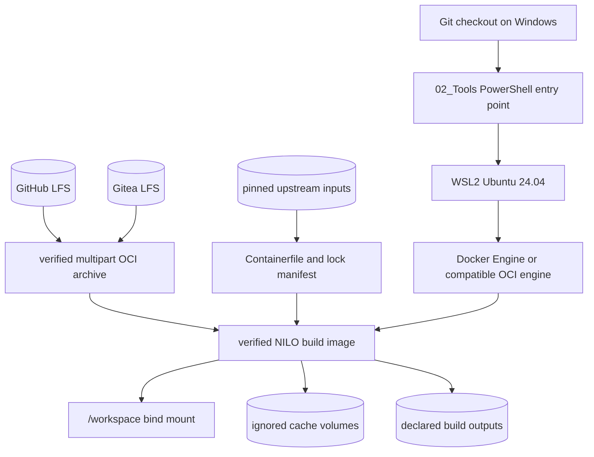

# NILO development and build environment plan

**Status:** Proposed prerequisite plan; environment implementation and proof must
complete before feature implementation resumes.
**Date:** 2026-09-05
**Scope:** Development and build environment only. Product packaging, appliance
installation, updates and delivery are a separate later plan.
**Relationship:** Refines `System_Build_Plan.md` decision D11 and the development
topology in `06_SoftwareDocu/Development_and_Simulation_Flow.md`.

## 1. Decision summary

NILO will use one Linux OCI build environment as the normal reproducible build
boundary. Windows x86-64 runs it inside a selected Ubuntu 24.04 WSL2
distribution; native Ubuntu 24.04 x86-64 runs it directly. Both use Docker
Engine or Podman and the same `linux/amd64` image. Docker Desktop is neither
required nor assumed.

The repository will preserve both ways to obtain that environment:

1. a reviewed container definition and lock manifest in ordinary Git; and
2. an exact, checksum-verified OCI archive split into Git LFS objects and stored
   completely on the primary personal Gitea remote. The public GitHub remote is
   a secondary source mirror and receives the archive only when the complete
   generation fits its applicable storage allowance.

The archived OCI digest identifies the exact preferred environment. Rebuilding
from the definition is the fallback when LFS is unavailable, assuming the
pinned upstream inputs remain available. If neither LFS copy nor the pinned
upstream inputs remain available, recovery is explicitly not guaranteed.

The current repository rule that forbids committed runtime/compiler binaries
must be amended before implementation. Extracted runtimes remain ignored under
`02_Tools/runtime/`; only designated immutable multipart escrow archives under
`02_Tools/archives/` may be tracked through Git LFS.

## 2. Goals and non-goals

### Goals

- A new developer can clone the repository and obtain one known build
  environment without installing language toolchains globally.
- Windows development works with WSL2 and an engine inside WSL2, without Docker
  Desktop.
- Native Ubuntu 24.04 x86-64 development works through a POSIX entry point
  without PowerShell or WSL.
- The environment contains every compiler, linker, SDK, package cache and test
  dependency needed by the supported offline build/test command.
- The primary Gitea remote holds an independently retrievable, complete copy of
  every required LFS object; GitHub may hold a second complete copy when its
  allowance permits.
- Every archive part, the reassembled archive and the imported OCI image are
  verified before execution.
- One command selects archive restore first and online reconstruction second.
- Archive completeness and correctness are not constrained by a fixed total
  size or by a public forge's free-tier allowance.
- Development/build concerns remain separate from target packaging and runtime
  concerns.

### Non-goals

- Making Windows, WSL2 or a container engine part of the application.
- Using Docker Desktop or depending on its licensing model.
- Treating a build container as an appliance image or production runtime.
- Packaging, installing, updating or rolling back a NILO appliance in this
  work package.
- Claiming bit-for-bit rebuild reproducibility before two clean builds prove it.
- Preserving upstream packages after both LFS replicas and upstream locations
  are unavailable.

## 3. Terminology and authority

- **Definition:** Containerfile, scripts and lock manifest reviewed as source.
- **Locked environment:** The exact tool/package/input versions and digests.
- **Archived environment:** The exported OCI image bytes identified by digest.
- **Repeatable build:** A clean environment produces equivalent tools and
  product outputs under the documented checks.
- **Reproducible image:** Independent clean builds produce the same OCI digest.
  This stronger term is used only after evidence exists.
- **Offline:** No network is available after repository and LFS objects have
  been obtained.

The definition is the build recipe; the OCI digest is the expected artifact
identity; Git LFS is the preferred artifact transport, not the only repository
truth. Tags, filenames and mutable registry references never establish identity.

## 4. Supported host and target matrix

| Role | Initial supported environment | Responsibility |
|---|---|---|
| Developer host | Windows 11 x86-64 | Git checkout, PowerShell entry point, optional headed browser and WSL control |
| Developer/build host | Native Ubuntu 24.04 x86-64 | Git checkout, POSIX entry point, OCI engine, image import/build, and normal build commands |
| Windows build host | WSL2 Ubuntu 24.04 x86-64 | OCI engine, image import/build, and normal build commands |
| Build container | Linux x86-64 OCI image | Go, Python, Node, C/C++ toolchains, dependencies and tests |
| Cross target | Linux ARM64 | Go outputs plus C compiler/linker/sysroot for Raspberry Pi artifacts |
| Native validation target | Authorized Linux ARM64 appliance | ABI/runtime smoke and later hardware acceptance |
| Later product target | Raspberry Pi 4 ARM64, then Linux x86-64 mini PC | Defined by the separate deployment-target plan |

The first archived image is `linux/amd64` for both supported build-host paths.
It carries the ARM64 cross toolchain and sysroot. A native ARM64 build image is
added only when an ARM64 developer-host use case is deliberately designed and
proven; it is not required merely because the product target is ARM64.

## 5. Environment architecture



The archive and online build paths converge on the same image verification.
Normal compilation and tests then run with networking disabled. The checkout is
mounted at `/workspace`; mutable caches and generated outputs use declared,
ignored locations and never silently modify host toolchains.

## 6. Planned repository layout

```text
02_Tools/
  containers/
    build/
      Containerfile
      build-environment.lock.json
      licenses/
      README.md
  archives/
    build-environment/
      current.json
      nilo-build-env-<generation>.oci.tar.gz.part000
      nilo-build-env-<generation>.oci.tar.gz.part001
      ...
  bootstrap/
    bootstrap-build-environment.ps1
    bootstrap-container-engine.sh
    setup-build-environment-image.sh
    bootstrap-build-environment.sh
  env/
    with-build-environment.ps1
    with-build-environment.sh
  scripts/
    build-build-environment.sh
    export-build-environment.sh
    restore-build-environment.sh
    mirror-build-environment-lfs.ps1
    verify-build-environment.sh
  tests/
    build-environment/
      verify-clean-clone.ps1
      verify-offline.sh
      verify-rebuild.sh
      verify-lfs-replicas.ps1
  runtime/
    containers/                 # ignored imported image/cache state
  cache/
    containers/                 # ignored online build inputs and caches
```

The implementation will add `.gitattributes` rules only for the archive part
pattern. Manifests, checksums, SBOMs, licence notices and scripts remain normal
Git text. Broad `*.gz` or `02_Tools/**` LFS patterns are forbidden.

## 7. Lock manifest

`build-environment.lock.json` is the machine-readable authority for environment
inputs. At minimum it records:

- schema version and environment generation;
- supported build-host platform;
- base image reference pinned by digest;
- Go, Python, uv, Node.js and npm versions already governed by
  `02_Tools/toolchain.versions`;
- the chosen native x86-64 and ARM64 cross compiler, assembler, linker and
  sysroot versions;
- package-manager package versions and repository snapshot identifiers;
- Playwright/browser version and required OS libraries for the mandatory
  headless browser gate inside the image;
- libsigrok/libsigrokdecode headers, ABI and build dependencies;
- source URLs, archive SHA-256 values and licences;
- OCI build frontend/format version;
- expected tool inventory and verification commands;
- expected OCI manifest digest once the generation is accepted.

`toolchain.versions` remains the simple bootstrap-readable view during
migration. A validation script rejects disagreements between its overlapping
values and the JSON lock manifest.

## 8. Container contents and boundaries

The initial container must include:

- pinned Go 1.27.0 for Linux x86-64 and cross-build support;
- pinned uv 0.11.25 and managed Python 3.12.10;
- pinned Node.js 24.20.0 and npm 11.19.0;
- the selected C11 compiler, assembler and linker for Linux x86-64;
- the selected C11 ARM64 cross compiler, linker and target sysroot;
- Git and required archive/checksum utilities;
- all locked Python and npm artifacts needed for offline restore/test;
- Chromium plus its runtime libraries for the mandatory Linux-container
  headless browser gate;
- build/test-only Sigrok headers and compatibility inputs;
- licence notices and a generated SBOM.

The image does not include product secrets, developer credentials, source
history, an appliance database, production configuration or a Docker daemon.
It runs as a non-root user whose numeric UID/GID can match the WSL developer.
The repository mount is the only source input, caches use named volumes, and
output directories are explicit.

The native toolchain is GCC plus binutils. The image carries pinned native
x86-64 packages and the matching `aarch64-linux-gnu` compiler, binutils and
ARM64 sysroot. ENV-01 selects their exact package versions from one pinned
Ubuntu snapshot, and the acceptance proof compiles, links and runs the Sigrok
worker on the ARM64 appliance. LLVM/Clang/LLD is not a second supported path.

The mandatory browser gate runs headlessly inside the Linux build container.
Native Windows headed browser execution remains an optional visual-development
workflow and does not define whether the build environment is complete.

## 9. Supported host and container-engine contract

The supported Windows path assumes WSL2 but not Docker Desktop.

`bootstrap-build-environment.ps1` will:

1. select an existing WSL2 Ubuntu 24.04 distribution, or require an explicit
   installation option before making that host change;
2. verify the distribution identity, architecture and systemd/service support;
3. verify an OCI engine inside WSL;
4. install the selected engine only through a separate explicit
   `-InstallEngine` action;
5. verify the engine version and storage location;
6. refuse to put engine state or Linux build state on the Windows-mounted
   checkout;
7. invoke the Linux restore/build/verification scripts through the existing
   `02_Tools/lib/Wsl.ps1` boundary.

Docker Engine in WSL is the documented primary path. The OCI archive remains
runtime-neutral and the scripts may support Podman after an import/run
compatibility test. Supporting two engines must not produce two build
definitions or two different accepted environments.

On native Ubuntu, `bootstrap-build-environment.sh` performs the equivalent
Ubuntu 24.04, x86-64, and systemd checks locally, verifies Docker Engine or
Podman directly, and invokes the same image-setup helper without PowerShell or
WSL. `--install-engine --engine-archive-path <directory>` is the only native
host-install path. Both host routes share the same engine verifier, lock,
archive, inventory, and offline command boundary.

The engine and Git LFS clients are host prerequisites. A separate, smaller
Ubuntu host-bootstrap archive retains the exact Ubuntu packages and dependencies
needed to install Docker Engine or Podman, Git LFS, and the archive/checksum
utilities. The user explicitly chooses which supported engine to install;
ordinary setup never installs both. Windows and the WSL2 kernel remain external
platform prerequisites.

## 10. Acquisition workflow

The default command is conceptually:

```powershell
.\02_Tools\bootstrap\bootstrap-build-environment.ps1 -Distribution Ubuntu-24.04
```

or, on native Ubuntu 24.04 x86-64:

```sh
./02_Tools/bootstrap/bootstrap-build-environment.sh
```

The developer obtains the ordinary Git checkout and its LFS content before
running setup. The setup command never runs `git fetch`, `git pull`,
`git lfs fetch`, `git lfs pull`, changes remotes, or authenticates to a forge.
Repository acquisition remains an explicit user action.

Setup follows this order:

1. Read `current.json` and the lock manifest.
2. Check whether the expected image digest already exists locally.
3. Inspect the local archive paths and distinguish real LFS content from pointer
   files or missing parts.
4. If parts are missing, print their names/OIDs and stop before any network
   action. Present three explicit recovery choices:
   - the user fetches LFS content from the current clone and reruns setup;
   - the user obtains the same parts from another repository origin or supplies
     a local archive/check-out path and reruns setup;
   - the user explicitly requests reconstruction from pinned upstream inputs.
5. Verify every locally available part's size and SHA-256.
6. Join the parts into a temporary file outside the checkout.
7. Verify the complete archive SHA-256.
8. Import the OCI archive.
9. Verify the imported image manifest digest and tool inventory.
10. Delete only the verified temporary joined file; keep user-acquired LFS
    objects in their normal cache.
11. When reconstruction is explicitly selected, show that network access and
    external downloads are required and obtain confirmation before continuing.
12. The reconstruction downloads only lock-listed base images and inputs,
    verifies them, builds the image, and applies the same final inventory
    checks.

`-Offline`/`--offline` forbids reconstruction and fails with an exact list of missing LFS
objects or host prerequisites. `-RebuildFromPinnedInputs` intentionally selects
the networked reconstruction path. `-ArchivePath` may select content that the
user already obtained from another clone or storage location. There is no
`-Remote` download option. No bootstrap silently installs WSL, enables system
services, changes Git remotes or changes persistent Windows environment state.

## 11. Normal developer workflow

All normal build/test commands go through one wrapper:

```powershell
.\02_Tools\env\with-build-environment.ps1 test
.\02_Tools\env\with-build-environment.ps1 build
.\02_Tools\env\with-build-environment.ps1 shell
```

The wrapper:

- verifies the expected image digest before every run;
- invokes the engine inside the selected WSL distribution;
- mounts the checkout at a stable path;
- sets the locked offline environment for Go, uv, npm and browser tooling;
- disables network access for normal build/test commands;
- maps UID/GID so outputs remain editable;
- gives no privileged devices or host network access;
- preserves command exit codes;
- prints the environment generation and digest in build logs.

Device access, appliance smoke and hardware-in-the-loop remain explicit higher
verification levels outside the ordinary container command.

## 12. OCI archive and Git LFS policy

### Size envelope

The primary personal Gitea instance is the authoritative archive store. There
is no fixed maximum for a complete OCI archive generation: the image must
contain every required compiler, linker, SDK, package cache and test dependency,
even when the result exceeds 8 GB or a public forge's free-tier allowance.

- Archive part size: 2 GB maximum; the exporter defaults to 1 GiB parts so no
  object sits exactly on a provider boundary.
- Gitea stores the complete accepted current generation and the retention set
  required by this plan, subject only to monitored server capacity and backup
  capacity—not to an artificial image-content budget.
- GitHub receives a generation only if all of its parts fit the measured
  allowance. A partial GitHub archive must not be published or described as a
  usable replica.
- Core and test-browser images may be separated when that improves maintenance
  or update frequency, but never to omit dependencies required by an acceptance
  gate.

Multipart splitting does not reduce total storage or bandwidth. It provides a
portable per-object size and precise retry/checksum boundaries. Every changed
archive consumes its full size again in LFS, and removing a pointer does not by
itself prove that a hosted provider stopped counting the old object. Archive
generations therefore change only when the lock manifest changes. Before
publishing a generation, maintenance records its measured size and verifies
enough capacity for the complete generation and required backups on Gitea. If a
complete GitHub replica is planned, its current allowance and reclamation
behavior must also be verified.

### Archive manifest

`current.json`, kept in normal Git, records:

- schema and generation;
- OCI archive media type and compression;
- expected OCI index/manifest digest;
- complete joined-file size and SHA-256;
- ordered part filenames, sizes, SHA-256 values and LFS OIDs;
- source commit and lock-manifest digest;
- creation command and builder identity;
- supported host/platform;
- SBOM, licence and provenance paths;
- verification date and commands;
- authoritative Gitea readback and backup status, plus GitHub complete-replica
  status when applicable.

The restore script refuses missing, reordered, duplicated, unexpected or
incorrect parts. It never trusts a successful `git lfs pull` without content
hash verification.

### Primary archive and secondary mirror

Pushing Git commits between GitHub and Gitea does not prove that LFS objects
were copied. Human-operated publication tooling must explicitly transfer every
required LFS OID to the primary Gitea remote and read it back independently.
GitHub publication is conditional and all-or-nothing for each generation.

For every accepted generation:

1. push the ordinary commit under the repository's human-only push policy;
2. push every required LFS object to Gitea;
3. fetch/read back each object from Gitea into a clean cache and verify it;
4. keep and verify a separate server backup of the Gitea Git and LFS storage;
5. if the complete generation fits GitHub, push every required LFS object there,
   read it back into another clean cache, and mark that complete replica in the
   manifest;
6. otherwise, keep GitHub as a source/definition/lock mirror, record that it has
   no archive replica for that generation, and direct archive users to Gitea.

An unavailable authoritative Gitea archive or backup is a maintenance fault.
Absence of an optional GitHub archive is not a fault when the manifest records
it explicitly. Neither condition authorizes replacing the expected digest or
silently rebuilding a different generation.

## 13. Security, licences and supply chain

- Pin base images by digest, never tag alone.
- Pin all downloadable archives and packages by digest/version.
- Use HTTPS sources and verify content independently of transport.
- Keep third-party licence texts and an inventory beside each generation.
- Generate an SBOM for the final image and for produced product artifacts.
- Record the build definition commit and source/lock digests as provenance.
- Do not place credentials, Git configuration, SSH agents or host sockets in
  the image/archive.
- Do not mount the container-engine socket into build/test containers.
- Run ordinary verification with no network and no privileged capabilities.
- Scan the definition, archive manifest and image before acceptance; scanning
  supplements, but does not replace, pinned inputs and tests.
- Treat archive production/publication as a repository delivery operation that
  requires explicit human approval. Agents never push either Git or LFS data.

## 14. Verification strategy

### Definition checks

- Containerfile uses only lock-manifest inputs and digest-pinned bases.
- The build context contains no secrets, generated runtime or unrelated files.
- The lock manifest and `toolchain.versions` agree.
- Every package has version, digest, source and licence metadata.
- A changed lock requires a changed environment generation.

### Image checks

- Report exact Go, Python, uv, Node/npm, C compiler, assembler and linker
  versions.
- Compile and link a native x86-64 C smoke executable.
- Cross-compile and link an ARM64 C smoke executable.
- Build both Go target architectures with `CGO_ENABLED=0` where designed.
- Restore Python/npm projects with network disabled.
- Run formatting, lint, unit, contract and browser gates assigned to the image.
- Build the Sigrok worker and run it on the authorized ARM64 appliance against
  the expected ABI.
- Confirm no generated file appears outside declared output/cache locations.

### Archive checks

- User-performed fresh clone/LFS acquisition from GitHub followed by local-only
  setup and restore.
- User-performed fresh clone/LFS acquisition from Gitea followed by local-only
  setup and restore.
- Proof that setup performs no Git or Git LFS network command.
- Offline restore with DNS/network disabled.
- Detect one missing part, reordered parts and one-byte corruption.
- Confirm imported digest and tool inventory match `current.json`.
- Confirm a source clone can omit LFS smudging and remains usable for inspection.

### Rebuild checks

- Build twice from clean caches on independent runners.
- Compare OCI digests. If they differ, record and eliminate timestamps,
  non-deterministic package ordering and mutable metadata where feasible.
- Until digests match, call the result a locked repeatable environment, not a
  bit-reproducible image.
- Verify the rebuilt image against the same inventory and repository test gate.

## 15. Acceptance gates

Feature implementation resumes only after all required gates pass:

| Gate | Acceptance evidence |
|---|---|
| BE-01 Policy | Repository rules explicitly allow designated LFS escrow archives while keeping extracted runtimes ignored |
| BE-02 Lock | Complete reviewed environment lock, licences and source digests |
| BE-03 WSL engine | Clean Windows/WSL2 setup works without Docker Desktop and host changes are explicit |
| BE-04 Build | Clean online container construction and complete tool inventory pass |
| BE-05 Offline | Complete repository build/test succeeds with container networking disabled |
| BE-06 ARM64 | Cross-built worker runs against the authorized ARM64 Sigrok ABI |
| BE-07 Archive | Multipart export, corruption tests, import and digest verification pass |
| BE-08 Storage | Every part is at most 2 GB; the complete required image is preserved on Gitea without omitted content; measured Gitea and backup headroom are recorded |
| BE-09 Replicas | Clean Gitea LFS readback and backup verification succeed; GitHub readback is required only when the manifest declares a complete GitHub replica |
| BE-10 Documentation | One-command setup, recovery and maintenance runbooks match observed behavior |

No gate may be satisfied by a plan, an untested script, a local cache already
present on the implementer's computer, or an image tag without digest proof.

## 16. Implementation work packages

### ENV-01 — Policy and inventory

- Amend repository policy for `02_Tools/archives/` LFS escrow only.
- Inventory every current bootstrap URL, version, digest, licence and cache.
- Measure present Windows and WSL runtime/cache sizes.
- Pin GCC/binutils native and ARM64 cross packages through a build proof.
- Establish the lock-manifest schema, measure the archive size, and record Gitea
  storage and backup-capacity evidence without imposing a content-size cap.

### ENV-02 — Container definition

- Create the Containerfile and lock manifest.
- Build all current Go/Python/Node workflows inside it.
- Add native and ARM64 cross compiler/linker/sysroot.
- Make package restoration and normal tests work without network.
- Generate SBOM, licences and provenance.

### ENV-03 — WSL2 orchestration

- Add explicit engine verification/optional installation inside WSL2.
- Add PowerShell-to-WSL restore/build/run wrappers.
- Keep runtime state on the WSL Linux filesystem.
- Migrate existing `with-tools` and development entry points without breaking
  the current workflow until the replacement is proven.

### ENV-04 — Offline archive and LFS

- Export a deterministic-format OCI archive.
- Split, hash, describe and restore it.
- Add narrow LFS attributes, per-part size enforcement and storage reporting.
- Add human-operated authoritative Gitea LFS publication, backup and clean
  readback verification. Add conditional all-or-nothing GitHub replication;
  setup itself performs no forge download.
- Prove corruption and missing-part failures.

### ENV-05 — Integrated acceptance and cutover

- Execute BE-01 through BE-10 from clean environments.
- Compare two clean builds and classify reproducibility honestly.
- Update `02_Tools/README.md` and development/simulation documentation.
- Retire redundant host-specific bootstrap only after equivalence is proven.
- Resume the paused Sigrok SW-01 correction under the accepted environment.

Each package is ordinary software-development work under AEGIS. Container-image
publication, LFS publication and archive retention are repository delivery
operations and remain human-controlled.

## 17. Maintenance policy

- Review toolchain inputs quarterly and on security advisories.
- Create a new generation only for intentional lock changes.
- Retain current and previous generations on Gitea while monitored server and
  backup capacity retain appropriate operating headroom.
- Verify Gitea and its independent backup at least quarterly and after forge or
  storage migration. Verify GitHub too when it holds a complete declared
  replica.
- Perform a full offline restore at least twice per year.
- Back up Gitea repositories and LFS storage together; a Git-only backup is
  incomplete.
- Never delete the previous accepted generation until the new generation has
  passed a clean Gitea restore and independent backup verification. When GitHub
  declares a complete replica, its clean restore must pass as well.
- Record unsupported/end-of-life toolchains and migration decisions in the
  changelog appropriate to the environment, not as silent archive replacement.

## 18. Later deployment-target environment plan

The build environment produces and tests artifacts; it does not define how the
product is installed or operated. After this plan is implemented and accepted,
a separate `Deployment_Target_Environment_Plan.md` must define:

- supported Raspberry Pi 4 ARM64 and Linux x86-64 base OS versions;
- kernel, glibc, systemd, Python and native ABI minimums;
- filesystem layout, service users, groups, device permissions and udev rules;
- immutable package contents and Sigrok/runtime dependency ownership;
- installer, repair, upgrade, rollback and uninstall transactions;
- signatures, SBOM/provenance, offline package transport and release retention;
- configuration/state/data boundaries and backup/restore;
- first-boot identity and secret enrollment;
- system, ARM64, hardware-in-the-loop and recovery acceptance matrices;
- the relationship between installer bundles and later appliance images.

The deployment plan must consume artifacts from the accepted build environment
by digest. It must not reuse the development container as the production image
or make development caches part of a release.

## 19. Decisions recorded for ENV-01

1. Use pinned GCC plus binutils for native x86-64 and ARM64 cross compilation;
   do not maintain an LLVM/Clang alternative.
2. Run the mandatory headless browser gate inside the Linux build container;
   native Windows headed testing is optional.
3. Limit every LFS part to 2 GB; the exporter defaults to smaller 1 GiB parts.
   Do not impose a maximum total archive size: completeness and correctness take
   priority over public-forge quotas.
4. Include the packages and dependencies needed to install Docker Engine or
   Podman inside WSL2 in a separate host-bootstrap archive.
5. Require the user to clone/fetch Git and LFS content. Setup consumes only
   local archive content, reports missing parts, and offers instructions to
   obtain them from another origin or an explicit networked reconstruction from
   pinned upstream inputs. It never contacts a Git forge itself.

ENV-01 still records exact GCC/binutils/engine package versions, source digests,
archive sizes, Gitea capacity/backup evidence and the human-configured
publication remotes. Gitea is the primary complete archive; GitHub is a public
source mirror and an optional complete archive replica. These are implementation
evidence, not unresolved architecture decisions, and no credentials enter the
plan or scripts.

## References

- OCI Image Layout: <https://specs.opencontainers.org/image-spec/image-layout/>
- Docker multi-platform builds: <https://docs.docker.com/build/building/multi-platform/>
- Docker Engine on Ubuntu: <https://docs.docker.com/engine/install/ubuntu/>
- WSL systemd support: <https://learn.microsoft.com/windows/wsl/systemd>
- GitHub Git LFS limits and billing: <https://docs.github.com/en/repositories/working-with-files/managing-large-files/about-git-large-file-storage>
- GitLab storage quotas: <https://docs.gitlab.com/user/storage_usage_quotas/>
- Gitea Git LFS configuration: <https://docs.gitea.com/administration/git-lfs-setup/>
