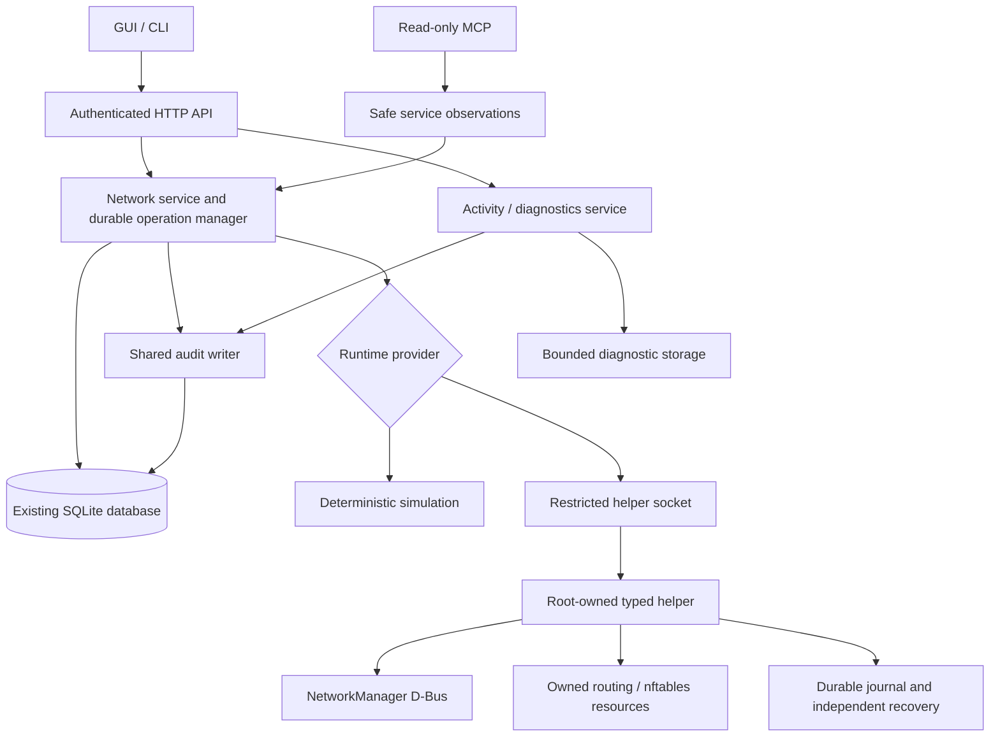

# Device networks and audit: implementation plan for Claude Code

Date: 2026-09-03. Status: implementation handoff; the capabilities below are planned unless explicitly identified as existing. This document does not report a completed implementation or hardware acceptance.

Workspace: `F:\2026_Networked_Intelligent_Lab_Orchestrator`. Current branch: `master`. Existing Network task: `TASK-943403e2`.

## 1. Outcome

Turn a Raspberry Pi running NILO into a configurable gateway for arbitrary Ethernet devices. An operator connects the Pi to an Internet hotspot or local management network and connects a second interface to the device network. From a computer, the operator can reach existing device IPs, or translated addresses, through a local route or WireGuard. Existing engineering tools perform application downloads; existing Modbus TCP clients communicate with device servers.

Provide an attributable local audit trail on every NILO, operational events, and temporary debug logging selectable by function and target. Keep the Network GUI concise: Interfaces, WireGuard profiles, Device networks; show history through a shared Activity page.

The product term is **Device networks**. Do not label the feature Cabinet, PLC network, or PLC gateway. PLCs are acceptance examples, not the domain model. Use **Device-side interface**, **Device subnet**, **Target IP address**, **Exposed address/subnet**, and an optional **Location**.

### 1.1 Agreed requirements and design defaults

The user explicitly requested interface selection including newly detected USB adapters; configurable device-side addressing; a preserved management connection; add/edit/enable/disable/delete; access with and without WireGuard; several imported WireGuard profiles with selected activation; access to devices with duplicate static IPs at different sites; and per-NILO event auditing with adjustable granularity. Application download means transferring a new device application, not replacing its firmware/bootloader.

The following are implementation defaults proposed in this plan, rather than previously implemented features: one active managed WireGuard profile, IPv4 device forwarding first, local/WireGuard/both access modes, source NAT by default, 90/14/1-day history targets, timed debug sessions, and the permission additions below. Record them during scope reconciliation. Routine implementation choices can be resolved from this document; questions about live infrastructure remain prerequisites for site acceptance, not blockers to building the software.

## 2. Authority and working rules

1. Read root `AGENTS.md`, `CLAUDE.md`, `.agentic/AGENTS.md`, and the current task/step before edits. Those instructions and the user's current request remain authoritative.
2. Stay on the existing branch. Never stage, commit, push, stash, reset, merge, rebase, revert, cherry-pick or tag. Do not create a worktree or branch. The human owns Git publication.
3. Preserve the dirty worktree, including tracked and untracked implementation. Do not restore a file from Git to make a check pass. Review baseline diffs before touching overlapping files.
4. Continue the existing Network work rather than replacing it. The task's earlier successful tests are historical evidence, not proof of a later candidate.
5. Use repository AEGIS requirements, design records and validation. Reconcile the enlarged scope before implementing it; keep earlier rulings and logs append-only. This document is not an approval to deploy, access an external VPN server, or download software to a live device.
6. The root Git prohibition overrides AEGIS deliver instructions. Delivery means a reviewable, uncommitted candidate and evidence.
7. Keep repository-local bootstrap/deployment/test tools in `02_Tools/`; use its pinned runtimes. Do not install system-wide tools or enable WSL host changes implicitly.
8. Read `06_SoftwareDocu/Development_and_Simulation_Flow.md` and `01_Documentation/Code_Style.md`. Preserve Windows GUI + WSL2 simulation and explicit Linux appliance mode.
9. Keep `VERSION` and mirrors unchanged. Add concise product changes under `CHANGELOG.md` Unreleased during implementation.
10. Do not edit the AEGIS payload or weaken tests, authentication, secret protections, or the simulation boundary. Current optional independent review policy is disabled; reread configuration before validation.
11. Do not restart the user's existing simulator merely to inspect the GUI. Its current WireGuard metadata is in memory and restart loses it. Use isolated test state.
12. `F:/2025_DCP_Server/5_Software/DDP.conf` is sensitive user configuration, not a test fixture. Never copy its keys into source, logs, examples or this plan. Generate disposable test peers. Each physical Pi and computer requires a distinct peer identity.

## 3. Verified starting point and reuse map

The following was inspected in the working tree on 2026-09-03. Recheck before implementation; paths in old design notes sometimes name files that were never created.

| Area | Existing implementation | Remaining work |
|---|---|---|
| Network service | `05_Software/nilo_assistant/internal/network/`: observations, profile parsing, simulation, traffic statistics, acknowledged operations | Persistent configuration and operation repositories; device-network model; management-path policy |
| Operation engine | `internal/network/operation.go`: preview/revision binding, serialized changes, 120-second confirmation, rollback states; operations are in a map | Durable operation records, restart/page-reload reattachment, audit integration, multi-resource recovery |
| Linux helper | `internal/nethelper/{protocol,engine,store,networkmanager_linux}.go`: restricted Unix socket, typed requests, NetworkManager interface toggles, durable recovery | Static/DHCP/Wi-Fi settings, protected secrets, live tunnel lifecycle, routing/firewall and independent recovery for them |
| WireGuard | Simulation import/remove/activate/deactivate/startup selection; validated parser; live readiness and acknowledged tooling installation | Live import/storage/mapping/inventory/switching/startup; profile rename; persistence |
| Database | `internal/store/sqlite/db.go`: modernc SQLite, WAL, FULL synchronous mode, single connection; migrations through `005_network_traffic` | Additive migrations for this milestone; preserve all existing data and migration digests |
| Audit | `internal/audit/audit.go`, `internal/store/sqlite/audit_repository.go`: append/list, sequence, actor/action/subject/JSON/UTC time | Full Network coverage; appliance identity; outcomes/correlation; query/export UI; retention; logging health |
| Identity | `internal/identity/service.go`: account/token changes and audit share a database transaction | Login/session outcome coverage audit, fixed permissions for Activity and Diagnostics |
| HTTP/CLI/MCP | `internal/httpapi/network*.go`, `cmd/nilo/network*.go`, `internal/apiclient`, `internal/mcp` | Extend common contracts; do not create a second management authorization path |
| GUI | `src/components/pages/NetworkPage.tsx`, `src/components/network/`, `src/api/{client,contract,mock,wireguard}.ts` | Configuration editors, Device networks, Activity, timed Diagnostics, operation recovery after reload |
| Appliance entry | `cmd/nilo/network_runtime*.go`, `internal/app/app.go`, `internal/httpapi/serving.go` | Compose persistence/logging/new services; startup reconciliation and readiness |
| Verification | `02_Tools/tests/network/`, `nilo_gui/e2e/network.spec.ts`, Go/component/script tests | Routed multi-node fixtures, duplicate addresses, audit/debug coverage, VM/systemd/reboot and Pi proof |

The implementation status is maintained in `06_SoftwareDocu/Network_Service_Implementation_Status.md`. Existing Linux readiness or simulated profile activation must not be presented as working live WireGuard management.

## 4. Scope boundaries

### Included

- Configurable IPv4 addresses, masks, DHCP/static mode, applicable gateway and DNS; observe existing IPv6 without corrupting it.
- Wi-Fi station scanning/joining for ordinary open or personal WPA2/WPA3 networks where supported by NetworkManager/hardware. Store passwords through the protected secret path. Preserve unrelated profiles.
- Multiple named WireGuard imports; one active managed profile; zero or one selected startup profile; external tunnels visible but read-only.
- Saved device networks targeting one host or a whole IPv4 subnet, over a selected local interface, managed WireGuard profile, or both explicitly selected paths.
- Original-address routing and translated host/subnet access for duplicate addresses; restrictive forwarding rules and source NAT by default.
- Last-management-path protection, transaction preview, independent rollback, durable reconciliation and startup behavior.
- Per-appliance audit, operational events, timed per-function/per-target debug, Activity search and export.
- GUI/CLI management parity and authenticated read-only MCP observations.

### Excluded from this milestone

- OpenVPN and other VPN implementations; retain a small provider boundary for later addition.
- Provisioning or administering an external VPN hub; automatically modifying the user's PC/router routes.
- DHCP server, Wi-Fi access-point mode, captive-portal automation, enterprise Wi-Fi onboarding, Ethernet bridging, broadcast relays, Layer-2 VPN, PROFINET real-time transport.
- General-purpose firewall editor, arbitrary shell/nftables rules, public Internet port publication, unconditional device Internet sharing.
- Multiple active managed VPN tunnels, overlapping device-side subnets on one Pi, VRF/network-namespace isolation as a product feature, multiple active device-network configurations on one physical interface.
- IPv6 device forwarding/NAT; IPv6 must not bypass the IPv4 access policy. Preserve management/uplink IPv6.
- Built-in Modbus polling/history or register editor; vendor application/firmware uploader; packet capture; central fleet log collector. Existing Modbus clients and vendor tools are acceptance clients.

## 5. Addressing and routing behavior

### 5.1 Normal direct access

Example: computer `192.168.1.13/24`; NILO management `192.168.1.50/24`; NILO device side `192.168.0.1/24`; target `192.168.0.130/24`.

For local access, the computer or its router needs a route for `192.168.0.0/24` through `192.168.1.50`. For VPN access, the computer and hub need the corresponding WireGuard routes and peer permissions. NILO alone cannot create a route on those other systems. WireGuard associates destination/source prefixes with peers through AllowedIPs; OS routing still has to send traffic to the tunnel. [WireGuard routing](https://www.wireguard.com/#cryptokey-routing)

NILO forwards authorized connections to the target and source-translates them to `192.168.0.1`. The target replies to that local address, avoiding a required target-gateway change for remote-initiated connections. `192.168.0.1` must be unused; it is NILO's address, never a forced replacement for the target address. Source and destination translations are stateful. [nftables NAT](https://wiki.nftables.org/wiki-nftables/index.php/Performing_Network_Address_Translation_%28NAT%29)

Do not add a default gateway to NILO's device-side profile. Uplink/default-route intent remains with the management/Internet connection or explicitly chosen VPN policy. NetworkManager supports a never-default property for this purpose. [NetworkManager settings](https://networkmanager.dev/docs/api/latest/nm-settings-nmcli.html)

### 5.2 Several sites with the same device IP

| Site | Actual device | NILO device-side address | Address used remotely |
|---|---|---|---|
| Site A | `192.168.0.130` | `192.168.0.1/24` | `10.60.1.130` |
| Site B | `192.168.0.130` | `192.168.0.1/24` | `10.60.2.130` |

Each site has a separate Pi/peer. For a subnet mapping, preserve host bits: `10.60.1.0/24` maps to Site A's `192.168.0.0/24`. For a single-device mapping, permit an explicit exposed IPv4 host. Prefix mapping must not allocate one rule per address. Authorize the original exposed destination as well as the translated destination, so knowing an internal address cannot bypass a selected mapping.

The hub routes Site A's exposed prefix to Site A's peer and Site B's prefix to Site B's peer. The computer routes these prefixes to its hub peer. On each Pi, the hub peer's AllowedIPs must permit the actual remote client source addresses and return routing. A full-tunnel profile is not proof that hub forwarding or per-site routing exists.

A portable Pi visiting one site at a time can use the original range when unambiguous. Simultaneous identical original destinations cannot identify different sites in one ordinary routing table; the UI must require translated prefixes or clearly limit selection to one site.

### 5.3 Conflict validation

- Canonicalize IP/CIDR inputs. Validate host address/mask, target membership, network/broadcast exclusion, translation prefix size and exposed-address uniqueness. Start with RFC1918 IPv4 device networks and ordinary host subnets; reject unsupported point-to-point masks with a clear reason.
- Reject device-side address equality with a known target and detect a responding address conflict before activation where possible. Lack of an ARP response is not proof that an address is free.
- Reject overlap between device-side and management/uplink/tunnel connected subnets on the same Pi. A translated remote prefix does not solve this local ambiguity; instruct the operator to change the hotspot subnet or use a distinct network.
- Check exposed prefixes against local connected routes, selected VPN configuration and other NILO device networks. Remote PC/hub conflicts may be unknown: provide instructions and a route check, not a false all-clear.
- Match configuration to stable adapter identity (permanent MAC/udev identity as available), not only `eth0` or an ifindex. Require explicit rebinding if the adapter is replaced or identity is ambiguous.
- Treat unplugged, renamed, replaced and unmanaged adapters separately. Saved configuration can exist while an adapter is absent; it cannot be reported as applied.

### 5.4 Access modes and restrictions

Local mode requires a selected local ingress interface and permitted source CIDR(s). WireGuard mode requires a selected managed profile and permitted VPN source CIDR(s); do not interpret AllowedIPs as permission to publish to every Internet address. Both mode is the union of two explicit paths, not automatic fallback from VPN to LAN.

Default scope is one target; whole-subnet scope is explicit. The default service policy can permit IPv4 TCP, UDP and ICMP to that selected scope from the authorized sources, supporting vendor protocols without assuming port 502 is sufficient. Advanced settings can restrict protocol/ports; a Modbus TCP preset selects TCP 502. Never include the Pi's own management services, another device network, or unrestricted new device-to-Internet connections in this forwarding grant.

Source NAT is the default. Advanced preservation of the remote source requires documented target return routes/gateway; its diagnostics must explain this dependency. Enabling NILO at `.1` does not automatically authorize all target-originated traffic.

## 6. User interface contract

Use current shell components, themes, bounded scrolling, keyboard behavior and en/de/ro catalogues. One SIM/LIVE indicator; no repeated explanatory banners. Expand details only on request. Preserve conspicuous pending-change, lost-connection and recovery-failure states.

### 6.1 Interfaces

List name/type, state, IP/mask, gateway, link speed, RX/TX, management protection and actions. Show detected Wi-Fi/USB Ethernet automatically. On edit: DHCP/static, IP/mask, applicable gateway, automatic/manual DNS, and management protection. For Wi-Fi: scan/refresh, SSID, supported security type, password replacement and connect-at-startup. Never display a saved password or send a fake redaction string as its replacement.

The device-network editor and interface editor reference one interface configuration, not duplicate independently editable IP copies. Physical interfaces have enable/disable; Add/Delete apply to saved managed connection profiles. Existing external profiles remain observable; taking ownership must be explicit, with a restorable snapshot.

### 6.2 WireGuard profiles

List name, active/inactive/error, configured IPs, endpoint summary, handshake, startup selection and actions. Import one or several files through per-file validation/results; create separate named records, never silently merge or overwrite. Imports begin inactive with startup off. Support rename, activate/switch, deactivate, delete and startup selection. Show all peers inside details for multi-peer profiles.

Selecting profile B while A is active creates one previewed switch operation showing affected device networks, routes, DNS and management access. Zero or one startup profile is selected. Refuse deletion while active or referenced; offer explicit dependency edits, not hidden cascade deletion. External profiles/tunnels are read-only and do not count as permission to disconnect them.

### 6.3 Device networks

List Name, Interface, Device subnet, Access, Exposed address/range and Status. Actions: Add, Edit, Enable, Disable, Delete, Check connection, View activity.

| Editor field | Requirement |
|---|---|
| Name; optional Location | Human labels, stable ID independent of names |
| Device-side interface | Select a detected compatible adapter; show missing saved selection |
| NILO address and subnet mask | Required static address; editor can derive the subnet |
| Expose | One device / entire subnet |
| Target IP | Required for one device; no individual target list required for subnet routing |
| Access method | Local / WireGuard / Both |
| Local interface and allowed sources | Conditional on local access |
| WireGuard profile and allowed sources | Conditional on VPN access |
| Addressing | Original / Translated |
| Exposed host or subnet | Conditional on translation |
| Startup | Persist disabled/enabled intent; changing intent is audited |
| Advanced | Service restrictions; source-address preservation |

Provide observed states such as disabled, pending confirmation, active locally, waiting for VPN, interface missing, configuration conflict and recovery failed. Keep configured intent, applied state and remote reachability distinct. Enabling a connection must not silently activate a different VPN or turn off another interface.

Disabling a device network removes its forwarding exposure but can retain its configured interface address for diagnostics. Disabling the physical interface is separate. Deletion removes only NILO-owned resources for the saved connection; when it restores pre-NILO interface settings, that is a connectivity-changing operation with preview/recovery.

Connection checks report separate facts: local adapter/link, local route/configuration, selected tunnel/handshake, target TCP port or ICMP probe, and optional remote-client test result. An ICMP timeout is not proof the device is offline. A local target check is not proof the remote client's route is correct. Probes accept only configured targets and bounded safe parameters, not arbitrary commands or a general network scan.

Show copyable client/router/hub route instructions and the exact target address to enter in engineering software. Generated instructions contain no private keys and clearly identify the machine on which each step belongs. Do not automatically run them on another host.

### 6.4 Activity and Diagnostics

Activity is a shared page, with Audit / Events / Debug filters, time range, function, target, actor, severity, outcome and operation ID. Paginate on the server. Selecting an entry expands safe before/after values and related operation events. Network and other functional pages link to Activity with filters already selected.

Diagnostics controls: function, optional target, Normal/Debug, 5/15/60-minute duration, Start/Stop and Export. Show the effective scope and expiry compactly. Backend collection continues when the page is closed. No permanent global debug toggle; explicitly stop or expire it. Diagnostics can later be used by other services without giving each a separate logging stack.

## 7. Backend architecture and ownership



- Keep core domain logic and planners process-free in `internal/network`. Extend its Provider/Change/Operation seams. Separate pure normalization/routing-plan code from effects.
- Add cohesive modules, for example `internal/network/{connections,device_network,forwarding_plan,management,persistence}.go`, with names finalized at design. These are proposed files, not current paths.
- Extend `internal/nethelper` with typed settings, keystore, tunnel and forwarding adapters. Bench Core remains unprivileged. A helper request must never accept shell text, file paths, arbitrary NetworkManager setting dictionaries, environment variables or raw nftables rules.
- NetworkManager owns all managed interface/tunnel profiles. Do not mix it with wg-quick or independent `ip` scripts for those same resources.
- Select a small supported nftables adapter at design. A fixed executable with internally generated structured input and bounded output is acceptable; no shell and no raw user-controlled command/rule payload. Declare/pin any new runtime dependency in repository tooling and tests.
- Distinguish imported WireGuard configuration from effective NILO-managed routes. Preserve import intent; apply device-network routes as separately owned resources. Never silently change AllowedIPs/DNS/default-route behavior to make a test pass.
- Use a narrow access-transport discriminator (`local`, `wireguard`) and provider-specific reference. Avoid OpenVPN stubs, unused UI choices or a speculative plugin framework.

### 7.1 Secrets and identities

Use root-owned storage and NetworkManager secret flags with one documented owner for each secret. Store private/preshared keys and Wi-Fi passwords outside the application database. IDs and public metadata can be in SQLite. Secret writes require strict permissions, symlink/path rejection, atomic replacement and crash-safe lifecycle. Bound import size and parse transiently; never persist raw upload bodies in previews or operations.

Safe preview revisions must still bind the secret change. Prefer a short-lived opaque helper import handle bound to operation ID/revision; do not return a plaintext secret or a public low-entropy password hash. Expire abandoned imports and test crash/orphan cleanup. Reuse existing profile parsing and redacting secret types.

Generate a stable random appliance ID during appliance provisioning/first initialization, before it becomes the identity of events. Base images must not contain a shared initialized ID; cloning a commissioned appliance requires an explicit re-provisioning procedure. Keep name/location mutable and event-time labels as snapshots. Give each boot a separate boot ID; do not use hostname/IP/MAC alone as the audit identity.

## 8. Durable operations and management recovery

Persist configuration intent, revision and operation state. Preserve current externally visible states where possible: previewed, applying, awaiting_confirmation, confirmed, failed, rolling_back, rolled_back and rollback_failed. If reconciliation needs an additional state, document and update every consumer instead of mapping uncertainty to success.

For a connectivity-changing operation:

1. Authorize actor/token, validate typed input and dependencies, check no other mutation/recovery is active.
2. Observe actual adapters, management routes, selected tunnel and all NILO-owned affected resources; produce a safe exact preview with a revision.
3. On acknowledgement, reauthorize and reject expired/stale/different-actor/replayed requests. Persist an attributable accepted intent before side effects.
4. Persist a root-owned recovery snapshot of NM profiles/secrets references, selected startup state, routes/rules/firewall resources and previous forwarding settings. Arm independent recovery before changing any network state.
5. Apply a prepared plan in conservative order: guard exposure first, configure links/tunnel/routes, install exact forwarding grants last. nftables updates use a batch; this does not make NM, files and SQLite one atomic transaction.
6. Observe the result. Start the existing 120-second confirmation window, expose the deadline and operation ID, and allow the GUI to reattach after reload.
7. Confirmation must verify the expected revision/result and finalize recovery durably. If checkpoint release/final persistence is uncertain, keep an honest recoverable state.
8. On failure, disconnect, timeout or restart, reconcile against the helper record and restore the complete affected resource set. Record observed recovery outcome, not merely a successful command return.

NetworkManager's checkpoint covers its resources; it is insufficient for custom nftables/sysctl/policy-route rollback. Extend recovery with a root-owned systemd timer/watchdog or equivalently independent mechanism that still runs if both core and helper die. It must consume only the saved typed snapshot. Prove recovery when NM also restarts and after a real VM reboot. Never add a remote arbitrary recovery-file execution endpoint.

Protect management by tracing the selected management interface, active authenticated connection path, local listener binding and any dependent VPN/underlay route. A spare unplugged NIC or an Internet ping does not count as a usable management path. Reject repurposing/disabling the sole usable path; allow a change only with a verified retained path and recovery. Do not claim software can guarantee access during physical power/radio failure.

The network stack and SQLite cannot be committed atomically. Use a durable state machine with idempotent operation IDs and helper event/outcome replay. Do not hold the single SQLite connection/transaction while waiting for D-Bus, imports, processes or probes. Recovery should prioritize restored management even when audit storage is unavailable, spool its outcome durably and surface audit degradation; do not prevent rollback because the database is full.

## 9. Forwarding implementation requirements

- Reserve uniquely named NILO tables/chains and route/rule identifiers. Inventory existing firewall managers/policies before claiming compatibility. Never flush the global ruleset or overwrite unrelated connections/routes.
- Model independent device networks explicitly; do not create cross-device forwarding. Each grant binds ingress interface/profile, permitted source, exposed destination, translated target, egress device and service policy.
- Reject spoofed/unauthorized ingress. In translated mode, do not accidentally also publish original target addresses through generic established/related accept rules.
- In VPN-only mode, tunnel loss, profile switching or missing routes cannot send device traffic through plain Wi-Fi/LAN. Install a persistent deny guard for managed exposure before enabling forwarding. Cover IPv6 separately so no bypass exists.
- Disabling/deleting/restricting a connection must terminate its existing access, including established conntrack flows. Use scoped marks/zones or another proven selective technique; never flush unrelated host connections. Removing a NAT rule alone does not necessarily remove an existing stateful mapping.
- Manage required forwarding sysctls with explicit ownership. Record pre-existing values and do not undo forwarding required by another service or another enabled NILO connection. Refuse unsupported coexistence rather than rewriting the host firewall silently.
- Account for WireGuard full-tunnel policy routing, DNS, endpoint reachability and return routes. Test split-tunnel and `0.0.0.0/0` imports; never infer reachability from tunnel activation alone.
- Test MTU/path-MTU discovery, large bidirectional TCP transfers and reconnects through the actual VPN path. A ping-only acceptance is inadequate for engineering downloads.
- On startup, keep exposure closed while pending operations reconcile. Then apply confirmed interface intent, connect the selected startup VPN when its uplink exists, and enable only device networks whose configured prerequisites are satisfied. A missing adapter/VPN produces a waiting state and bounded retry.

## 10. Audit and diagnostic design

### 10.1 Separate purposes

Audit is always collected for accountable actions and results. Operational events record meaningful state changes and failures. Debug adds temporary internal detail. Collection belongs in backend services/adapters and covers GUI, CLI, API, startup and autonomous recovery, not just button clicks. Suppressing debug must never suppress required audit. This separation, secret exclusion and bounded resource use follow the [OWASP logging guidance](https://cheatsheetseries.owasp.org/cheatsheets/Logging_Cheat_Sheet.html).

Reuse `audit_events`; do not create a competing generic audit store. The existing append/list API is not tamper-proof against a host administrator. Do not advertise forensic immutability; remote independent storage could be a later feature.

### 10.2 Event envelope

Extend safe event data through an additive schema or versioned payload/envelope. Preserve reading of existing rows without rewriting their historical meaning.

Required new-event attributes: event ID, appliance ID, boot ID, UTC timestamp, monotonic ordering/sequence, time-synchronization status, category, component/function, stable action code, target type/ID, actor kind/ID, request/operation ID where known, outcome, severity and safe structured details. Event-time labels aid reading after a rename; stable IDs preserve correlation. Store stable codes rather than localized messages; render translations in the GUI.

System actions need a durable system actor. Failed unauthenticated requests need an explicit anonymous/unknown actor representation compatible with the current required-actor model. Do not invent a human identity from an IP. Forwarded traffic can identify a source or known VPN peer only when that association is actually available; a hub peer may represent many remote users.

Configuration events contain safe before/after fields, not entire imported files. No passwords, private/preshared keys, authentication headers, cookies, tokens, raw request bodies or credential-bearing subprocess output at any level. Sanitize untrusted names/errors and protect CSV export against spreadsheet formula interpretation.

### 10.3 Required coverage

| Function | Events |
|---|---|
| Interfaces/Wi-Fi | Configuration accepted/applied/confirmed/failed/restored; enable/disable; join outcome; adapter appeared/disappeared/rebound; management protection change |
| WireGuard | Import/rename/remove; switch start/outcome; connect/disconnect; startup selection; meaningful handshake availability transitions; installation outcomes |
| Device networks | Create/edit/enable/disable/delete; exposure/routing change; dependencies unavailable/restored; explicit connectivity-check summary |
| Recovery | Deadline expiry; core/helper/NM restart reconciliation; restore result; conflicting or unknown state |
| Identity | Existing user/token lifecycle events; login success/failure; access denial; logout/session invalidation where observable |
| Diagnostics | Debug requested/started/stopped/expired; policy/retention changes; export requests/results |
| Appliance | Service start/stop when observed; new boot/recovered unclean shutdown; time synchronization changes; storage/audit degradation |

Do not log every GUI poll or counter sample as audit. Bound repeated failure events with rate limiting and explicit suppression counts. Modbus measurement values belong in future telemetry storage, not the audit table. Packet-by-packet logging is excluded.

Record requested, applied, confirmed and recovered outcomes separately where they differ. If side effects occurred but completion recording failed, do not report a clean success: reconcile using operation ID/helper outcomes and deduplicate replays. Persist a monotonic sequence allocator independent of retained rows: the current MAX(sequence)+1 approach must not reuse a cursor after retention deletes all records.

### 10.4 Per-function debug

Define scopes such as `network.interfaces`, `network.wifi`, `network.wireguard`, `network.device_networks`, `network.recovery`, `identity` and `system`. Function-level scope is stable product behavior, not a list of every internal code function. Optional target ID narrows the scope. Parent Network selection covers its subfunctions.

Use backend-controlled sessions with actor, scope, target, start and expiry; one effective policy per scope/target with deterministic overlap handling. Offer 5/15/60 minutes, maximum 60; log overrides and expiry. Expire using monotonic time within a boot and return to Normal on restart, recording interrupted sessions. Time adjustments or a closed browser cannot make debug permanent. Restrict runtime reconfiguration to NILO's logger; do not automatically enable global NetworkManager verbose logging or packet capture.

Debug records include operation ID, state transitions, selected safe route decisions, timing, retry count and sanitized error codes. Bounded queues, per-event limits and rate limits protect service responsiveness; dropped debug records produce a count, not a silent claim of completeness.

### 10.5 Storage, retention and export

Proposed initial defaults: audit 90 days; operational events 14 days; debug 24 hours. Treat them as configurable retention targets subject to explicit quotas, not unlimited storage promises. Suggested separate budgets for an initial Pi installation: audit 256 MiB of logical records, operational 128 MiB, debug 64 MiB; measure index/WAL/filesystem overhead and reserve free disk headroom during testing before fixing shipped defaults.

Keep audit/configuration in the existing database and high-volume diagnostics in a separate bounded database or rotated structured files. Choose one diagnostic backend during design; do not implement both. Housekeeping runs in bounded batches off request paths. Size controls must include WAL/rotation overhead. Do not weaken existing FULL durability or make ordinary network operations wait on debug storage.

Purge expired records according to administrator policy; no arbitrary edit/delete UI for individual audit events. Record policy changes and retention watermarks so an expired query can disclose the gap. If capacity pressure shortens retention, show the actual retained window. Preserve pending-operation/recovery evidence until reconciliation. On audit-capacity/write failure, stop new attributable configuration mutations before side effects and display degraded status; keep reads, established forwarding and recovery available. Test this policy explicitly.

Exports are authenticated, filtered, size-bounded and streamed as JSONL/CSV with schema version, appliance identity, time range, retained-window information and redaction policy. A diagnostic bundle can add sanitized configuration and version metadata but never secret files or arbitrary filesystem paths. Retention/export are audited. Local storage continues without Internet; central collection is deferred.

### 10.6 Limits of observed activity

When NILO only routes traffic, it cannot certify a vendor application download's success or identify a software version from a TCP connection. Report network facts only. A future vendor integration can attach a verified result; an operator-entered maintenance note must be labelled as an operator statement. The same applies to Modbus application outcomes when no NILO protocol integration observes them.

## 11. Persistence and API contract work

### 11.1 Suggested persistence entities

Allocate new migration numbers only after checking the current ledger; never edit applied `001`-`005` scripts. Use stable IDs, constraints, revisions and indexes; keep schemas proportionate to actual queries.

| Entity | Minimum content |
|---|---|
| Appliance identity | Stable ID, name/location, commissioning state; no cloned default identity |
| Interface configurations | Stable adapter binding, NILO NM UUID, safe address/DNS/Wi-Fi metadata, secret reference, revision/ownership |
| VPN profiles | Stable ID/name, provider, public config, helper/NM reference, revision; one global startup selection |
| Device networks | Interface reference, scope/target, addressing/translation, ingress permissions, services, startup intent, revision |
| Network operations | Actor/action/target, safe normalized parameters, revision/state/deadline, helper reference, errors and timestamps |
| Audit extension | Appliance/boot/category/outcome/correlation fields or versioned payload; monotonic cursor allocator and retention watermark |
| Diagnostic sessions/settings | Scope/target/actor/expiry, retention and storage policy; redacted values only |

Persist observed state only when it has a freshness/observation timestamp; do not restore stale observations as truth after restart. Foreign-key deletion policies must not erase audit history or silently remove referenced profiles. New repositories must join transactions through an explicit unit-of-work interface; avoid nested database calls that deadlock the existing one-connection pool.

### 11.2 HTTP

Reuse `/api/v1/network/operations/{id}` and its acknowledge/confirm/rollback lifecycle. Existing routes and DTOs remain compatible; add discriminated parameters/capabilities rather than silently changing meanings. Document these proposed additions in a formal spec before coding:

| Surface | Behavior |
|---|---|
| Existing interface preview | Extend typed actions for settings, ownership and management protection |
| `/network/interfaces/{id}/wifi` | Authenticated capability/scan observations; joins through an acknowledged preview |
| Existing WireGuard preview | Complete live import/rename/remove/switch/startup actions |
| `/network/device-networks` and `/{id}` | List/read safe configuration and observed state |
| `/network/device-networks/preview` | Typed create/update/enable/disable/delete; mutations only through acknowledgement |
| `/network/device-networks/{id}/checks` | Bounded configured-target diagnostic operation, never an application write |
| `/network/device-networks/{id}/access-instructions` | Safe local/client/hub instructions and unmet prerequisites |
| `/network/operations` | Paginated recent/pending operations for reload/restart reattachment |
| `/activity` and `/activity/export` | Filtered authorized audit/operational history and export |
| `/diagnostics/sessions` and `/{id}` | Start/read/stop timed debug sessions |
| `/diagnostics/settings` | Read/change authorized retention, quota and logging policy |

All paths above are under `/api/v1`; exact verbs/status codes are finalized at specify. Bounds are part of the contract: page size, lookback, payload, import count/bytes, probe time, export size and debug duration. Use stable error codes, UTC deadlines and cursor pagination. Revalidate permissions on acknowledge/confirm/rollback, not only at preview.

### 11.3 Permissions and adapters

Retain `network.read`, `network.manage`, `vpn.manage`, `vpn.install`. Proposed fixed additions: `activity.read`, `activity.export`, `diagnostics.manage`. Initially grant the new global-history and diagnostic permissions to Administrator; do not reveal account/security events to Viewer or Operator through a network-status permission. A future scoped operational-history permission can be added explicitly. Every API token remains the intersection of role and scope, including after role changes/revocation.

Add matching CLI subcommands under `nilo network`, plus a small `nilo activity` / `nilo diagnostics` surface if needed. CLI calls the authenticated API and does not invoke privileged local code directly. Do not expose secret values as command-line flags or terminal output. Extend MCP only with authorized bounded reads; no mutation, debug-enable or credential tool.

## 12. Implementation sequence

Each phase ends with runnable behavior and focused proof. Keep incomplete phases visible; do not mark the whole plan complete after a simulation slice. A phase may span sessions. No phase grants Git or live-site authority.

### P0 — Reconcile scope and baseline

- Read this plan, the original Network plan, full relevant journal history/spec/requirements and source map. Record current branch/status, existing dirty overlap and tools.
- Resume `TASK-943403e2` for unfinished foundation. Reconcile new scope into requirements/spec/design using the installed workflow; if the broadened audit effort needs a separate journal, link it without creating a branch or losing the Network handoff.
- Map the behavior IDs in section 13 to existing/new requirement IDs. Supersede the original exclusions only for this extension; do not silently rewrite historic decisions.
- Record design defaults and external prerequisites. Produce a short execution checklist with the first missing-behavior test for P1.
- Exit: precise requirements/ownership/state contracts and safe test topology; no production network change.

### P1 — Durable operation and audit foundation

- Add appliance identity, versioned event envelope, sequence/retention-safe cursor and necessary network-operation schema.
- Add a common audit writer and transactional repositories. Wire current Network mutations into it before adding new mutations.
- Persist/reconcile operation lifecycle and connect existing helper outcomes to idempotent audit results. Implement list/reload reattachment API.
- Test storage failures and core restart across accepted/applied/confirmed states.
- Exit: an existing interface toggle has durable attributable history and an observable result after restart; no secret persistence.

### P2 — Complete real WireGuard profile lifecycle

- Implement protected staged import/secret storage, public metadata persistence and explicit NM ownership.
- Implement real inventory, import, rename, remove, activate/deactivate, transactional profile switch and one startup selection. Preserve external tunnels.
- Bind operations to safe previews including dependencies; restore prior tunnel/DNS/routes after a failed or unconfirmed switch.
- Test split/full tunnel, multi-peer key alignment, duplicate names, malformed input, restart, startup and lost replies with disposable peers.
- Exit: two imported profiles survive restart and can be switched on isolated Linux; keys never appear in API/logs/SQLite/export; startup choice is actually exercised.

### P3 — Interface configuration and Wi-Fi

- Implement stable adapter identity/capability model, static/DHCP configuration and NM ownership/restoration rules.
- Add personal Wi-Fi scan/join and protected credentials; no AP/captive-portal scope creep.
- Implement management-path protection across interface, gateway, Wi-Fi and VPN mutations; extend snapshots to persistent settings.
- Build compact editors with simulation scenarios for missing/replaced adapters, invalid addresses, bad password and unavailable NM management.
- Exit: a second interface can be configured without losing the retained management path; unconfirmed changes restore addresses/DNS/autoconnect and ownership.

### P4 — Device-network contracts and pure planning

- Implement normalized model, revisions, saved CRUD, target/source/service validation, original/translated addressing and stable dependencies.
- Write a pure forwarding planner that returns owned typed desired resources and a safe preview; no OS effects yet.
- Add deterministic simulation for local/VPN/both, dependency loss and conflicts; wire API/CLI/GUI forms through the common operation lifecycle.
- Exit: all device-network decisions can be previewed/tested, simulated persistence works, and missing live capabilities remain explicitly unavailable.

### P5 — Local forwarding and complete recovery

- Implement restricted Linux routing/nftables application and pre-existing-resource ownership.
- Implement independent recovery for custom resources, not just NM checkpoints. Ensure disable/delete/restrictions terminate scoped established access.
- Exercise local direct access with a client namespace, Pi namespace and real TCP/Modbus test server on another subnet.
- Prove failure at every apply boundary restores management and removes unauthorized exposure.
- Exit: local cross-subnet access works with a documented client route, device gateway unchanged, and exact recovery of owned resources.

### P6 — VPN forwarding and duplicate-site translation

- Add a disposable WireGuard hub, remote client and two independent site gateways whose targets share `192.168.0.130`.
- Implement per-profile ingress/return-route validation, fail-closed behavior and host/subnet translation.
- Generate correct machine-specific access instructions. Keep server provisioning outside NILO.
- Test tunnel loss/switching, overlapping address rejection, unauthorized sources, inactive referenced profiles and large TCP transfers.
- Exit: both identical target IPs are independently reachable through distinct exposed addresses and cannot be reached through an unselected path.

### P7 — Activity, operational events and timed Diagnostics

- Complete coverage matrix, retention/quotas, cursor queries/export, diagnostic session lifecycle and logging health.
- Build shared Activity page and contextual links; timed debug controls filter backend functions/targets.
- Test role/token scope, close-browser/restart expiry, storage saturation, duplicate replay and redaction across every output.
- Exit: an administrator can explain a network change from intent to final outcome and obtain a bounded safe debug export for a chosen target.

### P8 — Integrated GUI and adapter completion

- Reconcile all three Network tables, editors, status distinctions, startup controls and activity shortcuts with the current shell.
- Finish CLI and read-only MCP contracts; update browser mock only as an isolated presentation fixture, not a substitute for real-backend browser tests.
- Verify en/de/ro, supported themes, keyboard/focus, narrow viewport, slow requests, stale preview, disconnected browser and pending-operation reload.
- Exit: the complete proposed user workflow is visible and exercised, with no repeated simulation notices or raw infrastructure detail in normal flows.

### P9 — Appliance startup and system acceptance

- Extend `02_Tools/scripts/install-nethelper.sh` and related deployment tooling for required directories, dependencies, ownership, service ordering and independent recovery.
- Verify least privilege and file access under actual systemd; keep package installation an explicit supported operation rather than hidden interface-activation work.
- Use a disposable VM for helper/core/NM crash, reboot during pending apply and startup offline/hotspot-later scenarios. Test backup/migration/restart with prior data.
- Exit: systemd/VM proof, ARM64 builds and clear installation/run instructions; distinguish this from physical Pi acceptance.

### P10 — Raspberry Pi and real device acceptance

- Obtain/verify the intended bench and target authorization; follow `06_SoftwareDocu/Local_Hardware_Access.md` without copying credentials into reports. Preserve unrelated networking and the existing external VPN.
- Preconfigure a disposable hotspot/profile; test Wi-Fi uplink, Ethernet target, USB hotplug, power-cycle and remote management recovery on the actual Pi.
- Run an external Modbus client against a known server/register map. Record actual request/result and errors/timeouts without inventing register semantics.
- With the exact device/tool available and authorized, perform a vendor application download and reconnection/version check. Record model, tool version, application identifier and observed result. Do not issue a firmware update.
- Exit: real observations for all available hardware cases; otherwise mark each missing hardware/tool case explicitly unverified. No production-complete claim while required device acceptance is missing.

### P11 — Final reconciliation and handoff

- Update requirement links/status, specs, knowledge, implementation status, development/operations documentation and Unreleased changelog.
- Review full dirty diff against the planning/implementation baseline and preserve unrelated work. Apply configured review policy.
- Run focused checks for fixes, then one final configured full gate after candidate-changing edits. Record opt-in Linux, VM and Pi proof separately.
- Deliver changed-file summary, commands/results, remaining limitations and the next exact action. Leave all changes unstaged and uncommitted.

## 13. Acceptance and requirement mapping

These are plan-local IDs, not fabricated AEGIS requirement IDs. At P0, link each to an existing or newly created requirement, implementation path and concrete test selector.

| ID | Observable acceptance | Minimum proof |
|---|---|---|
| DN-01 | Ethernet, Wi-Fi and new USB adapters appear; saved identity survives rename/replug | Provider tests; Linux fixture; physical USB case |
| DN-02 | Static/DHCP, gateway/DNS and personal Wi-Fi edits persist and recover | Service/API tests; NM fixture; Wi-Fi bench |
| DN-03 | Sole management path cannot be repurposed or disabled | Route/path unit cases; API and browser; VM recovery |
| DN-04 | One-device/subnet configurations support CRUD, startup, local/VPN/both | Domain/repository/API/CLI/browser tests |
| DN-05 | Direct local access works with a client route and unchanged target gateway | Multi-namespace bidirectional TCP/Modbus test |
| DN-06 | Translated host/subnet reaches the intended target with correct replies | Packet/flow observations in isolated topology |
| DN-07 | Two sites with the same target IP remain independently addressable | Two gateways + hub + client fixture |
| DN-08 | Local device/uplink subnet overlap and incompatible translations are rejected | Table-driven validation and API tests |
| DN-09 | Unauthorized ingress, cross-device access and IPv6 bypass are denied | Negative traffic tests, not rule-string assertions |
| DN-10 | Disable/delete/policy restriction removes already established access | Long-lived TCP/UDP flow test; unrelated flow survives |
| DN-11 | Tunnel loss/switch cannot expose VPN-only traffic over LAN | Real tunnel outage with concurrent probes |
| DN-12 | External NM/firewall/routes are preserved or incompatibility is explicit | Before/after state with independent resources |
| DN-13 | Pending changes recover if core/helper/NM die or machine reboots | Disposable Linux plus actual VM/systemd reboot |
| DN-14 | Device-network startup waits for dependencies and never opens early | Boot/offline/hotplug/race tests |
| WG-01 | Multiple imports persist, begin inactive, expose no keys | Parser, keystore, repository/API tests |
| WG-02 | Only one managed tunnel/startup selection; switch restores previous state | Linux switch, unconfirmed timeout, restart tests |
| WG-03 | External tunnels remain read-only; references prevent unsafe deletion | Provider and live-state tests |
| WG-04 | Split/full tunnel and multi-peer routes preserve intent | Real hub/client routing and DNS/endpoint tests |
| AU-01 | Network actions and recovery are attributable across restart | Repository/service/helper replay tests |
| AU-02 | Database failure cannot leave an unrecorded accepted mutation or block recovery | Fault injection before/after each side-effect boundary |
| AU-03 | Appliance identity survives restart; independent devices/clones do not share identity | Provisioning/migration tests |
| AU-04 | Event ordering/cursors survive clock changes, retention and empty tables | Fake-clock and persistent-sequence tests |
| AU-05 | Debug scopes/targets expire despite closed browser and reset on reboot | Service/API/browser and restart tests |
| AU-06 | Secrets never enter API, logs, history, errors or exports | Sentinel-secret tests at all sinks and failure paths |
| AU-07 | Quotas/retention/export stay bounded and expose gaps/degradation | Storage pressure, batch, pagination/export tests |
| AU-08 | Roles, scopes, revocation and CSRF apply consistently | Negative HTTP/CLI/MCP tests |
| UX-01 | Three concise tables, conditional forms, one runtime badge | Component tests and inspected browser screenshots |
| UX-02 | Reopening/reloading UI restores pending operation and Activity context | Real-backend browser tests |
| UX-03 | Languages/themes/keyboard/narrow view remain usable | Existing GUI gates plus focused visual inspection |
| IO-01 | Modbus TCP reads work through local and VPN/translated paths | Test server fixture and real known device server |
| IO-02 | Engineering application download and reconnect work for the stated device/tool | Explicit real-device acceptance; never inferred from TCP |
| PL-01 | Simulation cannot reach real helper/network mutation; portability preserved | Existing isolation tests and ARM64 build |

Use meaningful negative tests: no source-code string checks as proof of routing or recovery. For live tests, observe actual packets/connections and resource state. Fault injection should cover prepare, secret promotion, NM activation, route installation, firewall grant, result persistence, confirmation and recovery cleanup.

## 14. Verification commands and environment

Commands below are existing entry points, not evidence they were run for this planned implementation. Run from the stated directory. Confirm tools and inspect script parameters before adapting a command; do not create a duplicate full-suite process after a launcher timeout.

From the Windows repository root:

```powershell
git status --short
git branch --show-current
& ./02_Tools/env/with-tools.ps1 python .agentic/aegis.py status
& ./02_Tools/env/with-tools.ps1 python .agentic/aegis.py brief TASK-943403e2
```

Focused Go checks from `05_Software/nilo_assistant`:

```powershell
& ../../02_Tools/env/with-go.ps1 go test ./internal/network ./internal/nethelper ./internal/audit ./internal/store/sqlite ./internal/httpapi ./cmd/nilo
```

Focused frontend checks from `05_Software/nilo_gui`; narrow selectors to the affected behavior while iterating:

```powershell
& ../../02_Tools/env/with-tools.ps1 node node_modules/vitest/vitest.mjs run src/components/pages/NetworkPage.test.tsx src/components/network/WireGuardPanel.test.tsx
& ../../02_Tools/env/with-tools.ps1 npm run build
& ../../02_Tools/env/with-tools.ps1 node node_modules/@playwright/test/cli.js test e2e/network.spec.ts
```

Existing opt-in Linux fixture, from the Windows repository root with Docker available inside the configured WSL distribution:

```powershell
wsl -d Ubuntu-24.04 -- sh -lc 'NILO_NETWORK_RACE=1 sh /mnt/f/2026_Networked_Intelligent_Lab_Orchestrator/02_Tools/tests/network/check.sh'
```

Extend the harness with new isolated topology tests under `02_Tools/tests/network/`; document their exact commands as they are implemented. Never use host networking, mount the host system bus, or toggle developer-host interfaces. Docker-only success does not prove systemd or physical Wi-Fi behavior.

From `05_Software/nilo_assistant` in Linux/WSL, compilation-only portability proof:

```sh
GOOS=linux GOARCH=arm64 CGO_ENABLED=0 ../../02_Tools/env/with-go.sh go build ./cmd/nilo ./cmd/nilo-nethelper
```

Final configured gate from the Windows repository root after the integrated candidate is ready:

```powershell
& ./02_Tools/env/with-tools.ps1 python .agentic/aegis.py check --task TASK-943403e2 --strict --run
git diff --check
git diff --cached --stat
```

The configured test runner discovers frontend suites on Windows; a Linux-only full invocation does not substitute for the Windows GUI/browser gate. Keep WSL runtime databases on its Linux filesystem. The development launcher is `02_Tools/scripts/nilo-dev.ps1 start`; use the documented simulation-only development account only in that environment.

Record exact commands, exit codes, duration, exercised environment and meaningful exclusions. Honor the real 120-second rollback test; do not replace all timing tests with accelerated clocks. For this planning-only handoff, do not run the full implementation suite or contact hardware merely to produce a green report.

## 15. External prerequisites and delivery checklist

Development can proceed with generated peers and simulated/test devices. Before site acceptance, obtain: intended Pi/OS identity; hotspot credentials and non-overlapping subnet; permission/configuration access for the VPN hub; a unique Pi peer; remote client source ranges; allocated unique exposed prefixes; management listener/TLS access; and exact device/engineering-tool/application details. Do not treat the supplied WireGuard client file as proof of server-administration access.

Before sending a Pi to a site, the operational guide must cover commissioning identity, saving Wi-Fi/VPN/device configuration, cold boot with no monitor, confirming remote GUI access, physical cabling, recovery when the hotspot is unavailable, adapter replacement, retrieval of local logs, and application-tool connection instructions. Keep credentials out of the guide and example exports.

Implementation completion requires all of the following, with missing hardware proof explicitly reported:

- Multiple real saved WireGuard profiles, selected activation/startup, external-profile preservation and verified secret storage.
- Generic Device networks with persistent addressing, original/translated local/VPN access and management protection.
- Independent multi-resource rollback and startup/reboot reconciliation, including established-flow closure and unrelated-resource preservation.
- Complete required audit events, reliable per-device identity/correlation, timed debug, Activity/export and bounded storage.
- Passing final configured gate, separate routed Linux/VM evidence, inspected GUI and documented Pi/device results.
- Current requirements/specs/knowledge/status/changelog and an honest remaining-work list.
- No staging, commit, push, version change or unrequested live deployment.

The companion `CLAUDE_DEVICE_NETWORKS_AND_AUDIT_PROMPT.md` is the entry prompt for Claude Code. This plan is the detailed implementation reference; progress and evidence belong in task journals and the implementation status document.
