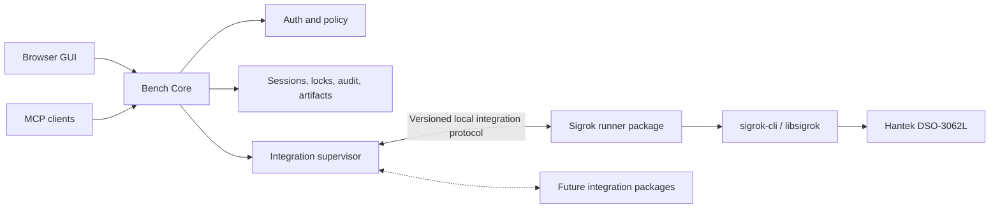

# NILO Remote Bench MVP — Product Requirements and Architecture

**Product:** Networked Intelligent Lab Orchestrator (NILO)

**Document status:** Approved MVP baseline for implementation planning

**Date:** 2026-08-29

**First target:** Raspberry Pi 4, Linux ARM64

**Later appliance target:** Ubuntu/Linux x86_64
**Portability check:** Windows 11 x86_64 compile-only for the portable core
**Reference integration:** sigrok with Hantek DSO-3062L certification

## 1. Document authority

This document defines the first NILO Remote Bench MVP inside the Stage 1 plan in `System_Build_Plan.md`. `Overview.md` remains the long-term vision. This PRD controls the MVP feature slice and its acceptance criteria, while `System_Build_Plan.md` controls architecture, supported appliance platforms, build order, and safety boundaries wherever the documents differ.

The MVP proves a complete remote evidence workflow while establishing a reusable integration platform. Sigrok is the first reference integration package, not a special subsystem built into Bench Core.

## 2. Product summary

NILO is a Raspberry Pi bench appliance that gives two actors controlled access to physical laboratory equipment:

- **AI clients** use authenticated MCP tools to discover capabilities, request typed operations, follow progress, cancel work, and retrieve structured evidence.
- **Human users** use a browser GUI to configure the appliance, integrations, hardware, connectivity, permissions, approvals, sessions, artifacts, and audit history.

For the first MVP, NILO controls `sigrok-cli` headlessly on a Raspberry Pi 4. A human reviews capture metadata in NILO, downloads the unmodified `.sr` artifact, and opens it in the separately supplied customized PulseView application.

NILO is not an autonomous robot laboratory. It controls only configured devices and exposes only operations declared by installed integration packages.

## 3. Goals

The MVP must:

1. Run on Raspberry Pi 4 with Linux ARM64.
2. Work on a local lab network without requiring a VPN.
3. Optionally join a remote private network using an imported WireGuard configuration.
4. Provide authenticated browser and MCP interfaces over configured private interfaces.
5. Install and operate integration packages without recompiling Bench Core.
6. Define a versioned integration contract, package template, and contract-test suite.
7. Use sigrok as the first reference implementation of that contract.
8. Certify the end-to-end workflow with the Hantek DSO-3062L.
9. Enforce persistent Ask, Auto, and Full Access policies at the app-operation boundary.
10. Preserve durable, attributable evidence for successful, failed, cancelled, and interrupted operations.
11. Give AI and human actors different presentations of the same underlying session and evidence.
12. Keep the portable core, integration protocol, and schemas cross-compilable for Windows x86_64 while delivering NILO appliances only for Linux ARM64 and later Linux x86_64.

## 4. Non-goals for this MVP

The MVP does not include:

- building or packaging the ARM64 PulseView, libsigrok, or `sigrok-cli` stack;
- embedded PulseView, browser waveform rendering, remote PulseView, or remote desktop;
- live waveform streaming;
- Ubuntu/Linux x86_64 or mini-PC delivery in the first MVP;
- Windows 11 x86_64 delivery in the first MVP;
- OpenVPN or other VPN providers;
- provisioning or operating the DCP server;
- PLC routing;
- production integrations for SCPI equipment, Modbus devices, flash programmers, debuggers, cameras, GPIO, or relays;
- certification of sigrok devices other than the Hantek DSO-3062L;
- unrestricted shell, filesystem, raw `sigrok-cli`, SCPI, Modbus, or debug command access.

These exclusions do not remove the requirement to design a generic integration contract that can support those future packages.

## 5. Actors and interfaces

### 5.1 Human administrator

The human administrator uses the browser GUI to:

- complete first-time setup;
- configure local networking and optional WireGuard;
- install, enable, disable, and inspect integration packages;
- review discovered hardware and its persistent configuration;
- select Ask, Auto, or Full Access for each integration app;
- override the default policy of individual operations;
- approve or deny immutable operation requests;
- create and revoke MCP tokens;
- inspect active and historical sessions;
- download artifacts;
- review audit records, logs, and diagnostics;
- export or import non-secret configuration and recover the appliance.

### 5.2 AI client

An AI client uses authenticated MCP tools to:

- list available integrations, devices, capabilities, and operations;
- inspect typed input requirements before submitting an operation;
- submit an operation with structured parameters;
- observe whether it is pending approval, queued, running, or finished;
- cancel a cancellable operation;
- retrieve a compact structured result;
- list and download authorized artifacts by stable identifier.

MCP tokens authenticate clients. Permission policy is not attached to a client or token; it is attached to the integration app and its declared operations.

### 5.3 Integration developer

An integration developer uses the NILO integration SDK/template to build an independently packaged runner that:

- declares its compatibility and capabilities;
- exposes typed semantic operations;
- translates approved requests into device-specific behavior;
- emits normalized progress, data, events, errors, and artifacts;
- implements cancellation and safe shutdown;
- passes common contract tests without changing Bench Core.

## 6. System architecture



### 6.1 Bench Core

Bench Core owns all cross-integration concerns:

- GUI and MCP APIs;
- authentication and token management;
- app and device configuration;
- policy resolution and approval workflow;
- immutable operation requests;
- session state and idempotency;
- exclusive resource leases;
- runner supervision;
- artifact registration and storage;
- audit records and diagnostics;
- startup reconciliation and crash cleanup;
- VPN-provider configuration boundary.

Bench Core does not contain instrument-specific commands or parsers.

### 6.2 Integration supervisor

The integration supervisor:

- registers installed packages and validates their manifests;
- checks protocol and platform compatibility;
- starts each enabled runner as an isolated supervised process;
- maintains a versioned local communication channel;
- monitors health and restarts failed runners according to policy;
- forwards only validated operation requests;
- enforces deadlines and cancellation;
- collects events, results, errors, and artifact declarations;
- invokes safe shutdown during cancellation, failure, disablement, and service stop.

A runner crash must not crash Bench Core or another integration. An integration may be independently implemented or compiled in any supported language as long as its package and runner conform to the integration protocol.

### 6.3 Runtime package model

The recommended and required MVP model is an external-process package. In-process dynamic libraries and compile-time integrations are not the primary extension mechanism because they weaken failure isolation, create ABI coupling, or require a NILO rebuild.

Installing a compatible package must not require recompiling Bench Core. Enabling, disabling, or upgrading a package may restart that package's runner but must not require an appliance reboot unless an external driver or operating-system dependency requires one.

### 6.4 Approved technology direction

- Bench Core, its policy/session services, the integration supervisor, and the MCP/HTTP server are implemented in Go.
- Python is the first-class integration language and the first integration SDK/template targets Python.
- Integration runners execute as separately installed, supervised Python processes with isolated dependencies.
- The integration wire contract is language-neutral so later runners may use Go, Rust, C++, or another compatible language.
- Runner control and event messages use a versioned, schema-validated JSON protocol over supervised standard input and output; standard error is reserved for bounded diagnostics.
- SQLite provides local transactional persistence behind Go repository interfaces.
- The browser GUI uses TypeScript and is compiled to static assets served by Bench Core; it does not require a JavaScript runtime on the appliance.
- Platform-specific service, path, process, networking, and hardware-driver behavior remains behind adapters. Portable core packages must compile for Linux ARM64, Linux x86_64, and Windows x86_64 even though only Linux ARM64 is delivered in the MVP.

## 7. Common integration architecture

### 7.1 What NILO standardizes

NILO standardizes the lifecycle and data envelope shared by every integration:

1. **Describe:** manifest, compatibility, configuration schema, device kinds, capabilities, operation descriptors, default policies, resource claims, and artifact types.
2. **Discover:** enumerate hardware and return stable device identity plus reported capabilities.
3. **Configure:** validate app and device configuration supplied through Bench Core.
4. **Health:** report runner, dependency, and device readiness.
5. **Execute:** accept one typed immutable operation request.
6. **Report:** emit status, progress, measurements, domain events, warnings, logs, artifacts, and typed errors.
7. **Cancel:** stop a cancellable operation and report its terminal outcome.
8. **Safe shutdown:** place owned resources into the safest state the integration can guarantee.

NILO does not force every device into a lowest-common-denominator `read`, `write`, or `send_cmd` interface. Device families expose semantic typed operations while using the common lifecycle.

Examples:

- Modbus: `read_registers`, `write_registers`;
- power supply: `measure`, `set_output`, `set_limits`;
- relay board: `read_state`, `set_state`;
- programmer: `identify`, `erase`, `flash`, `verify`;
- debugger: `attach`, `reset`, `inspect`, controlled memory operations;
- sigrok: `discover`, `capture`, `decode`, `export`.

### 7.2 Package template

Every integration package uses the same logical template:

```text
integration-package/
  manifest
  schemas/
    configuration
    operations
    results
  runner/
  profiles/
  normalizers/
  tests/
    contract
    fixtures
    simulated-devices
  documentation/
```

The physical serialization and file formats will be chosen in the implementation plan, but every package must supply the following information:

- package identifier, version, publisher, and integrity metadata;
- supported NILO integration-protocol range;
- supported operating systems and CPU architectures;
- runner entry point and dependency requirements;
- app configuration and secret schemas;
- device identity and profile rules;
- typed operation input and output schemas;
- default policy for each operation;
- required resource claims and conflict rules;
- default and maximum timeout behavior;
- cancellation and safe-shutdown support;
- normalized event and artifact declarations;
- health checks, fixtures, and contract tests.

### 7.3 Operation descriptor

Each operation descriptor declares at least:

- stable operation identifier and human-readable description;
- input and result schemas;
- semantic capability category;
- default operation policy;
- whether the operation changes physical or persistent state;
- resource claims and exclusivity requirements;
- timeout bounds and cancellation support;
- possible typed errors;
- progress, measurement, event, and artifact outputs;
- configuration or device-profile prerequisites.

The GUI and MCP surface are generated from these descriptors where practical. Bench Core remains authoritative for authentication, policy, approvals, sessions, locks, evidence, and audit.

### 7.4 Common request envelope

An accepted request contains:

- immutable request ID;
- authenticated actor identity;
- integration package and operation IDs;
- stable device ID;
- validated parameters;
- configuration and policy snapshot identifiers;
- requested deadline;
- resource claims;
- creation and approval timestamps where applicable.

Changing any parameter creates a new request and invalidates any approval for the previous request.

### 7.5 Common event and result envelope

Integrations may emit:

- lifecycle status;
- progress with optional stage and bounded completion value;
- timestamped measurements with quantity, unit, channel, and quality metadata;
- timestamped domain events with typed payloads;
- warnings and structured diagnostics;
- bounded logs;
- artifact declarations;
- one terminal result or typed error.

Artifact declarations include a stable ID, media type, size, integrity digest, producing operation, device identity, timestamps, and presentation hints for AI and human consumers.

## 8. Sigrok reference integration

### 8.1 Role

The sigrok package proves the integration contract and the end-to-end remote bench workflow. NILO assumes a compatible Linux ARM64 `sigrok-cli`/libsigrok stack is supplied externally. NILO does not build PulseView or sigrok in this MVP.

### 8.2 Required operations

The package provides typed operations for:

- discovering sigrok devices;
- reporting driver, channels, capabilities, and supported configuration;
- starting a bounded capture;
- checking capture status;
- cancelling a capture;
- collecting the raw `.sr` artifact;
- returning normalized metadata, warnings, and structured results;
- exposing supported decode/export functions when available in the supplied stack.

The runner generates exact `sigrok-cli` invocations from validated typed parameters. It never accepts an arbitrary command line from GUI or MCP clients.

### 8.3 Device support policy

- The Hantek DSO-3062L is the only MVP-certified reference instrument.
- Other detected sigrok devices may receive common discovery and read-only operations when their capabilities can be represented safely.
- Device-specific advanced or risky operations require a compatible device profile.
- An unknown or newly detected device begins in Ask mode and remains there until an administrator changes its persistent setting.

### 8.4 Human waveform workflow

The browser GUI shows session status, capture configuration, device identity, timestamps, structured results, warnings, logs, and artifact metadata. It provides an authenticated `.sr` download. The human opens that artifact in the separately supplied customized PulseView application.

Embedded or remote PulseView and browser-native waveform rendering are future capabilities.

## 9. Permission and approval model

### 9.1 Policy ownership

Policy is configured per integration app, not per MCP client, token, or GUI user. An app provides an effective default for its operations. Per-operation overrides and persisted device settings refine that default.

Newly installed apps and newly detected hardware begin in Ask mode. Known app, operation, and device settings persist across Bench Core and appliance restarts.

### 9.2 Modes

- **Ask:** prompt for each operation.
- **Auto:** automatically run routine reads and explicitly auto-eligible writes; prompt for operations requiring a higher threshold.
- **Full Access:** automatically run operations explicitly classified as full-only, while core-enforced equipment limits and device safety invariants remain binding.

### 9.3 Operation policies

| Operation policy | Ask mode | Auto mode | Full Access |
|---|---|---|---|
| Auto-eligible | Prompt | Automatic | Automatic |
| Full-only | Prompt | Prompt | Automatic |
| Always prompt | Prompt | Prompt | Prompt |
| Denied | Denied | Denied | Denied |

Each integration declares a default policy for every operation. The administrator may override that policy through the GUI.

### 9.4 Full Access boundary

Full Access is an approval-automation mode, not a protection-bypass mode. It may remove a per-request human prompt only where the administrator has explicitly classified the operation as full-only. Voltage, current, duration, channel, target-identity, firmware-allowlist, armed-state, interlock, and device safe-state constraints remain binding when configured and cannot be disabled by an operation request.

Full Access does not bypass:

- authentication;
- typed and schema validation;
- package compatibility checks;
- exclusive hardware locks;
- audit records;
- explicit cancellation and emergency-stop mechanisms;
- runner supervision;
- crash cleanup;
- operations marked Denied;
- operations marked Always prompt.
- configured equipment-protection limits and physical safety interlocks.

Every mode change, policy override, approval, denial, operation, cancellation, and terminal result is audited.

## 10. Operation and evidence flow

1. GUI or MCP submits an authenticated typed request.
2. Bench Core validates the app, operation, device, parameters, configuration, and schemas.
3. Bench Core resolves the persistent app, operation, and device policy.
4. If approval is required, NILO stores one immutable pending request. Approval applies only to that request snapshot.
5. Bench Core creates the session and acquires exclusive conflicting resources.
6. The supervisor dispatches the operation to the selected integration runner.
7. The runner emits health, progress, events, measurements, warnings, logs, artifacts, and a terminal outcome.
8. Bench Core persists required evidence before reporting success.
9. Bench Core releases resources and records the terminal audit event.
10. AI receives a compact structured result; the GUI presents the session and downloadable evidence to the human.

## 11. Session and artifact model

### 11.1 Session states

```text
pending_approval -> queued -> running -> completed
                                      -> failed
                                      -> cancelled
                                      -> incomplete
```

Rejected and expired approvals are recorded without entering the runner queue.

### 11.2 Completion rule

A session is `completed` only when:

- the runner reported success;
- required result metadata validates;
- all required artifacts are durable and registered;
- final audit information is durable;
- resource release has been initiated successfully.

Partial evidence from failed, cancelled, or interrupted work is retained when useful and labeled with its actual terminal state. It is never presented as a successful capture.

### 11.3 Evidence retained for sigrok capture

- raw `.sr` artifact;
- stable session, operation, device, and artifact IDs;
- exact validated capture parameters;
- integration and dependency versions;
- device identity and reported capabilities;
- start, end, and relevant event timestamps;
- structured result and decode events when produced;
- warnings, bounded logs, and typed errors;
- configuration and policy snapshot identifiers;
- approval record when applicable;
- artifact size and integrity digest.

## 12. Configuration and administration

### 12.1 First-time setup

The setup flow:

1. Creates the administrator account and appliance identity.
2. Detects installed integration packages and connected hardware.
3. Places new apps and hardware in Ask mode.
4. Configures local Ethernet or Wi-Fi access.
5. Optionally imports and enables a WireGuard configuration.
6. Creates revocable MCP access tokens.
7. Runs network, service, integration, device, and permission checks.

### 12.2 Configuration rules

- The browser GUI uses validated Bench Core APIs.
- It does not edit operating-system files or invoke instrument commands directly.
- Configuration is versioned and validated before activation.
- Secrets are stored separately from exported general configuration.
- Imported files are schema-validated and size-limited.
- Known app and hardware settings persist across restarts.
- Backup and restore report incompatible or missing integration packages before activation.

### 12.3 GUI areas

The MVP GUI includes:

- appliance and service status;
- local network and optional VPN configuration;
- integration package installation, enablement, compatibility, and health;
- detected devices, profiles, and persistent settings;
- app modes and per-operation policy overrides;
- approval queue;
- MCP token creation and revocation;
- active and historical sessions;
- artifact browsing and authenticated download;
- audit history, logs, and diagnostics;
- configuration export, import, and recovery.

## 13. Connectivity

### 13.1 Local operation

NILO must operate fully without a VPN when the Raspberry Pi and clients share an approved local lab network.

### 13.2 Optional WireGuard

The administrator may import, validate, enable, disable, and inspect a WireGuard configuration. Disabling WireGuard does not disable local NILO operation.

The DCP server is an example WireGuard hub/router used for testing; NILO does not depend on DCP-specific APIs or manage the DCP server.

### 13.3 Future provider boundary

Bench Core uses an internal VPN-provider boundary so future OpenVPN or other providers can implement import, validation, enable, disable, status, and diagnostics without changing integrations or session logic. Only WireGuard is implemented in the MVP.

### 13.4 Exposure rules

- GUI and MCP require authentication on every interface.
- Services bind only to explicitly configured private local or VPN interfaces.
- Non-loopback access uses encrypted transport.
- NILO is not exposed directly to the public internet.
- VPN connectivity does not replace application authentication or authorization.

## 14. Reliability and failure handling

### 14.1 Required behavior

- **Device busy:** return a typed conflict without starting a second conflicting operation.
- **Device disconnected:** stop the operation, preserve diagnostics, and release the lease.
- **Runner crash:** mark the session failed or incomplete as appropriate, preserve diagnostics, release resources, and restart the isolated runner according to policy.
- **Malformed runner output:** reject invalid data and fail the operation without accepting ambiguous success.
- **Timeout or cancellation:** terminate the operation, attempt safe shutdown, preserve useful partial evidence, and record the real terminal state.
- **Bench Core restart:** reconcile interrupted sessions and clear only leases proven to be orphaned.
- **Storage pressure:** reject new captures before acquisition when required capacity is unavailable.
- **Network loss:** allow an already-running local acquisition to finish when safe; retain results for later retrieval.
- **Artifact failure:** do not report success when required artifacts could not be persisted or validated.

### 14.2 Security controls

- GUI administrators authenticate with application credentials.
- MCP tokens are revocable and stored using a one-way verifier rather than recoverable plaintext.
- Integration packages and upgrades are integrity-checked before activation.
- No arbitrary shell command, raw command string, or unrestricted filesystem path is accepted.
- File paths are resolved within authorized storage roots.
- Requests, configuration, events, and results are size-bounded and schema-validated.
- Normal application interfaces cannot modify or delete audit history.

## 15. MVP delivery sequence

### Increment 1 — Platform and integration foundation

Deliver:

- configuration and persistence model;
- authentication and token management;
- policy and approval engine;
- session state machine, resource leases, audit, and artifact store;
- integration protocol and supervisor;
- package manifest and SDK/template;
- contract-test kit;
- fake integration package and simulated devices.

Gate: the fake package completes the full operation lifecycle, including approval, progress, evidence, cancellation, runner crash, and restart reconciliation, without modifying Bench Core.

### Increment 2 — Sigrok reference package

Deliver:

- generic sigrok discovery and capability mapping;
- typed capture, status, cancellation, result, and artifact behavior;
- `.sr` evidence pipeline;
- Hantek DSO-3062L device profile and certification fixtures.

Gate: a local Raspberry Pi capture produces a valid `.sr` that opens in the customized PulseView and releases the device correctly under success, cancellation, disconnect, timeout, and runner failure.

### Increment 3 — Browser GUI and MCP

Deliver:

- initial setup;
- package and device administration;
- Ask, Auto, and Full Access configuration;
- approval queue;
- MCP capability discovery and operation tools;
- token management;
- session, artifact, audit, and diagnostic views.

Gate: a human and an authenticated AI can complete the same local capture workflow and receive their appropriate evidence. Ask, Auto, Full Access, Always prompt, and Denied behavior matches the policy matrix.

### Increment 4 — Optional WireGuard

Deliver:

- import, validation, enable, disable, status, diagnostics, and private-interface binding;
- local operation independent of VPN state;
- remote testing through an example DCP WireGuard hub/router.

Gate: the same GUI and MCP workflow succeeds remotely over WireGuard without public exposure, while local operation still works with WireGuard disabled.

### Increment 5 — Appliance hardening and MVP delivery

Deliver:

- Raspberry Pi service definitions;
- startup and crash recovery;
- health and storage checks;
- configuration backup and restore;
- logs and diagnostics;
- installer and repair flow;
- documented prerequisites for the externally supplied ARM64 sigrok stack;
- automated and hardware-in-the-loop acceptance suites.

Gate: a clean Raspberry Pi 4 installation passes the complete acceptance suite with the Hantek DSO-3062L.

## 16. Verification strategy

### 16.1 Unit and contract tests

Use fake clocks, stores, policy inputs, devices, and runners to verify:

- schema validation;
- immutable request handling;
- permission matrix behavior;
- resource conflicts and release;
- state transitions and idempotency;
- artifact registration and integrity;
- audit creation;
- package compatibility;
- runner protocol conformance;
- timeout, cancellation, and safe-shutdown behavior.

Every integration package runs the same contract suite against simulated devices or fixtures.

### 16.2 Integration tests

Use controlled runner and `sigrok-cli` outputs to verify:

- discovery and capability normalization;
- exact command generation from typed input;
- progress and event ingestion;
- valid and malformed results;
- crashes, hangs, timeouts, and disconnects;
- required artifact success and failure;
- persistence and restart reconciliation;
- GUI and MCP authorization boundaries.

### 16.3 Hardware-in-the-loop tests

Run on Raspberry Pi 4 with the Hantek DSO-3062L to verify:

- local discovery and capture;
- capture configuration accuracy;
- `.sr` integrity and PulseView compatibility;
- Ask, Auto, and Full Access behavior;
- approval immutability;
- cancellation and timeout cleanup;
- USB disconnect and runner restart;
- service and appliance restart recovery;
- policy and device-setting persistence;
- local operation without VPN;
- remote operation over imported WireGuard configuration.

## 17. Acceptance criteria

The Remote Bench MVP is accepted when all of the following are demonstrated:

1. NILO installs and starts on a clean Raspberry Pi 4 Linux ARM64 system using documented prerequisites.
2. A compatible integration package can be installed, enabled, disabled, and upgraded without recompiling Bench Core.
3. The fake reference package passes the common integration contract suite.
4. NILO discovers the Hantek DSO-3062L through the sigrok package and reports stable identity and capabilities.
5. An authenticated MCP client can discover the capture operation and submit valid typed parameters.
6. Invalid parameters and arbitrary command strings are rejected before reaching the runner.
7. Ask, Auto, Full Access, Always prompt, and Denied behavior matches the approved permission matrix.
8. New integrations and newly detected hardware begin in Ask mode, and known settings survive restart.
9. A successful capture produces durable metadata and an integrity-checked `.sr` artifact.
10. The downloaded `.sr` opens correctly in the customized PulseView.
11. The GUI shows the same session, policy decision, status, evidence, warnings, and audit trail appropriate for the human actor.
12. Conflicting access to the instrument returns a typed busy result rather than racing.
13. Cancellation, timeout, disconnect, runner crash, and Bench Core restart leave no stale hardware lease or ambiguous success.
14. NILO works locally with WireGuard disabled.
15. NILO works remotely over an imported WireGuard configuration without public service exposure.
16. MCP tokens can be created and revoked, and revocation prevents subsequent authenticated use.
17. All automated, integration, and required hardware-in-the-loop acceptance checks pass with no unresolved critical defect.

## 18. Post-MVP direction

After MVP acceptance, future work may add:

- additional sigrok-certified devices;
- browser or embedded waveform viewing;
- remote PulseView integration;
- serial relay and GPIO packages;
- programmable power supply, SCPI, and Modbus packages;
- flash programmer and debugger packages;
- camera and visual-evidence packages;
- OpenVPN and other VPN providers;
- Ubuntu/Linux x86_64 and mini-PC appliance delivery;
- additional compile-only Windows portability checks where they prevent Linux appliance code from acquiring avoidable host assumptions.

Each new integration must use the common package template and contract rather than adding instrument-specific behavior to Bench Core.

## 19. Approved product decisions

- Raspberry Pi 4 Linux ARM64 is the only first-MVP appliance target.
- Ubuntu/Linux x86_64 is the later appliance target; Windows x86_64 remains a compile-only portability target, not a NILO runtime delivery.
- The ARM64 PulseView/sigrok stack is supplied outside this project.
- NILO controls `sigrok-cli` headlessly.
- The Hantek DSO-3062L is the only MVP-certified instrument.
- Sigrok is the first reference integration package, not a core special case.
- Runtime-installed supervised packages are the primary extension mechanism.
- Go is the approved Bench Core language; Python is the approved first-class integration language.
- The integration contract standardizes lifecycle and envelopes while preserving semantic device operations.
- The human downloads `.sr` evidence and opens it in customized local PulseView.
- Embedded or remote PulseView is deferred.
- WireGuard is optional; local lab operation is fully supported without VPN.
- The DCP server is an example hub/router, not a NILO dependency.
- VPN providers use an internal abstraction, but only WireGuard is implemented now.
- Permission policy belongs to the integration app, not to an MCP client or token.
- New apps and hardware start in Ask mode; known settings persist.
- Full Access may automate explicitly classified operations but cannot bypass configured equipment-protection limits, physical interlocks, or platform integrity controls.
- Every operation and policy decision is auditable.
